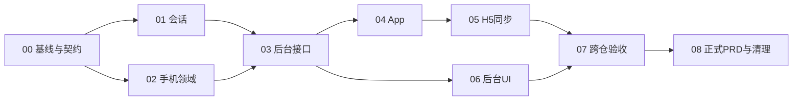

# 分步执行索引

产品规则唯一引用[共同规格](inputs/PRD/specs/FEAT-SESSION01-app-single-login-phone-replacement.md)，本表分配执行顺序。初始全部未实施；具体状态见 [EXECUTION-STATE.json](EXECUTION-STATE.json)。

| 步骤 | 交付物与允许仓库 | 前置验收 |
|---|---|---|
| [SPEC-00 基线与契约](specs/SPEC-00-baseline-contract.md) | 四仓定位、接口清单、迁移/测试准备、交互原型差异核验 | 无 |
| [SPEC-01 App 会话](specs/SPEC-01-backend-app-session.md) | 后端认证原子接管、续期隔离、旧任务停止 | 00 |
| [SPEC-02 手机领域](specs/SPEC-02-backend-phone-replacement.md) | 后端绑定、计次、资格、申请与特批状态机 | 00；与01共享写面串行集成 |
| [SPEC-03 后台接口](specs/SPEC-03-backend-operations.md) | 后端 E6/C5 权限、审计、命令结果恢复 | 01、02 |
| [SPEC-04 App 交互](specs/SPEC-04-app-interactions.md) | App 登录、被接管、校准、仓库及协助流程 | 01、02、03 |
| [SPEC-05 H5 隔离与同步](specs/SPEC-05-h5-isolation-sync.md) | H5共享源码同步、只读边界及双端门禁 | 04候选树及定向验收；双端full在05完成 |
| [SPEC-06 后台界面](specs/SPEC-06-admin-e6-c5.md) | 后台 E6 参数和 C5 查询/特批闭环 | 03；可与04并行 |
| [SPEC-07 集成与发布准备](specs/SPEC-07-integration-release.md) | 四仓回归、41边界、迁移演练、独立验收 | 01–06 |
| [SPEC-08 PRD回写与清理](specs/SPEC-08-prd-writeback-cleanup.md) | 正式PRD、永久验收记录、远端提交回读、删除临时材料 | 07 |

## 验收覆盖分配

SPEC-04的步骤通过表示候选交互、接口和定向验收具备交接条件，**不表示App已通过双端full、已提交或已发布**。SPEC-05接收该候选后完成同步和双端full；SPEC-07再关闭真实服务/原生及全链路验收。执行状态中的`passed`只对应该步骤定义的交付门，不得推导整个功能通过。

每条边界的 Given/When/Then 取共同规格 §5，本表不重写规则。列出的主责步骤实现并提供定向证据，SPEC-07 全量复核；跨端场景还须关联相应04/05/06界面证据。测试名称、commit、结果和证据由实施者填写，不预填“通过”。

| 边界 | 主责 | 验收重点 |
|---|---|---|
| S01 | 01、04 | 不同App接管与旧手机停止 |
| S02 | 01、05 | H5登录不影响App |
| S03 | 01、05 | App登录不影响H5 |
| S04 | 01、05 | H5多会话与多标签 |
| S05 | 01、02、04 | 同安装重登不强制取消在途任务 |
| S06 | 01、04、05 | 恢复/续期不能抢占 |
| S07 | 01、04 | 验证失败不接管 |
| S08 | 01、04 | 接管不等待条款/校准 |
| S09 | 02、04 | 拒绝后仓库继续 |
| S10 | 01、02、04 | 返回原绑定恢复0次 |
| S11 | 02、04 | 成功换回原机计第二次 |
| S12 | 01、04 | B拒绝后C继续接管 |
| S13 | 02、03、06 | 关闭换机与首绑/恢复边界 |
| S14 | 02、04 | 首绑0次但启动间隔 |
| S15 | 02 | 精确滚动与间隔边界 |
| S16 | 02、06 | 超额后足够事件移出才恢复 |
| S17 | 02、03 | 重放唯一事实 |
| S18 | 01、02、04 | 并发会话与绑定版本 |
| S19 | 02、03、04 | 成功回执丢失后授权到期 |
| S20 | 02、04 | 失败后授权过期不得执行 |
| S21 | 02、03、06 | 部分豁免不绕过另一限制 |
| S22 | 02、03、06 | 目标/版本/授权状态失配 |
| S23 | 02、03、06 | 消费、撤销并发 |
| S24 | 02、03、06 | 每账号至多一张有效特批 |
| S25 | 02、04 | 重装/硬件变化/空值补齐 |
| S26 | 02、04、05、06 | 策略或历史未知不是0 |
| S27 | 02、03、04、06 | 策略变更重新确认 |
| S28 | 01、02、04 | 离线迟到、任务停止/完成裁定 |
| S29 | 01、02、06 | 原机恢复保留其他暂停 |
| S30 | 01、02、04、05 | 非手机资产与收益保持 |
| S31 | 02、04 | 复用手机槽位 |
| S32 | 01、05 | 显式全端安全动作 |
| S33 | 01、04、05 | 未知会话归组与伪造来源 |
| S34 | 01、04、05 | 不支持手机运行的原生App仍属单点 |
| S35 | 01、04、05 | 换账号和迟到响应隔离 |
| S36 | 02、04、06 | 放弃申请/校准失败不消费 |
| S37 | 02、04、05、06 | 协助申请、客服关联失败 |
| S38 | 02、03、06 | 原签发请求过期不续期 |
| S39 | 03、06 | 原命令回执与当前状态区分 |
| S40 | 04、05 | 返回原机用户指引 |
| S41 | 02、04 | 首绑并发不绕过替换 |

额外回归：待处理申请与特批分别24小时；已关闭申请允许新确认后重申；关闭与签发并发只有一条终态；操作者权限被撤销后不能凭原操作者身份查询；H5受控首次DEFERRED保持；已退役证明接口保持退役。这些均从共同稿正文或既有合同导出，不新增产品政策。
