# NexGrid · 产品需求文档(PRD)

| 项 | 值 |
|---|---|
| 文档编号 | SN-PRD-2026-002 |
| 版本 | v3.7 |
| 文档类型 | Product Requirements Document |
| 适用对象 | 产品 / 设计 / 前端 / 测试 / 业务 |
| 适用系统 | NexGrid 移动端 H5 应用 |

> **产品性质**:NexGrid 定位为正式落地、持续运营的产品。本文档定义产品开发、交付与运营验收要求；开发测试中的 mock、交互原型和演示数据须与生产业务隔离，具体能力的上线状态以实现与验收记录为准。

---

## 配套规格文档

本文档为平台功能主索引;专项功能的三位一体详细规格(用户故事 / GWT 验收+异常 / 数据字典 / 状态机 / 交互 4 态 / 点击流)另立文档,与本文档交叉引用:

| 规格文档 | 覆盖范围 | 对应章节 | 位置 |
|---|---|---|---|
| 越南市场支付架构规格 v1.0 | 充值(USDT TRC20/BEP20/ERC20 + VietQR 银行转账 + 国际卡)· 链上 USDT 出金 · 汇率牌价 · 提现地址换绑 | §9 钱包 | specs/PAY-NexGrid_越南支付架构规格_v1.0.md |
| 银行卡本币提现 | BANKQR 收款账户绑定与短信换绑、USDT→VND 锁定报价、原请求恢复与结算证据 | §9.3.7 / §9.10.1 | specs/FEAT-PAYOUT-VND01-bank-payout-rail.md |

---

## 目录

1. 产品概述
2. 用户角色与场景
3. 信息架构与导航
4. 账户与身份(注册 / 登录 / 推荐 / 提现地址 / 安全)
5. Home Dashboard
6. Earn(算力赚取)
7. Store(设备商城)
8. Team(团队中心)
9. Wallet(钱包系统)
10. Genesis 创世节点
11. 扩展功能(Nova / 通知 / 信任中心 / 成就 / 收据 / 全球地图 / API / 帮助)
12. 数据模型
13. 业务规则与计算公式
14. 国际化(i18n)
15. 非功能需求
16. 技术架构
17. 验收标准与 KPI
18. 附录:路由 / 文件清单

---

## 1. 产品概述

### 1.1 产品定位

NexGrid 是面向全球非中国市场(北美、欧洲、东南亚、日韩、中东)的**分布式 AI 推理算力共享平台**。

核心叙事:**"Your phone is the AI cluster. Earn while you sleep."** — 用户的智能手机 NPU 在闲置时间为平台对接的 AI 客户(图像生成、LLM 推理、语音转写等)执行小型推理任务,获得 USDT 收益。

用户还可购买专用算力设备(NexGridBox 系列)获得更高收益。

### 1.2 目标用户

| 区域 | 核心国家 | 用户特征 | 语言 |
|---|---|---|---|
| 北美 | 美国、加拿大 | iPhone/Pixel 主流,AI 早期用户,追求被动收入 | EN |
| 欧洲 | 英国、德国、法国 | 注重平台可信度,能源价格驱动"闲置变现" | EN / DE / FR |
| 东南亚 | 越南、菲律宾、泰国、印尼 | 手机渗透高,crypto 原生 | EN / 本地语 |
| 日韩 | 日本、韩国 | 技术型用户,Galaxy/iPhone 高端机 | JA / KO |
| 中东 | 土耳其、沙特、阿联酋 | 高净值,主权 AI 热潮 | EN / AR |

### 1.3 核心价值主张

- **零门槛**:装 App 就能开始赚钱,无需购买硬件
- **零摩擦**:注册 90 秒内首笔收益到账
- **多层路径**:从手机 → NexGridBox S1 → Pro → Rack → 创世节点的清晰升级阶梯
- **多种收益**:静态(设备算力)+ 动态(团队推广 + 质押)双引擎
- **可证可查**:每笔收益附 Proof-of-Compute 推理收据 + 链上 attestation

### 1.4 商业模式

- 设备销售:NexGridBox S1 $649 / Pro $1,199 / Rack P1 $4,499 / Genesis $9,999
- 团队分润佣金体系(影响力网络版税 + 双轨)
- NEX 平台代币经济(锁仓 / 兑换 / 二级市场)
- 算力市场撮合服务费(向 AI 客户收取)

### 1.5 竞品参考

| 产品 | 类型 | 借鉴点 |
|---|---|---|
| io.net | 去中心化 AI GPU 云 | 客户侧叙事 + 代币经济 |
| Render Network | 去中心化 GPU 渲染 | 任务类型清晰分类 UI |
| Akash Network | 去中心化云 | "对抗 Big Tech 算力垄断"叙事 |
| Bittensor (TAO) | 去中心化机器学习市场 | 子网架构选择 UI |
| NiceHash | GPU 挖矿市场 | 收益展示形式、设备管理 UI |
| Genesis Mining | 云矿机 | 算力合约 + 托管收益模式 |
| StormGain | 加密云挖矿 | 可视化算力工作动效 |

---

## 2. 用户角色与场景

### 2.1 用户分层(基于产品使用阶段,内部 ID L0-L5)

| 内部 ID | UI 显示(EN / ZH) | 进入条件 | 核心诉求 | 转化目标 |
|---|---|---|---|---|
| L0 | Visitor / 访客 | 未注册 | 了解平台 | 点击注册 |
| L1 | Newbie / 新手 | 已注册,手机算力自动接入 | 看每天能赚多少 | 24h 在线 + 首笔收益 |
| L2 | Active / 活跃 | 累计 $5+ 收益 | 稳定获益,尝试提现 | 首次提现成功 |
| L3 | Upgrade-ready / 升级候选 | 主动查看硬件商城 | 寻求更高收益 | 完成设备购买 |
| L4 | Owner / 持有者 | 已购 NexGridBox 1+ 台 | 最大化收益 | 复购 / 追加台数 |
| L5 | Ambassador / 推广大使 | 推荐 3+ 成功注册 | 团队收益,被动分成 | 裂变传播 |

> 内部 `UserTier` enum 保留 `"L0"|"L1"|…|"L5"` 标识符;UI 一律走 i18n `profile.tierLabels` 显示功能化标签,**不暴露 L\d 编号**,避免与已废弃的 MLM 层级数字混淆。

### 2.2 V 级头衔(V0-V12,基于团队业绩)

跟 L 级独立,V 级是团队业绩驱动的军衔体系(详见 §8.2)。L0-L5 反映"产品使用阶段",V0-V12 反映"团队规模阶段",两套体系并存。

### 2.3 核心使用场景

| 场景 | 用户 | 触发 | 期望结果 |
|---|---|---|---|
| 注册 + 首单收益 | 新用户 | 完成手机号验证 | 90 秒内看到首笔 $0.0003 推理收益 + welcome gift |
| 升级硬件 | 活跃用户 | 看到手机收益瓶颈 | 在 store 选购 NexGridBox 并完成支付 |
| 邀请好友 | 推广用户 | 分享 referral link | 朋友通过链接注册 → 双方获得礼包 + 邀请人后续拿团队分润 |
| 提现 | 活跃用户 | 收益达 $20+ | 已绑定收款地址(短信验证码设置)→ 确认提交 → 48h 内到账 |
| 质押增益 | 设备持有者 | 想锁仓获更高 APY | 选 30/90/180/365 天档位 + 金额 → 锁仓 |
| 升等级冲奖 | 推广大使 | 想拿等级奖励 | 达成升 V 条件 → 获得头衔 + 等级奖励 / 培育奖 NEX |

### 2.4 30 天用户旅程

```
Day 0:   注册 → 设备识别 → 一键启用 → 90 秒首笔 $0.0003 + $5 welcome bonus
Day 1:   过夜累计 $0.05 → Nova push "earned overnight"
Day 3:   $0.13 → 推送"提现需满 $20" + 推荐裂变 hint
Day 7:   $0.42 → "🔒 Upgrade Unlocks" 显示锁定的高价任务
Day 14:  $0.78 → 商城 hero "117× more"
Day 21:  $1.20 → "推荐 1 人得 $10"
Day 30:  $1.80 → 月报 + "NexGridBox 月入 $210"
Day 45:  触发升级决策 → S1 详情页
Day 60:  完成购买 → 日收益从 $0.06 跳到 $7.00
Day 90:  活跃推广者,V2-V3 头衔追求
```

---

## 3. 信息架构与导航

### 3.1 应用框架(app chassis)

所有路由统一套进 iOS 414×874 设备外壳:

| 区 | 内容 |
|---|---|
| Status Bar | 实时时钟 + Dynamic Island + 信号/WiFi/电量 |
| Header App Row(仅 tab 路由) | NexGrid logo + 铃铛(打开 Nova drawer) + Locale Switcher |
| ScrollContainer | 内容主区 |
| TabBar(仅 tab 路由) | 5 个 tab,floating pill 样式 |
| Home Indicator | iOS 风白条 |

**框架规则**:
- Header / TabBar 锁定在 chassis 边界,内容独立滚动
- **滚动位置记忆**:chassis 记录各页滚动容器位置;从二级页 `navigateBack` 回上层时恢复到跳转前的滚动位置,前进进入新页则落到顶部
- overscroll-behavior contain
- **默认主题 dark**(产品默认 dark mode 体验)。主题选择 light / dark / system 由 `src/store/theme.ts` 持有并持久化到本地键 `nexgrid-theme-v1`,H5 端把解析后的主题写到根节点 `<html data-theme>`;首次进入 / 清缓存即落到 dark,已在 /me 主题选择器选过 light 或 system 的用户保留其选择,system 模式跟随系统配色实时切换
- **Chassis 顶部留白**:tab 路由首屏 hero 紧贴 brand row;注册了 chassis nav header 的子页在此基础上再下移,避免第一张分组列表卡撞 header 底沿

### 3.2 底部 5-Tab 主导航

| Tab | 名称 | 入口路由 | 核心内容 |
|---|---|---|---|
| 1 | Home | `/` | Dashboard,综合所有维度的实时信息 |
| 2 | Earn | `/earn` | 我的设备 + 任务中心 + 收益统计 + Market |
| 3 | Store | `/store` | NexGridBox 商城 + 订单 |
| 4 | Team | `/team` | 团队体系全套(等级 + 分润 + 配额 + 大使) |
| 5 | Me | `/me` | 个人中心(Profile + Wallet + 扩展 + Preferences) |

TabBar:active tab 显示背景 chip 高亮。

### 3.3 完整路由清单

```
/                                Home Dashboard
/market                          NEX 行情详情页(对标 AI/DePIN tokens)
/events                          活动中心(限时优惠 / 挑战 / 季节福利)
/earn                            Earn(算力赚取)
/store                           Store list
/store/[productId]               商品详情
/store/checkout                  结账(含 trade-in / replace-lowest intercept,见 §7.5)
/store/bundle                    套餐结算(多商品组合 + 阶梯折扣)
/tradein                         301 永久重定向到 /me/devices(向后兼容旧短链)
/store/tradein                   301 永久重定向到 /me/devices(独立 trade-in 页已下线,功能内置入 /store/checkout 拦截 + /me/devices promo banner)
/store/orders                    我的订单
/store/orders/[id]               订单详情
/team                            Team 主页
/team/rank                       V 级头衔进度
/team/rank/how-it-works          等级体系新人说明页
/team/unilevel                   影响力网络版税(Influence Network Royalty)
/team/unilevel/how-it-works      影响力网络版税玩法说明页
/team/binary                     双轨对碰
/team/binary/how-it-works        双轨玩法新人说明页
/team/leadership-pool            全球领导奖池
/team/leadership-pool/how-it-works  领导池玩法新人说明页
/team/commissions                佣金明细(5 类)
/team/commissions/how-it-works   6 类佣金来源说明页
/team/leaderboard                邀请排行榜(4 周期 + 奖池)
/team/network                    影响力网络可视化
/team/tree                       族谱树
/team/quota                      硬件配额解锁
/team/agent                      区域大使
/me                              Me 主页
/me/profile                      个人资料
/me/devices                      我的设备(全 inventory 激活/取消激活管理)
/me/security                     安全设置
/me/wallet                       钱包主页
/me/wallet/topup                 充值(链上 / 银行转账 / 银行卡三通道)
/pages/me/wallet-withdraw-method 提现方式(USDT / 银行卡,通道状态与原请求恢复)
/me/wallet/withdraw              USDT 提现(网络随绑定地址派生,只读)
/pages/me/wallet-withdraw-bank   银行卡提现(报价 / 原请求恢复 / 订单查询)
/me/wallet/withdraw/tracking     提现追踪
/me/wallet/address-rebind        提现地址设置与更换(短信验证码;仅"更换"触发 24h 冻结)
/me/wallet/usdt-guide            如何获取 USDT(新手指引)
/me/wallet/exchange              NEX↔USDT 兑换
/me/wallet/exchange/how-it-works 兑换玩法说明页
/me/wallet/repurchase            复投
/me/wallet/repurchase/how-it-works 复投玩法说明页
/me/wallet/bills                 账单流水
/me/wallet/cards                 我的银行卡(saved-cards 列表)
/me/wallet/cards/new             绑定银行卡(可带 returnTo)
/me/trial                        免费试用(无卡领取 3 天 + 7 天宽限)
/me/wallet/nex                   NEX 资产详情页(持仓 / P&L / 用途 / 活动)
/me/receipts                     推理收据
/me/rewards                      我的奖励(类别汇总:优惠券 / USDT / NEX 奖励)
/me/rewards/list                 奖励分类记录(cat=voucher|usdt|nex,10 条/批分页)
/me/risk-disclosure              平台风险提示书(scroll-to-bottom + 强制确认)
/me/achievements                 成就墙
/learn/courses                   教程中心(课程列表 + 进度汇总,见 §11.11)
/learn/course                    课程详情与测验(?id=,答对发 NEX)
/me/goals                        收益目标设置(target + deadline + 推荐路径)
/me/preferences                  偏好设置(音效 / 触感 / 通知 6 类偏好)
/missions                        Mission Center(任务中心,聚合所有任务体系的统一入口)
/me/proof                        Proof of Compute
/me/replay-tour                  重播引导
/me/help                         帮助中心
/me/support                      实时客服(渠道枢纽)
/me/support/tickets              工单系统(列表 / 创建 / 详情 3 mode)
/support/messages                统一会话中心(多类别客服会话列表)
/support/chat                    会话聊天线程(?cid= 人工 / ?type=ai Nova)
/me/language                     语言切换
/me/notifications                通知中心
/staking                         Staking 4 档质押
/staking/how-it-works            质押玩法新人说明页
/genesis                         创世节点预售
/genesis/how-it-works            Genesis 创世节点说明页
/genesis/marketplace             二级市场
/genesis/holder                  持有人 dashboard(排放 / 权益 / 持仓)
/trust                           信任中心
/trust/nex                       NEX 平台代币说明页
/daily                           每日签到
/globe                           全球节点地图
/developer                       API 开发者平台
/ref/[code]                      公开邀请落地页
/tx/[hash]                       Etherscan 风交易详情页(从 bills / trade-in 跳转)
/search                          全局搜索(routes / 设备 / 商品 / 网络成员 / FAQ)
/login                           登录(支持 ?ref=CODE)
/register                        注册(支持 ?ref=CODE)
/register/success                注册成功页(礼包确认 + 引导下载 APP,仅 H5,§4.1.1)
/onboarding/intro                启动语
/onboarding/estimator            收益估算
/onboarding/connect              手机绑定/换机选择与校准(登录后读状态 ?mode=login；显式确认/仓库手动操作 ?mode=recalibrate，见§4.7.3)
/onboarding/terms                服务条款(从 intro 脚注 / register 注册脚注进入)
/session/kicked                  登录失效提示(当前会话退出/指定下线/吊销/App被接管；受影响手机任务按§4.7.7、§12.2处理，提供显式重新登录)
```

---

#### UniApp 交付主体路由覆盖

正式 App 交付主体为 `nexion-frontend-uniapp`,`Nexion-uniapp` 仅保留原型参考。物理页面以正式工程 `src/pages.json` 为准,关键文件路径见 §19.2。业务验收以路由覆盖、i18n 镜像、运行时动作证据与三端契约检查为准。

验收口径:
- 本文涉及的路由须在正式工程注册并可达。
- 入口、关键动作与异常恢复须按当前实现逐项验收,不以原型路由数量或历史通过数替代。

## 4. 账户与身份

### 4.1 注册流程

3 步极简验证码注册:

| 步骤 | 字段 | 校验规则 | 交互 |
|---|---|---|---|
| 1 | 国家码 + 手机号 | 按国别位数即时校验(主市场国别有专属位数表:+86 为 11 位、+84 为 9-10 位、+1 为 10 位等;未列国别退回通用 6-15 位)。不合法时发送按钮禁用,输入框下方就地提示「该区号手机号为 N 位」 | 选区号 + 输手机 + "Send code"。国家码初始值随 App 语言预置(越南语→+84、中文→+86、日语→+81 等;英语及未映射语言→+1),仅作初始默认,用户手选后以手选为准;区号面板含越南 +84 |
| 2 | 6 位 OTP | 仅数字;服务端校验手机号、注册挑战与验证码 | 满 6 位自动发起预验;仅收到 `REGISTRATION_OTP_VERIFIED` 后进入设密步骤 |
| 3 | 密码 + 确认密码 | 两次一致 + 符合 §4.6.1 强度要求 | 提交 → 注册成功 |

**步骤 1 附加规则**:
- 奖励句护栏:副标题的「$X 新人奖励」仅在配置金额 > 0 时渲染金额;配置未就绪或异常清零时整句让位为不带金额的「新人奖励已备好,连接设备即刻到账」——金额为 0 的奖励承诺永不出现在转化首屏。邀请人卡片的「+$X + Y NEX」礼物行同一护栏。
- 发码失败提示为指路型:提示可先使用页面下方 Google / Apple / Telegram 第三方方式登录,或稍后重试(注册与登录页共用同一文案)。

**验证码与提交规则**:
- 预验调用 `POST /auth/users/register/otp/verify`,提交 `{countryCode, phone, challengeNo, code}`。服务端校验国家码与手机号、注册场景(`REG-` 挑战)、认证环境、验证码匹配、有效期、剩余尝试次数及未消费/未删除状态;无效时返回 `USER_REGISTRATION_OTP_INVALID`,留在验证码步骤。
- 预验成功不消费验证码、不创建账号、不签发会话,也不延长有效期。最终 `POST /auth/users/register` 携原挑战与验证码提交密码,在注册事务中重新校验并消费;预验通过不能替代最终核验。
- 预验等待中编辑验证码、切换手机号/步骤、重新发码或离开页面后,旧响应不得推进设密或覆盖当前错误;当前请求结束须解除等待态。重发后的旧挑战不能复用。

**注册成功后行为**:
1. 服务端最终注册成功后建立账号并签发会话;客户端接收账号资料与会话,不以本地存储建号作为注册成功依据
2. 自动 `addDevice("phone")` 接入手机算力(进入 Phase 0 多阶段揭示)
3. H5 端跳转 `/register/success`(注册成功页,§4.1.1);App 壳内注册直接跳转 `/onboarding/estimator`(L0 → L1)

**邀请码携带与锁定**(绑定规则详见 §4.3):
- 第 2 步含邀请码输入框(选填)。码来源优先级:`?ref` URL 参数 > 落地页暂存码 pendingRefCode(§4.3.1)> 用户手输。
- 链接来源码(`?ref` / pendingRefCode)通过格式预检(`NEXGRID-XXXX`,大小写不敏感,统一大写)后**锁定置灰展示——不可修改、不可清除**,框内锁形图示 + 「邀请码来自邀请链接 · 不可修改」提示;注册前换码的唯一途径是打开新的邀请链接。
- 缺失 / 非法码视同无码,输入框保持可手输;登录页 `?ref` 同一预检,非法码不入绑定链。

注册页底部含合规脚注「创建账号即表示同意服务条款和隐私政策」,其中「服务条款」下划线可点,进入 §4.7.5 服务条款页;「隐私政策」当前为占位文本(无独立页)。

#### 4.1.1 注册成功页 `/register/success`(浏览器 H5)

**目的**:确认新人礼到账状态,并在浏览器 H5 提供 NexGrid 官网 APP 下载入口。App 壳内注册不经过本页,直接进入 onboarding。

| 元素 | 内容 |
|---|---|
| 成功徽记 + 标题 | 「注册成功」;副行随绑定态:有 sponsor →「欢迎加入 NexGrid,{sponsor} 的团队」,无绑定 → 通用欢迎语 |
| 礼包确认卡 | 金额同源 `rewards.welcomeGift`;两态:已入账(绿 chip「已入账,余额可见」)/ 风控锁定(琥珀 chip「已锁定 · 审核通过后释放」+「在 APP 保持在线可加速解锁」,对应 §4.3.5 分桶);未带码注册整卡隐藏 |
| H5 装 APP 权益 3 行 | 仅浏览器 H5 显示:在线加速礼包与收益解锁 / 设备收益实时推送 / 更稳的连接与算力调度;App 不渲染此提醒区 |
| H5 官网下载引导 | 提示可通过 NexGrid 官网下载 APP;读取 `share.appDownload.officialUrl` 作为唯一链接。有效 HTTPS 地址显示「前往官网下载 APP」;空值或非法地址显示「官网下载 APP 地址暂未开放」的不可点击状态,不生成死链接;App 不渲染此区 |
| 继续出口 | 「继续」→ `/onboarding/estimator`(既有 onboarding 链),始终可用 |

**规则**:礼包状态由注册流程的风险评估结果带入(`?gift=posted|pending|none`),本页只读展示、不发生任何入账;`officialUrl` 仅接受 HTTPS,优先在新窗口打开,弹窗被拦时改为当前页跳转;返回键视同「继续」,不可返回注册流。App 正常注册直接进入 onboarding;即使直接访问本页,也不显示 H5 安装权益与官网下载提醒。

### 4.2 登录流程

双模式登录:默认密码登录(`password`),可切换至验证码登录(`otp`)。返回用户主要走 password 路径以加快再访;丢失密码或更换设备的用户走 OTP 路径。两种模式共用相同的手机号识别。

#### 4.2.1 密码登录(默认)

| 步骤 | 字段 | 校验规则 | 交互 |
|---|---|---|---|
| 1 | 国家码 + 手机号 + 密码 | 手机 6-15 位数字;密码非空(强度校验在 server) | 输完三项 → "Sign in" → 登录成功跳 `/` |

页面底部"改用验证码登录"链接切换至 OTP 模式;"忘记密码?"链接进入 reset 流程(§4.2.3)。

#### 4.2.2 验证码登录(OTP)

| 步骤 | 字段 | 校验规则 | 交互 |
|---|---|---|---|
| 1 | 国家码 + 手机号 | 6-15 位数字 | 选区号 + 输手机 + "Send code" |
| 2 | 6 位 OTP | 仅数字 | 满 6 位**自动确认**(无需手动点击)→ 登录成功跳 `/` |

底部"改用密码登录"链接切换回 password 模式。

#### 4.2.3 忘记密码 reset 流程

从密码登录页"忘记密码?"链接进入。3 步:

| 步骤 | 字段 | 校验规则 | 交互 |
|---|---|---|---|
| 1 | 国家码 + 手机号 | 6-15 位数字 | "Send verification code" |
| 2 | 6 位 OTP | 仅数字;服务端预验当前重置挑战 | 满 6 位自动校验;仅收到 `PASSWORD_RESET_OTP_VERIFIED` 后进入步骤 3,不消费验证码、不登录 |
| 3 | 新密码 + 确认密码 | 两次一致;App 输入 12–64 位且同时含大小写字母、数字和符号 | 提交后服务端重验并消费验证码、写入新密码、撤销全部旧会话;成功返回密码登录页 |

成功提示密码已重置、请使用新密码登录;不自动登录。清空密码与验证码状态,返回密码登录步骤。任一步骤 back 退出当前 step:step 3 → step 2,step 2 → step 1,step 1 → 退回密码登录页;返回验证码步骤须重新取得挑战。reset 模式下不显示底部 OAuth / 注册引导 / 模式切换链接。中、英、越三种语言的新密码提示与占位文本均标明 12–64 位。

#### 4.2.4 推荐码绑定

支持 `?ref=CODE` URL 参数:password / OTP 登录成功后,若已有 sponsor 则不重绑,无 sponsor 时自动 silent bind(不发 welcome gift,gift 只在注册步骤发放,详见 §4.3)。重置密码本身不登录、不触发绑定,后续登录按同一规则处理。

#### 4.2.5 重入保护

密码登录、登录验证码、二次验码与密码重置提交均防重复请求。响应只对发起时的页面、流程、手机号与挑战有效;密码登录还核对提交时的密码,验码还核对提交时的验证码。返回、切换模式、重发或离页后旧响应不得登录、跳步或覆盖错误;密码/验证码编辑后的旧结果同样忽略。旧响应携带会话时只丢弃该次响应产生的会话,不得清除较新的登录会话;仍在当前流程的过期请求必须解除等待态,允许修正后重试。

**认证接口**:

| Endpoint | Method | Payload | 用途 |
|---|---|---|---|
| `/auth/users/login` | POST | `{countryCode, phone, password, captchaTicket?}` | 密码登录;返回会话或二次验证挑战 |
| `/auth/users/login/otp/send` | POST | `{countryCode, phone, captchaTicket?}` | 登录验证码发送;返回挑战与重发冷却 |
| `/auth/users/login/otp/verify` | POST | `{countryCode, phone, challengeNo, code}` | 核验登录验证码并签发会话 |
| `/auth/users/login/2fa` | POST | `{countryCode, phone, password, challengeNo, code}` | 完成密码登录的二次验码并签发会话 |
| `/auth/users/password-reset/otp/send` | POST | `{countryCode, phone, captchaTicket?}` | 发送重置密码验证码 |
| `/auth/users/password-reset/otp/verify` | POST | `{countryCode, phone, challengeNo, code}` | 重置密码预验;返回 `PASSWORD_RESET_OTP_VERIFIED` |
| `/auth/users/password-reset/otp/complete` | POST | `{countryCode, phone, challengeNo, code, newPassword}` | 原子重验消费、修改密码并撤销旧会话;返回 `PASSWORD_RESET` 与 `revokedSessionCount`,不签发会话 |

客户端防重只约束交互;验证码消费、会话签发与密码修改由服务端裁定,不得凭本地验码状态放行。

### 4.3 推荐邀请系统

#### 4.3.1 推荐链接落地页 `/ref/[code]`

任何用户访问该 URL 时:

| 元素 | 内容 |
|---|---|
| Sponsor 卡 | 从 code hash 映射的固定 sponsor(姓名 + 头像 + V 级 + 城市 + 下线数) |
| Welcome Gift hero | `$5 USDT + 20 NEX` 大字 |
| Perks 列表 | 4 项($5+20 gift / 第一天赚钱 / 24/7 active / sponsor mentorship) |
| 社会证明 | 41,286 new joiners · 47 countries · $20.5M paid out(月发放 = 平台日发放锚 $682,368 × 30;新增人数为用户口径,不复用设备锚数字) |
| Partner wall | NVIDIA / Intel / AMD / OpenRouter / OPPO / TechCrunch |
| Trust badges | SOC 2 Type II / ISO 27001 / GDPR · MSB / CertiK audited |
| CTA(主) | "Claim my $5 + 20 NEX" → `/register?ref=CODE` |
| CTA(次) | "Sign in" → `/login?ref=CODE` |

**状态变体与归因暂存**:
- 码格式预检:`NEXGRID-XXXX`(大小写不敏感;服务端权威校验与反作弊另行,§4.3.5)。缺失 / 非法码 → 隐藏 Sponsor 卡与 `REF/CODE` 徽章,其余内容照常(通用落地,不阻断注册;注册页邀请码回到可手输)。
- 本机已登录 → 顶部提示条「你已注册,邀请链接对新用户有效,新人礼每账号仅一次」,隐藏 Sponsor 卡与注册 / 登录入口,主 CTA 变「进入 NexGrid」(不重复发礼)。
- **pendingRefCode(归因暂存)**:合法码到达落地页即写入本地暂存;访客当场不注册、此后从任意入口进注册页仍自动带码并锁定(§4.1)。注册前新码 last-touch 覆盖;绑定发生即清除;已绑定设备忽略新码(first-wins,§4.3.2)。
- 生产短链 `{share.baseUrl}CODE`(§13.3)由服务端 302 至本页;`share.baseUrl` 未配置(开发 / 演示)时分享链接回退当前站点地址直连本页,扫码当场可达。

#### 4.3.2 注册时绑定 sponsor

`/register?ref=CODE` 顶部显示 sponsor 确认卡(头像 + sponsor 名 + V chip + 礼包预告)。

**业务规则**:
- 注册完成时:`sponsorship.bind(code)` 写入 sponsorCode + sponsor 信息
- 立即 `claimGift()` → 礼包按账户注册风险评估**分桶入账**:风险簇 clear 直入可提余额;命中多账户风险簇(watch/frozen)则进「审核中 / 锁定」桶,不直入可提(详见 §4.3.5)
- 直入可提时显示庆祝 toast(`+$5 + 20 NEX welcome gift · Sponsored by …`);进审核桶时显示「新人奖励马上到 · 安全确认完成后自动入账」提示(用户面话术一律「安全确认」,不出现「审核 / 锁定」字样)
- 礼包金额由平台配置 `rewards.welcomeGift.{usdtAmount,nexAmount}` 决定(默认 $5 + 20 NEX,后台可调),前端展示与入账同源派生
- **首次绑定生效,后续 URL ?ref 不可覆盖**
- 每个账号 welcome gift **仅一次**
- 绑定成功即清除 pendingRefCode(§4.3.1),注册 / 登录两路共用同一清除点

#### 4.3.3 登录时绑定

`/login?ref=CODE` 静默绑定(无 toast),不触发 welcome gift。

#### 4.3.4 推荐人收益

被推荐人完成订单时,推荐人按固定 10% 费率获得直接版税(Direct Royalty),其上线网络按 Network Yield Bonus 算法分得扩展版税(详见 §8.3)。

#### 4.3.5 新人礼与 H5 收益的风险分桶

H5 手机算力用「登记 + 服务端结算」解耦页面运行(关掉 H5 也按 `lastSettledAt` 补算收益),由此带来多手机号 / 多设备重复注册套利面。为堵套利,新人礼与 H5 托管收益不再直入可提余额,而是按账户实时风险评估分入**收益三桶**:

| 桶 | 字段 | 入桶条件 | 可提现 |
|---|---|---|---|
| 可提现 | `withdrawableUsdt` | 风险簇 clear | 是 |
| 审核中(用户侧标签「确认中收益」) | `pendingReviewUsdt` | 命中多账户风险簇(同设备 / 同 IP / 同收款 / 同推荐链聚簇) | 否,待释放 |
| 锁定(用户侧标签「待释放奖励」) | `bonusLockedUsdt` | 冻结簇收益 / 熔断升格 | 否,待释放 |

**释放规则**:审核中 / 锁定收益**不随观察窗口到达自动释放**,释放来源只有两个——① App 在线证明累计达标(`appAttestationReleaseHours`);② 运营人工放行。同一风险簇在观察窗口内批量释放有熔断:超出免费槽位数的待审收益自动升为锁定。

**提现前置路由**:提现只认可提现桶;新账户首笔提现无条件人工审核;新绑定收款地址延迟放行;同收款地址被多账号复用按配置进人工 / 冻结。

所有阈值 / 天数 / 权重为平台配置(后台可调),完整参数表、聚簇维度表与状态机见 `PRD/三端架构改造/specs/SPEC-7-H5风险簇与收益释放.md`。

```mermaid
flowchart TD
  R[注册完成 claimGift / H5 结算] --> E{账户实时风险评估}
  E -->|clear| W[可提现桶 withdrawableUsdt]
  E -->|watch 多账户聚簇| P[审核中桶 pendingReviewUsdt]
  E -->|frozen 冻结簇| L[锁定奖励桶 bonusLockedUsdt]
  P --> Rel{释放来源}
  L --> Rel
  Rel -->|App 在线证明达标| W
  Rel -->|运营人工放行| W
  Rel -.观察窗到达.-x|不自动释放| P
  W --> WD{提现前置路由}
  WD -->|首提 / 新地址 / 同地址多号| M[人工审核 / 延迟 / 冻结]
  WD -->|通过| OUT[提现放行]
```

### 4.4 提现地址管理

首次提现前必须先绑定一个收款地址;此后无论首次绑定还是更换,都走同一入口 `/me/wallet/address-rebind`。**不做身份证件核验**,验证手段是短信验证码(复用登录 / 注册同一 OTP 组件与节流规则,场景 `payout-address`)。

- **首次添加**:填地址 → 短信验证码确认 → 立即生效,无冻结、无冷却。
- **更换地址**:填新地址 → 短信验证码确认 → 二次弹窗确认(旧地址立即停用 + 提现冻结提示)→ 旧地址转入历史记录、新地址生效 → 提现冻结 24 小时 → 冻结期满恢复正常提现。
- 完整流程、字段与状态机见 §9.3.1-2;数据结构见 §12.19。

### 4.5 安全管理 `/me/security`

页面包含 5 个功能项:

| 项 | 功能 | 详见 |
|---|---|---|
| 密码修改 | 当前密码 + 新密码 + 确认,inline 表单展开 | §4.6.4 |
| 2FA(双因子) | TOTP + 8 个 recovery codes | §4.5.1 |
| Active Sessions | 显示当前 + 历史登录设备,可逐个 revoke | §4.5.2 |
| Revoke All Other Sessions | 一键登出所有其他设备 | §4.5.2 |
| Delete Account | 红色 destructive,二次确认;确认后即登出 + 清除本地会话 + 跳转 `/login`(真后台:`DELETE /api/account` 服务端清除用户记录)| — |

#### 4.5.1 双因子认证(2FA)

**算法**

采用 **TOTP**(Time-based One-Time Password,RFC 6238),兼容 Google Authenticator / Authy / 1Password / Microsoft Authenticator。

- 6 位 code,30 秒时间窗
- HMAC-SHA1 + 16 byte (128-bit) random secret per user
- 容差:接受 ±1 个 30s 窗口,防 client 时钟漂移

**启用流程**

`/me/security` 点击 "Enable 2FA":

1. Confirm dialog 解释 2FA 用途 + 备份提示
2. server `POST /api/auth/2fa/enroll` → 返 `{secret, qrcodeUrl, recoveryCodes[]}`(base32 secret + otpauth URI + 8 个 recovery codes)
3. client 渲染 QR + 可显式查看 secret + 强制显示 recoveryCodes + 提供 download(纯文本 / PDF)
4. 用户在 authenticator 扫码后输 6 位 TOTP → `POST /api/auth/2fa/confirm` → server 验证 → 启用成功 + toast `2FA 已启用 — 请备份恢复码`

未在 confirm 步骤完成验证前,2FA enrollment 不计入 user state(server 端 pending,5 分钟超时清理)。

**登录时校验**

登录接口要求二次验证时,一次因子成功后仍须完成该次挑战才能建立会话;忘记密码不属于登录路径,完成后需重新登录:

- 不立即签发 session token,改返 `{step: "2fa_required", challengeId}`
- client 跳 `/login/2fa?challengeId=...` 显示 6 位 TOTP 输入框 + "使用恢复码" 切换链接
- 用户输 TOTP code 或 recovery code → `POST /api/auth/2fa/verify {challengeId, code, type: "totp" | "recovery"}` → server 验证 → 签发 session token + 跳 `/`

2FA challenge 5 分钟过期,过期后必须重头登录。

**关闭流程**

`/me/security` toggle off:

1. Confirm dialog(danger)警告关闭后账户更易被入侵
2. Step-up auth:必须输 current password 二次验证
3. `POST /api/auth/2fa/disable {currentPassword}` → server 验证 → 关闭 + revoke 所有 recoveryCodes
4. Toast `2FA 已关闭`

**Recovery codes**

| 维度 | 规则 |
|---|---|
| 数量 | 8 个一次性 codes,启用时一次性生成 |
| 长度 / 格式 | 10 位字母+数字,中间连字符(如 `xk9p3-mv2nr`)|
| 存储 | server-side hashed(同密码 argon2id),client 不存 |
| 显示 | 仅启用 / regenerate 时显示一次,用户必须 download / 抄录 |
| 使用 | 每个 code 一次性,使用即失效 |
| Regenerate | `/me/security` → "Regenerate codes" → 二次确认 + currentPassword → server 失效旧 codes + 生成 8 个新 |
| 失效场景 | (1) 单 code 使用 (2) 全部 regenerate (3) 2FA 关闭(全失效)|

**失去 device + recovery codes 路径**

用户既丢 authenticator 又没保存 recovery codes:

- 走客服工单(`/me/help → contact support`)+ 客服人工核实身份
- server 人工 disable 2FA + audit log,审核通过后用户重新走 enroll

不提供"忘记 2FA" 自助路径(防社工攻击)。

**真后台对接**

| Endpoint | Method | Payload | 用途 |
|---|---|---|---|
| `/api/auth/2fa/enroll` | POST | — | 启动 enrollment,返 secret + QR + recoveryCodes |
| `/api/auth/2fa/confirm` | POST | `{code}` | 用户首次 TOTP 验证 → 启用 |
| `/api/auth/2fa/disable` | POST | `{currentPassword}` | 关闭 2FA + revoke recovery codes |
| `/api/auth/2fa/verify` | POST | `{challengeId, code, type}` | 登录二因子 challenge |
| `/api/auth/2fa/regenerate-codes` | POST | `{currentPassword}` | 重生 recovery codes |

TOTP / recovery 连续输错走 §4.6.2 锁定计数器(5 次 / 15 分钟 → 锁定登录)。

#### 4.5.2 Session 管理

**Token 结构**

server 签发两类 token,client 持久化到 cookie(`httpOnly` + `Secure` + `SameSite=Lax`):

| Token | 类型 | 有效期 |
|---|---|---|
| Access token | JWT,server 对称密钥签名,payload `{userId, sessionId, exp, iat}` | 4 小时 |
| Refresh token | opaque random string,server 持有 → sessionId 映射 | 30 天滑动(每次 refresh 重置)|

**Refresh 流程**

client 调 API 收到 401 → 静默 `POST /api/auth/refresh` 带 refresh token cookie → server 验证未 revoke + 未过期 → 签发新 access + **rotate** refresh(旧 refresh 立即失效)→ retry 原请求。

Rotation 防 refresh token 被截获后长期复用:被盗后用一次就失效,真实用户下次 refresh 失败立即触发 sign-out + 强提示"账户安全异常"。

**Active Sessions 数据模型**

`/me/security` Active Sessions 列表项字段(server canonical):

| 字段 | 类型 | 说明 |
|---|---|---|
| `id` | string | sessionId |
| `device` | string | UA parse 结果(如 `iPhone 15 · Safari`)|
| `ip` | string | IP 地址,client 显示 mask 后两段 |
| `location` | string | IP → 城市级 GeoIP(隐私上限,不到街道)|
| `signedInAt` | number(ms) | session 创建时间 |
| `lastActiveAt` | number(ms) | 该 session 最近一次 refresh / API call 时间 |
| `current` | boolean | 是否当前浏览器的 session |

30 天未活跃自动过期(`now - lastActiveAt > 30d` → session 失效 + refresh token revoke)。

**主动登出**

| 操作 | endpoint | 行为 |
|---|---|---|
| Sign out 当前 session | `POST /api/auth/logout` | revoke 当前 sessionId 的 refresh + 加入 access token revocation list(JTI) |
| Revoke 单个 session | `POST /api/auth/sessions/:id/revoke` | revoke 指定 sessionId,下次 refresh 失败 → 被强制登出 |
| Revoke all others | `POST /api/auth/sessions/revoke-others` | revoke 除当前外所有 session |
| 密码修改成功后联动 | (server side-effect) | 等效 revoke all others,参 §4.6.4 |

logout client 副作用:清 access + refresh cookie + 调 `rebindAccountScopedStores("default")` 清空全部账号级 store 的内存残留(见 §4.8)+ 重启到登录页(`reLaunch`,清空页面栈)。

**安全约束**

- 所有 token 仅通过 cookie 传输;`httpOnly` 防 XSS 读取,`Secure` 强制 HTTPS,`SameSite=Lax` 防 CSRF
- access token JWT 签名密钥 server 持有,client 不得解码 / 篡改;敏感字段不放 JWT payload
- refresh rotation 检测异常 reuse(同一 refresh token 被两次 redeem)→ 立即 revoke 整条 session chain + 强提示
- 长时间未活跃(`lastActiveAt > 7 天`)的 session 在敏感操作(提现 / 改密码 / 关 2FA / regenerate recovery codes)前要求 step-up auth(重新输密码或 2FA)

### 4.5a 账号注销 `/me/security`

**目的**:给用户一条自主关闭账号的出口,同时把「关闭会失去什么」在提交前讲清楚,不靠事后客服解释。

**入口**:我的 → 安全 → 提交账号注销申请。需**当前密码**二次确认。

#### 4.5a.1 资金与资产处置(提交前必须逐条明示)

| 项 | 规则 |
|---|---|
| **账户余额** | **不退还**。注销即放弃,平台不做任何形式的返还或折算 |
| **锁仓中的本金** | **不退还**,包括未到期部分;不触发提前赎回、不计违约金 |
| **在途提现单** | 🔴 **存在任一在途提现单时,禁止提交注销申请**。提示用户「有提现正在处理中,完成或失败后才能申请注销」,并给出去提现记录的入口 |

🔴 **「不退」必须是提交前的显式告知,不是事后条款**:确认弹窗内逐条列出「余额 X 将不退还 /
锁仓本金 Y 将不退还」,金额取提交时刻的真实数值,用户看着具体数字确认,而不是一句笼统的「资产将被清除」。

#### 4.5a.2 状态机

`无申请 →(用户提交)已提交 → 处理中 → {已完成 | 已阻断 | 已取消}`

- **已阻断**:服务端判定当前不满足注销条件(如出现了新的在途提现),用户可在条件解除后重新申请
- **已取消**:由服务端/运营侧产生。⚠️ **客户端目前没有「撤回申请」入口**,用户自己撤不回来
- 提交成功后**立即退出登录**;最终清理状态以服务端申请单为准,客户端不自行宣布「已注销」

#### 4.5a.3 数据留存

注销完成后账号数据**保留 1 个月**,到期后按平台数据清理流程处理。留存期内数据不用于任何面向用户的功能。

#### 4.5a.4 推荐关系

注销账号从上级的**直推有效计数**中移除(与降级同口径,见 §8);已结算的历史佣金不追回、不冲正。

### 4.6 密码与凭证规则

覆盖注册设密(§4.1 步骤 3)、忘记密码 reset(§4.2.3 步骤 3)、安全管理修改密码(§4.5)三个入口。注册与已登录改密使用一般密码规则;忘记密码使用单独的重置策略。Client 实时校验仅为体验层提示,实际通过 / 拒绝以 server 提交校验为准。

#### 4.6.1 强度要求

| 维度 | 要求 |
|---|---|
| 最小长度 | 注册与已登录改密 8 位;忘记密码 12 位 |
| 最大长度 | App 三个入口均为 64 位；忘记密码服务端接口接受 12–72 位，App 将输入限制为 12–64 位 |
| 字符组合 | 注册与已登录改密至少含字母 + 数字;忘记密码必须同时含大写字母、小写字母、数字和符号 |
| 等价黑名单 | 不允许等于手机号 / 国家码+手机号 / 邮箱本地部分 / 用户昵称 |
| 弱密码字典 | 不允许命中 OWASP Top 10000 / 常见键盘序列(`123456` / `password` / `qwerty` 等)|
| 字符重复 | 单字符连续重复 ≥ 6 次拒绝(如 `aaaaaa`)|
| 历史复用 | 不能等于最近 3 次旧密码(server 留 hash 历史比对)|

UI 输入时显示三级强度条(`weak` / `fair` / `strong`),仅辅助提示,不作通过判定。

#### 4.6.2 错误尝试与锁定

server 持有锁定计数器(IP + userId 维度),client 仅显示倒计时(`error.lockedUntil` 字段):

| 场景 | 阈值 | 行为 |
|---|---|---|
| 密码登录连续输错 | 5 次 / 15 分钟 | 触发 15 分钟账户锁定,期间三种登录模式全部禁 |
| 密码登录连续输错 | 10 次 / 24 小时 | 触发 24 小时锁定 + 强制走 reset 流程 |
| reset 流程 OTP 输错 | 5 次 / 当次 session | 失效当前 OTP,需重新 `Send code` |
| 修改密码 currentPassword 错 | 与登录共用计数器 | 同登录锁定规则 |
| 2FA TOTP / recovery 连续输错 | 5 次 / 15 分钟 | 触发 15 分钟锁定,等同密码登录锁定 |

锁定期间 client 显示 `账户已临时锁定 · {mm:ss} 后可重试`,主 CTA disabled。

**解锁路径**:

- 15 分钟 / 24 小时锁定到期自动解锁,无需用户操作
- 用户主动:走 §4.2.3 reset 流程,reset 成功后清零所有锁定计数器
- 异常解锁(被盗号 / 设备丢失):客服工单(`/me/help → contact support`)+ 人工核实身份,server 人工 unblock + 写 audit log

锁定期间 server 拒绝该手机号一切登录请求(密码 / OTP / reset),即使新 `/api/auth/otp/send` 也不签发新 code,防绕过短信通道刷量。

**OTP code 有效期**:

- 6 位 OTP 在 server-side 有效 **5 分钟**(`otpGate.otpTtlSeconds`)
- 同一认证环境、手机号与场景只保留当前有效挑战,新 `send` 失效该场景旧挑战;注册、登录与重置挑战不得互换
- 单个 code 允许连续输错 5 次(`otpGate.maxVerifyAttempts`),用尽即作废,client 清空输入格并引导重新 send
- 过期后 verify 返 `errors.otpExpired`,client 引导重新 send
- Resend 冷却 60 秒(`otpGate.resendSeconds`):client 倒计时以 `send` 响应的 `resendAfterSec` 为准(不持有本地常量);冷却内重复请求 server 返 `rate_limited`(附剩余秒数),不生成新码、不失效现有码、不计入发送次数

**人机验证闸门(防短信轰炸)**:

是否需要滑块由发码入参 `scene`(`login` / `register` / `reset`)决定,判定为纯函数(server 与 client 同构),**禁用页面路径推断**:

```
需要滑块 = otpGate.captchaAlwaysScenes.includes(scene) || 该手机号 24h 成功发码数 >= otpGate.captchaAfterSends
```

- **注册场景每次取码都先过滑块**(`captchaAlwaysScenes` 默认 `["register"]`),含验证码步骤的「重新发送」——注册不区分首发与重发,没有前 N 次免验证窗口。
- **登录 / 重置密码**走次数阈值:同一手机号 24h 滑动窗内成功 send 达 `otpGate.captchaAfterSends`(默认 2)次后,下一次 send 前才需过滑块——即「24h 内 ≥3 次触发 CAPTCHA」(阈值口径 §16.2.1,参数 §13.3)。
- server 出题(目标缺口位置随机),用户拖动拼图块入缺口。位置不符 → 复位换题可立即重试并累计失败;连续 5 次失败 → 验证暂时关闭、本次发送中止(发送计数不增加),可重新点发送再次拉起。弹层可刷新换题(失败计数不清零)、可取消(取消即中止本次发送)。
- **验证失败或中途关闭一律不发码、不计次**:弹层关闭后按钮回到可点态、无倒计时、无任何计数变化(避免用失败刷高计数反向触发登录侧阈值)。
- 验证通过签发一次性 `captchaTicket`(有效 `otpGate.captchaTicketTtlSeconds` = 120s):**必须显式随 send 提交且与签发值一致**才放行,放行即消费;未出示、已消费或已过期一律返 `captcha_required` 要求重新验证,禁止复用。
- send 判定顺序:① 冷却检查 → `rate_limited`(**冷却优先于凭证**:距上次成功发码不足 60 秒时,即便携带有效 ticket 也照样拒绝,不生成新码、不失效现有码);② 滑块判定 + ticket 校验 → `captcha_required`;③ 放行(生成新码、旧码作废、计入发送记录)。锁定期间 send 一律拒绝不签发(见上文锁定规则)。
- 登录 OTP、注册、重置密码三场景共用本闸门与同一滑块组件,发送计数按手机号维度跨场景共享。

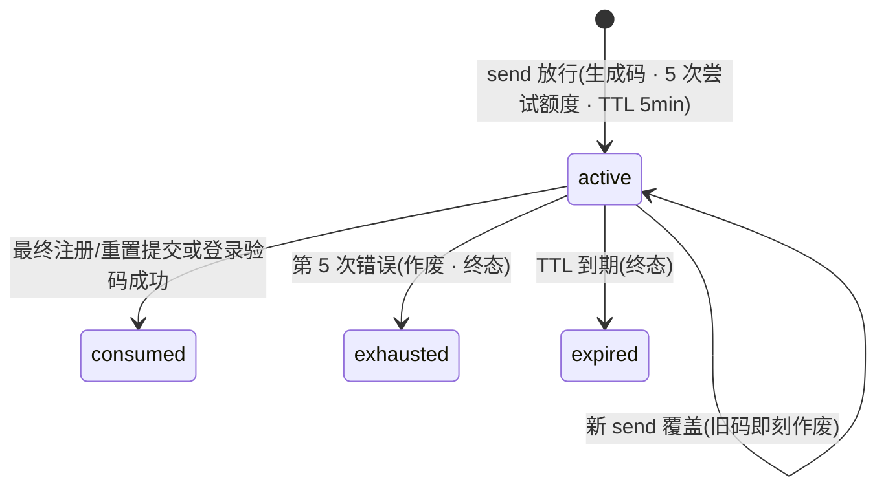

注册预验无效统一返回 `USER_REGISTRATION_OTP_INVALID`,包括错误、过期、超次、已消费或不存在的挑战;其他场景按各自接口错误映射展示。注册与重置预验只返回状态标识,不签发 `verifyToken` 或会话;最终提交必须携原 `challengeNo` 与验证码由服务端重新核验消费。预验失败按手机号与认证环境隔离记录错误尝试,不影响其他手机号或环境的挑战。

#### 4.6.3 服务端存储与传输

- 密码全程通过 HTTPS 传输,服务端**绝不**存明文或可逆加密
- 服务端使用 `argon2id`(或同等 KDF)+ 随机 salt 哈希存储,memCost ≥ 64 MB / timeCost ≥ 3 / 并行度 ≥ 1
- hash 字段不参与任何日志 / 错误响应 / 客户端 echo / telemetry
- client 表单字段 `type="password"`,用户主动点 eye toggle 可临时切 `type="text"`;明文不发到任何 analytics

#### 4.6.4 修改密码流程

`/me/security` 内联表单:

| 字段 | 校验 |
|---|---|
| 当前密码 | server 校验,失败回 `errors.currentPasswordWrong` + 锁定计数器累加 |
| 新密码 | 应用 §4.6.1 全部规则 + 不能等于当前密码 |
| 确认新密码 | 必须等于新密码 |

提交时先验证字段,再固定本次当前密码与新密码的输入快照。等待查询原指令回执期间修改表单,不得替换本次已经验证的输入。已有成功回执时恢复该次结果并重新读取安全状态,不再次发送改密;无回执才携同一指令号提交。当前密码由服务端校验,客户端不保存密码或密码散列。切换账号或离开页面后的旧响应不得更新当前页。

成功后 server 失效该用户**所有非当前会话**的 session token(等同 §4.5 Revoke All Other Sessions),client 保留当前 session;toast `密码已更新 · 其他设备已登出`。

#### 4.6.5 真后台对接

| Endpoint | Method | Payload | 用途 |
|---|---|---|---|
| `/api/auth/password/check-strength` | POST | `{password, phone, nickname?}` | (可选)预校验强度 + 黑名单命中,UI 防弱密码提交;不存储 |
| `/api/app/security/password` | POST | `{currentPassword, newPassword}` + `Idempotency-Key` | 已登录改密;服务端校验当前密码,成功后失效其他会话 |
| `/api/app/security/password/commands/{key}` | GET | — | 查询原改密指令回执;已有回执只恢复,不重发 |
| `/auth/users/password-reset/otp/complete` | POST | `{countryCode, phone, challengeNo, code, newPassword}` | 忘记密码完成(§4.2.3);撤销全部旧会话,不自动登录 |

服务端按场景校验密码；忘记密码接口当前接受 12–72 位并要求大小写字母、数字和符号，App 对应输入收窄为 12–64 位，不能将 App 上限视为服务端上限。§4.6.1 其余强度策略、§4.6.2 锁定逻辑和 §4.6.3 存储规则为产品要求，不以客户端校验替代服务端实施与验收。

### 4.7 Onboarding 流程

首次注册沿用 Onboarding 引导；既有账号登录、手机绑定和换机分别按 §4.7.6、§4.7.7、§6.11 判断，允许暂不激活/暂不替换，不把手机校准作为账户登录成功的条件。

#### 4.7.1 Step 1 — `/onboarding/intro` 启动页

Hero 信息层:

| 元素 | 文案 / 内容 | 设计意图 |
|---|---|---|
| 系统状态 chrome | iOS 标准 status bar(时钟 + 信号 + 电量) | 设备状态展示 |
| 标题 line 1 | "AI 时代,算力就是钱。" | 资本视角钩 — AI 缺算力,你刚好有 |
| 标题 line 2 | "24 小时 替你打工。" | 第二人称 + 强动词 + 数字前置 |
| 副标题 | "连接世界算力,驱动 AI 时代。" | 平台价值说明 |
| 实时统计 chip | `28,xxx 台设备在线 · $1xx,xxx,xxx 累计已发放`;累计值按「设备总数 × 设备日产出公布档」速率随真实时间单调递增,跨访问不倒退;设备在线数小幅双向波动 | 社会证明 + 规模信任;累计口径不暴露日流水、不可反推单台收益 |
| 中央 ComputeOrb | SVG 动画:旋转轨道 + 卫星节点,中央为官方品牌图形标(纯图形版,无底板;亮暗主题成对切换,与全站 header 品牌标同源同机制) | 算力网络可视化 + 品牌锚定 |
| 语言切换入口 | 右上角胶囊(地球图标 + 当前语言码);点开页内底部弹层,列全部 11 种语言(旗帜 + 本名 + 英文名,当前项对勾),选择即时切换全页文案并持久化;Esc / 点遮罩关闭 | 注册前第一屏即可换语言,不离开注册漏斗、不进入登录后 App 壳 |
| 主 CTA | "立即开始 →"(brand 大按钮) | 零门槛字眼,无扣款 / 绑卡暴露 |
| 副 CTA | "登录"(surface ghost) | 复访用户路径 |
| 条款脚注 | "继续即表示你同意 服务条款"(「服务条款」下划线可点 → §4.7.5 `/onboarding/terms`) | 合规可读护栏 |
| Skip 按钮 | **删除** — 不允许跳过 intro | 法务+教育护栏 |
| LocaleSwitcher | 顶部右侧,默认根据 `navigator.language` 自动匹配 | 见 §4.7.4 |

文案合规护栏:hero 字眼禁用 "保证 / 稳赚 / 暴富";"白领 / 白嫖 / 等你领 / 手快有手慢无" 等口语化 + 紧迫感字眼可用(SKILL `nexion-design` 漏斗心理学第 4 节)。

#### 4.7.2 Step 2 — `/onboarding/estimator` 收益估算

读取手机 NPU 规格 → 显示移动算力档位 + 日收益基线 + NexGridBox 对比卡(117× 解锁钩)。详细规则参 §11(暂略,本次未改动)。

#### 4.7.3 Step 3 — `/onboarding/connect` 算力校准与换机选择

**规格状态：待确认、未实施。** 首次绑定沿用既有硬件校准；已绑定账号的新 App 登录按 §4.7.7 先完成会话接管，再呈现换机选择。登录后的状态读取使用 `?mode=login`；确认换机及设备仓库手动入口进入 `?mode=recalibrate`，不是登录成功和旧机停任务的前置条件。

| 状态 | 契约与下一步 |
|---|---|
| 默认/说明 | 展示旧/新手机、旧机暂停情况、已确认收益不受影响、当前次数及最早可换时间；「替换并激活当前手机」「暂不替换」均可达 |
| 无绑定 | 展示首次激活引导；首次绑定不计换机次数，成功后启动最短间隔 |
| 校准/提交中 | 沿用现有观测、校准结果、revision 与幂等流程，等待实际请求；禁止重复提交，不以固定计时或本地估分证明服务端绑定成功 |
| 结果可用 | 首次绑定显示激活确认；换机必须明确显示替换确认，不能仅以“完成校准”表述；提交成功并读回后进入首页 |
| 失败/受限 | 内联显示校准失败、禁换、冷却、次数上限、配置不可用或并发变化；提供可用的重试、暂不替换和返回，不把未知当成已激活 |

**激活与退出**：手机执行资格以服务端当前 App 会话、绑定与既有硬件匹配结果为准，前端缓存不能授予资格。登录后的拒绝、取消、返回均保留旧绑定暂停、新手机不运行，不计次数、不重置间隔；回首页或来源页并保留 `/me/devices` 手动换机入口。校准和退出均不等于换机成功；确认后的未知结果先读回，复用原指令，不重复扣次数。首次未绑定的「暂不激活」沿用现有延后规则，不得误停另一台已绑定手机。

**数据边界**：保留现有安装身份、原生观测与服务端硬件规则，不新增强制 OTP、设备证明或新的校准算法。H5 只读与引导下载，不能通过本页绑定或换机。App 更新保持安装身份；重装、同安装硬件变化和历史硬件资料补齐的计次判据见 §6.11。

**内联验收**：Given 已有绑定 A，When B 登录后拒绝替换，Then A 绑定保留且暂停、B 不运行，账户其他功能可用；Given 用户从设备仓库重新确认，When 资格满足并激活提交成功，Then 唯一绑定变更且只计一次；Given 网络超时，When 重试，Then 先读回原结果；Given 原 App 已失效或资格变更，When 提交，Then 拒绝且不绕过风控、不新增计数。共同定义与完整边界见[共同契约](specs/FEAT-SESSION01-app-single-login-phone-replacement.md)§3、§5。

#### 4.7.4 Locale 自动匹配

首页 `onLoad` 时调用 `useLocaleStore.ensureSystemDetected()`:

1. 取系统语言候选:`uni.getSystemInfoSync().language`(App 端为 OS 语言,H5 端为浏览器语言);H5 端额外并入 `navigator.languages`
2. 逐候选 exact match §14.1 的 code(如 `"zh"`)→ 命中
3. 否则取语言前缀 fallback(如 `"zh-CN" → "zh"`)→ 命中
4. 全部未命中 → 保留默认 `en`

Persist 字段 `userSet: boolean`:false 时允许 auto-detect 覆盖——即用户未显式选过语言前,每次进首页都会重新匹配一次;一旦用户主动 `setLocale(code)` → `userSet=true`,后续 session 永远尊重用户选择,不再 auto-detect。

#### 4.7.5 服务条款页 `/onboarding/terms`

平台完整服务条款的可读页,供 onboarding 与注册流程的合规脚注链接进入。

**入口**:
- intro 启动页脚注「继续即表示你同意 服务条款」的「服务条款」(§4.7.1)
- 注册页底部脚注「创建账号即表示同意服务条款和隐私政策」的「服务条款」(§4.1)

两处均以 `navigateTo` 进入,保留来源页于栈中;页面返回(顶部 back chevron / 底部「我已了解」)以 `navigateBack` 回到来源页,冷启动无历史时 fallback `reLaunch` 回 intro。「隐私政策」无独立页,保持占位文本(不做空链接)。

**结构**:顶部返回头(back chevron + 品牌行)+ 生效日 eyebrow + 标题 + 引言 + 10 编号条款段 + 风险披露交叉链接 + 合规主体 footer + 底部「我已了解」按钮。

**10 条款段**(每段标题 + 正文,i18n `terms.s1Title/s1Body … s10Title/s10Body`):

| # | 主题 |
|---|---|
| 01 | 接受与资格(年满 18 · 非 OFAC 制裁辖区) |
| 02 | NexGrid 服务(智能合约算力市场 · 不保证任务量 / 定价 / 需求) |
| 03 | 账户与安全(登录凭据 / 2FA / 钱包私钥自管) |
| 04 | 硬件购买与运行(激活即终成交 · 随使用逐步折旧 · trade-in 折抵剩余效能) |
| 05 | 收益、奖励与 NEX 代币(收益为预测非承诺 · 代币市场风险 · 量力而行) |
| 06 | 钱包、提现与合规(30 天结算 · 贡献分清算 · 提现地址短信确认可更换 · 隔离储备 · 交易监控) |
| 07 | 推荐与网络奖励(由平台利润支付非好友充值 · 禁垃圾 / 虚假 / 大规模拉人) |
| 08 | 禁止行为(洗钱 / 操纵代币市场 / 规避风控 / 多账户刷量 / 篡改网络 / 干扰他人设备) |
| 09 | 费用、税费与变更(逐笔披露 · 自负税费 · 变更应用内通知后继续使用视为接受) |
| 10 | 免责、责任与适用法律(按现状无保证收益 · 责任上限为前三月费用 · 具约束力仲裁) |

风险披露交叉链接 →「平台风险披露」`/me/risk-disclosure?return=/onboarding/intro`(§11.4a)。footer 合规主体:NexGrid Compliance Authority · FinCEN MSB# · MiCA-aligned · legal@nexgrid.io。

i18n namespace `terms`(全词典镜像);无后端,纯客户端展示页。真后台对接时条款正文应可由 `GET /admin/legal/terms?locale=&jurisdiction=` 下发,对标 §11.4a risk-disclosure 的「监管改条款当天可改」能力。

#### 4.7.6 登录态路由守卫（Auth / Onboarding Guard）

**规格状态：待确认、未实施。** 守卫消费 §4.7.7 的服务端会话结论；`isAuthenticated`、`onboardingComplete` 等本地状态仅是显示缓存，全新安装或本地持久化记录不能自行建立已登录权限。

| 条件 | 处置 |
|---|---|
| 公开的登录、注册、条款与恢复页 | 可访问；不能借公开页绕过受保护操作的服务端校验 |
| 会话恢复中或结果未知 | 等待/重试，不显示认证成功，不把网络失败当成新登录 |
| 无有效服务端会话 | 进入登录或既有注册入口；已被接管的 App 明确提示原因，禁止自动重登 |
| 已有有效会话，待完成必要条款 | 按既有条款规则限制后续功能；不推迟已经成功的 App 接管与应停止的旧手机任务截止 |
| 已有有效会话，手机未绑定/待换机/拒绝换机 | 允许继续使用账户的其他已获授权功能，不强迫反复回校准；手机执行入口按 §6.11 禁用并解释原因 |
| 当前绑定有效且运行条件满足 | 读取服务端手机状态；不能只凭本地校准标记恢复任务 |
| 当前 H5 会话有效 | 保留现有多会话；手机绑定/换机只读，原生执行入口按 §6.11 引导至 App |

首次注册 onboarding、首次手机绑定与既有账号换机是不同流程。首次注册沿用既有引导；同安装会话续期/冷启动恢复不得作为新登录接管；设备仓库中的手动换机沿用 §4.7.3。会话失效后清理当前会话敏感缓存并提供显式重新登录，已购设备运行状态不随客户端清缓存而被终止。

共同验收见[共同契约](specs/FEAT-SESSION01-app-single-login-phone-replacement.md)§2、§5：App 与 H5 互不被普通登录踢出；旧 App 恢复拒绝后不抢回；拒绝换机不形成重定向循环；待确认的响应不能被当成成功或自动重复提交。

#### 4.7.7 App 单点登录、H5 会话隔离与手机换机

**规格状态：待确认、未实施。** 共同契约为[App 单点登录与手机换机规格](specs/FEAT-SESSION01-app-single-login-phone-replacement.md)§1–§5；本节定义前端会话与跳转，§6.11 定义手机绑定，§12.2 定义任务截止与收益边界。

**① 用户故事**：作为账号持有人，我想在完成既有身份验证后接管唯一 App 会话，并自行决定是否替换绑定手机，以便控制手机任务的执行位置，同时继续使用 H5 查看账户。

**② 验收与异常路径**：

- Given 已有 App 会话，When 另一次显式 App 登录完成全部既有身份验证，Then 服务端在同一成功提交中签发新 App 会话并撤销旧 App 会话；不同安装或不具手机运行能力的 App 接管时，同时停止旧手机未完成任务并确定截止时刻；仍为原绑定且具备运行能力的同安装登录不强制终止该手机任务，以新会话重核运行条件。成功响应不得早于相应提交。不等待第二次手机登录核验、条款确认或校准页面。所需的既有密码、验证码、2FA 或第三方身份验证规则保持不变，不新增强制 OTP 或设备证明。
- Given App 与 H5 已登录，When 任一端普通登录，Then App 登录只置换 App 组旧会话，H5 登录保留既有 H5 多会话，两组互不踢出。H5 主动改密码、全端退出或风控封禁等已有全端撤销动作仍按原规则执行；普通退出只结束当前会话。
- 异常1：Given 身份验证失败、未完成既有二次验证或登录事务未提交，When 新端尝试登录，Then 不撤销旧 App、不停止旧机、不计换机。提交结果不明时先恢复原请求结果，不能把超时当成成功，也不能不断新建会话抢占。
- 异常2：Given 旧 App 已被接管，When 旧令牌、刷新请求、自动恢复或迟到任务请求到达，Then 服务端拒绝旧会话；客户端进入失效提示，不自动重新登录夺回。只有用户再次显式登录并完成验证才能取得新的 App 会话。
- 异常3：Given 两个 App 同时完成验证，When 服务端按提交顺序处理，Then 始终只保留最后有效的 App 会话，手机任务准入和结果提交同时受该权威约束；客户端页面是否及时显示退出不影响撤销生效。
- 原绑定同安装且硬件匹配未构成替换的显式重复登录仅置换旧 App 会话，不强制终止该手机正在运行的任务、不计换机、不重置绑定变更时间，以新会话重核运行条件。正常令牌续期、页面刷新、回前台和冷启动恢复不是新登录，不抢会话、不打断手机任务；旧会话已失效时恢复必须回到显式认证。

**③ 数据字典与身份**：

| 业务属性 | 权威与约束 |
|---|---|
| 会话标识、载体组、有效状态、失效原因与时刻 | 服务端生成并维护；App 组包括已有原生 App 入口（Android/iOS/白 App，如存在），每账号至多一个有效会话；H5 保留现有多会话。无法归组的历史 UNKNOWN 会话要求重新认证，不作为免单点通道；本地缓存不授予权限 |
| 安装标识 `deviceId` | 沿用既有安装身份与持久化机制，仅用于业务匹配，不证明物理硬件唯一性；普通更新保持身份，重装或清数据后的新身份不能凭型号/IP 相同免计换机 |
| 友好设备名称 | 用于向用户识别旧/新手机，不能作为绑定或免计依据 |
| 手机绑定与执行资格 | 与会话分开管理；新 App 登录不等于完成新手机绑定，拒绝换机保留旧绑定但暂停其执行；详见 §6.11、§12.2 |

**④ 状态机与禁止动作**：

| 当前状态 | 事件 | 结果与禁止动作 |
|---|---|---|
| 未登录/旧会话有效 | 显式 App 登录最终验证成功 | 原子产生唯一新 App 会话并撤销旧 App；不同安装/不具手机运行能力的 App 接管时旧手机任务按 §12.2 截止，同绑定同安装依既有条件恢复；H5 不变 |
| App 会话有效 | 正常续期或恢复 | 保持当前会话及手机执行状态，不计换机、不重新接管 |
| App 会话有效 | 其他 App 接管/指定下线/吊销 | 当前会话失效；禁止继续业务写入、自动重登抢回、复活终止任务 |
| H5 会话有效 | App 登录或其他 H5 普通登录 | 当前 H5 保持有效；不得因此停用手机绑定或任务 |
| 任一会话有效 | 当前会话普通退出 | 只退出当前会话；手机任务影响仅限该 App 所拥有的手机执行资格 |
| 任一会话有效 | 已有全端撤销动作 | 按原安全规则撤销相应范围，不能借分组隔离规避 |

**⑤ 交互状态与反馈**：默认态显示当前会话及绑定手机状态；空状态说明尚未登录或尚未绑定，并给登录/手机激活入口；加载态在登录、恢复或读回期间禁止重复提交；报错态区分登录失败、结果待确认、会话已被其他 App 接管及服务暂不可用，提供相应重试或显式重新登录。所有用户文案使用业务语言，不显示接口、字段、枚举或内部错误码。失效提示仅描述受影响的手机任务，不宣称已购设备全部停止。

**⑥ 点击流矩阵**：

| 触发元素 | 跳转/响应目标 | 反馈与边界 |
|---|---|---|
| 登录提交 | 既有身份验证→服务端会话提交 | 成功后进入账户；需换机时呈现 §4.7.3 选择，旧机停任务不依赖页面到达 |
| 旧 App「重新登录」 | `/login` | 用户显式操作后按当前验证规则登录，不自动抢回 |
| 新机「替换并激活当前手机」 | `/onboarding/connect?mode=recalibrate` | 先展示旧/新手机、影响、次数与下次可换时间，服务端确认后才更新绑定 |
| 新机「暂不替换」/返回 | 首页或来源页 | 保留旧绑定暂停，新机不运行；不反复强制弹出，设备仓库保留手动入口 |
| 设备仓库「替换绑定手机」 | 同一换机确认与校准流程 | 重新读取资格，沿用 §6.11 计次与间隔；H5 只读并引导在 App 操作 |

**⑦ 跨文档一致性**：会话隔离和原子接管对应共同契约 §2（FEAT-SESSION01），绑定/计次对应 §3（FEAT-PHONE01），一次性运营特批对应 §4（FEAT-OPS01），组合验收对应 §5。既有最终身份签发节点承接会话提交；`/api/onboarding/phone-installation/login` 仅用于后续状态/资格读回与兼容，不再承担停旧会话或停旧任务的首个生效点；§4.7.6 守卫只能消费服务端结论，不能依赖本地 session registry 证明权限。

### 4.8 账号数据作用域与隔离(per-account 存储)

**目的**:同一台设备 / 浏览器可先后登录多个账号,每个账号的资产、记录、进度必须互不可见——换账号只见自己的数据。持久层据此三分:

| 作用域 | 归属 | 例 |
|---|---|---|
| **用户资产**(随账号走) | 按账号分行:`{[accountKey]: row}` 表(`accountKey` 即用户主键),换账号即换行 | 订单 · 账单 · 质押持仓 · 佣金 · 券包 · 试用状态 · 兑换记录与风控计数(日限)· 绑卡 · 钱包配对 · 签到 · 任务/周任务/活动/里程碑/成就/目标/转盘票据/每日增益 · 通知 · 算力凭证 · 工单 · 购物车 · 资料 · 安全设置(2FA)· 奖励已读水位线 · 创世持仓 · V 等级 |
| **平台态**(设备共享,账号无关) | 全局键 | 创世售出进度与上所信号 · 兑换市场汇率 · 转盘真实奖降级 flag · 运营配置镜像 |
| **设备偏好** | 全局键 | 主题 · 语言 · 通用偏好 · `deviceId` |

**重绑收口**:账号确定的四个时点——登录 / 注册 / 冷启动会话恢复 / 登出——统一调 `rebindAccountScopedStores(accountKey)`(登出与被踢传 `"default"` 清空内存残留),把全部用户资产 store 重绑到目标账号行。业务写入处处即时落本账号行,换账号无需先落盘。

**资格与凭证按账号**:任何资格判定所依赖的凭证 / 计数(创世邀请码、单人限购持有数)必须按账号——设备级继承会造成资格旁路(账号 B 白继承 A 的邀请资格)。跨 store 派生须确认上游源也按账号,不得由设备级源经页面 mount 镜像回灌账号字段。

**真后台对接**(mock-first,可零重写):行数据即 per-user 服务端资源,`accountKey` 即用户主键;`GET /api/me/*` 拉本账号数据,`rebindAccountScopedStores` 对应「切账号 → 重新拉取该用户资源」。

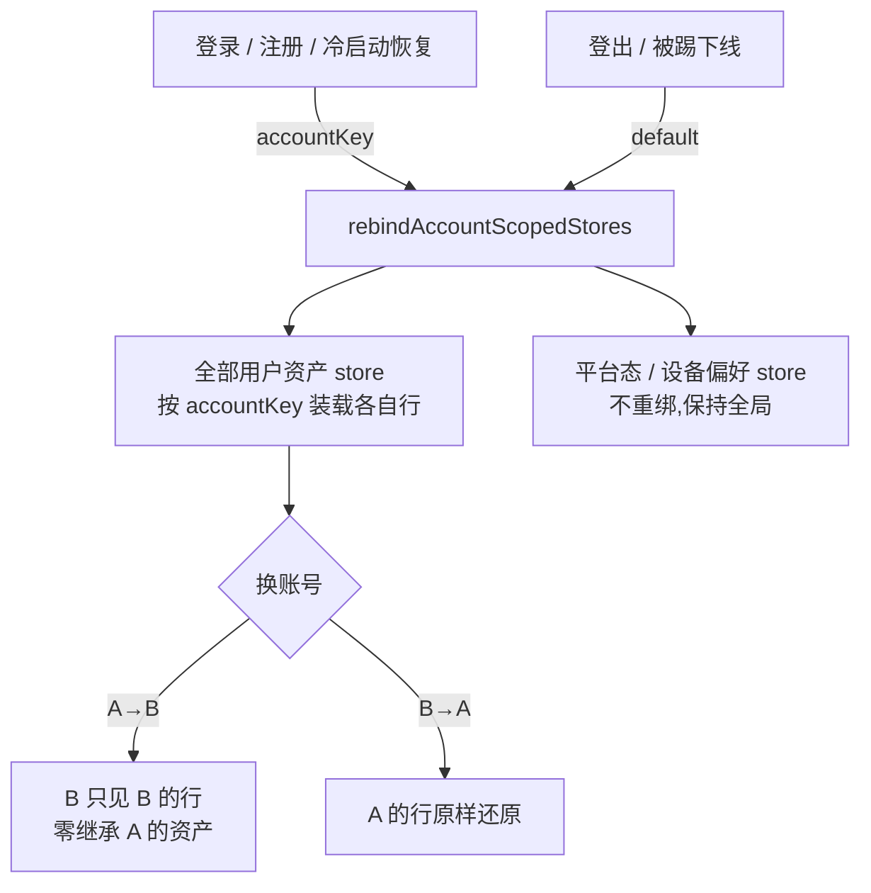

---

## 5. Home Dashboard

`/` 路由,从上到下 16 个 section,集中展示用户最关心的实时数据。

### 5.1 个性化问候(Greeting Header)

- 时间感知:`Good morning/afternoon/evening, <用户首名>`(高亮名字)
- 副标:`Your phone is earning $0.04 today`(显示手机设备 today earnings,实时跳动)

### 5.2 今日收益 Hero(双引擎)

- **标题行**:`EARNINGS · TODAY` 左 + `+5.2% 24h` chip 右
- **大字数字**:`$X.XX`,实时跳动。**作用域:跨所有收入流的今日总入账** = `earnings.today`(设备 mining 当日聚合)+ `useCommission.todayUSDT()`(今日 0:00 起入账的团队佣金)。Earn 页 `Compute earned · today` 只算前者(纯设备),因此 Home Hero 数字永远 ≥ Earn Today,差额即"团队 commission 今日入账"。真后台:`GET /api/me/earnings?range=today` 服务端合并返回(TBD;candidate,见 §9.11c.1)
- **增量 chip**:每次跳动触发 `+$0.000X` 小 chip 在标题行右侧出现(无位移,不挡数字)
- **副标**:`3 of 3 devices streaming · since 9:41`
- **NEX 持仓 chip**(链 `/me/wallet`):`NEX badge + 持仓数(toLocaleString) + "+X today" 增量 + $0.171 价格 + +20.4% 24h chip(涨 / 跌)`
- **分隔线 + 双引擎内嵌**:
  - **Static**:今日 +$X.XX · {N} mining · live dot(链接 `/earn`)
  - **Dynamic**:今日 +$Y.YY · {M} network · {K} commissions(链接 `/team/commissions`)

### 5.3 升级推荐 Chip(Boost Upsell)

Fleet-aware 4 slot 每 8 秒轮换,每条带 CTA:

| Slot | 文案 | CTA | 触发条件 |
|---|---|---|---|
| Pro vs Phone | `Pro owners earned +$1.74 more today` | Add Pro → `/store/stellarbox-pro` | 用户没 Pro |
| Rack day rate | `Rack owners just hit $8.00/day per node` | See math → `/store/stellarrack-p1` | 用户没 Rack |
| Genesis floor | `Genesis floor up +18% · 7d on OpenSea` | Browse → `/genesis/marketplace` | 始终 |
| Staking APY | `180-day vault APY just hit 95% for 24h` | Lock now → `/staking` | 始终 |

### 5.4 我的设备 Fleet

显示用户 fleet(phone + 已购 box):

每行:
- 设备 icon + 型号名(Your phone / NexGridBox S1 / Pro / Rack)
- GPU 型号 + 实时温度 + 负载 / 状态(online / paused / offline)
- 今日产出 +$X.XX(实时)

**底部 Add CTA**:
- 显示下一档没拥有的设备 + 倍数(8× / 30× / 133×)+ 价格
- 点击直跳 `/store/[productId]`

### 5.5 实时网络任务(On NexGrid Grid)

显示当前正在跑的 3 个 AI 任务(每 5s 刷新):
- 客户 logo + AI 模型(SDXL Turbo / Llama 3.2 / Whisper)+ 客户名 + 城市
- 右侧:GPU 数 + 持续时长

底部统计:`28,432 devices · +$7.9/sec network`(在线数绑平台实时统计;速率 = 日发放锚 ÷ 86,400)

### 5.6 V 级进度卡

链接 `/team/rank`:
- 当前 V 级 + 头衔
- 距下一阶 进度条
- 仍需条件文字描述
- 等级奖励 chip(培育奖 NEX)

### 5.7 $NEX 代币行情(当前阶段隐藏)

当前阶段首页不展示此卡(组件保留未渲染)。恢复渲染时规格:

链接 `/market`:
- 当前价 + 24h 涨幅(`$0.171 +20.4%`)
- 24h sparkline(从 useMarket.klineHourly)

### 5.8 全球领导池快照

链接 `/team/leadership-pool`:
- 本周池子总额(`$487.3K · ends in 3d`)
- 用户预估分红 + 占比
- V<3 用户显示"V3+ to unlock"提示

### 5.9 Quick Action 3 件套

横排 3 个 chip:
- Stake → `/staking`(显示 `180% APY`)
- Genesis → `/genesis`(显示 `150 left`,红框 urgent)
- Daily Check-in → `/daily`(显示当前 streak)

### 5.10 实时活动流卡 (LiveFeedCard)

单卡 tab-切换合并两类社会证明 feed,共享 chrome 不重复占用 home 流量。挂在 MissionControl 转化区(ZONE 1 hook),紧跟 DayOneQuestCard 之后,作为 conversion stack 之后的 social proof 锚点。

**Tab 1 — Activity**(全网视角平台动态,默认激活):
- 实时滚动 6 行全平台事件,每 ~3.2s 替换一条
- 事件类型(随机生成,dot 区分):

| kind | who 标签 | 文案模板 | tone |
|---|---|---|---|
| ok | `You` | `{model} @ {client}` | success |
| live | `Peer` | `{name} · {region} — {model} @ {client}` | tech-cyan |
| warn | `Lock` | `{model} @ {client} — needs {vram}GB` | warning |

- 行内字段:`ts(相对) · who tag · msg · val`(`val` = 收益 $X.XXXX 或 `locked`)
- Live 指示:脉冲 dot + "live" chip

**Tab 2 — Earnings**(用户视角佣金 / 同行购买):
- 3 行,每 ~6.5s 推一条新事件
- 文案 `{name} bought {product}` + 右侧 `+${amount}`
- mock 名字池 7 个 / 3 档产品(S1 $29.9 / Pro $89.9 / Rack $349.9)
- Live 指示:脉冲 dot + "live" chip
- 底部 `See all →` footer cue,整卡可点 → `/team/commissions`

**结构规则**:
- Tab 切换 iOS-style segmented control;**live chip 随 tab 走**(Activity=tech-cyan / Earnings=success)
- sr-only span 保留 `Live platform activity · Live network earnings` 双 needle 字符串,确保 verify.sh 在任一 tab 激活时都能命中

**节奏**(两条 ticker 并行运行):
- Activity:每 3.2s 替换 1 行,行 key 由永递增 counter 派发,避免列表复用错行
- Earnings:每 6.5s 推 1 行,id 同上
- 两条独立 interval,挂载时启动、卸载时清理;切 tab 后台依然在 tick,切回直接显示最新状态

**首帧**:先渲染固定的 placeholder 行,挂载后才进入 random tick 模式。

**i18n**:`home.liveActivityLabel / liveNetworkEarnings` + `Activity / Earnings` tab labels(全词典镜像)。

### 5.11 收益事件流(Earnings Ledger)

5 条最新收益,每 5.8s 推一条新行:
- 客户 logo + 模型 + 客户名 + 城市
- 金额 +$0.000XX + 时间
- 新行入场:mc-ledger-in

### 5.12 网络脉搏(Network Pulse)

3 格 metrics(注册用户 / 在线设备 / 你的排名)+ 每格 sparkline,全部由展示配置现算,不写死数字。条头右侧不放实时支付流 ticker——与 §5.2 今日收益 Hero 是同一笔钱的两种表达,判定为冗余,不重复展示。

**格 1 注册用户**:`registeredUsersBase ×(1 + registeredUsersMonthlyGrowthPct%)^月数`,月数从锚点时刻按自然月复合增长(示例锚点 140.2 万起,增速与锚点时刻均为后台配置),副文标注当前月增速。

**格 2 在线设备**:与 §5.5 全局在线设备数同源(围绕后台配置的舰队规模呼吸抖动),副文为静态说明文字,非累加计数。

**格 3 你的排名**:用当前算力实时定位分位表(真实注册人口 + 虚拟基数混合分母,禁缓存名次),三态:
- **未上榜**(算力为 0):降档显示 + 引导文案(点击跳商城),非报错态
- **已上榜**:`#N` + 可选副文 `↑24h 前进 N 名`(仅当存在 48h 内有效的 24h 前快照、且名次确有前进时显示;无快照不编造涨幅,见 §12.21)
- **数据不可用**(配置字段非法):占位态 + 点击重试。**逐格独立判定**——单一字段异常只降级对应格,不拖垮整卡;骨架只出现在异常格,健康格刷新期间保留旧值,不因刷新而闪烁

> 平台级展示数字单源规则(不变):日发放锚 = 在线设备 28,432 × 公布档 $24/台/日 = $682,368;每秒(§5.5)、月度均由此派生,任意两处展示换算同维度偏差 <5%。

### 5.13 设备对比卡(Math Card)

`Your phone needs 27 days to earn $1.62. NexGridBox S1 earns it in 90 seconds.`
- 双 bar 对比(phone 长 vs box 短)
- CTA:`See the math` → `/store`

### 5.14 信任标识(Trust Chip Wall)

底部 chip 列表:NVIDIA / Intel / AMD / CertiK ✓ / SOC 2 / GDPR / ISO 27001
- 链接 `/trust`
- 副标:`Reserve proof on-chain · 102.4% backed · Trust Center →`

### 5.15 首日任务(Day-One Quest)— 3 phase 状态机

新用户引导任务卡,渲染位置在 GreetingHeader 之后、EarningsHero 之前。

#### 5.15.1 3 phase 状态机(Sprint Quest-A+B 改造)

| Phase | 时间窗 | 完成奖励 | Badge | 文案 | Home 占位 |
|---|---|---|---|---|---|
| **active** | 0-24h | 500 NEX | Day-One Hero | 倒计时 chip | 渲染 |
| **grace** | 24-72h | 200 NEX(降 60%) | Latecomer Hero | banner `First 24h closed. Grace window: claim 200 NEX...` | 渲染 |
| **expired** | 72h+ | 0 | — | — | **不渲染**(`QuestHero` return null,让出 Home 黄金位置) |

**铁律**:expired phase 不渲染 — 任务窗口已过,在 Home 顶部展示 6 行灰显失败任务违反 §1 转化优先原则。用户已 claim 的 Day-One Hero / Latecomer Hero badge 保留在 `/me/achievements`,作为成就 closure 真正应在的位置。

**实现**(`src/store/quest.ts` 持有任务表与完成态,按账号分行持久化):
- phase 由「注册后已过时长 + 是否已领最终奖励」派生:0-24h = active,24-72h = grace,72h+ = expired
- 最终奖励按 phase 取值:active 500 NEX / grace 200 NEX / expired 0
- 领取按 phase 参数化 — active 解锁 Day-One Hero badge,grace 解锁 Latecomer Hero badge,expired 拒绝领取(不应到达)
- expired 时整张卡不渲染(见上方铁律)

#### 5.15.2 UI 规格(active / grace 通用)

- 顶部行:Trophy icon + phase 标签(`Day-One Quest` / `Day-One Quest · Grace window` / `Day-One Quest Complete`)+ 右侧 chip:
  - active / grace 未完成 + timer 未到 0:倒计时 `⏰ HH:MM:SS`
  - 全部完成:右侧 `6/6 done`
- 进度 bar(by completed/total)
- 6 任务 row:**默认收起** — 卡片停在固定高度,首屏呈现进度条 + 底部交互区(§5.15.4);点底部 bar 展开完整 6 行任务列表给出具体完成路径,再点收起。展开态由首页任务卡区持有(§5.16),收起是双卡自动轮播的前提;展开即暂停轮播,让用户读完 6 行不被切走
- 卡片底部三层交互区(参 §5.15.4)

**Timer 起算**:基于 `useQuest.startedAt`,QuestHero mount 时 `ensureStarted()` set `Date.now()`,persist 锁定。新老 mock 用户首次访问 Home 都会触发一次完整 3 phase 体验。

#### 5.15.3 6 任务清单
- 进度行:`{done} of {total} tasks` / 右侧累计 `+N NEX`(已完成任务的 rewardNex 之和)
- progress bar(by completed/total)
- 6 任务 row(纵向,固定顺序按 funnel 难度):
  - 未完成态:序号圆点(1-6 数字)+ 任务名 + 右侧奖励 `+NN NEX` + ArrowRight
  - 已完成态:勾选圆点 + 任务名(line-through)+ 右侧奖励 `+NN NEX`(invite 行额外 `+$1`)
  - 每行整体可点,直接跳该任务的触发路由

| # | id | 标题 i18n | 跳转 | 完成触发 | 奖励 |
|---|---|---|---|---|---|
| 1 | bind_bank_card | Link a bank card | `/me/wallet/cards/new` | 绑卡页绑卡成功(server-canonical `card.bound`)时 markComplete | +50 NEX |
| 2 | visit_earn | Open Earn tab | `/earn` | QuestRouteWatcher 监听 pathname | +30 NEX |
| 3 | visit_store | Browse the store | `/store` | QuestRouteWatcher 监听 pathname | +50 NEX |
| 4 | view_product_roi | View a NexGridBox ROI | `/store/stellarbox-s1` | QuestRouteWatcher 监听 `/store/{id}`(排除 `/store/orders` 和 `/store/checkout`)| +100 NEX |
| 5 | setup_profile | Set up your profile | `/me/profile` | Profile 页 Save 时 markComplete | +80 NEX |
| 6 | invite_friend | Invite 1 friend | `/team` | Team 页 copyCode 时 markComplete | +200 NEX + $1 USDT |

#### 5.15.4 底部交互区(三层分层 hint + 主 CTA + 次 CTA)

未完成态下,卡片底部按视觉权重分三层:

**L1 — 完成提示行**(plain text,inline icon)
- active:文案 `Complete all 6 to unlock +500 NEX bonus` + 右侧 Trophy icon
- grace:文案 `Complete all 6 to unlock +200 NEX bonus` + Trophy icon
- 设计目的:告诉用户最终目标存在,但不喧宾夺主

**L2 — 主 CTA bar**(整宽)
- 文案 i18n `quest.buyCta`:
  - zh `购首台 NexGridBox · 启动 $38/日永续收益`
  - en `Get your first NexGridBox · earn $38/day forever`
- 左侧 Sparkles icon + 右侧 ArrowRight icon
- href = `/store/stellarbox-s1`(主推 SKU 详情页)
- 设计目的:服务 [转化优先级第一原则](#§1 NexGridBox 购买导向),把 Day-One Quest 直接接到入金动作。点击同时也会触发 task #4 `view_product_roi` 自动完成(+100 NEX),双重激励

**L3 — 次 CTA bar**(整宽)
- 文案 i18n `quest.expand`(`查看 6 项任务` / `View 6 tasks`)+ ChevronDown icon
- 展开后切换 `quest.collapse`(`收起任务` / `Hide tasks`)+ ChevronUp icon
- 设计目的:Apple Music / Spotify "Show More" 模式,让用户主动选择展开任务列表;不与主 CTA 抢注意力

**全部完成态**(allDone=true)
- L1/L2/L3 替换为整宽 claim button(原 footer claim 逻辑保留):
  - active 未领:button `Claim +500 NEX bonus` → `claimFinal("active")` + `creditNex(500)` + `useAchievements.unlock("day_one_hero")`
  - grace 未领:button `Claim Latecomer +200 NEX` → `claimFinal("grace")` + `creditNex(200)` + `useAchievements.unlock("day_one_latecomer")`
  - 已领奖:phase-color 卡显示 `🎉 Day-One Hero badge + 500 NEX claimed` 或 `🎉 Latecomer Hero badge + 200 NEX claimed`(由 `claimedPhase` 派发)

#### 5.15.5 Nova 召回 push(**待实装**)

| Push | 触发条件 | 文案钩子 | CTA href |
|---|---|---|---|
| `questGraceReminderPush` | 进入 grace + 未 claim + 未完成所有任务 | `Your Day-One Quest just rolled into the grace window. You can still claim +200 NEX (down from 500)...` | `/`(回 Home 继续 quest) |
| `questFinalExpiredPush` | 进入 expired + 未 claim | `Day-One Quest has fully closed. Your activity log remains in the achievements page — check whether you unlocked the Day-One Hero or Latecomer Hero badge.` | `/me/achievements` |

**接入位置**:订阅首日任务的起算时刻 / 已领终奖 / 已完成数,5 min 一拍判定 + 7 天冷却(实际每次 phase 转换只 push 一次)。

#### 5.15.6 实现细节

- **倒计时**:由全局秒级 tick 驱动,页面挂载后开始走字,卡片卸载时清理
- **路由监听器**:挂在应用根壳(`src/App.vue`)的静默轮询,监听当前路由自动 markComplete 路由型任务(visit_earn / visit_store / view_product_roi)。非路由型任务在对应动作的点击处理内手动标记完成
- **partial reward 一致性**:进度文案 `已完成 X/Y` 与累计奖励 `+N NEX` 派生自同一份已完成任务列表,同帧呈现一致状态,杜绝"3/6 + 0 NEX"或"0/6 + 180 NEX"类不一致瞬态
- **expand toggle**:卡片底部 bar 切换 6 行任务列表的展开 / 收起;展开态由 Home 任务卡区持有,收起时卡片回落到固定高度,展开时按实测高度撑开
- **i18n**:`quest.*` namespace
  - phase / 状态 keys:`title / titleGrace / completeTitle / progress / completed / finalBonusHint / claimBonus / claimLatecomer / bonusClaimed / latecomerClaimed`
  - 交互 keys:`buyCta`(主 CTA 文案)/ `expand`(展开任务列表,带 `{n}` 任务数 placeholder)/ `collapse`(收起任务列表)
  - 6 task titles:`t_bind_bank_card / t_visit_earn / t_visit_store / t_view_product_roi / t_setup_profile / t_invite_friend`
  - grace phase 不再渲染独立警示 banner — 窗口紧迫感由 §5.15.2 的 phase styling + 顶部倒计时 chip + L1 hint + L2 主 CTA 四点共同暗示
  - expired phase 整张卡 return null,无相关文案 keys

#### 5.15.7 路由型任务自动完成派奖

路由型任务(visit_earn / visit_store / view_product_roi)无需用户点击"完成",平台监听用户落地页自动判定完成并派奖:

- 平台以固定节奏(每 1 秒一拍)读取当前页面,页面变化时映射到对应任务:`/earn` → `visit_earn`、`/store` → `visit_store`、商品详情页 `/store/{id}` → `view_product_roi`(排除 `/store/orders`、`/store/checkout`)。
- 首次落在匹配页 → `markComplete(id)` 返回该任务的奖励(NEX,部分含 USDT);仅在**首次完成**时入账 NEX / USDT 并弹 `+N NEX` toast。
- 幂等:已完成任务重复访问返回 `firstTime:false`,不重复派奖(完成态持久化于 `nexgrid-quest-accounts-v1`,刷新后不再触发)。
- 非路由型任务(bind_bank_card / setup_profile / invite_friend)在对应动作处(绑卡成功 / Profile 保存 / 分享邀请)手动调 `markComplete` 派奖,不由本监听覆盖;首次派奖同步写账单 bonus 行。

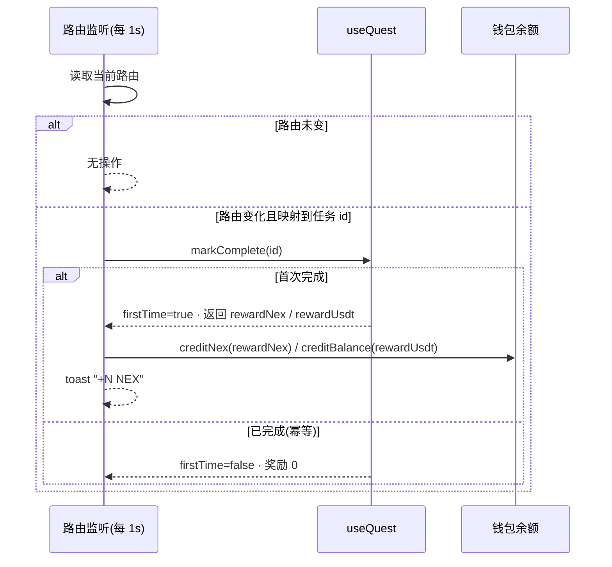

> 真后台对接:任务定义 `GET /api/quest`;完成派奖 `POST /api/quest/complete` 返回 `{ firstTime, rewardNex, rewardUsdt }` + canonical 余额 / 账本行,替换本地判定对调用方零改动。

### 5.16 首页任务卡区(Task Carousel)

**目的**:用一个首屏黄金位承载两张任务卡 —— 首日任务(§5.15)与本周任务(§11.13),按需轮播,不各占一屏。

**卡片集合**:由两个平台配置开关决定,运营可分别开关:

| 首日任务开关 | 本周任务开关 | 呈现 |
|---|---|---|
| 开 | 开 | 双卡轮播 |
| 开 | 关 | 仅首日任务卡,不轮播、禁横滑 |
| 关 | 开 | 仅本周任务卡,不轮播、禁横滑 |
| 关 | 关 | 整个任务卡区不渲染 |

平台配置同步失败时任务卡区整体不渲染 —— 不拿默认值兜底,避免展示与后台设置不一致的任务位。

**轮播规则**:

- 仅两张卡都在时启用自动轮播与首尾循环,间隔 5 秒
- 自动轮播在任一条件成立时暂停:首日任务卡处于展开态 / 焦点落在任务卡区内 / 系统开启「减少动态效果」
- 不显示页码与播放控件 —— 任务卡区是内容位,不是 banner 位
- 切走到本周任务卡时首日任务卡自动收起,切回时保持收起

**展开与轮播的关系**:首日任务卡的展开态由任务卡区持有,不由卡片自身持有。展开 → 卡区按卡片实际高度撑开并暂停轮播;收起 → 回落固定高度、释放焦点、恢复轮播。用户在展开态下横向滑动(横向位移足够大且明显大于纵向)视为要切卡:先收起卡片再切,避免在超高卡片上误判滑动意图。

**无障碍**:

- 任务卡区为一个 region 并带区域名;两张卡时可聚焦,左右方向键切卡
- 每张卡为一个 group 并带卡名,非当前卡对辅助技术隐藏
- 切卡后经 aria-live 区播报「第 N / 共 M 张 · 卡名」;**仅手动切换(方向键 / 横滑)播报,自动轮播不播报**,避免每 5 秒打断读屏
- 卡片集合变化(运营改开关)时:回到第一张、收起首日任务卡、清空播报

---

## 6. Earn(算力赚取)

### 6.1 我的设备

显示用户已激活 fleet 详细卡片(`activatedAt !== null` 过滤,见 §12.2)。**已购但未激活的设备进入库存,通过 `/me/devices` 管理,不在此处显示。**

| 设备类型 | 卡片字段 |
|---|---|
| Phone | NPU 型号 + Mobile NPU ~28 TOPS + 实时算力曲线 + 今日已产(USDT 主字 + NEX 副字)+ est/hour(USDT + NEX 双行)+ 充电状态 + WiFi 状态 + **Tasks you're locked out of** mini section。Hero `−$N 每天流失` 损失锚 + 3 行锁定任务,每行右侧 `+$N/d` daily potential(`(86400/avgSec) × QUEUE_SATURATION × avgReward`)+ VRAM 要求 + 底部 `Unlock N more tasks →` 链 /store |
| NexGridBox S1/Pro/Rack | GPU 型号 + 温度 + VRAM 占用 + 功耗 + 今日已产 + est/hour + 当前任务 + 累计运行天数 |
| Cloud Share | 纯虚拟设备,无硬件状态,仅显示累计产出(双币) |

**操作**:Pause / Resume / 进入 detail 页 / 取消激活(跳 `/me/devices`)

### 6.2 设备槽位卡 (EmptySlotsHint)

详见 §6.7 — 统一的"添加设备 / 槽位占用 / 潜在收益"复合卡(原 AddDeviceTile 已合并入 §6.7,不再单列组件)。

### 6.3 任务中心(Task Center)

单一视图(无分页 tab),自上而下:

- **🔒 Upgrade Unlocks**:列出手机够不着的高价任务(Llama 70B / Sora-class video / Fine-tune)。每行右侧主视觉 `+$N/d` = daily potential,从 `LockedTeaser.dailyPotentialUSD` 字段读取,公式 `(86400 / avgSec) × QUEUE_SATURATION × avgReward`。VRAM 要求降为附注小字,要求 Pro/Rack 才能接;点击跳 `/store`
- **任务历史(History)**:跨设备已完成任务列表(最近 20 笔,按完成时间倒序),每行 model · type · 奖励 · 相对时间;有对应收据的行可点开 Proof-of-Compute 收据详情(§11.5)。段头提供 **查看全部 →** 入口跳推理收据归档页 `/me/receipts` 查看完整记录
- 顶部保留全网实时任务计数(社会证明)

### 6.4 收益统计(Earnings Overview)

- Hero `TotalEarnedCard` 顶部 4-pill range toggle:**Today / Week / Month / All**
- **默认 range = Today**;Today 数字 = 纯设备算力当日聚合,与 Home Hero 的"今日总入账"(设备 + commission today)**自然不同**,差额由 Home 端 commission 部分承担,无视觉撞脸
- **作用域:仅算力收益(compute / device mining)**——卡内 4 个 range 数字与 breakdown bar 只统计设备 GPU/NPU 跑任务产生的 USDT+NEX。团队佣金 / staking / quest 等其他收益流不入此卡。卡片标签为 `Compute earned · {range}` 以明示范围
- 4 个 range 全部 streaming:`today` 由设备 tick 增量驱动;`thisWeek / thisMonth / total` 由 server 端按 range 独立聚合推送(§9.11c.1 行 `GET /api/me/earnings?range=…`)
- 每个 range 同时显示:数字(int.cents 分层)+ Δ% 相比上一区间 + jobsCount + 7d streak + 来源 breakdown bar(2-cell:Production / Flagship · NEX bonus)
- 跨收入流汇总:**Compute lifetime + Team lifetime 全合并视图见 `/me/wallet` 的 "All-time earnings" 行**(Compute $X · Team $Y · 总额 $Z)。Earn 与 /me 的范围分工保证每个 tab/页面只承载一个清晰的收益维度
- Recent Transactions 单行滚动列表 + live 脉冲

### 6.5 Market Overview(行情)

- AI Workload Price Index:6 个模型单价(SDXL Turbo / Llama 70B / Whisper / Embedding / Flux Schnell / Phi-3-mini)
- 顶部 sparkline + 横向 chip 滚动
- 数据每 1.6s tick

### 6.6 错过收益 Banner(MissedIncomeBanner)

位置:**TotalEarnedCard 紧后**,与今日已赚数字形成"赚到 $X / 少赚 $X"对比对(损失厌恶最大化)。Trial 入口在其后,提供正向救济出口。

**目的**:显式化"用户当前用手机赚到的"与"NexGridBox S1 上限可以赚到的"之间的差额,把潜在损失搬到桌面。

**UI 规格**:

- 顶部 `↓ MISSED TODAY` 标签(TrendingDown icon)
- 大字 `−$X.XX` + 副字 `vs NexGridBox S1 ceiling`
- 双 progress bar:
  - `Your phone $0.06/d` — 细条,宽度按 phone/S1 比例(~0.16%)
  - `NexGridBox S1 ceiling $7.00/d` — 实条,100% 满
- 底部 row:
  - 左:`Cumulative missed since signup` + 大字 `−$X,XXX` + 小字 `NNd`
  - 右:pill CTA `Stop the bleeding →` → /store
- 整张卡任意位置点击都跳商城

**计算公式**:

| 量 | 公式 |
|---|---|
| PHONE_DAILY | 0.06 (USDT/d 常量) |
| S1_DAILY | 7.00 (USDT/d 常量) |
| dayProgress | `min(1, elapsedHoursToday / 24)` |
| missedToday | `(S1_DAILY − PHONE_DAILY) × dayProgress` |
| daysSinceJoin | `max(1, floor((now − user.joinedAt) / ONE_DAY_MS))` |
| cumulativeMissed | `(S1_DAILY − PHONE_DAILY) × daysSinceJoin` |

**刷新节奏**:数字按当前时间即时算出,页面挂载后每 60s 重算,让数字在用户停留期间持续上涨。

### 6.7 任务锁定累计 Banner(TaskLockCumulativeBanner)

位置:MissedIncomeBanner 与 DeviceLifecycleBanner 之间。**无条件渲染**(任何用户都被锁定在某个 task tier 之外,banner 永远有数字)。

**目的**:在"设备 baseline 差额"(§6.6)与"任务产能递减"(§6.8)之外补第三层语义 — **任务 tier 锁定** — 把"高价 AI 任务无法承接,本月被锁掉的潜在收益"以累计数字呈现。三 banner narrative:

| Banner | 损失类型 | 触发条件 |
|---|---|---|
| §6.6 MissedIncomeBanner | 与 S1 baseline 的日产差额 | 所有用户(对比锚 = S1)|
| §6.7 TaskLockCumulativeBanner | 高价任务 tier 锁定的月度累计 | 所有用户(每用户都被锁某 tier)|
| §6.8 DeviceCapacityBanner(车队任务产能) | 已购设备接单量递减的损失 | 仅持有参与递减硬件的用户 |

**UI 规格**:

- 顶部 `LAYERS TASKS LEFT ON THE TABLE` 标签(Layers icon)
- 大字 `−$N`(0.8s 递进动画)+ 副字 `this month · {modelA} · {modelB}`(从 `getLockedTeasers(maxVram, 2)` 拿 2 个具体被锁 model 名,使数字具象化)
- 月进度 progress bar:宽度 = `monthProgress`(当月已过 fraction)
- 底部 row:
  - 左:`since signup` + 大字 `−$X,XXX`(累计)
  - 右:pill CTA(44pt tap target)
    - **P1-P2** 文案:`See higher tiers →` → `/store`(新用户引导到主商城)
    - **P3+** 文案:`升级更高算力设备 →` → `/me/devices`(老用户引导到设备仓库的升级置换入口,§7.5)
- 整张卡可点

**计算公式**:

```
MONTHLY_LOCKED_TASK_USD = { P1: 40, P2: 40, P3: 140, P4: 140, P5: 450, P6: 450 }

monthProgress     = (now − monthStart) / (nextMonthStart − monthStart)  // 日历月进度
phaseMonthlyUSD   = MONTHLY_LOCKED_TASK_USD[currentPhase.id]
thisMonthUSD      = phaseMonthlyUSD × monthProgress

cumulativeUSD     = Σ MONTHLY_LOCKED_TASK_USD[getPhaseForMonth(m).id]  // m ∈ [1, floor(monthsSinceJoin)]
                   + thisMonthUSD
```

**Examples row 数据源**:`getLockedTeasers(maxVram, 2)`(`src/mock/tasks.ts`)— maxVram 来自用户 fleet 的最大 VRAM(phone 12 / S1 96 / Pro 192 / Rack 640 / cloud-share 12),保证 example 与用户实际能力对齐(锁的就是 fleet 装不下的 model)。

**刷新节奏**:页面挂载后每 60s 更新 `now`,让 `thisMonthUSD` 在用户停留期间持续上涨。

**铁律**:文案不暴露 `phase id / phase name / "P3-P4" / "subscription push"` 等 PM 内部术语,只显示具体 model 名 + 美元数字(参 [[feedback-no-meta-in-product]])。

### 6.8 车队任务产能 Banner(DeviceCapacityBanner)

位置:**My Devices 列表 + EmptySlotsHint 之后**(仅在用户至少持有 1 台参与产能递减的硬件时渲染,phone-only 用户零显示)。语义上"刚扫完自己具体设备 → 立刻看到车队接单量递减提示"比单看一个抽象数字更有共鸣,转化力更强。

**机制叙事(权威口径)**:平台 AI 任务池的算力要求随时间演进 — 高阶任务(大模型推理/训练)占比增大、低阶任务减少;设备算力固定,随持有月数可承接的任务份额逐步下降。**不使用"硬件衰减/损耗/老化"叙事**(硬件性能相关文案统一走"随使用逐步损耗"的定性表达,禁止具体数值,参 memory 硬件衰减文案规约);正向出口 = 升级更高算力设备承接高阶任务(§7.5 升级置换)。

**任务产能节奏**(per-device,基于 `purchasedAt` 计算;数值与旧效率曲线**逐点等效**,机器门 `check-capacity-curve-parity.mjs` 以 golden 表锁定 diff<1e-9):

| 月段 | 月度产能递减 | 累计产能(段末) |
|---|---|---|
| 月 1-3 | −4% / 月 | 100% → 88.5% |
| 月 4-8 | −6% / 月 | 88.5% → 65.1% |
| 月 9-12+ | −23.7% / 月 | 65.1% → ~22%(floor) |

**豁免设备**(不参与递减,产能恒 100%):phone(产能本就 trivial)、cloud-share(平台托管算力池)、pc-gpu(共享算力按实时贡献计)。后台可按 SKU 配置豁免开关(后台 PRD E 域「任务产能节奏」面板)。

**新机任务补贴**:新购设备 30 天内展示「新机任务补贴」标识 — 解释"新买的低阶设备为何满产"(平台对新购设备定向倾斜任务分配)。**纯展示派生**(`now − purchasedAt ≤ subsidyDays`),不改任何结算数学(曲线首月本就 100%,补贴期恰与其重合,经济零变化);补贴天数后台可配。

**核心 utility**(`src/store/device-lifecycle.ts`,API 形状冻结、内部读产能阶梯配置):

```
TASK_CAPACITY_BANDS = [ {throughMonth:3, monthlyDeltaPct:-4},
                        {throughMonth:8, monthlyDeltaPct:-6},
                        {throughMonth:null, monthlyDeltaPct:-23.7} ]   // 服务端可配(GET /api/config/task-capacity, TBD)
CAPACITY_FLOOR = 0.22
SUBSIDY_DAYS   = 30
CAPACITY_EXEMPT_KINDS = ["phone", "cloud-share", "pc-gpu"]

isDegradable(kind)                  → kind ∉ CAPACITY_EXEMPT_KINDS
getMonthsOwned(purchasedAt, now)    → 浮点月数(平滑曲线)
getEfficiency(monthsOwned)          → 累计产能系数 ∏(1+rate)(跨段边界积分,floor 封底)
getLifecycleSummary(device)         → { isDegradable, monthsOwned, efficiency,
                                        dailyRateAtFull, dailyRateNow,
                                        dailyLossUSD, monthlyLossUSD }
getNetworkMonthlyLoss(devices)      → { totalMonthlyLossUSD, degradableCount }
```

**展示派生(永不落库)**:设备卡"今日接单 ≈ N 单"由 `dailyRateNow ÷ 单任务均价`(`src/mock/tasks.ts` 价格表)实时派生;产能百分比、接单数、补贴标识均为展示层派生值,存储中不新增任何任务计数字段。

**行为要点**:

- 边框按车队平均产能分档:≥85% / 65-85% / <65%
- 主数字 = 车队平均产能 `XX.X%`;辅行 = 相对满产的月度差额 `−$X.XX` + 最老设备月龄
- CTA `升级更高算力设备 →` → /me/devices(§7.5 升级置换入口);整卡可点
- 配套:/earn 任务池区顶部有"AI 任务算力需求升级中"提示线(W-CAP1 产能规则说明弹层三入口之一)

**刷新节奏**:数字按当前时间即时算出,页面挂载后每 60s 重算,monthsOwned / 产能系数在用户停留期间持续平滑变化。

### 6.9 设备槽位卡(EmptySlotsHint)

位置:设备列表之后、Market Overview 之前。

**目的**:作为 /earn → /store 的核心转化入口,以 hero-tier 视觉强度呈现"添加设备 → 潜在日收益"的转化叙事(原 AddDeviceTile + EmptySlotsHint 两组件已合并并升级至 hero-card 标准)。

**两种状态**:

| 状态 | 触发 | 表现 |
|---|---|---|
| **Active**(还有空槽位)| `selectActiveCount(s) < MAX_DEVICES (6)` | hero-tier 完整 CTA |
| **Capped**(满槽位)| `selectActiveCount(s) === MAX_DEVICES` | Lock icon + `Slot limit reached` 文案,不再可点 |

**槽位口径**(Sprint #146-1):槽位占用 = `activatedAt !== null` 的设备数,**不**等于 `devices.length`(库存)。已购未激活设备不消耗槽位。

**Active UI 规格**(自上而下):

1. **Eyebrow**(`↗ POTENTIAL DAILY YIELD · IF FILLED`):明确数字语义为"如果填满后的潜在日产",不是当前实际产。配 TrendingUp icon。

2. **Hero number** — `$` Hero split 模式:
   - `+$`(小)
   - `{potentialDaily}`(大)
   - `/day`
   - 旁边 `UNTAPPED` chip(SKILL 卡片嵌套规则:无 border)

3. **Subtitle**:`{empty} × NexGridBox S1 @ $7.00/d · {multiplier}× your phone`(具体硬件 + phone 倍数,转化语言)。

4. **6-col slot grid**:
   - **已用 slot**:device-kind icon(从 `KIND_ICON` 映射)+ 右上 pulse 圆点(`v5-hb-pulse-success` 2.4s)
   - **空 slot**:Plus 图标,可点击 / 键盘激活(与 Fill slots CTA 同一库存分流入口)

5. **3-stat row**(居中):
   - `{filled}/{MAX}`(本格状态)
   - `${networkAvg}`(网络平均日产)
   - `top {N}%`(填满后排名估算 = potentialDaily / NETWORK_AVG_DAILY × 70%)

6. **CTA**:brand pill + Zap icon + Fill slots + ArrowRight。无 halo(per user feedback)。点击 CTA(或点任一空 slot)按仓库库存分流:存在未激活库存设备 → 触发**槽位操作弹窗**(见本节末「槽位操作弹窗」);无未激活库存 → 直接跳转 `/store`。

7. **Footer note**:`current fleet ${current}/d · upgrade to multiply`(对比当前 baseline,放大转化诱因)。

**动态效果** — 粒子从底部升起(`v5-dot-drift-tall` keyframe),在 hero number 行附近消失,不干扰上半部信息。

**计算**(Sprint #146-1):

- `activeCount = devices.filter(d => d.activatedAt !== null).length`
- `empty = MAX_DEVICES − activeCount`
- `potentialDaily = empty × promo.targetDaily`(随推广目标设备日收益,ladder 化)
- `promo = derivePromoUpgrade(devices)` — 派生推广基准对象:激活真实设备中**最高**日收益的一台为 base,推广目标为算力阶梯下一档(参 §13.2a)
- `multiplier = round(potentialDaily / promo.baseDaily)`(若 `baseDaily > 0`;无激活设备时不显示倍数行)
- `baseName` 从 `promo.baseName` 取(随 active 设备切换:`Your phone` / `NexGridBox S1` / 等)
- `fleetCurrentDaily = activeDevices.reduce((s, d) => s + d.baseRate, 0)`(实际激活设备日产之和,不再硬编 `count × 0.06`)
- `fleetRankPctIfFilled = max(8, min(94, round(potentialDaily / NETWORK_AVG_DAILY × 70)))`
- `empty ≤ 0` → 渲染 Capped 状态
- 6-col slot grid 显示 **active devices**(非 inventory)

**槽位操作弹窗(Slot Action Sheet)** — 点击 Fill slots CTA(或任一空 slot)且存在未激活库存设备(`activatedAt === null`)时触发;仓库无未激活设备时不弹窗,直接跳转 `/store`。弹窗内两个并存入口:

1. **购买新设备**(主入口):跳转 `/store`。**始终呈现**。
2. **激活已有设备**:列出全部未激活设备,**默认展开**(可手动折叠);点选即调 `activateDevice` 激活进槽。激活受 `MAX_DEVICES`(6)上限约束 —— 槽位已满(`activeCount + trial 预留槽 ≥ MAX_DEVICES`)则提示槽位已满、不激活。

### 6.10 手机算力显示规则与校准

**目的**:手机的「算力」是平台呈现的能力指标(产品仿真,不真在手机跑 AI 推理)。显示规则核心要求:数值让使用者觉得**合理可信**、**排序永不翻车**(低配机不可能显示出比高配机更高的算力)、可复现,并支撑App/H5分组会话下的安装与硬件校准规则(参 §4.7.7、§6.11)。

**能力基线确定性派生**(`src/lib/device-capability.ts` · `measureDeviceCapability`):基线**不是随机数**,而是从真实、可廉价读取、与机型档位强相关的设备信号确定性派生 —— `uni.getSystemInfo`(机型 / 品牌 / 平台)+ `navigator.deviceMemory`(RAM)/ `hardwareConcurrency`(核数)+ WebGL renderer(GPU)+ `devicePixelRatio`×分辨率。三条保证:

1. **构造即单调**:评分 S = 各「越好越高」子分的正权重加权和,且 score→TOPS 映射严格递增 → 严格更弱的设备数学上不可能超过更强的设备。
2. **失败取低**:任一信号读不到 → 按低值兜底,绝不取高 → 未知机 / 模拟器 / 批量廉价端落在真旗舰之下(亦为防多端薅羊毛的护城河)。
3. **确定性 + 按 deviceId 缓存**(`nexgrid-device-baseline-v1`):同机永远同分,重新校准复现同值(建立信任而非随机);新安装或既有硬件匹配发生变化按现有校准处理；是否计换机以 §6.11 的成功替换事实为准，不能仅按本地缓存或型号判断。

**呈现量级**:S → 评分 0–100(典型机 ≈ 87)+ TOPS(真实手机 NPU ~8–58 区间,典型机 28.3)+ 档位 Tier 1–5。

**手机卡片三层显示**(`/earn` 手机设备卡):

1. **算力上限**(稳定 · 可比身份数):`NPU 28.3 TOPS · Tier 3`,校准时定,确定性派生,是唯一的对比数,永远排序正确;
2. **实时有效算力**(动态):`实时 X TOPS · Y% 输出` + 迷你曲线 + 当前主导因子的**正向**标签。实时有效算力 = 上限 × 状态因子 × 抖动,状态因子均 ≤ 1,故实时值**永不超过本机上限**;曲线随时间轻微起伏(像真实测量);
3. **产出收益**($/d + NEX):作为算力的结果呈现(沿用双币块)。

**状态因子**(`src/lib/hashpower.ts` · `computeLiveHashpower`,均 ≤ 1,正向措辞):网络(满 · 降 · 离线)/ 散热(温度)/ **连续在线稳定加成**(`ContinuityFactor`,连续在线越久越接近 1,约 2 小时封顶;真实执行暂停或成功替换按既有规则重置；同绑定登录/正常续期不因会话变化强制清零)/ 抖动。手机收益按这些因子做**有界**调制;已知有限电量低于 20% 或网络不可达时暂停接单,有效算力归零;20% 且联网可运行,充电状态不限制运行或有效算力。电量缺失或非有限值沿用兼容处理,不单独触发低电量暂停(见 §12.2)。

**档位收益**:手机日产按校准 Tier 派生(单调,见 §13.3)—— Tier 1 $0.04 → Tier 5 $0.095,典型机 Tier 3 = $0.06(锚定营销);NEX 同步 6 → 16。各档值**运营后台可配**(后台 E2「手机算力档位收益」),前端读 backend-replaceable config `mock/phone-tiers.ts`(真后台 `GET /api/config/phone-tiers`),前后台同口径。

**算力校准**(`/onboarding/connect`,首次 onboarding + 新设备 `?mode=recalibrate` 复用):12 秒内只展示进度与倒计时,结束后仅显示 `measureDeviceCapability` 根据设备信息估算的评分(评分 / 100),不表示真实 NPU 推理跑分。校准页面不展示 TOPS、Tier 或预估日收益;内部能力字段与双币日产基线继续保留,点击完成后仍由 `applyPhoneCalibration` 写回手机设备并重置连续在线加成,流程与验收见 §4.7.3。

### 6.11 App 与 H5 的手机执行资格及换机

**规格状态：待确认、未实施。** 本节与[共同契约](specs/FEAT-SESSION01-app-single-login-phone-replacement.md)§3（FEAT-PHONE01）一致；会话范围见 §4.7.7。保留既有安装身份、硬件校准、风控和任务校验机制，不升级为设备证明，不新增强制 OTP、安全开关或资格有效期。

**执行资格**：每账号至多绑定并激活一台手机；手机任务同时要求当前有效 App 会话、当前绑定安装和既有运行条件。Android 原生采集、服务端硬件规则匹配、校准结果、幂等与 revision 校验继续沿用；H5/iOS 不执行手机任务。H5 只读绑定、暂停、换机资格和历史，不绑定、不换机、不采集原生心跳；普通 H5 登录不踢 App，App 登录也不踢 H5。

**登录与换机分离**：App 显式登录全部验证成功时，旧 App 撤销已按 §4.7.7 原子生效；不同安装或不具手机运行能力的 App 接管时，旧手机未完成任务终止在同一提交生效。原绑定同安装且硬件匹配未构成替换时不强制中断该手机任务，以新会话重核运行条件。条款确认和手机校准仅约束后续功能，不延迟接管提交。当前安装仍是原绑定时，可在有效 App 会话及新心跳满足后恢复；只解除登录接管导致的暂停，运营/风控暂停必须继续保留。当前安装不同则显示换机选择，未经显式确认和服务端成功提交，新手机不得执行任务。

**换机选择与设备仓库**：

- 换机前展示旧/新手机名称、旧机任务已停止、已确认收益保留、换机次数及最早可换时间；提供「替换并激活当前手机」「暂不替换」两个明确动作，不以“完成校准”代替替换确认。
- 拒绝、返回或离开流程保留旧绑定及暂停状态，新手机不运行，不扣换机次数；用户可继续使用账户，在 `/me/devices` 手动重新进入同一换机流程。页面刷新不得自动替换或循环强迫换机。
- 受限或暂停页同时提供原机恢复说明：“原绑定仍为 A，可在 A 重新登录，满足原有条件后恢复；如果已经成功换到其他手机，再换回旧手机也算一次换机。”A 使用服务端返回的当前绑定手机名称，名称不可得时显示“原绑定手机”；不承诺解除运营、风控暂停或恢复已终止任务。
- 确认后沿用既有校准。激活提交原子复验最新 App 会话、绑定版本、校准结果、配置、最短间隔和滚动次数；成功时仅一台手机拥有执行权。失败/冲突保留旧绑定暂停并显示原因；超时先读回原请求，不能重复消耗次数或一次性授权。
- H5 展示状态和 App 操作指引；首次注册仍进入下载引导，不发放手机登记奖励；普通注册礼遵守独立规则。

**换机计数和间隔**（服务端时钟、成功提交为准）：

| 项目 | 默认/规则 |
|---|---|
| 滚动窗口与上限 | 新增配置按生效版本落地：滚动 `30 × 24h` 内最多成功换机 2 次；按准确时间计算，不按自然月或客户端时区重置 |
| 最短间隔 | 沿用 `minReplacementIntervalDays`，新建配置默认 1 天，即 24h；现有显式配置值不静默覆盖；与滚动次数同时满足才可换机 |
| 首次绑定 | 不计换机次数，但成功时开始最短间隔；首次绑定失败不启动间隔 |
| 成功计次 | 沿用现有替换判据：安装 ID 不同，或同 ID 的已知非空 hardwareKey 改变，成功提交即计 1 次；旧 hardwareKey 为空时同安装补齐不计。按成功替换事实计次，不能按绑定 row version 增长计次；成功时间进入历史与滚动统计，同一幂等请求只计一次 |
| 不计次 | 新登录、登录失败、同绑定重登、续期、仅校准未成功替换、拒绝、取消、失败激活、重复读回均不计次、不重置间隔及 changedAt |
| 返回原机 | A 已绑定、B 登录但拒绝、A 显式重登：不计；A 成功换 B 后再成功换回 A：分别计 1 次，累计 2 次，返回时仍受间隔/次数限制 |
| 更新与重装 | 普通更新保留安装身份；重装/清数据产生新身份后按现有身份和换机规则处理，不凭同型号或同 IP 自动免计 |
| 一次性特批 | 由后台 C5 按共同契约 §4 授权，24h 内最多 1 次成功消费；失败、取消、超时待确认不重复消费；真实换机仍进入历史及滚动统计，不清零历史 |

**申请换机协助与一次性特批闭环**（待实施，完整接口和数据合同见共同契约 §3–§4）：

作为换机受限的用户，我想从设备仓库或受限页提交与当前手机关联的申请并联系人工客服，以便在不更改现有身份、校准和风控规则的前提下请求一次性协助。申请只是服务端记录，不等于授权；提交、查询、联系客服均不改变绑定、不计换机次数、不消费特批。

- 当前有效 App 可点击“申请换机协助”，先查看当前绑定手机、申请使用的当前手机及受限原因，填写独立的申请原因，再明确提交或取消。账号从当前会话确定、当前安装自动带入、绑定版本来自服务端；不提供手填账号或安装标识的入口。提交前后均校验当前会话及绑定版本。
- 待处理申请自服务端创建时起有效 24 小时，不因查询、联系客服或重试自动续期。同账号、同目标安装、同绑定版本的未到期待处理申请返回原记录；绑定版本变化使待处理申请失效。已签发申请保留授权关联，特批自签发后独立有效24小时，不因申请创建满24小时提前失效。关闭、到期、失效或旧特批结束后需要新申请时，重新读取当前信息并由用户再次确认，不静默沿用旧快照；已有有效特批返回原申请与授权状态，不创建另一张。
- 提交成功显示可读申请号及“联系客服”，进入既有人工客服会话并携带该申请引用（复用 §11.8.4 的会话中心及聊天流程，实际页面为 `/pages/support/messages`、`/pages/support/chat`）。关联或进入会话失败时，保留申请号，提供“复制申请号”“重试联系客服”和返回设备仓库；复制后可在既有会话中提供申请号，不把“申请已保存”显示成“客服已收到”。
- C5 从服务端申请记录选择目标手机，不由用户或运营手填安装标识。客服核实、特批签发及其 24 小时有效期独立遵循共同契约 §4；申请有效不代表已有特批，也不自动延长特批。
- 用户回到设备仓库点击“刷新资格”，从服务端读回申请和授权状态，区分“待处理”“已授权”“未获批准”“已到期”“已失效”及对应原因；申请或特批到期须分别说明，未获批准可查看原因并主动重新申请。已获授权仍需在目标 App 完成原有校准、明确确认并成功换机，才可能消费特批和开始运行；收到授权不能自动激活。
- H5 只读申请及特批状态，显示“请在要使用的 App 中申请换机协助”；不新建申请、不使用授权，不借客服跳转获得手机执行权。

| 拟新增接口 | 前端输入与返回语义 |
|---|---|
| `POST /api/onboarding/phone-installation/replacement-requests` | 当前有效 App 提交原因及当前安装、绑定版本快照；账号由会话确定。返回服务端申请号、创建/到期时间和状态；重复未到期待处理申请返回原记录，已关闭申请不复用 |
| `GET /api/onboarding/phone-installation/replacement-requests/current` | 查询本人当前申请及特批状态；App/H5 按上述权限只读，不创建记录或延长有效期 |

上述接口为新增待实现合同，不能按现有客户端已支持处理。用户界面只显示手机名称、申请号、时间、可读状态和原因，不展示接口路径、字段名或内部状态值。

| 触发元素 | 响应、禁用原因与退出 |
|---|---|
| 申请换机协助 | 有效 App 在设备仓库/受限页打开申请确认；加载当前信息时禁提交，缺少绑定或会话无效时说明原因并给首次激活/重新登录出口；可取消返回 |
| 提交申请 | 提交期间防连点；确定失败保留原因并可重试/取消，响应未知先查询原申请，不另造申请或声称已送达客服 |
| 联系客服 / 复制申请号 | 成功进入既有人工会话并携带引用；关联失败可复制、重试或返回，申请本身保持原状态 |
| 刷新资格 | 读回当前申请及授权；无申请显示“暂无换机协助申请”，查询失败保留待核实状态及重试，不能显示成无申请或未授权 |
| 重新申请 / 使用已授权资格 | 前者重新读取并确认新申请，后者回到原校准及换机确认流程；两者均不因页面打开自动提交 |

验收：Given 同一有效 App 已有同目标、同绑定版本的未到期待处理申请，When 再次提交或刷新，Then 返回原申请且到期时间不延长；Given 申请已保存但客服引用关联失败，When 用户重试或复制申请号，Then 不重复申请、不假报送达；Given 绑定版本变化或待处理申请到期，When 查询或继续操作，Then 显示失效/到期并要求重新确认；Given 申请在创建24小时内已关闭，When 用户重新确认申请，Then 创建新申请而不复用关闭记录；Given 已签发授权仍有效但原申请创建已满24小时，When 查询，Then 授权保留自身有效期；Given 用户已获一次性授权，When 仅查询、联系客服或退出，Then 不换绑、不计次、不消费授权，仍须回目标 App 校准并确认实际换机。

**四态与异常验收**：默认态明确已绑定手机、是否暂停、当前手机是否可运行；无绑定显示首次激活且不伪造次数历史；加载态读取资格/提交期间禁重复确认；报错态内联显示禁换、冷却截止时间、次数上限、配置不可用、校准失败或并发变更，并保留返回和可用的重试/支持入口。Given 已达上限或未到间隔，When 确认或直接调用激活，Then 服务端拒绝且不变更绑定；Given 响应丢失或同时发起两次替换，When 读回或重试，Then 只有一个有效提交及一次计数，界面以读回结果为准。完整边界矩阵见共同契约 §5。

**任务与收益边界**：不同安装或不具手机运行能力的 App 接管只终止旧手机未完成任务；原绑定同安装登录沿用既有恢复，不强制终止任务。已购设备和非手机任务沿用各自规则；已确认收益不回退。迟到任务/结算按 §12.2 的服务端截止时刻与任务结果裁定。未授权、暂停或离线期间无手机托管补收益；手机普通前后台/心跳超时继续使用既有运行规则，返回前台不能复活因会话接管而终止的任务。

---

## 7. Store(设备商城)

### 7.1 商品列表 `/store`

6 种产品卡片,固定 SKU 算力/价格阶梯;升级动力由 §6.8 任务产能递减 + §7.5 升级置换驱动(**代际概念已取消**,无代际字段/无固定升级映射):

| 产品 | 状态 | 价格 | 日产 USDT | 日产 NEX | 倍数 vs Phone |
|---|---|---|---|---|---|
| Phone(基准) | — | $0 | $0.06 | 10 | 1× |
| NexGridBox S1 | **legacy** | $649 | $7.00 | 40 | 117× |
| NexGridBox Pro | **legacy** | $1,199 | $13.00 | 80 | 217× |
| NexGridBox Pro v2 | active | $1,319 | $14.00 | 90 | 233× |
| NexGridRack P1 | **legacy** | $4,499 | $45.00 | 300 | 750× |
| NexGridRack P2 | active | $7,499 | $75.00 | 500 | 1,250× |
| Cloud Share | active | $19.9 | $0.19 | 3 | 3× |

**经典款(市场售卖状态)**:S1 / Pro / Rack P1 标 `status="legacy"`(目录较早上架的型号,与置换资格**正交**),ProductCard 左下角显示「经典款 / Classic」chip(i18n `store.cardLegacyBadge`)。仍正常售卖;§6.8 产能递减 + §7.5 阶梯抵扣共同引导升级更高算力。

**升级置换(设备级,无固定映射)**:任何已购付费设备可随时下架,按其累计产出落阶梯折抵购买**任何更高价 SKU**(默认规则;详见 §7.5)。

**上架节奏门**(`Product.unlocksAtPhase`,控市场投放节奏):

| 产品 | unlocksAtPhase | 时点(参 §13.4 phase 月段)|
|---|---|---|
| NexGridBox Pro v2 | `P3` | 月 ≥ 4 |
| NexGridRack P2 | `P5` | 月 ≥ 8 |

上架门对**置换路径同样生效**(未正式上架的 SKU 不可作置换目标,结算深链同拦)——例外为「置换侧抢先购」开关(`tradeInEarlyAccess{enabled, leadDays}`,上架参数配置项,**默认关闭**,后台 E1 面板可配):开启后**仅置换路径**可在正式上架前 `leadDays` 天(运营档位 7/14/30/60/90)内购买该 SKU,置换目标行带「抢先升级」标;商城正门(列表 Locked 卡/详情/非置换深链)始终不受抢先购影响。与运营「强制解锁」动作的优先级:强制解锁=全面正式上架,抢先购开关随之无作用面,两者不冲突。

**两层口径(预热 vs 购买)**:**转化预热面**(首页/收益页升级推广位等纯营销入口)允许预告未上架机型——点击落"即将上架"卡(带上线通知订阅),为发售蓄水;**购买面**(商城列表/详情购买、组合建议、置换目标、结算)严格按上架门(置换侧叠抢先购窗口)拦截,且支付时刻二次复验。

**列表渲染**(`/store`):

- 已上架产品(`unlocksAtPhase` 未设 / 已 reached)→ 渲染常规 `<ProductCard>`
- 未上架产品 → 过滤出主列表,聚合到底部 **"Coming soon"(即将上架)section**,每张以 `LockedProductCard` 的 inline 变体渲染(名称 + tagline + ETA + "上线时通知我" pill)
- 首帧(挂载完成前)默认把 `unlocksAtPhase` 产品视为锁定 —— phase 覆写需等本地存储恢复,先按锁定渲染避免上架态跳变;挂载后按真实 phase 重算

**购买门(等级门 + 锁额门)**(`Product.purchaseGate`):

上架节奏门(`unlocksAtPhase`,阶段门)之外,高客单设备可挂第二类 per-product 购买门 —— **等级/条件门**(谁有资格买)+ **锁额门**(本期限量多少)。两者正交,任一可单独设。目的:高价机型挂资格条件 + 限量,制造稀缺感并把"达成团队条件"作为购买前提,驱动用户冲直推数 / 团队业绩。门为**后台可配**(运营在后台 SKU「购买限制」配置组设定,server-canonical,见后台 PRD E 域),前端只读、服务端二次校验为权威。

数据结构 `PurchaseGate`(全字段可选,任一条件省略=不校验该项;`purchaseGate` 整体未设=自由购买无门):

| 字段 | 含义 |
|---|---|
| `rankMin?` | 最低 V 级(0-12),需 `myRank ≥ rankMin` |
| `activeDirectMin?` | 最少活跃直推数 |
| `teamVolumeMin?` | 最低团队业绩(USD) |
| `mode` | 多条件判定:`all`(全满足 AND)/ `either`(任一满足 OR)|
| `quotaCap?` | 锁额:本期可售上限(未设=不限量)|
| `quotaSold?` | 已售(服务端维护;余量 `remaining = max(0, quotaCap − quotaSold)`)|
| `quotaPeriod?` | 锁额周期:`month` / `lifetime` |
| `enforce` | `true`=硬拦截(售罄即禁购)/ `false`=仅展示 FOMO 不拦 |

**单源判定** `evaluatePurchaseGate(product, { rank, activeDirect, teamVolumeUSD })` → `{ eligible, soldOut, blocked, remaining, conditions, unmet, progressPct }`,商品列表 / 详情 / 结账 / 配额页(§8.9)**共用此纯函数**,杜绝口径分叉:

- `eligible` = 无条件→true;`mode=all`→所有条件满足;`mode=either`→任一满足
- `soldOut` = `enforce && remaining ≤ 0`
- `blocked` = `!eligible || soldOut`(结账据此拦截)

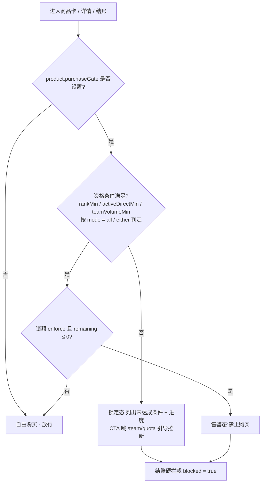

**Pro / Rack P1 上线默认**(后台可改):

| 产品 | 门类型 | 条件 | mode | 锁额 cap / sold | enforce |
|---|---|---|---|---|---|
| NexGridBox Pro | 单活跃直推 | ≥ 5 活跃直推 | all | 1,000 / 977(余 23)| 硬拦 |
| NexGridRack P1 | 组合 | V≥3 **或** ≥15 活跃直推 **或** 团队业绩 ≥ $20,000 | either | 100 / 92(余 8)| 硬拦 |

> 锁额 `remaining` 是该 SKU"还剩 N 件"的**单一来源**(收编原 `stock` 展示,消除双口径)。其余 SKU 默认无购买门;Pro v2 / Rack P2 维持阶段门(`unlocksAtPhase`)。

**列表顶端 VsPhoneHero**:`Your phone $0.06/d ↔ NexGridBox S1 $7.00/d`,中间 `117× MORE` boost chip,两侧带 `+NEX/d` 副字(双币展示)。倍数 = round(S1 日产 / phone 日产) = round(7 / 0.06) = 117;营销文案与实时计算徽章统一用此单一派生值,不另行圆整。

**Promo 并存**:升级置换横幅(§7.6)已改为按「用户是否持有可置换设备」动态显隐(无 phase 窗口),与 S1 促销条各自独立渲染;旧「window 开放时隐藏 S1 promo」互斥规则随 phase 窗口机制一并退役。

**卡片 ROI-first hero metric**(自上而下):

1. **大字日产**:USDT 主数字(如 `$7.00/d`)+ 同行 `+N NEX` 副字(双币)。Cloud Share 同为入门级日产出设备,显示 `$0.19/d` + `+3 NEX/d`,与硬件同形(无年化 / 份额 / 锁仓语义)。
2. **倍数徽章**(卡片右上角):`NNN×` + 副字 `vs phone`(= round(dailyEarn / 0.06),如 S1 117× / Pro 217× / Rack P1 750×)。
3. **价格行**:`Price $649 · $60/mo × 11` 小字。Cloud Share 改 `$19.9`。
4. **AI Performance 行**(已有):chip,展示 SDXL img/min · LLM tok/s · 解锁池信息。

> **商品卡不展示回本天数 / 年化 / 首年净利**——避免在卡片层引导用户自行算年化(数字可信不自曝,§13.1)。回本 / 年化 / 首年净利等 ROI 派生值仅在商品详情页(§7.2)与结账页展示。

**卡片元素**:
- 产品渲染图(datacenter 风,4U 服务器内部 4 张 NVIDIA-style 显卡可见)+ Best Seller / Trending badge + 库存告警(<50 时显示 `NN LEFT`)
- 标题 + 副标 + GPU · VRAM 规格小行
- 上述 4 行 ROI hero metric
- 评分行(⭐ X.X · N reviews · N sold)
- 底部 footer 双按钮:Details (i 圆) + Buy Now CTA(内嵌价格)

**真后台对接**

| Endpoint | Method | Payload | 用途 |
|---|---|---|---|
| `/api/store/catalog` | GET | — | 下发全部 SKU:名称 / 规格 / 价格与分期 / 双币日产 / 已售与锁额余量 / `status` 经典款标记 / `unlocksAtPhase` 上架节奏门 / `purchaseGate` 购买门参数 / AI 性能行。价格与日产以此为**目录单一来源**;上架门与购买门的判定同样在 server,客户端只负责展示与按钮态,下单时 `POST /api/orders` 二次复验 |

### 7.2 商品详情 `/store/[productId]`

**Phase gate**:商品详情页读 `useProductPhase()`,若 `product.unlocksAtPhase` 未 reached,**整页替换**为 `LockedProductCard` 完整变体(lock icon + `New silicon — coming next quarter` 大字 + tagline + GPU/VRAM mini-spec + Estimated arrival + 全宽 `Notify me when live` 按钮)。直链进入(`/store/stellarbox-pro-v2` 等)仍正常渲染该锁定卡、不跳 404 — 用户从分享链接落地也能看到 anticipation 卡。

页面自上而下(unlocked 状态):

1. **Hero card**:产品大渲染图 + tagline + 规格 2×2 grid(GPU / VRAM / Hash Rate / TDP)
2. **Price box**:
   - 大字 `$649`
   - Est. daily 行:`$7.00` + `+40 NEX/d` 副字(双币展示)
   - **ROI hero strip**:
     - 上行 `⏱ PAYS FOR ITSELF IN` 小字标签
     - 大字 `93 days`(payback ≥60 天显示 `X.X months`)
     - chip 行:`Year 1 profit +$1,906` + `14,600 NEX/yr`
   - Buy Now CTA
   - 库存告警(<50):`Only N units left at this price` 脉冲点
3. **LiveSocialProof strip**(Price box 之后,vs-phone 之前):3 stat 横排紧迫感卡,详见 §7.2.2
4. **vs-phone strip**(独立 section,LiveSocialProof 与 AI Performance 之间):
   `📱 Your phone $0.06/d ↔ 📦 $X.XX/d` + chip `NNN×`
   手机基准取典型机档位日产(Tier 3,见 §13.3,运营后台可配),对所有商品同值;
   速度倍数 = round(dailyEarn / 手机基准),现档位下 S1=117× / Pro=217× / Rack P1=750×。
   档位配置取不到时,基准与倍数均不展示,不以默认值或历史值顶替
5. **AI Performance section**:2 列 spec grid(🖼 Image Gen / 💬 LLM / 🎬 Video Gen / 🔧 Fine-tune)+ 🔓 解锁池 chip
6. **What's Included**:features 列表带 ShieldCheck 图标
7. **Managed service strip**:3 列 promise(99.9% uptime / 24/7 service / Live monitor)
8. **ROI Calculator**(详见 §7.2.1)
9. **Social proof**:用户头像 + reviews 节选(详见 §7.2.3,作为深度信任)
10. **Final CTA**:全宽 `Order {product.name} →` 按钮

**硬件规格表**(Hero 与 AI Performance 之间):GPU / 显存 / 功率 / 数据中心逐 SKU 由运营在后台填写,任一项缺失该行整行不展示(空行不携带信息),不影响其余规格与整个商品目录的展示;Cloud Share 无自有硬件,故只展示 GPU / 显存 / 在线率三行。在线率 SLA 为平台统一托管承诺(99.9%),不随商品变。质保按 SKU 配置**月数**:整机 24 个月,Pro v2 与 Rack P1 60 个月,Rack P2 120 个月;满 36 个月且为整年的按年展示,否则按月展示,单位随语言。

Cloud Share variant:Cloud Share 现为**入门级日产出设备**(非份额 / 非年化理财)。详情页隐藏硬件专属的 ROI hero strip 与 ROI Calculator,Price box 显示设备日产出(`$0.19/d` + `+3 NEX/d` 双币),Hero 下方显示日产出区(与硬件同形,无年化 % / 质押 / 锁仓 / 赎回语义)。走立即购买流程,`$19.9` 一次性购买。

#### 7.2.1 ROI Calculator

放在详情页底部,允许用户调整数量(1-10)实时重算。

**结构**:

- 标题 `CALCULATE YOUR RETURNS`(verify.sh 关键文案断言)
- 数量 stepper(`− 1 +`)— 仅硬件 SKU;Cloud Share(入门设备 · 日产微量)不含此计算器(见 §7.2 Cloud Share variant)
- `Total investment: $X,XXX` 即时小行
- **5 ROI block**(2 列 grid + 第 5 块 col-span-2):
  - Est. Daily
  - Est. Monthly
  - Est. Annual + 副字 `+N NEX/yr`(双币年度展示)
  - Payback(显示 `N d` 或 `X.X mo`)
  - **Year 1 Net**(col-span-2 突出,`+$XX,XXX`)
- **12-Month Cumulative Return Chart**(仅非 Share):
  - 标题 `12-MONTH CUMULATIVE RETURN` + 右上角终值 `$XX,XXX`
  - 12 根柱(月累计收益,profitable 月 / 未回本月)
  - `Purchase price` 水平虚线(对应 totalPrice)
  - `▲ Break-even M{n}` 竖虚线 marker(标第几月回本)
  - 底部 legend(Purchase price 点 / Profitable 点)
- Footer 免责声明:"Projections use current network parameters (live). Actual earnings fluctuate ±15%. ROI excludes electricity (covered by managed hosting)."

**计算公式**:

| 量 | 公式 |
|---|---|
| daily | `product.dailyEarn × qty` |
| monthly | `daily × 30` |
| annual | `daily × 365` |
| paybackDays | `round(totalPrice / daily)` |
| year1Net | `annual − totalPrice` |
| annualNEX | `product.dailyEarnNEX × qty × 365` |
| 月柱值 cumulative[i] | `daily × 30 × (i + 1)`, i ∈ [0, 11] |
| breakEvenMonth | `ceil(paybackDays / 30)` |

#### 7.2.2 LiveSocialProof

Price box 之后的紧迫感 strip(Sprint A-1 / B.1)。**目的**:让产品页正中位置(用户已被 Price + ROI 钩住准备决策)出现"别人正在买"的实时社会证明,把"是否买"的犹豫期压到最短。

**布局**:顶部 dot 脉冲 + `ACTIVITY RIGHT NOW` 标签,下方 3 列,每列 Stat 组件:

| 列 | 图标 | 数值公式 | jitter |
|---|---|---|---|
| Viewing | Eye | `24 + FNV-1a(productId) % 92`(24-115 区间) | 客户端 12s ±5 |
| Sold · 24h | ShoppingBag | `max(8, product.sold × 0.024)` | 30% 概率每 12s +1 |
| Sold · 30m | Clock(+ ⚡ HOT 标) | `max(1, sold24h × 0.022)` | 6% 概率每 12s +1 |

**库存告警条**(stock < 50)— 卡底加一行 strip:`Only N units left at this price · restock unconfirmed` + dot 脉冲。

**基线稳定性**:基线由 FNV-1a hash(productId)+ mulberry32 PRNG 派生,同一商品每次进入的初值完全一致;挂载后才启动 jitter interval。

**i18n**:`store.liveProof.{label/viewingLabel/sold24hLabel/sold30mLabel/stockWarning}`(全词典镜像)。

### 7.3 结账流程 `/store/checkout`

7 步状态机:`select-payment → confirm → pay-instructions → awaiting → confirmed → activating → live`

#### 7.3.1 步骤定义

| Step | 内容 | 推进触发 |
|---|---|---|
| select-payment | 4 支付方式选择(USDT TRC20 / BEP20 / ERC20 / Card)+ 弱化「取消」(回商品详情)| `Continue` |
| confirm | Review order:产品 / 数量 / 支付方式 / 物流 / 费用拆解 / 总额 | `Pay now`(链上)或 `Continue to payment`(Card)|
| pay-instructions | 链上 → QR + 地址 + 30 分钟倒计时(待支付会话,§7.3.5);Card → saved-cards selector + CVV(§7.3.3)| 链上:用户点「我已完成支付」;Card:提交。**不自动推进** |
| awaiting | 等待网络/支付方确认;订单号已生成时提供「查看订单」出口 | 支付确认 |
| confirmed | 支付成功庆祝(首单特殊分支,§7.3.4)| 1.2s 自动进 activating |
| activating | 设备激活时序图 + 「查看订单」出口 | 全部步完成 |
| live | 跳 `/store/orders/[id]` |  |

#### 7.3.2 Confirm step 费用拆解

按支付方式动态展示:

| 支付方式 | 显示行 | Total 计算 |
|---|---|---|
| Card | Subtotal + Card processing fee (3.5%) + Total | `price × 1.035` |
| 链上(USDT 三网络)| Network fee: Free + Total | `price` |

CTA 文案:Card 显示 `Continue to payment`(继续进入支付),链上显示 `Pay now`(立即支付)。**点击 CTA 直接进 pay-instructions,不弹任何 confirm modal**(去除冗余双重确认)。

#### 7.3.2a 试用转化模式

持有 `active` / `grace` 试用(§9.11)的用户进入结算页时,自动进入转化模式:

- 费用拆解**分行展示**早购促销折扣与试用抵扣金,两者叠加,行末给出实付总额;抵扣金来源与上限在行内可展开说明。
- **应付为 $0 时不再要求走链上转账或刷卡**,直接完成下单,但**仍需用户显式确认**;确认区明示**超出购机款的抵扣金不退差额**(超出部分按 §9.11.4 规则在购买完成后入余额)。
- 下单成功即把试用置为 `converted`:试用槽位释放、真实设备入槽,净占用不变。

#### 7.3.3 pay-instructions 分支

**链上分支(USDT TRC20 / BEP20 / ERC20)**:
- 140×140 QR 二维码 + 真实网络格式钱包地址(每笔会话专属,来自待支付会话 §7.3.5)
- 30 分钟支付倒计时(以会话截止时刻推算,离开再回来连续不重置)
- 推进只由用户点「我已完成支付」触发;倒计时归零进超时态(§7.3.5)
- 「取消」作废本次会话,需确认(提示已转账者勿取消)

**Card 分支**(走 saved-cards 复用流程,见 §9.10):
- 顶部:已绑卡列表(从 `useCards.cards` 读),tap 选中 → brand-2 高亮 + Check 标
- "添加新卡"入口:跳 `/me/wallet/cards/new?returnTo={当前 checkout url}`,绑定完自动跳回
- 选中后:输入 CVV(只 3-4 位数字)
- 空态(无任何绑卡):卡片提示"还没有绑定的银行卡 / 绑定一次,以后结算只输 CVV 即可" + 主 CTA "绑定银行卡" 跳 `/me/wallet/cards/new?returnTo=...`
- 费用拆解:商品总价 / 卡处理费 (3.5%) / 实付总额
- 提交按钮:`支付 ${总额}`(选中卡 + CVV 4 位时启用);否则 disabled 显示 `输入 CVV` / `选择银行卡` / `填写完整信息`

**关键安全约束**:**完整 PAN / CVV 永不持久化**。saved-cards store 只存 brand / last4 / expiry / holder + 一个 mock tokenId(对标 PSP token 化模式)。

**支付成功后**:
- 自动创建订单(`useApp.orders`)
- 跳 `/store/orders/[id]` 显示进度

#### 7.3.4 confirmed step 首单庆祝分支(Sprint A-1 / E.1)


`confirmed` step UI 根据 `wasEmptyBeforeRef.current`(组件挂载时 snapshot `useOrders.orders.length === 0`)分两个分支渲染:

- **非首单**:Check icon + `Payment Confirmed` + 副字 `Funds received · Initializing your device…`
- **首单**:
  - 全屏彩带,从勋章位置迸发(detail § 14.3.1.1)
  - 🏅 medal spring 入场
  - 大字 `🎉 Your first NexGridBox is on its way`
  - 副字 `We'll provision your slot in the data center within minutes.`
  - Sparkles icon + `Achievement unlocked · First Hardware Owner · +200 NEX`

**为什么用快照而不是订阅**:下单会立即把订单数从 0 推到 1,若直接订阅,触发庆祝判定时已经是 1,首单永远判不出来。因此在页面挂载瞬间快照一次"用户此前是否已有订单",该真值贯穿整个 checkout 生命周期,不随下单变化。

#### 7.3.5 待支付会话与浮动条

**目的**:链上付款进入扫码步即开出一张「待支付会话」:金额 / 收款地址 / 截止时刻在开票瞬间冻结,用户离开再回来仍是同一笔(同地址、倒计时连续),到点作废——已转账的资金不因离开页面而失去归属。

**入口**:`/store/checkout?product=<id>&resume=<sessionId>`(浮动条点击)。

**数据**:`usePendingCheckout`,按账号分行持久(§12.22),列表形、同一时刻至多一张在窗内;会话即服务端待支付订单(PENDING_PAYMENT + 支付指令)的客户端投影,服务端下发 paymentDeadline 与地址时以服务端为准。

**业务规则**:
- 开票:confirm 步「Pay now」(链上方式)→ 建会话 → 进 pay-instructions。金额 = 确认页应付总额;会话同时记录确认页报价(券 / 试用 / 旧机抵扣分项),供恢复展示与后端镜像。卡支付、$0 应付不开票。**同账号同一时刻至多一张在窗内的会话**(不满足则拒开并露出已有那张)。
- 作废:结算回到 select-payment / confirm 步(支付时刻任一校验不通过、更换支付方式)即作废当前会话——会话绑定的是那份报价,报价重来则票不再有效;下一次「Pay now」开新票(新地址、新 30 分钟)。
- 结算:一张会话至多结算一次(结算前原子占用,别处已结算 / 取消 / 过期则拒单并提示「已在别处完成或取消」)。恢复会话时券 / 试用按当前状态重新计算,且每一分项取 min(当前值, 会话记录值)——记录值不可信(本地可改)故不得高于当前值,当前值也不得高于记录值(窗内新到的券 / 多累计的试用收益不参与这一单,也不导致拒单);链上会话按票面金额恰好结算,实扣 ≠ 票面(券失效、试用结束、抵扣变化)一律拒单回报价步重开新票;抵扣只承认报价当时已包含的那台设备。单次券在扣款前原子核销(别处已用掉这张券则拒单回报价步),之后任一步失败即放回;扣款后的每一步落盘(旧机下架、建单)失败都按原路退回资金、设备与券并明示,退不回去进入待对账终态。同一账号多个结算页同时打开(浮动条 / 绑卡返回)互不干扰各自的报价上下文。
- 后退:扫码页 / 等待页离开(返回、刷新)→ 会话静默保留 + 首次一次性提示「订单已为你保留 30 分钟」;不弹确认框(用户可能已转账,销毁 = 资金失去归属)。
- 浮动条:存在在窗内会话、且当前结算页未展示它时,全站置顶显示「待支付 $X · mm:ss · 继续支付」;点击回到同一笔(商品此刻不可购买 —— 售罄 / 未上架 / 资格不足 —— 时不作废会话,提示「待支付订单已保留;如已转账请联系客服」,会话到期自然作废);离开扫码页时的一次性提示报该会话真实剩余分钟;会话完成 / 取消 / 超时即消失;账号隔离;刷新存活。所有页面内容整体下让一带,不遮挡首屏(页内置顶栏随内容下让并钉在浮动条下沿)。
- 完成:「我已完成支付」→ awaiting → confirmed(扣款 + 建单)时会话结束。同一商品经任何支付方式(链上 / 卡 / $0 直付 / 组合购)成交,同账号仍在窗内的该商品会话一并作废(购买意图已兑现,不再催付)。取消须真正作废成功才算取消(作废失败提示重试,会话仍在)。
- 取消:扫码页「取消支付」→ 确认框先问「你是否已向该地址转账」并告知风险(已转账请勿取消,取消后订单不再等待到账、款项无法自动匹配,应点「我已完成支付」;未转账可放心取消),二选一「已转账,继续支付 / 未转账,取消」→ 取消 = 作废会话、提示已取消、回 confirm 步,浮动条随之消失;点遮罩 = 继续支付。未点取消而按顶部返回 = 会话保留 + 浮动条提示未支付。
- 超时:倒计时归零 → 扫码页进超时态(地址不再展示、不可「我已完成支付」),唯一出口「重新下单」→ 回 confirm 步重新报价开新票;浮动条同时消失。
- 撞单:已有在窗内会话时再点「Pay now」→ 确认框二选一:「保留它」(点遮罩同)= 什么都不动,旧会话仍在、浮动条仍在(想回去点浮动条);「放弃它,开始新的」= 作废旧会话后开新票。确认框随结算页一起关闭(离开页面即收掉,不跨页残留)。
- 参数:付款窗 30 分钟(`PENDING_CHECKOUT_WINDOW_MIN`)。

### 7.4 订单管理 `/store/orders`

订单 4 阶段直通车:`placed → paid → provisioning → activated`(平台为机房托管模式,无实物物流环节)。

**结算与驻留态**:结账即时结算 —— `createOrder` 创建订单时同时记入 `placed`(已下单)与 `paid`(已付款)两条时间线事件,订单初始驻留态为 `paid`。`placed` 仅是时间线上的瞬时事件,正常流程不停留于该状态(无独立"待付款"驻留态)。

**自动履约推进(全局)**:订单付款后无需用户干预即可自动履约。平台对所有在途订单(`paid` / `provisioning`)以固定节奏(每 6 秒一拍)逐段推进:`paid → provisioning`(分配机位)→ `provisioning → activated`(设备上线)。订单进入 `activated` 的同一更新内,平台**自动生成并激活一台对应商品的设备**(`addDevice(productId)` + `activateDevice`,受 §12.x `MAX_DEVICES=6` 活跃槽位上限约束),并写入 `deviceId` / `activatedAt` / 时间线 `Device live · joined NexGrid network`,从而把购买动作与 Earn 模块的设备机队接起来。用户停留在某订单详情页(`/store/[id]`)时,该订单以更快的节奏(每 3 秒一拍)单独推进,使进度条实时可见。

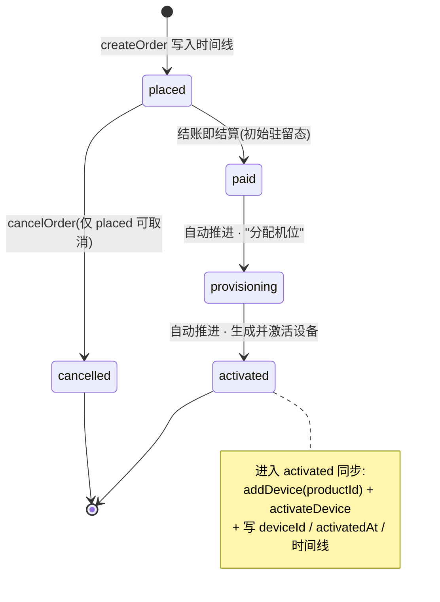

> 当前各阶段推进由客户端模拟节奏驱动(`SimulationProvider` ORDER_TICK 6s + 详情页 3s);真后台对接时改由服务端履约事件推送(SSE `GET /api/orders/:id`),客户端只反映 canonical 状态、不自行推断推进。设备记录由服务端在订单上线时创建并回传 `deviceId`。真平台所需的 `payment_failed / expired / refunded / chargeback / provisioning_failed` 终态在 mock 阶段暂统一塌缩为 `cancelled`,对接时补全(见 §9.11f)。

**取消规则**:订单**仅在付款前(`placed` 态)可由用户自助取消**。一旦进入 `paid`(结账后的初始驻留态)及之后的 `provisioning` / `activated`,订单即为**最终态,不可自助取消** —— 机房已产生机位调度与资金结算承诺,付款后的撤销改走退款 / 支持流程。`cancelOrder(id)` 对任何非 `placed` 状态为 no-op,该不变量由服务端权威强制、client 仅反映(`GET /api/orders/:id` 返回规范状态)。因当前结账即结算、订单不停留在 `placed`,订单详情页实际不出现自助"取消订单"入口。

**订单详情页 `/store/[id]`**:
- **Order summary** 板块顶部展示 **Order ID**(完整订单号)+ Quantity / Unit price / Discount / Subtotal / Total
- **Deployment timeline**(原"物流进度"已统一更名)— 4 阶段时间线 + 状态描述 + 进度条
- **Deployment #**(原"运单号")+ **Datacenter**(原"承运商",显示 SG / FRA / VA 机房 ID)+ 数据中心 API 模拟说明
- 到 `activated` 阶段自动 `addDevice(productId)` 添加设备到 fleet

**文案规则**:平台不涉及实体物流(机房托管 = 数据中心一键开通),所有 "shipping / tracking / courier" 文案统一改为 "deployment / activation / datacenter"。例外:排行榜 Podium 实物奖品(Genesis Node / NexGridBox 等,见 §8.11.5)保留 shipping 语义。

### 7.5 升级置换(Trade-in)— 随时下架 + 产出阶梯抵扣

**代际概念已取消**。任何已购付费设备可**随时下架**,按其累计产出落阶梯折算抵扣金额,用于购买**任何更高价 SKU**(默认规则,后台可配)。三个入口表面:

1. **设备仓库置换条**(`/me/devices`,主动入口)— 每台合规设备行内「可抵 $X」chip(→阶梯规则说明弹层)+「升级置换」CTA(→选目标 → 确认 → 去结算);
2. **Checkout intercept**(`/store/checkout` mount-time)— 买任一设备 SKU 时,若持有可置换设备自动弹分叉 sheet(置换抵扣 / 全价购买);
3. **商城横幅**(`/store` 顶部,§7.6)— 按用户最优可置换设备动态报价,CTA 跳设备仓库。

**总不变量**:抵扣**仅在结算时抵减应付款,永不写入余额**、不可提现、不可拆分;真值 server-authoritative(`POST /api/orders` 携 `tradeInDeviceId`,服务端同事务复算抵扣 + 下架旧机)。

#### 7.5.1 Eligibility 评估 + 产出阶梯抵扣

**购买资格**(与旧版一致,仅 trade-in 规则去定向):`eligibility[kind]` 定义,模式 `open / any-of / all-of`,9 种规则类型:`open / own-kind / own-prev-tier / v-rank-min / cumulative-deposit-usdt / kyc-tier / days-active / referral-count / trade-in`。`trade-in` 规则**不再限定来源型号**(fromKind 可省,任意合格设备的置换即满足该通道)。

**默认 eligibility**:
- **S1**:`open`(任何用户可购)
- **Pro / Pro v2**:`any-of`〔own ≥1 S1 / V-Rank ≥2 / 累计入金 ≥$1000 / trade-in〕
- **Rack P1 / P2**:`any-of`〔own ≥1 上一档 / V-Rank ≥4 / 累计入金 ≥$5000 / trade-in〕

**设备置换资格**(计算候选清单 `eligibleTradeInDevices(targetKind)`):实付价 > 0(赠送/免费设备排除,前端零痕迹)∧ kind ∈ `applyTo` 白名单 ∧ 目标目录价严格更高(`requireHigherPrice`,可配)∧ 非「激活中且任务运行」(阻断判定单源 `isDeviceTaskBlocked`:**库存设备上的出厂任务不在跑、不阻断**;激活设备走「先停用(自带等任务/强停保护)→ 库存态再置换」既有链路)。活跃与库存设备均可置换;候选按可抵额降序。

**置换目标合规**(三个目标面——retire 目标列表 / 设备行 strip / 商城横幅——统一判定 `isTradeInTargetAvailable`):目标 SKU **已正式上架(unlocksAtPhase 已达,与商城正门同源)∨ 处于抢先购窗口**(§7.1 `tradeInEarlyAccess` 开关,默认关);未上架且不在窗口的 SKU 不出现在任何置换目标面。

**产出阶梯抵扣公式**(`computeTradeInCredit`,唯一抵扣引擎;无持有时长门槛——套利防护由阶梯本身承担:刚买产出≈0 → 落最高档,抵扣 ≤75% 实付,立即置换必亏 25%):

```
ratio  = cumulativeEarningsUsdt ÷ paidPriceUsdt        // 产出比(分子=该设备累计 USD 产出,分母=实付净额)
credit = paidPriceUsdt × creditPct(band(ratio)) × promoMult,  clamp 到 [0, 目标价]
```

| 档 | 产出比区间(左闭右开) | 抵扣比例(默认) |
|---|---|---|
| 1 | 0% – <25% | 75% |
| 2 | 25% – <50% | 60% |
| 3 | 50% – <75% | 45% |
| 4 | 75% – <100% | 30% |
| 5 | ≥100% | 15% |

- **实付基数**:`paidPriceUsdt` = 实付净额(订单 total,已扣券与置换抵扣;trial 转正 = 促销价 − 收益抵扣),非目录价 — 防券/试用低价买入套利。
- **paidPrice = 0(赠送)⇒ 不可置换**(资格排除,非"∞ 产出比落档 5")。
- **规则参数**(后台「升级置换阶梯」面板可配,详见后台 PRD E 域):阶梯 5 档界点与比例(区间连续、比例严格递减,结构由机器哨兵锁)/ `requireHigherPrice`(默认 true)/ `maxDevicesPerOrder`(默认 1)/ `promoMult`(默认 1.0;>≈1.47 时 clamp 可能绑定)/ `applyTo` SKU 白名单 / `enabled` 总开关(关闭 = 全部置换入口隐藏)。
- 所有参数 server-canonical via `GET /api/config/tradein`,运营可热改无需 client redeploy。

**真后台对接**

| Endpoint | Method | Payload | 用途 |
|---|---|---|---|
| `/api/devices/eligibility` | GET | `?kind=<SKU>&tradeInFrom=<SKU>` | 按目标 SKU 返购买资格评估 `{ eligible, mode, passed[], missing[{ rule, current, required }] }`,规则集即本节 `eligibility[kind]`。server 是唯一权威;客户端评估只决定开哪张 sheet、按钮锁态与差距提示,**从不作为 `POST /api/orders` 的前置条件**,下单时 server 重校验 |

**铁律**:抵扣 **永不写余额** — 仅在结算中作为扣减项(`debitBalance(price − discount − credit)`),不可提现、不可累加;累计产出越多抵扣越低(合规口径向用户明示,引导尽早置换)。

#### 7.5.2 Checkout intercept 触发条件

结账页 mount 时按序评估(**全部设备 SKU 均可触发**,旧 v2/P2 白名单排除已取消):

-1. **上架节奏门**(先于购买门——没上架谈不上资格):`unlocksAtPhase` 未达的 SKU,仅当「携置换上下文 ∧ 抢先购窗口内(开关默认关)」放行;否则提示「即将上架」+ 跳回 `/store`(深链防线,与商城正门口径同源)。
0. **购买门硬拦截**:对挂 `purchaseGate` 的商品跑 `evaluatePurchaseGate`(§7.1),若 `blocked` → 阻断支付 + 跳 `/team/quota`。**门优先级高于置换**——向被锁 SKU 置换同样被拦(retire 流选中被锁目标时在此兜底)。服务端下单二次校验为权威。
1. **已带置换上下文**(用户从设备仓库 retire 流确认后到达,`appliedTradein.targetKind` = 本单 SKU)→ 不再弹分叉,直接渲染抵扣行。
2. 若持有 ≥1 台可置换候选 → 弹**分叉 sheet**(选哪台设备置换(设备级,含各台实时可抵额)/ 全价购买)。
3. 否则若 `activeCount ≥ MAX_DEVICES` → 弹**让位 sheet**(让出最低产出设备)。
4. 否则正常 checkout 流程。

#### 7.5.3 Sheet 状态机 + 结算原子块

`useTradeinSheet` 单一 discriminated union 防双开:`{ kind: "none" | "choice" | "retire" | "tradein" | "replace" | "block" }`,block 态按来源分裂(`origin: "replace" | "retire"`)。

| Sheet 态 | 触发 | 主流程 |
|---|---|---|
| `choice` | Checkout intercept 分叉 | 列全部可置换设备(每台带实时抵扣额),选设备 → tradein;或全价购买(槽满 fallback replace) |
| `retire` | 设备仓库「升级置换」CTA | 选升级目标(**点选列表**,仅列合规目标 SKU,每行带抵后价;无自由输入)→ tradein |
| `tradein` | 置换确认 | 确认卡:旧机 / 累计产出 / 抵扣档位 / 本次抵扣 / 预计应付 + 合规披露 → 确认写入结算抵扣上下文(`appliedTradein`,仅内存态,离开结算页即弃)→ 去结算 |
| `replace` | Path B 槽满 | 让出最低产出设备 / 保留全部槽位入库 / 取消(原有流程不变) |
| `block(origin=retire)` | 目标设备激活中且任务运行 | 「任务完成后即可下架」+ 查看任务进度 / 知道了(**无强拆选项**) |
| `block(origin=replace)` | 让位目标 mid-task | Wait / Force-replace(放弃任务,原有流程不变) |

**结算原子块**(钱与设备的唯一变更点,checkout 持久块同步执行、无 await 无半执行窗口):

```
支付确认 → 复检抵扣上下文(设备仍在 ∧ 非任务阻断 ∧ 开关开;失效 → 拒单重报价,绝不静默按全价扣)
        → debitBalance(净额 = 价 − 券 − 抵扣, ≥0)      // 失败 → 退回支付步,零状态变更
        → 移除旧设备(下架) + 持久化
        → createOrder{ tradeInCredit, tradeInDeviceId }   // order.total = 价 − 券 − 抵扣
        → 账单(i18n memo 含置换明细) → 清抵扣上下文
```

新设备由订单履约管线生成(**未激活入库**,`paidPriceUsdt = order.total`),不在本块内。

**关键不变量**:
- M1(原子):扣款成功前零状态变更;扣款后同步序列无失败分支(移除为幂等 filter)
- M2(抵扣不入余额):`debitBalance(净额)` 是唯一接触余额的调用,抵扣不经 `creditBalance` 路径
- M3(双击防御):每个 composer 入口 confirming 守卫,成功/失败路径均复位
- M4(判定单源):任务阻断 `isDeviceTaskBlocked` 与抵扣引擎 `computeTradeInCredit` 各自单源,全部消费面(候选/入口/确认/结算复检 × 七个抵扣展示面)禁止旁路自算

**业务流程图(retire 主链)**:

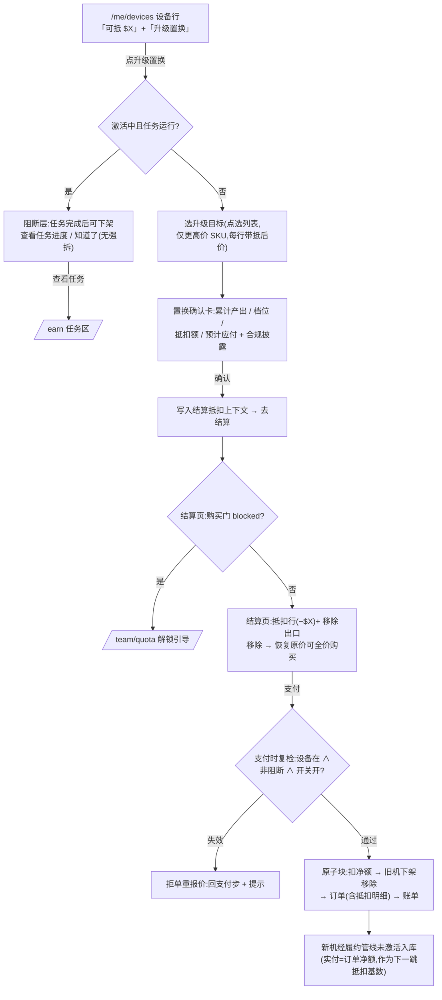

#### 7.5.4 `/me/devices` 设备仓库置换条 + 阶梯说明弹层

**常驻置换条**(入口形态为"行内常驻",不做节奏式弹出推送):每台设备行底部按资格渲染:

- 合规设备:「可抵 $X ›」chip(点开**阶梯规则说明弹层**:5 档表 + 当前档高亮 + 该设备产出比/落档描述 + 合规脚注,数据全派生自阶梯单源)+「升级置换」CTA(→ §7.5.3 retire 流)
- 免费设备(paidPrice=0)/ 不在 applyTo:**零痕迹**(不渲染置换条)
- 无更高价目标(已持最高档):显示禁用原因「当前已是最高算力档位」
- 激活中且任务运行:CTA 可点,进阻断层(业务链必有下一步)

旧 promo 推送配置组(`cooldownHours / maxPerSession / delayMs / routes / triggerWhen`)保留为后台预留参数(server-canonical),当前版本无弹出式推送消费者。

#### 7.5.5 i18n

`tradein.*` namespace 按面组织(全词典镜像):eligibility hint 组(9)/ choice 分叉组 / retire 目标选择组 / tradein 确认卡组(含档位行)/ checkout 抵扣行组(含移除)/ 设备行置换条组(strip*)/ 阶梯说明弹层组(ladder*)/ replace & block 组(含 retire 阻断专用文案)/ 错误组。结算账单 memo 走 `store.coBillMemo*` 模板(账单页直接渲染,禁硬编码英文)。

#### 7.5.6 Demo 演示工具(PM-facing)

`/me/replay-tour` 顶部新手引导回放后,挂"Lifecycle demo"section,PM-facing 演示 action,让 prototype 演示者绕过"购买 → 等月份"的真时间延迟,立即呈现任务产能递减 + 升级置换流程效果。

| Action | Store call | 效果 | i18n key |
|---|---|---|---|
| Seed S1 | `_devSeedLegacyDevice("stellarbox-s1", 5)` | 加一台 5 个月前购买的 NexGridBox-S1(落地产能 ~70%) | `replay.demoSeedTitle/Hint/Cta` |
| Seed Rack | `_devSeedLegacyDevice("stellarrack-p1", 8)` | 加一台 8 个月前购买的 NexGridRack-P1(落地产能 ~50%) | `replay.demoSeedRack/RackHint/RackCta` |
| Fast-forward | `_devFastForwardAll(3)` | 全部参与递减设备 purchasedAt 拨回 3 个月 | `replay.demoFastForwardTitle/Hint/Cta` |
| Reset | `_devResetDevices()` | 重置回 phone-only(purchasedAt = user.joinedAt) | `replay.demoResetTitle/Hint/Cta` |
| Trigger milestone | `useMilestones.reset() + _devBumpEarningsTotal(150)` | 重置已触发的里程碑 + 拨高 earnings 跨过 $100 阈值,§11.3a watcher 下次 poll 时 fire celebration overlay | `replay.demoMilestoneTitle/Hint/Cta` |
| Trigger Nova push | `useStella.push(monthlyTaskLockPush + tradeinNudge)` 走唯一 cooldownKey 绕过节流 | Sprint 2 收尾(Gap D)— 立即 force-fire 月度任务锁定推送 + Trade-in nudge(若条件满足),文案随当前 phase 切换,PM 演示无需等真 cadence | `replay.demoStellaTitle/Hint/Cta` |

每个 action 触发 toast 反馈(模板 `replay.demoToastSeeded/FastForwarded/Reset/Full`),容量校验 MAX_DEVICES。

**设计意图**:快速展示"用户买了 NexGridBox 4-5 个月后看到接单量递减 + 升级置换引导"完整路径,不能等真时间。这些 demo helpers 不影响真实用户流程(用户从 /store 正常购买的设备 purchasedAt = Date.now())。

### 7.6 升级置换横幅(TradeinWindowBanner)

位置:`/store` 顶部,VsPhoneHero 之下、商品列表之上。**条件渲染** — 用户持有 ≥1 台可置换设备(§7.5.1 资格:实付>0 ∧ applyTo ∧ 存在合规目标 ∧ 抵扣>0 ∧ 总开关开)即显示;无合格设备整横幅隐藏,无 phase 窗口概念。

**目的**:把用户手上"最划算的一台置换机会"以动态报价固化在 `/store` 顶部,与 §6.8 车队产能 Banner(/earn 入口)、设备仓库置换条(§7.5.4)互补 — 三侧任一进入 §7.5 置换流程都有 1-tap 路径。CTA target 为 `/me/devices`。

**报价派生**(全实时,无写死金额):遍历用户可置换设备,每台按其**最低升级价目标**计算阶梯抵扣,取**抵扣额最高**的一台展示 —— `你的 {name} 可抵 ${credit}` + `升级 {target} 只需再付约 ${net}`(net = 目标价 − 抵扣)。

**i18n**(`store.tradeinUpgrade.*`):`label` / `title{name,credit}` / `body{target,net}` / `cta`。旧 `store.tradeinWindow.*` 窗口键组已删除。

**铁律**:文案永不暴露 phase / 内部参数名等 PM 术语;抵扣口径向用户明示"按累计产出计算、越早置换抵得越多"(合规透明,同时构成紧迫感)。

### 7.7 代金券(Voucher · 领券促销)

平台促销代金券:运营在后台(运营控制台 H7)创建 / 配置,用户领取后在结算对应设备时自动抵扣。两类:**满减(fixed)**= 订单满 `minPurchaseUSD` 减 `amountUSD`;**折扣(percent)**= 按 `percent`% 抵扣、封顶 `maxDiscountUSD`。

**目的**:以可控的获客 / 活动促销降低首购门槛,定向(新人 / 全部受众)+ 定 SKU(指定设备或全设备)+ 限时(有效期),全部参数后台可配、随时可投放 / 暂停。

#### 7.7.1 领取入口与弹窗

- **首页自动弹窗**:用户进首页(`/`)后延迟自动弹出领券弹窗,展示当前可领代金券(名称 / 面值 / 门槛 / 适用范围 / 有效期)。弹窗有节流(冷却 + 单会话上限),且**优先于免费试用弹窗**(同一次进站只弹一个;无可领代金券时让位给试用弹窗)。优先级与同屏互斥的统一口径见 §7.7.1a。

#### 7.7.1a 自动弹层编排(跨模块统一口径)

会遮挡交互的自动弹出面共用一套编排,**同一时刻只允许一个占屏**:

- **优先级(高 → 低)**:领券弹窗 → 免费试用弹窗 → 里程碑庆祝浮层。顺序是配置数据而非各面延迟时长的副产品;调整任一面的 `delayMs` 不得改变弹出顺序。
- **一次进站只弹一个**:先取得占屏权的那个关闭后,本次进入首页不再弹出第二个。
- **永不顶替**:已占屏的弹层不因更高优先级的面稍后就绪而被替换或关闭(防止用户正要点击时目标被换掉);未抢到的面按各自节流规则等待下一次机会。
- **资格实时判定**:是否有资格弹出在**触发时刻**判定,不在页面载入瞬间锁定——代金券目录等异步数据尚未就绪时不得据此判定为"无资格"而让位给低优先级面。
- **里程碑庆祝浮层**:除上述占屏互斥外,原有的钱链路页面(结算 / 提现 / 试用)挂起规则不变;两条挂起轴独立生效。挂起只延后展示,不丢失——奖励入账与账单记录始终无条件执行,离开挂起条件后逐条补发。
- **层级兜底**:庆祝浮层的视觉层级必须低于全部业务弹层,即便编排失效也只会垫在业务弹层之下,不遮挡领取入口。
- **回退 banner**:用户关闭弹窗后,在后台为该券配置的页面(`home / store / me / earn` 子集)顶部显示领券 banner 入口;点击重新打开领券弹窗。banner 仅在一级 tab 页出现,子页不出。
- **领取**:点击「领取」即领入个人钱包(claim);同一券每用户限领一次。

#### 7.7.2 领取后跳转(马上去使用)

领取后同一按钮文案变为「马上去使用」,点击按券的适用范围跳转:
- **指定单一 SKU 券** → 跳该设备购买详情页 `/store/[productId]`。
- **多设备 / 全设备券**(`applicableSkus` 为空 = 全设备)→ 跳商城 `/store`。

#### 7.7.3 结算抵扣

进入某设备结账(`/store/checkout`)时:
- 系统在用户**已领、未使用、在有效期、适用本 SKU** 的代金券中,自动选取**抵扣额最大**的一张(`bestVoucherFor`)。
- 价格摘要新增「代金券 −$X」行;**满减**按门槛判定(订单额 ≥ 门槛才抵),**折扣**按百分比并受封顶约束;抵扣额不超过设备价。
- 卡支付的 3.5% 手续费按**抵扣后**小计计算;`Order.discount` 记抵扣额、`Order.total = 单价 − 抵扣`;账单(useBills)备注带券。
- 券在扣款前原子核销(单次核销:同一张券在多个页面 / 标签页并发结算时只有一处成交带折扣,其余拒单回报价步);扣款 / 建单随后失败则放回未使用。确认页 / 会话报价里没有券的订单不依赖任何券:窗内新领到的券不参与本单,也不拦本单。
- 若用户已领、适用本 SKU 的券**已过期**(被自动选取跳过),价格摘要显示一行「代金券已过期」提示,而非静默无折扣。

#### 7.7.4 性质与叠加规则(后台可配)

- **不可提现**(固有性质):代金券只在结算抵扣价格,**永不计入可提现余额**、不会转化为现金。
- **不可拆分**(`splittable`,默认否):一张券整张一次性用于一笔订单,不跨单拆分。
- **叠加策略**:`stackWithTrial`(可否与试用收益抵扣叠加)/ `stackWithOthers`(可否与其它优惠叠加),默认均为否(二选一取最优);当前结算流中代金券为唯一折扣来源。
- 领取资格、有效期、核销均以服务端为权威(claim / 下单核销服务端二次校验);客户端为乐观镜像。

#### 7.7.5 个人中心入口

「我的奖励」(`/me/rewards`,见 §11.5a)是代金券的用户侧查看入口:类别汇总页显示可用张数,分类记录页列出可用券(带「去使用」)与已过期券;个人中心(`/me`)「账户」分组提供带未读红点的入口项。

#### 7.7.6 业务流程

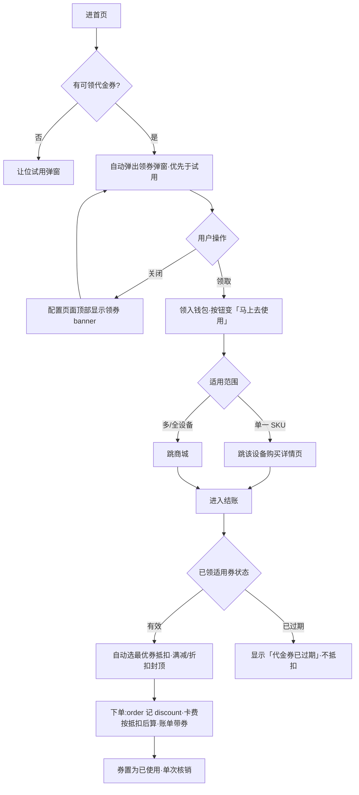

**铁律**:代金券是真实促销折扣,文案与展示不暴露任何运营 / 漏斗术语。

---

## 8. Team(团队中心)

### 8.1 团队主页 `/team`

汇总枢纽,显示:
- 邀请 hero(ReferralHero,见 §8.1.1)
- 3-stat 行:Direct(自直推人数)/ Network(直推+扩展总数)/ Today(今日团队收益)
- V 级 hero + 升阶进度条 + 等级奖励 chip(培育奖 NEX)
- 5-track Team programs 卡(V-Rank ladder / Influence Royalty / Dual-Track Binary / Leadership Pool / Regional Ambassador)— 每行 icon + label + sub + 右侧 value;value 按 §8.1.0 规则分类显示
- 团队收益卡(TeamLedgerCard,见 §8.1.2)— 本月 + 累计 + Direct/Extended 拆分 + 可提现/冷却 + 提现入口(单一聚合卡,替代原"团队 lifetime 卡 + 月份佣金卡"的拆分布局,消除 lifetime $195.09 与本月数据重复显示)
- Influence Network 入口(链 §8.7 orbit live map)/ Genealogy 入口(链 §8.8)
- Genesis FOMO 卡:销售进度 + 剩余配额 + 链 Genesis 详情
- Leaderboard preview:Top Inviters + 自己排名 + ↑N 周变化 + 链 §8.11

#### 8.1.0 ProgramRow value 字段分类

ProgramRow 右侧 value 按内容自动分类,影响视觉强度:

| Value 类型 | 示例 | 语义 |
|---|---|---|
| Active earnings(含 `$`) | `+$11.00/d` / `$240/wk` | 真实 active earnings,强调显示 |
| 状态 / hint | `Active` / `+14% next` / `Locked` / `V5+` | 状态指示 / 升级 hint,次级显示 |
| Disabled 锁定 | 任意 + `disabled: true` | 未解锁,弱化显示 |

判断方式:`val.includes("$")`。语义:earnings 强化"钱在流入",status hint 引导 unlock 动作。

#### 8.1.1 邀请 Hero(ReferralHero)

**目的**:展示"我的邀请码 + 双向奖励经济 + 实时社会证明 + 分享路径",降低分享决策门槛,提升直推转化。

**内容**(自上而下):

1. **邀请码展示 + 复制**:展示 `user.referralCode`(如 `NEXGRID-8K9X`),配复制按钮 · 点击调 `navigator.clipboard.writeText(code)` + toast `Copied {code}` + 1.6s 内反馈 Check

2. **双向奖励**:
   - You get(邀请人):`$200 + 200 NEX` / `per friend signup · 10% direct royalty`(佣金费率单一来源 §4.3.4 / §8.3.1)
   - They get(被邀人):welcome gift 同源 `rewards.welcomeGift`(默认 `$5 + 20 NEX`,§4.3.2),不另设常量
   - **发放规则**:邀请人奖励不直入余额——被邀人注册成功计一笔,入账按邀请人**当时风险评估分桶**(与新人礼同口径,§4.3.5 三桶);被邀新号与邀请人命中同一多账户风险簇(自推链)时,该笔奖励进锁定桶或停发(SPEC-7 §4 反自推链口径,阈值后台可配)

3. **Social proof**:`247 inviters earned today · 30-day cooldown per friend`(mock 实时社会证明,无需对接后端)

4. **分享动作(四入口,链接单源构造)**:
   - 分享链接 = `share.baseUrl + referralCode`(§13.3;未配置时回退当前站点地址直连落地页,扫码可达);四入口产出的码 / 链接 / 二维码同源一致;邀请码为空时四入口置灰并 toast 提示。
   - **海报**:打开分享海报面板——canvas 生成 750×1000 海报,含**可扫二维码**(payload = 分享链接)、邀请码、可开关的用户名;模板轮播:新人礼(恒可用)/ 我的产出(取用户设备今日实际产出,无设备自动隐藏)/ 我的网络;海报仅承载被邀方向价值(新人礼 + 产品故事),**不出现邀请人向金额**;面板含被邀方奖励说明行、底部渠道行、保存图片(受限浏览器降级为长按保存引导)、复制链接;生成中 / 失败态禁分享与保存,失败可重试。
   - **邀请码 / 链接**:复制到剪贴板;复制失败不展示成功态、不计分享事件。
   - **立即分享**:打开渠道面板——顶部邀请人奖励说明行(数额随 §8.1.1.1 阶段倍率)+ 渠道 grid(`share.channels` 配置驱动,顺序即展示序,§13.3)+ 弱化「取消」。渠道行为:web intent 型直接唤起并预填文案 + 链接(被拦截自动复制降级);无网页直发口的渠道(Zalo / Messenger)在 H5 走「复制文案 + 引导到该 App 粘贴」;系统分享项仅在浏览器支持时显示;渠道配置为空时兜底「复制 + 海报」两项,面板永不空。分享文案模板含礼包金额占位,与 `rewards.welcomeGift` 同源。
   - **分享事件与任务接线**:任一入口的成功分享动作(复制成功 / 唤起渠道 / 保存海报)记录分享事件(server-canonical `share.performed`),并幂等触发首日任务 `invite_friend` 完成(§5.15.3,仅首次发奖,重复分享不重复计酬)。

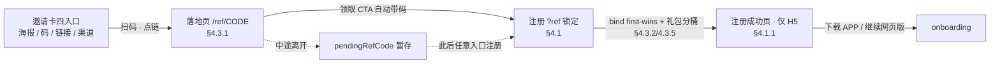

**关键参数**:
- `REWARD_USDT_LIFETIME_ESTIMATE` = 200(`You get` 数额,代表被邀人 lifetime 平均贡献 ≈ unilevel + binary + 平级奖之和;× §8.1.1.1 阶段倍率展示)
- `REWARD_NEX_INVITER`:同源 `rewards.inviterReward.nexAmount`(默认 200,后台可调,§13.3 配置映射),不另设常量;发放过风险分桶见 §8.1.1「发放规则」
- 被邀人礼包:同源 `rewards.welcomeGift`(§13.3),不另设常量

#### 8.1.2 团队收益卡(TeamLedgerCard)

**目的**:把"本月可领、累计业绩、网络结构拆分、可提现/冷却余额、提现入口"聚合在单卡,替代原"团队累计 lifetime 卡 + 月份佣金卡"双卡布局,消除同一 $195.09 数据重复出现。

**内容**(自上而下):

1. **Header**:`This month` eyebrow + `View details →` link(跳 `/team/commissions`,§8.6)

2. **本月 hero**(主指标):
   - 本月 USDT 收益(`monthUSDT`,来自 `useCommission.monthlyUSDT()` aggregate)
   - 副字:`+ {monthNEX} NEX`(本月 NEX 佣金,`useCommission.monthlyNEX()`)

3. **累计摘要行**(单行 mono):`Lifetime ${totalUSDTLifetime} · {contributors} contributors · ↑ +12.4%`
   - `totalUSDTLifetime`:`useCommission.totalUSDTLifetime()`
   - `contributors`:`useNetwork` 总成员数(直推+扩展)
   - `+12.4%`:MoM growth(mock 静态,Sprint 4 接 history aggregate)

4. **Direct / Extended 拆分**:
   - Split bar:Direct(brand)+ Extended(brand-2)按 lifetime USDT 比例
   - 2-cell 数额:`Direct · N% · $X.XX` / `Extended · N% · $X.XX`
   - 数据源:`directUSDT` = L1 累计;`extendedUSDT` = L2-L7 累计

5. **流动性 2-cell**:
   - Withdrawable:`unlockedUSDT`(已解锁可提现额)
   - Cooling (30d):`coolingUSDT`(30 天冷却中)
   - 注:原 lifetime cell 已上移到累计摘要行,此处删除以消重

6. **提现入口**:跳 `/me/wallet/withdraw`(§9.3)— P-mini phase 仅展示可提现额对应入口;接 NEX 自选抵扣的网络确认费(§9.3.2)

**数据流**:`useCommission`(月度/累计 aggregate)+ `useNetwork`(成员数 + 直推/扩展划分)+ `useApp.wallet`(可提现/冷却余额)

**i18n key**(`teamV3` namespace):`thisMonth` / `viewDetails` / `lifetime` / `withdrawable` / `coolingDown` / `withdrawUSDT`

**关键参数**(`INVITE_REWARDS` 常量,Sprint 3 第三阶段改为 base + phase multiplier):
- `REWARD_USDT` = 1(单次签约真实结算,不随 phase 变化)
- `BASE_REWARD_NEX` = 200(NEX 奖励 base)
- `BASE_REWARD_DOLLAR_LABEL` = 200(hero base,代表"被邀人 lifetime 平均贡献 ≈ unilevel + binary + 平级奖之和")

#### 8.1.1.1 phase-driven 邀请奖励 promo(Sprint 3 第三阶段)

接 `useProductPhase().inviteBonusMultiplier`(§13.4),根据用户当前 phase 自动派发奖励倍数:

| Phase 派发 multiplier | 派发表现 |
|---|---|
| `> 1.0`(P1=2.0,P2=1.5) | 顶部加 Flame chip `Limited time · {N}× bonus this week`(真实庞氏话术);左侧 hero 大字显示派发后金额(`$400` / `$300`)+ 原价 `$200`;Share CTA 跟随派发数额;NEX 显示 `400` / `300` |
| `= 1.0`(P3+) | 无 promo chip,显示基础 `$200 + 200 NEX`(无变化) |

**⚠️ 铁律(参 §13.4 + [[feedback-no-meta-in-product]])**:**永远不在 UI 暴露 phase id / phase name**。promo chip 用"Limited time · N× bonus this week"真实电商促销话术,等同 Coinbase / Binance 的限时活动文案。

`Math.round(BASE × multiplier)` 计算 → 整数显示;multiplier toFixed 仅在小数时显示一位(避免 `1.5×` → `2×` 取整后变成 `2x` 误导)。

### 8.1.3 Team finance controls

- Commissions:展示 5 类佣金事件明细,入口必须可从 Team 主页到达。
- V Rank:展示 V0-V12 进度、晋升条件、维持期与等级奖励/培育奖。
- Balance Match:展示双轨 balance、弱区/强区、日封顶与 spillover 逻辑。
- Leadership Pool:展示全球领导奖池、参与资格、分配周期与说明页。

以上四入口不得为占位按钮;点击后必须进入对应业务页面或任务式说明页,并保留 i18n copy。

### 8.2 V 级头衔体系 `/team/rank`

#### 8.2.1 13 阶完整表

| V | 头衔 | 升级条件 | 扩展版税覆盖(数学层 `unilevelDepth`) | 平级奖 | 领导池票数 |
|---|---|---|---|---|---|
| V0 | Cadet 学员 | 注册即得 | 仅直推 | — | — |
| V1 | Pilot 飞行员 | 自买 ≥ $299 + 直推 3 | 直推 + 1 度扩展 | — | — |
| V2 | Operator 操作员 | 团队 $5K | 直推 + 2 度扩展 | — | — |
| V3 | Captain 舰长 | $20K + 2×V1 | 直推 + 3 度扩展 | 5% | 1 |
| V4 | Commander 指挥官 | $50K + 3×V2 | 直推 + 4 度扩展 | 5% | 2 |
| V5 | Wing Leader 翼领 | $150K + 4×V3 | 直推 + 5 度扩展 | 5% | 4 |
| V6 | Squadron 中队长 | $500K + 5×V4 | 直推 + 6 度扩展 | 5% | 8 |
| V7 | Fleet Cmdr 舰队司令 | $1M + 6×V5 | 直推 + 7 度扩展 | 5% | 16 |
| V8 | Star Admiral 星上将 | $3M + 7×V6 | 直推 + 8 度扩展 | 5% | 32 |
| V9 | Galaxy Lord 星河领主 | $10M | 直推 + 9 度扩展 | 5% | 64 |
| V10 | NexGrid Founder 联合创始 | $30M | 无限扩展 0.5% | 5% | 128 |
| V11 | Cosmic Sovereign 宇宙至尊 | $100M | 无限扩展 1% | 5% | 256 |
| V12 | Singularity 奇点 | $500M | 无限扩展 1.5% | 5% | 512 |

> "扩展度"= 数学层 unilevelDepth 字段值,内部按 `UNILEVEL_USDT` 数组结算;UI 层只展示"直推 / 扩展版税"二态,不暴露具体度数。

#### 8.2.2 升级判定规则

**条件类型**(每阶可组合 4 种,具体见 §8.2.1 表):

| 条件 | 字段 | 计入规则 |
|---|---|---|
| 自买累计 | `selfBuyUSD` | **仅本人下单**支付的 NexGridBox / NexGridRack / Cloud Share USDT 金额。复投锁仓 / NEX 内购 / 礼包赠送 **不计**。退款金额从累计中扣除。 |
| 直推数 | `directRefs` | 直接邀请并完成注册的下家数(数学层 L1)。**仅去重计数**(同手机号 / 同钱包重复绑定不重复计)。降级 / 注销的下家从计数中扣除。 |
| 团队业绩 | `teamVolumeUSD` | 直推 + 扩展网络全部下线**所有订单 USDT 金额累加**(数学层 L1-L7;超过 V7 后按对应 unilevelDepth)。包括首购 / 复投 / 商城升级 / Cloud Share 充值。退款扣减。 |
| 下属 V 级数 | `vDownlines` | "≥Vn 等级"直推下家数,**含直推中达到目标 V 级或更高的人**。例:V3 要求 `vDownlines: { 1: 2 }` 表示需要 ≥2 个 V≥1 的直推(若直推中有 V3,也按 V≥1 计 1 个)。 |

**判定方式**:

- **同时满足全部条件**(`AND` 逻辑)才晋升。`progressPct = avg(每个 check 完成度)`,但实际晋升要求 **每个 check 必须独立 ≥ 1**(并非平均 ≥ 1)。
- 进度条 UI 显示 `progressPct`(平均完成度),Missing 文案逐条列出未达成项。
- **不可越级**:必须按 V0→V1→V2→...→V12 顺序升,每跳一阶。即使一次性满足 V5 的条件,系统也只先晋升到 V3(下一阶),下一次结算再升 V4,以此类推。这保证奖项 / 解锁深度 / 培育奖按阶逐次发放。

#### 8.2.3 晋升触发时机

- **被动评估**:每次以下事件触发后台 re-check:
  - 用户自买订单 paid → 重算 `selfBuyUSD`
  - 任意直推 / 扩展网络下家订单 paid → 重算 `teamVolumeUSD` 和上线 `vDownlineCounts`
  - 直推下家完成注册 → 重算 `directRefs`
  - 直推下家自身晋升 V 级 → 上线 `vDownlineCounts` 更新
- **晋升瞬时性**:check 通过后系统**当前帧自动 setMyRank**(无审批等待 / 无月结结算),立即生效:
  - 扩展版税覆盖范围加宽(下一笔订单按新覆盖度结算)
  - 解锁平级奖(若 V≥3)
  - 解锁领导池票数(下次周结自动并入)
  - 上线触发 cultivationBonus NEX(见 §8.2.5)
- **晋升通知**:推送至 useNotifications(`kind: team`)+ Nova 推一条 `🎉 Congratulations! You're now V{n} {Title}.` + Home BoostUpsell 轮换插入 5s 庆祝条幅

#### 8.2.4 维持期 / 降级规则

- **不降级**:V 级一旦达成,**永久保留**。即使后续团队业绩缩水 / 下家流失 / V 级下家降级,自身 V 级不回退。
- **不需要月度维护**:无"月度业绩门槛""活跃考核""90 天激活窗口"等典型 MLM 维持机制。
- **唯一例外**:账户注销 → V 级清零(账户重新注册视为 V0)。
- **保留机制目的**:晋升后用户视角是"已锁定身份和未来收益"(包括 unilevel 深度 / 平级奖 / 领导池票数),减少持续投入压力。

#### 8.2.5 等级奖励 & 培育奖

**等级奖励(运营可配)**:每个 V 级的晋升奖励由运营后台(F1 V-Rank)配置,支持 **USDT / NEX / 代金券 / 系统 SKU / 自定义** 多种类型,可一阶多项。原「实物奖品 + 发货队列」机制已下线。下方「培育奖 NEX」是默认随阶发放的代币奖励(发给上线 sponsor)。

**培育奖(cultivationBonus,NEX)**:

| 培育对象升至 | 上线一次性获得 NEX |
|---|---|
| V1 | 500 |
| V2 | 2,000 |
| V3 | 10,000 |
| V4 | 50,000 |
| V5 | 200,000 |
| V6 | 800,000 |
| V7 | 3,200,000 |
| V8 | 10,000,000 |
| V9+ | 0(高阶停发,改靠平级 / 领导池) |

- **触发对象**:被培育者的**直接上线**(L1 sponsor)。L2 及以上不分培育奖。
- **重复触发限制**:同一被培育对象升 V 级时仅触发**该次跨阶**对应奖励;若被培育者从 V2 直接达成 V5 条件(实际仍需逐阶升,见 §8.2.2),则上线分别在 V3 / V4 / V5 三次晋升时累计拿到 10K + 50K + 200K NEX。
- **结算**:NEX 即时入 `user.nexBalance`,无冷却期,无门槛。
- **通知**:`kind: team` 推一条 `🌱 Your direct {name} just hit V{n} — you earned +{nex} NEX cultivation bonus.`

#### 8.2.6 V 级矩阵设计意图

| 阶段 | V 范围 | 用户体验目标 |
|---|---|---|
| 入门 | V0 → V3 | 低门槛快速上手 — 3 个直推 + $20K 团队业绩可达,平均 2-4 周内 90% 活跃用户能升 V3,解锁平级奖 + 领导池 1 票 + 培育奖 NEX |
| 攀升 | V4 → V6 | 业绩门槛指数级跳跃($50K → $500K),需稳定下线团队 + V 级下属;典型 MLM "中坚干部"区间 |
| 高阶 | V7 → V9 | $1M-$10M 团队业绩,需 6+ V5 / 7+ V6 下属;少数顶尖大区领袖区间 |
| 远期 | V10 → V12 | $30M-$500M 远期天花板;高阶领导池权重 + 全网分红作为长期 aspirational 锚 |

#### 8.2.7 UI 规格

- 当前 V 级 hero(V Badge + 头衔英中文双行)
- 升至下一阶进度条(`Math.round(progressPct × 100)%`)
- Missing 条件清单(`nextRankProgress().missing` 数组逐条列出)
- 13 阶完整列表(已达成 / CURRENT / 锁定 3 状态)
- 每阶展示:升级条件 + 直推奖 + unilevel 深度 + 平级 + 领导池票数 + 培育奖

### 8.3 影响力网络版税 `/team/unilevel`

**用户端命名**:Influence Network Royalty(中文"影响力网络版税")。对标主流 Partner Program 范式:Amazon Associates / Stripe Partners / Crypto.com Affiliate。

#### 8.3.1 版税规则

用户月度版税由**两个组件**叠加而成:

**A. 直接版税(Direct Royalty)**
- 你直接邀请的朋友(L1)产生的每一笔订单(首购 / 复投 / 商城升级 / Cloud Share 充值)按**固定 10% 费率**结算。
- 公式:`Direct Royalty = Σ(L1 直推朋友月订单额) × 10%`
- 直推费率为固定 10%(数学层单一来源 `UNILEVEL_USDT[1]`),不随网络活跃度变动;月度活跃度只决定 Partner Status 等级及其权益(见 §8.3.2),不改变费率。

**B. 网络收益奖金(Network Yield Bonus)**
- 扩展网络(L2-L7,实现层保留)的月度算力活跃度产生的算法奖金,不向用户暴露层级数字。
- 公式:`Network Bonus = Σ(扩展网络各层订单额 × UNILEVEL_USDT[layer]) × InfluenceScore`
- `UNILEVEL_USDT[L1..L7] = [10%, 5%, 3%, 2%, 1%, 0.5%, 0.5%]`(数学层常量,与原 7 层 Unilevel 计算逻辑一致,仅 L1 折算入 Direct Royalty,L2-L7 合并入 Network Yield Bonus)。
- `InfluenceScore = clamp(1 + log10(monthlyNetworkVolume / 100), 1.0, 5.0)`。

**Partner Status 等级表**(基于过去 30 天本人网络总活跃度自动评定,逐月重评):

| Partner Status | 月度网络活跃度门槛 | 解锁权益 |
|---|---|---|
| Standard | $0+ | 基础权益 |
| Verified | $5,000+ | 优先客服支持 |
| Elite | $50,000+ | 新品优先购 |
| Diamond | $500,000+ | 创始人 AMA + VIP |

Partner Status 仅决定权益(perks),**不改变直推版税费率**——任何等级下直推费率恒为 10%。

**示例**:用户处于 Verified 等级(月活跃 $5K+),直推朋友买 $1,199 Pro → Direct Royalty = $1,199 × 10% = +$119.90;同月扩展网络活跃 → 算法计 Network Yield Bonus +$92.50 → 本月总版税 +$212.40。

NEX 双币奖励规则不变:每笔订单的版税同时按 `UNILEVEL_NEX[layer]` 派发 NEX(50 / 20 / 10 / 5 / 2.5 / 1 / 1 NEX per $)。

#### 8.3.2 UI 规格

页面结构(自上而下):

1. **顶部 entry chip**:`📖 How the Royalty Program works →` 链 `/team/unilevel/how-it-works`。
2. **Hero 卡**:月度总版税金额(大字号)+ 当前 Partner Status chip(等级名 + 固定 10% 费率)。
3. **Direct Royalty 组件**:
   - 大字号金额(当前月 Direct Royalty)
   - 当前费率(`{rate}% royalty rate`)
   - 直推朋友数(`{n} direct friends contributing`)
4. **Network Yield Bonus 组件**:
   - 大字号金额(当前月 Network Bonus)
   - Influence Score(1.00 – 5.00)
   - Network activity($)
   - 算法奖金说明(`Calculated by the platform's influence algorithm…`)
5. **Partner Status 进度**:
   - 4 档 Partner Status 卡片横排(Standard / Verified / Elite / Diamond,各档解锁权益 + 门槛 + 当前档位高亮,不显示费率)
   - 进度条:`${current} / ${nextThreshold}` + 文案 `再积累 $X 月度活跃度即可升到 {next}`
   - 已达 Diamond 时显示 Crown + `已达最高合伙人等级 · Diamond`
6. **Member list filter**:三按钮 `全部 / 直推 / 扩展`(无层级数字)。
7. **Member 列表**:每个 member 卡 = 头像 + 名字 + 状态 dot + V 级 chip + 月业绩 + 本月版税贡献 + 二分类 badge(`直推 DIRECT` / `扩展 EXTENDED`)。

#### 8.3.3 玩法说明页 `/team/unilevel/how-it-works`

零基础说明页,对应入口 entry chip。

**页面结构**(自上而下):
1. iOS nav back + 标题 `How Influence Network Royalty works`
2. Hero + 标签 `ROYALTY PROGRAM` + 大标题 `Earn royalty on every order in your influence network.`
3. **§1 What is Influence Network Royalty?**:2 段说明
   - §1.1 双组件结构(Direct Royalty + Network Yield Bonus)
   - §1.2 行业对标(Amazon Associates / Stripe Partners / Crypto.com Affiliate / YouTube AdSense)
4. **§2 Partner Status Tiers**:4 行表(Status / Monthly network activity / Perk unlocked)+ 脚注"直推费率在每个等级恒为 10%,版税来自平台利润,朋友支付金额不变"
5. **§3 Network Yield Bonus 计算原理**:2 个信号卡(Network activity / Influence Score)+ 提示卡描述算法公式
6. **§4 数字示例**:
   - 场景:Verified 等级 × $1,199 直推订单(固定 10% 费率)+ 扩展网络
   - 拆解:Direct Royalty +$119.90 / Network Yield Bonus +$92.50
   - 合计本月版税:$212.40
7. **§5 How to grow your royalty 3 杠杆**:
   - 直推更多朋友
   - 帮直推激活扩展网络
   - 推月度活跃度冲刺更高 Partner Status(解锁权益)
8. **§6 FAQ 4 问**:
   - 朋友是否多付钱
   - 终身上限
   - Partner Status 月度重评(费率恒定 10%)
   - 是否需要主动 claim
9. 底部 CTA 回 `/team/unilevel`

### 8.4 双轨平衡匹配 `/team/binary`

**用户端命名**:Balance Match · Dual-Track Growth(中文"平衡匹配 · 双轨成长")。UI 一律称"轨道 Track A / Track B",**不暴露**"翼 wing / 左 / 右 / 空降 spillover / 上线 / 下线"等 MLM 词汇;内部 enum 仍用 `binary: "left" | "right"` 字段,网络数学层不变。

#### 8.4.0 设计动机

##### 8.4.0.1 在团队体系中的角色

双轨平衡匹配与影响力网络版税(§8.3)并行:网络版税提供横向 Direct + Extended 双组件分润,双轨提供纵向持续增长入口。两者叠加形成完整团队激励矩阵,使用户在 V 级扩展覆盖封顶后仍有继续邀请的回报路径。

##### 8.4.0.2 4 个核心机制要点

| # | 机制 | 业务效果 |
|---|---|---|
| 1 | 较小轨匹配公式 | Balance Match = `min(A, B) × 10%`,日上限随平台 Phase 收紧(P1–P3 $5,000 / P4+ $2,000,详见 §11 Phase 参数表)。仅按较小一轨体量发放,鼓励两轨均衡发展。**结算周期**(每日 / 每周 / 每月)与**沉淀处置策略**(较大一轨未匹配体量如何处理:每月清零 / 每次对碰清零 / 转结)均由运营后台配置(默认每月结算 + 每月清零),详见 §8.4.1.2。 |
| 2 | 最低业绩门槛 | 强制两轨各 ≥ $1,000 才进入结算队列。未达门槛的业绩计为 pending,达标后批量结算 → 自然形成业绩沉淀缓冲池,稳定平台日结资金流。 |
| 3 | 自动分配机制(内部 spillover) | 网络伙伴在某轨业绩饱和时,新邀请自动分配到下游轨道,形成"网络伙伴主动帮你扩展轨道"的体验。增强网络绑定关系,降低用户主动退出意愿。 |
| 4 | LTV 延长 | 两轨无封顶 + 强制平衡,提供"持续投入还能再增长"的长期激励路径,把用户活跃生命周期从单一网络版税的 ~6 个月延长到 ~18-24 个月(基于行业基准数据)。 |

##### 8.4.0.3 与 NexGrid 产品目标的契合

| 产品目标 | 双轨对碰的贡献 |
|---|---|
| 用户增长速率 | 自动分配机制把网络伙伴的拉新激励传递给下游用户,加速底层用户基数扩展 |
| 用户留存率 | 强制平衡门槛 + 业绩沉淀机制提升用户继续投入意愿 |
| 体系包装一致性 | Dual-Track Growth Program 命名与 V 级 / 影响力网络版税 / 领导池等模块共用"成长激励"语义,保持产品语言统一 |

#### 8.4.1 规则

每个用户开两条独立轨道 Track A + Track B(内部存储 `binary: "left" | "right"`)。

**Balance Match** = `min(A, B) × 10%`,日上限随平台 Phase(P1–P3 $5,000 / P4+ $2,000,详见 §11)

**强制平衡**:必须 Track A ≥ $1,000 且 Track B ≥ $1,000 才能领奖,否则当月归零

##### 8.4.1.1 轨道月活跃业绩(Group Volume, GV)计算

每条轨道的月活跃业绩 = **该轨道全部下游成员**(从直推到轨道末端,不限网络深度)**当月合格交易 USDT 金额累加**。

**计入项**:
- 设备首购(NexGridBox S1 / Pro / NexGridRack P1 / Cloud Share)
- 设备复购(同账户购买第二台及以上)
- Cloud Share 加仓充值
- §9.5 复投激励中用 USDT 余额触发的复投订单

**不计入项**:
- NEX 兑换购买(`/me/wallet/exchange` NEX→设备)
- 礼包赠送
- 注册新人首充礼(`WELCOME_GIFT_USDT`)
- 同账户跨轨道内部转账

**扣减项**:
- 30 天内退款 / 取消订单的 USDT 金额按比例扣减当月 GV
- 下游成员降级 / 注销后,其历史业绩从对应轨道累加值中移除

**周期**:按自然月统计,每月 1 日 00:00 UTC 滚动归零;月底 23:59 UTC 锁定结算。

**实现引用**:
- `useNetwork.leftVolumeMonth()` / `rightVolumeMonth()` — 遍历 `members[]` 按 `binary === "left" | "right"` 筛选,累加 `monthVolumeUSD` 字段
- `monthVolumeUSD` 字段在每笔合格交易完成时增量更新

##### 8.4.1.2 结算周期与沉淀处置(运营可配置)

平衡匹配的**结算周期**与**沉淀处置策略**为平台级可配置参数,由运营后台 F3 双轨结算引擎设定(server-canonical),前端读取后联动渲染。

**结算周期 `settlePeriod`**:对碰奖金的派发节奏,枚举 `每日 | 每周 | 每月`,默认 `每月`。

- 每条轨道的活跃业绩(GV)始终按自然月累计(§8.4.1.1);结算周期决定按何种节奏计算并派发 Balance Match Bonus。
- **预计金额口径**:hero 显示的预计奖金随结算周期联动 = 较小轨「该周期业绩」× 10%,封顶 = 日封顶 × 周期天数。其中「周期业绩」= 月业绩 ×(周期天数 / 30),周期天数 `每日=1 / 每周=7 / 每月=30`。
  - 默认每月:hero 显示「本月平衡匹配奖估算」= `min(月 Track A, 月 Track B) × 10%`,与双轨卡可见的月业绩、玩法说明页 `$2,000 × 10% = $200` 示例同口径,用户可自行验算。
  - 每周 / 每日:hero 标签与金额随之切换为「本周 / 今日 …估算」并按周期天数折算。

**沉淀处置策略 `residualPolicy`**:较大一轨未被匹配的剩余业绩(沉淀池)在周期边界如何处理,枚举三档,默认 `每月清零`:

| 策略 | 语义 | 平台资金影响 |
|---|---|---|
| 每月清零 | 每自然月边界,较大轨未匹配体量重置归零 | 沉淀不累积,负债口径最紧 |
| 每次对碰清零 | 每次结算事件后较大轨未匹配体量即清零(清零频率 = 结算周期) | 与每月清零在周期=每月时重合,但概念为「结算事件驱动」而非「日历驱动」 |
| 转结 | 较大轨未匹配体量结转到下一周期继续累计,不清零 | 沉淀持续累积、最终可被匹配派发 → 拉大利息负债(科目 #3)与佣金应付,改前须过 B1 兑付覆盖率核验 |

**最低业绩门槛**(独立于结算周期):必须 Track A ≥ $1,000/月 且 Track B ≥ $1,000/月 才进入结算队列,未达门槛该周期匹配归零;此门槛恒按月口径,与结算周期正交。

**前后端联动**:运营在后台改 `settlePeriod` / `residualPolicy` → server-canonical 配置经平台配置接口下发 → 前端读取并联动:① 预计金额数字与「本周期…估算」标签;② 公式行「{周期}结算」节奏文案;③ 玩法说明页结算频率 FAQ 与沉淀处置 FAQ。前端以 backend-replaceable 单源(`src/lib/binary-settlement.ts`,枚举 `settlePeriod` / `residualPolicy` + i18n label map)承接,接真后台时把常量换成配置接口拉取即可,渲染层零重写。

#### 8.4.2 自动分配机制

当网络伙伴某节点已满后,新发展的成员自动分配到下游用户的轨道下面(内部 `isSpillover: true` 标记)。系统推送:`↳ Network partner V5 Sarah K. auto-placed 3 new members into your Track B`。

#### 8.4.3 UI 规格

- 本周期(默认本月)Balance Match 预计 hero(大字,金额随结算周期联动,见 §8.4.1.2)+ 公式(min(Track A, Track B) × 10% · 日上限 · {周期}结算)
- 阻塞警告(若任一轨 < $1,000)
- Track A / Track B 双轨卡(月业绩 + 成员数 + Top member)
- 较大 vs 较小差距比较条
- 自动分配记录(`↳` 图标)
- 最近匹配历史
- hero 上方 entry chip `📖 New here? Learn how the program works →` 链 `/team/binary/how-it-works`

#### 8.4.4 玩法说明页 `/team/binary/how-it-works`

**目的**:面向首次接触双轨机制的新用户的零基础说明页,从"你做什么"到"系统怎么算"再到"具体例子"递进,降低参与门槛。

**用户端命名映射**(对照内部代码 / 后台术语):

| 内部 / 后台 | 用户端展示 |
|---|---|
| binary 双轨 | Dual-Track Growth Program / 双轨成长奖励计划 |
| match Balance Match | Balance Match Bonus / 平衡匹配奖励 |
| left wing → "left" enum | Track A / A 轨道 |
| right wing → "right" enum | Track B / B 轨道 |
| 强制平衡 / 阻塞 | Both tracks must be active / 双轨均需达到激活门槛 |
| spillover(内部字段 isSpillover) | Auto-placement / 自动分配 |
| upline | Network partner / 网络伙伴 |
| downline | Track member / 轨道成员 |
| 日上限 / 阻塞归零 | Daily payout cap ensures fair distribution / below qualifying threshold |

文风对标 Apple Affiliate / Airbnb Superhost / Uber Driver onboarding 等正规商业奖励计划。

**页面结构**(自上而下):

1. **iOS nav**:back chevron → `/team/binary`,标题 `How it works`

2. **Hero**:
   - 顶部 `DUAL-TRACK GROWTH PROGRAM` 标签
   - 大标题:`You grow two teams side by side. When both grow, you earn.`
   - 副文:简短说明这是奖励均衡持续推荐的计划,不是单边猛冲

3. **§1 What is the Dual-Track Program?**(2 段)
   - 第 1 段:推荐网络分 Track A / Track B 两条独立轨道,每个邀请的人加入一条
   - 第 2 段:系统按两轨较小者的月度活动发奖,鼓励两轨平衡

4. **§2 Picture it like this**(SVG 树状图)
   - SVG:中心 `YOU` 节点 + Track A 圆 + Track B 圆 + 各 3 子节点小圆点 + 连接线
   - 下方 2 列示例数字卡:`Track A $3,000/mo` / `Track B $2,000/mo`

5. **§3 How your team grows (3 steps)**(圆点序号 1-3 stack)
   - Step 1 You invite someone — 选择放 Track A / Track B,placement 永久锁定
   - Step 2 They invite others — 新邀请自动加入同一轨道
   - Step 3 Auto-placement assistance — 网络伙伴推荐位填满后新成员下沉到你的轨道下游("your network partner helps your team grow")

6. **§4 How your reward is calculated**
   - 介绍段:系统月底取两轨总活动 × 较小数 × 10% = Balance Match Bonus
   - 内嵌计算 box(双数字 + 分隔线 + `Smaller track $2,000 × 10% = $200` 大字)
   - 资格 chip:`Both tracks need at least $1,000/month to qualify`
   - 白话段:不需要相等,但都得"活着",keep inviting smaller track

7. **§5 A real example: meet Sarah**(3 月 timeline 卡 stack)
   - Month 1:Tom (Track A) + Alex (Track B) 各小额订单 → 两轨未过门槛 → bonus $0(`· below qualifying threshold` tag)
   - Month 2:Tom + Alex 各邀请 2 人买 NexGridBox S1 → A $2,600 / B $2,200 → bonus $220
   - Month 3(高亮卡):A $4,500 / B $2,400 → bonus $240(按较小一轨)
   - 💡 takeaway 卡:`The slower track sets your reward. Invest in both.`

8. **§6 Common questions**(5 FAQ 行,纯展开列表)
   - Q1 能否选 track?A1 可以,首次签约时选,placement 之后锁定
   - Q2 一轨没人怎么办?A2 继续邀请该轨或等网络伙伴自动分配;两轨 < $1,000 无 bonus
   - Q3 多久结算?A3 按平台配置的结算周期(默认每月),按周期统计两轨累计业绩、于下一周期初支付(§8.4.1.2)
   - Q4 不邀请也赚吗?A4 可以,Balance Match Bonus 只是 channel 之一,设备产出 / 直推奖照常
   - Q5 未匹配的业绩会保留吗?A5 取决于沉淀处置策略(§8.4.1.2):每月清零 / 每次对碰清零 → 不结转;转结 → 累积到下一周期

9. **底部 footer**:全宽 CTA `Got it · see my Dual-Track →` 链 `/team/binary`

**实现约束**:
- "use client" + useT(),完全静态展示,无 store 订阅(零状态)
- SVG 树状图:程序生成,viewBox 自适应,不依赖外部图片
- i18n keys:`binaryHowItWorks.*` namespace(全词典镜像),含结算频率 FAQ 与沉淀处置 FAQ(`residualFaq` 按策略派生);结算周期 / 周期标签 label map 在 `binary.*` namespace(`settlePeriodLabel` / `periodEstimateLabel` / `periodUnitLabel`)

### 8.5 全球领导奖池 `/team/leadership-pool`

#### 8.5.1 规则

- 池子来源:平台每周总交易额(GMV)的 5% 注入;池额 = 周 GMV × 比例派生,当前周池约 $487.3K(GMV ~$9.75M)
- 参与门槛:V3(Captain)解锁——票权首个非零等级;V3 以下可查看池子但不参与分配
- 分配:V3+ 领袖按指数票权(V3=1, V4=2, V5=4 ... V12=512,每升一级翻倍)分配,个人份额 = 个人票数 ÷ 全网总票
- 结算:每周一次——周日 23:59 UTC 票权快照 → 周一 00:00 UTC 自动派发入钱包(无需 claim)
- **头部集中(派生)**:高阶领袖稀少但指数票权碾压,池子向 V-Rank 顶层集中。顶部 N 名领袖(当前全网分布下 ≈ V8 星上将及以上约 10 人)凭票权分走约六成奖池。集中度按真实全网 V 级分布 × 票权运行时派生展示,不写死固定百分比;调整全网分布或票权,集中度同步变化

**示例**(当前全网分布,周池 $487.3K,全网总票约 2,100):V3 入门单人约占 0.05% → 周入约 $232(尝鲜);V8 约占 1.5% → 约 $7.4K;V12 顶阶单人约占 24% → 约 $119K。

**业务流程(周结算循环)**:

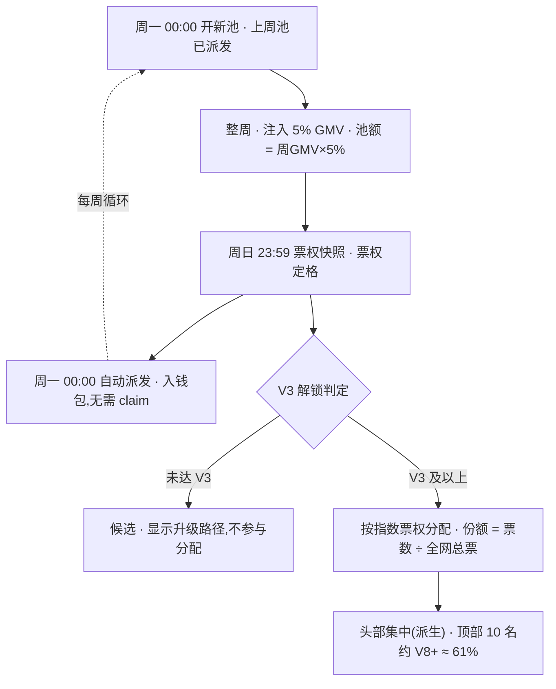

#### 8.5.2 UI 规格

- hero 上方 entry chip `📖 New here? Learn how the Leadership Pool works →` 链 `/team/leadership-pool/how-it-works`
- 本周池子总额 hero
- 距结算倒计时
- 你的预估分红 + 票数 + 全网票数 + 占比
- V<3 时显示"V3+ to unlock" + 升级路径 CTA
- 顶部集中度提示条(派生):顶部 N 名领袖分走约 X% 池子,X 按当前全网分布与票权派生
- V 级 → 票数权重完整表(显示全网 V3-V12 分布 + 各档占池比与人均派发,派生)
- 历史周池列表

**真后台对接**

| Endpoint | Method | Payload | 用途 |
|---|---|---|---|
| `/api/pool/state` | GET | — | 本周池额、全网 V 级票权分布、历史周池派发记录。个人票数 / 占比 / 预估派发额由 server 计算下发,客户端不自行推算;规则参数(注入比例 / 解锁档 / 票权表 / 月度封顶)读 `GET /api/config/leadership-pool`(§9.11c.1) |

#### 8.5.3 玩法说明页 `/team/leadership-pool/how-it-works`

零基础说明页,文风对标合规商业利润分享计划(Stripe Partner Fund / Apple Affiliate 等)。

**页面结构**:
1. iOS nav back + 标题 `How the Leadership Pool works`
2. Hero + 标签 `GLOBAL LEADERSHIP POOL` + 大标题 `5% of all platform volume, split among V3+ leaders every week.`
3. §1 What is the Leadership Pool?(2 段:周度 5% 注入 + 利润分享类比)
4. §2 V 级票数对照表(V3=1 / V4=2 / V5=4 / V6=8 / V7=16 / V8=32 / V9=64 / V10=128 / V11=256 / V12=512)+ 各档周分红占比(单人份额 = 票数 ÷ 全网总票,从全网分布派生,非写死)
5. §3 结算时间表 3 步:周一 00:00 UTC 开新池 / 整周 5% 业绩流入 / 周日 23:59 UTC 快照 + CalloutBox `💡 When you reach V3 mid-week`(部分周按比例计入)
6. §4 提升池子分成 3 种途径 IconRow(🚀 升 V 级 / 💎 持有不衰减 / 🤝 帮团队成长)
7. §5 FAQ 4 问(V0-V2 能看吗 / 何时收到 / 票数会丢吗 / 总票数翻倍怎么办)
8. 底部 CTA 回 `/team/leadership-pool`

i18n keys 在 `poolHowItWorks.*` namespace(全词典镜像)~40 keys。

### 8.6 5 类佣金事件 `/team/commissions`

| 类别 | 触发 | 结算 | 备注 |
|---|---|---|---|
| 网络版税(Network royalty) | 被推荐人订单 — 数学层 7 层(L1 Direct,L2-L7 Extended) | 实时 | USDT + NEX,30 天冷却 |
| 平衡匹配(Balance Match) | 双轨对碰条件满足 | 每日 | USDT,30 天冷却 |
| Peer | 同 V 级团员业绩 5% | 每月 | USDT |
| Cultivation | 下属升 V 一次性 NEX | 实时 | V1 500 / V2 2K / V3 10K / V4 50K / V5 200K NEX |
| Leadership | 领导池周分红 | 每周 | USDT(V3+ 解锁) |
| Genesis | 创世节点持有人排放 | 上所后 | $NEX(创世持有人,vesting 释放) |

UI:返回按钮同行 `📖 新手?了解 6 类佣金 →` chip 链 `/team/commissions/how-it-works` + 6 类汇总 grid + filter pills(全部 / 网络版税 / 平衡匹配 / 平级 / 培育 / 领导池 / 创世)+ 时间线 + 每条状态(冷却 N 天 / Ready / Withdrawn)+ tap 详情。

**Commission row layer chip 二分类显示**:Row 内紧跟 `sourceUserName` 显示来源 chip,基于数学层 `e.layer` 字段二分类:
- `layer === 1` → **直推**(`commissions.directBadge`)
- `layer >= 2` → **扩展**(`commissions.extendedBadge`)

不再暴露 `L{N}` 层级编号(已废弃 MLM 语汇)。数学层 `UNILEVEL_USDT[layer]` × 月业绩计算逻辑不动,只 UI 表达层去层级化。

#### 8.6.1 玩法说明页 `/team/commissions/how-it-works`

帮助用户区分"每笔到账钱来自哪个渠道",对应入口 entry chip。

**页面结构**:
1. iOS nav back + 标题 `How commissions work`
2. Hero + 标签 `ALL 6 COMMISSION TYPES` + 大标题 `Six different ways money lands in your wallet.`
3. §1 Why six?(简介一段)
4. §2 6 个 channel IconRow(emoji + label + 一句目的 + 解锁条件):
   - 👥 Network royalty · Direct + Extended
   - ⚖️ Binary · Balance Match Bonus
   - 🤝 Peer · same-rank bonus(V3 解锁)
   - 🌱 Cultivation · sponsor bonus (NEX)
   - 👑 Leadership · weekly pool share(V3 解锁)
   - 💎 Genesis · founder dividend(创世持有人)
5. §3 结算生命周期 3 个 status pill:`COOLING`(30d)→ `UNLOCKED` → `WITHDRAWN` + CalloutBox 解释为什么有冷却期
6. §4 典型一天案例:4 笔不同 channel 收益累加 → $79.00 + 2,000 NEX 日合计
7. §5 FAQ 4 问(为什么没看到佣金 / 能立即提现吗 / 降级失去什么 / Cultivation 和 Unilevel 区别)
8. 底部 CTA 回 `/team/commissions`

### 8.7 影响力网络 `/team/network`

2 圈轨道(orbit)可视化,与 §8.3 影响力网络版税的双组件结构对齐:

- **中心 YOU**(显示当前 V 级)
- **Direct 内圈**(实线轨道):直推朋友均匀散布 360°
- **Extended 外圈**(虚线轨道):扩展网络节点带轻微径向偏移分散,呈环带分布
- **Top metrics**:Members 总数 / Active 活跃数 / **Direct** 直推数
- 每 1.2 秒随机 pulse 一个 active 节点(模拟新订单经过)
- Tap 节点 → bottom sheet 显示详情(头像 + V 级 + DIRECT/EXTENDED badge + city + 月业绩 / 累计 / 加入天数 / 头衔 / 状态)
- Legend:Direct friends / Extended network
- 不暴露 L1-L7 / 左右翼 / 4 色 layer 编码 / Spillover ring;内部数据仍保留 layer 字段供数学层使用,可视化层只呈现 Direct(L1) vs Extended(L2-L7 合并)
- SVG cx/cy 计算后 `Math.round(n*100)/100` 规整精度,避免浮点字符串化漂移

**真后台对接**

| Endpoint | Method | Payload | 用途 |
|---|---|---|---|
| `/api/network/members` | GET | `?cursor=` | 下发当前用户下线成员(层级 / 左右翼 / 状态 / 城市 / 入网时间 / 本月业绩 / 累计业绩 / 上级 id)。层级聚合、左右翼业绩与 V 级下线计数以 server 值为准,客户端派生只用于展示;本 endpoint 同时供族谱树(§8.8)、影响力网络版税(§8.3)、双轨(§8.4)与硬件配额(§8.9)取数,不各自另拉 |

### 8.8 族谱树 `/team/tree`

Direct / Extended 二分类可折叠列表:

- **Top metrics**:Total network 成员数 / Monthly volume 全网月业绩
- **Direct section**(DIRECT badge,默认展开):
  - Header subtitle:`{n} contributing · ~$X/mo Direct Royalty`
  - member row 按 monthVolume 降序
- **Extended section**(EXT badge,默认展开):
  - Header subtitle:`{n} members · ~$X/mo Network Yield Bonus`
  - member row 按 monthVolume 降序
- member row:头像 + V 级 + 状态点 + city + 入网天数 + 本月版税贡献(数学层 `UNILEVEL_USDT[layer]` × 月业绩,直推用 10% 直接版税)
- 不展示 7 层 sections / 左右翼 filter / Spillover badge

### 8.9 硬件配额解锁 `/team/quota`

| 设备 | 解锁条件 | 月度库存 |
|---|---|---|
| NexGridBox Pro | 5+ 已激活直推 | 1,000 台(余 23)|
| NexGridRack P1 | 15+ 直推 **或** 团队月业绩 ≥ $20,000 | 100 台(余 8)|

> 解锁条件 / 阈值 / 库存 / 进度**单源自商品目录的 `purchaseGate` 配置**(§7.1)与 `evaluatePurchaseGate`,本页不自带硬编码数值;运营在后台调门槛 / 锁额,本页与商城卡 / 详情 / 结账同步变化。tier 的名称 / 价格 / perks 同源自 catalog,杜绝口径分叉。

UI:
- 用户当前邀请数 hero
- 每个 tier 卡片显示:解锁条件进度条(`progressPct`)+ 月度库存进度(`remaining / quotaCap`)+ perks + Buy/Invite CTA
- 满足条件 → 直跳 store 完成销售
- 不满足 → "Invite to unlock" 跳 team

### 8.10 区域大使 `/team/agent`

V5 Wing Leader 起开放,提供 4 项可申请预算:

| 预算项 | 额度 | 申请规则 |
|---|---|---|
| 线下活动场地 | $1,000 - $10,000 | 签到 QR ≥ 100 人 |
| KOL 推广配比 | 50% 补贴 | 结束后提交发票 + 流量数据 |
| 物料印刷 | 区域配额 | 海报 / 手册 / 名片 |
| SDK / 开发支持 | 按小时 | 为顶级客户定制集成 |

UI:
- Hero:Lead the network in your region
- Eligibility 状态(V<5 显 locked + 升 V5 路径 CTA)
- 4 预算桶卡片
- 申请表单(Date + City + Budget,V<5 时禁用)
- "Recently approved" 案例展示 3 个(Tokyo Web3 Summit / Berlin DePIN Meetup / São Paulo AI Devcon)
- 提交 → 等待 3-5 工作日合规审核

### 8.11 邀请排行榜 `/team/leaderboard`

#### 8.11.1 目的

公开展示全平台 Top 100 邀请人,提供持续的社会证明 + 排名对标,驱动用户增加邀请频次以争夺奖池席位。
任何持卡用户可访问,展示自身排名 + 距下一档差距,鼓励用户冲榜。

#### 8.11.2 页面结构(自上而下 6 段)

1. **Prize Pool Hero**:
   - 标签 `PRIZE POOL · {periodLabel}`
   - 大字 USD 金额(`$5K / $50K / $250K / $1M`)
   - 副字 `Pays to top {topN}`
   - 右上 Trophy icon
   - 分割线下:`Resets in` + 右对齐倒计时(`08:42:11 / 3d 12h / 12d / —`)

2. **Period Tabs**(单层胶囊):
   - `Today / Week / Month / All-time`
   - 切换时整页数据重新计算(同一份 mock dataset,不同 multiplier)

3. **My Rank 卡**:
   - 标签 `YOUR RANK`
   - `#412 / 100+` 大字(+ `/total` 副字)
   - Flame icon + `earn ${gap} more to climb` 进度提示文案
   - 右侧 Share to climb CTA(Share2 icon + 按钮,跳 `/team`)

4. **Podium(Top 3)**:
   - 顺序:#2(左)/ #1(中,凸起)/ #3(右)
   - 每格:奖牌 emoji 🥇🥈🥉 + 圆头像(单字符)+ handle + 国旗 + USD 金额 + `{n} directs`
   - 卡下方 3 行实物奖列表:`#1 Genesis Node + Rack ×1 / #2 NexGridBox Pro ×3 / #3 NexGridBox Pro ×1`

5. **#4 - #100 List**(单卡 + 4 列):
   - 列头:`# / Inviter / Directs / Earned`
   - inviter 列:头像 + handle + 国旗 emoji + Cpu icon(verified hardware)
   - 副行:`V{n}` chip + `{n} team` + `↑{delta}` / `↓{delta}`
   - 数值列:右对齐,Earned 列 compact(`$3.5K`)

6. **Share CTA**:
   - Share2 icon + `Share my invite link`
   - 链 `/team`,触发原页 InviteEarnCard 的 share path

7. **Footer note**:
   - `Rankings update every 5 minutes. Pool pays out automatically at period reset.`

#### 8.11.3 业务规则

- **排序键**:本期累计 USDT 佣金(unilevel + binary + leadership + 邀请奖 + 平级奖之和)
- **更新频率**:服务端每 5 分钟 snapshot,前端按 period 切换读取
- **奖池派发**:周期结束时按比例自动派发到对应 USDT 余额,触发 `commission` 事件
- **入榜门槛**:本期累计 ≥ $1
- **匿名化**:handle 显示完整(真实平台均不做 mask,反而强化攀比)
- **My Rank 取数**:服务端按当前用户 referrer 计算,>100 则只显示 `#NNN / 100+`

**真后台对接**

| Endpoint | Method | Payload | 用途 |
|---|---|---|---|
| `/api/leaderboard` | GET | `?period={today\|week\|month\|all}` | 下发该周期的 Top 100 榜单(名次 / handle / 国别 / 直推数 / 团队规模 / 本期累计 USDT / 名次变动 / V 级 / 是否持机)+ 奖池参数 + 当前用户名次与差距。排序、入榜门槛与名次全部 server snapshot,客户端不自行排序或补算 |

#### 8.11.4 奖池参数(`PERIOD_PRIZE`)

| Period | Pool USD | TopN | Resets In | Label |
|---|---|---|---|---|
| today | $5,000 | 20 | 08:42:11 | Daily |
| week | $50,000 | 50 | 3d 12h | Weekly |
| month | $250,000 | 100 | 12d | Monthly |
| all | $1,000,000 | 100 | — | All-time |

#### 8.11.5 Podium 奖品(`PODIUM_PRIZE`)

| Rank | 奖牌 | 实物 |
|---|---|---|
| #1 | 🥇 | Genesis Node + Rack ×1 |
| #2 | 🥈 | NexGridBox Pro ×3 |
| #3 | 🥉 | NexGridBox Pro ×1 |

---

## 9. Wallet(钱包系统)

### 9.1 钱包总览 `/me/wallet`

iOS Settings 风分组列表:

| 区 | 内容 |
|---|---|
| 顶 hero | USDT $248.56 + NEX 1,240(≈$212)+ Pending $2.31 |
| 3 圆形 action | Top-up / Withdraw / Exchange |
| Earnings section | Today / Pending / All-time |
| Activity section | Daily Check-in 入口(显示当前 streak)+ Transaction History |
| NEX highlight footer | +10% boost active 提示 |

### 9.2 充值 `/me/wallet/topup`

#### 9.2.1 三条充值通道

| 通道 | 手续费 | 最低额 | 单笔上限 | 到账方式 |
|---|---|---|---|---|
| USDT 链上 · TRC20 | 1 USDT | $10 | — | 链上确认数达标自动入账 |
| USDT 链上 · BEP20 | 1 USDT | $10 | — | 同上 |
| USDT 链上 · ERC20 | 5 USDT | $10 | — | 同上 |
| 银行转账 · VietQR | 0 | $10 等值 | $5,000 | 回单匹配自动入账 |
| 国际卡 · Visa/Mastercard | 3.5%(另收) | $30 | $5,000 | 收单授权成功即入账 |

通道费率、最低额、单笔上限、启停位均由后台按通道下发,前端不写死;拉取失败禁回退默认值,
该通道置为不可用而非按旧值放行。BTC / Ethereum 充值通道已下线。

#### 9.2.2 统一入金账

三条通道共用同一份入金记录与状态机,后台对账看到的是同一份数据,不存在只走余额、
不留入金单的通道。

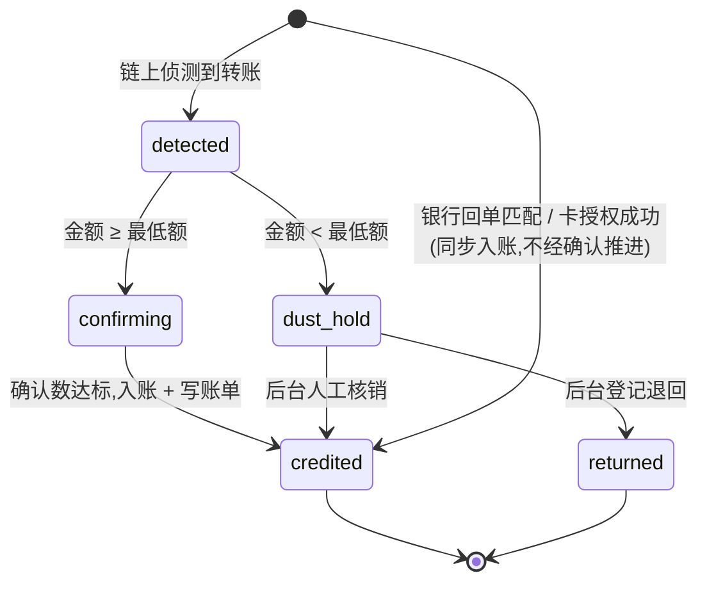

**计费方向按通道分两类**(两类都满足「入账额 = 实收额 − 手续费」,账本口径统一):

- 链上:从到账额里扣,入账额 = 转入额 − 通道费。
- 国际卡:费另收在用户卡上,入账额 = 用户输入额、实扣 = 入账额 + 费;入金记录的实收额记实扣额。
- 银行转账:0 费,按下单时锁定的牌价折算。

**幂等键按通道**:链上 = 交易哈希 · 银行 = 付款单号 · 国际卡 = 收单方授权号。
同键重复回报一律 no-op,不重复入账;账单按同一键去重兜底。

**副作用顺序**:先落入金单并持久化,过了才动余额与账单 —— 「失败」必须等于「什么都没发生」,
否则失败态既扣了钱又允许重试,会重复入账且对账查不到。

**状态权威**:状态一律由服务端裁定,客户端只提交意图、只读结果,不本地推进状态。

#### 9.2.3 USDT 链上充值

- 每用户 × 每网络一个专属充值地址,服务端派发、长期恒定不轮换,转入即可归属到人。
- 所需确认数按网络配置(TRC20 20 · BEP20 15 · ERC20 12,后台可调),达标即自动入账。
- 页面常驻错网络警示:仅通过所选网络转入,错网络 / 错资产转账无法找回。
- 提供「如何获取 USDT」新手指引与「充值未到账」工单入口。

**异常路径**:

| 场景 | 处理 |
|---|---|
| 转入额低于最低额 | 入金单挂起,不自动入账;后台人工核销或登记退回 |
| 转入额不足以覆盖通道费 | 只能退回,不可核销入账 |
| 错网络转入 | 侦测不到,不生成入金单;走工单人工核实 |
| 确认停滞超 30 分钟 | 提示网络拥堵,不自动置失败;走满仍正常入账 |

#### 9.2.4 VietQR 银行转账

面向越南本地用户的主力法币通道:按当前牌价下单,转越南盾,按锁定牌价折成 USDT 入账,平台 0 手续费。

- **下单锁价**:生成付款单时锁定牌价、应付越南盾金额与倒计时;窗口内平台调价不影响已生成的单。
- **附言码**:每单铸一个在途唯一的附言码,用户转账时填入,作为回单归属的主匹配依据。
- **精确零头**:应付金额精确到盾、不凑整千,零头本身作为第二重匹配线索。
- **收款账户池**:从可用账户池轮询派发;单账户可停用 / 熔断并移出轮换,池内无可用账户时该通道置灰。

**付款单状态机**:

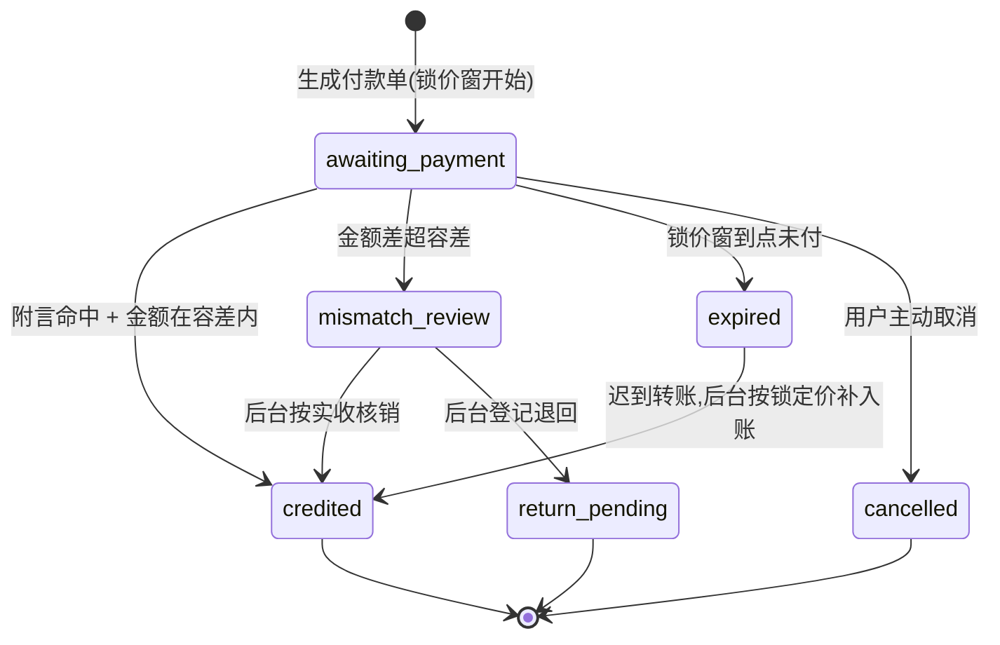

**三类进人工挂账**(钱已到银行、只是认不到人,记入负债科目「待核实入金」,不计入用户可提余额):
无附言码或附言残缺且金额撞不上任何在途单;实收与应付差异超容差(默认 ±1,000₫);
锁价窗过期后才到账且超出宽限。挂账各行折算金额之和恒等于该科目余额。

#### 9.2.5 国际卡充值

辅助通道。提交卡信息后由收单方完成 3DS 授权,授权成功即直落已入账,不经确认推进。

- 限额门双层:界面提交前拦 + 服务端入账前拦,绕过界面直接调用同样拒绝。
- 限额提示常驻展示,越界即给出禁用原因,不得复用收单方拒付文案 —— 真实原因是超限,
  提示发卡行拒绝会误导用户去联系银行。
- 卡号 / CVV 不落平台后端,由收单方直连采集;平台只接收授权结果与授权号。
- 同卡短时间内重试次数与锁卡时长由后台配置。

#### 9.2.6 汇率牌价

越南盾牌价由后台单一配置派生,前端只做展示与换算,不缓存、不写死:

- 牌价 = 基准价 ×(1 + 买入点差),取整到十位;点差合法区间 0 ~ 3%,越界后台拒绝写入。
- 牌价不可用(缺字段 / 非法值 / 点差越界)时禁止下单,不猜价、不回退默认值。
- 换算全程整数域运算(点差转基点、金额转分),避免小数进位在半分边界上偏一档。

#### 9.2.7 充值记录

- 三通道的入金记录同列「最近入金」,按通道分流展示标题与跳转:链上轨可进链上交易详情,
  法币轨无链上哈希,进账单流水。
- 入金记录与账单、收据三处使用同一单号口径,互相可反查。

#### 9.2.8 充值后台接口契约

(server endpoint TBD,候选命名,真后台对接时正式确认。入账状态一律 server 权威,客户端无写入口。)

| Endpoint | Method | Payload | 用途 |
|---|---|---|---|
| `/api/config/deposit-channels` | `GET` | — | 下发三通道的费率 / 最低额 / 单笔上限 / 确认数 / 启停位。**拉取失败禁回退写死值**,按通道维护处理 |
| `/api/config/bank-accounts` | `GET` | — | 下发收款账户池(启停 / 日限 / 熔断 / 轮换),银行轨专属 |
| `/api/deposits/address` | `GET` | `?network=` | 取当前用户在该网络的专属充值地址(server 派发,同账号同网络恒定、不轮换)|
| `/api/deposits` | `GET` | `?cursor=` | 入金记录列表(三通道合流,server 权威状态)|
| `/api/deposits/bank-intents` | `POST` | `{ amountUsdt }` | 生成银行付款单:锁定牌价 + 派发收款账户 + 铸造附言码,返回锁价窗到期时间 |
| `/api/deposits/bank-intents/:id/cancel` | `POST` | — | 用户取消在途付款单(仅待付款态可调,终态拒绝)|
| `/api/deposits/card` | `POST` | `{ token, amountUsdt, holder, billing }` —— **token 来自收单方 SDK** | 卡通道充值下单;授权结果由收单方回调 server,server 在同一事务内入账 + 记账 + 写账单 |

链上到账与银行回单均为**服务端事件驱动**(链上侦测服务 / 银行回单推送),客户端只轮询拉取状态收敛,没有任何推进状态的入口。

#### 9.2.5 充值记录写入规则

- top-up 写入钱包账单,保留 channel / network / amount / txHash / status。

### 9.3 提现

#### 9.3.0 提现方式与恢复入口

钱包的提现入口进入 `/pages/me/wallet-withdraw-method`,提供 USDT 与银行卡两种方式。USDT 页只承载链上提现,不重复放置银行卡提现入口。

- 方式页先查询后端银行卡通道配置及未完结请求。存在 USDT 原请求时,优先进入 USDT 原请求核对,银行卡入口禁用;存在银行卡原请求时,只进入银行卡恢复流程,确认原结果前禁止新建提现。
- 没有银行卡原请求且 `enabled=false` 时,银行卡入口禁用并提示暂不可用;有原请求时,通道关闭仍可查询原单。不能从“通道关闭”推断原单失败或已退款。
- 状态加载中不开放新提现。状态读取失败或未证明无原请求时,显示“重新加载”;保留原请求恢复入口,但不得新建报价或提现单。页面、账号或认证环境变化后,旧响应不得改变当前入口状态。
- USDT 流程见下文;银行卡流程见 §9.3.7。通道是否开放、收款账户是否可用与提现是否到账分别判断。

#### 9.3.1 USDT 提现流程 `/me/wallet/withdraw`

| 步 | 字段 | 校验 |
|---|---|---|
| 1 | 金额 | ≥ $20 |
| 2 | 网络 | 随绑定地址派生,只读;换网络 = 走换绑重新验证 |
| 3 | 收款地址 | 只读,取当前已验证的绑定地址;不手输 |
| 4 | NEX 抵扣网络确认费(开关,默认关闭) | 见 9.3.2;不开则全额付费,开而 NEX 不足按可抵部分抵扣 |
| 5 | 提交 | 确认弹窗核对金额 / 网络确认费 / NEX 消耗 / 到手金额,确认后进入提现追踪 |

#### 9.3.1-1 出金币种与网络

链上出金仅支持 USDT,网络同充值三条链(TRC20 / ERC20 / BEP20)。BTC / Ethereum 提现通道不提供。银行卡出金按 §9.3.7 由 USDT 报价兑换为 VND,不属于链上网络选择。
收款网络不再由用户在提现页选择,而是随当前绑定地址派生并只读展示 —— 杜绝选出与地址不匹配的网络。

#### 9.3.1-2 提现地址设置与更换

单地址原则:每条支持网络(TRC20/ERC20/BEP20)同一时刻只有一个生效地址,提现一律打到该网络当前生效的地址。首次添加与更换共用 `/me/wallet/address-rebind` 同一入口,验证手段均为短信验证码,不做身份证件核验。

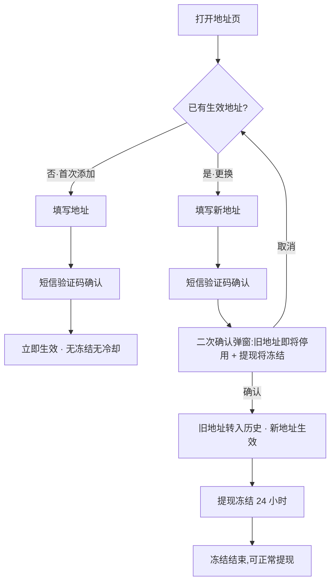

- **首次添加**:无冻结、无冷却,验证通过即生效。
- **更换**:旧地址立即停用(转入可折叠的历史记录,标注停用时间);新地址生效同时触发提现冻结 24 小时,防盗号即时转移资产——冻结判定下沉在风控评估层,绕过界面直接调用同样拦得住,不只是按钮置灰。
- **更换频次**:每 7 天最多一次(后台可配),冷却到期前禁止再次发起;有在途提现单时更换被拒,判定优先级高于冷却。
- **新地址大额审核**:与"更换冷却"是两个独立时间窗——新绑定的地址在其自身 7 天内,提现 $1,000 以上自动转人工审核,与上面的更换频次冷却分别计时。
- 数据结构见 §12.19。

**真后台对接**

| Endpoint | Method | Payload | 用途 |
|---|---|---|---|
| `/api/payout-address`(endpoint TBD;candidate) | `POST` | `{ network, address, otpTicket }` + `Idempotency-Key` header | 首次添加或发起更换。server 校验地址格式、OTP 凭据、是否有在途提现、是否在冷却内;更换通过后立即生效并下发 `freezeUntil`;同一账号同一网络同时只允许一次在途请求,重复提交返回同一结果 |
| `/api/payout-address` | `GET` | `?network=` | 取当前生效地址、冻结截止、下次可更换时刻与历史记录,server 权威,**客户端不本地推进状态** |

#### 9.3.1-3 出金三道闸

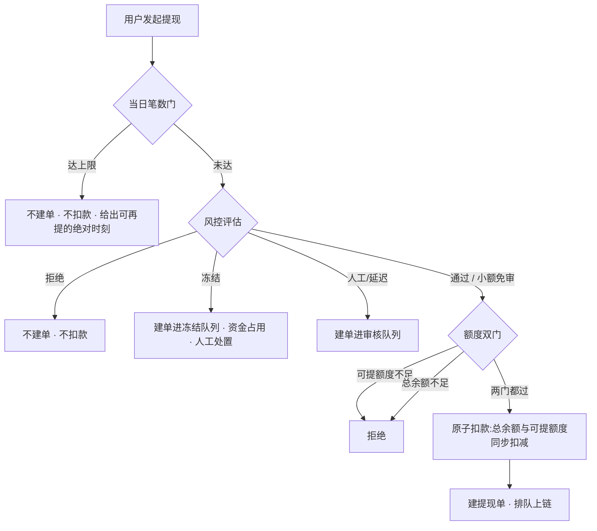

- **当日笔数门**:每日提现笔数达 `withdrawRules.dailyWithdrawLimitCount` 即不建单不扣款;
  拒绝文案给出下一平台日(UTC+7)可再提的**绝对时刻**,不说「明天」。笔数占位先占后建,
  并发提交不会绕过。
- **小额免审快车道**:金额 ≤ `withdrawRules.smallAmountThresholdUsd` 时免除「首提必审」类
  审核闸;被免掉的闸名随单落盘(审计与客服可还原该单当时免了哪几道)。页面双向告知:
  命中时说明本单免审,未命中且改小金额即可命中时给出一键改额引导(引导只在真能立即
  处理时出现,笔数已满或费率不可用时不给)。
- **第一道 风控路由**:拒绝路由不建单不扣款;冻结 / 人工 / 延迟三种路由建单进队列,
  资金占用但不放款,状态由服务端与人工推进。
- **第二道 额度双门**:可提额度门(只有已解锁收益可提,充值本金不可提)+ 总余额门
  (纵深兜底,任何情况下不放行超过总余额的提现)。两门独立校验。
- **第三道 原子扣款**:总余额与可提额度在同一步扣减,不存在扣一半的中间态。

**真后台对接**

| Endpoint | Method | Payload | 用途 |
|---|---|---|---|
| `/api/withdrawals/eligibility` | `POST` | `{ network, address, amountUsdt? }` | 三道闸的服务端评估,返 `{ canSubmit, maxWithdrawableUsdt, route, riskReasons[], fastLaneApplied, waivedGates[], dailyLimitReached, dailyCountResetAt, configVersion }`。**只读预检:不占笔数、不建单、不扣款**;笔数占位仍在 `POST /api/withdrawals` 内先占后建。客户端评估只用于按钮态与提示文案,提交时 server 以同一套规则重算,绕过界面直接调提交接口拦得住 |

#### 9.3.1a 提现提交闭环

> **服务端契约**:提现的两个端点(`GET /api/withdrawals/policy` 取参数、`POST /api/withdrawals` 提交)
> 字段名、值域、费用等式与错误码,权威在 `PRD/specs/FEAT-WD01-trust-payout-rails.md` **§4**,本章不复述。
> 本章只写用户可感知的业务规则。

- **每日提现笔数上限**:上限值取服务端 `policy.dailyLimitCount`(**唯一来源**,前端不用本地默认值);
  按**平台时区 UTC+7** 的自然日切分,数的是**发起次数**——已驳回 / 已退款 / 上链失败的单**照样占额度**;
  `reject` 路由不建单不扣款,**不占额度**。达上限时提交置灰,文案给**绝对时刻**(`MM-DD HH:mm`)而非「明日」
  (平台日按 UTC+7 切,用户本地时钟未必是同一天)。服务端超限拒单为 **429 + `WITHDRAWAL_DAILY_LIMIT_EXCEEDED`**,零副作用。

- **提交前必经确认弹窗**:展示提现金额 / 网络确认费 / 本次消耗 NEX / 到手金额,用户可取消返回修改;确认弹窗到落单之间费率或收款账号发生变化,一律拒单并重新报价,不静默按新数字扣款。
- 提现提交必须生成 tracking record 与 USDT 提现单;打开抵扣开关并烧了 NEX 时另写一条 NEX 抵扣单。
- 提交为**服务端单事务**:扣款、烧 NEX、建单、写账本在同一事务内完成或整体不发生,不存在"扣了 NEX 却没提现"或"提现了却没扣 NEX"的中间态。客户端**不自行扣减 NEX**,只按回执记账——烧了多少以服务端回执的 `nexBurned` 为准,本地报价只是提交前的预览。未打开抵扣开关时 `nexBurned = 0`,不烧 NEX,按全额网络确认费提交。
- USDT 提现单记录 `fee = actualFee`(见 9.3.2 计算),账单金额 = 提现金额(全额出金,费用为其中差额);NEX 抵扣单记录烧掉的 NEX 数与抵扣的费用。提现追踪页与账单显示的费用均为 `actualFee`(三处口径一致)。
- **提现单为列表模型**:多笔单据并存(与 `GET /api/withdrawals` 同构),不存在「第二笔顶掉第一笔」;账号快照按单号并集合并,无删除路径。
- 提交成功后**直达该笔单据的追踪页**(URL 带单号)。
- **到账推进由系统层统一驱动**(追踪页只展示不推进);单据到达 confirmed 的同时,对应账单行由在途结算为已入账——钱到账与账单跟上是同一步。
- **失败终态自动退款**:被驳回 / 地址无效 / 上链失败时原额退回,该笔 USDT 账单行同步标记为失败(退款与标记同一步,幂等只退一次);**当初为抵扣费用消耗的 NEX 一并退还**。
- **NEX 退还在账本上靠反向分录冲正,不改写原分录**:烧掉那条 `−N NEX` 恒为**已入账**并保持原样——烧是既成事实,把它改成失败等于账本声称从没烧过;退还另记一条**同单号的 `+N NEX`**,两行相抵即钱包净变化。冲正行的**唯一判据是服务端下发的"已退还数额"**(`nexRefunded`,整数且不超过烧掉数),金额取该值本身,不由客户端按烧掉数推导——没有服务端的退还事实就不写,绝不凭单据进入失败态就宣布一笔退款。该数额超过烧掉数时整条不写(不夹取),按服务端数据异常处理。
- 账单页的提现条目(含 NEX 抵扣行)**深链至追踪页对应单据**(按单号);查无此单显示「未找到」空态,绝不回落展示其它单据。

#### 9.3.2 网络确认费与 NEX 抵扣(关键业务规则)

**模型**:提现只收一笔**按网络计价的固定网络确认费**(链上确认成本),与提现金额无关;用户可自行打开「用 NEX 抵扣」开关,烧 NEX 按优惠率抵扣该费。开关**默认关闭**,不打开则永不消耗 NEX。这是 NEX 的两大功能之一(另一为兑换 USDT,见 §9.4)。

**参数**(平台配置,后台 D5 可调,server 权威,见 §13.3):
- `withdrawRules.networkConfirmFeeUsd`:按网络分列的每笔固定费(TRC20 $1.00 / BEP20 $1.00 / ERC20 $5.00),合法域 [0, 25]。
- `nexFeeOffsetRate`:每烧 1 枚 NEX 可抵扣的费用(默认 $0.40 / NEX)。该值**远高于 NEX 兑换市价**(~$0.027),即用 NEX 抵费比兑现更划算,引导持有与抵扣。

**计算**(提现金额 A,所选网络 N):

```
confirmFee  = networkConfirmFeeUsd[N]                 // 每笔固定,与 A 无关(TRC20 → $1.00)
requiredNex = ceil(confirmFee / nexFeeOffsetRate)     // 全额抵扣所需 NEX($1.00 / $0.40 → 3)
nexBurned   = 开关打开 ? min(用户 NEX 余额, requiredNex) : 0
actualFee   = max(0, confirmFee − nexBurned × nexFeeOffsetRate)   // 烧够 → $0,永不为负
到账         = A − actualFee
```

> 🔴 **服务端还要多发一个 `feeWaived`(实际减免额),且必须封顶到费本身**:
> `feeWaived = min(confirmFee, nexBurned × nexFeeOffsetRate)`。
> `ceil` 会过烧不到 1 枚 NEX(3 NEX × $0.40 = $1.20 > $1.00 的费),账单只准记实际减免 $1.00。
> 不封顶会让客户端的费用等式校验失败 → 已建单已扣款却报"提交失败"。完整等式见 `specs/FEAT-WD01` §4.3。

**业务流程**:

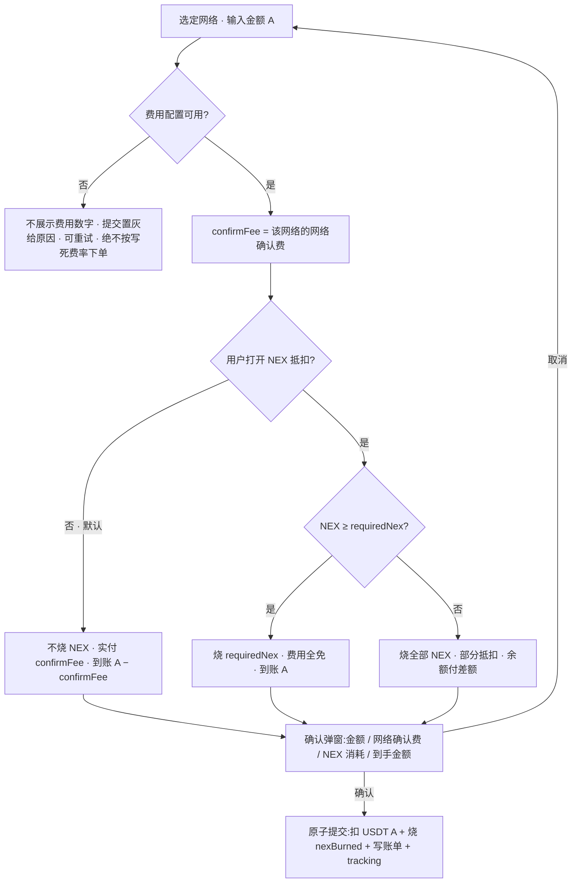

**费用行为边界**:
- 费用配置拉取失败或值非法(< 0 / > 上限 / 非数值)时不展示任何费用数字,提交按钮置灰并给出置灰原因与重试入口,**永不回退写死费率下单**。
- `actualFee` 以服务端重算为准,客户端展示值仅 UI 缓存,客户端自算的费用不入库。
- 未打开抵扣开关时**永不**扣减 NEX;切换网络即时刷新费用与所需 NEX。
- 历史提现单按落单时的费用快照原样展示(可含已下线的历史费用行),不按当前规则重算。

**NEX 来源**:
- 主产出:设备算力任务(NEX 即时滴灌入钱包持仓)
- 每日签到水龙头(基础 +2 NEX / 天,连续 7 天额外 +5 NEX)
- 团队佣金部分以 NEX 计

**NEX 抵扣面板**(金额 > 0 时显示):
- 「用 NEX 抵扣」开关默认关闭;打开后即时显示将消耗的 NEX 数量与抵扣后费用。
- NEX 不足:`可抵 $X.XX · 仍需支付 $Y.YY`;NEX = 0 时开关置灰,旁留「去赚 NEX」入口(签到跳 `/daily` / 算力任务跳设备 · 商城)。
- 规则说明:`每 1 NEX 抵 ${offsetRate} 费用(远高于兑换价值)· 烧够 {requiredNex} NEX 即全免;不足按比例抵扣,余额以 USDT 支付。`

#### 9.3.3 提现地址前置要求

提交提现前必须已在当前网络绑定一个生效的收款地址(§9.3.1-2)。未绑定时页面只显示"设置提现地址"引导卡,金额 / 网络 / 提交等字段均不渲染。

#### 9.3.4 反向劝阻卡 `<StakeAlternativeCard>`

Sprint A-1 / B.2。当用户输入金额 ≥ $20 时,在 amount input 之后、NEX 抵扣面板之前显示 hero 卡,把"现在拿走 $X"转换为"$Y 在 N 天后"的对比,导出 USDT 质押转化(质押为 USDT 锁仓,见 §9.5)。

**核心心智**:不阻止提现 / 不动 Submit 按钮 / 不强制留下,只展示机会成本。维持 §1 转化优先原则,把提现冲动导向更深锁定而非阻拦。

**计算**(沿用 §13.3 staking pool APYs,simple-interest 与 staking 页 UI 一致):

```
future = amount × (1 + APY × days / 365)
```

| Tier | APY | 30d → | 90d → | 180d → |
|---|---|---|---|---|
| 30d | 12% | $X × 1.00986 |  |  |
| 90d | 35% |  | $X × 1.08630 |  |
| 180d | 80% |  |  | $X × 1.39452 |

示例:$500 → 30d $502 / 90d $515 / 180d $549

**UI 结构**:
1. Sparkles label `WHAT THIS BECOMES IF YOU STAKE INSTEAD`
2. 大字 headline:`{amount} staked for {peak.days} days at peak APY becomes {peak.value}.`
3. 3 档 tier grid(横排):每档 N-day 标签 + future value 大字 + `+$delta`(30d / 90d / 180d)
4. 全宽 pill CTA `Stake for +${delta} in {peak.days} days →` → `/staking`
5. 免责声明:`Projections use current APY snapshot · Early unlock forfeits 100% of accrued premium · Not financial advice`

**i18n**:`walletV3.stakeAlt.{label/headline/tierLabel/cta/disclaimer}`(全词典镜像)。

#### 9.3.4a Risk disclosure gate(Sprint A-1 / A.3)

`handleSubmit` 前置守卫:`useRiskDisclosure().accepted === false` 时,跳 `/me/risk-disclosure?return=/me/wallet/withdraw`,接受后通过 query 自动回原页。Staking lock 同理(同一 store)。详见 §11.X。

#### 9.3.5 Compliance hold banner(phase 派发)

服务端下发的提现政策中 `complianceHoldEnabled = true` 时(对应 P5 / P6 阶段参数,见 §13.4.2),在 Amount input 之前显示警示 banner:

- 标题:`Extra check for large withdrawals`
- 副文(模板):`Withdrawals over $1,000 get one extra security check and settle within {days} days; your funds stay in your account the whole time. Smaller amounts aren't affected.`
- `{days}` 取服务端下发的冷却天数

未开启该政策时不渲染 banner。文案按 §13.4 铁律保持中性 —— 只讲「大额多一道安全确认 · 期间资金仍在账户里 · 小额不受影响」,不出现 phase id / name,也不出现「平台进入锁仓期」这类暴露内部运营阶段的说法。提现冷却随 phase 派发(见 §13.4.2),网络确认费与 NEX 抵扣率为平台配置(见 §13.3),两者均不硬编码常量。

#### 9.3.6 提现追踪 `/me/wallet/withdraw/tracking`

主流程 5 状态:`submitted → review-passed → processing → sent → confirmed`,每状态显示时间戳 + 进度条 + 预计完成时间(时效由 `payoutSlaHours` 派发,不写死)。

- **失败终态**:`review-rejected / address-invalid / tx-failed / refunded` 渲染失败卡(步进条不打勾),说明原因并给客服出口;安全确认 / 冻结持有态同样给客服出口(告知「不会自动放款」就必须给人问)。用户面状态话术:安全确认中 / 已冻结 · 行为异常;侦测类风控原因统一渲染「账户行为异常」,不点名侦测维度。
- **失败原因的来源**:取服务端 `GET /api/withdrawals/:id` 回的 `terminalReason`,**客户端不推导**。
  闭集与运营后台 D2「拒绝原因码」下拉同源:风控命中 / 地址风险 / 资料不符 / 用户撤回 / 其他。
  页面只出业务话术,**原始码不上页面**;服务端未下发时回落通用失败文案,不编原因。
- **能否重新发起**:服务端 `retriable` 为 false 时,在该单详情内如实说明并把客服入口摆在同一屏。
  🔴 它是**单据级**结论,**不得**用来禁用「再提一笔」——后者发起的是一笔全新提现(账号级),
  且失败单永久留存、终态后不再回查,拿它置灰会让一张历史废单永久锁死入口。账号级闸在提现页。
- **文案不得对资金位置做无来源断言**:失败卡正文只说「未完成 + 可联系客服查这笔钱现在在哪」。
  (客户端拿不到资金落点的凭据;而 `refunded` 态若同时说「资金未离开账户」会与状态标题自相矛盾。)
- **展示口径**:无参进入时优先展示**最早的在途单**(防在途审核单被后提且已到账的单挤掉);带 `?id=` 深链时精确展示该单,查无此单显示「未找到这笔提现的单据记录」空态 + 发起新提现出口,不回落其它单据。
- **再提一笔**:当日笔数已满时按钮置灰并给出原因与可再提的绝对时刻,空态里的发起入口同规则。
  置灰源**仅此一个**(见上条:`retriable` 不参与置灰)。
- **状态码别名**:服务端下发 `PENDING` 视同 `submitted`;`TX_ORPHANED` / `DEAD`(孤块 / 死亡信件)
  视同 `tx-failed`。🔴 客户端认不出的状态码会导致整张单据的状态回读失败并被静默吞掉 ——
  该单永久停在「处理中」,换绑收款地址与下一笔提现连带被永久拦死;出现在**建单回执**里时
  更重(单据入表前即失败,服务端已扣款而客户端无单号)。状态码闭集与后台 D2 状态表逐值一致,
  由机器门 `withdraw-terminal-reason-parity` 守。

#### 9.3.7 银行卡提现 `/pages/me/wallet-withdraw-bank`

**前提**:后端 `enabled=true`,且存在属于当前平台账号的收款账户。创建新报价须明确无未完结请求(`unresolvedIntent=null`);提交则须命中当前唯一 `NOT_SUBMITTED` 意图且 `quoteNo` 一致,已提交的原报价只返回原订单。账户规则见 §9.10.1。报价、提交、D2 审核与派发保留当前账号、收款账户编号及版本与原报价的一致性检查;字段缺失、账户不匹配、其他未决意图或通道关闭均不得创建新报价或新订单,但仍可恢复原请求。

**实现边界**:产品契约不要求外部账户真实性、本人归属或收款能力核验,服务端不返回外部核验字段或 `capabilitySummary`,也不生成 `verified` 证据。App 按服务端 `canWithdraw` 与通道状态判断可用性，已支持首次免短信、换绑短信及立即生效；实现与验收边界见《NexGrid_APP端开发落地规格》§4.3。生产代付保持关闭/HOLD;独立供应商配置、D7、资金覆盖与风险版本检查仍保留,真实供应商契约确认和授权联调未完成,账户保存或页面可用不能证明真实到账。

**报价与确认**:
- 输入 USDT 金额,服务端返回锁定的 `quoteNo`、提现金额、手续费、兑换本金、VND 汇率、到账 VND、收款账户摘要及到期时间。`amountUsdt = feeUsdt + netUsdt`,到账 VND 为正整数;页面不自行替换汇率或收款账户。
- 报价固化 D5 提现规则、D7 通道配置、收款账户版本与 D6 汇率快照;提交前版本或账户变化须重新确认,提交成功后审核和代付继续使用原报价,不得重新报价。
- 确认时核对上述金额与账户,仅提交 `quoteNo` 和固定指令号。报价过期须先取消或确认原结果,再重新报价;不得静默使用新价格。报价、提交结果不明时均先查询原请求,不重复建单。
- 提交前按账号持久保存 `quoteNo` 并回读确认保存成功;保存失败不得提交。只保存恢复用单号,不在本地持久化完整收款账户、开户人或密码。服务端负责最终校验、资金占用与订单创建,页面不自行扣款。

**恢复与展示**:
- `unresolvedIntent` 缺失表示状态未知,不等同没有原请求;`null` 才表示没有原请求。单笔未提交报价恢复原报价,已提交恢复原订单;`MULTIPLE` 时逐笔核对,全部解决前禁止新提现。
- 恢复状态为 `NOT_SUBMITTED / COMMITTED / ABANDONED / EXPIRED`。通道关闭不妨碍恢复;不确定结果不得用重新填写覆盖,不能把超时当失败。
- 取消和过期结果由服务端耐久封存,旧报价的延迟请求或重试不得再次扣款;取消时发现已经提交须返回原订单。
- 已有订单或指定订单号时显示“刷新订单状态”;只有报价、未知结果、错误或缺少原请求状态时显示“重新加载”。初次正常进入且无上述状态时不显示刷新动作。两种操作都只读取后端状态,不推进支付、不重复提现。
- “已到账”须订单与代付状态一致,且后端提供匹配金额、查询时间、证据引用和代付单号的到账证据;“已退回钱包”须匹配的退款证据。缺证据、金额不符或状态矛盾显示客服核对中,不得仅凭订单终态宣称到账或退款。

**接口**(均需有效 App 会话):

| Endpoint | Method | 输入 / 输出 |
|---|---|---|
| `/api/withdrawals/bank/config` | GET | 通道开关、绑定/短信换绑要求、脱敏收款账户与 `unresolvedIntent` |
| `/api/withdrawals/bank/quotes` | POST | `{amountUsdt}` → 锁定报价 |
| `/api/withdrawals/bank/orders` | POST | `{quoteNo}` + `Idempotency-Key` → 已提交订单 |
| `/api/withdrawals/bank/quotes/{quoteNo}` | GET | 查询原报价或其已提交订单 |
| `/api/withdrawals/bank/quotes/{quoteNo}/abandon` | POST | 取消未提交报价;已提交时恢复原订单 |
| `/api/withdrawals/bank/orders/{withdrawalNo}` | GET | 查询指定订单与结算证据 |

详细数据与业务契约见 `specs/FEAT-PAYOUT-VND01-bank-payout-rail.md`;通道开放与真实代付验收不由页面可访问或账户已保存推定。

### 9.4 NEX↔USDT 兑换 `/me/wallet/exchange`

#### 9.4.1 Swap UI

- From token + amount input
- 大箭头(可点击切换方向)
- To token + 自动计算
- 实时汇率(`1 NEX = $0.171`)+ refresh 按钮
- "Quote refreshing" indicator
- 历史 5 笔 swap

#### 9.4.1a 兑换确认与写入

NEX↔USDT 兑换确认必须展示 from/to amount、rate、fee、cap 状态与兑换后余额预估。确认后写入 swap record、wallet bill 与 cap 变化;失败时不得只 toast,必须保留原余额并展示失败原因。

#### 9.4.2 风控参数

| 参数 | 值 |
|---|---|
| 每用户日 cap | $50 USDT 等值 |
| 全平台日 cap | $20,000 USDT 等值 |
| 排队 | 超 cap 进入下日队列 |

#### 9.4.3 Gate 决策

提交前自动检查,2 种拦截:

| Reason | 触发 | 用户操作 |
|---|---|---|
| `user-cap` | 本日个人额度已满 | 弹窗 "Queue for tomorrow",可选排队 |
| `platform-cap` | 全平台日额度已满 | toast 拒绝,提示明日重试 |

**真后台对接**

| Endpoint | Method | Payload | 用途 |
|---|---|---|---|
| `/api/exchange/swap` | `POST` | `{ direction: "usdt2nex" \| "nex2usdt", fromAmount: number, quotedRate: number, quotedToAmount: number }` + `Idempotency-Key` header | 提交兑换。server 以自身当前牌价重算 `toAmount`,与 `quotedToAmount` 不一致即按报价过期拒单并重新报价,**绝不静默按新价成交**;客户端送的 rate / amount 一律不作为成交依据。依次复校用户日 cap → 平台日 cap,拦截时原样返回 §9.4.3 的两个 reason。**一进一出两条腿与两条分录必须在同一事务落盘**,任一环失败整笔回滚(资金三元组含可提额度精确还原),不存在「钱动了账没记上」或「只落一条分录」的中间态;成功返 `{ balances, swapId, billIds }` |
| `/api/exchange/queue` | `POST` | `{ amountUSD: number, direction }` + `Idempotency-Key` header | 触顶 `user-cap` 后用户确认排队,单据入下一平台日队列;server 去重,重复提交不产生第二张排队单 |
| `/api/exchange/state` | `GET` | — | 风控仪表盘(§9.4.4)数据源:当日个人已用 / 当日平台已用 / 排队列表。计数全部 server 持有,客户端只读不写(§9.11d.2) |

阈值本身走 `GET /api/config/exchange/caps`(§9.11c.1);牌价单源为 §10.3 `/api/market/nex`,兑换页不自行生成汇率。

#### 9.4.4 风控仪表盘 UI

- header 之下 entry chip `📖 New here? Learn how exchange works →` 链 `/me/wallet/exchange/how-it-works`
- 用户日 cap 进度条($X/$50,超 85% 变红)
- 平台日 cap 进度条($XK/$20K)
- Queue 列表(下一日待处理)

#### 9.4.5 玩法说明页 `/me/wallet/exchange/how-it-works`

**页面结构**:
1. iOS nav back + 标题 `How exchange works`
2. Hero + 标签 `NEX ↔ USDT EXCHANGE` + 大标题 `Convert NEX to USDT (or back) at live market rate.`
3. §1 Why a built-in exchange?(USDT 提现 vs NEX 持有的两种钱形态)
4. §2 三步操作 StepRow(选方向金额 / 确认报价 / 资金即时结算)
5. §3 两层风控限制 IconRow:
   - 📅 用户日上限 $50/day(00:00 UTC 重置)
   - 🌐 全平台日池 $20,000/day(满即排队)
   + CalloutBox `💡 Why daily limits?`(FATF Travel Rule + MiCA 合规)
6. §4 触及上限 3 步透明流程 + CalloutBox `✓ Your funds are never locked unilaterally`(排队随时可取消)
7. §5 FAQ 4 问(汇率来源 / 是否收费 / 能否直接兑法币 / 超过 $50/日)
8. 底部 CTA 回 `/me/wallet/exchange`

i18n keys 在 `exchangeHowItWorks.*` namespace ~35 keys。

### 9.5 复投激励 `/me/wallet/repurchase`

#### 9.5.1 目的

引导用户把已到账的 USDT 重新投入资金,以更深的锁仓换取更高的复合收益。

#### 9.5.2 UI

- Hero:`Lock USDT for 90 days · earn 3 things at once`
- 3 项 benefits:
  - `35% APY · 90 days`
  - `Cultivation ×1.5`
  - `Genesis lottery ticket`
- 金额输入 + presets($100 / 200 / 500 / 1000)
- 90 天后预测:本金 + 利息 + 解锁可提现总额
- CTA:`Re-invest $X`

#### 9.5.3 业务逻辑

提交 → `debitBalance(amount)` + `stake(amount, 90)` → 90 天锁仓到 staking vault,并发放培育奖 ×1.5 倍率与 Genesis 抽奖券。

§9.5.2 header 之下 entry chip `📖 New here? Learn how Re-invest works →` 链 `/me/wallet/repurchase/how-it-works`。

#### 9.5.3a 复投确认与写入

复投确认必须展示复投金额、进入 stake/cap 的影响与账单摘要。确认后写入 repurchase event、wallet bill 与 active stake/cap 变化。

#### 9.5.4 玩法说明页 `/me/wallet/repurchase/how-it-works`

零基础说明页,文风强调"3 重奖励一次叠加"以解释复投增益的独特价值。

**页面结构**:
1. iOS nav back + 标题 `How Re-invest works`
2. Hero + 标签 `RE-INVEST BOOST` + 大标题 `Lock USDT for 90 days — earn 3 things at once.`
3. §1 What is Re-invest Boost?(2 段:强化版 90 天质押 + 复利效应类比)
4. §2 一笔存款 3 重奖励 IconRow:
   - ⚡ 35% APY · 90 天质押利息
   - 🎟 Genesis 抽奖券(每月开奖,中奖 ~$5,000 NFT)
   - 📈 培育奖倍率 ×1.5
5. §3 操作 3 步(选金额 / 查看明细 / 锁仓 90 天)+ CalloutBox `💡 Early withdrawal cost`(罚本金 15% + 利息/券全 forfeit)
6. §4 Worked example: 复投 $1,000 — 卡显示本金 $1,000 / ×1.5 倍率 / 1 张抽奖券 → 第 90 天总回报 $1,300+
7. §5 FAQ 4 问(为什么用复投而不是普通质押 / NEX 能否复投 / 抽奖券何时发 / Genesis 抽奖怎么开)
8. 底部 CTA 回 `/me/wallet/repurchase`

i18n keys 在 `repurchaseHowItWorks.*` namespace ~40 keys。

### 9.6 Staking 4 档质押(USDT 锁仓)`/staking`

质押与复投(§9.5)均为 **USDT 锁仓**产品;NEX 不可质押(NEX 仅两大功能:兑换 USDT 与抵扣提现网络确认费,见 §9.3 / §9.4)。用 NEX 余额需先在兑换页换成 USDT 再质押。

| 期限 | APY | 提前赎回罚款 |
|---|---|---|
| 30 天 | 12% | 5% 本金 |
| 90 天 | 35% | 15% 本金 |
| 180 天 | 80% | 30% 本金 |
| 365 天 | 180% | 50% 本金 |

#### 9.6.1 UI

- Hero:Total locked + Accrued + Active count + Matured count
- 4 个 plan 卡片(每个:期限 + APY 大字 + 描述 + 罚款警告 + Stake CTA)
- Positions 列表:
  - 期限 + APY chip + 本金
  - 实时累积利息(每 4s tick)+ 剩余天数 + 进度条
  - 已到期 → `Claim` CTA
  - 进行中 → `Early withdraw` + `Track` 双 CTA
  - 已领取 / 已早赎 → 状态显示

#### 9.6.2 Stake Bottom Sheet

- 金额输入 + presets($100 / 500 / 1,000 / 5,000)+ Max
- 90 天后预测(本金 + 利息 + 解锁日期 + 合计)
- Lock CTA + Early withdraw 警告

§9.6.1 hero 上方加 entry chip `📖 New here? Learn how staking works →` 链 `/staking/how-it-works`。

#### 9.6.2a 开仓确认与写入

Staking 开仓必须展示档位 APY、锁期、提前退出 penalty、预计收益和最小质押额。确认后写入 active position 与 wallet bill;用户端展示值必须与后台 G1 参数源一致。

#### 9.6.3 玩法说明页 `/staking/how-it-works`

零基础说明页,文风对标 "类银行定期存款" 类比,**三段坦诚风险说明**确保用户在锁仓前完全理解。

**页面结构**:
1. iOS nav back + 标题 `How staking works`
2. Hero + 标签 `STAKING VAULT` + 大标题 `Lock USDT, earn interest. Like a fixed-term deposit, but on-chain.`
3. §1 What is staking?(定期存款类比,2 段)
4. §2 4 档计划数字对照表(以 $100 为例:30d/5%/$4.11 · 90d/12%/$29.59 · 180d/20%/$98.63 · 365d/35%/$350)
5. §3 操作 3 步 StepRow(选计划 + 金额 / 锁仓 / 到期 Claim)
6. §4 **风险说明**(3 个 IconRow):
   - 🔒 资金锁定整个期限
   - ⚠️ 提前赎回 forfeit 全部累计利息(只拿本金扣罚款)
   - 📉 APY 浮动,但已质押位按原利率到期
   + CalloutBox `Why it's safe`(102.4% 超额抵押兑付 + 信任中心公开储备)
7. §5 FAQ 5 问(最低金额 / NEX 能否质押 / 到期不 claim 怎样 / 多笔并行 / 是否算团队业绩)
8. 底部 CTA 回 `/staking`

### 9.7 账单 `/me/wallet/bills`

按日期 grouping 流水:
- 字段:type / amount / symbol / status / memo(另有 memoKey 语言码位,渲染时按当前语言翻译,写入时不冻结语言)/ ref / network(仅链上转账条目,大写网络短码)
- type:earn / refer / bonus / topup / withdraw / purchase / swap / kyc / stake / unstake / achievement
- 不显示逐行余额:余额列唯一合法来源是服务端复式账本下发的 `balanceAfter`,客户端不自行推算(账单是部分流水,推算必错)。

**条目详情分流**(点击行为按条目性质,杜绝把非链上账务渲染成链上交易):

| 条目 | 点开去向 |
|---|---|
| 提现类(USDT 主行与同单号 NEX 抵扣行) | 提现追踪页对应单据(真状态;确认路由中的单据显示「确认中」) |
| 链上充值 | 交易详情页,金额 / 网络 / 确认数 / 收款地址全部取自入金记录真实值 |
| 其余(奖励 / 签到 / 成就 / 兑换 / 购买 / 质押 / 历史验证退款) | 不可点——非链上转账,无交易详情可看,不渲染可点态 |

### 9.8 每日签到 `/daily`

#### 9.8.1 规则

签到是一个小额 NEX 水龙头(NEX 主产出仍是设备算力产出,见 §13.1)。

- 每日签到 baseline +2 NEX
- 连续 7 天满额外 +5 NEX bonus
- **Lucky multiplier**:每次签到 15% 概率触发 1.5×,5% 概率触发 2× 随机奖励倍率(作用于当次 NEX 发放量)
- 同一天不可重复签到;同一天 0:00 之前不算新一天
- 中断 streak(>48h 未签)→ 重置为 0,但可消耗 1 张 Streak Saver 恢复至历史最长 streak(上限 30 天)
- `longestStreak` 字段在签到时同步更新

#### 9.8.2 30 天里程碑路线图

7 阶梯奖励,签到累计满 N 天后,Claim 按钮变亮可手动领取:

| Day | 奖励 | 类型 |
|---|---|---|
| 3   | +5 NEX | nex |
| 7   | +15 NEX | nex |
| 14  | +1 USDT | usdt |
| 21  | +100 NEX | nex |
| 30  | 🎰 Lucky Spin × 1 | spin |
| 60  | +10 USDT | usdt |
| 100 | ⭐ Streak Master Badge(NFT) | badge |

每个里程碑 claim 一次后状态变为 `claimed`(Claimed 按钮);未达成显示 Lock icon + "Xd to unlock"。
里程碑奖励本质上是 sunk-cost 强化:user 累计越久,放弃损失越大。

Day-30 的 `🎰 Lucky Spin × 1` 奖励发放 1 张转盘抽奖券,进入 §11.10.9 Lucky Spin 转盘(与每日免费转盘同一奖池);claim 后提示"已领到一次幸运转盘机会",可选立即前往转盘。

#### 9.8.3 断签复活卡(Streak Saver)

- 用户默认 1 张
- 仅当 streak 真正断掉(`Date.now() - lastSignedInAt > 48h`)时按钮亮起
- 消耗 1 张 → `signInStreak` 恢复到 `min(longestStreak, 30)`,`lastSignedInAt` 设置为 "yesterday" 使次日签到可续上
- Day-30 里程碑可获得 +1 张复活卡(未来扩展)
- 0 张时按钮 disabled + 副字 `No savers left · earn one at Day-30 milestone`

#### 9.8.4 Top Streakers 迷你榜

5 行社会证明 leaderboard,显示当前全平台最长连签人(Daniel_K 🇺🇸 412 / Mei_C 🇸🇬 387 / Lukas_F 🇩🇪 341 / Carlos_M 🇧🇷 298 / Priya_S 🇮🇳 256),
右上角显示 `Your best: {longestStreak} days`,驱动用户与榜单对标。

#### 9.8.5 UI(完整页面结构,自上而下)

1. **Streak hero** — 大字 streak 数字 + `days` + "Active streak" 标签 + 距下次里程碑 daysToMilestone 文案 + 已签到时显示 `Next claim in HH:MM:SS` 倒计时 chip
2. **本周 7 天日历**(Mon-Sun grid)— 已完成 / Sun 第 7 天 / 今日高亮 / future
3. **签到主 CTA** + 副字 `Streak day + 15% chance of 1.5×, 5% chance of 2×` Lucky 提示
4. **30 天里程碑路线图**(7 行卡片,见 §9.8.2)
5. **Streak Power-Ups 卡**(Sparkles header)— 4 行 conversion-tied unlock(参 §9.8.6)
6. **Streak Saver 卡** — Shield icon + 余量 + `Use 1 saver` 按钮(仅断签时可用)
7. **Top Streakers 榜**(见 §9.8.4)
8. 3 stats grid:NEX Balance / Lifetime earned / Burned
9. "Your NEX unlocks up to $X USDT withdrawal" 卡 → 跳提现(NEX 用于抵扣提现网络确认费,见 §9.3.2)
10. Recent 10 条 NEX 发放历史(挂载后才渲染相对时间戳)

#### 9.8.6 Streak Power-Ups(Long-tail Task System 强化)

4 个 conversion-tied unlock,基于 `signInStreak` 与阈值比较自动解锁。激活后写入 `useDailyPowerUp` persist,激活同时 unlock 一枚成就 badge,引导用户跳目标路由继续转化动作。

| Streak 阈值 | 增益名称 | i18n key | 转化路径 | Badge | Icon |
|---|---|---|---|---|---|
| **7 天** | Royalty Boost +5% this week | `royalty_boost` | `/team/unilevel/how-it-works` | `streak_royalty` | Zap |
| **14 天** | NEX yield boost unlocked | `nex_boost` | `/daily` | `streak_nex` | Zap |
| **30 天** | +2% APY on next stake | `staking_boost` | `/staking` | `streak_staker` | ShieldCheck |
| **60 天** | Genesis whitelist priority | `genesis_whitelist` | `/genesis` | `streak_founder` | Gem |

每行 ≥ 56px Apple HIG tap target,三态:

| 态 | Icon | Right CTA |
|---|---|---|
| Locked(`streak < threshold`) | Lock icon | `Locked` label |
| Unlocked + 未激活 | icon | 实心 button `Activate →` → `claim(id)` + `unlockAchievement(badgeId)` + 跳 `href` + toast |
| 已激活 | Check icon | `Activated` label |

**Dynamic footer banner**(inline 卡片,三态切换):

1. 存在 unlocked + 未激活 perk:banner `«{name}» is ready — tap Activate on the right`
2. 无 unlocked perk + 有 locked perk:banner `{days} more days to unlock «{name}»` — 直接驱动签到动机
3. 全部已激活:banner `All {n} perks activated · keep streaking to retain them`

设计目的:即使所有 perk 都锁定,用户也能看到"还差 X 天到第一个 reward"的紧迫感,而不是 4 个并列 Lock icon 的视觉死局。

**实现细节**:
- `src/components/daily/streak-power-ups.vue` 持有 4 个 `StreakPowerUp` 定义(id / threshold / tint / 文案 key / href)与渲染
- `src/store/daily-powerup.ts` `useDailyPowerUp` 持久化 `claimed: StreakPowerUpId[]` + 领取时刻,按账号分行
- 严守 [feedback_no_meta_in_product]:UI 文案绝不出现 "phase boost" / "exit theater" / 任何元层面术语,只用真实平台话术(Royalty Boost / NEX yield boost / APY boost / Whitelist priority)

#### 9.8.7 首帧与随机源

- 历史时间戳列表 + 已签到倒计时 chip 都依赖当前时间与本地持久化数据,挂载后才渲染真实值
- Lucky multiplier 仅在 signIn 事件 handler 内 roll,不在渲染期调 Math.random()
- Streak Power-Ups 已激活态来自 `useDailyPowerUp` 持久化数据,同样挂载后才呈现真实状态

### 9.9 NEX 资产详情页 `/me/wallet/nex`

#### 9.9.1 目的

为 NEX 持币用户提供 user-level 资产视图(对比 §11.9 `/market` 是 platform-level 价格视图)。
集中展示:持仓 + 估值 + 24h 涨跌 + 持仓结构 + 盈亏 + 用途入口 + 历史活动,降低用户管理 NEX 的认知门槛,
强化"NEX 不是空气币 — 有真实结构 / 真实收益 / 真实用途"的产品感。

#### 9.9.2 页面结构(自上而下 6 段)

1. **Hero**:
   - 标签 `YOUR HOLDINGS`
   - 大字 NEX 余额 + 副字 `NEX`
   - 右侧 USD 估值 + `▲/▼ XX.XX% (24h)`
   - sparkline area chart
   - `View market →` 链 `/market`

2. **Quick Actions 4-cell**:
   - Buy(TrendingUp)→ `/me/wallet/exchange`
   - Sell(TrendingDown)→ `/me/wallet/exchange`
   - Stake(Lock)→ `/staking`
   - Re-invest(RefreshCw)→ `/me/wallet/repurchase`

3. **POSITION BREAKDOWN**(3 行):
   - Liquid balance · `{nexBalance} NEX` · USD 估值
   - Today's mining accrual · `+{todayNEX} NEX` · From your active fleet
   - Pending cooldown · `0 NEX` · 默认无 NEX cooldown(NEX 不走 30d cooldown,USDT 才走)

4. **PROFIT & LOSS**:
   - 顶部右侧 `+$XXX.XX (+XX.X%)`
   - 3 cell:Avg cost `$0.085` / Total invested `$X` / Current value `$X`
   - 公式:`pnl = nexBalance × nexPrice - nexBalance × costBasis`,`costBasis = 0.085`(initial day-0 price,后续可改成事件追踪)

5. **USE YOUR NEX 2×2 grid**:
   - 👑 Genesis Node · "Stake NEX → permanent share" → `/genesis`
   - 🔄 Re-invest boost · "90d lock + 4× rewards" → `/me/wallet/repurchase`
   - 🔒 Stake NEX · "30d / 90d / 180d / 365d" → `/staking`
   - ❤️ Donate · "Community grant pool" → `#`(暂占位)

6. **RECENT NEX ACTIVITY**(10 行混合):
   - 来源 1:devices.todayEarningsNEX 累加(过去 5 天 mock 衰减比例,Cpu 紫 icon,标签 `Mining payout · fleet`)
   - 来源 2:`useCommission.events` 中 `amountNEX > 0` 的事件(Users icon,标签 `{sourceUserName} · {kind}`)
   - 每行右侧:`+{nex} NEX` + ≈ `${usd}`
   - 顶部 `View all` 链 `/me/wallet/bills`

#### 9.9.3 入口

- `/me/wallet` Balance Hero 内的 NEX 副字加 ChevronRight 链 `/me/wallet/nex`
- 未来可加 Home Mission Control NEX ticker 卡的副 CTA(本期暂用 `/market` 单一目的地)

#### 9.9.4 首帧与刷新

- nexBalance / activity 列表均依赖本地持久化数据 + 当前时间,挂载后才渲染真实值
- sparkline tick 由 `useMarket.tickPrice` 每 3s 推进,interval 挂载时启动、卸载时清理

### 9.10 我的银行卡 `/me/wallet/cards`

“我的”设置入口名称为“银行卡”。该入口区分银行收款账户与 PSP 支付卡:正式 App 未启用开发支付时进入 BANKQR 收款账户表单;PSP 支付卡的开发态管理与正式收单接入要求另见 §9.10.2,不得把已保存的银行收款账户当成已授权支付卡。

#### 9.10.1 BANKQR 收款账户

**入口与输入**:通过 `/pages/me/wallet-cards-new` 管理,可从银行卡提现页携安全站内 `returnTo` 返回。后端下发 `payType=BANKQR`、`bankCodeRequired=false`;填写 6–32 位数字银行账号与 2–100 字符开户人姓名,银行代码提交空字符串,不填写有效期或 CVV。首次绑定 `bindingOtpRequired=false`,免短信;已有绑定时为 `true`,每次更换须提交发送至当前注册手机号的专属 `PAYOUT-BANK-[A-Fa-f0-9]{32}` 挑战号与 6 位短信验证码。配置不支持或读取失败时关闭提交并提供重新加载。

- 同账号保存一个默认收款账户,首次绑定与换绑均立即生效;`bindingDelayHours=0`、`changeCooldownDays=0`,历史账户也不再受 24 小时等待或 7 天换绑间隔限制。存在未决报价或进行中的提现时服务端拒绝换绑及发送换绑短信。
- 绑定提交冻结当前输入与指令号;结果未知时重试原请求,已有绑定回执时只重新读取。后端回读的账户标识、脱敏账号与生效/更换时间须匹配回执才展示“已保存”;已保存不等于可提现。敏感输入只保留在页面内存,离页/换账号即清除。
- 短信挑战有效 300 秒、重发间隔 60 秒,与提现地址共用每日 10 次发送限制;服务端校验当前账号、用途、有效期、错误次数及单次消费,发送结果未知仍保留计数。成功绑定的幂等重放不重复消费验证码。
- 当前账号有绑定时 `beneficiary.canWithdraw=true`,仅表示本地账户条件成立,仍须满足 `config.enabled`、报价/账户编号与版本一致、资金和风险检查。外部真实性、归属与能力核验不作为前置条件;登录身份及换绑短信均不能证明银行账户属于本人,也不能作为到账证据。登录、找回密码及提现地址的独立验证码与保护规则不变。

| Endpoint | Method | 输入 / 输出 |
|---|---|---|
| `/api/withdrawals/bank/beneficiary/otp` | POST | 已绑账户申请换绑短信 → `challengeNo`、`expiresInSeconds=300`、`retryAfterSeconds=60`;不返回验证码或完整手机号 |
| `/api/withdrawals/bank/beneficiary` | POST | `{bankCode:"", account, holder, challengeNo?, code?}` + `Idempotency-Key` → 脱敏收款账户;首次免 OTP,更换必填挑战号和验证码 |
| `/api/withdrawals/bank/beneficiary/verify` | POST | 退役兼容入口;鉴权后返回 `410 BANK_BENEFICIARY_VERIFICATION_NOT_REQUIRED`,不写核验记录 |

#### 9.10.2 PSP 支付卡

**目的**:支付卡令牌的绑定、默认卡与解绑管理。以下为 PSP 托管接入的功能契约;开发支付模式可验证管理流程,不得据此提供正式商城扣款或宣称已接入真实收单。银行收款账户不使用本节的卡号/CVV 令牌模型。

**两个路由**:

| 路由 | 用途 |
|---|---|
| `/me/wallet/cards` | 列表 + 设默认 + 解绑 |
| `/me/wallet/cards/new?returnTo=...` | 绑定新卡表单;`returnTo` 参数支持从 checkout 跳来,绑完自动跳回 |

**列表页内容**:
- 空态:dashed 框 + "还没有绑定的银行卡 / 绑定一次,结算时一键复用" + 底部 `添加新卡` brand pill
- 列表:每张卡 → CreditCard icon + `{Brand} •••• {last4}` + `有效期 MM/YY · {持卡人}` + 默认 chip(若是默认)+ 底部双 action(设为默认 / 解绑)
- 解绑用 `confirm()` 二次确认("解绑这张卡? · 解绑 / 取消")
- 列表底部 sticky `添加新卡`(brand pill)
- 页面底部声明:"完整卡号、CVV 不会保存。仅留存品牌、末四位、有效期、持卡人姓名,符合 PCI DSS 标准。"

**绑卡页字段**:
- 卡号(4-4-4-4 格式化,最多 19 位,inputMode numeric,autoComplete cc-number)
- 有效期 MM/YY(autoComplete cc-exp)
- CVV(3-4 位,autoComplete cc-csc)
- 持卡人姓名(自动 uppercase,autoComplete cc-name)
- 头部右侧自动 detect 并显示 brand chip(`Visa` / `Mastercard` / `Amex` / `UnionPay`)
- 选项:设为默认支付卡(checkbox,默认勾选)
- 完成后 toast `已绑定 {Brand} •••• {last4}`,push 跳 returnTo
- 安全声明:"只留存品牌、末四位、有效期、持卡人姓名;完整卡号、CVV 不会保存。"

**Brand 检测规则**(`detectBrand`,Luhn 前缀启发式):
- `^4` → visa
- `^(5[1-5]|2[2-7])` → mastercard
- `^3[47]` → amex
- `^62` → unionpay
- 否则 → unknown

**与 checkout 衔接**:
- checkout 页 `CardPaymentForm` 调 `useCards()` 读列表 + defaultTokenId
- 已绑卡:列出可选卡 + CVV 复验(托管字段,平台不接触明文)
- 无绑卡:空态 + 去绑卡入口,入口须带返回地址,绑完回到结账流程
- 选中卡 + CVV 填足才允许付款,否则按钮禁用并显示禁用原因
- CVV 仅换取一次性 `cvvToken` 供本次提交,**平台侧不持有、不持久化**

**解绑**:一律走默认 confirm 流程。PSP 支付卡用于支付,与免费试用完全无关;解绑不弹试用挽留、不取消试用、不影响试用状态。

**卡数据采集模型**(2026-07-28 定,前端已按此实现):

采用**收单方托管字段**(hosted fields)模型 —— 卡号、有效期、CVV 由收单方 SDK 在其自有域内采集与令牌化,**平台前端与平台后端都不接触明文卡号与 CVV**。这是产品对用户承诺「不会接触你的完整卡号」的实现方式,也是把合规自评保持在最轻档位的前提。

- 卡号 / CVV:只存在于收单方 SDK 的采集面内,平台侧任何代码都读不到。
- 有效期:随令牌一并返回平台(卡列表需展示「有效期 09/30」),真实收单方亦然;它属持卡人数据但不属敏感认证数据,与卡号 / CVV 不同级。
- 持卡人姓名 / 账单地址:非卡数据,由平台自行采集并随令牌提交。

🔴 **禁止**把明文卡号或 CVV 提交给平台自有接口 —— 那会让整个平台后端进入持卡人数据环境,合规成本与责任范围完全不同。

**Cards 后台接口契约**(server endpoint TBD,候选命名,真后台对接时正式确认):

| Endpoint | Method | Payload | 用途 |
|---|---|---|---|
| `/api/cards/session` | `POST` | — | 换取收单方 SDK 的一次性客户端会话凭证(用于在页面挂载托管字段)。凭证短时效、限单用户 |
| `/api/cards` | `GET` | — | 列出当前用户已绑定的卡(返回 tokenId / brand / last4 / expiry / holder / boundAt)|
| `/api/cards` | `POST` | `{ token, holder }` —— **token 来自收单方 SDK,平台不接触明文** | 绑卡:后端持 token 向收单方确认并落库,返回展示字段。**幂等**:同一 token 重复提交视为重绑,更新展示字段而非新增一行(真实收单方对同一张卡返回同一 token)|
| `/api/cards/:tokenId` | `DELETE` | — | 解绑(撤销 token),不读写免费试用状态 |
| `/api/cards/:tokenId/default` | `PUT` | — | 设为默认支付卡 |

用已存卡付款时,CVV 复验同样走托管字段产出一次性 `cvvToken`,随订单提交(`POST /api/orders` 携带 `{ tokenId, cvvToken }`),平台不接触 CVV 明文。

⚠️ 当前原型用本地状态模拟收单方 token 库,并用一个托管字段容器组件充当 SDK 的对等物:卡号 / CVV 的明文只存在于该组件内部,三个调用面(充值 / 绑卡 / 结账)在代码上取不到。真后台对接时替换该组件为收单方 SDK,调用面不改;所有 mutation 走 server endpoint,client 只 cache 展示字段(`brand / last4 / expiry / holder`)。

### 9.11 免费试用 `/me/trial`

**目的**:零门槛试用 NexGridBox S1 —— 不绑卡、不填任何支付方式,确认即开始;试用期结束后由用户主动用累积的抵扣金完成购买,作为拉新与转化的核心机制。

#### 9.11.1 状态机

5 态(`useFreeTrial.status`):

```
none
 ↓ start() — 用户在领取半屏确认(无入参)
active (trialDays 天,试用收益持续累加)
 ↓ 到达 activeEndsAt
grace (graceDays 天宽限:设备停止产出、收益冻结,已累积抵扣金仍可用)
 ↓ 到达 graceEndsAt
ended (终态:抵扣金失效)

active | grace  →(用抵扣金完成购机)→ converted (终态)
active          →(用户主动取消)  → ended
```

**全程零自动扣款、零自动下单**;`ended` 态不再累积抵扣金,`converted` 为终态禁回退。试用为**一次性**:进入 `ended` 或 `converted` 后不可再次领取。

#### 9.11.2 用户路径

| 入口 | 触发 |
|---|---|
| Home mount 自动 push claim sheet | session-once,1.5s 延迟,canStart && status=none 时 |
| Home `TrialHeroBanner` (none+canStart) | $116 hero + social proof + 立即领取 pill |
| Earn 顶部 `TrialHeroBanner` (none+canStart) | 同上,inline 多入口 |
| Earn 顶部 `TrialGhostSlot` (active/grace) | NexGridBox S1 设备卡:试用中标识 + 实时抵扣金 + ETA + 早购折扣 + 买断 CTA;**占用 1 个设备槽位,试用期 MissedIncomeBanner 让位以避免转化卡重复** |
| Home 顶部 `TrialGhostSlot` (active/grace) | 同上 |
| Me 页 `TrialEntry` | none+canStart:pill;active:card |
| `/me/trial` 详情页 | 倒计时 + 抵扣金累计 + 提前购买折扣表 + 去赚取页 CTA(forward-only;**取消试用入口在 `/me/devices` 设备管理**)|

#### 9.11.3 关键交互

- **领取**:试用入口「立即领取」→ 领取确认半屏,**半屏内无任何支付方式区、不跳转任何绑卡页**;确认即启动:试用设备进入运行态、倒计时开始、首页与设备页出现试用机位。连点 / 多端并发以落盘状态为准仅生成一份,第二次为幂等 no-op,不产生双份试用与双份抵扣金。领取失败给 inline 错误 + 重试,不静默。
- **不可领时**:入口按钮置灰并给出**具体原因与下一步**(试用进行中 / 已购机 → "去看看升级" / 已用过 / 未开放领取 / 账户暂不可领),禁泛化报错。claim sheet 可被多入口唤起(不预检资格),`onClaim` 前置 `canStart()` 判断,不合格即提示原因、不静默无开通。
- **购买转化**:`/me/trial` 主 CTA「立即购买(可抵 $X)」→ 携抵扣金进入购机结算页(§7.3.2a)。实付 = `trialPriceUSD` − 早购促销(`discountRate` 封顶 `discountCapUSD`,默认 15% / $20)− 试用抵扣金(`min(累积收益, trialOffsetCapUSD)`,默认上限 $50),两者**叠加**且在结算页分行展示;下单必经用户显式确认。
- **宽限期(到期停摆)**:设备灰显 + 「已停止产出」+ 抵扣金额与失效时刻 + 「用抵扣金购买」CTA,四要素同屏;宽限结束后该按钮改为普通「去购买」(无抵扣),并说明抵扣金已失效的时间与原因。
- **紧迫推送**:`active` 剩 ≤24h → toast.warn `"免费试用剩 24 小时 · 提前购买立省 $X"`;`grace` 剩 ≤24h → toast.warn `"抵扣金 {t} 后失效 · 现在用它买下设备"`。session-scoped `urgencyFired` 标志防 spam。
- **与银行卡解耦**:领取、进行、结束全程不涉及银行卡;用户在卡管理页解绑任意卡**不弹试用挽留、不取消试用**,卡仅服务商城支付。
- **存量试用承接**:改版前已在进行中的试用照常继续,到期走本节规则(停摆 + 主动购买),页面明示规则已变更。
- **claim sheet auto-push**:受 4 个后台可控参数节流(见 §9.11b TrialConfig):enabled / delayMs / cooldownHours / maxPerSession。manual show(用户主动点入口卡)不计入 sessionShownCount。跨弹层的优先级、同屏互斥与「永不顶替」口径见 §7.7.1a——试用弹窗排在领券弹窗之后,`autoPushDelayMs` 只决定首屏安顿时长,不决定弹出顺序。

#### 9.11.4 资金 / 数据风控

- **收益兑现规则(Model A — 购前抵扣封顶 / 购后剩余入余额)**:
  - 实时累积的试用收益在 `active/grace` 状态:仅 UI display,**不写**入 `useApp.earnings` / `useApp.wallet` / `useCommission.events` / lifetime stats / `useNetwork` / V 级条件;**购买设备前,试用收益只能用于抵扣购机款,不可提现、不可当现金花**
  - **槽位占用**:试用激活期(`active/grace`)预留 1 个设备槽位 — 试用设备**不进** `useApp.devices[]`,但 `/earn`、`/me/devices`、`EmptySlotsHint` 的槽位计数与 `activateDevice` 上限均计入该预留(`trialReservesSlotNow()` 非响应式查询,store↔trial 耦合);激活真实设备不会超出 `MAX_DEVICES`,转购(`converted`)时试用预留释放、真实设备入槽,净占用不变
  - 进入 `converted` 终态:累计收益经纯函数 `computeTrialOffset(config, accruedUSD)` 拆为 `{ offsetUSD, remainderUSD }`,`offsetUSD = min(accruedUSD, trialOffsetCapUSD)` 抵扣购机款(已反映在实付金额),**仅 `remainderUSD`(超出抵扣上限的部分)在购买完成后 creditBalance 入账户余额**;NEX 收益不能抵 USDT 标价,购买后全额 creditNex 入 NEX 余额。写 `type:"bonus"` bill;snapshot 时机在改 status 之前
  - 进入 `ended` 终态(宽限结束 / 用户主动取消):抵扣金失效、不入账,页面明示失效时间与原因
- **一次性**:`ended` / `converted` 均为终态,`canStart()` 恒为假,不可再次领取
- **referral 农场屏蔽**:试用账户的 referral signup 不触发 `useCommission` inviter bonus
- **client time 防篡改**:`startedAt` snapshot 即写 persist,后续只读不写
- **试用收益用语**:产品内 0 mock 字眼,只用"试用收益 / 试用累计 / 抵扣金"(参 [[feedback-trial-copy-no-mock]])

#### 9.11.5 入口推广策略

- **Home auto-push**(后台可控):受 `autoPushEnabled` / `autoPushDelayMs`(默认 1500ms)/ `autoPushCooldownHours`(默认 24h)/ `autoPushMaxPerSession`(默认 1)节流;`useTrialClaimSheet.lastClosedAt` localStorage persist 跨 session 延续该弹窗冷却(仅节流弹窗,不影响试用资格)
- **入口/banner 文案规则**:入口侧只突出"免费 / 0 元 / 试用收益 / 立即领取",**不铺陈条款细节**;试用期 / 宽限期 / 抵扣金上限与失效规则在领取半屏与 `/me/trial` 详情页透明告知,符合"先吸引进入、再展示规则"的真平台营销范式
- **多入口**:Home Hero(TrialHeroBanner)/ Earn 顶部 / Me 入口 / `/me/devices` 空槽位(待补)/ Home 自动 push(应用外壳在 Home 路由挂载后按 `autoPushDelayMs` 延时触发),降低用户单点拒绝率
- **抵扣引导**:claim sheet 主体强调"试用收益直接抵扣设备款"(转化甜头) + "提前购买额外立省 $20"(早购钩子)

### 9.11a 后台接口(留接口待真实后台对接)

按 [[feedback-mock-real-compatible]] 规则,当前**前端 mock 实现**保持 backend-replaceable shape,user 任意阶段可接真后台不需要重写前端。

#### 9.11a.1 Admin endpoints(运营后台用)

| Endpoint | Method | Payload | 用途 |
|---|---|---|---|
| `/api/admin/trial/config` | `GET` | — | 拉取 `TrialConfig` 全量参数 |
| `/api/admin/trial/config` | `PUT` | `Partial<TrialConfig>` | 更新部分参数,前端 store 同步刷新 |
| `/api/admin/trial/sessions` | `GET` | `?status=&from=&to=&limit=` | 列出活动 / 终态试用会话 |
| `/api/admin/trial/sessions/:userId` | `GET` | — | 单用户试用详情 + 抵扣金累计 + 状态转换 timeline |
| `/api/admin/trial/sessions/:userId/cancel` | `POST` | `{ reason }` | 强制取消试用(资金风控介入)|
| `/api/admin/trial/kpi` | `GET` | `?from=&to=` | KPI 聚合:领取转化率 / 试用→购买率 / 提前购买率 / 宽限期流失率 |

#### 9.11a.2 User-facing endpoints(用户端操作)

| Endpoint | Method | Payload | 用途 | 当前 mock 实现替换点 |
|---|---|---|---|---|
| `/api/trial/eligibility` | `GET` | — | 检查当前用户能否开新试用 | `useFreeTrial.canStart()` 返回值 |
| `/api/trial/state` | `GET` | — | 拉取当前试用完整 state(polling / SSE / WS) | 替换 `useFreeTrial.poll()` 整体逻辑 |
| `/api/trial/start` | `POST` | — | 开通试用(无入参;server 校验资格与幂等并生成所有时间戳) | `useFreeTrial.start()` |
| `/api/trial/convert` | `POST` | — | 用抵扣金购机,server 结算 `trialPriceUSD` − 早购促销(`discountRate` 封顶 `discountCapUSD`)− 收益抵扣(`min(accrued, trialOffsetCapUSD)`);`remainderUSD` 购后入余额。返回价格拆解供结算页确认前预览 | `useFreeTrial.convert()` |
| `/api/trial/cancel` | `POST` | — | 用户主动取消试用,直接进 `ended` 终态(不可再领)| `useFreeTrial.cancel()` |

#### 9.11a.3 前端实现规则

- `useTrialConfig` 当前 persist 在 localStorage,**真实接入后**:mount 时 fetch `/api/admin/trial/config` → seed store;`update()` 改 PUT 后更新 store
- `useFreeTrial` 当前全前端 state,**真实接入后**:user action(start / convert / cancel)改为先 POST 对应 endpoint,响应成功才 update local state(乐观更新 + 失败回滚)
- `useFreeTrial.poll()` 当前 client-side 时间判定,**真实接入后**:替换为 SSE/WS 订阅 `/api/trial/state` 或定时 GET poll;状态转换逻辑全 server-side
- 所有 `mockServerNow()` 调用点 → 替换为已同步的 server time 缓存(单点替换)

#### 9.11a.4 生产环境 server-side responsibilities(MOCK ↔ REAL 切换清单)

下表所列逻辑当前为前端 mock 实现,**真实接入时必须迁移到 server-side**,前端只负责 fetch + 显示:

| Server-side 职责 | 当前 mock 实现位置 | Why server-side |
|---|---|---|
| **当前时间权威值** | `mockServerNow()` in `free-trial.ts` | 防止 client clock skew / 篡改试用时长 |
| **试用资格判定**(一次性 / phaseOpen) | `useFreeTrial.canStart()` | 不暴露规则给 client,防止伪造 |
| **状态机推进**(active→grace→ended,以及 →converted) | `useFreeTrial.poll()` | server-cron / job runner 在精确时刻触发,client 只 reflect |
| **收益累积冻结**(grace 进入时 snapshot) | poll 内 `accruedFrozenAtUSD/NEX` 计算 | 防止 client 伪造高抵扣金数额 |
| **抵扣价格计算 + 收益结算拆分** | `computeDiscountedPrice(config)` + `computeTrialOffset(config, accrued)` | 前端展示 OK,但订单 total 与收益的"抵扣 / 入余额"拆分必须 server 重算(防止 client 伪造 discountRate / accrued / offset)|
| **referral signup bonus 屏蔽** | `useCommission` filter trial 期间 inviter | server-side 检查 `user.trialActive` 字段决定不发,前端不应介入 |
| **一次性资格校验** | canStart 内终态判定 | server-side 校验,前端只 reflect |

**实施 checklist(真后台接入时)**:
1. 替换 `mockServerNow()` → `GET /api/server-time` 拉取 + skew cache(单点;app 挂载与定期各校一次,所有时敏判定统一走该时源,禁各处直接读设备时钟)
2. 删除 `useFreeTrial.poll()` 主体,改为 SSE/WS 订阅或定时 GET state
3. `useTrialConfig.update()` 改 PUT request
4. 加 `useCommission` trial-aware inviter bonus 屏蔽(后端 enforced)
5. 加 axios/fetch 错误处理 + 失败回滚 + 乐观更新 retry

### 9.11b TrialConfig 数据模型(后台可控参数表)

```ts
interface TrialConfig {
  trialDays: number;              // 默认 3 — 试用收益累积天数
  graceDays: number;              // 默认 7 — 宽限期(停止产出,抵扣金冻结但仍可用)
  discountRate: number;           // 默认 0.15 — 早购促销折扣比例
  discountCapUSD: number;         // 默认 20 — 早购促销折扣上限 USD
  trialOffsetCapUSD: number;      // 默认 50 — 试用收益抵扣购机款上限 USD(购前只抵扣;超出部分购后入余额)
  trialProductId: "stellarbox-s1"; // 当前固定;后续可扩 Pro/Rack
  trialPriceUSD: number;          // 默认 649 — 转化标的全价(= S1 售价)
  shadowDailyUSD: number;         // 默认 7 — S1 baseline 日产
  shadowDailyNEX: number;         // 默认 40 — S1 baseline NEX 日产
  phaseOpen: boolean;             // 默认 true — 当前是否开放领取试用
  // ── claim sheet auto-push 节流(MVP-C 后台可控)──
  autoPushEnabled: boolean;       // 默认 true — kill switch,关闭后只能用户主动从入口触发
  autoPushDelayMs: number;        // 默认 1500 — 进入 home 后多少毫秒触发 auto-push
  autoPushCooldownHours: number;  // 默认 24 — 关闭后多少小时内不再 auto-push 同一设备(localStorage 跨 session 持久化)
  autoPushMaxPerSession: number;  // 默认 1 — 单会话最多 auto-push 几次(防骚扰)
}
```

后台 PUT 任一字段 → 前端 `useTrialConfig.update(patch)` → 所有读 `useTrialConfig` 的组件(claim sheet / hero banner / /me/trial / ghost slot / 应用外壳的 Home 自动 push)立即响应新参数。

**字段实时性**:
- `discountRate / discountCapUSD / trialOffsetCapUSD / phaseOpen / autoPush*`:实时生效,每次 poll / 转化结算 / claim sheet 渲染读取
- `trialDays / graceDays / trialPriceUSD / shadowDailyUSD / shadowDailyNEX`:**仅影响新启动的 trial**;正在进行中的 trial 在 `start()` 时已 snapshot `activeEndsAt / graceEndsAt`,中途修改不会推后/拉前 already-started boundary。`/me/replay-tour` TrialConfigPanel 顶部有 ⚠️ 提示说明。

### 9.11c 全平台后台可控参数清单(非 trial 模块)

`9.11a` 仅覆盖免费试用模块。全平台另有 23 张业务参数表 / 内容池目前以 hardcoded const 形式分散在前端文件,必须在真后台对接时迁移到 server。

#### 9.11c.1 业务参数表(运营常调)

| 参数 / 表 | 当前前端位置 | 提议接口 | 调整频次 / 触发场景 |
|---|---|---|---|
| Unilevel rates L1-L7(USDT + NEX) | `src/store/commission.ts`(`UNILEVEL_USDT` / `UNILEVEL_NEX`)| `GET /api/config/commission/rates` | Promotion 周 multiplier / phase 紧缩 |
| Commission 30-day cooling-off | `src/store/commission.ts`(`cooling` 状态 + `unlockAt` 派生)| `GET /api/config/commission/cooling-days` | 监管紧缩 → 拉长 30d→45d→60d |
| V-Rank ladder(13 级 selfBuyUSD / directRefs / teamVolumeUSD / votes / prize) | `src/store/v-rank.ts`(`V_RANKS`)| `GET /api/config/v-ranks` | 阶段调整门槛 |
| V_VOTES + GLOBAL_V_DISTRIBUTION | `src/store/leadership-pool.ts`(`V_VOTES` / `POOL_TOP_N`)| `GET /api/config/leadership-pool` | 周池金额 + vote weight |
| Staking pools 统一(USDT 锁仓 + NEX 池)| `src/store/staking.ts`(`STAKING_APY` / `STAKING_PENALTY` / `STAKING_MIN` + `pools`,已收敛为单源)| `GET /api/config/staking/pools` | APY / penalty / enabled / minStake |
| Genesis 节点经济(TOTAL_SLOTS / unitPriceUSDT / dailyDividendShare) | `src/store/genesis.ts`(`TOTAL_SLOTS`)| `GET /api/genesis/state` | 供应 / 单价 / 排放比例 |
| Genesis 二级市场 stats(floor / vol_24h / sales_24h / listed / owners) | `src/pages/genesis/marketplace.vue` | SSE `/api/genesis/marketplace/stats` | 实时市场数据 |
| NEX 市场参数 + 拉盘曲线(price / pump 概率 / 幅度) | `src/store/market.ts` | WebSocket `/api/market/nex` | server canonical |
| Exchange 双阈值(USER_DAILY_CAP / PLATFORM_DAILY_CAP) | `src/store/exchange-v3.ts`(`USER_DAILY_CAP_USD` / `PLATFORM_DAILY_CAP_USD`)| `GET /api/config/exchange/caps` | 合规调阈值 |
| Phase engine 全表(每 phase 多个时变 dial × 6 phases)| `src/store/product-phase.ts` | `GET /api/admin/platform/phase-config` | 12 月节奏 dial 调优 |
| Task pricing 表(6 类 min/maxReward + QUEUE_SATURATION)| `src/mock/tasks.ts` | `GET /api/config/task-pricing` | 每周市场行情 |
| Device specs(baseRate / baseRateNEX / price 全表) | `src/store/device-types.ts`(`DEVICE_PRICE_USDT` / `createDevice`)| `GET /api/products/specs` | 产品上下架 / 定价 |
| 任务产能节奏(3 段月界+递减幅度 + 产能下限 + 豁免 SKU + 新机补贴天数) | `src/store/device-lifecycle.ts`(TASK_CAPACITY_BANDS 等) | `GET /api/config/task-capacity`(TBD) | 产能节奏决定终身收益;运营可调段界/幅度/补贴 |
| Sponsorship welcome gift(金额 + 发放模式)| `platform-config.rewards.welcomeGift` | `GET /api/config/platform` | 后台调额度 / 发放模式(H8)|
| Inviter reward(邀请人奖励 NEX)| `platform-config.rewards.inviterReward` | `GET /api/config/platform` | 后台调邀请人奖励额度(H8)|
| Earnings milestones(5 档阈值 + NEX 奖励) | `src/store/milestones.ts`(`EARNINGS_MILESTONES`)| `GET /api/config/milestones` | 阶段调整 |
| Sign-in lucky multiplier(5% 2x / 15% 1.5x / 7d streak,作用于签到 NEX 发放)| `src/store/nex-faucet.ts` | `POST /api/faucet/sign-in` 返 multiplier | A/B 实验值 |
| 升级置换全配置(抵扣阶梯 5 档界点/比例 + `requireHigherPrice` / `maxDevicesPerOrder` / `promoMult` / `applyTo` / `enabled` + `eligibility[kind].rules[]` + promo 预留组 + `inventory.softMax`)| `src/mock/tradein-config.ts` | `GET /api/config/tradein` (TBD; candidate) | 抵扣定价 + 资格门槛;阶梯结构由哨兵锁(连续/递减) |
| Tradein composer endpoints | `src/components/tradein-sheets.vue`(组合 `useApp.deactivateDevice` / `addDevice`)| `POST /api/devices/recycle` / `POST /api/devices/replace` / `POST /api/devices/deactivate` (TBD; candidates) | 服务端原子 tx 替代 client composer |
| User cumulativeDepositUsdt | `recordDeposit` action | `GET /api/users/me.cumulativeDepositUsdt` (TBD; candidate) | trade-in 资格门槛源 |
| Deposit write path | topup PSP webhook | `POST /api/wallet/topup` (TBD; candidate) | PSP webhook → server tx 写 bill + 更 cumulativeDepositUsdt |
| Wallet 提现限额 + fee 公式 + 日额度 | `src/pages/me/wallet-withdraw.vue` | `GET /api/config/wallet/withdraw-limits` | 监管 / 风控调阈值 |
| Bundle 折扣 ladder(4 件 12% / 3 件 8% / 2 件 5%)| `src/store/cart.ts` | `GET /api/config/cart/bundle-discount` | 促销活动 |
| Day-One quest 时窗 + 奖励(24h / 72h grace / 500 NEX / 200 NEX)| `src/store/quest.ts`(`QUEST_TASKS` / `QUEST_FINAL_BONUS_NEX`)| `GET /api/config/quest/day-one` | 新人转化最核心钩子 |
| 平台 marketing stats(activeDevices / activeJobs / nodes / countries / uptime + 资金口径由日发放锚派生)| `src/store/app.ts:createInitialGlobal` + `src/lib/platform-stats.ts`(单源锚) | SSE `/api/platform/stats` | 首页/globe/trust 信任数字,server broadcast;服务端沿用同一恒等式(在线设备 × 公布档 = 日发放) |
| Nova push cadence(10 channel × `{enabled, tickMs, cooldownMs, …}`,见 §11.0A.1)| 未实现(推送冷却目前只有 `src/store/nova.ts` 的 per-call `cooldownMs` 参数,无 channel 级配置表)| `GET/PUT /api/admin/stella/cadence-config` (TBD; candidate) + SSE `/api/stella/config-invalidate` 推变更 | 运营 throttle AI 推送频率(per cohort / phase / risk regime),每条 channel 独立 kill-switch |
| 用户多 range 收益聚合(today / week / month / all)| `useApp.earnings.{today,thisWeek,thisMonth,total}` | `GET /api/me/earnings?range={today\|week\|month\|all}` (TBD; candidate) + SSE `/api/me/earnings/stream` 推 today 滚动 | 4 个 range 独立 server 计算,客户端只渲染;Earn hero 4-tab toggle 全部 streaming |
| 越南法币牌价(基准价 / 买入点差 / 锁价窗分钟数)| `src/store/fx.ts` | `GET /api/config/fx` | 汇率波动 / 点差调整;**拉取失败一律不回退写死价继续接单**,按通道不可用处理(§9.2.6)|
| 创世配置(阶梯档区间与档价 / 开售时刻 / 倒计时与展示开关 / 权益文案 / 运营挂单 / 二级市场统计 / 活动流节奏与价带)| `src/store/genesis-config.ts` | `GET /api/config/genesis` | 档价与开售节奏、二级市场氛围参数;档区间不连续、档价非正、总量小于已售时 fail-closed 回默认档表 |
| 显卡档位表(G1-G6 档名 / 匹配关键词 / TOPS)| `src/lib/gpu-tiers.ts` | `GET /api/config/gpu-tiers` | 新显卡入档 / 算力口径调整;TOPS 必须随档位严格单调递增,派生日产与显存按档表推 |
| 上架节奏门(置换侧抢先购开关 + 提前天数)| `src/store/product-phase.ts`(`tradeInEarlyAccess`)| `GET /api/config/release-gates` | 提前发售窗运营档位(7/14/30/60/90,默认关);未知 phase fail-closed 不放行(§7.1)|

#### 9.11c.2 内容池(运营 + 法务必须可调)

| 内容池 | 当前位置 | 提议接口 | 触发场景 |
|---|---|---|---|
| Nova 推送模板池(quick reply / welcome / social event) | `src/mock/nova-templates.ts` | `GET /admin/stella/templates/{key}` | A/B 文案实验 |
| Social proof 姓名 / 金额池 | `src/components/home/live-feed-card.vue`(`FEED_POOL` + 姓名数组)| `GET /admin/stella/social-event-pool` | 每市场轮换姓名/金额 |
| AI client 名录(按任务类目匹配)| `src/mock/ai-clients.ts`(`AI_CLIENTS`)| `GET /admin/task/ai-clients` (TBD; candidate) | 客户名录轮换 |
| Home ConversionBanner(this week's bonus + payback 天数 + ROI anchor)| `src/components/home/conversion-banner.vue` | `GET /admin/home/conversion-banner.copy` | 主 CTA 跨平台,A/B 优先 |
| Trial claim sheet + lifecycle 全套 ZH 文案 + legal disclaimer | `src/components/trial-claim-sheet.vue` + `src/pages/me/trial.vue` | `GET /admin/trial/copy?locale=` | 转化 #1 wedge,合规改文案当天必须能改 |
| Risk-disclosure s1-s7 bodies(MiCA / FATF / FinCEN MSB# / PwC / Chainalysis 等)| `src/i18n/messages/*.ts` → `riskDisclosure.s1Body`–`s7Body` | `GET /admin/legal/risk-disclosure?locale=&jurisdiction=` | 监管要求改条款当天必须能改 |
| Withdrawal limit copy("Daily limit: 1 withdrawal · 80% balance max") | `src/pages/me/wallet-withdraw.vue` | `GET /admin/wallet/withdraw-limits.copy` | 调阈值时文案必须同步 |
| Events(8 类活动:flash sale / refer / wheel / regional PK)| `src/mock/events.ts`(`EVENTS`)| `GET /api/events?status=ongoing&region=` | 季度活动滚动 |
| Weekly quests(Tier1 / Tier2 任务集) | `src/store/weekly-quest.ts`(已改为读服务端快照)| `GET /api/quests/state` | 周更新 |
| Day-One quest tasks(任务文案 + 奖励)| `src/store/quest.ts`(`QUEST_TASKS`)| `GET /admin/onboarding/quest-tasks` | A/B 引导文案 |
| Marketing namespace(home / tradein / milestones)| `src/i18n/messages/{en,vi,zh}.ts` 内对应 namespace | `GET /i18n/{namespace}?locale=` | 运营 A/B 多版 |

#### 9.11c.3 核心数字口径三端同源

- staking:APY / penalty / minStake / lockDays。
- Genesis:slot price $24.08、年化 87.9%、royalty/dividend、一级/二级市场开关。
- 设备生命周期:decay -4% / -6% / -23.7%, floor 22%, salvage formula。
- 商品与收益:SKU price、daily earning、route threshold、trial price。
- Team:unilevel 7 层、V Rank 条件、binary cap、leadership pool rule。
- Wallet:withdraw min / fee / cap。

任何端修改上述数字必须同步更新机读 canon source,否则验收失败。

### 9.11d Admin Kill Switch + Client-tamper Defense

#### 9.11d.1 Kill Switch(监管点名 / 紧急下架)

| Switch | 触发场景 | 接口 |
|---|---|---|
| **Staking pool 单档 disable**(尤其 180% APY / 365d) | 监管定性"高息违法集资" | `POST /api/admin/staking/pool/:id/disable` |
| **Genesis 一级 + 二级市场全局 pause** | 证券类风险 | `POST /api/admin/genesis/pause` + `geo_block: string[]` |
| **NEX↔USDT swap 全局 pause** | OFAC / FATF 链路 | `POST /api/admin/exchange/pause` |
| **Free-trial entry kill switch**(`phaseOpen=false`)| 诱导销售定性 | `POST /api/admin/trial/{open\|close}` |
| **Risk-disclosure 版本号 + 司法辖区双维度强制 re-acknowledge** | 监管更新条款 / 跨国合规 | 加 `acceptedVersion: number` + `acceptedJurisdiction: "MAS" \| "BaFin" \| "FinCEN" \| "SFC" \| ...` 双字段;server `GET /api/legal/risk-disclosure/current?jurisdiction=` 返当前 user IP 所属辖区的 `{ version, body }`;client 检测 `acceptedVersion < current` 或 `acceptedJurisdiction ≠ current` 任一时强制 re-prompt。**单 version 不够 — 跨国真平台必须 per-jurisdiction 分别记录接受**(同一用户在 SG 接受 MAS 条款 ≠ 在 DE 接受 BaFin 条款)|
| **Region geo-block**(Genesis marketplace 等) | 国家级要求屏蔽 | 各 endpoint 加 `geo_block: string[]` 字段,server 边缘判 IP |

#### 9.11d.2 Client-tamper Defense(localStorage 篡改路径)

下列状态目前 100% client 持久化,DevTools 一行 setState 即可篡改。真后台必须 **server canonical + client 仅做 UI cache**:

| 篡改路径 | 攻击效果 | server 修复 |
|---|---|---|
| `useFreeTrial.{status,finishedAt}` 重置 | 无限领试用 + 折扣 | `GET /api/trial/eligibility` server 单源(一次性资格 server 持有),localStorage cache 失效自动重 fetch |
| `usePayoutAddress` 本地伪造已绑定地址 | 跳过短信验证码直接"生效"收款地址 | server 单源持有生效地址与 OTP 核验结果,提现 endpoint 二次核对收款地址与 server 记录一致 |
| `useRiskDisclosure.setState({accepted:true})` | 跳过强制阅读解锁出金/staking | server 持有 user 接受版本号,所有 gated action server 重校验 |
| `useSecurity.setState({twoFactorEnabled:true})` | 伪造已开 2FA(若涉及风控降级) | session token claim 持有真实 2FA 状态 |
| `useProductPhaseOverride.pinned`(localStorage)+ URL `?dev=1` | 跳 phase 解锁高 invite multiplier / 短 cooldown | `?dev=1` 移除生产支持 + phase 完全 server 决策 |
| `MAX_DEVICES=6` 改常量 | 多设备 yield | server `POST /api/devices/activate` enforce slot cap,client 限制纯 UI |
| `_devSeedLegacyDevice` / `_devFastForwardAll` / `_devBumpEarningsTotal` 生产 bundle 仍在 | 伪造老化设备 / 改 lifetime USD 领里程奖 | build-time strip(按构建模式剥离生产包内的该分支)+ tree-shake |
| OTP 闸门状态(`nx_otp_*` storage)篡改 | 清发送计数绕滑块 / 伪造 active code → 批量开号 | 正式认证状态由服务端持有。注册必须经 `/auth/users/register/otp/verify` 预验,最终 `/auth/users/register` 重验消费;本地状态、6 位格式或预验成功均不能替代服务端核验,规则见 §4.1 / §4.6.2 |
| Bills 客户端 push 无 server 二次入账 | 伪造账单 | server 是唯一账本,client 拉 `GET /api/bills?cursor=` 不写 |
| Order ID + Withdrawal ID + Bill ID + Card tokenId 客户端 mint | 可枚举 / 撞 ID / 伪造 PSP token | server 单源 ID,响应携带 |

#### 9.11d.3 Feature Flag / A/B 实验值(必须 server-driven)

| 实验值 | 当前位置 | 替换 |
|---|---|---|
| Unilevel rates promotion 周 multiplier | `src/store/commission.ts`(`UNILEVEL_USDT` / `UNILEVEL_NEX`)| server feature flag(server-side 计算佣金时按 user bucket 应用 multiplier)|
| Sign-in lucky multiplier(5% 2x / 15% 1.5x,作用于签到 NEX 发放)| `src/store/nex-faucet.ts` | `POST /api/faucet/sign-in` 返 multiplier |
| PHASES 全表(每 phase 多个时变 dials)| `src/store/product-phase.ts` | `GET /api/admin/platform/phase-config` + user bucket-aware override |
| NEX 拉盘曲线(isPump=0.08 / ±3%)| `src/store/market.ts` | server-driven price feed |

### 9.11e 跨 store mutation 原子性(transaction boundary)

下列用户操作目前由前端拼装多个 store 写入(非原子),crash 中途 → 部分持久化。真后台必须收敛到 single endpoint + server transaction:

| 用户操作 | 当前 client 序列 | 真后台 endpoint |
|---|---|---|
| 登录与会话接收 | `authApi` 返回有效会话后完成登录;推荐绑定见 §4.2.4 | 认证接口见 §4.2.5;密码/验证码/二次验码的旧响应不能建立当前会话 |
| 忘记密码 | `authApi.completePasswordReset` → 返回密码登录页 | `/auth/users/password-reset/otp/complete` 原子重验消费、修改密码与撤销旧会话;不签发会话、不触发推荐绑定 |
| Open staking position | `postMoneyBill`(扣款 ⊗ 账单单次落盘)+ `useStaking.stake`;建仓失败走冲正(反向分录 + 还原扣款前可提额度) | `POST /api/staking/open` 原子(debit / create stake / write bill / 返 receipt id) |
| Claim staking position | `useStaking.claim` + `postMoneyBill`(入账 ⊗ 账单单次落盘)— **持仓已平而入账落盘失败时无冲正**(store 无反向接口),用户只拿到失败提示 | `POST /api/staking/:id/claim` |
| Early withdraw staking | `useStaking.earlyWithdraw` + `postMoneyBill`(退款 ⊗ 账单单次落盘,罚金并入同一行 memo 不单开分录)— 同上,**已平仓 + 落盘失败无冲正** | `POST /api/staking/:id/early-withdraw` |
| Re-invest from wallet | `postMoneyBill`(扣款 ⊗ 账单单次落盘)+ `useStaking.stake`;建仓失败走冲正(反向分录 + 还原扣款前可提额度) | `POST /api/wallet/reinvest` |
| Submit withdrawal | `useApp.submitWithdrawal(amount,network,address,fee)` —— 客户端**不动钱**,只按回执记账 | `POST /api/withdrawals` 原子(烧 nexBurned / 扣 USDT / queue tx / 写 USDT 提现单(fee=actualFee)+ 烧 NEX 时写 NEX 抵扣单 / 返 **`withdrawalNo`**;失败整体不发生)。失败终态退还已烧 NEX 并下发 `nexRefunded`,客户端据此补一条反向分录冲正(见 §9.3.1) |
| Open free trial | `useFreeTrial.start` | `POST /api/trial/start` |
| 试用转化购机 | `useFreeTrial.convert` + `useOrders.createOrder` + `useApp.creditDevice` | `POST /api/trial/convert` |

每个 endpoint 必须支持 `Idempotency-Key` header(由客户端 mint UUIDv4,server 用作 dedup key 24h)— 当前 client 侧只有入金三轨与注册赠金按业务流水号(txHash / intentId / authCode / 赠金单号)对**账单行**判重,资金侧一律靠状态机边界把关;其余 mutation 没有任何 idempotency,网络抖动 retry 会造成重复扣款 / 重复开仓。

### 9.11e.1 组合攻击路径(单 audit 维度看不到)

**攻击前提**:若试用资格、注册验证码和推荐风控退化为客户端判定,攻击者可组合成本地重置与批量注册闭环。正式注册已要求服务端预验和最终原子核验消费,不得把下列失去服务端约束的攻击模型当作可用注册路径:

```
主账号生邀请 → 尝试绕过服务端 OTP 核验批量注册
                ↓
           sponsor bind + 拿 $5+20NEX welcome gift(无反多账户检测)
                ↓
           子账号领试用 → 拿抵扣金累积
                ↓
           子账号取消试用 → 本应进 ended 终态,不可再领
                ↓
           localStorage.removeItem('nexgrid-trial-accounts-v1') → 重置全部 state
                ↓
           canStart() 重新返 true → 回到"领试用"步骤,无限循环
```

**真后台修复(组合 + 跨维度)**:
- 注册 OTP 必走 `POST /auth/users/register/otp/verify` 预验与最终注册重验消费;服务端校验场景、手机号、环境、TTL 与试次限制
- Sponsor bind 走 `POST /api/sponsorship/bind` + **反多账户检测三层**(IP / device fingerprint / payment instrument 任一重复 → reject)
- Trial state 100% server canonical,client localStorage 仅 UI cache
- Welcome gift server-side 用 `userId.created` 单次幂等发放,localStorage reset 不影响 server 记录

### 9.11f 状态机失败/退款路径(server canonical)

当前 Order / Withdrawal / Staking position 状态机均**缺少失败 / 退款 / 异常状态**。真后台必须扩展:

| State machine | 当前状态 | 缺失状态 | 备注 |
|---|---|---|---|
| Order | placed / paid / provisioning / activated / cancelled | `payment_failed` / `expired` / `refunded` / `chargeback` / `provisioning_failed` | `cancelled` 当前 collapses 所有失败为一类 |
| Withdrawal | submitted / review-passed / processing / sent / confirmed | `review-rejected` / `address-invalid` / `tx-failed` / `tx-orphaned` / `refunded` / `frozen` | 全部 server canonical,client 仅订阅 |
| Staking position | claimed: bool + earlyExit: bool | 改为 status union: `pending_lock` / `active` / `mature_unclaimed` / `early_withdrawn` / `claimed` / `slashed` / `refunded` |  |
| Free trial | none / active / grace / ended / converted | ✓ 已完整 | 5-state;`ended` / `converted` 为终态,server 判定资格一次性 |

服务端是所有状态机的唯一权威;client 通过 `GET /api/{module}/:id` 或 SSE 订阅获取当前状态,**绝不本地推进**。

---

## 10. Genesis 创世节点

### 10.1 一级预售 `/genesis`

#### 10.1.1 规则

- 限量 1,000 张;一级预售按累计售出分 3 档阶梯定价,售罄硬跳价:

  | 档 | 累计售出区间 | 席位 | 单价 |
  |---|---|---|---|
  | 白名单 / OG | 0–99 | 100 | $7,999 |
  | 公售 Tier 1 | 100–549 | 450 | $9,999 |
  | 尾盘档 | 550–999 | 450 | $11,999 |

- 席位 = 创世 OG 身份 + $NEX 协议排放优先权;持有特权:
  - **$NEX 排放优先额度**:上所后按 vesting 曲线释放的优先排放份额(以 $NEX 计价,非每日现金分红)
  - 生态奖励池份额
  - DAO 治理(1 席 = 1 票)
  - 年度忠诚空投
  - 二级流动性(可转让,2.5% 网络版税)
- **分红延期**:排放**上所(运营中期)后才开阀**——上所前只持有预留额度、赚积分冲排行榜,无每日收益、无可领余额。开阀由全局信号 `nexListed`(server-canonical,fail-closed:脏 / 未知数据默认不开)控制,后台 H1 `genesisDivOpen` 逐月旋钮据平台生命周期第 7 月(上所窗口)翻开。
- **申购资格门**(后台 G4 可配):默认 `any-of`〔累计入金 ≥ $5,000 / 持有旗舰机 ≥ 1 台 / V-Rank ≥ V4 / 持创世邀请码〕,满足任一即可申购;单账号限购 5 席。总开关关闭 = 全员放行;配置脏 / 缺失时 fail-closed(门保持开启)。作用面可配:仅一级预售,或一级与二级承接同管(§10.2.4)。

**真后台对接**

| Endpoint | Method | Payload | 用途 |
|---|---|---|---|
| `/api/genesis/primary/subscribe` | POST | `{ qty }` + `Idempotency-Key` header | 一级申购。server 按当前累计售出定档价(**客户端送的价一律不采信**),依次校验资格门 → 单人限购余量 → 剩余席位 → 余额,再**在同一事务内完成扣款、写账单、铸席位**,成功返 `{ balance, ownedTokenIds, billId }`。任一校验不过时零资金动作;事务内失败整笔回滚并冲正,不留「扣了钱没席位」或「铸了席位没账单」的中间态 |
| `/api/genesis/eligibility` | GET | — | 资格门唯一权威,返 `{ eligible, conditions[{ key, met, current, target }], unmetCount, capReached, capRemaining }`。客户端同款判定仅作 UI affordance(显示差距进度),不构成通过依据 |
| `/api/genesis/invite/redeem` | POST | `{ code }` | 创世邀请码核销。server 判定码是否存在、是否有效、是否已用尽,核销成功后该账号 `invite` 条件置真;客户端格式预检只做兜底。凭证按账号归属,换号不继承(§4.8)。**核销次数规则(一码一用 / 限次 N)待定** |

#### 10.1.2 UI

- header 之下 entry chip 链 `/genesis/how-it-works`
- Hero:极简吊钩(标题「优先领 $NEX」+ 副标「限量 1000 · 售完即止」+ 免责「上所后释放 · 参考非保证」)+ 销售进度条(`847/1,000` + 剩余)
- 阶梯档卡:3 档(已售档打钩灰显 / 当前档高亮 / 未来档预告更高价)+ 当前档价 + 「较白名单 +50%」溢价说明
- 权益卡 4 层(优先领 $NEX / 生态奖励池份额 / DAO 治理权 / 年度空投)+ 「玩法详情 →」链 `/genesis/how-it-works`
- Live social proof(每 8-14s 滚动)+ 销售 ticker(每 30s 销售数自动 +1-3)
- Sticky 底部 CTA `认购 · $<当前档价>`(售罄→「去二级市场」)
- Confirm sheet:数量调节 ± + 小计 / 网络费 / 到手(创世 OG 席位 · 上所优先权)/ 合计

#### 10.1.3 玩法说明页 `/genesis/how-it-works`

零基础说明页,文风对标传统 founder 股权 + 协议排放权益类比,降低 NFT 概念门槛。

**页面结构**:
1. iOS nav back to `/genesis` + 标题 `About Genesis Nodes`
2. Hero + 标签 `GENESIS NODES` + 大标题 `1,000 founder NFTs. Each a permanent share of the network.`
3. §1 What is a Genesis Node?(2 段:类比 founder 股权 + 限量 1,000 张永不增发)
4. §2 持有 1 张的 4 项权益 IconRow:
   - 🪙 $NEX 协议排放优先额度(上所后按 vesting 曲线释放,$NEX 计价)
   - 🎟 每月 Genesis 抽奖券(中奖额外 ~$5,000 NFT)
   - 📜 创始成员证书(链上验证)
   - 🗳 DAO 投票权(每张 1 票)
5. §3 获取途径 3 步 StepRow:预售阶梯价认购 / 二级 OpenSea 竞价 / 持有获排放优先权(上所后开阀)+ CalloutBox `💡 Why pre-sale beats secondary`(尾盘档价通常高于早期档价)
6. §4 二级市场交易 4 步流程(打开 marketplace → 挂单 → 设价上 OpenSea → 卖出后排放权跟随 NFT)+ CalloutBox `⚠️ Once sold, emission moves with the NFT`
7. §5 FAQ 5 问(为什么只有 1,000 张 / 排放什么时候开始、怎么算 / 阶梯价怎么定 / 平台关停怎么办 / 能持多张吗)
8. 双 CTA:`Got it · go to pre-sale` 链 `/genesis` + `Browse secondary market` 链 `/genesis/marketplace`

i18n keys 在 `genesisHowItWorks.*` namespace ~55 keys。

### 10.2 二级市场 `/genesis/marketplace`

#### 10.2.1 Collection Hero

- Collection 名 + Verified ✓ chip + `ERC-721 · Ethereum · 1,000 supply`
- 4 stats:Floor $25K / 24h vol $1.2M / Listed 89 / Owners 953
- Floor 7d 涨幅 chip + "View on OpenSea" 外链

#### 10.2.2 3 Tab 结构

| Tab | 内容 |
|---|---|
| Listings | 顶部 List-for-sale 引导 banner(文案随是否持有动态切换)+ 2 列 NFT grid + sort pills(Price asc / Recent / Last sale)+ 8 张 listing 卡 |
| Activity | 8 条 feed(Sale / Listed / Transfer / Mint 4 类 icon + 地址 shortener + 时间) |
| Mine | 用户已持有 grid + 每卡内 inline 价格 input(可编辑)+ List CTA(主操作)|

**挂单入口设计原则**:Mine tab 卡片内的 List 按钮是挂单流程的**唯一入口**;不在顶部 nav 加冗余 Sell 按钮,Listings tab 顶部用引导 banner 把用户推到 Mine。

**空列表口径**:Listings 无挂单、Activity 无事件、Mine 无持仓时一律出缺省页,不留空白区。Listings 缺省页带「从一级预订」入口指向 `/genesis/genesis`,但**二级处于阻断态(配置不可用 / 市场关闭 / 熔断)时不提供该入口** —— 该状态下一级同受 `marketOpenState` 约束、同样不可购买,阻断原因由页面顶部的关闭说明条承载,缺省页不复述。排序 pill 在无挂单时不显示。

#### 10.2.3 NFT 卡

**ListingCard**(他人挂单):
- 视觉:Crown icon + `#NNN` 大字 + `FOUNDER · 2.5×` chip(i18n key `marketplace.founderLabel`)
- 价格 + 上次成交对比(涨跌幅 chip,绿 / 橙)
- Buy CTA 接 `useApp.debitBalance + useGenesis.purchase`
- 成功 toast `Genesis #N acquired · Paid $X · holdings N`(i18n)
- 失败 toast `Insufficient USDT · Need $X · balance $Y`(i18n)

**MyTokenCard 三态设计**(自己持有):

| 状态 | 触发条件 | 表现 | 操作 |
|---|---|---|---|
| **未挂单** | tokenId ∉ `myListings` | Crown,`你的 · 2.5×`,价格 input(一眼可编辑)+ "地板 $X K" + "挂单"按钮 | 输入价格 → 点"挂单" → confirm dialog |
| **挂单中** | tokenId ∈ `myListings` | Crown,右上角 `挂单中` chip + pulse 圆点,显示 `标价 $X` + `<1m 挂单` 时间,`✕ 取消挂单` 按钮 | 点"取消挂单" → confirm dialog(danger) |
| **已售出** | 买家承接挂单后服务端回写(tokenId 从 `ownedTokenIds` 移除) | 卡片消失 | 成交 toast `Genesis #N 已售出 · 买家支付 $X · 到账 $Y(扣 2.5% 版税)`,由 canonical 成交结果驱动(客户端不自动撮合) |

**二次确认 confirm dialog**:
- **挂单**:`确认以标价挂单 Genesis #N? · 标价 $X · 地板 $Y K · 成交时扣 2.5% 版税 · 买家成交前你可随时取消` → "确认挂单" / "取消"
- **取消挂单**:`取消 #N 的挂单? · 节点将回到你的钱包(下架),你之后可以重新设价上架` → danger "确认取消" / "取消"

**tokenId 一致性规则**:
- Mine tab 从 `useGenesis.ownedTokenIds[]` 渲染,**显示真实购买的 token 序号**(对应 listing 的 #N)
- 一级预售购入 → ID 序列 `soldSlots + 1`, `+2`, ...
- 二级购入 → 直接记录 listing 的真实 tokenId(`purchase(n, [listingTokenId])`)
- 卡片 key 用 `tokenId`(不要用 array index)避免列表复用错行

**OpenSea 外部市场 modal**(全屏 z-120 fixed):
- 触发:点 Collection Hero 右下 `在 OpenSea 查看 ↗` 按钮
- Phase 1(2.4s):spinner + "正在连接 OpenSea…" + "加载 collection · 0xNX...A98F"
- Phase 2(超时):随机 5 种可信错误之一:
  - `OpenSea API 请求频率受限,请 15 分钟后再试`
  - `Collection 同步中 — OpenSea 通常需要挂单后 24-48h 显示`
  - `跨链桥维护中。预计恢复:24h`
  - `Collection 正在 OpenSea 等待 ✓ 认证审核,通过后可见`
  - `Cloudflare 1015 错误:OpenSea 边缘节点限流`
- 安抚文案:`别担心 — 你的挂单仍在 NexGrid 站内市场正常显示`
- 站内导流 chip:`💡 大多数持有人选择在 NexGrid 站内 P2P 交易 · 更快 + 零 gas`
- 双按钮:`重试连接` + `返回 NexGrid 市场`(主 CTA)
- 重试逻辑:再次 2.4s loading,从 5 个错误中随机选,直到用户点 `返回 NexGrid 市场` 关闭

所有 marketplace 文案 i18n key 在 `marketplace.*` namespace(~70 keys,全词典镜像)。

#### 10.2.4 挂单管理与二级承接

持有人在 Mine tab 把某节点挂单(`listNode(tokenId, askPriceUSDT)`,校验:持有该 token、未重复挂单、价 > 0)或撤单(`cancelListing`,节点回到钱包、可重新设价上架)。挂单进入二级市场挂单池,由其他用户主动承接:

- **主动承接**:买家在二级市场列表点「Buy」承接某挂单(`acquireSecondary(tokenId)`),受资格门(FEAT-GEN08,appliesTo=both)+ 单人限购(`perUserCap`)约束;承接为**转让**(不动一级 `soldSlots` / 档价、不走售罄门),扣买家、转 token。
- **卖家侧成交为服务端事件**:真后台在真实买家承接挂单时触发结算(扣 2.5% 网络版税后贷卖家)。客户端**不模拟自动撮合、不持有任何成交赌注**,只反映 canonical 成交结果;卖家挂单在无买家承接时保持挂出、可随时撤单。
- 2.5% 网络版税(§13.3 `Genesis 二级版税`)在成交时扣除并进入网络金库,卖家实得为净额。

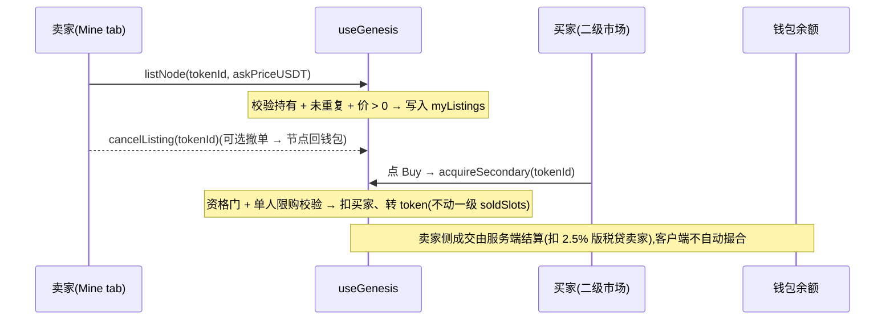

> 真后台对接:`POST /api/genesis/secondary/fulfill`(原子:校验挂单+资格 → 扣买家 → 贷卖家扣版税 → 转 token);挂单/撤单走 `POST /api/genesis/{list,unlist}`。客户端只发起主动承接、反映 canonical 结果,不含任何客户端撮合逻辑。

### 10.3 持有人 Dashboard `/genesis/holder`

#### 10.3.1 目的

为 Genesis Node 持有人提供完整的 holder portal,集中展示排放 / 权益 / 持仓 / 二级流动性。
看板由全局上所信号 `dividendsOpen`(= 服务端 `nexListed`,fail-closed)分**两态**渲染:上所前作战舱(排放优先额度 + 上所进度 + 积分榜)/ 上所后排放态(NEX 排放 vesting)。
当 `useGenesis.myOwned === 0` 时**显示真实空状态**(0 节点 / 无排放数字)+ 引导购买,不伪造数据。Perks / Footer 保留作为"购买能得到什么"的预览。

DAO 治理功能本期**仅作为持有人权益的文字承诺**(在 Perks 列表显示"1 节点 = 1 票")**不提供 active 投票 UI**,未来如开放可重新加 Active Governance section。

#### 10.3.2 页面结构(按 `dividendsOpen` 两态 × 持有状态分支)

**A. 上所前(`dividendsOpen === false`)· 排放优先额度作战舱**

`myOwned > 0`:
1. **Hero** — 排放优先额度卡:优先级 + 区间表述(非保证死数)+ 免责「上所后按排放与参与度确定」;**无每日收益数字、无可领余额**
2. **上所进度条 / 倒计时** — 真实话术「上所后开放」,不渲染 P1–P6 阶段字面
3. **积分排行榜名次卡** + 锁仓加倍 CTA(升 OG 排放优先倍率)+ 里程碑追溯奖励条
4. **动态条**(替代旧 live feed)— 「额度锁定 / 积分入账 / 里程碑达成」滚动;原 30 天柱图改标「积分趋势」

`myOwned === 0`:单一引导卡「你还没有创世节点」+ 认购 CTA(跳 `/genesis`),不显任何虚假持有 / 额度数字。

**B. 上所后(`dividendsOpen === true`)· NEX 排放态**

`myOwned > 0`:
1. **Hero** — NEX 排放收益:已释放 NEX 大数 + 参考 USDT 等值(「≈$X 参考 · 非保证」)+ vesting 环形进度(已释放 / 锁定中)
2. **排放明细 feed** — 复用原 feed 组件,数字换 NEX;下次释放倒计时
3. **YOUR NODES 列表** — N 个 NFT 卡(`NEX-GEN-XXXX` serial / 铸造日 / 二级市场 ExternalLink)

`myOwned === 0`:同上所前空状态引导。

**共享 Perks**(描述性权益,无交互入口):$NEX 协议排放优先额度 / 生态奖励池份额 / V5 直通 / Founders Circle(闭门 TG + AMA + alpha)/ DAO 治理(1 节点 = 1 票,文字承诺)/ 年度忠诚空投 + 二级流动性(OpenSea / 站内市场)。

**Footer note** — `Genesis Nodes are ERC-721 on Ethereum mainnet · Smart contract 0xNX...A98F · Audited by CertiK and Halborn`

#### 10.3.3 业务规则

- **持仓数据**:用真实 `myOwned`,0 时显示空状态,不伪造预览数据。
- **上所门(核心)**:`dividendsOpen = (nexListed === true)`,服务端权威 + fail-closed(脏 / 未知默认 false,绝不误显 live 排放);client **禁**本地由 false 推 true。后台 H1 `genesisDivOpen` 逐月旋钮据平台生命周期第 7 月(上所窗口)翻开。
- **上所前**:只持有排放优先额度(区间 / 优先级表述,派生自持有量 × `airdropPct`,默认 8%)+ 积分名次;**零累积可领余额**(推迟期不攒数,TGE 从 0 起按排放浮动发)。
- **上所后排放**:`emittedNEX`(累计已释放)/ `lockedNEX`(锁定中)/ `nextReleaseAt`(下次释放锚)均 server-canonical,按 vesting 曲线(TGE 10% + 18 月线性 + 每 6 月减半,后台 G4 `G.genesis.emissionCurve` 可配)派发,client 不本地推进。
- **参考等值**:`refUSDTValue ≈ emittedNEX × 平台参考价`,标「参考非保证」;取不到 = 隐藏(不显 $0 / NaN)。承接双口径设计——保底口径(节点价 × 0.1% ≈ $10/节点/日)挂后台负债科目#4,展示口径改 NEX 计价参考。
- **熔断**:`J.killswitch.genesis` 触发 → 排放区显「维护中,暂停派发」态,不报错白屏。

#### 10.3.4 入口

- `/genesis` 顶部 chip row 加 `Holder dashboard`(Diamond icon)与 `How it works` 并列

#### 10.3.5 首帧与随机源

- 持仓数 / 倒计时 / Live feed 时间戳 / Holdings 卡铸造日期 都在挂载后才渲染真实值
- chart bars 为 deterministic mock(纯函数派生),渲染期不调 Math.random()

---

## 11. 扩展功能

### 11.0 Me 主页 `/me`

`/me` 是 5 个 tab 之一,定位为**导航 / 摘要中心**,而非完整资金操作中心。所有完整流程(钱包、设备、网络、成就、设置)都通过摘要卡的链入口跳到对应子页。**首屏 4 张大卡** + 下方 Settings 列表 + 底部 Sign out。

**1. Profile compact row**(无独立 card,扁平 Link row → `/me/profile`)
- 头像
- 显示名 + V badge
- 单行 mono:`{phoneMask} · {region} · Joined {n}d`
- 整行点击跳 `/me/profile`,右侧 chevron 提示

低视觉权重,减少跟核心信息(钱包余额、网络收益)抢夺注意力。

**2. 我的钱包卡** `Card` 非 Link,内部多入口
- Header eyebrow `我的钱包` + 右侧 `钱包 →` Link 跳 `/me/wallet`(完整资金中心)
- USDT 余额 hero + 待结算提示(`≈ ${n} 待结算 · 每 24h 自动入账`)
- **3 个 quick action**(min-h-[64px] Apple HIG):**充值 / 提现 / 兑换**,各自跳对应 `/me/wallet/{topup, withdraw, exchange}`。充值用 accent 突出,提现/兑换次级。
- **设备槽位转化条**(仅在 `devices.length < MAX_DEVICES` 时渲染):
  - 左:`{n} 个设备槽位空闲 · +$X/d`(潜在日收益 = emptySlots × 7 取整)
  - 右:`添加设备 →` Link → `/store`
  - 计算:`emptySlots = MAX_DEVICES(6) − devices.length`;`slotPotential = emptySlots × 7`(取整)
- Footer compact 行:左侧 NEX chip + 数量 + USD 估值;右侧 `{n} 条本月` 链 `/me/wallet/bills`

设计动机:用户高频操作是充值/提现/兑换,放一级减少 1 步点击。设备槽位转化条在余额下方直接展示"有多少空位 + 填满能多赚多少",把资金管理动线与硬件购买动线合并于同一卡片,减少跳转层级。其他资金管理(质押 / 复投 / Bills / NEX 详情等)在 `/me/wallet` 子页。

**3. 我的网络卡** `Card href="/team"` 整卡可点击

定位:升级引导卡 — 展示距下一阶 V 级的具体动作 + 升级解锁的核心权益,引导用户进 `/team` 操作。**不展示状态信息**(可提现 / cooling 已在钱包卡覆盖),保持单一主题。

**进行中状态**(`gap.next` 不为空):
- 奖励锚点:下一阶解锁的培育奖 NEX(如 V3 = 10,000 NEX)
- 主标:`距 V{N+1} {title}` + 主缺口文案(取 `nextRankGap(state).primaryGap`,按 `progress = have/required` 比例选离完成最远的条件)
- 升级权益:`topUnlocks` 取前 2 项(emotional weight 排序见 §13.2)
- 进度条 + 百分比;`progressPct ≥ 0.8` 时进度条切 warning(冲刺暗示)
- "+N more" 副字:`unmetCount > 1` 时提示尚有几条未达

**Server-eligible 过渡态**(所有 conditions met 但 server 未确认):
- 主缺口位置显示 `条件全部达成 · 等待确认`(success 色)
- 进度条满格
- Server 仍可能 reject(anti-abuse / race-condition fraud check)— UI 仅提示

**Max-rank 终态**(`gap.next === null`):
- 卡片塌缩到单行 dignity row:`已达最高阶 · {title}` + V 级 prize icon
- 不显示进度条 / 权益对比

**数据来源**:`nextRankGap(state)` helper(`src/store/v-rank.ts`)— client preview only,server canonical 见 §13.2。`/team/rank` 详情页参 §8.2。

**4. 成就 strip**
- 6 个 BadgeTile 横排(`首次收益 / 7 天连签 / 后台设备 / 推荐达人 / 100 俱乐部 / Founder`)
- 已解锁数 / 总数 chip
- Footer SettingsRow `查看全部勋章 → /me/achievements`

**5+. 设置区**(`§11.X` 子页入口列表)
- 账户 / Earn extras / 资产 / 安全 / 帮助 / 语言 / 等等(参 `src/pages/me/me.vue` 设置行渲染列表)
- 银行账户管理入口显示“银行卡”,进入 §9.10;银行卡收款与 PSP 支付卡按实际通道能力分流。


浮动 bubble + Drawer 聊天面板。

### 11.0A Nova AI 顾问系统

**目的**:chassis-level 漂浮 AI 顾问。浮动 bubble 跨页存在,负责自动 push 与未读聚合;点击进入统一会话中心(§11.8.4),Nova 作为其中「AI 顾问」会话类型,承载自动 push 通道与 AI 对话。请求人工时切换到会话中心的「普通客服」会话类型(§11.0A.3)。

**作用域**:本节(§11.0A.1 - §11.0A.3)定义 Nova 的所有 channel + 切换规则。`§11.0A` 编号作为 §11.0 Me 主页 下的子区段,与 §11.1 我的设备 在层级上同辈但范围正交(Nova 跨页 / 设备只在 /me)。

**代码标识符**:前端已全量改名 `nova`(`src/store/nova.ts` / `src/components/nova/*` / `src/mock/nova-templates.ts`);仅 admin endpoint `/admin/stella/*` 保留 `stella` 字符作为后台接口契约。

#### 11.0A.1 5 个基础 push channels

| Channel | 默认频率 | 内容 |
|---|---|---|
| welcome | 注册 8s 后 / 24h cd | 欢迎语 + 解释玩法 |
| market-event | 12 min tick / 30 min cd | 全网算力波动 / AI workload 价格变动 |
| upgrade-nudge | 15 min tick / 60 min cd | 基于用户当前 fleet 推荐升级 |
| risk-alert | 异常事件 | 设备掉线 / 任务失败 |
| daily-summary | 每 25 完成任务 / 25 min cd | 当日收益总结 |

> **频率全部 server-controllable**:每条 channel 的 `{enabled, tickMs, cooldownMs}` 由 `GET /api/admin/stella/cadence-config`(§9.11c.1)拉取(endpoint 路径保留 `/stella/*` 命名作为代码契约),运营按 cohort / phase / 风险态势在线调整;`enabled=false` = 单 channel kill-switch。真后台接入前,前端只有单次推送的 `cooldownMs` 参数(`src/store/nova.ts`),尚无 channel 级配置表,本表数值为待落地基线。

#### 11.0A.2 3 个 v3 业务 channels

| Channel | 频率 | 内容示例 |
|---|---|---|
| team_event | 90s tick / 70s cd | "Sarah K. just bought Pro · +$89.90 USDT credited" |
| staking_event | 4 min tick / 5 min cd | "180-day vault APY just rose from 80% → 95%" |
| market_event | 6 min tick / 7 min cd | "$NEX broke $0.178 +20.4% in 24h" |

每条 push 带 CTA chip 直跳目标路由。

#### 11.0A.2a Sprint 2 / 3 / A-2 增量 channels

| Channel | 默认频率 | 触发条件 / 内容 |
|---|---|---|
| tradein-nudge | 15 min tick / 60 min cooldown | 车队(参与递减设备)平均产能 < 65% 且持有可置换设备时触发;文案钩子 = 当前产能 / 月度差额 + 该设备实时可抵额,CTA `查看置换选项 →` 跳 /me/devices 置换入口;无 phase 分档(代际窗口叙事已删) |
| monthly-task-lock | 30 min tick / 30 d cd(P1-P2)/ 7 d cd(P3-P4)/ 3.5 d cd(P5-P6) | Sprint 2 收尾(Gap D)— 月度任务锁定累计推送,phase-keyed 节奏。读 `getTaskLockSummary(joinedAt)` 取 thisMonthUSD,`getLockedTeasers(maxVram, 1)[0]` 取最佳 model 名。文案三 variant(early/mid/late phase bucket):early `Heads up — $N premium tasks (model) unaccepted this month. NexGridBox would clear most.` → /store;mid `Premium queue's running hot — missed $N this month (model pool). Pro v2 catches 2.5× throughput.` → /me/devices;late `**Final upgrade window.** Lost ~$N this month on model alone, plus fleet degrading. Rack P2 trade-in closes when this window does.` → /me/devices(Batch E 迁移)|
| social-event | 20 min tick / 30 min cd | Sprint A-2 / A.5 — 5 类全网"真实事件"等概率派发:大额提现走推荐网络 30% / V 级升级 25% / Genesis 二级成交 20% / AI 客户月 NEX 消费 +18-50% 15% / 网络小时新增 10%。文案严守真实平台叙事风,无 PM 内部术语 |
| quest-grace-reminder | 5 min tick / 7 day cd(一次性) | Sprint Quest-A+B — 用户首日任务进 grace 窗口(24-72h)且未 claim 时 push,CTA → `/` 回 Home 继续。详 §5.15.5 |
| quest-final-expired | 5 min tick / 7 day cd(一次性) | Sprint Quest-A+B — 用户首日任务彻底过期(72h+)且未 claim 时 push,CTA → `/me/achievements` 查看 badge 状态。详 §5.15.5 |
| weekly-quest-refresh(**待实装**)| 进入新 ISO 周时一次 / 同一周不重复 | 每周一新 Weekly Quests 上线时 push,CTA → `/missions` Mission Center。文案 `🎯 New week, new quests. 5 tasks unlocked — top reward +X NEX`。详 §11.13.9 |
| event-claimable | 15 min tick / 60 min cd | Sprint Q-3 — 当存在 trackable + done + 未 claimed 的 event 时 push 催领。文案 `🎁 You've earned a reward. {topEventName} is done (and N more) — claim +X NEX before it expires.` CTA → `/events`。topEventName 取奖励最大的那个,total NEX 为所有 claimable 奖励之和。详 §11.10.7 |

> **整体节奏 v3 收敛**:相较 v2,ambient 噪声类 channel(market / upgrade / dailySummary / tradein / social / eventClaim)cooldown 拉长 5-6× → 30 分钟主动浏览只触发 1-3 次 AI 推送。事件触发类(quest grace / expired / weekly refresh / wrapped)节奏不变 — 它们由日历滚动 / 状态机推动,不是 ambient noise。所有节奏由 §9.11c.1 `GET /api/admin/stella/cadence-config` 控制。

#### 11.0A.3 人工客服切换(Handoff)

用户在 Nova(AI 顾问)会话请求人工客服时,不在 Nova 会话内就地切换坐席,而是路由到统一会话中心(§11.8.4)的「普通客服」会话类型,由真人客服线程接管;Nova 会话保持 AI 语义不变。

- **切换入口**:Nova 会话头部「人工客服」按钮 → 打开会话中心的普通客服会话(无可用会话时回会话中心列表)。
- **人工客服语义**:发送 / 回复、坐席身份、回复模板见 §11.8.4。
- **AI auto-push 与人工对话互不干扰**:team / staking / market 等自动 push 始终注入 Nova(AI)会话;人工客服是独立会话类型,无需静默 AI 通道,Nova 自身不再有「live-agent 就地模式」与无响应自动切回逻辑。

### 11.0B 个人资料 `/me/profile`

账户公开资料页。**整页无自由文本输入、无手动配置项**(内容治理设计:平台不产生对其他用户可见的 UGC 自由文本,昵称违规在结构上不可能发生,无需事后内容审核机制;工单/客服输入属「用户→客服」私信通道,由客服人工在环,不在本命题内)。页面仅含:昵称(候选挑选)、头像(种子重掷)、加入时间/等级/钱包绑定(只读或跳转);地区、时区、个人简介均已从产品中移除。

**昵称(displayName)** — 预置词库构造器,唯一改名路径为候选挑选:
- 生成规则:`{形容词} {名词} {10-99 两位数}`,策展词库形容词/名词各 16 词(约 2.2 万组合;词库刻意避开 Node 等产品业务词,防与设备/节点术语同屏混淆),示例 `Nova Pilot 27`
- 改名流:点击昵称行 → 候选面板(一批 6 个不重复候选,可整批换新)→ 选定 → 回填编辑缓冲 → 「保存修改」持久生效;未选中时确认不可用
- 新账号默认昵称按账号标识确定性派生(同账号恒定,不同账号大概率不同)
- 露出面:团队成员可见 · 收益证明分享卡(§11.5)· 邀请海报(海报侧按最长词库组合 18 字符适配);参与支付密码等价黑名单比对(提现安全章节)
- 数据接口:`GET /profile/nickname-candidates` 返回候选数组(mock 以 `src/lib/nickname.ts` 等价实现,backend-replaceable)

**头像** — 账号信息派生首字母头像,可重掷随机种子。
**保存语义** — 页内编辑缓冲,统一「保存修改」提交(仅昵称可产生变更);无变更时提交给出无变更提示。

**运营配套** — 后台 C2「重置昵称」处置动作(操作确认 + 审计留痕,重置为系统生成默认,用户可重新挑选),处置存量违规/历史昵称;规格见运营后台 PRD C2 章。

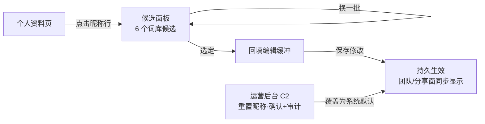

### 11.1 我的设备 `/me/devices`

**目的**:全 inventory 管理入口 — 购买 ≠ 激活,用户在这里决定哪些设备占用 6 个算力槽位中的一个。

**两段分组**:
- **已激活**:`devices.filter(d => d.activatedAt !== null)` — 每行显示设备名 + 日收益 + GPU 型号 + 取消激活按钮
- **待激活**:`devices.filter(d => d.activatedAt === null)` — 每行同上 + 激活按钮(若槽位已满则 disabled 显示"槽位已满")

**顶部 slot meter**:`activeCount / MAX_DEVICES` 双色进度条(6 格)+ 文字 mono 标识。

**Actions**:
- `激活`:调 `useApp.activateDevice(id)`,失败条件:槽位满 / 设备不存在 / 已激活;成功 toast `已激活 {name}`
- `取消激活`:**根据当前任务状态分支**
  - 若设备 `currentTask === null`(空闲态)→ `confirm()` 二次确认("取消后该设备停止贡献收益与任务进度,可随时重新激活"),确认后立即调 `useApp.deactivateDevice(id)`
  - 若设备 `currentTask !== null`(进行中任务)→ 弹专用 3 选 sheet(`useDeactivateSheet`):
    - **等任务完成后自动取消**(主 CTA):调 `useApp.scheduleDeactivation(id)`,设备保持激活直到 tick 检测任务完成并自动出槽
    - **强制取消(放弃当前任务奖励)**(次 CTA):立即调 `useApp.deactivateDevice(id)`,当前任务奖励不发放
    - **返回**:cancel,不动状态
  - Sheet 内显示当前任务实时进度(model / client / 奖励 / progress% / ETA)
- 列表项 chip:`pendingDeactivate=true` 时显示"任务完成后自动取消" warning chip(Clock icon)
- 空 inventory 状态:dashed 框 + "还没有任何设备 / 前往商城购买 NexGridBox" + 底部 brand pill `前往商城购买`

**取消激活的连锁效应**(完整一致性):
- 设备退出 active fleet:Earn 页"我的设备"section / Home FleetSection / MyEarnings 卡均同步消失
- DeviceCardPC 内嵌的"Tasks you're locked out of" mini section(phone 专属)随 DeviceCardPC 一起消失
- 推广文本变量(`derivePromoUpgrade`)自动重算 base = 剩余激活真实设备中最高日收益的一台(全无激活时 fallback S1 anchor)
- earnings tick 不再贡献 USDT/NEX
- weekly quest 设备进度只算 active

**安全声明**:取消激活不影响硬件归属(设备仍在用户库存),不影响购买记录与 lifetime 收益历史。重新激活时 tick 在下一帧 pickRandomTask,任务恢复接取。

### 11.2 通知中心 `/me/notifications`

汇总所有事件历史(Nova 推送 + 佣金 + 质押到期 + Genesis 销售 + 系统通知)。

#### 11.2.1 类型

| Kind | 来源 |
|---|---|
| commission | Unilevel / Binary / Peer / Cultivation / Leadership 任一类佣金 |
| team | Sponsorship / Spillover / Rank progress |
| staking | APY 变化 / Maturity / Lock reminder |
| market | NEX 价 / TVL milestone / Listing 新闻 |
| genesis | 销售 ticker / 二级市场动态 |
| system | 维护通知 / 监管 |

#### 11.2.2 UI

- iOS nav 顶部 + unread 数 badge + Mark all read + Clear read 操作
- 6 个 filter pills(All + 5 类,只显示有内容的)
- 时间线列表:
  - 未读 dot + 加粗标题
  - 已读态
  - tap 自动 markRead + 跳 CTA href
- 200 条 cap,LRU 滚动

#### 11.2.2a Swipe-to-action(conversion-tied)

每行 row 支持左滑手势。用户左滑暴露 conversion 路径 + 管理 actions,**第一个 action 与 NotifKind 联动**,把通知 → 直达入金页:

| NotifKind | Swipe action 1(conversion)| 跳转 | Action 2 | Action 3 |
|---|---|---|---|---|
| commission | 复投 | `/me/wallet/repurchase` | 已读 | 删除 |
| team | 团队 | `/team` | 已读 | 删除 |
| staking | Stake | `/staking` | 已读 | 删除 |
| market | 行情 | `/market` | 已读 | 删除 |
| genesis | Genesis | `/genesis/marketplace` | 已读 | 删除 |
| system | — | — | 已读 | 删除 |

设计目的:绕过 list-tap → detail-tap → 入金-tap 三步漏斗,让用户拿到 commission 通知后**左滑直跳复投页**,把通知从被动事件流升级为主动 conversion 漏斗入口。

**store action**:`useNotifications.removeOne(id)` 单条删除(swipe-to-delete),复用现有 `markRead(id)` 单条已读。

#### 11.2.3 入口

- Me 页 Earn extras section 第一行 row(显示 unread badge)
- Header bell 当前打开 Nova drawer(保留独立角色)

#### 11.2.4 通知优先级队列

| Priority | 适用类型 | 保留策略 |
|---|---|---|
| `critical` | 提现冻结 / 风控异常 / 合规要求 re-acknowledge / 资金账户异动 | **永不淘汰**(`CAP_CRITICAL = Infinity`)|
| `high` | 试用即将到期 / 高质量延长资格 / staking maturity / 大额收益结算 | tier 内 LIFO,`CAP_HIGH = 50` |
| `normal` | Nova v3 频道社交事件 / 邀请奖励到账 / 设备状态变化 | tier 内 LIFO,`CAP_NORMAL = 200` |
| `low` | 节庆活动 / 周月任务 / 推荐已知 / 营销 promo | tier 内 LIFO,`CAP_LOW = 30`(真后台对接后改 24-48h 自动淘汰)|

**前端实现**:`src/store/notifications.ts` 加 `priority: NotifPriority` 字段;`push()` 默认 `"normal"` 保持向后兼容;`applyPriorityRetention()` 按 tier 单独 cap,critical 永不丢失。所有 callsite 旧调用无需改动,显式优先级仅在新调用点声明(如风控类系统通知应明确传 `priority: "critical"`)。

**Priority 升级路径**(MVP-D 抓到的边界):同一 notification id 后续以更高 priority 重新出现(例如 `normal` 试用提醒被升级为 `critical` 风控告警)时:
- 客户端 mock 已实现 in-place 升级(`src/store/notifications.ts` 的 `push()` existing-id 分支检 `priorityRank` 后 update),并清 `readAt` + bump `unread`,保证升级事件重新进入未读队列浮顶
- 升级时 `ts` 重置为 now,触发 surface-newest-critical 排序语义
- 真后台等价行为:server 检测 priority 变化后,在新事件上 emit 一条 canonical 记录(同 id,新 priority + 新 ts + readAt=null),client 通过 SSE / cursor refresh 重读;**client 不直接 PATCH**,改由 server 主动推送

**真后台接口契约**:
- `GET /api/notifications?cursor=&limit=&priority=` — 分页拉取,支持按优先级过滤
- `POST /api/notifications/:id/read` — server-side 标读
- SSE `/api/notifications/stream`(候选)— server 主动推 priority 升级 / 新通知
- `client.useNotifications` 改为 cursor-based fetch,LIFO cap 仅作为 UI 显示窗口,**不再是权威数据源**

#### 11.2.5 支付方式生命周期推送模板(银行卡解绑 / 换绑引导)

后台「用户银行卡查询与解绑」能力(运营控制后台 PRD v1 Ch5 [C1·deepening] 支付方式)的用户端配套推送,两条模板,均由 **server 在事件流上触发**(client 仅收 feed,不本地判定触发时机):

| 模板 | 触发事件(server) | Kind | Priority | CTA 深链 | 文案要点 |
|---|---|---|---|---|---|
| 银行卡已解绑 | `card.unbound`(后台解绑 / 用户自解绑同一事件) | system | normal(风控发起的解绑,server 可按 §11.2.4 升级 critical「资金账户异动」档) | `/pages/me/wallet-cards`(§9.10 我的银行卡) | 告知「{brand} •••• {last4} 已解除绑定」;引导需要时重新绑卡以便继续在商城结算 |
| 请更换支付卡 | `card.rebind_notified`(后台 C1 发送换绑通知动作) | system | high(影响后续结算,对齐 §11.2.4 high 档) | `/pages/me/wallet-cards` | 告知当前卡不再适用,引导绑定新卡以免影响商城结算;换绑成功前旧卡保持生效 |

- 触发时机权威在后台侧;两条模板只关乎商城支付,与免费试用无耦合。
- 文案走 i18n(`notifs.cardUnbound* / notifs.cardRebind*` 六键全词典镜像);模板实现为 builder 形态(`src/mock/card-notifications.ts`),PRODUCTION 由后端事件桥调用,mock 期不自动注入静态样例(避免与实时卡状态矛盾)。

### 11.3 信任中心 `/trust`

14 个 section 集中展示合规与信任标识。

| Section | 内容 |
|---|---|
| Hero | "Hardware-backed compute · Verifiable execution" + TVL $847M + Active nodes 287K |
| Compliance badges | SOC 2 Type II / ISO 27001 / GDPR / HIPAA / FinCEN MSB |
| Audits & reserves | CertiK 智能合约审计 PDF + Etherscan reserve proof + Trail of Bits quarterly attestation |
| Trusted by | NVIDIA / Intel / AMD + 5 客户 logo |
| Backed by | a16z crypto / Sequoia / Pantera / Polychain / Multicoin / Coinbase Ventures |
| **Leadership team** | 5 行 C-suite,LinkedIn 风格(首字母头像 + 名 + 角色 + ex-公司 + `in` 外链 chip)。Section header suffix `verified on LinkedIn`。整行 `<a href="#">` 占位 |
| In the press | TechCrunch / CoinDesk / Forbes / The Block 4 篇报道 |
| **Q2 2026 financials** | 顶部 strip(文件图标 + 标题 + `Download PDF →` 占位链接)+ 2×2 KPI grid(MRR $4.87M +22% / Active 184,206 +38% / Devices 27,150 +12% / Payouts $47.0M +27%)+ footnote `Selected metrics · Full audited report ships to investors quarterly`。Section header suffix `audited by PwC`。季度取**已收官季**(季中不得标 audited);Payouts 为按增长曲线积分、收口于日发放锚的季总量;Devices 为季末快照,低于当前在线锚形成延续增长轨迹 |
| **NEX backed by AI demand** | hero(`Every NEX is minted only when AI inference completes` + `30% 平台手续费回购销毁`)+ 3 列 stats(`$X.XXM 24h volume` / `$XXXM FDV` / `X.XXB Circulating`)+ 3 行 top AI 客户 NEX 月度消费 ranking(Helix Labs / Mosaic Studios / Echo Earbuds)+ footer `View all 1,247 active AI clients →` |
| $NEX listings | PancakeSwap / Uniswap / CoinGecko / CoinMarketCap "Live",Binance / Coinbase "推进中" |
| Bug bounty | $50,000 per critical · HackerOne · 24h triage SLA |
| Footer | compliance@nexgrid.ai |

**Sprint A-1 / A.2 新增**:Leadership team + Q3 2026 financials 两 section 在 Investors → Press → NEX anchor 链条中插入(Leadership 在 Investors 后 Press 前;Q3 在 Press 后 NEX anchor 前),进一步强化"真实 fintech / Web3 公司"信号。所有 PDF / LinkedIn 链接均为占位 `href="#"`,纯视觉剧场。

**NEX 价值锚叙事目的**:为平台代币提供"工作量证明"语义 — NEX 不是凭空铸造,而是 AI 推理完成才 mint;暗示 buyback 机制(30% 平台手续费回购);列出 top 客户月度 NEX 消费量,放大"1,247 家客户真实需求"的可信度。数据源:`useMarket.volume24hUSDT / circulating` 计算 FDV;客户消费量来自 §9.5 AI 客户清单关联。

`NEX backed by AI demand` section 内嵌 entry chip `📖 What is NEX? Learn more →` 链 `/trust/nex`。

#### 11.3.1 NEX 代币说明页 `/trust/nex`

零基础说明页,向新用户解释 NEX 平台代币本质 + 用法 + 价格机制。

**页面结构**:
1. iOS nav back to `/trust` + 标题 `About NEX token`
2. Hero + 标签 `PLATFORM TOKEN` + 大标题 `NEX — the token that powers NexGrid's compute economy.`
3. §1 NEX vs USDT 对照表(Property / USDT / NEX 三列;Token type / Current price / Volatility / Primary use 四行)
4. §2 NEX 4 个来源 IconRow:
   - ⚙️ 设备算力产出(主产出:每笔推理任务完成 mint NEX,即时滴灌入持仓)
   - 🤝 团队佣金(unilevel / peer / cultivation 部分 NEX 计价)
   - 📈 质押利息(NEX 计价收益)
   - 🎁 签到 + 注册礼包(每日签到水龙头 + 20 NEX 注册礼)
5. §3 NEX 5 种用法 IconRow:
   - 💱 Convert to USDT 提现(经 `/me/wallet/exchange`)
   - 🔥 抵扣提现网络确认费(每笔按网络固定收费,可自选烧 NEX 抵扣,见 §9.3.2)
   - 🛒 支付升级 / 复投
   - 🔒 质押锁定 NEX 收益
   - 🚀 持有看涨
6. §4 价格涨跌机制双卡:
   - DEMAND SIDE:AI 客户付费 → 月度 buyback
   - 🔥 BURN MECHANISM:30% 平台费永久销毁
   - 💡 Track NEX in real time CalloutBox(指向 Trust Center 实时数据)
7. §5 FAQ 5 问(NEX 是否稳定币 / 是否可直接提现 / 价格下跌怎么办 / Binance 上市 / 与 memecoin 区别)
8. 双 CTA:`Open Exchange` 链 `/me/wallet/exchange` + `Back to Trust Center` 链 `/trust`

### 11.3a 收益里程碑庆祝(MilestoneWatcher)

平台监听账号累计收益；`earnings.total` 已包含今日收益，不再叠加 `earnings.today`。只有新增收益实际跨过尚未触发的档位才自动派奖并庆祝。首次加载或旧数据迁移时，将已存在的历史累计收益记录为账号基线，不补发或补弹历史档位；基线须在首次新增收益结算前建立并持久化，同账号刷新或重新登录不重设，换账号独立读取。

**与 §11.4 成就系统的差异**:Achievements 是用户主动 Claim 的成就(条件评估 → 可见 lock 状态 → Claim 入账);**MilestoneWatcher 是被动触发的庆祝**(条件越过 → 自动 fire + 自动入账 NEX 奖励,无需用户操作)。两者并行,不冲突。

**跨档派奖动作**(单次跨档):

1. 确认累计收益已达到高于历史基线的未触发档位；
2. 以稳定的 `MILESTONE-{id}` 幂等入账 NEX 奖励及 `achievement` 账单，同一账号同一档位只能发奖一次；
3. 奖励与账单成功后持久化已触发标记；标记失败时重试，不重复发奖；
4. 标记成功后加入庆祝队列，遵守全局弹窗互斥与钱链路挂起规则。基线写入失败时保留首次观测值并重试，成功前不发奖。

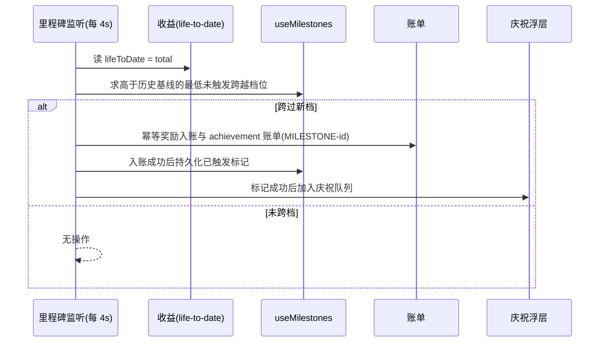

**5 档阈值**(`src/store/milestones.ts` · `EARNINGS_MILESTONES`):

| ID | 阈值 (USD lifetime earnings) | NEX 奖励 | 业务文案钩子 |
|---|---|---|---|
| earn-100 | $100+ | +100 NEX | "First $100 earned — your phone has officially paid back its activation overhead." |
| earn-500 | $500+ | +250 NEX | "Half-grand reached. Hardware tier upgrades start unlocking measurable ROI." |
| earn-1000 | $1,000+ | +500 NEX | "Four-figure earner. You're outpacing 88% of solo-phone accounts." |
| earn-5000 | $5,000+ | +1,500 NEX | "Mid five-figure operator. Most users at this stage already own a NexGridBox Pro." |
| earn-10000 | $10,000+ | +3,000 NEX | "Top 2% of NexGrid earners. Founders Tier consideration unlocks at $25K." |

**Overlay UI**(portal 到 body):
- Trophy icon spring 入场
- 大字 `$X+`
- 标题 + 阈值专属业务文案
- chip `+N NEX` 奖励
- 全屏彩带同步触发,从勋章位置迸发
- 5.2s 自动 dismiss

**检测节奏**:本地原型每 4 秒检查一个新跨越档位。一次新增收益跨过多档时逐档处理，不以演示效果补播历史档位。

**Persist**:`useMilestones` 按账号分行持久化(键 `nexgrid-milestones-accounts-v1`)记录 `baselineUSD` 与 `firedIds`。缺少基线的旧记录保留已有标记，静默建立基线；刷新不重复派奖或重播已通知档位。

**真后台对接**

| Endpoint | Method | Payload | 用途 |
|---|---|---|---|
| `/api/me/milestones/:id/claim` | POST | — | 跨档派奖。server 以累计收益权威值复核该档确已跨越且未派发,再**在同一事务内**置已触发、入账 NEX、写 `achievement` 账单(ref `MILESTONE-{id}`)。以档位 id 幂等,重复请求只返首次结果、不二次发奖;客户端 firedIds 仅为免重复弹窗的 UI 缓存,清空不能重领。阈值与奖励读 `GET /api/config/milestones`(§9.11c.1) |

**Demo 触发入口**(`/me/replay-tour` Lifecycle demo section,Sprint 2 第三阶段 §7.5.6 同位置):"Trigger earnings milestone" 按钮 → `resetMilestones() + _devBumpEarningsTotal(150)` → 下一次 poll 时 fire $100 阈值。

**i18n**:`milestones.*` 7 keys(title 模板 + 5 阈值业务文案 + genericBody fallback)。

### 11.4 成就系统 `/me/achievements`

24 个成就分类(First / Earnings / Social / Loyalty / Hardware),每解锁触发弹窗 + 可领取 USDT/NEX 奖励。

### 11.4a 风险提示书 `/me/risk-disclosure`(Sprint A-1 / A.3)

合规剧场关键件 — 真实加密交易所 ToS 风格强制阅读 + 双 gate 确认(scroll-to-bottom + checkbox)。首次提现 / 首次 staking 锁仓前拦截;常驻入口在个人中心「帮助与支持」分组。

**Store**:`src/store/risk-disclosure.ts` — `useRiskDisclosure`,`{ current, accepted, acceptedAt, accept, reset }`;确认态以服务端 acknowledge 接口为权威,前端只镜像。

**页面结构**:
1. iOS nav back + 标题 `Platform risk disclosure`
2. **Hero**(AlertTriangle):`REQUIRED READING` 标签 + `Read this before staking, locking, or withdrawing.` + 副文
3. **7 章节**(每章 mono 编号 01-07 + 标题 + body):
   - 01 收益预估只是预测,不是承诺(±15% 周波动)
   - 02 任务产能节奏(月 1-3 −4% / 4-8 −6% / 9-12 −23.7% / floor 22%)
   - 03 NEX 代币市场风险(±20% 日 / 非 FDIC 保险)
   - 04 提现时效 + 额外安全确认(30d / 45d enhanced / 每笔按网络收固定网络确认费)
   - 05 Staking 锁仓不可撤销(提前赎回扣全息 + 5-15% 本金)
   - 06 网络经济 + 推荐人激励(平台利润支付 / 反垃圾推广)
   - 07 托管 / 合规 / 监管管辖(FinCEN MSB / MiCA / Chainalysis / PwC 季度审计)
4. **Bottom sentinel + IntersectionObserver**(`rootMargin -24px`)— 工作在 iOS chassis 内部 scroll 容器
5. **未滚到底 banner**:`ArrowDown` + `Please scroll through all sections before acknowledging`
6. **Acknowledge section**:
   - Checkbox(scrolledToBottom 才能勾)+ `I have read the 7 sections above and understand...` 完整 acknowledgement label
   - Accept CTA(全宽):双 gate 满足才 enable;已接受时变 `Acknowledged` + ShieldCheck 不可点
7. **Footer disclaimer**:`Acknowledgment is logged with timestamp. Re-reading available anytime via Me → Risk disclosure.`

**双 gate**:`canAccept = scrolledToBottom && checked && !accepted`。

**i18n**:`riskDisclosure.*` namespace ~25 keys(全词典镜像)。

**集成点**(`useRiskDisclosure().accepted === false` 时拦截):
- `/me/wallet/withdraw` handleSubmit 前置守卫(§9.3.4a)
- 后续 Sprint:`/staking` lock CTA 同理

### 11.5 推理收据 `/me/receipts` + `/me/proof`

#### 11.5.1 推理收据 `/me/receipts`

每完成一笔 AI 推理任务生成"推理收据":
- 任务 ID + 客户名 + AI 模型 + 设备/GPU + 时长 + 能耗 + 单价 + 收益明细(gross / network fee / net paid)
- 客户地址 + 签名(rsa-sha256)+ attestation tx_hash + 区块号
- 列表按分类 tab(全部 / 图像 / 视频 / LLM / 微调 / Embedding / 语音 / KYC)分屏加载:每个 tab 首次载入只渲染一屏,下滑接近列表底部时加载下一屏;切换 tab 重置回第一屏
- 列表行点击打开 Proof-of-Compute 详情 sheet;**详情为纯信息展示**,所有字段只读,不提供复制 / 分享 / 在 explorer 查看等操作

#### 11.5.2 Proof of Contribution 分享卡 `/me/proof`

社交分享中心 — 真实平台都做(对标 Coinbase shareable card / Robinhood Wrapped),目的是**把用户的 lifetime 收益 / streak / 网络规模做成可一键社交分享的视觉证明**,驱动 referral 转化。

**3 个卡片主题 Tab**:
- **Earnings** — hero `TOTAL EARNED $XXX.XX` 大字 + 14 点 sparkline
- **Streak** — hero `LONGEST STREAK 🔥 N d` 大字
- **Network** — hero `TEAM REACH 👥 N` 大字

**共享区域(所有 variant)**:
- 顶部 brand 行(NexGrid logo + `PROOF OF CONTRIBUTION` label)
- 用户名 + Member since + **VBadge** 组件露出当前 V 级
- 3 mini stats:Active days / Devices / Top X% of network(基于 lifetime 收益分位)
- **Achievements chips 横滑**:V{N} {title} / {n}d streak / {n} devices / {n}d active(动态生成)
- **Referral 区**:大字 `NEXGRID-XXXX` 推荐码 + 完整 URL(点击复制)+ QR 占位图案(从 referralCode 哈希)

**分享触点**:
- 顶部 `Quick share` CTA → 调起 `navigator.share()` 原生 sheet(无原生支持时回退到 clipboard.writeText + toast)
- 下方 **6 个目的地 grid**:X/Twitter / Telegram / WhatsApp / Instagram / Copy link / Save PNG
- 每目的地 icon + label,点击复制对应 shareText 到剪贴板

**Share Text 模板**(根据 variant 切换):
- Earnings:`💸 Earned $X on NexGrid in N days. Join my network: {refUrl}`
- Streak:`🔥 N-day streak on NexGrid. Daily check-ins drip passive NEX. Join me: {refUrl}`
- Network:`🌐 My NexGrid network is N strong across 7 layers. Compound earnings from each. Join: {refUrl}`

**数据源**:
- earnings / activeDays / devices / referralCode / displayName / joinedAt → `useApp` + `useProfile`
- 当前 V 级 → `useVRank.myRank` + `V_RANKS[myRank].title`
- streak / longestStreak → `useNexFaucet`
- totalMembers → `useNetwork`

**首帧稳定性**:
- VBadge / streak chip / longestStreak 数字依赖本地持久化数据,挂载后才渲染真实值
- QR 占位图案基于 referralCode 哈希派生(纯函数,同一推荐码每次渲染完全一致)

i18n keys 在 `proof.*` namespace,~50 keys。

### 11.5a 我的奖励 `/me/rewards`

个人中心的奖励聚合入口,两级结构。

**入口与红点**:`/me`「账户」分组「我的奖励」项,带未读红点,条件(满足其一):
- 存在已领、未使用、在有效期的代金券 — 持续显示,直到券被使用或过期;
- 存在入账时间 > `rewardsSeenAt` 的奖励类账单条目 — 打开 L1 即更新 `rewardsSeenAt`(服务端权威:用户档案字段,`PATCH /api/me/rewards/seen` 由服务端盖时间戳,客户端仅缓存);首装 `rewardsSeenAt=0`,历史入账视为未读。

**L1 类别汇总**(`/me/rewards`):三个分类入口——优惠券(可用张数;有过期券时提示过期张数)、USDT 奖励(累计入账总额)、NEX 奖励(累计入账总额)。零值时三分类仍显示并附引导文案。

**L2 分类记录**(`/me/rewards/list?cat=voucher|usdt|nex`,cat 非法或缺失回退 voucher):
1. **优惠券**(voucher)— 已领、未使用、在有效期的券(面值 / 名称 / 适用范围 / 有效期),每张提供「去使用」:单一 SKU 券 → 该设备详情页,多 / 全设备券 → 商城(§7.7.2);已领未用但已过期的券置灰标「已过期」,不可使用。
2. **奖励记录**(usdt / nex)— 该币种的奖励类入账(活动 / 推荐 / 成就 / 客服补偿,账单类型 ∈ {活动奖励, 推荐佣金, 成就奖励} 且金额 > 0),按时间倒序,每批 10 条,滚动到底自动续载;真后台 `GET /api/me/bills?type=reward&symbol=USDT|NEX&cursor=&limit=10`(游标分页)。

**数据源与口径**:代金券钱包(useVoucher,§12.20)+ 账单流水(useBills,§9)。红点、L1 汇总、L2 记录共用同一奖励条目判定(单源派生);客服补偿以奖励类账单入账后自动计入本页与红点,无额外接口。

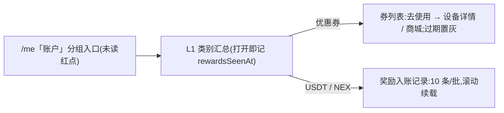

### 11.6 全球节点地图 `/globe`

SVG 抽象世界地图 + 28K 节点 dot + 顶部国家活跃排行 + 实时 pulse 任务派发动画。

**真后台对接**

| Endpoint | Method | Payload | 用途 |
|---|---|---|---|
| `/api/network/regions` | GET | — | 各区域节点数 / 每小时任务数 / 平均时延 / 归一化坐标 / 当前用户所属区标记,驱动地图节点分布与国家活跃排行。节点与任务数须与 `/api/platform/stats`(§9.11c.1)同源,不得两处各报一套 |

### 11.7 Developer API `/developer`

展示性 API 文档 + 代码 sample + SDK 下载链接。

### 11.8 帮助 + 客服

#### 11.8.1 帮助中心 `/me/help`

FAQ accordion,分类:Account / Earnings / Hardware / Payment / Security。

#### 11.8.2 客服渠道枢纽 `/me/support`

- Live status chip(`Online now · avg response 4m`)
- 5 个渠道行:**在线会话**(链 §11.8.4 统一会话中心)/ Telegram / Discord / Submit a ticket(链 §11.8.3 `/me/support/tickets`)/ Email
- Pinned 公告 4 条

#### 11.8.3 工单系统 `/me/support/tickets`

私密 1:1 客服对话系统,对标 Binance Customer Service / Coinbase Help Tickets / Crypto.com Support。
**单页 3 view mode**(页面内本地状态切换,无路由跳转):

**A. List mode(默认)**:
- Subtitle + 3 stats 卡:`OPEN` / `AWAITING YOU` / `RESOLVED lifetime`
- `+ New ticket` CTA
- `Median first response · 12 min` chip
- 4 tabs:All / Open / Resolved / Closed
- 工单行:status icon + `STATUS · CATEGORY · TK-ID` chip + 未读 chip(`N new`)+ 标题 + 相对时间 + msg count

**B. Detail mode**(点列表行):
- Meta 卡:status / category / 标题 / Created {when} / Last update {when}
- 消息线程:用户消息靠右,客服消息靠左,顶行带名字 + 时间
- 回复 textarea + `Send reply` + `Mark closed` 双按钮(已 closed / resolved 状态隐藏)

**C. Create mode**(点 New ticket):
- 8 个分类 chip:Withdrawal / Deposit / KYC / Hardware / Account / Earnings / Technical / Other
- Subject 输入 + Description textarea
- Cancel / Submit ticket 双按钮 + 空字段校验

**TicketStatus 枚举与颜色**:
| status | label | color |
|---|---|---|
| open          | Open          | #FFC83D |
| in_progress   | In progress   | #3DA9FF |
| pending_user  | Awaiting you  | #FF6B35 |
| resolved      | Resolved      | #C6FF3A |
| closed        | Closed        | #5F6A7E |

**TicketCategory 枚举**:account / withdrawal / deposit / kyc / hardware / earnings / genesis / technical / other。
**TicketPriority 枚举**:low / normal / high / urgent。

**数据来源**:工单列表与详情由服务端提供(`GET /tickets` / `GET /tickets/{id}`,`src/api/support-api.ts`),前端 `src/store/tickets.ts` 只持有拉取结果;枚举与展示映射在 `src/domain/support.ts`。

i18n keys 在 `tickets.*` namespace,~40 keys。

### 11.8.4 统一会话中心 `/support/messages` + `/support/chat`

**目的**:把人工客服与 AI 顾问统一到一个会话中心。人工客服支持**多类别**,用户可在不同类别的客服会话间主动切换。区别于工单系统(异步 / 私密 1:1 / 有状态机)——会话中心是即时聊天形态。

**会话类别(`ConversationType`,可扩展)**:

| 类别 | 角色 | 会话语义 |
|---|---|---|
| `advisor` 专属顾问 | 增长顾问 | **顾问主动触达**:预置带转化 CTA 的引导消息(如「设备闲置 ~30%,升级 Pro 多赚」→ `/store`;「180 天锁仓 95% APY」→ `/staking`),以未读呈现,引导购买 NexGridBox / 锁仓 / 复投 |
| `support` 普通客服 | 客服支持 | **用户发起**:处理售前 / 售后问题(账户 / 提现 / 订单等);用户发消息 → 真人客服回复 |
| `ai` Nova | AI 算力顾问 | §11.0A Nova 作为 AI 类型并入;保留 quick-prompt + 自动 push 通道;会话头部「人工客服」入口路由到 `support` 会话(§11.0A.3) |

**入口与路由**:
- `/support/messages` — 会话中心:按类别分组列出会话,用户主动切换类别查看该类别会话。
- `/support/chat?cid={id}` — 人工类别会话聊天线程;`/support/chat?type=ai` — Nova 聊天线程。
- 入口:Nova 浮动 bubble(点击进会话中心)、客服渠道枢纽 `/me/support`「在线会话」行(§11.8.2)、Home 的 Nova 卡(进 AI 会话)。

**业务规则**:
- `advisor` 会话默认带未读(主动触达),作为常驻转化触点;进入会话清零该会话未读。
- `support` 为用户发起线程,用户发送后由真人客服按类别模板回复。
- `ai`(Nova)承载所有自动 push;Nova bubble 未读徽标聚合**全部类别**未读(AI + 人工)。
- 人工 / 顾问回复为按类别循环模板(真后台接入后替换为真实坐席消息流)。
- **发送频控**:单会话发送限流,两道独立闸——滚动窗口(每 15 秒最多 5 条)+ 相邻两条最小间隔(至少隔 1 秒),防连点刷屏;两闸都放行才发出,超限提示的重试秒数取两者较长值。超限提示同一时刻只显示一条,连续触发刷新该条不叠加;被拦下的这条消息文本回填输入框,不丢失。规则覆盖三类会话的自由输入与快捷提问(chip)。真后台以 HTTP 429 + Retry-After 镜像同一策略。
- **消息回执与状态**:用户发出的消息显示「已送达 / 已读」回执;坐席回复前依「已读 → 正在输入…(气泡)→ 回复」节奏推进(约 2 秒),使接待过程可感知。真后台接入后由消息已读事件与 typing 事件驱动。
- **消息定位**:进入会话、发送或收到新消息后,线程自动滚动定位到最新一条。

**数据模型**:§12.9a Conversation。**i18n**:`conversations.*` 命名空间 + `support.chLiveChat` 渠道键。

### 11.9 NEX 行情详情页 `/market`

#### 11.9.1 目的

提供 NEX 与同类 AI / DePIN tokens 的横向对标视图,锚定 NEX 处于"主流赛道",
强化交易所上线预期(`Binance / Coinbase 推进中`),驱动用户进入后买入 NEX。Home `$NEX ticker` 卡当前阶段隐藏(参 §5.7),Home 侧入口走算力市场卡「打开」。

#### 11.9.2 页面结构(自上而下 7 段)

1. **NEX Hero**:
   - 标签 `YOUR PLATFORM TOKEN`
   - 左:N 圆 icon + `NEX / USDT` + 副字 `NexGrid · #{rank}`
   - 右:大字价格 + `▲/▼ XX.XX% (24h)`
   - 时段 tabs:`1H / 24H / 7D / 1M / ALL`
   - K-line area chart(上涨 / 下跌)
   - 双 CTA:Buy NEX + Sell NEX,链 `/me/wallet/exchange`

2. **6-cell Stats grid**:
   - Market Cap / 24h Volume / FDV
   - Circulating / Total Supply / Rank
   - 底部 ATH 行:`$0.184 (-X.X% from ATH)` 损失感

3. **LISTED ON 卡**:
   - 标签
   - 已上交易所:`PancakeSwap · MEXC · Gate.io · LBank`
   - chip ⏳:`Binance · Coinbase (under review)` — 锚定未来合法性

4. **Category Tabs**(胶囊):All / Watchlist / AI / DePIN / Infra

5. **Token 列表**:
   - 列头:`# / Asset / Price / 24h`
   - NEX 置顶 + `OURS` chip
   - 同类 tokens 15 个(RNDR / TAO / FET / AKT / IO / OCEAN / AR / FIL / GRT / AGIX / GLM / NMR / POND / RLC / ROSE)
   - 每行:Star(可切换 watchlist)+ icon + symbol + name · market cap + price + sparkline + 24h %

6. **Footer note**:
   - `Data refreshes every 30 seconds. Prices are reference-only · NEX/USDT is settled at platform rate.`

#### 11.9.3 业务规则

- Watchlist 切换在前端 `Set<symbol>` state 持有(无服务端写入,刷新即重置;真实平台会持久化)
- NEX 永远置顶 + 永远不可被 unstar
- NEX/USDT 价格来源:复用 `useMarket` store(同 Home ticker / NEX↔USDT 兑换页)
- 其他 token 数据来源:`src/mock/tokens.ts` 静态 mock,无实时 tick(避免 perf 损耗 + 强化"NEX 是唯一活跃 token"暗示)
- Device ranking 等"工作负载行情" 不进 /market,仍在 `/earn` 的 Market Overview(§6.5)

**真后台对接**

| Endpoint | Method | Payload | 用途 |
|---|---|---|---|
| `/api/market/tokens` | GET | — | 同类对标 token 列表(symbol / 名称 / 分类 / 价格 / 24h 与 7d 涨跌 / 24h 成交额 / 市值 / FDV / 流通量与总量 / sparkline / ATH 与日期 / 排名)。**NEX 行情不取此表**,走 §10.3 `/api/market/nex` 平台牌价,避免同一价格两个来源 |

#### 11.9.4 入口

- Home Mission Control 的 `$NEX` ticker 卡(NexTickerCard)→ 链 `/market`
- 可从 `/trust/nex` 等 NEX 说明页加 "查看行情" 入口

### 11.10 活动中心 `/events`

#### 11.10.1 目的

集中展示限时折扣 / 邀请挑战 / 抽奖转盘 / 区域 PK / 奖励翻倍周 / 节日活动 / 持币空投 / 新人加速 等促销活动,
形成持续的"周期性流量回访点",每个活动卡都是一个独立的 conversion hook(折扣 → 商城 / 邀请挑战 → InviteEarnCard / 抽奖 → 转盘 page 等)。

**Long-tail Task System Layer 4**:trackable 类活动接入真任务化引擎 — progress 来自真实平台状态(`evaluateEventProgress`),Join / Claim 通过 `useEventQuest` 持久化,完成时直接 `creditNex` + `useAchievements.unlock` 写入余额 / 解锁勋章(参 §11.13)。

#### 11.10.2 页面结构(自上而下 4 段)

1. **Featured Hero**:
   - 主推 1 个 ongoing 活动(默认 NexGridBox Pro Flash Upgrade)
   - 显示 `FEATURED` 标签 + Trophy icon + emoji 大字 + 标题 + 副标 + 奖励 chip + 倒计时 + 进度条 + 大按钮 CTA

2. **5-Tab nav**(胶囊):All / Ongoing / Upcoming / Joined / Ended

3. **活动卡列表**(Hero 之外的活动):
   - 每卡 grid:emoji icon + 主体(类型 chip + ribbon + `You're in` 标记 + 标题 + 副标 + 奖励 chip + 倒计时 / 开始时间 / Ended 状态 + 可选进度条)
   - Ended 状态卡片不可点

4. **Footer note**:`Events run on UTC time. Rewards are credited automatically to your USDT / NEX balance unless otherwise noted.`

#### 11.10.3 活动类型(EventKind)

| EventKind | 标签 | 典型示例 |
|---|---|---|
| `discount`  | Flash Sale     | NexGridBox Pro $500 OFF 7d |
| `referral`  | Refer & Earn   | Refer 5 · Win a Pro |
| `wheel`     | Lucky Wheel    | Spring Daily Spin |
| `regional`  | Regional PK    | LatAm vs SEA vs EU $20K |
| `boost`     | Bonus Boost    | Weekend Double NEX / Re-invest 2× |
| `seasonal`  | Seasonal       | Black Friday 20% OFF |
| `holding`   | Holders Reward | Hold ≥ 1,000 NEX → share $5K |
| `onboarding`| New Pilot      | First-Week +200 NEX + 1 Saver |

#### 11.10.4 状态机

| status | 表现 | 行为 |
|---|---|---|
| ongoing  | 倒计时 + 进度 + Join CTA | 可点 |
| upcoming | `Starts in X` | Notify-me CTA |
| ended    | `Ended` 副字 | 可点查看历史 |

#### 11.10.5 默认初始数据

10 个 mock(8 ongoing + 1 upcoming + 1 ended),硬编码在 `src/mock/events.ts`。
每个 event 字段:`id / kind / status / title / subtitle / ribbon / emoji / tint / reward / progress / countdown / startsIn / joined / ctaLabel / href / featured`。

#### 11.10.6 真任务化引擎(Trackable vs Decorative)

Events 分两大类:

| 类别 | 行为 | 例子 |
|---|---|---|
| **Trackable** | 接 `evaluateEventProgress(ev.id, ctx)`,progress 由真实平台状态派发;支持 Join(持久化到 `useEventQuest.joined`)+ Claim(`creditNex` + `unlockAchievement`) | `evt-pro-upgrade-7d` / `evt-refer-5-get-pro` / `evt-onboarding-7d` / `evt-nex-holders-share` |
| **Decorative** | 系统级 boost / 抽奖 / 区域 PK / 节日营销 — 不需要 opt-in,progress 装饰性(用 events.ts hardcode 或不显示);Action row 渲染 `ev.ctaLabel` 链接跳 `ev.href` | `evt-weekend-double-nex` / `evt-reinvest-2x` / `evt-spring-spin` / `evt-regional-pk` / `evt-black-friday` / `evt-anniversary-spin` |

**Trackable evaluator 映射**(`src/mock/events.ts`):

| Event ID | 评估字段 | Target | 奖励 NEX | Badge ID |
|---|---|---|---|---|
| `evt-pro-upgrade-7d`   | `ctx.ownsProOrHigher`(buy Pro / Rack 一台) | 1 | 2,000 | `flash_upgrader` |
| `evt-refer-5-get-pro`  | `ctx.directInviteCount`(直推数,clamp ≤ 5) | 5 | 5,000 | `team_champion` |
| `evt-onboarding-7d`    | `ctx.vRank`(within 7d of joinedAt)— 4 步达到 V2 | 4 | 200 | `fast_pilot` |
| `evt-nex-holders-share`| `ctx.nexBalance`(clamp ≤ 1,000) | 1,000 | 500 | `diamond_hands` |

**进度上下文**:evaluator 所需的 `vRank` / `joinedAt` / `nexBalance` 等字段取自对应业务 store。当前前端尚未实现实时进度评估——`src/mock/events.ts` 以 `trackable` 标记 + 固定奖励表代替,接真后台时由 `GET /api/events` 直接下发 progress。

#### 11.10.7 行为(Trackable Event)

- **未 join + 未 done**(ongoing):卡底渲染 `Join now` / 原 `ev.ctaLabel` 实心 button → `useEventQuest.join(id)` + toast `Joined «{title}»`
- **已 join + 未 done**:卡底 outline link `View progress →` 跳 `ev.href`(默认 `#`,或 trackable event 关联的路由如 `/team` for refer-5)
- **done + 未 claimed**:卡底实心 button `Claim +N NEX`(主题色)→ `creditNex(EVENT_REWARD_NEX[id])` + `useAchievements.unlock(EVENT_BADGE_ID[id])` + `useEventQuest.claim(id)` + toast `+N NEX credited`
- **已 claimed**:卡底灰 Lock label `Claimed`,无操作

**真后台对接**

| Endpoint | Method | Payload | 用途 |
|---|---|---|---|
| `/api/events/:id/join` | POST | — | 报名 trackable 活动。server 校验活动处于 ongoing 且用户未报名;以活动 id 幂等,重复报名返回同一结果、不重复计入 |
| `/api/events/:id/claim` | POST | — | 领奖。server 以平台权威数据重算进度是否达标(客户端进度不作依据),达标后**在同一事务内**入账 NEX、写 `achievement` 账单(ref `EVENT-{id}`)、解锁勋章、置已领。以活动 id 幂等,重复请求只返首次结果,绝不二次发奖;清空本地存储不能恢复领奖资格 |

#### 11.10.8 入口

- `/me` 设置列表 SettingRow `Events Center · 9 live`(Trophy icon)
- `/missions` Mission Center 的 Events row 显示动态 stat + claimable 红色 badge(参 §11.13.2)

#### 11.10.9 Lucky Spin 转盘

`wheel` 类 Decorative event(`evt-spring-spin` 日重置 / `evt-anniversary-spin` 周年型)的玩法面。点击事件卡 `Spin now` CTA,或从签到 30 天里程碑领券后,弹出全屏转盘 sheet —— 不占用独立路由,挂载于应用外壳(`src/components/lucky-spin-sheet.vue`),状态由 `useLuckySpin` 持有(`src/store/lucky-spin.ts`,见 §12)。

**抽奖次数来源**(两类来源进同一转盘、共用同一奖池):

- **每日免费 1 次**:`evt-spring-spin`,UTC 00:00 重置;按 `eventId × userId × spinDate`(UTC 日桶)计次。当日用完显示"今日免费次数已用完 + 重置倒计时 + 去签到攒券"引导(跳 `/daily`)。
- **连胜里程碑券**:签到连续满 30 天里程碑发放 1 张 bonus 抽奖券(§9.8.2),进入同一转盘;消费 bonus 券前二次确认(免费次数零门槛不确认)。

**奖池(8 档,server-canonical RNG 裁决,概率之和 = 100%)**:

| 档 | 奖项 | 概率 |
|---|---|---|
| 1 | +5 NEX | 38% |
| 2 | $1 USDT | 5% |
| 3 | +10 NEX | 24% |
| 4 | $20 USDT | 0.9% |
| 5 | +30 NEX | 18% |
| 6 | $50 购机抵扣券 | 3% |
| 7 | +50 NEX | 11% |
| 8 | $500 USDT | 0.1% |

中奖结算:NEX 即时入 NEX 余额(另写 `type:"bonus"` 账单);USDT 入 USDT 余额并写账单;$50 购机抵扣券仅用于抵扣购机款、不可提现。每次中奖记入本地中奖历史(上限 20 条)。

**风控与护栏**(服务端裁决,前端镜像态):

- **server-canonical RNG**:中奖裁决由服务端执行(`POST /api/events/:id/spin`),概率表服务端持有,客户端不可知概率、不本地 roll(生产环境 RNG 不落客户端随机函数)。
- **三护栏**:真实奖(USDT / 券)受 **日派彩预算上限 · 单奖每日全局库存 · 真实奖总开关** 三项约束;达上限或运营关闭时真实奖档当日停发、仅发 NEX。
- **兑付覆盖率红线自动降级**:每次抽奖前服务端核验平台兑付覆盖率,低于红线时自动降级为"仅 NEX / 券档"(真实 USDT 档不参与当次裁决),覆盖率回升自动恢复;前端转盘对应真实奖扇区置灰、顶部提示"今日大奖暂歇,小奖照常发"。

**边界场景与提示**:

- 无抽奖次数:转盘不可转,顶部倒计时 + 引导去签到攒券。
- 真实奖售罄:顶部 banner 提示,真实奖扇区置灰。
- 网络繁忙:抽奖请求失败时弹网络繁忙覆盖层,抽奖次数不扣除、可重试。
- 中奖庆祝:普通奖与大奖(≥50 NEX 或高额 USDT)差异化呈现;中奖后"收下",或在仍有剩余次数时"再转一次"。

**i18n**:`luckySpin.*` namespace(全词典镜像)。数据模型见 §12.19。

### 11.11 教程中心 `/learn/courses` + `/learn/course`

**目的**:用带测验的短课程解释平台机制(算力、收益、质押、风险),答对给 NEX 奖励。既降低新用户的理解门槛,又把「学会怎么用」变成一条可激励的路径。

**入口**:我的 → 教程中心。

**内容 100% 服务端下发**:课程正文、题目、奖励额、版本号全部来自服务端,客户端不内置任何课程数据,也不缓存跨会话的课程内容。**未连接受信任网络时本功能整体不可用**(明确提示「需要连接受信任网络」,不展示旧内容)。地区适用范围无法确认时同样不展示,提示用户检查网络后重试——**不拿缓存冒充当前适用内容**。

**语言**:随 App 语言向服务端请求对应语种;服务端无该语种课程时按平台回退语言取(§14.1),不得出现界面语与课程语不一致。

#### 11.11.1 课程列表

展示:进度汇总(已完成 X / 共 Y · 累计已获 N NEX)+ 课程卡列表(标题、时长、奖励 NEX)。

#### 11.11.2 课程详情与测验

展示:标题、正文、版本号与奖励额、题目列表(单选)。

业务规则:

- **版本绑定**:用户作答依据的是打开课程时那一版内容,提交时携带该版本号;服务端据此拒收过期卷。运营中途改课不会让已在作答的用户提交到新版本上。
- **全答完才能提交**;未答完时明确提示「全部答完才能提交」。
- **无题课程**走「完成课程」而非提交测验。
- **一次一交**:已判过卷、或服务端已记为完成,不再放行重复提交。
- **奖励**:通过后发放该课程的 `rewardNex`;是否已发放以服务端 `rewardGranted` 为准。
- **提交结果未知时不许猜**(超时 / 断网):重读课程的权威完成位,只据此显示「已完成」;**分数与是否通过在当前契约下无法回读,一律不显示、不推断**,并明确告知用户「提交结果尚未确认,奖励不会按本地状态显示」。
- **幂等键按一次提交动作生成**(含时间戳),不按课程版本。⚠️ 键只含课程+版本会跨「重新作答」恒定不变,导致第一次误交的卷被永久重放,用户之后怎么答都拿不到成绩与奖励。

#### 11.11.3 内容来源标识(合规)

每份课程带来源环境标识:生产内容来自正式内容源;**验收沙箱内容必须携带永久性非生产标识**,客户端按该标识如实呈现,不允许沙箱内容以生产内容的面貌出现。

#### 11.11.4 数据模型

| 字段 | 类型 | 说明 |
|---|---|---|
| `id` / `title` / `body` | string | 课程标识 / 标题 / 正文 |
| `category` / `format` / `level` / `duration` | string | 分类 / 形式 / 难度 / 时长 |
| `rewardNex` | number \| string | 通过后发放的 NEX |
| `featured` | boolean | 是否精选 |
| `version` | string | 内容版本;提交测验时回传,服务端据此拒收过期卷 |
| `progress` | 0-100 | 进度;`completed` 为真时必须为 100 |
| `completed` | boolean | 服务端权威完成位(**唯一可回读的结果字段**) |
| `attempts` / `lastScore` | number | 作答次数 / 上次得分(0-100) |
| `rewardGranted` | boolean | 该课程奖励是否已发放 |
| `sourceEnvironment` | `PRODUCTION` \| `SANDBOX` | 内容来源环境,配套永久标识文案 |
| `questions[]` | `{questionId, question, options[]}` | 单选题;答案索引数组随提交上送 |

判卷结果:`{courseId, version, score, passed, completed, rewardGranted, rewardNex, attempts}`,其中 `passed` 为真时 `completed` 必为真。

### 11.12 Sprint A-2 / A-3 / P-full 新页与组件汇总

按主题分组,本节为 2026-05-21 一日推进新增功能的索引页。每项简述目的 + 关键设计 + 引用其他章节做详细规格。

#### 11.12.1 套餐结算 `/store/bundle`(Sprint A-2 / B.3)

- **目的**:多商品组合下单 + 阶梯折扣,补充单商品 checkout 的转化路径
- **折扣 tier**:2 件 5% / 3 件 8% / 4+ 件 12%(`BUNDLE_DISCOUNT_TIERS`)
- **结算**:组合下单需服务端对整单一次定价——阶梯折扣属定价规则,不由客户端断言。该单据类型接入前组合结算不可用:结算入口置为不可用并给出原因与替代路径(至商城单件购买),组合车原样保留。单商品下单接口 `POST /api/orders` 按单个 `productNo` + `quantity` 计价、客户端不传价格,承载不了组合折扣,逐件下单会造成展示价与实收价不符,故不采用
- **本地结算**(未接入服务端下单时):余额直付,为组合内每个商品各建一单(组合折扣按单价比例分摊)、按组合总价扣平台余额(余额不足则拦截报错)、写一条组合购买账单、清空组合车、跳 `/store/orders`。账本单源 = 扣款 = 账单 = 组合总价
- **UI**:Hero 折扣 tier grid + In-bundle 列表 + Suggestions(剩余产品)+ 底部 Subtotal/Discount/Total 卡 + 合并日产能
- **Store**:`useCart` 按账号分行持久化(`nexgrid-cart-accounts-v1`)— `items: string[]` + add/remove/clear/has
- **i18n**:`bundle.*` namespace 24 keys

#### 11.12.2 交易详情 `/tx/[hash]`(Sprint A-2 / A.4)

- **目的**:伪 Etherscan/TRONScan,从 bills / trade-in / staking 链路引用
- **实现**:`[hash]` dynamic route + `seeded(hashSeed(hash))` PRNG 派发 mock 字段(block / value / gas / from / to / contract / confirmations / minutesAgo)— 同一 hash 复现一致数据
- **UI**:Hero CONFIRMED + 3 stat tile(block/conf/age)+ 6 行 details + 外部 Etherscan/TRONScan 链接
- **i18n**:`tx.*` namespace ~16 keys

#### 11.12.3 收益目标 `/me/goals`(Sprint A-3 / F.3)

- **目的**:用户主动设目标,系统派发推荐设备 tier
- **算法**:`perDay = target / days` → 推荐 Cloud Share / S1 / Pro / Rack(按 dailyEarn 阶梯)
- **UI**:Hero + Target input + 4 preset targets + 4 preset deadlines + Recommendation card + Active goals list with progress bars
- **Store**:`useGoals` 按账号分行持久化(`nexgrid-goals-accounts-v1`)— `Goal[]` + setGoal/markAchieved/remove
- **i18n**:`goals.*` namespace ~17 keys

#### 11.12.4 偏好设置 `/me/preferences`(Sprint P-full / P8 + P9)

- **目的**:音效 / 触感 / 通知 6 类偏好的统一切换中心
- **2 组 toggle**:Feedback(sound + haptics)+ Notifications(6 种 NotifKind 各自 mute)
- **Store**:`usePreferences` 设备级持久化(`nexgrid-preferences-v1`)
- **i18n**:`preferences.*` namespace ~14 keys

#### 11.12.5 全局搜索 `/search`(Sprint P-full / P6)

- **入口**:应用外壳 Header 右上角 Search icon,所有 tab 路由可见
- **索引**:20+ 静态路由 + Store products + 用户设备 + 网络成员 + FAQ 条目
- **结果**:实时过滤(input change)+ 5 组分类(route / product / device / member / faq)+ 跳转 ChevronUpRight 图标
- **i18n**:`search.*` namespace ~10 keys

#### 11.12.6 长按设备菜单(Sprint P-full / P4)

- **位置**:`<DeviceCardPC>` 内嵌(`src/components/earn/device-card-pc.vue`)
- **触发**:`onPointerDown` 480ms 长按 → `DeviceQuickMenu` bottom sheet
- **2 actions**:Detailed stats(跳 /earn)+ Trade-in(degradable only,跳 /me/devices)。**无手动暂停/恢复** — 真实平台节点要么运行、要么被动中断,用户不持有暂停任务或设备的能力
- **i18n**:`earn.quickMenu.*`(stats / tradein / cancel)

#### 11.12.7 404 mascot(Sprint A-3 / E.4)

- 404 页加 Nova vocabulary 风 SVG mascot(helmet + visor + 双 ? LED + antenna LED + Sparkle)
- spring 入场 + LED 脉冲 + 文案 `Nova checked every corner of the network`

#### 11.12.8 重投奖励 3 重动画(Sprint A-2 / B.5)

- 逐个错峰入场;金额变化时动画重新触发一次(以金额值为重放锚点)
- 3 个 Benefit pills(Zap / Check / Diamond)依次 spring scale 入场(stagger 0.12s,delay 0.05s)

#### 11.12.9 Staking 复利计算器(Sprint A-2 / B.4)

- `<CompoundCalculator>` 嵌在 `/staking` 4 plan cards 后 + Positions 前
- 输入金额 + 4 档 term 切换(30/90/180/365d)+ 双卡 projection(单次 vs N× 复投 1 年终值)
- 公式:`compound = principal × ∏(1 + apy × term/365) for cycles = floor(365/term)`
- i18n `stakingV3.calc.*` 5 keys

#### 11.12.10 半年 Wrapped Mini(Sprint A-2 / F.1)

- Nova push trigger,`elapsed >= 14 days`(原型压缩自 6 月)时 fire 一次,30 天 cooldown 几乎一次性
- 文案钩子总收益 + 推荐人数 + V 级,CTA → /me/proof
- 模板 `wrappedMiniPush()` 归 Nova 推送模板池(`src/mock/nova-templates.ts`)

#### 11.12.11 Team royalty hero 置顶(Sprint A-2 / D.1)

- `/team` 主页 V3+ 用户 InviteEarnCard 之前置顶 Royalty card
- 显示本月总版税(`monthUSDT`)+ Network Yield Bonus NEX 计数,跳 `/team/unilevel`
- i18n `teamV3.royaltyHeroLabel/Subtitle`

#### 11.12.12 Genesis 卡 3D 倾斜(**待实装**)

- 新通用组件 `<TiltCard>`
- mouse pointer 跟踪 perspective + rotateX/Y(±9°)+ scale 1.02 hover
- Reset on leave(240ms cubic-bezier 弹回)
- 接入:`<ListingCard>` 在 `/genesis/marketplace`

#### 11.12.13 Home 行情入口(Sprint A-2 / D.2)

- `<MarketBoard>` 主体在 `/earn`(操作时的决策辅助)+ `/market` 专用路由
- 不在 Home 渲染:Home 16 个 section 已聚焦"状态总览 + 转化触发",再嵌 MarketBoard 会重复 4 子卡内容并稀释主转化注意力(Earnings hero → Quest → Buy)

#### 11.12.14 邀请 promo chip(Sprint 3 第三阶段 / inviteBonusMultiplier)

- 见 §8.1.1.1

### 11.13 Long-tail Task System — 4 层架构(Sprint Q-1 上线 L2 + Mission Center)

#### 11.13.1 4 层架构总览

| Layer | 周期 | 任务数 | 单次最大奖 | 状态 |
|---|---|---|---|---|
| **L1 Daily Streak** | 每日 | 1 签到 + 1 micro | 100 NEX(streak 加成 +500) | `/daily`(streak + milestone + saver + leaderboard) |
| **L2 Weekly Quests** | 每周一 reset | 1 Tier 1 + 4 Tier 2 | 3,000 NEX(buy Genesis + P6 ×1.5) | `<WeeklyQuestHero>` + `<WeeklyQuestList>` |
| **L3 Monthly Challenge** | 每月 1 reset | 1 big | 10,000 NEX + 月度勋章 | Q-2 待做(规格见 §11.14 / §12.14;Missions 页暂无 This Month section) |
| **L4 Event/Seasonal** | 不定期 | 临时集 | 5,000 NEX(refer-5) | `/events`(4 trackable + 6 decorative)— 参 §11.10.6 |

**统一入口**:`/missions` Mission Center,聚合 5 处分散的任务体系。Home 顶部仍展示当前最高优先级(首日任务卡 + `<WeeklyQuestHero>`,同处 §5.16 任务卡区),用户主动看完整任务则跳 `/missions`。Me 页 Earn extras 顶置 `<SettingRow href="/missions">`。

#### 11.13.2 Mission Center `/missions`

5 个 section(自上而下):

| Section | 内容 |
|---|---|
| Hero | Trophy + `ALL MISSIONS` 标签 + 标题 + 副文 |
| **Today** | 链 `/daily` — 每日签到 + streak |
| **This Week** | 内嵌 `<WeeklyQuestHero>` + `<WeeklyQuestList>` |
| Day-One Quest | 链 `/`(回 Home 顶部继续 quest)— **仅当 phase ∈ {active, grace} 时显示**(参 §5.15) |
| Events | 链 `/events` — 显示 `{N} ongoing · {M} joined · {K} claimable` 动态 stat,K > 0 时显示圆 badge(参 §11.10.6)|
| Achievements | 链 `/me/achievements` — 勋章 closure |

每 section 为「标题 + icon」分组,组内是行式入口(圆 icon + label + value + ArrowRight)。

#### 11.13.3 Weekly Quests Tier 1 派发规则

**派发在服务端**:下表是服务端按用户状态挑单个最匹配入金任务的优先级规则,客户端只渲染下发结果。任务编号(`questCode`)在后台是运营手输的自由文本、无枚举约束,下表 ID 为运营约定而非系统强校验。

**不可完成任务的过滤责任在派发端**:某项业务当前不可用时(如创世未开售 / 售罄 / 熔断),不得派出指向它的任务 —— 客户端拿到的只有任务编号与名称,没有「这条任务指向哪个业务动作」的结构化字段,**不能也不应在客户端过滤**:猜漏只是让用户看见一条暂时做不了的任务,猜错却会藏掉一条已可领的任务、等于扣掉用户已经挣到的奖励,两个方向代价不对称。客户端仅保留一道观测报警,判定异常时报错到运行时日志,不改变渲染。

| Priority | 条件 | Tier 1 Quest | Base Reward | 入金类型 | Badge |
|---|---|---|---|---|---|
| 1 | `myRank ≥ 6 + 无 Genesis` | `buy_genesis` | +2,500 NEX | A 直接 | Genesis-Believer |
| 2 | 有 Rack + `balanceUSDT ≥ 2,000` | `buy_additional_hw` | +2,000 NEX | A 直接 | — |
| 3 | 有 Pro/Rack(存在更高价升级目标) | `tradein_upgrade` | +1,800 NEX | A 直接 | — |
| 4 | 仅有 S1 | `upgrade_s1_to_pro_v2` | +1,500 NEX | A 直接 | — |
| 5 | 无 hardware + `balanceUSDT ≥ 200` | `buy_first_box` | +1,000 NEX + $10 | A 直接 | — |
| 6 | 无 hardware + `balanceUSDT < 200` | `topup_balance` | +100 NEX | A 充值 | — |
| 7 | Fallback(其他所有情况) | `stake_fallback` | +250 NEX | B 锁定 | — |

**Phase reward multiplier**(`getPhaseRewardMultiplier(phase)`):P1 1.0 / P2 1.0 / P3 1.1 / P4 1.2 / P5 1.3 / P6 1.5。**UI 仅显示 `×1.5 boost` chip,无 phase id leak**。

#### 11.13.4 Weekly Quests Tier 2 池

服务端每周从 8 池中抽 4 下发,同周内结果稳定:

| Quest ID | Base Reward | 派发条件 | 入金类型 |
|---|---|---|---|
| `invite_friend` | +200 NEX + $2 | 始终在池 | E 传销 |
| `reinvest` | +120 NEX | `balanceUSDT ≥ 100` | B 锁定 |
| `stake_small` | +150 NEX | `balanceUSDT ≥ 200` | B 锁定 |
| `nex_swap` | +80 NEX | `nexBalance ≥ 100` | D 兑换抽水 |
| `top_up_small` | +100 NEX | `balanceUSDT < 200`(小余额激励) | A 直接 |
| `browse_store` | +50 NEX | 始终在池 | 暖身 |
| `ai_jobs_50` | +80 NEX | 有 hardware | 设备激活 |
| `genesis_browse` | +60 NEX | 始终在池 | 高端暖身 |

#### 11.13.5 完成激励

- **Tier 1 + 全部 Tier 2 都 claim** → 触发 Weekly Champion bonus 行:`+500 NEX × phase mult`(P1=500 / P6=750)+ 解锁 `weekly_champion` achievement
- 每张 Tier 2 row 完成后变 `Sparkles + Claim +N NEX` 按钮态;claim 后变 `Check + line-through` 灰显态
- **完成触发**:完成态**由服务端判定**,以行为归因为准 —— 用户实际达成目标动作后服务端把该条置 `COMPLETED` / `CLAIMABLE`。客户端不自标完成、不缓存完成态,点任务 CTA 只是跳目标页;用户回到 Mission Center 重新拉取快照后该任务翻转为可领态。Tier 1 变 `CLAIMED` 后 hero 整卡 hidden 让位 Tier 2 列表。领取走 `POST /api/quests/{questCode}/claim`(带幂等键)原子入账(§9.11e),写 `creditNex` + bill row(`tier1` 含可选 `+$N USDT` + badge)

#### 11.13.6 周次锚定

- 周次以 ISO 周编号 `YYYY-W##`(eg. `2026-W21`)为锚
- **跨周 reset 由服务端负责**:新一周的任务集合随快照下发,客户端不自算周次、不本地清空上周状态
- 同周内重复进入,任务集合与顺序保持一致

#### 11.13.7 视觉规格

**`<WeeklyQuestHero>`**:Flame icon + 单卡 hero。
- 顶部 `THIS WEEK'S BONUS` / `本周限时大奖` 标签(不暴露"conversion"内部术语)
- 任务标题 + body(派发的 quest i18n key)
- 大字 `+XXX NEX` + 可选 `+$N` 副字 + 可选 `×1.5 boost` promo chip
- 右侧 CTA:未完成 → 跳 quest.href / 完成未领 → 领奖按钮
- Tier 1 变 `CLAIMED` 后整张卡 hidden,让位 Tier 2

**`<WeeklyQuestList>`**:行列表 + Bonus 行。
- Header:`ENGAGEMENT QUESTS` + `3/4` 计数
- 4 行:未完成(数字圆 + 任务标题 + 奖励)/ 完成未领(Sparkles + Claim 按钮)/ 已领(Check + line-through)
- 底部 Bonus 行:Tier 1 claimed + 全 4 Tier 2 claimed 时显示 `+500 NEX × mult` 全宽按钮

#### 11.13.8 i18n

- `missions.*` namespace ~16 keys(全词典镜像):nav / hero / 6 section heading + label + value
- `weeklyQuest.*` namespace ~40 keys:hero label / tier2 label / claim / promoChip / bonus + 9 Tier 1 quest(title + body + cta)+ 8 Tier 2 quest(title)
- `me.missionsRow / missionsValue` 2 keys

#### 11.13.9 Nova push

**weekly-quest-refresh**(**待实装**)— 每周一次,以周次为冷却锚点,同一周不重复 push。文案 `🎯 New week, new quests. 5 tasks unlocked — top reward +X NEX. Complete all five for the Weekly Champion bonus.`,CTA `Open Mission Center →` → `/missions`。详 §11.0A.2a。

#### 11.13.10 Sprint 切片

| Sprint | 范围 | 状态 |
|---|---|---|
| **Q-1**(已完成) | L2 Weekly Quests 全量 + Mission Center 主页 + Home / Me 接入 | ✅ |
| Q-2(待做) | L3 Monthly Challenge 5 主题派发 + Mission Center "This month" section 实装 | pending |
| Q-3(待做) | L1 Daily Streak 深化 + L4 Event Quests 真任务化 | pending |

---

## 12. 数据模型

> **持久化作用域**:用户资产类 store 按账号分行持久化——`{[accountKey]: row}` 表(键 `nexgrid-<entity>-accounts-v1`),换账号即换行、互不继承,详见 §4.8。下文各实体注明的旧设备级 `nexgrid-*-v1` 持久 key 已废弃,实体字段结构不变;平台态 / 设备偏好类仍用全局键。

### 12.1 User(useApp.user)

```
{
  email: string;
  tier: "L0" | "L1" | "L2" | "L3" | "L4" | "L5";
  joinedAt: number;             // epoch ms
  referralCode: string;
  usdtBalance: number;
  nexBalance: number;
  pendingEarnings: number;
  cumulativeDepositUsdt: number; // 终身已确认 USDT 入金累计,仅由 recordDeposit 写入;
                                 // 非 earnings / exchange / 置换抵扣增长。
                                 // 驱动 §7.5 trade-in `cumulative-deposit-usdt` 资格规则
                                 // (Pro $1000 / Rack P1 $5000)。server-canonical via
                                 // GET /api/users/me。
}
```

### 12.2 Device(useApp.devices[])

```
{
  id: string;
  kind: "phone" | "stellarbox-s1" | "stellarbox-pro" | "stellarrack-p1" | "cloud-share";
  name: string;
  gpu: string;                  // 型号
  vramTotal: number;            // GB
  basePower: number;            // W
  baseRate: number;             // daily USDT 基准(满效率,参 §6.8 设备生命周期)
  baseRateNEX: number;          // daily NEX 基准(平台代币,spec §8.1 静态收益 80%)
  purchasedAt: number;          // epoch ms,购买/入网时间。驱动 §6.8 任务产能节奏 + 新机补贴期
  activatedAt: number | null;   // epoch ms 激活进槽位的时刻;null = 已购未激活(库存中)
  lastSettledAt?: number | null; // 服务端结算锚点的只读投影；手机仅对有效执行区间和已确认任务结果结算，暂停/接管期间不补算；已购设备沿用独立规则(§6.11)
  onlineHeartbeatAt?: number | null; // 服务端认可的手机运行心跳投影；同时满足有效App会话和当前绑定才具有执行资格，陈旧心跳不产生托管收益(§6.11)
  pendingDeactivate?: boolean;  // true = 等当前任务完成后自动取消激活(graceful deactivation)
  cumulativeEarningsUsdt: number; // 该设备终身 USD 产出(settle 与今日收益同步累加;停用/清零今日不回退);
                                  // §7.5 抵扣阶梯分子。多端合并走 additive 语义(不双计)
  paidPriceUsdt: number;        // 实付净额(订单 total / trial 转正实付;赠送=0 ⇒ 不可置换);§7.5 阶梯分母
  status: "online" | "offline";   // 无 "paused":用户无手动暂停;被动中断由 pausedReason + interruptedAt 表达
  gpuUsage: number;             // 0-100
  gpuTemp: number;              // °C
  gpuPower: number;             // W
  vramUsed: number;             // GB
  currentTask: CurrentTask | null;
  recentTasks: CompletedTask[]; // 最近 10
  todayEarnings: number;        // 今日累计 USDT
  todayEarningsNEX: number;     // 今日累计 NEX
  // phone 专属(heartbeat-sourced 运行态,客户端只读)
  batteryLevel?: number;          // 电量百分比;仅已知有限值 < 20 时触发低电量暂停
  isCharging?: boolean;           // 状态遥测,不作为任务准入或有效算力限制
  isWifiConnected?: boolean;       // 字段名沿用 v3.2,语义为"网络可达"(Wi-Fi 或 cellular 均可)
  thermalState?: "nominal" | "fair" | "serious" | "critical";
  pausedReason?: "low-battery" | "no-network" | null;  // tick 计算,UI 渲染中断态
  interruptedAt?: number | null;  // 电量低于20%/掉网时任务进入重连宽限的起始 epoch;null=未中断。驱动 30s/5 次重连窗口(见下)
  // phone 校准能力基线(见 §6.10):由真实设备信号确定性派生,单调、按 deviceId 缓存
  capabilityScore?: number;       // 0-100 呈现评分(典型机 ≈ 87)
  capabilityTops?: number;        // 稳定呈现算力上限(TOPS),可比身份数
  capabilityTier?: number;        // 1-5 能力档(派生 baseRate / baseRateNEX)
  miningSince?: number | null; // 连续在线起点的只读投影；真实执行暂停/成功替换按既有规则重置，正常续期和同绑定登录不因会话标识变化强制清零
}
```

**手机算力门槛与任务中断模型**:phone 设备每个 tick 根据电量与网络计算 `pausedReason`,不受充电状态影响(无用户 opt-out,无 PhoneSettings opt-in;用户无手动暂停能力)。电量缺失或非有限值不单独触发低电量暂停;旧 `no-charger` 状态按当前遥测重新派生为 `low-battery` / `no-network` / `null`,不沿用充电限制:

| reason | 触发条件 | UI |
|---|---|---|
| `low-battery` | `Number.isFinite(batteryLevel) && batteryLevel < 20` | 提示电量低于 20%,任务暂停 |
| `no-network` | `!isWifiConnected`(fail-closed:undefined 也算离线)| 「未接单 · 网络不可达」卡片 + WifiOff icon |
| `null` | 未触发低电量暂停且网络可达;20% 可运行,是否充电均可 | 显示当前任务 + 进度 |

**任务中断 / 重连宽限**:电量低于 20% 或掉网发生时**不立即丢任务**。若当前有 `currentTask`,任务进入重连宽限窗口(`INTERRUPT_GRACE_MS` = 30s,内含 `INTERRUPT_MAX_RETRIES` = 5 次重试,每 6s 一次),记录 `interruptedAt`:

- **窗口内恢复**(不再低电量且网络可达)→ **续跑原任务**(`startedAt` 顺延中断时长,挂起时间不计入进度),清 `interruptedAt`;
- **窗口超时**(>30s / 5 次重试均失败)→ **取消当前任务**(`currentTask = null`,放弃进度与奖励,无收据),清 `interruptedAt`;条件恢复后由调度器**派发新任务**,不续跑被取消的任务。

宽限期内任务**挂起**:不计 earnings、不轮换新任务、设备卡显示「重连中 · 第 n/5 次重连 · Xs 后超时取消」。阈值常量集中于 `src/store/interrupt.ts`(见 §13.3),tick 取消判定与 UI 倒计时共用同一纯函数 `interruptInfo()`。

**会话接管与手机任务截止（待确认、未实施）**：按 §4.7.7 的载体分组与服务端提交生效。不同安装或不具手机运行能力的 App 接管时，撤销旧 App 与终止旧手机未完成任务在同一成功提交生效，无重连宽限；普通退出/指定下线/吊销只处理其授权范围。原绑定同安装且硬件匹配未构成替换的显式登录仅更新会话授权，以新会话重核运行条件，不强制取消该手机正在运行的任务；正常续期和冷启动恢复不做接管。H5 普通登录/退出不影响 App 手机任务；已有全端撤销动作按既有安全规则执行。

**结算边界**：终止后的手机任务不得被旧令牌、迟到心跳、客户端刷新或本地进度复活。服务端保存任务结果及截止时刻；截止前已确认的收益保留，截止时尚未完成的手机任务终止，迟到结果/结算按服务端截止与已记录结果裁定并幂等处理，不能按客户端到达时间或进度声称完成。既有已购设备、非手机任务与其结算不受手机接管影响；界面清空当前会话缓存不等于删除这些资产或停止其任务。

**相关业务数据字典**（逻辑属性；服务端权威、客户端只读缓存，具体映射遵守共同契约，不表示已实施）：

| 属性 | 生成规则/约束 |
|---|---|
| 当前 App 会话及载体组 | 最终身份验证成功提交时确定唯一有效 App；H5 多会话独立，历史无法归组会话需重新认证 |
| 绑定安装 `deviceId` 与 `hardwareKey` | 沿用既有身份/硬件匹配；安装不同或已知非空硬件键改变构成替换，同安装空键补齐不计次 |
| 绑定版本与 `changedAt` | 版本用于并发复验，不作为次数；仅成功首次绑定/成功替换更新间隔起点，同绑定恢复、拒绝和失败不重置 |
| 手机暂停原因与服务端截止时刻 | 区分登录接管暂停和既有运营/风控暂停；原机恢复只能解除前者，保留其他限制 |
| 成功换机记录 | 服务端提交时间、原/新绑定、结果及原请求关联；成功替换一次一条，首次绑定不计换机 |
| 当前滚动次数及最早可换时间 | 按生效配置、成功历史和服务端时钟计算；默认30×24h内2次、最短间隔默认24h，现有显式间隔不静默覆盖 |
| C5 一次性授权 | 24h有效、一次成功消费；失败/取消不消费，同请求读回不重复消费；实际替换仍进入成功历史和滚动统计 |
| 手机任务结果及结算记录 | 以任务与截止时刻判定；已确认结果保留，终止任务不复活，重复结果不重复记账 |

**验收反例**：A 被 B 接管后在后台恢复，旧刷新令牌及迟到心跳必须被拒绝；B 拒绝换机后 A 绑定仍暂停，B 无执行权；A 显式重登原绑定不计换机，成功换 B 后再换 A 仍计两次；H5 登录与同绑定正常续期不能导致已购设备或手机正常任务被一并清空。

**真后台对接**(endpoint TBD,候选名):

| Endpoint | Method | Payload | 用途 |
|---|---|---|---|
| `/api/device/:id/heartbeat` | POST | `{isCharging, isWifiConnected, batteryLevel, thermalState}` | 设备 agent 定期上报状态;server 跑 ping 校验 + 决定 eligibility;返 `pausedReason` |

客户端 store 只 mirror server 推送的 `pausedReason`,不参与 gating 决策。Demo 阶段通过 `setPhoneRuntime` 更新电量或网络状态进行验证；切换充电状态不影响任务准入。

**激活生命周期 (`activatedAt`)** — 购买与激活解耦的核心数据。`useApp.devices[]` 同时承载库存(已购未激活 / `activatedAt=null`)与已激活设备(在槽位中 / `activatedAt=number`)。两类 derived selectors:

- `selectActiveDevices(s)` / `selectInactiveDevices(s)` — 派生过滤
- `selectActiveCount(s)` — 槽位占用数
- `selectActivePhone(s)` — 手机激活状态(可能因用户在 `/me/devices` 取消激活而为 undefined)
- `derivePromoUpgrade(devices)` — pure helper,返回 `{ baseKind, baseName, baseDaily, targetKind, targetName, targetDaily, multiplier, targetPayback }`,推广文本(weekly quest / Home upsell / EmptySlotsHint / DoTheMathCard / MissedIncomeBanner)动态接此 helper。**base(`base*` 字段 = 最高日收益活跃真实设备)+ targetPayback(目标设备按其日收益的回本天数)详见 §13.2a**

**Store actions**:
- `addDevice(kind)` — 新购入库存,**无上限**(`activatedAt=null`)
- `activateDevice(id) → boolean` — 进槽位,**返回 false 当且仅当**:设备不存在 / 已激活 / **(当前激活数 + 试用预留槽 `trialReservesSlotNow() ? 1 : 0`)≥ `MAX_DEVICES`(6)**;成功时清零 `pendingDeactivate`(恢复激活时清除遗留挂起标记)
- `deactivateDevice(id)` — **立即**出槽位:清零运行态遥测 + `currentTask=null`(放弃任务奖励)+ `pendingDeactivate=false`,保留 `purchasedAt` / `cumulativeEarningsUsdt` / `paidPriceUsdt` / 其他元数据
- `scheduleDeactivation(id)` — **优雅出槽位**:若 `currentTask !== null` 则只设 `pendingDeactivate=true`(等任务完成);若 `currentTask === null` 则立即执行 `deactivateDevice` 等效行为
- `tick()` 守卫:`activatedAt === null` 的设备不参与 earnings / task 累计;任务完成处理时检查 `pendingDeactivate=true` → 自动执行 deactivate(清零 telemetry + `activatedAt=null`,不再 pickRandomTask)

**初始 seed**:onboarding 完成后,phone 自动 `activatedAt = purchasedAt`(强制激活,无 skip)。用户进 APP 后可在 `/me/devices` 取消激活,使手机进入库存状态。

### 12.3 Order(useOrders,persist key `nexgrid-orders-accounts-v1`)

```
{
  id: string;                   // ORD-YYYYMMDD-NNNN
  productId: DeviceKind;        // 排除 "phone"(phone 不经下单流程)
  productName: string;
  quantity: number;
  unitPrice: number;            // USDT
  discount: number;             // USDT
  total: number;                // USDT = unitPrice − discount
  paymentMethod: string;        // 如 "usdt-trc20"
  status: "placed" | "paid" | "provisioning" | "activated" | "cancelled";
  placedAt: number;
  paidAt?: number;
  activatedAt?: number;
  timeline: OrderTimelineEvent[];   // 每段推进追加一条 { status, ts, note? }
  deviceId?: string;            // activated 后自动生成的设备 id
  dataCenter: "Singapore DC" | "Frankfurt DC";   // NexGridRack P1/P2 → Frankfurt,其余 → Singapore
}

OrderTimelineEvent = { status: OrderStatus; ts: number; note?: string }
```

`createOrder` 落库即写入 `placed` + `paid` 两条时间线、驻留态为 `paid`;`advanceOrder` 每推进一段追加一条时间线事件,进入 `activated` 时自动生成并激活设备并写入 `deviceId`(见 §7.4 自动履约推进)。

### 12.4 Network Member(useNetwork.members[])

```
{
  id: string;
  name: string;
  avatar: string;
  vRank: 0-12;
  layer: 1 | 2 | 3 | 4 | 5 | 6 | 7;
  binary: "left" | "right";
  isSpillover: boolean;
  joinedAt: number;
  monthVolumeUSD: number;
  totalVolumeUSD: number;
  status: "active" | "idle" | "offline";
  sponsorId?: string;
  city: string;
}
```

### 12.5 Commission Event(useCommission.events[])

```
{
  id: string;
  kind: "unilevel" | "binary" | "peer" | "cultivation" | "leadership" | "genesis";
  sourceUserId: string;
  sourceUserName: string;
  layer?: number;               // 仅 unilevel
  orderId?: string;
  orderAmountUSD?: number;
  amountUSDT: number;
  amountNEX: number;
  ts: number;
  unlockAt: number;             // 30 天后
  status: "cooling" | "unlocked" | "withdrawn";
}
```

### 12.6 Staking Position(useStaking.positions[])

```
{
  id: string;
  amountUSDT: number;
  termDays: 30 | 90 | 180 | 365;
  apy: number;
  startTs: number;
  unlockTs: number;
  status: "active" | "matured" | "early-withdrawn" | "claimed";
}
```

### 12.7 Genesis Holding(useGenesis,persist `nexgrid-genesis` v2)

```
{
  totalSlots: 1000;
  soldSlots: number;            // 全网,ticker 自动增长
  myOwned: number;              // 当前用户持有数
  ownedTokenIds: number[];      // 用户真实持有的 token 序号(对应 listing #N)
  myListings: MyListing[];      // 当前用户在二级市场的活跃挂单
  unitPriceUSDT: 9999;

  purchase(n, tokenIds?): { ok, cost }   // 一级用递增 ID,二级传 listing 真实 ID
  listNode(tokenId, ask): boolean
  cancelListing(tokenId): boolean
  acquireSecondary(tokenId): boolean     // 二级承接:主动买入已存在 token(转让,不动 soldSlots / 一级档价),资格门 + 单人限购校验
}

MyListing = { tokenId: number, askPriceUSDT: number, listedAt: number }
```

**Persist migration**:`version: 2` + `migrate()` 自动 backfill 老用户。检测 `myOwned > ownedTokenIds.length` 时按 `soldSlots` 倒推回填序号 ID,同时初始化 `myListings: []`,避免 schema 升级后老 localStorage 显示空 Mine。

### 12.8 Sponsorship(useSponsorship)

```
{
  sponsorCode: string | null;
  sponsor: { name, vRank, title, city, downlines } | null;
  giftClaimed: boolean;
  boundAt: number | null;
  pendingCode: string | null;   // 落地页归因暂存码(§4.3.1):注册前 last-touch 覆盖,绑定即清,已绑定忽略
  pendingAt: number | null;
}
```

分享事件(client 记录,server-canonical `POST /api/share/event`,§8.1.1):

```
{ channel: "poster"|"code"|"link"|渠道 key; surface: "team_hero"|"poster_sheet"|"share_sheet"|"proof"; sharedAt: number }
```

### 12.9 Notification(useNotifications.items[])

```
{
  id: string;
  kind: "commission" | "team" | "staking" | "market" | "genesis" | "system";
  title: string;
  body?: string;
  ctaLabel?: string;
  ctaHref?: string;
  ts: number;
  readAt: number | null;
}
```

### 12.9a Conversation(useConversations)

统一会话中心(§11.8.4)的人工客服会话。`ai`(Nova)类型由 `useStella` 承载,不在此 store。Session 态(非持久,每会话从 mock seed 重建,使顾问主动未读常驻);真后台接入后由会话 API 提供并持久化。

**ConversationType**:`"ai" | "advisor" | "support"`(可扩展)。

ConvMessage:

```
{
  id: string;
  sender: "user" | "agent";
  text?: string;        // 运行时 / 真后台消息正文
  textKey?: string;     // mock 预置消息的 i18n seed key(渲染时按当前语言解析)
  ctaKey?: string;      // 预置消息 CTA 文案 i18n key
  ctaHref?: string;     // CTA 目标(逻辑路由,经路由映射层跳转)
  ts: number;
  status?: "sent" | "read";  // 送达回执:用户消息用;坐席已读后置 read(坐席端同源镜像)
}
```

Conversation:

```
{
  id: string;
  type: ConversationType;
  agentName: string;
  roleKey: string;      // 角色副标题 i18n key
  messages: ConvMessage[];
  unread: number;
  lastTs: number;
}
```

派生:`byType(type)` 按类别取会话、`totalUnread` 人工侧未读合计(Nova 未读由 `useStella.unread` 提供,bubble 在页面层合并)。`typingIds` 记录各会话「坐席正在输入」瞬态(非持久,真后台由 typing 事件驱动)。

### 12.10 Exchange Cap(useExchangeV3)

```
{
  todayUserUsedUSD: number;
  todayPlatformUsedUSD: number;
  dayKey: string;               // YYYY-MM-DD
  lifetimeExchangedUSD: number;
  kycVerified: boolean;
  queue: QueuedExchange[];
}
```

### 12.11 Quest(useQuest,persist key `nexgrid-quest-accounts-v1`)

```
{
  completed: QuestTaskId[];     // 已完成任务 id 数组(持久化,幂等)
  claimedFinal: boolean;        // 是否已领取全部完成奖励
  startedAt: number | null;     // quest 24h 窗口起算 epoch ms;首次 ensureStarted 时锁定
  markComplete(id): QuestCompleteResult;   // 首次完成返回该任务奖励;已完成返回 firstTime:false / 奖励 0(幂等,不重复派奖)
  claimFinal(): boolean;        // 领取最终 +500 NEX + Day-One Hero badge
  ensureStarted(): number;      // 若 startedAt === null 则 set Date.now(),否则返回现有值(幂等)
  isComplete(id): boolean;
  reset(): void;                // 清空 completed / claimedFinal / startedAt
}

QuestCompleteResult = { firstTime: boolean; rewardNex: number; rewardUsdt: number }

QuestTaskId =
  "bind_bank_card" | "visit_earn" | "visit_store" |
  "view_product_roi" | "setup_profile" | "invite_friend"
```

各任务奖励见 §5.15.3 任务清单;路由型任务的自动完成 + 派奖编排见 §5.15.7。`markComplete` 只返回是否首次完成 + 应派金额,余额 / 账单写入由调用方编排(store 不互相 import)。

### 12.12 NEX 水龙头(useNexFaucet,persist key `nexgrid-nex-faucet-accounts-v1`)

签到状态机 + 连签 + 里程碑。NEX 余额不在此 store —— NEX 单源在钱包 `nexBalance`(§12.x),签到 / 里程碑发放的 NEX 通过 `useApp.creditNex` 入钱包持仓。本 store 只持有签到节奏状态。

```
{
  history: FaucetEvent[];               // 50 条 ring buffer(NEX 发放记录)
  lastSignedInAt: number;               // epoch ms,上次签到
  signInStreak: number;                 // 当前连签
  longestStreak: number;                // 历史最长连签
  streakSavers: number;                 // 断签复活卡余量(default 1)
  claimedMilestones: number[];          // 已领里程碑天数 [3,7,14,21,30,60,100]

  signIn(): { ok, gained, streak, multiplier }      // 计算当日基础 +2 NEX(连签满 7 天额外 +5)× lucky multiplier;返回 gained,由 daily 页 compose `app.creditNex(gained)` 入钱包
  useSaver(): boolean                   // 消耗 1 张复活卡恢复 streak
  claimMilestone(day, gainedNex, reason): boolean   // 领里程碑(NEX / USDT / spin / badge),发放写入对应余额
}

FaucetEvent = { ts: number, delta: number, reason: string }   // delta = 本次发放 NEX
```

**纯函数**(独立于 store,提现页与 phase 系统共用):

```
computeWithdrawFee(amount, userNex, confirmFee, nexFeeOffsetRate, offsetWithNex): WithdrawFee  // 网络确认费 + NEX 抵扣(confirmFee/requiredNex/nexBurned/actualFee/netReceive),见 §9.3.2
```

### 12.13 Weekly Quest(useWeeklyQuest — 服务端快照投影,无本地持久化)

周任务状态**不落本地**:客户端每次从 `GET /api/quests/state` 读服务端快照并渲染,不缓存、不自算完成态。无服务端数据源时直接置错误态,页面走失败态与重试出口,不拿本地兜底假装有任务。

```
{
  snapshot: QuestSnapshot | null       // 服务端快照;每条任务 { questCode, name, layer, rewardNex, status }
                                       //   layer  ∈ DAY_ONE | WEEKLY_T1 | WEEKLY_T2
                                       //   status ∈ PENDING | COMPLETED | CLAIMABLE | CLAIMED
  loading: boolean                     // 快照请求在途
  error: string | null                 // 加载 / 领取失败原因,供页面出失败态与重试
  claiming: string | null              // 正在领取的 questCode;领取期间互斥,防并发双领

  tier1Quests                          // 派生:快照中 layer = WEEKLY_T1 的任务
  tier2Quests                          // 派生:快照中 layer = WEEKLY_T2 的任务
  multiplier                           // 派生:服务端下发的奖励倍率,缺省 1

  refresh(): Promise<boolean>          // 拉最新快照
  claim(quest): Promise<boolean>       // 领取单条任务奖励
  bindAccount(accountKey): void        // 换账号:清空快照与在途请求后重新拉取
}
```

**领取的原子性**:`claim()` 只接受 `COMPLETED` / `CLAIMABLE` 的任务,带幂等键调 `POST /api/quests/{questCode}/claim`;成功后**再读一次快照复核**该条确已变 `CLAIMED` 才算领到 —— 服务端回成功但状态没落地时报错,不假装领到。幂等键按 questCode 缓存,失败重试复用同一把,重复请求不会二次发奖。

**换账号与并发**:换账号提升一个 epoch,在途的快照 / 领取响应回来时若 epoch 已变则整个丢弃,不写进新账号的状态。

### 12.14 Monthly Challenge(useMonthlyChallenge,persist key `nexgrid-monthly-challenge-accounts-v1`;**Q-2 待实装**,i18n 命名空间已预留、store 未建)

```
{
  monthKey: string;                    // 当前 YYYY-MM ISO month
  claimedIds: ChallengeId[];           // 已领的 monthly challenge id

  rollMonthIfStale(): void             // 跨月清空
  claim(id): boolean                   // 领取月度挑战奖励
  hasClaimed(id): boolean
}

ChallengeId =
  "foundation_builder" | "network_architect" | "upgrade_pathway" |
  "diamond_tier" | "founders_quest"
```

参 §11.14 Monthly Challenge 派发器(5 主题基于 `user.joinedAt` 月数分段)。

### 12.15 Event Quest(useEventQuest,persist key `nexgrid-event-quest-accounts-v1`)

```
{
  joined: string[];                    // 用户已 Join 的 trackable event id
  claimed: string[];                   // 已 Claim 的 event id
  joinedAt: Record<string, number>;    // 每个 event id → join 时刻 epoch ms

  join(id): boolean                    // 已 join 返 false(防重)
  claim(id): boolean                   // 已 claim 返 false
  hasJoined(id): boolean
  hasClaimed(id): boolean
  reset(): void
}
```

仅 trackable event(参 §11.10.6 4 个 trackable event id)会通过 `useEventQuest.join` 持久化用户参与;decorative event 用 `events.ts` hardcode `joined` 字段。

### 12.16 Daily Power-Up(useDailyPowerUp,persist key `nexgrid-daily-powerup-accounts-v1`)

```
{
  claimed: StreakPowerUpId[];          // 已激活的 power-up id 数组
  claimedAt: Record<string, number>;   // 每个 power-up id → 激活时刻 epoch ms

  claim(id): boolean                   // 已 claimed 返 false
  hasClaimed(id): boolean
  reset(): void
}

StreakPowerUpId =
  "royalty_boost" | "nex_boost" | "staking_boost" | "genesis_whitelist"
```

Unlock 状态(streak ≥ threshold)纯派生于 `useNexFaucet.signInStreak`,**不持久化** — 只持久化"已激活该 perk"的决定。激活同时 `useAchievements.unlock(badgeId)` 写入勋章成就。参 §9.8.6 完整规格。

### 12.17 Saved Card(useCards,persist key `nexgrid-cards-accounts-v1`)

```
{
  cards: SavedCard[];
  defaultTokenId: string | null;

  add(input): string                  // returns tokenId; first card auto-defaults
  remove(tokenId): void                // also reassigns defaultTokenId to next card or null
  setDefault(tokenId): void
  get(tokenId): SavedCard | null
}

SavedCard = {
  tokenId: string;                     // mock PSP token uuid — NEVER the PAN
  brand: "visa" | "mastercard" | "amex" | "unionpay" | "unknown";
  last4: string;                        // for masked display `•••• 1234`
  expiry: string;                       // "MM/YY"
  holder: string;                       // uppercase
  boundAt: number;                      // ISO epoch
}
```

**关键安全约束**:完整 PAN / CVV **永不入 store / 永不入 localStorage**。绑卡 form 内的 PAN 仅用来 `detectBrand` + `slice(-4)` 派生 last4,提交后 form state 丢弃。PSP token 化模式占位:此版本生成 mock uuid 作为 `tokenId`,真实接入时替换为 PSP 返回的 token id。

`detectBrand(digits)` 启发式:
- `^4` → visa
- `^(5[1-5]|2[2-7])` → mastercard
- `^3[47]` → amex
- `^62` → unionpay
- 否则 → unknown

### 12.18 FreeTrial(useFreeTrial,persist key `nexgrid-trial-accounts-v1`)

```
{
  status: "none" | "active" | "grace" | "ended" | "converted";
  startedAt: number | null;          // ms epoch — 试用激活时刻
  activeEndsAt: number | null;       // = startedAt + trialDays
  graceEndsAt: number | null;        // = activeEndsAt + graceDays
  finishedAt: number | null;          // 终态时刻(ended / converted)
  endedReason: "grace_expired" | "user_cancelled" | null;
  accruedFrozenAtUSD: number;         // grace 进入瞬间冻结的收益累计(USD)
  accruedFrozenAtNEX: number;
}

// Actions
start(): void                         // 无入参;资格 + 幂等由 server 判定
convert(): { ok: boolean; reason?: string }   // 用抵扣金购机 → converted
cancel(): void                        // 用户主动取消 → ended
poll(now): void                       // SimulationProvider 每 4s 调
reset(): void
canStart(): boolean                   // status = none + phaseOpen(终态后恒为假)

// Derived helpers (src/store/free-trial.ts exports)
liveAccruedUSD(now): number            // active 时实时累加;grace 返冻结值
liveAccruedNEX(now): number
remainingMs(now): number               // 当前阶段倒计时
computeDiscountedPrice(config): { subtotal; discount; total }
```

**关键安全约束**:
- 试用收益字段**永不**入资金账户 / commission events / lifetime stats / network 统计
- store 不持有任何支付方式引用;银行卡的绑定与解绑不读写本 store
- `convert()` 成功 → 同步调 `useApp.addDevice + activateDevice`(槽满则进库存)

---

### 12.19 Lucky Spin(useLuckySpin,persist key `nexgrid-lucky-spin-accounts-v1`)

```
{
  bonusTickets: number;          // Day-30 里程碑发放的 bonus 抽奖券余量
  lastFreeSpinDate: string;      // 最近一次免费抽奖的 UTC 日期 "YYYY-MM-DD";!== 今日 → 当日有免费次数
  history: { prizeId: string; ts: number }[];  // 中奖历史(cap 20,新→旧)
  realPrizeSoldOut: boolean;     // 真实奖今日售罄(护栏镜像态)
  coverageDegraded: boolean;     // 兑付覆盖率低于红线 → 仅发 NEX/券(镜像态)
  // 会话态(不持久化):open / phase("idle"|"confirming"|"spinning"|"won")/ lastWonPrizeId / wheelAngle
}

// 奖池常量 SPIN_PRIZES[8](id / kind: "nex"|"usdt"|"coupon" / amount / weight / isReal),见 §11.10.9

// Actions
openSheet() / closeSheet(): void
grantBonusTicket(n): void              // Day-30 里程碑调用
spin(): string | null                  // 消费 1 次(免费优先)+ server roll + 置 spinning,返中奖 prizeId
reveal(): void                         // 动画结束置 won(派奖由组件 compose,见下)
refundAndReset(wasFree): void          // 网络失败退还次数
backToIdle() / pushHistory(prizeId): void

// Derived helpers
hasFreeSpinToday(): boolean
availableSpins(): number               // (今日免费 ? 1 : 0) + bonusTickets
realPrizeActive(): boolean             // 售罄 / 降级 → false(真实奖档不参与裁决)
```

**关键约束**:
- 真实奖(USDT / 券)中奖须经 server-canonical RNG + 三护栏 + 兑付覆盖率红线裁决(§11.10.9);客户端 `realPrizeSoldOut` / `coverageDegraded` 仅为前端镜像态。
- 派奖经 UI handler compose 多 store:NEX → `useApp.creditNex` + `useBills.add(bonus)`、USDT → `useApp.creditBalance` + `useBills.add(bonus)`、$50 券仅记录(不入余额);store 不跨 import 其他 store。
- 每日免费次数按 `lastFreeSpinDate`(UTC 日桶)计;接真后台后由服务端按 `eventId × userId × spinDate` 计票,超额返 409。

### 12.20 Voucher(代金券)

**代金券目录**(运营配置,后台运营控制台 H7 域维护,前端只读;真后台 `GET /api/vouchers`):

| 字段 | 类型 | 含义 |
|---|---|---|
| id | string | 唯一 id |
| name | string | 代金券名称(运营配,普通字符串非 i18n key) |
| type | "fixed" \| "percent" | 满减 / 折扣 |
| amountUSD | number? | 满减面值 USD(type=fixed) |
| percent | number? | 折扣率,整数百分点 e.g. 8=8%(type=percent) |
| minPurchaseUSD | number? | 满减门槛 USD(0 / 缺省 = 无门槛) |
| maxDiscountUSD | number? | 折扣封顶 USD(0 / 缺省 = 不封顶) |
| applicableSkus | string[] | 适用设备 product id 列表(空 = 全设备 → 领取 CTA 跳商城) |
| audience | "new" \| "all" | 受众:新人礼 / 全部活动 |
| startAt / endAt | number | 有效期起止(epoch ms;endAt=0 → 长期无到期) |
| claimSurfaces | ("home"\|"store"\|"me"\|"earn")[] | 关闭弹窗后展示领券 banner 的页面 |
| popupEnabled | boolean | 是否参与首页自动弹窗 |
| stackWithTrial / stackWithOthers / splittable | boolean | 叠加试用收益 / 叠加其它优惠 / 可拆分(默认均 false) |
| status | "active" \| "paused" | 投放中 / 暂停 |

**用户钱包**(useVoucher,persist key `nexgrid-voucher-accounts-v1`;真后台 `GET /api/me/vouchers`):`claimed[]`,每条 `{ id, claimedAt, usedAt? }`。

派生:`claimableVouchers`(可领:active + 有效期内 + 受众匹配 + 未领)/ `claimedUnused`(已领未用且有效)/ `expiredVouchers`(已领未用但过期);`bestVoucherFor(skuId, price)` 在已领适用券中选抵扣最大者;纯函数 `computeVoucherDiscount(def, subtotal)` 为单源折扣算法(满减按门槛、折扣按封顶、抵扣不超小计)。

**写操作**:领取 `claim`(`POST /api/vouchers/:id/claim`,每券每用户限领一次)、核销 `markUsed`(下单成功后置 usedAt,单次)。代金券折扣只在结算抵扣价格、**永不计入可提现余额**(不可提现由设计保证)。后台对端为运营控制台 H7 代金券域,其 `OpsVoucher` 是本结构的结构化超集(字段级镜像门),两端映射同一后端资源。

---


### 12.18 Deposit(useDeposits,按账号分行持久化)

三条充值通道共用的入金记录与银行付款单。状态由服务端裁定,客户端只读。

```
{
  records: DepositRecord[];          // 三通道共用的入金记录
  intents: DepositIntent[];          // 银行轨付款单(链上/卡轨不产生)

  depositAddress(network): string    // 每账号 × 每网络专属地址,恒定不轮换
  createBankIntent(usdtAmount): DepositIntent | null   // 锁价下单;牌价不可用/账户池空 → null
  cancelBankIntent(intentId): boolean                   // 仅在途单可撤
  submitCardPayment(usdt, accountKey): DepositRecord | null  // 卡支付;账号已切走/越界/拒付 → null
}

DepositRecord = {
  depositId: string;                 // 服务端铸 `DP-YYYYMMDD-NNNN`(与提现 WD- 同族),铸号查重
  channel: 'usdt-trc20' | 'usdt-erc20' | 'usdt-bep20' | 'bank-vietqr' | 'card-intl';
  grossAmountUsdt: number;           // 平台实收(链上=转入额;卡=实扣额=入账+费;银行=入账额)
  feeUsdt: number;                   // 按通道费率,服务端计算
  creditedUsdt: number;              // = gross − fee,入账额
  address?: string;                  // 链上必:专属充值地址
  txHash?: string;                   // 链上必:交易哈希,幂等键
  authCode?: string;                 // 卡轨必:收单方授权号,幂等键
  confirmations?: number;            // 链上必:当前确认数,服务端推进
  requiredConfirmations?: number;    // 链上必:达标线,后台按网络可配
  status: 'detected' | 'confirming' | 'dust_hold' | 'credited' | 'returned';
  createdAt: number;
  creditedAt?: number;
}

DepositIntent = {
  intentId: string;                  // 同 DP- 号族;入账时即该笔入金记录的 depositId
  usdtAmount: number;                // 下单额
  fxRate: number;                    // 下单瞬间锁定的牌价,后续调价不影响本单
  vndAmount: number;                 // 应付越南盾,精确到盾不凑整千(零头兼作匹配线索)
  memoCode: string;                  // 附言码,在途唯一,回单归属主依据
  bankAccount: { bankName; accountName; accountNumber };  // 从可用账户池轮询派发
  receivedVnd?: number;              // 回单实收
  status: 'awaiting_payment' | 'credited' | 'mismatch_review' | 'expired' | 'cancelled' | 'return_pending';
  expireAt: number;                  // 锁价窗终点
  matchedAt?: number;
}
```

**约束**:入金记录按账号分行存储,换账号不继承;跨延迟的资金动作(卡支付授权等待期)
必须校验发起时的账号仍是当前账号,否则作废,防止把钱记进切换后的账号。

### 12.19 提现地址簿(usePayoutAddress,按账号 × 按网络分行持久化)

按网络(TRC20/ERC20/BEP20)各自独立维护一条收款地址记录,首次添加与更换共用同一入口(§9.3.1-2)。

```
PayoutAddressEntry = {
  address: string;
  addedAt: number;
  source: 'user' | 'migrated';       // migrated = 早期机制迁移而来,UI 标注"早期地址 · 自动沿用"
}
PayoutHistoryEntry = PayoutAddressEntry & { replacedAt: number };

NetworkPayoutState = {
  current: PayoutAddressEntry | null;
  history: PayoutHistoryEntry[];
  freezeUntil: number | null;        // 更换生效后的提现冻结截止(仅"更换"触发,首次添加不冻结)
  nextChangeAt: number | null;       // 下次可更换的最早时刻(冷却)
}

PayoutAddressBook = { [network: 'usdt-trc20' | 'usdt-erc20' | 'usdt-bep20']: NetworkPayoutState }
```

**约束**:首次添加立即生效,无冻结无冷却;更换生效后旧记录转入 `history`、`freezeUntil = now + 24h`、`nextChangeAt` 按冷却天数推进;有在途提现单时更换被拒,判定优先级高于冷却。验证手段为短信验证码(复用登录 / 注册同一 OTP 组件),不做身份证件核验。

### 12.20 FX Quote(useFx)

越南盾牌价,由后台单一配置派生,前端不缓存、不写死。

```
{
  baseRateVndPerUsdt: number;        // 基准价,后台下发
  buySpreadPct: number;              // 买入点差,合法区间 0 ~ 3%,越界后台拒写
  lockWindowMin: number;             // 锁价窗时长(分钟)
  quoteRate: derived;                // = round(base ×(1 + spread)/10)× 10,取整到十位
  fxAvailable: derived;              // 缺字段/非法值/点差越界 → false,禁止下单
}
```

### 12.21 排名 24h 快照(useRankSnapshot,按账号分行持久化)

首页 §5.12 排名格「↑24h 前进 N 名」的数据来源。滚动语义:存「≈24h 前的名次」;首次见到名次只落盘不显示;快照满 24h 用旧值算一次前进量,同时滚动为当前名次。前进量 ≤0 不显示(名次单调由分位表保证,倒退只可能来自运营改配置,不算"上升")。

```
RankSnapshot = {
  rank: number;                      // 快照时刻的名次
  at: number;                        // 快照时刻(ms epoch)
}
```

**约束**:按账号分行存储,换账号不继承(设备级存储会让换号用户看到别人的昨日名次);基线超 48h 视为过期,不拿多日进步冒充 24h;展示读路径与滚动写入严格分离,提交动作不得写入展示计算正在追踪的同一响应式源。

### 12.22 Pending Checkout Session(usePendingCheckout,persist key `nexgrid-pending-checkout-accounts-v1`)

```
{
  id: string;                   // 会话主键(服务端接入后 = orderNo)
  kind: "purchase" | "deposit"; // 预留充值意向单
  orderNo: string | null;       // 服务端订单号;本地建单前为 null
  productId: string;
  method: "usdt-trc20" | "usdt-bep20" | "usdt-erc20";
  amountUsdt: number;           // 要求转账的精确金额 = 确认页应付总额
  address: string;              // 每笔会话专属收款地址
  createdAt: number;            // ms epoch
  expiresAt: number;            // createdAt + 30 分钟(服务端接入后 = paymentDeadline)
  quote: { total; voucher: { id, discount }; trial: { applied, promo, offsetUSD, remainderUSD, shadowNEX }; tradeIn: { deviceId } | null };  // 确认页报价分项(展示 / 后端镜像;结算逐项取 min(当前值, 记录值),见 §7.3.5)
  leftNoticeShown: boolean;     // 「已保留 30 分钟」提示只给一次
}
```

行为见 §7.3.5:开票冻结 / 离开保留 / 完成或取消或超时移除;过期行读入即剪除。

### 12.23 银行收款账户与提现恢复数据

服务端持有收款账户、报价、订单与结算证据;App 只展示返回值,完整字段契约见 `specs/FEAT-PAYOUT-VND01-bank-payout-rail.md`。

| 对象 | 关键字段与约束 |
|---|---|
| `BankConfig` | `enabled`、`payType`、`bankCodeRequired`、`bindingOtpRequired`、`bindingDelayHours=0`、`changeCooldownDays=0`、`beneficiary`、`unresolvedIntent`;有绑定时要求换绑 OTP,不返回 `capabilitySummary`;原请求状态缺失不得当成 `null` |
| `BankBeneficiary` | `beneficiaryNo`、`bankCode / bankName`、`maskedAccount`、`version`、`effectiveAt / nextChangeAt`、`canWithdraw`;不返回外部核验字段或证据;账户与通道条件见 §9.10.1 |
| `beneficiaryEligibility`(D2) | `{canWithdraw, reasonCode}`;检查当前平台账号的收款账户与原报价编号/版本一致性,不含明文账号或姓名,不代表本人归属或到账 |
| `BankQuote` | `quoteNo`、`amountUsdt / feeUsdt / netUsdt / rateVnd / amountVnd`、银行与脱敏账户快照、`expiresAt`;报价锁定且金额关系合法 |
| 原请求恢复 | `unresolvedIntent.state` 为 `NOT_SUBMITTED / COMMITTED / MULTIPLE`,逐项含 `quoteNo / withdrawalNo / expiresAt / providerState`;恢复查询还可返回 `ABANDONED / EXPIRED` |
| `BankOrder` | `withdrawalNo`、订单 `status`、`providerState`、原 `BankQuote` 与 `settlementEvidence`;证据状态、金额、时间和来源须一致才能显示到账/退款 |

本地仅按账号保存提交前的 `quoteNo` 作为恢复索引;不能作为余额、收款账户资格或付款结果的权威。

## 13. 业务规则与计算公式

### 13.1 设备收益生成(双币种,spec §8.1)

每个设备同时累积 USDT(流动性结算)和 NEX(平台代币),按秒 tick:

```
marketMult  = 0.95 + Math.random() × 0.1    // 0.95-1.05
variation   = 0.85 + Math.random() × 0.3    // 0.85-1.15
lifeEff     = isDegradable(kind) ? getEfficiency(getMonthsOwned(purchasedAt)) : 1   // §6.8 任务产能系数
incUSDT     = baseRate    × lifeEff × marketMult × variation × tickMs / ONE_DAY_MS
incNEX      = baseRateNEX × lifeEff × marketMult × variation × tickMs / ONE_DAY_MS
todayEarnings     += incUSDT
todayEarningsNEX  += incNEX
user.nexBalance   += incNEX       // 每 tick NEX 自动滴灌入用户钱包持仓
```

每 1.8s 触发一次 tick,USDT 跟 NEX 同步跳动。USDT 用于提现 / 出金,NEX 用于团队佣金结算 / 二级市场拉盘叙事 / 用户囤币 FOMO。`lifeEff` 使参与递减的硬件实时收益随持有月数下降(§6.8 任务产能节奏),豁免 SKU(phone / cloud-share / pc-gpu)恒为 1。设备终身产出 `cumulativeEarningsUsdt` 与今日收益同增量累加(§7.5 抵扣阶梯分子;午夜清零今日、停用清零遥测均不回退它)。

**年化 ROI(展示值)**:`annualRoiPct = round(dailyEarn × 365 / price × 100)`,从日产与售价单一派生(不单独存储),与回本天数 `price / dailyEarn` 同源,避免两数互相矛盾;商品卡 / 详情 / 结账三处统一调用此派生函数。

### 13.2 V 级升级判定

进度公式(所有 client preview helper 共用):

```ts
const checks: number[] = [];
if (cond.selfBuyUSD)  checks.push(min(1, selfBuyUSD / cond.selfBuyUSD));
if (cond.directRefs)  checks.push(min(1, directRefs / cond.directRefs));
if (cond.teamVolumeUSD) checks.push(min(1, teamVolumeUSD / cond.teamVolumeUSD));
if (cond.vDownlines) { for each requirement → check }

progressPct = avg(checks);
```

#### Client-side preview helpers(`src/store/v-rank.ts`)

两个 helper 共享上面的 checks 公式,但输出形态不同以服务不同 UI:

| Helper | 输出 | 用途 |
|---|---|---|
| `nextRankProgress(state)` | `{next, progressPct, missing: string[]}` | `/team` / `/team/rank` / home mission-control — 把 `missing` 字符串数组直接 join 渲染。**字符串是英文 hardcoded,locale 不友好**,适合既有 caller。|
| `nextRankGap(state)` | `{next, progressPct, primaryGap, unmetCount, topUnlocks}` | `/me` NetworkCard — 结构化输出,caller 端用 i18n fmt 渲染,跨 locale 安全 |

#### `nextRankGap` 业务规则

- **primaryGap** 选择策略:按 `progress = have/required` 比例选**最远 blocker**(reduce 比较 `g.progress < worst.progress`),不按 raw remaining 数值(`$14,760` 与 `3 invites` 单位不可比)
- **topUnlocks** 排序:按 emotional weight 排序后截前 2 项,固定权重表:

| Perk kind | Weight | 触发条件 |
|---|---|---|
| `peerBonusUnlock` | 100 | `current.peerBonus = 0 && next.peerBonus > 0`(仅 V2→V3 触发)|
| `leadershipUnlock` | 95 | `current.leadershipVotes = 0 && next.leadershipVotes > 0`(仅 V2→V3 触发)|
| `cultivationJump` | 70 | 新解锁(0→X)或 `> 2×` 跳点 |
| `directBonusUp` | 60 | `next.directBonus > current.directBonus`(仅 V0→V1 触发,5%→10%)|
| `unilevelDepthUp` | 30 | `next.unilevelDepth > current.unilevelDepth && next.unilevelDepth < 90`(排除 99 = 全网穿透,避免 "+89 layers" 反 design intent)|

#### Server canonical(强约束)

所有 V-rank promotion 由 server 二次判定:client preview 仅做 UI 提示。**server 可能在 client 显示 100% 时仍 reject**(anti-abuse / race condition / fraud check)— 这是产品契约,而非 UI bug。当 client 进入 server-eligible 过渡态(`primaryGap === null && next` 不空),UI 必须明确告知用户"等待确认"(参 §11.0 第 3 卡 server-eligible 过渡态描述)。

### 13.2a 推广模板变量化(Sprint #146-1)

广告 / 转化推广文本中所有"倍数 × 设备名 / 回本天数"模板,**变量永远以当前最高日收益的活跃真实设备(base = 用户已达到的产出上限档)为基准,推广目标为算力阶梯的下一档**,不再硬编 phone 或 S1。免费试用设备为 shadow 模型(不进 `devices[]`),故试用 S1 永不计入 base,推广始终以用户**实际拥有**的最高设备为锚(目的:转化已激活用户购买更高一档,而非重复推送其已拥有的档位)。

**实现**:`derivePromoUpgrade(devices)` pure helper(`src/store/device-types.ts`)返回结构 `{ baseKind, baseName, baseDaily, targetKind, targetName, targetDaily, multiplier, targetPayback }`:

- `baseKind` / `baseName` / `baseDaily`:激活真实设备中**最高**日收益的一台(= base)
- `targetKind` / `targetName` / `targetDaily`:`UPGRADE_LADDER = ["phone", "stellarbox-s1", "stellarbox-pro", "stellarrack-p1"]` 上 base 的下一档(base 已到顶则 target 保持 Rack P1)
- `multiplier = round(targetDaily / baseDaily)`(base 到顶或全无激活时 = 0)
- `targetPayback = round(DEVICE_PRICE_USDT[targetKind] / targetDaily)`:目标设备按其日收益的回本天数(全无激活的 fallback 用 S1 价 / S1 日收益)

**应用**:
- Home `ConversionBanner` / `DoTheMathCard`("Activate {targetName} · earn ${targetDaily}/day · payback ~{targetPayback} days · {multiplier}× {baseName}")
- `EmptySlotsHint` Subtitle("{empty} × {targetName} @ ${targetDaily}/d · {multiplier}× {baseName}")
- `MissedIncomeBanner`(试用期隐藏):非试用态显示 base 与 target 的日收益差(gap = targetDaily − baseDaily)累计错过收益,ceiling 对比 = {targetName}
- Home `AddDeviceRow`("Add a NexGridBox")与 `DoTheMathCard` 的 CTA href 均指向 `derivePromoUpgrade().targetKind`(已激活 Pro/Rack 的用户被推向下一档,而非硬锚 S1;无激活设备时 fallback S1)
- 任何未来推广卡片接同一 helper,不重复实现倍数算法

**边界**:
- 全无激活设备 → fallback 锚定 S1 baseline,`multiplier = 0`,UI 隐藏倍数行,只显示 target 设备(eg "Activate NexGridBox S1 · earn $7.00/day · anchor pricing")
- 激活设备已到 ladder 顶(Rack P1)→ target 保持 Rack P1,`multiplier = 0`,UI 隐藏倍数行 / 切换为 anchor pricing 或升级 trade-in 推广(见 §7.5)

**base 设备跃迁的连锁效应**(典型用户路径):
1. 仅手机激活时:base = phone → target = S1,推广文本 `"117× phone → NexGridBox S1"`
2. 用户激活 S1(或 Pro / Rack)后:`derivePromoUpgrade` 的 base 立即取激活真实设备中最高日收益者(S1),target 跃迁至其上一档(Pro)
3. 全站推广文本随之切换:`"117× phone"` → `"2× NexGridBox S1 → Pro"`(或对应 target),回本天数同步切到 target 设备
4. 任务推送 / weekly quest / Home upsell / MissedIncomeBanner 推广广告自动更新,不需要手动 i18n key 切换

### 13.3 关键参数集

| 参数 | 值 | 含义 |
|---|---|---|
| App 新密码输入 | 注册/已登录改密 8–64 位;忘记密码 12–64 位 | 忘记密码须同时含大小写字母、数字、符号;中英越提示一致,不得把重置要求套用于其他入口(§4.6.1) |
| 银行收款账户生效与换绑 | `bindingDelayHours=0`、`changeCooldownDays=0` | 首次免 OTP、每次更换需当前注册手机号短信;绑定即生效,无换绑等待;未决报价或在途提现阻止更换(§9.10.1) |
| 银行换绑短信 | 有效 300s、重发 60s、每日 10 次 | `PAYOUT-BANK-[A-Fa-f0-9]{32}` + 6 位码;与提现地址共享发送频率,用途与单次消费独立校验(§9.10.1) |
| 银行提现通道与恢复状态 | `enabled` + `unresolvedIntent` | 开关来自后端;只有明确无原请求且账户有效时才可新建报价,关闭通道仍允许原单查询(§9.3.0 / §9.3.7) |
| `USER_DAILY_CAP_USD` | 50 | 每用户日 NEX 兑 USDT 上限 |
| `PLATFORM_DAILY_CAP_USD` | 20,000 | 全平台日兑换池 |
| `rewards.welcomeGift.usdtAmount` / `.nexAmount` | 5 / 20 | 注册礼包金额(平台配置,后台 H8 可调;NEX 收缩至 20,主 NEX 产出归设备算力任务)|
| `rewards.welcomeGift.lockMode` | `risk_bucket` | 礼包发放模式:`risk_bucket`=按账户风险桶发放 / `direct`=直入可提(活动期开闸)|
| `rewards.inviterReward.nexAmount` | 200 | 邀请人奖励:邀请人每成功邀请一名新用户自身获得的 NEX(平台配置,后台 H8 可调);与新人礼 `welcomeGift` 相互独立——礼包给被邀请人、此项给邀请人 |
| `share.baseUrl` | 空 | 分享短链前缀(生产如 `https://nexgrid.ai/ref/`,配套服务端 302 至落地页);空 = 回退当前站点地址直连落地页(开发 / 演示扫码可达);平台配置,后台可调 |
| `share.channels[]` | Zalo / Telegram / WhatsApp / Messenger / 短信 / X / 复制 / 海报 / 系统分享 | 渠道面板清单与顺序(运营可调,越南盘默认 Zalo 首位);每项含 intent 类型(web 直开 / scheme 复制降级 / 本地动作)与 intent URL 模板 |
| `share.appDownload.officialUrl` | 空 | 浏览器 H5 注册成功页的 NexGrid 官网 APP 下载地址(§4.1.1);仅接受 HTTPS,空值或非法地址显示不可点击占位,App 不消费;与 `computeShare.downloadUrl`(PC 客户端)为两套配置不混用 |
| 收益三桶 + 释放 / 提现风控参数 | 见 SPEC-7 | `riskCluster.*` / `withdrawRules.*` / `riskScore.dimensionWeights` 全表(平台配置,后台可调)在 `PRD/三端架构改造/specs/SPEC-7-H5风险簇与收益释放.md` §5 |
| OTP 发送闸门 `otpGate.*` | 冷却 60s · 必过滑块场景 `["register"]` · 滑块阈值 2(第 3 次起)· 有效期 300s · 输错上限 5 · ticket 120s | 验证码防轰炸参数组(平台配置,后台可调):`resendSeconds` / `captchaAlwaysScenes`(每次发码必过滑块的场景清单,默认仅注册;空数组 = 全部回落到次数阈值)/ `captchaAfterSends`(24h 窗内成功发送达此值后下一次需过滑块,**仅对不在 `captchaAlwaysScenes` 内的场景生效**)/ `otpTtlSeconds` / `maxVerifyAttempts` / `captchaTicketTtlSeconds`;规则与状态机见 §4.6.2 |
| `deposit.chain.fee` | TRC20 1 / BEP20 1 / ERC20 5 USDT | 链上通道费(按网络,后台可配);从到账额里扣 |
| `deposit.chain.confirmations` | TRC20 20 / BEP20 15 / ERC20 12 | 入账所需确认数(按网络,后台可配)|
| `deposit.min` | $10 | 链上与银行轨最低充值额;低于此额挂起等人工处置 |
| `deposit.bank.max` | $5,000 | 银行转账单笔上限 |
| `deposit.bank.tolerance` | ±1,000₫ | 回单与应付金额容差;超出转人工核对,永不自动入账 |
| `deposit.card.feeRate` | 3.5% | 国际卡费率;**另收在用户卡上**(实扣 = 入账额 + 费)|
| `deposit.card.min` / `.max` | $30 / $5,000 | 卡通道单笔下限与上限(与银行轨各自可配)|
| `fx.baseRateVndPerUsdt` | 后台下发 | 越南盾基准价;拉取失败禁止下单,不回退默认值 |
| `fx.buySpreadPct` | 后台下发,合法区间 0 ~ 3% | 买入点差;牌价 = 基准价 ×(1 + 点差),取整到十位 |
| `fx.lockWindowMin` | 30 | 付款单锁价窗时长(分钟)|
| `withdraw.rebind.freezeHours` | 24 | 更换地址生效后的提现冻结时长;判定下沉风控层 |
| `withdraw.rebind.cooldownDays` | 7 | 两次更换最小间隔 |
| `withdraw.newAddressReviewUsd` | $1,000 | 新绑定地址未满 7 天(独立于更换冷却的另一时间窗)内提现超此额转人工审核 |
| `withdrawRules.smallAmountThresholdUsd` | $50(0–500 可配,后台 D5) | 小额免审线:金额 ≤ 此值免「首提必审」类审核闸;免掉的闸名随单落盘;比较 / 写入 / 显示三处用同一个向下取 2 位的落地值 |
| `withdrawRules.dailyWithdrawLimitCount` | 后台 D5 可配 | 每日提现笔数上限;达上限不建单不扣款,拒绝文案给可再提的绝对时刻(平台日 UTC+7);先占后建防并发绕过 |
| `withdrawRules.payoutSlaHours` | 24(1–168 可配,后台 D5) | 标准到账时效;注册条款 / 风险披露 / 追踪页的时限文案全部由此插值,不写死 |
| `withdrawRules.networkConfirmFeeUsd` | TRC20 $1.00 / BEP20 $1.00 / ERC20 $5.00(合法域 [0, 25],后台 D5 可配,server 权威) | 每笔固定的网络确认费,按所选网络计价、与提现金额无关,是提现的唯一费用;配置拉取失败时禁止提交(信任边界),不回退默认值 |
| `Notification CAP` | 200 | 通知中心最多 |
| `MAX_DEVICES` | 6 | **激活槽位上限**(不限购,激活进槽时 `activateDevice()` 守卫,Sprint #146-1)|
| 手机任务最低电量 | 20% | 已知有限电量 < 20% 暂停,达到 20% 且联网可运行;是否充电不影响准入;缺失或非有限电量不额外阻断 |
| `INTERRUPT_GRACE_MS` | 30,000(30s) | phone 低电量/掉网后任务重连宽限窗口;窗口内恢复则续跑原任务,超时则取消(`src/store/interrupt.ts`)|
| `INTERRUPT_MAX_RETRIES` | 5 | 宽限窗口内调度器重试次数(每 6s 一次);全部失败即取消当前任务,恢复后接新任务 |
| 设备 baseRate(USDT/d) | phone 按 Tier 0.04–0.095(典型 T3 0.06)/ S1 7 / Pro 13 / Pro v2 14 / Rack P1 45 / Rack P2 75 / Cloud 0.19 | 各设备 USDT 日产基线;phone 按校准档派生(§6.10 + 下「手机算力档位收益」行),余为 `DEVICE_SPECS.baseRate`,~365–396% 年化、Cloud ~348% |
| 设备 baseRateNEX | phone 按 Tier 6–16(典型 T3 10)/ S1 40 / Pro 80 / Pro v2 90 / Rack P1 300 / Rack P2 500 / Cloud 3 | 各设备 NEX 日产;phone 按校准档派生,余为 `DEVICE_SPECS.baseRateNEX` |
| 设备零售价(USDT) | S1 649 / Pro 1,199 / Pro v2 1,319 / Rack P1 4,499 / Rack P2 7,499 / Cloud 19.9 | `DEVICE_PRICE_USDT`,商品卡 / 详情 / 结账单一定价源 |
| phone→S1 倍数 | 117× | round(7 / 0.06);营销文案与计算徽章统一此单一派生值(§7.1 / §13.2a),不另行圆整 |
| 手机算力档位收益 | T1 $0.04 / 6 NEX · T2 $0.05 / 8 · T3 $0.06 / 10 · T4 $0.08 / 13 · T5 $0.095 / 16 | 手机按校准能力 Tier 的日产(USDT / NEX),单调;运营可配(`mock/phone-tiers.ts` → `GET /api/config/phone-tiers`,后台 E2),见 §6.10 |
| 手机算力典型锚点 | 评分 87 · 28.3 TOPS · Tier 3 · $0.06 | 未校准 / 典型机的呈现锚点(`fallbackCapability`,§6.10)|
| 历史兼容字段 · `h5BaseFactor` | 旧配置值保留 | 不参与 H5 手机执行、收益或离线补算；H5 仅展示服务端当前手机状态，手机执行资格以 §6.11 为准 |
| 在线加成系数 · `continuityFullHours`(`CONTINUITY_FULL_MS`)| 2h(7,200,000ms) | App 连续在线稳定加成达满所需时长(0.85→1.0 线性,`src/lib/hashpower.ts`,§6.10 / §6.11);真实执行暂停或成功替换按既有规则重置；同绑定登录/正常续期不因会话变化强制清零;运营可配(`onlineBonus`) |
| 提现冷却 | 30 天 | unilevel + binary 佣金 |
| Direct Royalty 费率 | 固定 10% | 单一来源 `UNILEVEL_USDT[1]`,不随 Partner Status 变动 |
| Partner Status Standard | $0+ | 基础权益(月度网络活跃度起步档)|
| Partner Status Verified | $5,000+ | 优先客服支持 |
| Partner Status Premium | $50,000+ | 新品优先购 |
| Partner Status Diamond | $500,000+ | 创始人 AMA + VIP(顶档)|
| Influence Score 公式 | clamp(1 + log10(networkVolume / 100), 1.0, 5.0) | Network Yield Bonus 算法倍率 |
| 任务产能递减(月 1-3) | −4% / 月 | 累计 100% → 88.5%(段界与幅度后台可配) |
| 任务产能递减(月 4-8) | −6% / 月 | 累计 88.5% → 65.1% |
| 任务产能递减(月 9-12+) | −23.7% / 月 | 累计 65.1% → ~22%(floor) |
| 任务产能下限 floor | 22% | 月 12 后产能不再下降,引导升级置换 |
| 产能递减豁免 | phone / cloud-share / pc-gpu | phone 产能 trivial / cloud 平台托管 / pc-gpu 按实时贡献;后台可按 SKU 配开关 |
| 新机任务补贴 | 30 天 | 纯展示标识(曲线首月本就 100%,零经济变化);天数后台可配 |
| 上架节奏门 | Pro v2 P3 / Rack P2 P5 | `Product.unlocksAtPhase` 字段,未 reached 时 /store 列表过滤 + 详情页 swap LockedProductCard + **置换目标面同拦**(详见 §7.1 / §7.2 / §7.5.1) |
| 置换侧抢先购 | 关闭(leadDays 30) | `tradeInEarlyAccess{enabled, leadDays}`,上架参数配置项;开启后仅置换路径可在正式上架前 leadDays 天购买,目标行带「抢先升级」标;正门不受影响(§7.1) |
| 置换抵扣阶梯 | 75% / 60% / 45% / 30% / 15% | 按产出比(累计产出÷实付)落档:<25% / <50% / <75% / <100% / ≥100%,左闭右开;仅结算抵减,永不入余额(§7.5.1) |
| 置换阶梯规则 | 仅限更高价 · 单笔 1 台 · promoMult 1.0 | `requireHigherPrice` / `maxDevicesPerOrder` / `promoMult`,连同 `applyTo` 白名单与总开关均后台可配 |
| 任务锁定月度阈值 | P1-P2 $40 / P3-P4 $140 / P5-P6 $450 | `MONTHLY_LOCKED_TASK_USD` 常量,§6.7 TaskLockCumulativeBanner 主数字基准,日历月 partial accrual + 累计 |
| Nova task-lock 推送节奏 | P1-P2 30 d / P3-P4 7 d / P5-P6 3.5 d | `monthly-task-lock` cooldownKey,30 min tick / phase-keyed cadence(§11.0A.2a),与 §6.7 banner 形成"屏内 + 召回"双层 funnel |
| Nova tradein 推送节奏 | 60 min cooldown | `tradein-nudge` cooldownKey;触发条件 = 车队平均产能 < 65% 且持有可置换设备;文案钩子 = 产能/月损 + CTA 跳设备仓库置换入口(§11.0A.2a)|
| `nexFeeOffsetRate` | $0.40 / NEX(恒定,平台配置) | 每烧 1 枚 NEX 可抵扣的网络确认费;用户自选开关,默认关闭(§9.3.2)|
| Nova ambient 总频率 | 30-60 min cooldown(per channel,§11.0A.1 / §11.0A.2a 表)| v3 收敛后 30 分钟主动浏览 1-3 次,事件触发类(quest / weekly refresh / wrapped)按日历滚动不入此口径 |
| `QUEST_WINDOW_MS` | 86,400,000(24h) | 首日任务活动窗口 |
| `QUEST_FINAL_BONUS_NEX` | 500 | 全部 6 任务完成奖励 |
| `QUEST_BADGE_ID` | `day_one_hero` | 完成解锁的 achievement id |
| Lucky 1.5× 概率 | 15% | 签到 Lucky multiplier 1.5× 触发 |
| Lucky 2× 概率 | 5% | 签到 Lucky multiplier 2× 触发 |
| 签到基础发放 | +2 NEX / 天 | 每日签到水龙头基础量(§9.8.1)|
| 7 天 streak bonus | +5 NEX | 连续 7 天签到额外奖励 |
| Streak Saver 初始余量 | 1 张 | 用户默认持有 |
| Streak 中断窗口 | 48h | `Date.now() - lastSignedInAt > 48h` 视为断 |
| Saver 恢复上限 | 30 天 | 复活后 streak 不超过 `min(longestStreak, 30)` |
| 里程碑梯度 | 3 / 7 / 14 / 21 / 30 / 60 / 100 天 | 7 阶 Claim 奖励节点 |
| `QUEUE_SATURATION` | 0.35 | Locked task daily potential 估算因子:`(86400 / avgSec) × 0.35 × avgReward = $N/d`。模拟真实分布式 GPU 池非 100% 饱和,操作者间互相竞争 |
| Genesis 二级版税 | 2.5% | 卖家成交时扣,进入网络金库;卖家净得 `售价 ×(1 − 2.5%)`(§10.2.4)|
| Genesis 一级价 | $9,999 | 一级预售单价 |
| Genesis 二级地板 | $25,000 | 二级市场 floor(mock,模拟 +18% 7d 涨)|
| Genesis 销售进度 ticker | +1~3 张 / 30s | 销售进度条 FOMO 抖动(独立于真实成交)|
| Genesis 单节点排放参考等值 | 上所后 NEX 排放,展示等值 ≈ 平台日交易额 × 0.1% ÷ 1000 | NEX 计价参考(非保证),上所前不派发;保底口径(节点价 × 0.1% ≈ $10/节点/日)挂后台负债科目#4 |
| 收益里程碑阈值 / 奖励 | $100/$500/$1k/$5k/$10k → +100/250/500/1500/3000 NEX | 累计收益(life-to-date)跨档各触发一次自动派奖 + 庆祝(§11.3a),firedIds 持久化幂等 |
| 里程碑监听节奏 | 每 4s 一拍 | 跨档检测一次推一档(cascade),`nexgrid-milestones-accounts-v1` 持久化已触发档 |
| 首日路由任务奖励 | visit_earn +30 / visit_store +50 / view_product_roi +100 NEX | 路由型任务首次落地页自动完成派奖(§5.15.7),`nexgrid-quest-accounts-v1` 持久化幂等 |
| 首日路由监听节奏 | 每 1s 一拍 | 读当前页映射任务 id,页面变化才判定 |
| 订单自动履约节奏 | 每 6s 一拍(全局)/ 每 3s(详情页) | `paid → provisioning → activated` 逐段推进,到 activated 自动生成并激活设备(§7.4)|
| Initial USDT balance | $24,856.56 | mock user 启动余额(够买 1 张二级 Genesis 留出余量)|
| 代金券弹窗节流 | 延迟 1,300ms / 冷却 24h / 单会话 1 次 | `VOUCHER_POPUP`;首页 voucher 弹窗延迟早于试用(1,500ms)→ 优先弹券,无可领券时让位试用(§7.7.1)|
| 代金券默认投放档 | 新人满减 $50(满 $600、限 S1)/ 活动 8% 折扣(封顶 $200、全设备) | `VOUCHERS` 种子(后台 H7 可改);取可信促销档,不自曝 |

#### 13.3.0 核心数字口径锁定

核心数字口径以机读 canon source 为三端共同锚点。staking、Genesis、设备生命周期、商品收益、Team 规则与 Wallet 限额/费用/cap 任何一端发生变更时,必须同步更新 canon source 并通过三端口径 gate;否则不得进入验收。

#### 13.3.1 Staking 产品分类(USDT vs NEX 双产品,数值不同)

平台有**两个独立 staking 产品**,共用 30/90/180/365d 期限,但 APY/penalty/最小额完全不同。UI 必须明确币种区分,文案不能让用户误以为是同一个产品。

| 期限 | **USDT 锁仓**(`src/store/staking.ts`)| **NEX 池**(待实现)|
|---|---|---|
| 30d | APY 12% / penalty 5% | APY 5% / minStake 1000 NEX |
| 90d | APY 35% / penalty 15% | APY 12% / minStake 5000 NEX |
| 180d | APY 80% / penalty 30% | APY 20% / minStake 10000 NEX |
| 365d | APY 180% / penalty 50% | APY 35% / minStake 20000 NEX |

⚠️ 任何展示 APY 的界面(含提现页 stake-alternative card)必须读同一份档表,不得自带镜像常量,否则主表调档即漂移;真后台对接后统一收敛到 `GET /api/config/staking/pools`。

### 13.4 平台运营阶段(`useProductPhase`)— 后台引擎,UI 永远不暴露

Sprint 3。把 12 月生命周期固化为 6 个 phase,每个 phase 派发若干时变参数,作为全站"运营拧紧"的单一真相源。pages 不再 hardcode 提现冷却 / binary cap — 全部读 `useProductPhase()`。

⚠️ **铁律(2026-05-21 强化,参 [[feedback-no-meta-in-product]])**:phase 是 **PM 内部命名**,P1-P6 / 极速拉新 / 沉淀加深 / 软退场 等术语**永远不在用户视角 UI 出现**。所有 phase-gated 文案必须翻译为中性平台话术:
- "Platform reached its lock-in phase" → "Recent regulatory updates have extended the review window"
- 提现冷却随 phase 拉长时,用户侧只呈现中性时限文案,绝不暴露 phase id / name。

**实现位置**:`src/store/product-phase.ts`(常量 + override store)+ `src/composables/use-product-phase.ts`(组合 user.joinedAt + override)。

#### 13.4.1 Phase 参数表

| Phase | 月段 | 名称 | 邀请加成 | 提现冷却 | 双轨日封顶 | Compliance hold |
|---|---|---|---|---|---|---|
| P1 | 0-2 | Rapid acquisition | 2.0× | 30d | $5,000 | — |
| P2 | 2-4 | Soft transition | 1.5× | 30d | $5,000 | — |
| P3 | 4-6 | First upgrade wave | 1.0× | 30d | $5,000 | — |
| P4 | 6-8 | Deposit ramp | 1.0× | 30d | **$2,000** | — |
| P5 | 8-10 | Deposit lock-in | 1.0× | **45d** | $2,000 | ✅ |
| P6 | 10+ | Soft exit | 1.0× | 45d | $2,000 | ✅ |

> 提现费用不随 phase 变动:每笔按网络收固定网络确认费,NEX 抵扣率恒定 $0.40 / NEX,两者均为平台配置(见 §9.3.2 / §13.3)。

**派发规则**:`useProductPhase()` 解析当前 phase —— 接真后台时以服务端下发为权威(加载中或取不到回落 P1,绝不按客户端账龄推断);隔离 mock 模式下按 `useProductPhaseOverride.pinned ?? 注册月龄` 派生。`useProductPhaseOverride` 持久化到 `nexgrid-product-phase-override-v1`,PM demo 用 `setPinned(id)` 强制锁某 phase。

#### 13.4.2 接入点

| Phase 参数 | 接入位置 | 用户视角文案策略 |
|---|---|---|
| `complianceHoldEnabled` | /me/wallet/withdraw 顶部 banner(§9.3.5) | "Enhanced compliance review in effect · Recent regulatory updates" |
| `binaryDailyCapUSD` | /team/binary 日封顶常量(§8.4.1 弱侧匹配公式) | 直接显示金额,无 phase 提示 |
| `inviteBonusMultiplier` | `<InviteEarnCard>` Team 主页(§8.1.1.1) — 派发奖励数字 + Flame promo chip | "Limited time · {N}× bonus this week" — 永远不暴露 phase id/name |

#### 13.4.3 Demo 切换

`/me/replay-tour` Lifecycle demo section 第 6 个 action `Cycle platform phase` — 循环 P1 → P6 → unpin。store 记到 persist,toast 反馈 + 全站 phase-aware UI 立即响应。

---

## 14. 国际化(i18n)

### 14.1 支持语言

| 语言 | code | 区域 | 分组 | 词典 |
|---|---|---|---|---|
| English | en | Global | P0 Recommended | 完整(源语言) |
| Tiếng Việt | vi | Vietnam | P0 Recommended | 完整 |
| 简体中文 | zh | China · Singapore | P1 Major markets | 完整 |
| 日本語 | ja | Japan | P1 Major markets | 占位 |
| 한국어 | ko | South Korea | P1 Major markets | 占位 |
| Русский | ru | CIS | P1 Major markets | 占位 |
| Español | es | Latin America | P2 Growing regions | 占位 |
| Português | pt | Brazil | P2 Growing regions | 占位 |
| العربية | ar | Middle East | P2 Growing regions | 占位 |
| Deutsch | de | Germany | P3 Europe | 占位 |
| Français | fr | France | P3 Europe | 占位 |

- **分组**:P0-P3 及其英文标签即语言选择页的分组标题,按 P0 → P3 排序展示。
- **完整**:与 en 同一 key 树、0 diff(机器门 `i18n-key-mirror.mjs` 逐 key 校验,现 4803 keys)。
- **占位**:语言可正常选中并持久化,文案整体回退 en;`useHasTranslation()` 对其返回 false,供 UI 打「翻译进行中」标记。
- **默认与回退**:默认 `en`;词典未落地、或任何环节取不到对应语种内容时,一律回退 en。按设备语言自动匹配的完整规则见 §4.7.4。
- **RTL**:`ar` 携带 RTL 标记(语言选择页显示 RTL 角标);布局镜像尚未实现,当前按 LTR 呈现回退的 en 文案。

### 14.2 实现

- `src/i18n/use-t.ts` 提供 `useT()` 组合式函数,从 `useLocaleStore` 读当前 locale
- `src/i18n/format.ts` 提供 `fmt(s, params)` 插值 helper(支持 `{n}` `{amount}` 占位符);另提供 `dateLocale()` —— 应用语言 → BCP-47 tag(en→en-US / vi→vi-VN / zh→zh-CN,词典未落地语言随文案回退 en-US)。全站 Date 格式化(`toLocaleDateString` / `toLocaleTimeString` / Date 的 `toLocaleString`)必须显式传它,禁缺省跟浏览器/设备语言
- `src/i18n/messages/{en,vi,zh}.ts` 各 4803 keys,112 命名空间(详见 §14.3)
- 关键页面 i18n 全覆盖:`/me`(60+ keys 含三个 section header + 16 SettingRow + 6 成就 badges + Wallet 卡 + Network 卡 + 状态文案)、`/genesis/marketplace`(70+ keys 含 ListingCard / MyTokenCard / Listed 状态 / 二次确认对话框 / OpenSea 外部市场 modal / 5 种 OpenSea 错误文案 / toast 全套),无任何 hardcoded 英文字符串

### 14.3 命名空间

`tabs / headerTitles / headerSubtitles / intro / terms / authOtp / geoPolicy / countryCodes / login / register / home / earn / market / genesisHolder / preferences / entrySurface / search / goals / bundle / tx / riskDisclosure / productPhase / milestones / tradein / tickets / nexWallet / events / marketPage / luckySpin / trial / novaCard / myDevices / deactivateSheet / slotSheet / computeShare / voucher / rewards / store / team / wallet / cards / onboarding / session / me / nova / device / receipt / language / ui / profile / security / help / support / conversations / exchange / exchangeHowItWorks / bills / a11y / sharePoster / orders / staking / achievements / developer / globe / proof / taskHistory / errors / teamV3 / leaderboard / stakingV3 / stakingHowItWorks / trust / genesisEligibility / genesis / walletV3 / rank / rankHowItWorks / unilevel / unilevelHowItWorks / binary / binaryHowItWorks / pool / poolHowItWorks / commissions / commissionsHowItWorks / repurchase / repurchaseHowItWorks / network / tree / quota / agent / daily / marketplace / genesisHowItWorks / ref / upsell / nexHowItWorks / monthlyChallenge / missions / weeklyQuest / quest / stickyCta / notifs / share / empty / topupChrome / usdtGuide / bankPane / uiChrome / fx / addrRebind / learning`

**关键 namespace 说明**:
- `headerTitles` — 60+ 路由的 header 显示标题映射。包含 tab roots(earn / store / team / me / 等)+ Me 子树(meWallet / meProfile / meSecurity / meWalletBills / ...)+ Team 子树(teamRank / teamUnilevel / teamBinary / ...)+ Store 子树 + Genesis / Trust / 动态路由(storeProduct / tx / ...)+ `howItWorksSuffix`(EN: ` · How it works` / ZH: ` · 玩法说明`)拼接 how-it-works 子路由。
- `headerSubtitles` — 23 条路由的 header 品牌行副标题。与 `headerTitles` 共享相同 key 名,仅对有语境价值的路由提供条目;无对应条目的路由 header 仅显示标题行。
- `me.slotsOpen` / `me.slotsOpenPlural` / `me.addDeviceCta` — `/me` 钱包卡设备槽位转化条文案(空槽数量 + 潜在收益 + 跳 /store CTA)。
- `profile.tierLabels` — 用户生命周期 L0-L5 功能化标签(EN: Visitor/Newbie/Active/Upgrade-ready/Owner/Ambassador,ZH: 访客/新手/活跃/升级候选/持有者/推广大使)。**UI 永不暴露内部 enum `"L0"|...|"L5"` 编号**,避免与已废弃的 MLM 层级数字混淆。
- `teamV3.extendedRoyalty` / `teamV3.directLabel` / `teamV3.extendedLabel` / `teamV3.networkComposition` — 影响力网络版税相关二分类术语(EN: Extended royalty / Direct / Extended / Influence network composition,ZH: 扩展网络版税 / 直推 / 扩展 / 影响力网络构成)。
- `commissions.directBadge` / `commissions.extendedBadge` — Commission row 内 layer chip 二分类显示(EN: Direct / Extended,ZH: 直推 / 扩展)。数学层 `e.layer` 字段保留,UI 仅按 `layer === 1` 二分类显示对应 chip。

### 14.4 切换机制

- LocaleSwitcher 组件在 Header / 注册页 / 登录页
- 用户选择持久化到 localStorage
- 不可翻译保留英文:品牌名(NEXGRID / NVIDIA / TechCrunch...)、token 符号(USDT / NEX / ERC-721)

---

### 14.5 i18n 验收规则

- §14.1 标为「完整」的每本词典与 en 的 key mirror 必须 0 diff:机器门 `i18n-key-mirror.mjs` 以 en 为基准逐本校验 key 树,并对带插值的文案逐键比对占位符集合(跨语言语法差异走显式白名单授权,不得整体豁免某个语言)。新增一门完整词典即自动进入本门,不需要改门。
- 语言切换必须在 top-up、staking、team、wallet 等核心业务页即时改变可见 copy。
- 日期/时间显示跟**应用**语言(经 `dateLocale()` BCP-47 映射),不得跟浏览器/设备语言——应用语言 ≠ 设备语言时不得出现混语日期(如英文页「Member since 2026年7月」);分享海报 canvas 等派生渲染同源同规。机器门:verify 哨兵 `date toLocale* pins app locale`。
- 用户可见文本不得出现裸 key、mock/demo/simulated/fake 等开发态词。
- 新增业务页必须先补齐全部完整词典的 key,再进入验收。
- 中、英、越的新密码重置提示与占位文本须统一 12–64 位;银行卡入口、通道不可用、原单恢复、“刷新订单状态”与“重新加载”须表达相同业务状态。

## 15. 非功能需求

### 16.1 性能

- 首屏 LCP < 2.5s
- 路由切换 TTI < 500ms
- 60fps 滚动 + 动画
- localStorage 读写 < 50ms

### 16.2 安全

#### 16.2.1 业务层

- 密码存储与传输遵循 §4.6.3:服务端 argon2id + 随机 salt,客户端永不存密码或 hash
- 密码强度、错误尝试锁定、修改流程见 §4.6
- 触发 CAPTCHA:注册场景每次取码(含重新发送)一律先过滑块(`otpGate.captchaAlwaysScenes`,默认仅注册);其余场景按同一手机号 24h 内 3+ 次验证码请求触发(`otpGate.captchaAfterSends`)。两项均为平台配置后台可调;滑块验证流程 / 一次性 ticket 规则 / send 判定顺序见 §4.6.2

#### 16.2.2 Web baseline(浏览器安全头 + 路由防护)

| 防护 | 实现 | 文件 |
|---|---|---|
| **Open redirect defense** | `safeReturnTo(raw, fallback)` helper — 拒绝绝对 URL / protocol-relative / `javascript:` 等 scheme,仅接受 `/...` 相对路径 | `src/routing/safe-return-to.ts` + 使用点:`src/pages/me/risk-disclosure.vue` + `src/pages/me/wallet-cards-new.vue` + `src/auth/complete-sign-in.ts`,后续所有接受 `returnTo` / `return` / `next` 等 query param 的页面必须使用 |
| **CSP**(`Content-Security-Policy`)| `default-src 'self'` + `script-src 'self' 'unsafe-inline'`(H5 入口页含内联引导脚本;静态构建产物不需要 `'unsafe-eval'`)+ `style-src 'self' 'unsafe-inline' https://api.fontshare.com https://fonts.googleapis.com`(品牌字体样式表)+ `frame-ancestors 'none'` + `form-action 'self'` + `object-src 'none'` | H5 部署层响应头 |
| **X-Frame-Options** | `DENY`(对应 CSP `frame-ancestors 'none'`)| H5 部署层响应头 |
| **X-Content-Type-Options** | `nosniff` | H5 部署层响应头 |
| **Referrer-Policy** | `strict-origin-when-cross-origin` | H5 部署层响应头 |
| **Permissions-Policy** | `camera=(), microphone=(), geolocation=(), interest-cohort=()` | H5 部署层响应头 |
| **Strict-Transport-Security** | `max-age=31536000; includeSubDomains`(只对 HTTPS 生效,dev http 无害)| H5 部署层响应头 |

#### 16.2.3 Admin / 运营路由保护

- `/me/replay-tour` 等运营 / 调试入口在生产环境必须 server-side JWT role check
- 当前 mock 实现:非生产构建 `\|\| ?dev=1` 客户端 redirect(prototype 阶段);真后台必须改为 server-side `/admin/*` 路由级保护
- `useProductPhaseOverride.setPinned()` 等 PM-demo store action 在生产 build 必须 tree-shake 或加 server-side enforcement
- `_devSeedLegacyDevice` / `_devFastForwardAll` / `_devBumpEarningsTotal` 等 dev-only store action 必须 build-time strip(按构建模式剥离生产包内的该分支)

#### 16.2.4 客户端持久化数据约束

- `localStorage` 仅做 UI cache,**不**持有任何 authoritative state
- 所有 `useXxx` persist store 中**身份 / 余额 / 风控 / 资格判定**字段在真后台对接时必须改为"读 server 单源 + 失效自动重 fetch",localStorage 缓存只为离线展示
- 详见 §9.11d.2 Client-tamper Defense 表

#### 16.2.5 i18n 文案规则(正式产品文案)

- 生产页面不得混入开发调试文案(`模拟` / `mock` / `demo` / `演示` / `simulated`)，测试与演示环境须保留明确标识；不得通过删改文案将模拟能力表述为真实能力。既有 `自动扣款` 禁用规则保留。
- 试用相关文案统一称"试用收益",不写"模拟收益 / shadow earning"
- 营销话术(NexGridBox 营销 / FOMO / 提现劝阻)与合规文案均按真平台口径

### 16.3 可用性

- 99.5% uptime 目标
- 离线状态下:已加载页可读,操作进入 queue
- 极弱网下:Nova 提示 "Network slow, switching to fallback"

### 16.4 兼容性

- iOS Safari 17+(主要)
- Android Chrome 120+
- Desktop Chrome / Safari(secondary,作 mobile mockup 渲染)
- 不支持 IE / 旧 Edge

---

## 16. 技术架构

### 17.1 前端栈

| 项 | 选型 |
|---|---|
| 框架 | uni-app 3(目标端 App iOS/Android + H5,全 `.vue`) |
| UI | Vue 3.4 |
| 构建 | Vite 5 |
| CSS | UnoCSS + `src/styles/tokens.css` 双主题 CSS 变量 |
| 状态 | Pinia setup store + uni storage 持久化 |
| i18n | vue-i18n 9(`src/i18n/`) |
| 动画 | 原生 CSS keyframes / transition |
| 图标 | 内联 SVG |
| 类型 | TypeScript strict(`vue-tsc --noEmit`) |

### 17.2 路由组织

物理路由扁平注册在 `src/pages.json`;PRD 与设计稿使用的嵌套逻辑路径(如 `/me/wallet/withdraw`)由 `src/lib/route.ts` 映射到物理页面,导航统一走 `navTo()`。

```
src/
├── pages/                      # 91 个页面
│   ├── index/                  # / (Home)
│   ├── earn/                   # /earn + 设备详情
│   ├── store/                  # /store + 详情 / 结账 / 订单 / 套餐
│   ├── team/                   # /team + 15 子页
│   ├── me/                     # /me + 31 子页(钱包 / 设备 / 安全 / 偏好 / 试用…)
│   ├── genesis/ staking/ trust/ daily/ globe/ developer/ onboarding/
│   ├── market/ events/ missions/ learn/ support/ search/ tx/
│   ├── ref/                    # /ref/[code](公开)
│   ├── login/ register/ session/
│   └── compute-share/ entry-surfaces/
├── components/                 # 156 个共享组件(app-chassis / global-ui / 各业务域子目录)
├── store/                      # Pinia store
├── api/                        # 后台接口客户端 + 契约
├── composables/ routing/ auth/ domain/ services/ mock/ lib/
├── i18n/messages/{en,vi,zh}.ts
├── styles/tokens.css           # design tokens
├── pages.json                  # 路由注册(navigationStyle custom)
└── App.vue / main.ts
```

### 17.3 状态 Store

全部 Pinia setup store,统一放在 `src/store/`,按业务域分文件。

**全局**:
- `app.ts`(`useApp`:user + devices + earnings + global + tick)
- `ui.ts`(toast / confirm / netError 队列)/ `session.ts` / `refresh.ts` / `locale.ts` / `theme.ts` / `config.ts`

**账户与安全**:auth / auth-account / auth-otp / profile / security / preferences / account-cloud / risk-identity / risk-cluster / **risk-disclosure**(§11.4a)

**资金**:bills / deposits / cards / exchange + exchange-v3 / repurchase / staking / payout-address / withdrawal-eligibility / withdrawal-arrival-core / **nex-faucet**(§12.12 签到水龙头 + 提现销毁闸纯函数)/ funds-sandbox-ledger

**商品与设备**:orders / cart / pending-checkout(§7.3.5 待支付会话)/ product-catalog / product-phase + server-product-phase(§13.4)/ product-availability / device-types / device-lifecycle(任务产能引擎,§6.8)/ earn-config / earning-release / tradein-sheet / free-trial / trial-config / trial-boundary

**团队与增长**:v-rank / network / network-rank / commission / leadership-pool / sponsorship / referral-reward / genesis + genesis-config / genesis-points / genesis-invite

**任务与活动**:quest(§5.15)/ weekly-quest(§11.13)/ event-quest(§11.10.6)/ daily-powerup(§9.8.6)/ lucky-spin / voucher / milestones(§11.3a)/ achievements / goals / rewards-seen

**内容与通知**:notifications / nova(AI 顾问)/ conversations / tickets / message-drawer / market / content-copy

**通用 utility**(无独立 store 状态):
- `src/composables/` — use-product-phase / use-page-header / use-dialog-a11y / use-now / use-ticker / use-scroll-grow-progress / use-purchase-gate / 各类资格判定
- `src/lib/` — route(逻辑路径 → 物理路由映射)/ hashpower / device-id / device-capability / binary-settlement / nickname / a11y-activate / account-scope 等纯函数
- `src/routing/safe-return-to.ts` — returnTo 参数消毒(§16.2)

**Nova push 模板**(`src/mock/nova-templates.ts`):`welcomeMessage` / `replyToQuickPrompt`。

**PM-facing demo actions**(`useApp` 上的 `_dev` 前缀方法,仅供演示与验收):
- `_devGrantManualRelease(...)` / `_devGrantManualReleaseLedger(...)` — 手动发放收益与对应账本行
- `_devAdvanceWithdrawal(...)` — 推进提现状态机到下一档

### 17.4 持久化

用户状态、sponsor 绑定、NEX 余额与签到水龙头状态、commission 历史、staking position、genesis 持有、通知中心、locale 选择 — 通过 uni storage 写入本地,刷新不丢。

**账号作用域**:per-user 状态按账号分行存储(`src/store/account-scoped-storage.ts` + `src/lib/account-scope.ts`),键形如 `nexgrid-<域>-accounts-v1` → `{ [accountKey]: 数据 }`。设备级单键已废弃 — 同一台设备换账号登录不得读到上一个账号的资格、领取态或余额。

### 17.5 渲染策略

H5 端为纯客户端渲染(无 SSR),页面挂载后直接读本地持久化数据,不存在 hydration 不一致问题。数据来自接口的页面在请求返回前渲染骨架占位,并保留失败态与重试出口(§16.2)。

---

## 17. 验收标准与 KPI

### 18.1 功能验收

正式 App 的全量验证与类型检查须通过,历史通过数不作为当前版本验收依据。

- 注册:错误/过期/超次/跨手机号/跨场景/跨环境/已消费或删除的验证码不得进入设密;正确预验不建号、不消费、不建会话,最终提交仍重验消费。
- 认证响应:登录、二次验码及注册/重置预验等待中编辑输入、返回、重发、换模式或离页,旧响应不得登录、跳步或覆盖当前错误;当前等待态须可恢复重试。重置成功返回密码登录页;已登录改密使用提交前已验证的输入快照,已有回执只恢复。
- 银行卡入口与账户:通道关闭且无原单时不能进入新提现,有原单时可恢复;状态读取失败可重新加载且不新建。首次绑定免短信、每次换绑须通过专属短信挑战,立即生效且回读同一账户后才显示保存成功;旧挑战、跨用途、重复消费、发送超限与在途换绑须拒绝。报价、提交、D2 审核和派发须保持当前账号与原报价账户编号/版本一致,不要求外部核验,不得据此宣称已证明银行归属。
- 银行卡提现:覆盖报价未提交、已提交、多个原请求、结果未知、报价过期、失败重试和跨账号状态隔离;无订单正常空态不显示刷新,订单查询与重新加载用语区分;到账/退款声明须有一致的服务端结算证据。

每个路由必须:
- HTTP 200
- 关键 visible 文案存在
- 主要交互可点击 → 跳转 / 弹 toast / 写入 store

### 18.2 KPI 指标

| 指标 | 目标 | 测量 |
|---|---|---|
| Day 0 自动接入率 | > 95% | 注册 → 90 秒内首笔 receipt |
| Day 7 留存 | > 60% | 7 天后仍开过 app |
| L2 → L3 转化率(进 store) | > 30% | 主动浏览商城 |
| L3 → L4 转化率(下单) | 5-10% | 完成支付 |
| L4 → L5 转化率(推广) | > 40% | 设备持有者推荐 ≥ 1 人 |
| Nova push CTR | > 25% | 每条 CTA tap 率 |
| 团队佣金触发率 | > 80% | L1 直推被推荐人首单 |
| Genesis 售罄速度 | < 14 天 | 1,000 张 |

---

## 18. 附录:路由 / 文件清单

### 19.1 统计

| 项 | 数量 |
|---|---|
| 路由 page | 91 |
| Pinia store | 63(`src/store/` 共 94 个模块,含类型与纯函数辅助文件) |
| Mock 数据文件 | 19 |
| i18n keys | 4803 / 本词典(en / zh / vi 三语镜像) |
| 共享组件 | 156 |

### 19.2 关键文件路径

| 模块 | 路径 |
|---|---|
| Home 主页 | `src/pages/index/index.vue` + `src/components/home/*` |
| 应用外壳(header + tabbar + Nova 浮标) | `src/components/app-chassis.vue` |
| 独立全屏页系统壳 | `src/components/device/standalone-page-shell.vue` |
| 子页 header | `src/components/sub-page-header.vue` |
| Nova 系统 | `src/store/nova.ts` + `src/components/nova/*` + `src/components/message-drawer.vue` |
| Nova 推送模板 | `src/mock/nova-templates.ts` |
| V Badge | `src/components/team/v-badge.vue` |
| 邀请排行榜 page | `src/pages/team/leaderboard.vue` |
| 邀请排行榜 mock | `src/mock/leaderboard.ts` |
| NEX 行情页 | `src/pages/market/market.vue` |
| Token 列表 mock | `src/mock/tokens.ts` |
| 活动中心页 | `src/pages/events/events.vue` |
| 活动 mock | `src/mock/events.ts` |
| NEX 资产详情页 | `src/pages/me/wallet-nex.vue` |
| 工单系统页 | `src/pages/me/support-tickets.vue` |
| 工单类型与展示映射 | `src/domain/support.ts` |
| Genesis 持有人 dashboard | `src/pages/genesis/holder.vue` |
| Toast / Confirm / NetError | `src/components/global-ui.vue` |
| 逻辑路径 → 物理路由映射 | `src/lib/route.ts` |
| 路由注册 | `src/pages.json` |
| 认证 API / 注册 / 登录 / 安全管理 | `src/api/auth-api.ts` / `src/pages/register/register.vue` / `src/pages/login/login.vue` / `src/pages/me/security.vue` |
| 提现方式 / 银行卡提现 | `src/pages/me/wallet-withdraw-method.vue` / `src/pages/me/wallet-withdraw-bank.vue` |
| 银行收款账户表单与状态 | `src/components/me/bank-account-binding.vue` / `src/lib/bank-binding-form.ts` / `src/lib/bank-withdrawal-state.ts` |
| 银行提现 API 与数据校验 | `src/api/bank-withdrawal-api.ts` |
| 设计 token | `src/styles/tokens.css` |
| i18n keys | `src/i18n/messages/{en,vi,zh}.ts` |
| 验证脚本 | `scripts/verify.sh` |

---

**文档结束**

NexGrid Product Team
