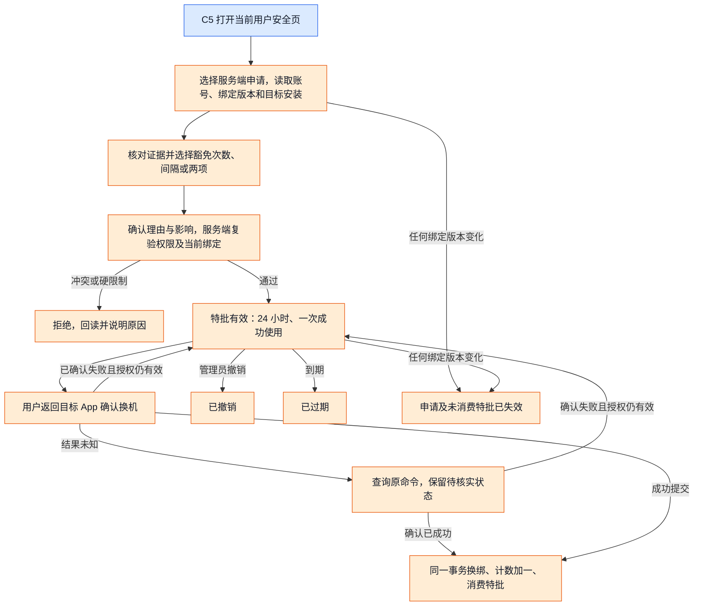
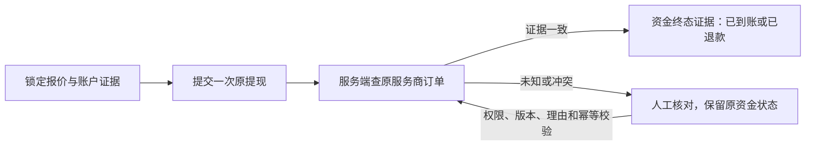

# NexGrid · 运营控制后台 PRD(Ops Console PRD)— V1

> 📎 **2026-09-03 并回说明**:本卷已把 admin-ops 仓内副本(至 `8deffab`,2026-08-28)以 `d50e762`(07-08)为基线**三向并回**。实现侧自基线的改写在权威侧未动处直接生效、未逐处标记,主要有:A1 章由「7 角色 RBAC + member/lead」改为「A6 / A8 权限码模型 + MFA」(A1-MD5 2FA→MFA)、KYC 全量取消口径、提现单主键改为线上真名(见 D2 字段契约)、admin operations 接后端后的端点与字段、E3b(E3b-MD5 改名)、K5、D1/D2 弹窗字段;由此带入 43 处 **A6 / A7 / A8(角色管理 / 菜单 / 权限字典)引用,三卷尚无对应章节**,定义暂在 admin-ops `docs/PC管理后台完整操作流程.md`,待补章。两侧同处改动的 8 处见 `<!-- 冲突 #N · 已裁决 -->` 注释与「⚠️ 实现偏差登记」块;方法与守恒核对见 admin-ops `docs/changes/2026-09-03-prd-v1-3-merge-report.md`;并回前原文在 `PRD/_archive/20260903-后台PRD并回前/`。

> 本文档是 NexGrid 平台**运营控制后台**的产品需求文档。它是独立于前端用户产品 PRD(`NexGrid_产品功能架构设计文档_v3.7.md`)的新建文档,只读引用后者、不修改后者。
> 撰写/续写遵循 `nexion-admin-prd` skill 的「编写 → 审查 → 仲裁 → 修订 → 验收」多-agent 流水线。术语、边界与三条贯穿设计原则(双账本 / server-canonical / 埋点优先)见第 1 章。
> §锚点(如 §9.11d、§13.4.1)均指向前端 PRD v3.7;**参数默认值以 `NEXGRID_12月节奏表.md` 12 月运营周期为权威,前端值仅作现状参考**(详见 §1.3「参数默认值锚定」)。
> **E3/K2 后发裁定（2026-07-21）**：`specs/FEAT-DEV01-task-capacity-schedule.md` 与 `specs/FEAT-DEV02-tradein-ladder.md` 优先于本卷所有 `minHoldingMonths/salvage/degrade*` 旧口径。旧文字仅是历史方案，不再构成实现、验收或 K2 判定依据；K2 当前以 30 天内已完成置换次数叠加正数佣金/IN 向正数赠送事实识别置换套利簇。
> **KYC 全量取消后发裁定（2026-08-07，优先于本卷全部旧文字）**：以 `specs/FEAT-KYC-RM01-remove-kyc-and-pairing.md`(裁决时快照:admin-ops `docs/PRD/specs-snapshot-20260807/`) 为准。KYC、C4、K5、钱包配对及一切身份认证门槛/复审/权限/接口/事件/报表已退出当前产品；本卷下文相关章节仅为历史设计记录，不得作为实现、测试、验收或恢复功能的依据。提现只读取用户按网络直接维护的当前提现地址。
<!-- 冲突 #1 · 已裁决(2026-09-03 并回):首行取权威侧品牌形态;B 侧两条后发裁定(E3/K2 2026-07-21、KYC 全量取消 2026-08-07)为新增内容全量并入,KYC 规格路径改为本目录 specs/ 并注明快照位置 -->

## 目录(V1 核心批次)

| 章 | 标题 | 域 | 状态 |
|---|---|---|---|
| 1 | 文档概述与边界 | — | ✅ 本卷 |
| 2 | 平台基础(RBAC + 审计 + 操作确认 + 埋点事件体系) | A | ✅ 本卷 |
| 3 | 信息架构与后台导航(全 12 域菜单树) | 全 | ✅ 本卷 |
| 4 | 总览驾驶舱 | B | ✅ 本卷 |
| 5 | 用户与账户管理 | C | ✅ 本卷 |
| 6 | 资金与财务(提现审核队列) | D | ✅ 本卷 |
| 7 | 增长与运营节奏(Phase 调度 + Trial) | H1–H2 | ✅ 本卷 |
| 8 | 风控与反作弊 | K | ✅ 本卷 |
| 9 | 数据模型 + API 概要 + 技术架构概要(V1 域) | — | ✅ 本卷 |

> V2–V4 各批次覆盖域见 §1.10。

---

## 第 1 章 文档概述与边界

### 1.1 文档定位与读者

本文档是 **NexGrid 运营控制后台(Ops Console)** 的产品需求文档(PRD)。它描述的是平台运营方内部使用的一套 Web 操盘系统——运营者借此监控全平台资金与用户态势、调整业务参数、审核资金流出、调度运营节奏、处置风控事件。它**不是**面向终端用户的功能,也不是嵌入用户端 app 的任何面板。

本 PRD 服务于以下后台角色(角色权限矩阵的权威定义见第 2 章 RBAC,此处仅列读者画像):

| 角色 | 关注域 | 典型后台诉求 |
|---|---|---|
| 超级管理员(Super Admin) | 全域 | 系统配置、RBAC 授权、kill-switch 总闸、跨域仲裁 |
| 财务(Finance) | 资金与财务、双账本 | 提现审核放行、储备与应付负债对账、兑付覆盖率监控、余额/资产调整复核 |
| 风控(Risk) | 风控与反作弊、资金安全 | 反多账户检测、异常资金链路、试用滥用闭环阻断、冻结与解冻 |
| 增长(Growth) | 用户与账户、增长活动、运营节奏 | 漏斗转化看板、Phase 节奏调度、邀请/任务/活动参数调优 |
| 内容(Content) | 内容合规 CMS | 推送模板池、活动文案、营销 copy 的上线与下架 |
| 客服(Support) | 用户与账户、工单 | 单用户态势查询、受限范围的账户处置、工单流转 |
| 只读审计(Read-only Auditor) | 全域(只读) | 操作审计追溯、合规取证、参数变更历史核查,**不具备任何写权限** |

> 角色与动作的精确映射(谁可发起、谁需复核、哪些动作触发审计)在每个功能子模块的「⑥ 权限 & 审计」段逐条约束;本节仅交代读者构成与阅读视角。

> **关于内容(Content)角色的 V1 范围说明**:完整内容合规 CMS(I 域)在 V4 落地,V1 阶段内容角色不具备全站文案治理面。但 V1 已覆盖的 H2(Trial)与 K(风控)子模块中,涉及**法务披露与试用推送模板的紧急修改**在对应子模块内提供有限文案覆盖——前端 PRD §9.11c.2 已将 Trial claim sheet 文案 + legal disclaimer(`GET /admin/trial/copy?locale=`)与 Risk-disclosure s1-s7 条款(`GET /admin/legal/risk-disclosure?locale=&jurisdiction=`)标注为「监管改文案当天必须能改」的配套紧急可调内容,故 V1 阶段这部分文案能力随 H2/K 子模块一同提供,并非在 V1 完全归零(批次范围见 §1.10)。

### 1.2 后台与前端 app 的边界

后台是**平台运营操盘台**;用户端(H5 app)是**终端用户的产品界面**。两者是同一平台的两侧,但在可见性上严格隔离。

```
┌──────────────────────────────┐        ┌──────────────────────────────┐
│   运营控制后台(本 PRD)        │        │   用户端 H5 app(前端 PRD v3.7)  │
│   Ops Console                 │        │   终端用户产品界面               │
│                               │        │                               │
│  • 双账本 / 兑付覆盖率监控       │        │  • Home / Earn / Store / Team   │
│  • 提现审核队列与放行           │        │  • Wallet / Genesis / 试用       │
│  • 业务参数调优(费率/阈值/cap) │◀──控制──│  • 用户只见结果,不见控制台        │
│  • Phase 运营节奏引擎          │ 派发参数 │  • Phase id / name 永不出现       │
│  • 风控处置 / kill-switch       │        │  • 后台存在本身对用户不可见         │
│                               │        │                               │
│   仅平台内部角色可访问           │        │   公开注册即可使用               │
└──────────────────────────────┘        └──────────────────────────────┘
       服务端权威 (server-canonical)              客户端仅 UI 渲染
```

边界铁律:

1. **单向不可见**:后台的存在、菜单、Phase 命名、参数调节动作,对用户端**永不可见**。前端 PRD §13.4 已确立「Phase 是 PM 内部命名,P1-P6 等术语永远不在用户视角 UI 出现」;后台是这些内部命名与参数的唯一操作面。
2. **控制与展示分离**:后台调整参数 → 通过服务端下发 → 用户端读取并渲染结果。用户端不持有任何"控制权",只持有"展示用缓存"。
3. **运营内部能力**:本 PRD 中少数无前端直接映射的能力(如审计取证、对账视图、内部告警)属于纯运营内部职能,会在所在子模块明确标注其运营意图,而非臆造的用户侧杠杆。

### 1.3 与前端 PRD v3.7 的引用关系

本后台 PRD 有**两个只读权威源**:**前端 PRD `NexGrid_产品功能架构设计文档_v3.7.md`**(功能 / 结构 / 现状实现的事实源;本文档不修改它,只对其中「后台控制面种子」做产品化收敛)与 **`NEXGRID_12月节奏表.md`**(12 月运营周期设计 —— **所有参数默认值的权威源**,优先级**高于**前端现状值,见下方「参数默认值锚定」行)。

| 引用关系 | 说明 |
|---|---|
| **收敛对象** | 前端 PRD §9.11a–§9.11f「后台控制面种子」+ §13.4「平台运营阶段(Phase 引擎)」 |
| **§9.11a** | 免费试用模块的 Admin / User-facing endpoints + 前端实现规则 + 生产环境 server-side 职责清单 |
| **§9.11b** | `TrialConfig` 数据模型(后台可控参数表,含默认值) |
| **§9.11c** | 全平台后台可控参数清单(§9.11c.1 业务参数表 + §9.11c.2 内容池) |
| **§9.11d** | Admin Kill Switch + Client-tamper Defense + Feature Flag/A-B 实验值 |
| **§9.11e** | 跨 store mutation 原子性(transaction boundary) |
| **§9.11e.1** | 组合攻击路径(§9.11e 的子节;§9.11e 定义 transaction boundary,§9.11e.1 在其之上枚举多条 client-tamper 维度叠加才显现的养号/套利闭环)——风控 K 域必须以此为覆盖锚点,而非独立攻击路径文档 |
| **§9.11f** | 状态机失败 / 退款路径(server canonical) |
| **§13.4** | Phase 引擎(6 phase × 时变参数表),后台节奏调度的引擎依据 |
| **第 17 章验收标准 · §18.2 KPI 指标** | 后台 BI 验收基准来源锚点;§18.2 的八项 KPI 指标表是后台数据看板的目标值与测量口径权威源(章节序号歧义见下方说明) |
| **不改前端 PRD** | 本文档为**新建独立 PRD**。若发现前端 PRD 存在缺口,记入 V4「跨文档收口」,不擅自修改前端 PRD。 |
| **参数默认值锚定(12 月运营周期优先)** | 本文档任一数值(费率 / cap / APY / 天数 / 阈值 / 衰减率 / 倍率)的**默认值以 `NEXGRID_12月节奏表.md` 的 12 月运营周期设计(§6 关键参数表 + P1–P6 运营逻辑)为权威源**;前端 PRD §锚点 / 代码常量仅作**现状实现参考**。三者冲突时**以 12 月运营周期为准**,就地注明前端现状值与差异(供开发对照现状↔目标)。12 月周期未覆盖的参数(如设备基础定价),以前端 §7 现价为现状参考、目标值在对应域按运营节奏设定并注明依据。 |

> **KPI 章节序号歧义(一次性说明)**:前端 PRD v3.7 验收章节存在标题序号混排——目录与正文章节标题写作「第 17 章 验收标准与 KPI」,而实际承载八项 KPI 指标表的小节标题为 **§18.2 KPI 指标**(同章标题之下直接接 §18.x 小节;§17.2 实为「路由组织」,非 KPI)。本文统一以「**前端 PRD 第 17 章验收标准 · §18.2 KPI 指标**」指代该表;全文后续凡引用八项 KPI 一律指向 §18.2,不再重复解释。另:配套 SKILL.md §0/§1 两处将该表写作「§17.2 KPI」,所指即本文 §18.2 小节——SKILL 自身存在同一序号歧义,统一以本文「§18.2」为准,并建议后续将 SKILL.md 同步更正为 §18.2。

### 1.4 产品定位对齐

后台一切控制点都服务于前端 PRD §1.1–§1.3 所定义的产品形态,后台不引入任何脱离该形态的能力。

- **产品形态**:移动端算力消费 app。核心叙事 "Your phone is the AI cluster. Earn while you sleep."——用户手机 NPU 闲置算力对接 AI 推理任务获取收益;用户可进一步购买专用算力设备 NexGridBox 系列获得更高的每日 AI 算力收益。
- **双币体系**:收益与结算采用双币——**USDT**(出金、设备结算、提现的稳定币)与 **NEX**(平台代币,严格两个功能:兑换 USDT + 优惠抵扣提现手续费)。后台所有金额参数须明确所属币种。
- **升级阶梯**:手机 → NexGridBox S1 → Pro → Rack → Genesis 创世节点的清晰升级路径;后台的设备与定价参数沿此阶梯组织。
- **运营优先级**:后台设计的第一优先级是**支撑用户向购买 NexGridBox 的转化**与**平台资金兑付安全**,二者构成后台所有看板与杠杆的取舍基准。

### 1.5 商业模式(对齐前端 PRD §1.4)

前端 PRD §1.4 列出四条收入来源:设备销售、团队分润佣金体系(影响力网络版税 + 双轨)、NEX 平台代币经济、算力市场撮合服务费。后台围绕这四条收入来源组织其监控与杠杆,对应四大支柱:

> **命名口径声明(避免与 SKILL 三锚核对时误判)**:配套 SKILL.md §0「对齐三锚」将商业模式概括为「硬件 GMV + 金融产品利差 + 代币经济」三锚,其中第二锚旧称「金融产品利差」。本章不沿用该三锚概括,而以**前端 PRD §1.4 四条收入来源原文为准**——「团队分润佣金体系(Unilevel + Binary)」与「算力市场撮合服务费」是其中两条相互独立的支柱,与 SKILL 三锚的命名差异为已知差异。后续 reviewer / 仲裁如按 SKILL 三锚核对本表,请以 PRD §1.4 原文四支柱为准,不判「命名不对齐」;建议后续将 SKILL.md 三锚表述与 §1.4 对齐。

| 支柱 | 收入来源(§1.4) | 后台关注的杠杆 |
|---|---|---|
| 硬件 GMV | 设备销售:NexGridBox S1 / Pro / Rack / Genesis | 设备定价与上下架、套餐折扣 ladder、试用→购机转化、trade-in 折旧定价 |
| 团队分润佣金体系 | 影响力网络版税(Unilevel)+ 双轨对碰 | Unilevel 费率(L1-L7)、Partner Status 权益、V-Rank 门槛、binary 双轨日封顶(`binaryDailyCapUSD`,Phase 派发,§13.4.1)、提现冷却、领导池 |
| 代币经济 | NEX 平台代币经济(兑换 / 二级市场) | NEX 周价格曲线关键帧排程与做市、Staking 池(USDT 锁仓)APY/penalty、Genesis 节点经济与二级市场、Exchange 三阈值 |
| 算力市场服务费 | 算力市场撮合服务费(向 AI 客户收取) | 向 AI 客户侧收取的平台撮合佣金;**当前前端 PRD 无对应后台参数控制面,AI 客户侧接口均标注 TBD,待 V4 架构收口补入**(注:`GET /api/products/specs` 属设备规格/E 域,与本支柱无关,不作为本支柱锚点) |

> **硬件 GMV 定价基准说明**:§1.4 所列设备价(S1 $299 / Pro $899 / Rack $3,499)为**早期定价**;商城实际售价以前端 PRD §7 商品表为准——当前 §7 列示 **NexGridBox S1 $1,299(legacy)/ Pro v2 $2,639 / NexGridRack P2 $14,999 / Genesis $9,999**。后台设备与定价子模块(E 域)的参数以 §7 商品表 + §9.11c.1 `Device specs(GET /api/products/specs)` 为权威数据源,**不以 §1.4 为基准**。E 域开发须回源核对 §7 当前每款型号的实际价格列。

> **Staking 收入科目澄清**:Staking 的 APY/penalty 是**用户侧产品参数**(USDT 锁仓产品,NEX 不可质押,§13.3.1 / §9.6),归入"代币经济"支柱作为资金留存杠杆,**不单独列为一条收入来源**;前端 PRD §1.4 未将其列为独立收入科目。

> 取舍原则:在合规与兑付安全约束内,后台杠杆优先服务转化与资金留存,但**资金兑付安全始终优先于短期 GMV**——任何放大流出的参数调整须先满足兑付覆盖率约束(见 §1.8 双账本原则)。

### 1.6 业务目标与 KPI

后台 BI 以前端 PRD **第 17 章验收标准 · §18.2 KPI 指标**(共八项)为验收基准。后台数据看板必须可计算、可下钻、可按 cohort/Phase 切片地呈现下列八项指标:

| # | KPI | 目标值 | 测量口径(§18.2) | 后台可见性 |
|---|---|---|---|---|
| 1 | Day 0 自动接入率 | > 95% | 注册 → 90 秒内首笔 receipt | V1 |
| 2 | Day 7 留存 | > 60% | 7 天后仍开过 app | V1 |
| 3 | L2 → L3 转化率(进 store) | > 30% | 主动浏览商城 | V1 |
| 4 | L3 → L4 转化率(下单) | 5-10% | 完成支付 | V1 |
| 5 | L4 → L5 转化率(推广) | > 40% | 设备持有者推荐 ≥ 1 人 | V4(依赖 F 域分销关系图谱下钻,完整看板随 L 域 BI 落地) |
| 6 | Nova push CTR | > 25% | 每条 CTA tap 率 | V4(依赖 I 域内容/推送埋点贯通) |
| 7 | 团队佣金触发率 | > 80% | L1 直推被推荐人首单 | V2 基础计数 / V4 完整下钻(F 域落地后即可按直推首单做基础触发率计数,完整 cohort 下钻随 L 域 BI 补齐) |
| 8 | Genesis 售罄速度 | < 14 天 | 1,000 张 | V2 基础读数 / V4 完整 BI(E 域落地后 Genesis 库存与售出即可有基础读数,完整售罄速率曲线随 L 域 BI 补齐) |

> **后台可见性列说明**:V1 =「总览驾驶舱」域(B)先行实现该指标的实时呈现,聚焦 Day 0 接入、Day 7 留存与购买漏斗 L2→L3→L4 等转化/资金相关核心指标;V2 基础读数 = 对应业务域(F 分销 / E 设备)在 V2 落地后即可提供该指标的基础计数/读数,但完整的可下钻 cohort BI 统一在 V4(L 数据 BI 域)收敛;V4 = 该指标的完整看板随数据 BI(L 域)及其依赖域批次落地。即此列不应被理解为「运营须等到 V4 才能看到任何团队/Genesis 数据」——V1 驾驶舱已覆盖核心转化与资金指标,F/E 域 V2 落地即带来 #7/#8 的基础读数。

### 1.7 12 月运营节奏 P1–P6 概述

平台运营按 12 个月划分为 6 个运营阶段(Phase)(**默认 12 月;节奏总时长由 H1「节奏骨架」运营可配 9–24 月,6 段按月数权重等比重分布,见 Ch7 [H1] ③(c2)**),后台 **H1「Phase 调度器」**(★V1)是其参数的唯一操作面;用户端只读取派发结果、**永不感知阶段切换**(前端 §13.4 铁律:Phase 是 PM 内部命名,P1–P6 等术语永不出现在用户 UI)。

**参数默认值以 `NEXGRID_12月节奏表.md` §6.4 `ProductPhase` 为权威**(2026-06-01 directive,优先于前端现状)。该 12 月运营模型**按月**派发 **7 个时变 dial**(新用户加成 / 邀请加成 / 复投加成 / 提现惩罚费率 / 提现冷却 / 双轨日封顶 / 任务加成);后台再叠加前端 §13.4.1 的 **`complianceHoldEnabled`**,合计 **8 dial**。下表按 P1–P6 命名带汇总(部分 dial 在带**内**按月有拐点,见表注),完整逐月矩阵在 **Ch7(H1)** 展开。

| Phase | 月段 | 名称 | 新用户加成 | 邀请加成 | 复投加成 | 提现惩罚费率 | 提现冷却 | 双轨日封顶 | 任务加成 | Compliance hold |
|---|---|---|---|---|---|---|---|---|---|---|
| P1 | 0–2 | 极速拉新 | 2.0× | 2.0× | 1× | 20% | 30d | $5,000 | **4×** | — |
| P2 | 2–4 | 温和过渡 | 1.5× | 1.5× | 1× | 20% | 30d | $5,000 | 1× | — |
| P3 | 4–6 | 首波升级 | 1.0× | 1.0× | **2×**(月5–6限时) | 20% | 30d | $5,000 | 1× | — |
| P4 | 6–8 | 订阅化 | 1.0× | 1.0× | 1× | 20% | 30d→**35d**(月8) | **$2,000**(月7起) | 1× | — |
| P5 | 8–10 | 沉淀加深 | 1.0× | 1.0× | 1× | **25%** | 35d→**45d**(月9) | $2,000 | 1× | **✅** |
| P6 | 10–12 | 软退场 | 1.0× | 1.0× | 1× | **30%** | 45d | $2,000 | 1× | ✅ |

> **加粗 = 该 dial 在此带内的变化拐点。** 12 月模型是**月粒度**的,比 6 个等宽 Phase 更细:双轨日封顶在**月 7**(P4 带内)由 $5,000 降 $2,000;提现冷却**月 8** 升 35d、**月 9** 升 45d;提现惩罚费率随 Phase 上行(P1–P4=20% → P5=25% → P6=30%);复投加成仅**月 5–6** 限时 2×。后台 H1 调度器以**月粒度**为准,P1–P6 仅为命名带。
>
> **默认值权威 = 12 月周期,前端为现状参考**:上表默认值取自 `NEXGRID_12月节奏表.md` §6.4 `ProductPhase`。前端 §13.4.1 是当前原型的**简化实现**(仅 邀请加成 / 提现惩罚费率 / 提现冷却 / 双轨日封顶 / Compliance hold,按等宽 Phase 取值、**无月内拐点**),且**缺** 新用户加成 / 复投加成 / 任务加成 三个倍率。冲突时**以 12 月周期为准**;前端现状差异(如双轨封顶拐点:§13.4.1 标 P4=月6,12 月模型为月7;前端任务加成实现为 1.0→1.5 ramp 而 12 月模型为月1–2=4×、其余=1×),开发对照现状↔目标实现。
>
> **dial 在 V1 的落地边界**:H1(★V1)提供全 **8 dial** 的**查看 / 调优 / 按 cohort 下发**;但各 dial 的**生效逻辑**落在其业务域——提现惩罚费率/冷却在 D 域(V1)、双轨日封顶在 F 域(V2)、邀请/新用户/复投/任务加成在 H3–H6(V3)。即 V1 可调可下发**全部** dial 值,部分 dial 的对账与可视化随对应域批次补齐。

### 1.8 三条贯穿全后台的设计原则

下列三条原则适用于本 PRD 的**每一个**子模块,在各子模块的「⑤ 接口」「⑦ 风控 & 联动」「⑧ 埋点」段具体落地。

#### 原则一:双账本(真实储备 vs 应付负债 → 兑付覆盖率)

**「双账本」是本后台 PRD 新建的运营内部设计构造**,用于约束后台对资金水位的核算方式,**前端 PRD 未命名此机制**。前端 PRD 仅在用户侧叙事层提供"102.4% 超额抵押兑付 + 公开储备"的对外参考,且该数字出处明确为以下两处:(1)前端 PRD §5.14 Home 页信任标识(Trust Chip Wall)副标 `Reserve proof on-chain · 102.4% backed · Trust Center →`;(2)§9.6.3 staking how-it-works 的 `Why it's safe` CalloutBox(102.4% 超额抵押兑付 + 信任中心公开储备)。该 102.4% 是面向用户的信任叙事数字,**并非前端 PRD 已实现的账本系统**;前端 PRD §11.3 是完整信任中心路由的页面描述,其正文并不承载该 102.4% 数字,故不作为该数字的出处归因。本后台 PRD 在此引入"双账本"作为内部设计约束,不主张前端 PRD 存在同名条目。

平台必须分账记录两本账:

- **真实储备账本**:平台实际持有、可用于兑付的资产(USDT 储备等)。
- **应付负债账本**:用户端累计可见的"余额 + 收益 + 待提现 + 锁仓本息"等平台对用户的应付项。

后台总览驾驶舱必须以二者之比持续呈现**兑付覆盖率**(= 真实储备 ÷ 应付负债),作为资金安全的核心水位指标。任何放大资金流出的参数调整(提现限额上调、APY 上调、佣金倍率上调、kill-switch 解除)须先核验该覆盖率约束。后台是上述用户侧信任叙事(§5.14 / §9.6.3 的 102.4% 超额抵押表述)背后的真实账本与水位的权威计算面。

#### 原则二:server-canonical(服务端权威 + 审计 + 幂等 + 操作确认)

凡前端 PRD §9.11d 列为"客户端可篡改"的状态(余额、试用资格、KYC 状态、风控判定、资格门槛、Phase、设备槽位、ID 序列等),后台侧一律按以下四条约束实现:

1. **服务端权威**:服务端是该状态的唯一真相源(server canonical),客户端 localStorage 仅作 UI cache,失效自动重 fetch(§9.11d.2)。后台展示与处置均以服务端值为准。
2. **审计可追溯**:每一次写操作(参数变更、放行、调整、kill-switch、impersonate)落审计日志,记录操作者、时间、前后值、原因;只读审计角色可全量追溯。
3. **幂等**:涉及资金/资产的写入 endpoint 必须支持 `Idempotency-Key`(§9.11e),网络抖动 retry 不得造成重复扣款 / 重复入账 / 重复放行。
4. **操作确认(Confirm-with-Reason)**:余额/资产调整、大额提现放行、参数批改、kill-switch、impersonate 等高敏动作一律经**确认弹窗二次确认 + 理由必填**后即时生效;理由由 server 强制非空(空值返 400 `REASON_REQUIRED`),动作连同理由落 A2 审计(操作者/前后值/理由/IP/时间)。**放大资金流出方向的动作额外前置 B1 兑付覆盖率红线核验,低于红线 server 拒绝(422)**。高敏动作清单权威归 A2;每个高敏动作的确认弹窗按业务单独设计,规格见各子模块「④ 操作动作」「④a 交互与弹窗规格」与「⑥ 权限 & 审计」段。

#### 原则三:埋点优先(全链路事件可观测)

后台所有看板、漏斗、KPI、风控信号**派生自统一的事件流**,而非临时查询。每一个转化触点、资金动作、状态流转、运营动作都产生一个**规范命名的事件**(`domain.object_action`),由 **A4 埋点事件体系**(Ch2 §2.4)统一定义命名、身份模型(anonId → userId 拼接)、通用属性(含事件发生时所处 Phase / cohort)与 KPI 映射。

1. **漏斗 / KPI 可观测**:§1.6 八项 KPI 与「注册 → 绑卡 → 首购 → 复投 → 提现」漏斗(B3),其定义即「由哪些事件按何口径计算」;不存在无埋点支撑的看板数字。
2. **资金与风控可观测**:每笔充值 / 提现状态流转 / 收益入账 / 佣金发放 / 兑换 / 锁仓,及每个风控信号(多账户命中 / 套利可疑 / 提现冻结),均落事件,喂 B(驾驶舱)/ D(资金)/ K(风控)。
3. **服务端权威 + 防篡改**:资金 / 状态类事件由服务端在状态机推进时发出(server-canonical,§9.11d/f);客户端仅发 UI 交互类事件,且不作为资金 / KPI 的权威口径。
4. **每子模块声明**:各功能子模块的「⑧ 埋点」段声明其产生 / 消费的事件,确保 BI 有据、覆盖可审计。

### 1.9 术语表(后台高频术语)

| 术语 | 含义 |
|---|---|
| Ops Console / 运营控制后台 | 本 PRD 所定义的平台内部操盘系统;用户端不可见 |
| 双账本 | 真实储备账本 + 应付负债账本的分账记录体系(本后台 PRD 内部设计构造,前端 PRD 未命名) |
| 兑付覆盖率 | 真实储备 ÷ 应付负债,资金安全核心水位 |
| 应付负债 | 平台对用户累计的应付项(余额 + 收益 + 待提现 + 锁仓本息) |
| server-canonical(服务端权威) | 状态以服务端为唯一真相源,客户端仅 UI cache |
| Client-tamper Defense | 针对客户端可篡改状态的服务端防御(§9.11d.2) |
| 操作确认(Confirm-with-Reason) | 高敏动作的执行确认机制:单人执行 + 业务专属确认弹窗 + 理由必填(server 强制,400 `REASON_REQUIRED`)+ A2 审计留痕,即时生效;放大流出方向动作前置 B1 红线核验(422) |
| Idempotency-Key | 写操作幂等去重键,server 24h 内 dedup(§9.11e) |
| Kill Switch | 监管点名/紧急下架时对某能力(staking 档/swap/试用/Genesis/提现等)的全局停用闸(§9.11d.1 + 后台应急 withdraw) |
| Phase / 运营阶段 | 12 月节奏的 6 段运营阶段 P1–P6,由 Phase 引擎驱动(§13.4);PM 内部命名,用户端永不暴露 |
| Phase 引擎(`useProductPhase`) | 按用户 `joinedAt` 计算所处 Phase 并派发时变 dial 的单一真相源。后台权威模型 = **8 dial**(12 月 §6.4 的 7 dial,Premium/NEXv2 gate 已下线 + 前端 `complianceHoldEnabled`),月粒度,见 §1.7 |
| TrialConfig | 免费试用模块的后台可控参数模型(§9.11b) |
| Shadow earning(试用收益) | 试用期累计的模拟算力收益。**系统层面**:进入 `redeemed` 终态时合并至账户余额(creditBalance/NEX + 双 bill 记录),作为后续购机的余额来源;`failed / cancelled` 终态则归零不入账。**用户侧文案口径**:统一入口统称"试用收益 / 试用累计 / 试用奖励"(§16.2.5);仅 claim sheet 转化场景专用"购机抵扣 / 抵扣购机款"(§9.11b),该口径不适用于所有 UI 入口;两类口径均不向用户暴露 shadow 技术名词(参 §9.11a-f) |
| Unilevel(影响力网络版税) | 团队分润的影响力网络版税体系。**数学层**内部按 L1–L7 计算费率(`UNILEVEL_USDT = [10%, 5%, 3%, 2%, 1%, 0.5%, 0.5%]` USDT + 对应 NEX);**用户侧 UI** 按直推(L1)/扩展(L2–L7 合并)二态呈现,不暴露具体层编号(§8.3)。后台 F 域报表是否按层(commission.ts 以 key 1–7 存层数据)下钻排查,属 F 域子模块设计决策,本章不预设约束 |
| 双轨(Binary Track) | 双轨对碰佣金体系:用户发展 A/B 两侧团队,按 `min(A, B) × 10%` 平衡匹配公式(取两轨中业绩较小一侧的月 GV)日结算佣金,受 Phase 派发的 `binaryDailyCapUSD` 日封顶约束(§8.4 / §13.4.1);与 Unilevel 版税并列构成团队分润两条腿。用户侧一律称 Track A / Track B,不暴露翼 / 左 / 右 / spillover / 上线 / 下线等词汇 |
| V-Rank | 团队业绩驱动的 V0–V12 军衔体系(13 级门槛) |
| 用户生命周期 L0–L5 | 用户产品使用阶段内部 ID(Visitor→Ambassador);用户侧仅显示功能化标签,不暴露 L 编号 |
| NEX v2 Founders Vault | 24 个月 NEX 锁仓产品(用户侧标 250% APY)。**已下线:新开锁仓入口停用,后台不再设其配置面与 kill switch**;存量在锁 position 仍按到期一次性兑付(B2 负债科目 #5「存量在锁,新开已停」,参 §9.5b) |
| 算力市场撮合服务费 | 向 AI 客户收取的平台撮合佣金,§1.4 四条收入来源之一;后台杠杆为 V4 待规划项,当前前端 PRD 无对应控制面、AI 客户侧接口均标注 TBD(参 §1.5) |
| Compliance hold | Phase 派发的合规审查开关,启用后提现进入增强合规审查 |
| 提现状态机 | 提现单的服务端权威状态机:正常 5 态见前端 PRD §9.3.6(submitted / review-passed / processing / sent / confirmed);异常 6 态为真后台扩展定义,见 §9.11f(review-rejected / address-invalid / tx-failed / tx-orphaned / refunded / frozen);client 仅订阅,不持有权威状态 |
| 提现 SLA | 提现 48h 内到账(§2.3 核心场景表) |
| frozen | 用户账户资金冻结标志,提现状态机异常态之一(§9.11f) |
| 双币 | USDT(稳定币,出金/结算)+ NEX(平台代币,锁仓/兑换/二级市场) |
| RBAC | 后台角色访问控制(超管/财务/风控/增长/内容/客服/只读审计) |

### 1.10 文档范围与批次

本 PRD 按批次推进。各批次覆盖的运营域如下,菜单树以 Ch3 为权威索引,每个子模块均可追溯到一个真实前端功能(§锚点)。

| 批次 | 覆盖域 | 状态 |
|---|---|---|
| **V1(核心)** | **A 平台基础**(RBAC / 审计 / 系统配置)· **B 总览驾驶舱**(双账本 / 兑付水位 / 漏斗 / 节奏 / 风险雷达)· **C 用户与账户** · **D 资金与财务**(提现审核队列)· **H1**(§13.4 Phase 引擎调度)**–H2**(§9.11a-f Trial 控制面)· **K 风控与反作弊** | 本卷 |
| V2 | E 设备与商城 · F 分销与团队 | 概述 |
| V3 | G 金融产品 · H3–H6 增长活动全套 | 概述 |
| V4 | I 内容合规 CMS · J 紧急合规 · L 数据 BI · 全局数据模型/API/架构总表 · 跨文档一致性收口 | 概述 |

> **V1 内容能力备注**:I 域完整内容合规 CMS 在 V4 落地;但 V1 已纳入的 H2(Trial)与 K(风控)子模块,随模块配套提供法务披露与试用推送模板的**紧急文案覆盖**(Trial claim sheet 文案 + Risk-disclosure 条款,参 §9.11c.2 / §1.1 内容角色说明),不应误读为 V1 阶段内容文案能力完全缺位。

V1 聚焦"看得见资金与用户态势、管得住资金流出、调得动运营节奏、压得住风控事件"四项核心运营能力闭环:总览驾驶舱(B)提供态势感知,资金与财务(D)管控流出,Phase 调度与 Trial(H1–H2)驱动节奏与转化,风控与反作弊(K)守住资金与账户安全,平台基础(A)提供 RBAC/审计/配置底座,用户与账户(C)提供处置入口。V2–V4 在 V1 底座上逐域补全设备商城、分销、金融产品、增长活动、内容合规与数据 BI,并在 V4 完成全局数据模型/API/架构总表与跨前后端文档的一致性收口。

---

## 第 2 章 平台基础(RBAC + 审计 + 操作确认 + 埋点事件体系)

> 本章覆盖域 A 的四个子模块。§2.1–§2.3(A1 RBAC / A2 审计 + 操作确认 / A3 系统配置)+ §2.4(A4 埋点事件体系)均已落地——它是 B/D/K/L 与 §1.6 KPI 的数据地基,须先于驾驶舱(Ch4)确立。

#### [A1] 运营账号 & RBAC

**① 目的 & 对齐**
A1 是后台的**运营账号、登录安全与会话治理地基**。A1 负责账号创建/启停/资料/角色分配、强制 MFA、登录锁定、会话与安全基线；**A6 是角色定义及角色授权的唯一权威，A8 是权限码字典的唯一权威，A7 管理菜单节点**。A1 只读取 A6/A8 的实时结果做角色变更影响预览，不再维护第二份权限矩阵或 `member/lead` 层级。A2(§2.2)记录所有账号治理写操作，服务端在每次请求上按真实权限码判权，客户端角色只用于展示。

> **运营账号 ≠ 用户账户(C 域)**:A1 管理的是**平台运营方内部员工**的后台登录账号(角色 / 2FA / session),与 C 域(§5 章)管理的**终端用户**账户是两套完全独立的实体与生命周期。后台账号不在用户事件流(A4)中,不持任何用户资产;C 域用户的冻结 / impersonate / 资产调整等动作,其**操作者**是 A1 运营账号、**对象**是 C 域用户账户。两者在本 PRD 中严格区分,不可混用。

**② 后台界面**
1. **运营账号列表**:`账号 ID / 登录名 / 显示名 / 当前角色或暂未分配 / MFA 绑定态 / 账号状态 / 最近登录 / 活跃 session 数`。列表提供新建、编辑、启停、变更角色、重置密码、重置 MFA 与强制登出入口；**没有删除账号入口，账号生命周期只允许禁用和重新启用**。
2. **账号详情**:展示账号资料、真实 MFA 绑定态、服务端审计生成的角色变更记录，以及每条活跃 session 的`设备 / IP / 起始时间 / 最近活动时间`；超管可按单条 session 吊销，也可从列表吊销目标账号全部 session。不得吊销自己的当前账号或任何超管账号的 session。
3. **角色影响预览**:角色选择项来自 A6；选择新角色时用 A6 返回的真实权限码集合显示“新增/失去”的差异，同角色选择必须禁用确认。A6 角色详情或权限差异不完整时必须显式报错并停用“改角色”，不得以空权限集继续提交。A1 顶部提供 A6“角色管理”和 A8“权限字典”的明确跳转，不复制其数据模型。
4. **安全基线**:展示 MFA、session、登录锁定与最少有效超管数。系统进入“治理恢复模式”时显示阻断原因，并只开放恢复双超管所必需的创建超管、提升为超管或启用已绑定 MFA 超管动作。

**③ 可控参数**

| 参数 | 默认值 | 范围 | 生效时机 | 影响 / 依据 |
|---|---|---|---|---|
| 运营账号角色集 | A6 当前启用角色；内置 8 角色:`SUPER_ADMIN / CONFIG_ADMIN / FINANCE / RISK / CONTENT / GROWTH / SUPPORT / AUDITOR`，并允许 A6 中启用的自定义角色 | 以 A6 为准 | 角色分配实时 | A1 不维护固定七角色副本，不存在 `member/lead` 隐式层级 |
| 后台强制 2FA | 强制开启(全角色) | 固定开启(不可关) | 实时(登录时校验) | 后台账号安全基线,§1.8 原则二;无 2FA 不得完成登录 |
| 运营账号 session 时限 | 无操作 30min / 绝对上限 8h | 滑动 15–60min / 绝对 4–12h | 每次请求实时校验 | Redis 保存 `issuedAt / lastSeen / IP / User-Agent`；首次强制改密换发 session 时继承本次请求真实 IP/User-Agent；调整后按新基线校验现有与后续会话，超过任一上限立即失效 |
| 登录失败锁定 | 5 次失败锁定 15min；24h 累计 15 次锁定 24h | 固定安全基线 | 密码与 MFA 失败均计数 | 用户名哈希后写 Redis；错误文案不区分账号、密码或锁定态 |
| 最小权限默认 | 新账号默认“暂不分配” | 固定默认拒绝 | 创建即生效 | 无角色关系、权限码为空、菜单为空；后续必须由超管显式分配 A6 角色 |
| 最少有效超管数 | ≥ 2 | 固定下限 2 | 每次账号治理写操作前 | “有效超管”=账号启用 + 超管角色 + MFA 已真实绑定；不足 2 时进入治理恢复模式 |

> **MFA 登录闭环**:密码校验成功只签发一次性 MFA challenge，绝不签发 JWT/session。challenge 在正确验证码路径中以 Redis 原子删除裁决，只允许一个并发请求消费；同一账号已接受的 TOTP 时间步以原子 `SET NX` 标记，换新 challenge 也不得在有效窗口内重放同一验证码。首次登录展示 TOTP 绑定信息，密钥经 AES-GCM 加密落库；完成正确 TOTP 后才建立 Redis session 并签发 8h 上限的 JWT/cookie。重置 MFA 会先校验双超管下限，再清除绑定并吊销该账号全部 session，下一次登录重新绑定。登出只有在服务端确认撤销 session(或确认 token 已无效)后才清除浏览器 HttpOnly cookie；后端/Redis 不可用时返回失败、保留凭据并提示重试，不得伪报成功。

> **双超管恢复闭环**:有效超管不足 2 时，资料修改、非恢复性角色变更、启停、重置 MFA/密码和安全基线变更全部由服务端拒绝；只允许创建超管、把账号提升为超管、启用已绑定 MFA 的超管，以及会话止血。恢复到 2 个有效超管后自动解除。

**④ 操作动作**

| 动作 | 角色 | 确认弹窗 | 审计点 |
|---|---|---|---|
| 创建运营账号 | 仅超管 | A1-MD1(理由必填) | `admin.operator_account_created`(account_id / initial_role / operator；不记录初始密码) |
| 禁用运营账号 | 仅超管 | A1-MD2(理由必填;禁用前服务端校验剩余有效超管 ≥ 2) | `admin.operator_account_disabled`(account_id / reason / operator) |
| 启用运营账号 | 仅超管 | A1-MD3(理由必填) | `admin.operator_account_enabled`(account_id / reason / operator) |
| 分配 / 变更角色 | 仅超管 | A1-MD4(理由必填) | `admin.operator_role_changed`(account_id / before_role / after_role / operator) |
| 重置运营账号 2FA(员工丢设备) | 仅超管 | A1-MD5(理由必填) | `admin.operator_2fa_reset`(account_id / reason / operator);留痕同 A2 |
| 强制登出运营账号 session | 仅超管(非自己、非超管目标) | A1-MD6(理由必填;止血动作,确认即生效) | admin 审计事件(目标账号 / session / reason / operator) |
| 查看账号列表 / 跳转 A6 角色管理 / A8 权限字典 | 由 `platform_a1_read / platform_a6_read / platform_a8_read` 分别判定 | 否(只读) | admin 审计事件(查看范围 / operator) |

> 后台账号的创建 / 禁用 / 启用 / 角色变更 / MFA 重置五类动作均为后台权限边界写操作,**执行权仅超级管理员**，经确认弹窗 + 理由必填即时生效并落 A2 审计。**强制登出运营账号 session**同样仅限超管，但为避免自锁和双超管互相踢出，服务端拒绝当前账号与超管目标；每次必须记录 reason。

**④a 交互与弹窗规格**

> ④ 表「确认弹窗」列的弹窗 ID 在此逐一定义。弹窗容器统一复用基础 Modal/Drawer,弹窗内容逐弹窗单独设计;本段约定结构/分区/控件类型/行为与状态,不约定视觉。

**(1) 动作触发总表**

| 动作(同④) | 触发控件 + 位置 | 形态 | 可用态规则 | 点击行为 |
|---|---|---|---|---|
| 创建运营账号 | ②(a)账号列表页顶部「新建账号」 | 主按钮 | 仅超管渲染 | 打开弹窗 A1-MD1 |
| 禁用 / 启用账号 | ②(a)账号列表行内菜单 + 账号详情页操作区 | 菜单项 / 次按钮 | 启用态账号显示「禁用」,已禁用账号显示「启用」;仅超管渲染;目标为超管且剩余有效超管 < 3 时「禁用」置灰并提示双超管下限 | 打开弹窗 A1-MD2 / A1-MD3 |
| 分配 / 变更角色 | ②(a)账号详情页角色卡「变更角色」 | 次按钮 | 仅超管渲染 | 打开弹窗 A1-MD4 |
| 重置运营账号 2FA | ②(a)账号详情页安全卡「重置 2FA」 | 次按钮 | 仅超管渲染;目标账号 2FA 未绑定时置灰 | 打开弹窗 A1-MD5 |
| 强制登出 session | ②(a)账号详情页 session 列表行内「强制登出」 | 行内按钮 | 仅超管可用；自己、超管目标或无活跃 session 时置灰并解释原因 | 打开弹窗 A1-MD6 |
| 查看角色定义 / 权限字典 | A1 顶部“A6 角色管理”/“A8 权限字典” | 链接 | 按 A6/A8 read 权限展示 | 跳转权威视图,无弹窗 |

**(2) 弹窗规格**

##### [A1-MD1] 创建运营账号
- **功能**:开通一个新的后台运营账号(开通后台访问权 = 权限边界写操作),确认即创建并落审计。
- **布局结构**:1. **信息区**:提示行「新账号默认零权限;首次登录强制绑定 MFA 并修改初始密码」。2. **输入区**:见下表。3. **按钮区**:取消 / 确认创建。
- **输入与选择控件**:

| 字段 | 控件类型 | 必填 | 校验 | 默认值 |
|---|---|---|---|---|
| 账号 ID(登录名) | 单行文本 | 是 | 3–32 字符,字母数字与 `.`/`_`;server 唯一性校验(重复返 409) | 空 |
| 显示名 | 单行文本 | 是 | 2–32 字符 | 空 |
| 初始角色 | A6 启用角色 + 「暂不分配」 | 否 | 恢复模式下只能选择超管；普通模式允许空角色 | 暂不分配 |
| 初始密码 | 密码输入 + 安全随机生成 | 是 | ≥16 位，至少含大小写字母、数字、特殊字符；默认生成 20 位 | 随机强密码 |
| reason(创建理由) | 多行文本 | 是 | server 空值返回 `REASON_REQUIRED`；初始密码不得进入审计/提案 payload | 空 |

- **按钮区**:`[取消]` · `[确认创建]`(主按钮;必填未过校验置灰;提交 loading 锁定)。
- **错误态**:409 账号 ID 已存在(弹窗不关,字段下内联错误)/ 400 `REASON_REQUIRED` / 403(非超管)。
- **成功反馈**:弹窗关闭;列表新增行并高亮;toast「账号已创建 · 已记审计」;事件 `admin.operator_account_created`;实时告警推送全体超管。

##### [A1-MD2] 禁用运营账号
- **功能**:收回目标账号的后台访问权(即时踢出全部活跃 session),确认即生效。
- **布局结构**:1. **信息区**:目标账号 ID / 显示名 / 角色 / 活跃 session 数 / 最近登录时间。2. **影响预览区**:目标为超管时展示「当前有效超管数 N → 禁用后 N−1」;N−1 < 2 时升级为阻断提示(确认钮置灰,文案含「低于双超管下限,server 将拒绝(422)」)。3. **输入区**:reason(多行文本,必填,8–200 字)。4. **按钮区**:取消 / 确认禁用。
- **按钮区**:`[取消]` · `[确认禁用]`(警示色主按钮;reason 未达标或触发双超管下限时置灰)。
- **错误态**:422 `MIN_SUPERADMIN_VIOLATION`(弹窗不关,内联阻断条)/ 400 `REASON_REQUIRED` / 409(账号已被禁用,提示刷新)/ 403。
- **成功反馈**:弹窗关闭;行内状态更新「已禁用」;toast「已禁用并登出全部 session · 已记审计」;事件 `admin.operator_account_disabled`;实时告警全体超管。

##### [A1-MD3] 启用运营账号
- **功能**:恢复已禁用账号的后台访问权,确认即生效(账号须重新完成 2FA 登录)。
- **布局结构**:1. **信息区**:目标账号 ID / 显示名 / 角色 / 禁用时间 / 禁用理由(引自审计)。2. **输入区**:reason(多行文本,必填,8–200 字)。3. **按钮区**:取消 / 确认启用。
- **错误态**:400 `REASON_REQUIRED` / 409(账号已为启用态)/ 403。
- **成功反馈**:弹窗关闭;行内状态更新「启用」;toast「已启用 · 已记审计」;事件 `admin.operator_account_enabled`;实时告警全体超管。

##### [A1-MD4] 变更角色
- **功能**:把目标账号分配到 A6 的一个启用角色，或清空为“暂不分配”；确认即生效并清除权限缓存。权限缓存失效属于同一事务闭环：Redis 删除失败必须让角色/授权事务回滚，禁止 DB 已变更而旧权限缓存继续存活。
- **布局结构**:1. **信息区**:目标账号 / 当前角色。2. **影响预览区**:用 A6 返回的权限码集合展示“新增/失去”；授予超管时提示最高权限。3. **输入区**:见下表。4. **按钮区**:取消 / 确认变更。
- **输入与选择控件**:

| 字段 | 控件类型 | 必填 | 校验 | 默认值 |
|---|---|---|---|---|
| 目标角色 | A6 启用角色 + 「暂不分配」 | 是 | 不得与当前角色相同；不存在 `member/lead` 字段 | 当前角色 |
| reason | 多行文本 | 是 | server 空值返回 `REASON_REQUIRED` | 空 |

- **错误态**:422 `RBAC_BASELINE_VIOLATION`(server 返回违反的基线条目,弹窗不关)/ A6 权限差异加载不完整(前端停用提交)/ Redis 权限缓存失效失败(事务回滚、提示重试)/ 400 / 409(角色已被他人变更,提示刷新)/ 403。
- **成功反馈**:弹窗关闭;详情页角色卡就地更新;toast「角色已变更 · 已记审计」;事件 `admin.operator_role_changed`;实时告警全体超管。

##### [A1-MD5] 重置运营账号 MFA
- **功能**:解绑目标账号的 TOTP(员工丢设备场景)，同时吊销其全部活跃 session；目标账号下次登录必须重新绑定。
- **布局结构**:信息区展示目标账号、当前 MFA 态与最近登录；输入区要求 reason；按钮区为取消 / 确认重置。身份核验通过既有安全工单流程完成，工单号应写入 reason，A1 不虚构未落库的渠道/时间字段。
- **错误态**:`REASON_REQUIRED` / MFA 未绑定 / 重置后有效超管少于 2 / 非超管或治理恢复模式阻断。
- **成功反馈**:安全卡更新为“未绑定(待重绑)”，活跃 session 清零，A2 写入 `admin.operator_2fa_reset`。

##### [A1-MD6] 强制登出 session
- **功能**:立即终止目标账号的指定活跃 session(疑似账号被盗时快速止血),确认即生效。
- **布局结构**:1. **信息区**:目标账号 ID / session 设备 / IP / 起始时间。2. **输入区**:reason(多行文本,必填,8–200 字)。3. **按钮区**:取消 / 确认登出。
- **错误态**:400 `REASON_REQUIRED` / 409(session 已结束,提示刷新)/ 403。
- **成功反馈**:弹窗关闭;session 行移除;toast「session 已终止 · 已记审计」;admin 审计事件落 A2。**草稿不为风控单方面赋予运营账号 session 踢出权**:已落地 §1.1 未授予风控此权,且 C2 的强制登出针对用户账号(与运营账号 session 踢出是两件不同的事);若后续确认风控需紧急止血路径,须在 §2.1 RBAC(T3)正式定义后方可引入,当前不在本章自定。

**⑤ 接口**
- 登录:`POST /api/admin/auth/login` → MFA challenge；`POST /api/admin/auth/mfa/verify` → JWT/session；`POST /api/admin/auth/logout` → 服务端撤销当前 session；`GET /api/admin/auth/me`。
- 账号:`GET /api/admin/platform/accounts/overview`；`POST /api/admin/platform/accounts`；`PATCH /api/admin/platform/accounts/:id/profile|role|status`；`POST /api/admin/platform/accounts/:id/reset-2fa|password/reset`。
- 会话:`POST /api/admin/platform/accounts/:id/sessions/revoke`(全部)；`POST /api/admin/platform/accounts/:id/sessions/:sessionId/revoke`(单条)。
- 基线:`PATCH /api/admin/platform/accounts/security-baselines/:baselineKey`。角色与权限权威接口分别位于 `/api/admin/platform/roles`(A6)和 `/api/admin/platform/permissions`(A8)。

所有写 endpoint 按专用权限码 + 服务端业务不变量双重校验，并要求 reason / `Idempotency-Key`。**A1 不提供 DELETE endpoint**；任何历史删除调用必须失败，账号只能禁用。

**⑥ 权限 & 审计**

> 本表只描述 A1 自身账号治理动作；实际授权以 A6 角色授予和 A8 权限码为准，不再声明角色内隐式层级。

| 动作 | 超管 | 财务 | 风控 | 增长 | 内容 | 客服 | 只读审计 |
|---|---|---|---|---|---|---|---|
| 查看 A1 账号；跳转 A6/A8 | ✅ | 按实际 read 权限 | 按实际 read 权限 | 按实际 read 权限 | 按实际 read 权限 | 按实际 read 权限 | 按实际 read 权限 |
| 查看运营账号列表 | ✅ | — | — | — | — | — | ✅(只读) |
| 创建账号 | ✅ | — | — | — | — | — | — |
| 禁用 / 启用账号 | ✅ | — | — | — | — | — | — |
| 分配 / 变更角色 | ✅ | — | — | — | — | — | — |
| 重置运营账号 2FA | ✅ | — | — | — | — | — | — |
| 强制登出运营账号 session | ✅(非自己、非超管目标) | — | — | — | — | — | — |

审计记录字段:`操作者 / 角色 / 动作(operator_account_created|operator_account_disabled|operator_account_enabled|operator_role_changed|operator_2fa_reset|logout_session) / 目标账号 ID / 前角色 / 后角色(角色变更时)/ reason / 时间(ms)`。**运营账号体系的所有写操作落 A2 审计**(§2.2),只读审计角色可全量追溯谁在何时创建 / 禁用了运营账号、变更了谁的角色——这是后台内部权限滥用的取证地基。

**⑦ 风控 & 联动**
- **后台账号强制 MFA + 最小权限**:全角色强制 MFA；新建账号默认无角色、无权限、无菜单。A6 角色授权负责跨域最小权限约束，A1 只消费其结果。
- **运营账号 ≠ 用户账户(防混淆)**:A1 运营账号与 C 域用户账户是两套实体;后台对用户的处置(冻结 / impersonate / 调资产)的操作者是运营账号、对象是用户账户,二者绝不互通(运营账号不持用户资产、不入 A4 用户事件流)。
- **角色变更经 A2 审计 + 操作确认**:角色授予/撤销仅超管可执行，理由必填、即时生效、清权限缓存并留痕；同角色操作在前后端均拒绝。
- **双超管按“有效”而非账号行数计算**:只有启用、超管角色且 MFA 已绑定的账号计入；不足 2 即进入治理恢复模式，避免“账面双超管、实际单点”。

**⑧ 埋点(事件)**
对齐 A4(§2.4.5 ⑥ admin family):
- **产生(admin 审计,§2.4.5 ⑥ admin family)**:
  - `admin.operator_account_created` — 触发点:创建运营账号确认执行;属性:`account_id / initial_role / operator / reason / ts`;喂 A2 审计。
  - `admin.operator_account_disabled` — 触发点:禁用运营账号确认执行;属性:`account_id / reason / operator / ts`;喂 A2 审计。
  - `admin.operator_account_enabled` — 触发点:启用运营账号确认执行;属性:`account_id / reason / operator / ts`;喂 A2 审计。
  - `admin.operator_role_changed` — 触发点:角色分配 / 变更确认执行;属性:`account_id / before_role / after_role / operator / reason / ts`;喂 A2 审计。
  - `admin.operator_2fa_reset` — 触发点:运营账号 2FA 重置确认执行;属性:`account_id / reason / operator / ts`;喂 A2 审计。
- **消费**:无(A1 为账号治理域,不消费用户事件流)。
- **注**:上列五个 `admin.operator_*` 事件须各自经 A4 schema registry 注册(归入 §2.4.5 ⑥ admin family),与各章 admin.* 审计事件统一在 A4 命名空间下;**`operator_` 前缀用于与用户侧 `admin.user_*` 事件区分,防命名空间冲突**(与 C5 用户侧 `admin.2fa_disabled` 对称但命名独立)。强制登出 session、查看类操作仅产 A2 审计记录,无独立 KPI 事件(纯运营内部账号治理,无用户侧事件)。

---

#### [A2] 审计 & 操作确认

**① 目的 & 对齐**
A2 是后台**一切高敏写操作的留痕与确认契约地基**——提供 (1) 全量、append-only、不可删改的审计日志,(2) 高敏动作清单与操作确认(Confirm-with-Reason)契约的权威定义。**§3.14 跨域归属表已将「审计日志 / 操作确认」权威归属定为 A2,引用方 = 全域所有高敏写操作**;各章「⑥ 权限 & 审计」段的审计记录字段结构、所有标「确认弹窗」的高敏动作、`admin.*` 审计事件落库,全部以 A2 为统一机制,各域不另立确认与审计体系。对齐前端 §9.11d(服务端权威 + 篡改防御——后台对可篡改状态的每一次纠正/执行都留痕)+ §9.11e(原子性 / 幂等——高敏动作的资金写入须事务边界 + `Idempotency-Key`,不重复生效)。服务的业务目标:落地 §1.8 原则二.2(审计可追溯)+ 原则二.4(操作确认),为运营内部操作提供完整问责链与高敏动作的执行确认契约。**A2 不承载业务审批、pending 提案或写入回放**：发起人未达到某动作的执行门槛时，目标域 endpoint 必须直接返回 403，不得生成可由他人稍后执行的 mutation 描述符；A2 只记录拒绝尝试、成功/失败结果并提供监督告警。

**② 后台界面**
两视图:(a) 审计日志查询 + (b) 高敏操作流水。

1. **(a) 审计日志查询**:全量审计事件检索表,每条记录统一 schema `[who(操作者 + 角色) / when(时间 ms) / action(动作) / object(对象域 + 对象 ID) / before → after(前后值) / reason(理由) / IP]`;支持按**域 / 操作者 / 动作类型 / 对象 / 时间区间**多维筛选;**只读审计角色可全量查询与导出**(取证用)。日志为 append-only,界面无任何编辑 / 删除入口(§⑦)。
2. **(b) 高敏操作动态（只读监督流水）**：从 append-only 审计库派生 `[记录 ID / 动作类型 / 操作者(+角色) / 对象 / before → after / 理由 / 要求门槛 / outcome(succeeded|failed|denied) / 错误原因 / 时间]`，资金类、大额和 denied 异常尝试置顶。该视图没有执行、批准、驳回或 mutation 回放按钮。
   - **达到门槛**：操作者只能在目标业务域通过专属确认弹窗直接调用目标域 endpoint；server 在每次请求重验动作级角色、范围、理由、B1 前置门与幂等约束，成功或失败均写 A2。
   - **未达到门槛**：非K6目标域直接返回 403 `EXEC_FORBIDDEN`，目标状态不变；A2 可记录被拒绝的尝试并告警，但不得保存可执行写意图、不得把拒绝变成待办。K6 production protected action不返回裸403，只返回action-specific Gateway denial+A2，完整保留principal/session/request/action/role-capability-scope-access证据与typed恢复路由，且不得进入领域或产生grant/domain closure、receipt、mutation ref。
   每条成功高敏动作及高风险 denied/failed 尝试向超管与对应域角色 lead **实时告警推送**（站内，可选邮件）。应急动作另进入 SOS 监督计数，但仍不经过审批或回放队列。
   > ⚠️ **实现偏差登记(2026-09-03 并回 admin-ops 仓内副本时发现,待主人裁定)**:admin-ops 当前实现仍按「执行门槛分流 pending 提案队列」运行——A2 ②b 提案视图,够权者确认即执行、不够权者入 pending 提案由具门槛者执行 / 驳回,仍单人确认不引入第二人会签;应急轨 SOS 动作置顶,A2 不自行推算或展示 SLA 倒计时。与本节「只读监督流水、无 proposal / execute / replay」的裁定正面冲突。两条路:① 按本裁定撤实现;② 按实现改本节。裁定前本节文字为权威口径,实现侧现状记于此不丢。
   > 同一偏差还散布在本卷三处正文(实现侧无冲突改写、权威侧自基线未动,按三向规则直接生效,未另加标记):A1 ⑥「执行 / 驳回权限暂只授予超管…不得把固定 A2 审批权扩给整个业务角色」· A2 ⑦「A2 的提案执行、驳回、机制调参与导出均经事务边界一次性提交」· A1「初始密码不得进入审计 / 提案 payload」;以及 A2 角色矩阵实现侧那一行(冲突 #4,权威已删):
   > | 执行 / 驳回 pending 提案(②b) | ✅(全域) | —(当前未落 lead 身份模型) | —(当前未落 lead 身份模型) | —(当前未落 lead 身份模型) | —(当前未落 lead 身份模型) | — | — |
   > 实现侧 ②(b) 原文(admin-ops 2026-08-28 版 8deffab):
   > 2. **(b) 高敏操作动态(实时 pending 队列 + 监控)**:高敏动作按**执行门槛分流**的实时视图——`[提案 ID / 动作类型 / 操作者(+角色) / 对象 / before → after / 理由 / 执行门槛 / 状态(pending / 已执行 / 已驳回) / 时间]`,pending 优先、资金类 / 大额置顶。两条路径:
   >    - **够权 → 确认即执行**:操作者对自己达到执行门槛的动作,在业务域经确认弹窗即时执行(不变),落审计并在本视图记为「已执行」;本视图对超管 / 各角色 lead 提供事后监督。
   >    - **不够权 → 入 pending 提案**:操作者发起超出自己执行门槛的高敏动作时不直接生效,而是携**可序列化的目标域写入描述符**入此队列(提案)+ 审计留痕;具备该动作执行门槛者(对应域 lead / 超管)在本视图**执行**(回放写回目标域 + 落审计 + 提案转「已执行」)或**驳回**(终态,理由必填)。**仍单人确认**——执行者一人(可为发起人本人若够权,或更高门槛执行者),不引入第二人会签。
   >    每条高敏动作(直接执行或提案执行)落审计的同时向超管与对应域角色 lead **实时告警推送**(站内,可选邮件)。**应急轨(SOS)动作**(单档熔断恢复、kill-switch 恢复)额外进入 SOS 计数并置顶;A2 不自行推算或展示 SLA 倒计时,只有目标业务返回服务端权威处理时限时才可展示该时限。
   <!-- 冲突 #2 · 已裁决(2026-09-03 并回):权威侧 2026-08-06 起把 A2 ②b 改为只读监督流水、取消 proposal 队列;admin-ops 实现仍走 pending 提案队列。取权威文字,实现现状以「实现偏差登记」原样保留(含冲突 #4 的角色矩阵行与散布在正文的三处同类口径),待主人裁定 -->

> **动作级执行流程（非K6域通用）**：`操作者在目标域发起动作` → server 重验该操作者是否达到该动作门槛 → 未达到则 `403 + denied 审计`；达到则展示/校验专属确认、理由、作用范围与必要前置门 → 目标域直接原子执行并同事务落 A2。K6改用专项Gateway envelope：DENIED只落Gateway denial+A2，AUTHORIZED才进入领域并落domain/grant closure+A2；两者互斥。超管也必须通过目标动作自己的确认和前置门，A2 不能代替目标域执行。
>
> **执行门槛矩阵（摘要；逐动作门槛见 ③ 高敏动作清单）**：超管恒具最高候选权限，但仍受动作前置门约束；**财务 lead** = G1 APY / 罚款 / 档位停售恢复、D2 大额放行 / 解冻 / 退款覆盖；**增长 lead** = H1 Phase dial(放大方向)；**内容 lead** = I7 课程奖励；**仅超管** = G1 单档熔断解除、J1 Kill-Switch 恢复、A1 账号治理、K4 风险模型发布及 K6 Admin-only 动作。任何 member 不得通过 A2 把 Admin/lead-only 动作升级为待执行提案。

**③ 可控参数**

| 参数 | 默认值 | 范围 | 生效时机 | 影响 / 依据 |
|---|---|---|---|---|
| 审计日志保留期 | **≥ 13 个月**(完整 12 月运营周期 + 1 月缓冲) | 13–36 个月 | 仅新对象(改后对新日志生效,不回溯清理) | 对齐 §2.4.9 事件留存期(13 个月);合规取证须覆盖整个运营周期 |
| 高敏动作清单 | 见下方「高敏动作清单」 | 配置级(增删动作须发布) | 实时(改后对新动作生效) | 汇总各章标「确认弹窗」的动作;清单是确认弹窗 + 理由必填 + 高敏流水/告警的触发集 |
| 理由最小长度 | **8 字** | 8–200 字 | 实时 | 高敏动作 reason 的 server 动态校验下限(空值或短于当前下限返回 400 `REASON_REQUIRED`);过短理由削弱问责价值 |
| 审计字段 schema | 统一 schema(见 ②a / ⑥) | 固定结构(扩展须 registry 注册) | 仅新对象 | 各章 ⑥ 段审计字段引用本结构;schema 变更经超管确认弹窗(A2-MD1,§2.4.8) |

> **高敏动作清单(汇总各章标「确认弹窗」的动作)**:下列动作一律经业务专属确认弹窗 + 理由必填(server 强制非空 400 `REASON_REQUIRED`)执行,落 A2 审计并入高敏操作流水/实时告警;放大资金流出方向的动作额外前置 B1 覆盖率红线核验(低于红线 422)——
> - **资金 / 资产调整**:余额 USDT/NEX 增减(C3)、手动 refund / 调整账单(D4)、储备注入登记(B1/D3)、对账差异核销(D1);
> - **充值对账/退款类**:充值渠道侧 PSP 退款(D1,与提现审核 D2 退款路径独立;审计事件名 `admin.topup_chargeback_refunded`(与 D1⑧/§9.2 一致)须 A4 schema registry 注册;D1 子模块落地后须回源核实高敏边界,当前为预设);
> - **大额资金放行**:提现审核放行 / 冻结 / 退款(D2,放行前置 B1 覆盖率预检);**单笔佣金处置(F5)——撤销(F5-MD1)/ 批量补发(F5-MD2,前置 B1)/ 暂停用户佣金(F5-MD3)/ 冻结·提前解锁·解冻(F5-MD5,后两者为放大流出方向)**,执行=财务(lead)/风控(lead)/超管按 F5⑥ 矩阵分列;
> - **参数批改**:兑付覆盖率红黄线(B1)、挤兑阈值(B5)、提现参数(D5,含非 Phase 参数配置)、注册登录风控参数 OTP/锁定/CAPTCHA(C6)、预测参数配置/口径配置(D3/B2,含科目开关/计提口径/压力层;同 B2④ 预测参数配置动作)、充值渠道启停 / PSP 切换(D1)、Phase dial 改动 / pin / cohort override(H1:非放大流出方向执行=增长/超管;**放大流出方向 dial 执行=仅超管**,弹窗内强制展示覆盖率预检,与 H1②⑤ 对齐)、Trial 敏感参数(H2)、**K1 收益释放参数七键(K1-MD4,执行=风控(lead)/超管;放宽方向前置 B1 红线预检)**、**G4 创世阶梯档位增开/编辑/删除(G4-MD5,执行=财务(lead)/超管;增开与扩大末档截止方向前置 B1 红线预检)**、**F5 佣金异常预警阈值(F5-MD4,执行=风控(lead)/超管)**;
> - **风险模型 / KYC 裁决(K 域,两类分列)**:
>   - **K4 风险模型权重/分档**:**执行=仅超管**(风控可起草草稿,发布须超管经确认弹窗执行;权限边界类动作执行门槛就高,2026-06 操作确认决议);
>   - **K5 大额 KYC 复审裁决**:执行=风控(lead)/超管(与 K5⑥ 矩阵对齐);
> - **kill-switch**:6 闸(5 个二元功能闸熔断/恢复〔4 个源自前端 §9.11d.1 + 后台应急新增 withdraw 提现闸〕 + 1 个 geo-block 闸)(V1 入口在 A3;V4 归 J1/J2;**恢复方向(disable→enable)执行=仅超管 + B1 红线前置**,熔断方向为止血动作,执行=风控/财务/超管);
> - **账户高敏处置**:账户冻结 / 解冻([C2-Account])、impersonate 授权([C2-Account])、人工标记/撤销 KYC(C4,执行=风控 lead/超管)、人工 disable 2FA(C5)、密码重置(C5)、解除账户锁定(24h 长锁路径)(C5);单用户冻结→[C2-Account] 路径;
> - **批量账户簇冻结**:批量冻结关联账户簇(K1 反多账户引擎,执行=风控(lead)/超管,与 K1⑥ 矩阵对齐;与 [C2-Account] 单用户冻结分工——单用户→[C2-Account],批量簇→K1,两者均入本清单);**同 K1 的另两个基底变更动作**:标记为正常 cleared(K1-MD2)/ 解除误判 released(K1-MD3),执行同上;
> - **K6 Janus 接管**:K6 是接管控制域唯一人工产品入口，C2-Control 是运行权威并独占策略评估，Janus 只执行已物化命令；原型只验收双向一致的功能、接口、状态、失败、恢复、RBAC 与 A2，不要求真实联控。完整上位口径见本卷 `[K6]`：策略字段 registry 与递归证据、Scope 组合、生命周期矩阵、genesis bundle 0；“人群与名单”独立产品入口及 cohort 成员 artifact/catalog 分离；RemoteTarget content/catalog 分离；普通 HumanActionPreview 确认链与独立 ImpactGrant 高敏链；pre-lease pending takeover 安全取消；Ack 顺序/gap 恢复、claim expiry 终止 Ack、cleanup/authority 正交、accepted projection 连续性门控，以及导出 selection lineage/backoff 均不得省略。
> - **后台账号治理**:运营账号创建 / 禁用 / 启用 / 角色变更 / 2FA 重置(A1,执行=仅超管);
> - **feature flag 切换**(A3)。
>
> **K 域旧命名映射注脚**:本清单引用 K 域动作(K1 批量冻结、K4 风险模型、K5 复审裁决)时,角色映射为 §1.1 体系:平台管理员→超级管理员、风控运营→风控(member)、审计员→只读审计;主管层级 = 角色内 lead 层级(承担高敏执行门槛)。K1④ 正文与 K1⑥ 矩阵以**矩阵为准**(矩阵粒度更细),执行权 = 风控(lead)/超管;K5④ 正文与 K5⑥ 矩阵以矩阵为准,执行权 = 风控(lead)/超管。
>
> 上列清单是各章「④ 操作动作」「④a 交互与弹窗规格」与「⑥ 权限 & 审计」段标「确认弹窗」动作的**汇总权威**;**本清单随各章新增高敏动作同步更新**。强制登出 / 标记 / 只读查看 / 风控自动检测等**非高敏或即时止血**动作不入确认门(直接生效 + 留痕),其分界以「是否放大资金流出 / 变更权限边界 / 触及用户资产或合规态」为准。

**④ 操作动作**

| 动作 | 角色 | 确认弹窗 | 审计点 |
|---|---|---|---|
| 审计日志查询 | 全角色(各按可见性裁剪)/ 只读审计可全量 | 否(只读) | 元操作;查询本身留痕(operator / 查询范围) |
| 审计日志导出 | 超管 / 只读审计 / 财务 / 风控(按域裁剪) | 是(理由 8–200 字) | admin 审计事件(导出范围 / operator / reason / Idempotency-Key);PII 脱敏(§2.4.3) |
| 审计/埋点 schema 变更(新增事件/属性) | 仅超管 | A2-MD1(理由必填) | admin 审计事件(schema 前后版本 / operator / reason);呼应 §2.4.8 与 A4 |

> **权限不足契约**：非K6目标域对未达到动作门槛的请求返回 403 `EXEC_FORBIDDEN`；K6 production protected action只允许结构化Gateway denial+A2，禁止裸403。两者都不创建 A2-MD2/A2-MD3，不生成 pending、proposal 或可回放 mutation；K6 denial还强制无grant/domain closure、domain receipt或mutation snapshot。

> **高敏动作端点直接执行契约(全域统一)**:A2 自身不发起业务动作,而是定义各域高敏动作的执行契约并承载其留痕。各章 ④ 段标「确认弹窗」的动作,由操作者在业务域界面经该动作的专属确认弹窗(④a 规格)提交,目标域 endpoint **body 必携 `{reason}`**(server 校验非空,缺失返 400 `REASON_REQUIRED`),资金/资产类另携 `Idempotency-Key`(§9.11e),放大资金流出方向前置 B1 覆盖率红线核验(低于红线 422);写入与审计记录同事务落库,无审批中转环节。A2 是这些动作的审计存储与高敏流水监控面(②b)。

**④a 交互与弹窗规格**

**(1) 动作触发总表**

| 动作(同④) | 触发控件 + 位置 | 形态 | 可用态规则 | 点击行为 |
|---|---|---|---|---|
| 审计日志查询 | ②(a)筛选条 + 检索表 | 筛选控件 | 恒可用(可见域 server 裁剪) | 就地刷新列表,无弹窗 |
| 审计日志导出 | ②(a)列表顶部「导出」 | 次按钮 | 仅超管/只读审计/财务/风控渲染;当前筛选结果为空时置灰 | 打开操作确认弹窗,理由按当前 A2 下限校验;确认后按当前筛选范围生成脱敏导出文件 + toast + 必达留痕 |
| 高敏操作流水查看 | ②(b)导航 tab | 链接 | 超管/各角色 lead/只读审计可见 | 跳转流水视图,无弹窗 |
| schema 变更 | A4 schema registry 视图(§2.4.8)「新增事件/属性」 | 次按钮 | 仅超管渲染 | 打开弹窗 A2-MD1 |

**(2) 弹窗规格**

##### [A2-MD1] 审计/埋点 schema 变更确认
- **功能**:对审计/埋点统一 schema 新增事件或属性(registry 注册),确认即发布,仅对新日志生效。
- **布局结构**:1. **信息区**:schema 当前版本号 / 本次变更 diff(新增事件名或属性清单,before→after 并排展示)。2. **影响预览区**:受影响的消费方清单(引用该事件族的看板/KPI 口径,由 registry 派生);提示行「schema 变更仅对新日志生效,不回溯」。3. **输入区**:见下表。4. **按钮区**:取消 / 确认发布。
- **输入与选择控件**:

| 字段 | 控件类型 | 必填 | 校验 | 默认值 |
|---|---|---|---|---|
| eventName(事件名) | 文本 | 是 | 命名规范 `domain.object_action`(过去式),不与现有事件重复 | 空 |
| ownerDomain(归属域) | 枚举单选 | 是 | A4 已注册域枚举 | 空 |
| producer(生产方) | 枚举单选(server / client / server+client) | 是 | 资金/状态类须含 server | server |
| consumer(消费方) | 文本(看板/KPI/风控/对账,逗号分隔) | 否 | — | 空 |
| property(属性名) + propType(类型) | 文本 + 枚举(string/number/boolean/enum/timestamp/id) | 是 | 属性名规范;类型枚举 | 空 / string |
| isServerAuthoritative | 复选框 | — | 资金/状态事件必勾(server 校验) | 勾 |
| isPII(含隐私明文) | 复选框 | — | **勾选即 server 拒绝注册(422,隐私明文禁入 schema,§2.4.8 / A 域三铁律②)** | 未勾 |
| samplingPolicy(采样策略) | 枚举(100% 资金/风控/转化 · 浏览 10% · 会话 25%) | 是 | 资金/风控/转化类锁定 100% | 100% |
| 变更说明(reason) | 多行文本 | 是 | 8–200 字;server 空值 400 `REASON_REQUIRED` | 空 |
| 兼容性确认 | 复选框「我已确认本变更向后兼容(只增不删改)」 | 是 | 未勾确认钮置灰;含删除/改名的 diff 由 server 拒绝(422) | 未勾 |

- **错误态**:422 `SCHEMA_BREAKING_CHANGE`(diff 含删除/改名,弹窗不关,内联指出违规条目)/ 400 `REASON_REQUIRED` / 409(版本冲突,他人已先发布,提示刷新 diff)/ 403。
- **成功反馈**:弹窗关闭;registry 版本号 +1 并就地更新;toast「schema 已发布 · 已记审计」;admin 审计事件落 A2;实时告警全体超管。

**⑤ 接口**
- `GET /api/admin/platform/audit/overview` / `GET /api/admin/platform/audit/logs` — A2 总览与审计日志查询;query 支持 `{ domain, operator, action, object, startTime, endTime }`,总览、列表、统计均使用同一组过滤条件;返回统一 schema 记录列表(见 ⑥)。**各角色可见性由 server 强制裁剪(非 UI 层可选)**——客服只能查 `{operator: self}` 的记录;财务=`D`、风控=`C/K`、增长=`H`、内容=`I`;超管与只读审计可全量查询。日志 append-only,不提供写/删 endpoint。
- `POST /api/admin/platform/audit/exports` — 按与页面完全相同的当前过滤条件导出脱敏日志;仅超管/只读审计/财务/风控可用,body 携 `{ reason, filter }` 且 header 必携 `Idempotency-Key`;空结果返回 422,生成文件、必达审计与幂等结果处于同一事务,重试同一命令返回原文件且不重复审计。
- **高敏动作端点说明**:高敏动作即各业务域的原执行 endpoint(无审批中转层)——各域写 endpoint 按 ④ 的执行契约统一约束:body 携 `{reason}`(server 校验非空 400 `REASON_REQUIRED`)、资金/资产类携 `Idempotency-Key`(server 24h dedup,重复提交同一 key 返回 200 + 原始结果)、放大流出方向前置 B1 红线核验(低于红线 422)、写入与审计同事务。
- A2 不提供 `/audit/pending`、proposal execute/reject 或 mutation replay endpoint。权限不足由目标业务 endpoint 返回 403，并把 denied 结果写入同一审计 schema。
  > ⚠️ **实现偏差登记(2026-09-03)**:实现侧现有 endpoint(与上条裁定冲突,处置同 A2 ②b 登记):
  > - **执行门槛分流 pending 队列**(②b,backend-replaceable;原型以可序列化描述符在本地回放,真后台落库):
  >   - `GET /api/admin/platform/audit/overview` — 返回经服务端角色裁剪的 pending 提案、历史、审计日志与机制参数。
  >   - `POST /api/admin/platform/audit/operations` — 发起入队(发起人未达执行门槛时由各域写动作触发;body 携 `{action, obj, beforeValue, afterValue, command, target(s), sourceDomain, reason}`;header 必携 `Idempotency-Key`;server 落库 + 实时告警具门槛者)。
  >   - `POST /api/admin/platform/audit/operations/:id/approve` — 具门槛者执行:server 复核执行权限 + 仅 pending 态 + 放大流出 B1 红线;回放目标域写入 + 必达审计,与状态变更及 24 小时幂等结果同事务,提案转「已执行」。
  >   - `POST /api/admin/platform/audit/operations/:id/reject` — 具门槛者驳回(终态,理由按当前 A2 动态下限校验,header 必携 `Idempotency-Key`)。
  <!-- 冲突 #3 · 已裁决(2026-09-03 并回):同冲突 #2:权威侧声明 A2 不提供 pending / execute / reject / replay endpoint;实现侧 4 个 endpoint 与说明行原文保留在登记块内 -->

server-canonical;审计写入服务端权威。**审计日志为 append-only**,服务端不提供任何更新 / 删除审计记录的 endpoint(§⑦)。

**⑥ 权限 & 审计**

| 动作 | 超管 | 财务 | 风控 | 增长 | 内容 | 客服 | 只读审计 |
|---|---|---|---|---|---|---|---|
| 审计日志查询 | ✅(全) | ✅(财务/资金域) | ✅(风控/账户域) | ✅(增长/节奏域) | ✅(内容域) | ✅(单用户范围) | ✅(全量) |
| 审计日志导出 | ✅ | ✅(资金域脱敏) | ✅(风控域脱敏) | — | — | — | ✅(全量脱敏) |
| 高敏操作流水查看 | ✅(全域) | ✅(资金类) | ✅(风控/账户类) | — | — | — | ✅(全量) |
| schema 变更 | ✅ | — | — | — | — | — | — |
<!-- 冲突 #4 · 已裁决(2026-09-03 并回):权威侧已删除「执行 / 驳回 pending 提案」角色矩阵行(无 proposal 模型);实现侧该行改为「当前未落 lead 身份模型」,原行已逐字登记在冲突 #2 的实现偏差登记块内 -->

> **审计日志可见性 server-enforce**:各角色的审计日志可见性由 server 在 `/api/admin/platform/audit/**` 强制裁剪(非 UI 层可选)——客服只能查 `{operator: self}` 的记录;财务=`D`、风控=`C/K`、增长=`H`、内容=`I`;只读审计与超管可全量查询。高敏操作流水沿用同一裁剪。当前 RBAC 尚无可验证的 lead/member 层级,因此执行/驳回权限暂只授予超管;完成 lead 身份模型与逐动作门槛校验前,不得把固定 A2 审批权扩给整个业务角色。

**审计记录统一 schema(各章 ⑥ 段引用本结构)**:`记录ID(a2RecordId)/ actorKind(admin_principal|system_service)/ 操作者或服务主体/ 角色与scope/ 动作要求门槛(requiredRole)/ 动作(action)/ 对象(object:域 + 对象 ID)/ 前值(before)/ 后值(after)/ 理由类别与原文(reasonCategory/reasonText)/ 结果(outcome:succeeded|failed|denied)/ errorCode(失败或拒绝必填)/ sourceContext(后台session+脱敏IP或system trigger)/ requestId/ 时间(ts, ms)/ Idempotency-Key(资金/资产类动作)`。人工动作必须是admin principal，自动动作必须是具名system service；任何域的只读投影不得补默认值或丢字段。各功能子模块「⑥ 权限 & 审计」段声明的简写字段均为本 schema 的实例化。只读审计角色可全量追溯本 schema 的所有记录(PII 字段脱敏,§2.4.3)。

**⑦ 风控 & 联动**
- **审计 append-only 不可删改(核心约束)**:审计日志服务端只追加、不更新、不删除;无任何角色(含超管)具备改写审计记录的能力(无对应 endpoint),保证取证链不可抵赖。这是 §1.8 原则二.2「审计可追溯」的服务端兑现。
- **理由强制 + 即时审计(核心约束)**:所有高敏写 endpoint 由 server 强制 reason 非空(400 `REASON_REQUIRED`),动作与理由同事务落审计(§9.11d:授权与校验服务端权威,客户端不可绕);执行人、前后值、理由全量可追溯,问责链不依赖第二人复核。
- **高敏写入的原子性 + 幂等(§9.11e)**:高敏动作触发的目标域写入(资金 / 资产 / 参数)以及 A2 的提案执行、驳回、机制调参与导出均经事务边界一次性提交、携 `Idempotency-Key` 做 24 小时去重并重放原结果;幂等请求哈希绑定已认证操作者、操作类型、目标与 payload,跨人或跨操作复用同一 key 返回冲突。网络 retry 不致重复执行 / 重复审计 / 重复导出;写入失败则目标域无副作用。
- **审计字段统一 schema(各章 ⑥ 引用)**:各域审计字段以 A2 schema 为单源,避免各章自定义字段导致取证口径分裂;新动作的 action 枚举与对象类型在 A2 登记。
- **高敏动作实时告警(单人执行的事后监督补偿)**:高敏动作落审计的同时,server 向超管与对应域角色 lead 推送实时告警(站内,可选邮件),并进入 ②b 高敏操作流水置顶;异常执行(高频/大额/非工作时段)可被快速发现与追责。
- **动作级权限不可旁路**:高敏动作只由达到该动作门槛的操作者在目标业务域直接执行；权限不足固定 403 + denied 审计，不存在 pending、代执行、审批回放或 A2 提权路径。即时止血同样先校验其专属执行角色，只是无需等待其他人批准。
- **跨域权威(§3.14)**:审计日志 / 操作确认权威归 A2,全域引用——B/C/D/H/K 各章 ⑥ 段的确认契约与留痕均落 A2,本卷各章已据此声明「确认与审计留痕落 A2,本域不另立确认机制」。

**⑧ 埋点(事件)**
对齐 A4(§2.4.5 ⑥ admin family;审计为元事件):
- **承载(元事件,非新增 KPI 事件)**:A2 是各域 `admin.*` 审计事件的**统一落库管道**——各章产生的 `admin.*` 审计事件(如 `admin.balance_adjusted` / `admin.user_frozen` / `admin.kyc_status_changed` / `admin.withdraw_*` / `admin.treasury_threshold_changed` / `admin.feature_flag_changed` / `admin.killswitch_toggled` 等)全部经 A2 落 append-only 审计库;**事件命名归 A4 §2.4.5 ⑥ admin family,A2 负责落库与可查询**,二者分工:A4 定义命名/属性 schema、A2 是这些事件的审计存储与高敏流水监控面。
- **产生**:高敏操作流水(②b)与实时告警均为审计库的派生视图/推送,不产生新事件。(原复核工作流元事件 `admin.approval_expired` 已随 2026-06 操作确认决议废除注销,A4 registry 同步移除。)
- **权限拒绝记录**:权限不足不产生业务写或 proposal 事件；A2 以统一审计 schema 记录 `outcome=denied`、动作、主体、要求门槛和拒绝原因，供异常尝试监督。`admin.proposal_submitted/executed/rejected` 不登记、不得生产。
  > ⚠️ **实现偏差登记(2026-09-03)**:实现侧仍登记三条 proposal 元事件,原文如下(与本条裁定冲突,处置同 A2 ②b 登记):
  > - **执行门槛分流元事件(新增)**:`admin.proposal_submitted`(发起人未达门槛,动作入 ②b pending 队列)/ `admin.proposal_executed`(具门槛者执行,携回放的目标域 `admin.*` 子事件)/ `admin.proposal_rejected`(驳回终态)——经 A4 §2.4.5 ⑥ admin family 注册、A2 落库;供高敏动作分流监督与 SOS 置顶计数派生,不在 A2 伪造 SLA 倒计时。
  <!-- 冲突 #5 · 已裁决(2026-09-03 并回):权威侧:权限不足不产生 proposal 事件;实现侧原文保留在登记块内 -->
- **注**:所有各章声明「须经 A4 schema registry 注册」的 `admin.*` 事件,其**注册命名空间归 A4(§2.4.5 ⑥)、审计落库与高敏流水归 A2**。

---

#### [A3] 系统配置

**① 目的 & 对齐**
A3 托管**平台级横切配置**——feature flag 平台、**kill-switch config store**、系统健康(运营可视/可配范围);并承载两条**固定后端不变量**——server time 单源、Idempotency-Key 去重——作为全平台时间判定与幂等去重的服务端地基(平台强制、运营不可调,**不设配置卡**,约束见 ⑦)。这些底座被多域依赖。对齐前端 **§9.11a.4 中「当前时间权威值」职责**(server time 权威——Trial / Phase 等一切时间判定以服务端时钟为准,防 client clock skew;§9.11a.4 其余 8 条 server-side responsibilities 由 H2 Trial 承接)+ §9.11e(`Idempotency-Key`——资金写入幂等去重键,server 24h dedup)+ §9.11d.3(feature flag / A-B 实验值 server-driven)+ §9.11d.1(kill-switch 闸清单)。服务的业务目标:为 §1.8 原则二.1(server-canonical)与原则二.3(幂等)提供平台级技术底座;**kill-switch config store 是 B5 风险雷达(Ch4)所引用「服务端 kill-switch config store」的实际托管处**(§9.11d.1 定义闸清单,B5 只读其状态灯)。

> **§9.11d.3 内容归属边界(A3 覆盖范围示例)**:§9.11d.3 中 PHASES 全表由 H1 Phase 调度器承接(§3.3 H1),chargeFailRate 归 H2,multiplier/做市价格曲线由对应业务域接管;**A3 feature flag 平台仅承接无明确业务域归属的横切平台 flag**,不覆盖 §9.11d.3 全部内容。归属判定示例——**归 A3 的横切 flag**:A-B 实验开关、灰度发布百分比开关、跨域通用能力开关;**不归 A3 的反例**:PHASES 全表归 H1、chargeFailRate 归 H2、业务域 multiplier 归对应业务域。

> **kill-switch 托管的 V1→V4 边界**:**V1 阶段由 A3 config store 托管 6 闸(5 个二元功能闸〔4 源自前端 §9.11d.1 + 后台应急新增 withdraw 提现闸〕 + 1 个 geo-block 闸)的闸状态与切换入口**(临时承载);**V4 由 J1(Kill-Switch 矩阵,5 功能闸)/ J2(Geo-block)接管管理操作面**——J1/J2 是 kill-switch 的管理操作面,A3 config store 是 V1 阶段的状态存储与临时切换面。**本章是 kill-switch config store 的存储端定义**:B5⑦ 为消费方声明,二者协作而非竞争——A3 为存储端权威、B5 为消费引用方。B5⑦ 中「或专属 config endpoint 待开发确认」的不确定性由本章终结:A3 config store 已终结 B5⑦「落点待开发确认」的不确定性,**B5⑦ 正文须同批次更新为「V1 由 A3 `/api/admin/killswitch` 承载;切换面 V4 归 J1/J2」**,B5⑦「以本子模块此处声明为准」限定改为「仅指消费端读取视图,存储端权威见后台 PRD §2.3 A3」。B5② / B5④ / B5⑦ 已声明「状态在 V1 阶段来自服务端 kill-switch config store(§9.11d.1),V4 归 J1/J2」,本子模块即该 config store 的托管定义,与 B5 引用逐一吻合。(§3.14 跨域归属表目前无「kill-switch 状态」权威归属行。)

**② 后台界面**
三视图:(a) feature flag 平台 + (b) kill-switch config store + (c) 系统健康。**server time 单源与 Idempotency-Key 去重不在本配置面**——为固定后端不变量(平台强制、运营不可调,无卡;约束见 ⑦)。

1. **(a) feature flag 平台**:feature flag 清单 `[flag key / 当前态(on/off/灰度%)/ 适用范围(全量/cohort/Phase)/ 最近变更]`;A-B 实验值 server-driven(§9.11d.3),客户端读取派发结果。flag 切换经 ④ 确认弹窗(A3-MD1,理由必填)。**A3 feature flag 覆盖范围示例**:归 A3 的横切 flag(A-B 实验开关 / 灰度发布百分比 / 跨域通用能力开关);不归 A3 的反例(PHASES→H1 / chargeFailRate→H2 / 业务域 multiplier→对应业务域)。
2. **(b) kill-switch config store**:6 闸(5 个二元功能闸 + 1 个 geo-block 闸)的服务端闸状态托管表 `[闸 key / 状态(enabled/disabled,geo-block 为 activeCountries 非空判定)/ 最近变更(operator / reason)]`——`withdraw 提现(后台应急新增,enforce 于 D 域提现 endpoint)/ staking 单档 / genesis / exchange / trial`(5 个二元功能闸,其中 4 个源自前端 §9.11d.1)+ `geo-block`(国家级屏蔽,结构 `{ key:'geo-block', enabled: countryList.length>0, activeCountries:[] }`);闸切换经 ④ 确认弹窗(熔断 A3-MD2 / 恢复 A3-MD3,V1 临时入口,V4 转 J1/J2)。**默认态**:5 个二元功能闸 `enabled=true`(未熔断);geo-block 默认 `activeCountries` 为空列表(无封锁),`enabled = activeCountries.length > 0`(非 boolean ON/OFF)。
3. **(c) 系统健康**:服务端关键依赖健康面(事件管道 / 账本写入 / endpoint 可用性 / NTP 同步)的运营内部监控总览。

**③ 可控参数**

| 参数 | 默认值 | 范围 | 生效时机 | 影响 / 依据 |
|---|---|---|---|---|
| feature flag 清单 | 平台 flag 集(灰度发布开关) | 配置级(增删 flag 须发布) | 实时(切换即派发) | §9.11d.3:A-B 实验 / 灰度 server-driven;client 读派发结果 |
| kill-switch 闸清单与默认态(6 闸) | 5 个二元功能闸 `enabled=true`(含后台应急新增 withdraw) + geo-block `activeCountries` 空(无封锁) | 各闸 enabled/disabled(geo-block 为国家列表) | 实时(熔断即服务端 enforce) | §9.11d.1(4 闸)+ 后台应急 withdraw:监管点名/紧急下架时全局停用闸;V1 由 A3 托管、V4 归 J1/J2 |
| geo-block 国家列表 | 空(无封锁) | 国家码列表 | 实时(enforce 即生效) | §9.11d.1 Region geo-block;`enabled = countryList.length > 0`(非纯 boolean);通过同一 `PUT /api/admin/killswitch?key=geo-block` + activeCountries 字段实现,不设独立 endpoint |

> **kill-switch 闸数量口径(6 闸:5 个二元功能闸 + 1 个 geo-block 国家列表闸)**:前端 §9.11d.1 Kill Switch 表原列 Staking pool 单档 / Genesis 一二级 pause / NEX↔USDT swap(exchange)/ Free-trial entry / NEX v2 Lock / Premium 订阅 / Region geo-block 等二元闸 + 「Risk-disclosure 版本号 + 司法辖区双维 re-ack」条款 re-ack 机制(非二元熔断闸,运营面归 I5 / J 域,V4)。**NEX v2 Lock / Premium 订阅两产品已下线,其 kill 闸随产品移除**;故后台 A3 托管的二元功能闸源自前端 §9.11d.1 的 4 个(Staking 单档 / Genesis pause / exchange swap pause / Free-trial entry)。**后台另在前端 §9.11d.1 之外应急新增 `withdraw` 提现闸**(enforce 于 D 域提现 endpoint,用于监管点名/挤兑场景一键冻结全平台提现流出)。故 A3 config store 托管 **6 个 kill-switch 闸(5 个二元功能闸〔4 源自前端 §9.11d.1 + 后台应急新增 withdraw〕 + 1 个 geo-block 国家列表闸)**——其中 5 个功能闸为二元 enabled/disabled、geo-block 为国家列表语义(`enabled = activeCountries.length > 0`)。geo-block 默认态 = `activeCountries` 为空列表(无封锁);其余 5 个功能闸默认 `enabled=true`,与 B5② geo-block 灯语义声明完全对齐(A3 全章与 B5②④⑦ 统一使用「6 闸」整体计数口径)。

> **默认值口径**:kill-switch 5 个功能闸默认 `enabled=true` 为未熔断常态（4 源自前端 §9.11d.1 + 后台应急新增 withdraw;熔断为监管/应急例外动作），geo-block 默认空列表(无封锁)。12 月节奏表 §6 未覆盖系统配置类参数（flag / 闸），本表按前端 §9.11d.1 / §9.11d.3 现状规则设默认并注明依据（§1.3 默认值口径）。**server time 单源与 Idempotency-Key（24h dedup）为固定后端不变量,非本表可调参数**（平台强制,依据 §9.11a.4 / §9.11e）。

**④ 操作动作**

| 动作 | 角色 | 确认弹窗 | 审计点 |
|---|---|---|---|
| feature flag 切换(on/off/灰度%) | 增长(限增长类 flag)/ 超管 | A3-MD1(理由必填) | `admin.feature_flag_changed`(flag / before / after / operator / reason) |
| kill-switch 功能闸熔断(enable→disable,V1 临时入口) | 风控 / 财务 / 超管 | A3-MD2(理由必填;止血方向,确认即生效) | `admin.killswitch_toggled`(闸 key / disable / operator / reason) |
| kill-switch 功能闸恢复(disable→enable,V1 临时入口) | 仅超管 | A3-MD3(理由必填+B1 红线预检) | `admin.killswitch_toggled`(闸 key / enable / operator / reason) |
| geo-block 国家列表配置(V1 临时入口) | 风控 / 超管 | A3-MD4(理由必填;V4 转 J2;排除财务,见下注) | `admin.killswitch_toggled`(key=geo-block / 国家列表变更 / operator / reason) |
| 查看系统健康 / flag 清单 / 闸状态 | 全角色(各按可见性裁剪)/ 只读审计可全量 | 否(只读) | admin 审计事件(查看范围 / operator) |

> kill-switch 两个方向区别对待(2026-06 操作确认决议):**熔断(enable→disable)是止血方向**——监管点名 / 紧急下架场景需分钟级响应,风控/财务/超管单人经确认弹窗即时执行,执行后实时告警全体超管 + 全运营账号广播;**恢复(disable→enable)是放大流出方向**——执行权仅超管,且前置 B1 兑付覆盖率红线核验(低于红线 server 拒绝 422,弹窗内展示预检结果)。V1 由 A3 config store 临时承载切换入口,V4 由 J1(5 功能闸,含后台应急新增 withdraw)/ J2(geo-block)接管管理操作面。**执行角色分层依据**:① **feature flag** — 增长仅可执行与增长活动/A-B 实验相关的 flag(如 quest 倍率实验);涉及资金/Phase dial/风控行为的 flag 执行权为超管,服务端按 flag 分类校验执行角色资质。② **kill-switch 功能闸熔断** — 资金安全止血场景,财务可参与执行。③ **geo-block** — 为合规/监管驱动(非资金止血),财务不参与、风控主导;与功能闸熔断执行角色不一致是设计意图(分层依据不同),非笔误。

**④a 交互与弹窗规格**

**(1) 动作触发总表**

| 动作(同④) | 触发控件 + 位置 | 形态 | 可用态规则 | 点击行为 |
|---|---|---|---|---|
| feature flag 切换 | ②(a)flag 清单行内开关 / 灰度% 编辑 | 开关 / 行内按钮 | 按 flag 分类裁剪(增长仅见增长类);无权限角色只读 | 打开弹窗 A3-MD1 |
| 功能闸熔断 | ②(b)闸状态表行内「熔断」 | 行内警示按钮 | 仅 `enabled` 态闸显示;风控/财务/超管渲染 | 打开弹窗 A3-MD2 |
| 功能闸恢复 | ②(b)闸状态表行内「恢复」 | 行内按钮 | 仅 `disabled` 态闸显示;仅超管渲染 | 打开弹窗 A3-MD3 |
| geo-block 配置 | ②(b)geo-block 行「编辑国家列表」 | 行内按钮 | 风控/超管渲染 | 打开弹窗 A3-MD4 |
| 查看健康/清单/状态 | ②(a)-(c) 导航 tab | 链接 | 恒可用(按角色裁剪) | 跳转对应视图,无弹窗 |

**(2) 弹窗规格**

##### [A3-MD1] feature flag 切换确认
- **功能**:切换单个 feature flag 的状态(on/off)或灰度百分比,确认即派发(server-driven,client 读结果)。
- **布局结构**:1. **信息区**:flag key / 分类(增长类|平台类)/ 当前态 / 适用范围(全量|cohort|Phase)/ 最近变更记录(引自审计)。2. **影响预览区**:目标态(before→after 并排);灰度% 变更时展示受影响用户占比估算。3. **输入区**:见下表。4. **按钮区**:取消 / 确认切换。
- **输入与选择控件**:

| 字段 | 控件类型 | 必填 | 校验 | 默认值 |
|---|---|---|---|---|
| 目标态 | 单选(on / off / 灰度) | 是 | 不得与当前态相同 | 当前态 |
| 灰度百分比 | 数字输入(0–100,步长 5) | 选灰度时必填 | 0–100 整数 | 当前值 |
| reason | 多行文本 | 是 | 8–200 字;server 空值 400 `REASON_REQUIRED` | 空 |

- **错误态**:403(flag 分类与角色资质不符,server 校验)/ 400 `REASON_REQUIRED` / 409(已被他人变更,提示刷新)。
- **成功反馈**:弹窗关闭;清单行就地更新;toast「flag 已切换 · 已记审计」;事件 `admin.feature_flag_changed`。

##### [A3-MD2] kill-switch 功能闸熔断确认
- **功能**:全局停用单个能力闸(staking 单档/genesis/exchange/trial/withdraw),止血动作,确认即 server enforce。
- **布局结构**:1. **信息区**:闸 key / 当前态 enabled / 该能力的当前活跃量(如在锁 position 数、24h 提现单量,server 派生)/ 最近一次该闸变更记录。2. **影响预览区**:警示条「熔断后该能力 endpoint 全局拒绝,影响全体用户;熔断即时生效并广播全运营账号」;withdraw 闸额外提示「全平台提现流出将冻结」。3. **输入区**:reason(多行文本,必填,8–200 字)+ 触发依据单选(监管点名 / 挤兑风险 / 安全事件 / 其他)。4. **按钮区**:取消 / 确认熔断(警示色)。
- **错误态**:400 `REASON_REQUIRED` / 409(闸已为 disabled,提示刷新)/ 403。
- **成功反馈**:弹窗关闭;闸状态灯变 disabled;toast「已熔断 · 已广播 · 已记审计」;事件 `admin.killswitch_toggled`;实时告警全体超管 + 全运营账号广播;B5 风险雷达状态灯同步。

##### [A3-MD3] kill-switch 功能闸恢复确认
- **功能**:恢复已熔断的能力闸(disable→enable),放大流出方向,仅超管,前置 B1 红线核验,确认即生效。
- **布局结构**:1. **信息区**:闸 key / 熔断时间 / 熔断理由(引自审计)/ 熔断时长。2. **影响预览区**:server 预检「恢复后兑付覆盖率」(尤其 withdraw 闸:展示待处理提现单总额与覆盖率冲击);低于红线时阻断提示(确认钮置灰,文案含「覆盖率低于红线,server 将拒绝(422)」)。3. **输入区**:reason(多行文本,必填,8–200 字)。4. **按钮区**:取消 / 确认恢复。
- **错误态**:422 `COVERAGE_BELOW_REDLINE`(含 server 回传当前覆盖率,弹窗不关)/ 400 / 409 / 403(非超管)。
- **成功反馈**:弹窗关闭;闸状态灯变 enabled;toast「已恢复 · 已记审计」;事件 `admin.killswitch_toggled`;实时告警全体超管;B5 同步。

##### [A3-MD4] geo-block 国家列表配置
- **功能**:编辑国家级屏蔽列表(增删国家码),确认即 server enforce(`enabled = activeCountries.length > 0`)。
- **布局结构**:1. **信息区**:当前 activeCountries 列表(国家码 chip 集)/ 最近变更记录。2. **影响预览区**:本次 diff(新增屏蔽 / 解除屏蔽两组 chip 并排);新增屏蔽国家展示该国当前活跃用户数(server 派生);解除屏蔽视为放大方向,提示行「解除屏蔽将恢复该国用户访问」。3. **输入区**:见下表。4. **按钮区**:取消 / 确认变更。
- **输入与选择控件**:

| 字段 | 控件类型 | 必填 | 校验 | 默认值 |
|---|---|---|---|---|
| 国家列表 | 多选搜索框(ISO 国家码) | 是 | 合法 ISO 码;与当前列表相同则确认钮置灰 | 当前列表 |
| reason | 多行文本 | 是 | 8–200 字;server 空值 400 `REASON_REQUIRED` | 空 |

- **错误态**:400 `REASON_REQUIRED` / 403(财务角色调用返回 403,见 ⑤)/ 409(列表已被他人变更,提示刷新)。
- **成功反馈**:弹窗关闭;geo-block 行就地更新;toast「屏蔽列表已更新 · 已记审计」;事件 `admin.killswitch_toggled`(key=geo-block);实时告警全体超管。

**⑤ 接口**
- `GET /api/admin/system/config` — 返回系统健康 `{ health:{ pipeline, ledger, ntp, endpoints } }`(server time 单源 / Idempotency-Key 为固定后端不变量,**不在本 endpoint 配置面**;feature flag / kill-switch 走各自 endpoint)。
- `GET /api/admin/feature-flags` / `PUT /api/admin/feature-flags` — feature flag 清单查询 / 切换(body 携 reason;服务端按 flag 分类校验执行角色资质;切换产 `admin.feature_flag_changed`)。
- `GET /api/admin/killswitch` / `PUT /api/admin/killswitch`(**V1 临时**)— kill-switch 闸状态查询 / 切换 `{ key, enabled, activeCountries?, reason }`,geo-block 闸 `enabled = activeCountries.length > 0`(非纯 boolean,对齐 B5⑤)。**单一 endpoint 按 key 路由**:每次调用切换单一闸,**服务端按 key 与方向校验执行角色资质——功能闸熔断(→disabled)可为风控/财务/超管;功能闸恢复(→enabled)仅超管,且 server 前置 B1 覆盖率红线核验(低于红线返回 422 `COVERAGE_BELOW_REDLINE`);geo-block 拒绝财务(返回 403),仅风控/超管可执行**;geo-block 不设独立 endpoint(经同一 `PUT /api/admin/killswitch?key=geo-block` + activeCountries 字段实现)。**请求体须携 `Idempotency-Key`(server 24h dedup,防网络抖动重复熔断/恢复,§1.8 原则二.3)与 reason(缺失 400 `REASON_REQUIRED`);操作者经确认弹窗(A3-MD2~MD4)直接调用,写入与审计同事务,熔断动作另触发全运营账号广播**;切换产 `admin.killswitch_toggled`。**V4 落地后切换面迁移至 J1/J2 endpoint**,A3 `/killswitch` 标注「V1 临时,V4 转 J 域」。

server-canonical;**server time 为单源时间权威**(防 client clock skew,§9.11a.4 当前时间权威值)、`Idempotency-Key` 由服务端 dedup（§9.11e）、kill-switch 由服务端 enforce（client 不可绕，§9.11d.2 篡改防御）。

**⑥ 权限 & 审计**

| 动作 | 超管 | 财务 | 风控 | 增长 | 内容 | 客服 | 只读审计 |
|---|---|---|---|---|---|---|---|
| 查看系统配置 / 健康 / flag / 闸状态 | ✅ | ✅(只读) | ✅(只读) | ✅(只读) | — | — | ✅(只读) |
| feature flag 切换 | ✅(全部) | — | — | ✅(限增长类 flag) | — | — | — |
| kill-switch 功能闸熔断 | ✅ | ✅ | ✅ | — | — | — | — |
| kill-switch 功能闸恢复 | ✅ | — | — | — | — | — | — |
| geo-block 配置 | ✅ | — | ✅ | — | — | — | — |

> **kill-switch 按方向分两行**:熔断(止血)财务/风控可执行,恢复(放大流出)仅超管 + B1 前置——服务端按 key 与方向区分执行资质(geo-block 拒绝财务返回 403,见 ⑤)。恢复方向执行权就高为超管独占,与 K4 模型发布、A1 账号治理同属 2026-06 操作确认决议的执行门槛就高类。

审计记录字段:`操作者 / 角色 / 动作(feature_flag_change|killswitch_toggle|geo_block_config) / 对象(flag key|闸 key) / 前值 / 后值 / reason / 时间(ms)`。只读审计可全量追溯 feature flag 切换史、kill-switch 熔断/恢复史——这是平台级配置变更的取证地基。

**⑦ 风控 & 联动**
- **server time 单源(核心约束)**:服务端时钟是全平台一切时间判定的唯一权威(Trial 倒计时 / Phase 月龄 / 提现冷却 / 锁仓到期),client 时钟仅 UI 显示、不参与判定(§9.11a.4 当前时间权威值);防用户改本地时钟套利（如伪造 Trial 到期、提前解锁）。H2 Trial / H1 Phase 的时间判定均依赖此单源。
- **幂等键防重复（§9.11e）**:资金 / 资产写入 endpoint 强制携 `Idempotency-Key`，server 在 TTL（默认 24h）内 dedup；具备动作权限的操作者经目标业务域直接执行的高敏资金写入同样用该键去重，并在同一事务写 A2 审计，网络 retry 不致重复扣款 / 重复入账 / 重复放行。A2 不代执行。
- **kill-switch server enforce（client 不可绕，核心约束）**:闸状态服务端权威，熔断后对应能力 endpoint 在服务端直接拒绝（§9.11d.2 篡改防御：client localStorage 改 flag 无效，真值在 server）；client 仅读 enabled 灯渲染。B5 风险雷达只读其状态、不持开关（避免双写分叉）。
- **feature flag / A-B server-driven（§9.11d.3）**:灰度 / 实验值由服务端派发，client 读结果；flag 切换经确认弹窗 + 理由必填 + 审计告警，误改可快速追溯回滚。
- **kill-switch 托管的 V1→V4 单一源**:V1 由 A3 config store 托管闸状态（存储端权威,B5 为消费引用方）,V4 J1/J2 接管管理操作面后,闸状态权威随之迁移;迁移前后 B5 始终只读单一源、不持开关。

**⑧ 埋点(事件)**
对齐 A4(§2.4.5 ⑥ admin family):
- **产生(admin 审计,§2.4.5 ⑥ admin family)**:
  - `admin.feature_flag_changed` — 触发点:feature flag 切换确认执行;属性:`flag_key / before / after / scope(all|cohort|phase) / operator / reason / ts`;喂 A2 审计。
  - `admin.killswitch_toggled` — 触发点:kill-switch 闸熔断/恢复确认执行（含 geo-block 国家列表变更）;属性:`switch_key / action(enable|disable) / active_countries(geo-block 时)/ operator / reason / ts`;喂 A2 审计 + B5 风险雷达（状态灯变更,V1 阶段由 A3 产生此事件）。
- **消费**:无用户侧事件;A3 为平台配置域,仅产 admin 审计事件。
- **注**:`admin.feature_flag_changed` / `admin.killswitch_toggled` 须经 A4 schema registry 注册（归入 §2.4.5 ⑥ admin family）、经 A2 落 append-only 审计库;**B5② / B5⑦ 须补充反向引用「V1 阶段 kill-switch 状态来自后台 A3 系统配置（§2.3 A3）托管的 config store」**,与 A3① 形成双向引用;**B5⑧ 消费端事件名应对齐为 `admin.killswitch_toggled`(V1 阶段由 A3 产生;V4 J1/J2 落地后由 J 域产生)**。

### 2.4 埋点事件体系(A4)

> A4 是后台**数据地基**(域 A,★V1)。统一定义事件命名、身份模型、通用属性、核心事件目录与 KPI 映射;B(驾驶舱)、D(资金)、K(风控)、L(BI)及 §1.6 八项 KPI **全部从本事件流派生**(§1.8 原则三:埋点优先)。各功能子模块的「⑧ 埋点」段引用本节规范,不另立命名。

#### 2.4.1 设计目标与消费方

- **目标**:漏斗 / KPI / 资金流 / 风控信号**全链路可观测**——任何看板数字都可追溯到一组事件与口径,不存在临时拍脑袋查询。
- **消费方**:B3 实时漏斗 · B1/B2 驾驶舱水位 · D 资金对账 · K 风控信号 · L BI/KPI · H1 Phase 效果归因。

#### 2.4.2 身份模型

| 标识 | 含义 |
|---|---|
| `anon_id` | 注册前的设备 / 会话匿名 ID(落地页、onboarding 阶段已开始打点) |
| `user_id` | 注册后服务端权威用户 ID |
| `session_id` | 单次会话 ID |

**拼接**:`auth.register_completed` 同时携带旧 `anon_id` 与新 `user_id`,服务端做身份拼接,使注册前漏斗事件归因到该 user;归因 `ref`(推荐码 / 渠道)在 `anon_id` 阶段捕获,拼接后落到 user。

#### 2.4.3 事件命名规范

- 形如 `domain.object_action`,小写 snake,**动作用过去式**(事件 = 已发生的事实):`auth.register_completed`、`withdraw.submitted`、`device.purchase_completed`(注:提现用 `withdraw` 独立 domain,与 §2.4.5 ③ 一致)。
- `domain` 对齐 12 域 + 基础域:`app / auth / referral / kyc / onboarding / store / checkout / device / earnings / wallet / withdraw / commission / staking / exchange / genesis / trial / quest / daily / nova / phase / risk / admin`。
- **事件名与属性中禁放原始 PII**(手机号 / 地址明文),一律用 hash 或 id。

#### 2.4.4 通用属性(每个事件必带)

| 属性 | 说明 |
|---|---|
| `event_id` | 服务端生成唯一 ID,用于幂等去重 |
| `event_name` | 见 §2.4.3 |
| `ts` | **服务端权威时间**(ms epoch);client 事件以 server 收到时间为准,防 clock skew |
| `user_id` / `anon_id` | 身份(二选一或拼接期并存) |
| `session_id` | 会话 |
| `phase` | 事件发生时用户所处 Phase(P1–P6)+ 账户月龄 —— **Phase 效果归因关键** |
| `cohort` | 注册周 `YYYY-Www` —— cohort 分析维度 |
| `ref` / `source` | 归因来源(推荐码 / 渠道) |
| `platform` / `app_version` / `locale` | 端信息 |
| `is_server_authoritative` | bool:资金 / 状态事件 = true(server 发),UI 交互事件 = false |

#### 2.4.5 核心事件目录(V1 families)

**① 获客漏斗 acquisition**:`app.session_started` · `onboarding.intro_viewed` · `auth.register_started / otp_sent / otp_verified / register_completed` · `referral.link_opened / referral.bound`(sponsor_code)· `kyc.express_started / express_paid / express_verified`(绑卡 $1,network)· **`device.first_yield_received`**(latency_sec ← Day0 KPI)

**② 转化 conversion**:`store.viewed`(← L2→L3)· `product.detail_viewed` · `checkout.started / checkout.completed`(← L3→L4)· `trial.claim_sheet_shown / trial.started / trial.redeemed` · `upsell.chip_clicked` · `referral.invite_sent`(← L4→L5)

**③ 资金流 money(全部 server-authoritative)**:`wallet.topup_initiated / topup_confirmed` · `withdraw.submitted / approved / rejected / delayed / frozen / sent / confirmed` · `earnings.credited` · `commission.paid` · `staking.opened / claimed` · `exchange.swapped` · `genesis.purchased`(属性:amount / currency / 业务 id / state)· `card.bound / card.unbound / card.rebind_notified / card.revoke_failed`(支付方式生命周期,试用担保自动扣款链路前置;`card.unbound` 属性 `unbound_by` 区分 admin / 用户发起;`card.bound` 为既有事件补录注册,同时喂 H3 首日任务;详见 Ch5 [C1·deepening] 支付方式 ⑧)

**④ 留存 engagement**:`app.dau`(← Day7 KPI)· `daily.checkin` · `quest.completed` · `nova.push_sent / nova.push_clicked`(← Nova CTR KPI)

**⑤ 风控 risk(server)**:`risk.multi_account_flagged` · `risk.arbitrage_suspected` · `risk.trial_cycle_detected` · `risk.withdraw_held` · `risk.score_updated` · `risk.kyc_review_triggered` · `risk.leaderboard_velocity_flagged` · `auth.login_locked`(属性:rule_id / score;`risk.score_overridden` 为人工覆盖,归 ⑥ admin family,见 §9.3④)。K 域(Ch8)新增 risk.* 已纳入本目录

**⑥ 运营节奏 phase / admin**:`phase.transitioned` · `phase.dial_changed`(admin 改 dial → 同时落 A2 admin 审计事件)· `admin.*` 高敏动作审计事件

#### 2.4.6 KPI 映射(§18.2 八项 → 事件口径)

| KPI | 事件口径 |
|---|---|
| 1 · Day0 接入 >95% | `device.first_yield_received.latency_sec ≤ 90` ÷ `auth.register_completed` |
| 2 · Day7 留存 >60% | day7 有 `app.dau` ÷ register cohort |
| 3 · L2→L3 >30% | `store.viewed` 去重用户 ÷ 注册数 |
| 4 · L3→L4 5–10% | `checkout.completed` ÷ `store.viewed` |
| 5 · L4→L5 >40% | 设备持有者 `referral.invite_sent` ÷ 设备持有者数 |
| 6 · Nova CTR >25% | `nova.push_clicked` ÷ `nova.push_sent` |
| 7 · 佣金触发 >80% | L1 被推荐人首单 `commission.paid` ÷ 直推数 |
| 8 · Genesis 售罄 <14d | `genesis.purchased` 累计达 1,000 的天数 |

#### 2.4.7 漏斗定义(B3)

注册 `register_completed` → 绑卡 `kyc.express_verified` → 首购 `checkout.completed` → 复投 `wallet.reinvest` / 二次 `checkout.completed` → 提现 `withdraw.submitted`。各级转化率 = 下级去重用户 ÷ 上级;支持按 **cohort / phase / ref** 三维切片。

#### 2.4.8 管道与治理

- **管道**:事件 → 采集(资金/状态由 server emit;UI 交互由 client SDK emit)→ 去重(`event_id`)→ 事件库 → B3 实时漏斗 + L BI。
- **治理**:**schema registry**(A4 owns,事件名/属性 schema + 版本);PII 不入事件;事件 schema 变更经超管确认弹窗(A2-MD1,理由必填)。
- **防篡改**:资金 / KPI 口径事件**只认 `is_server_authoritative=true`**(server 在状态机推进时发,§9.11d/f);client 事件可丢可重,不影响资金账与 KPI 权威。

#### 2.4.9 默认参数(锚定 12 月运营周期)

| 参数 | 默认值 | 依据 |
|---|---|---|
| Day0 接入窗口 | 90 s | §18.2 KPI 口径 |
| cohort 粒度 | 注册周 `YYYY-Www` | 12 月节奏按周/月运营 |
| 留存口径 | Day1 / Day7 / Day30 | §18.2 + 运营周期 |
| 事件留存期 | 13 个月(完整 12 月周期 + 1 月缓冲) | 12 月运营周期 |
| 采样率 | view/session 类 10%;资金 / 风控 / 转化类 **100% 全量** | 成本 vs 准确性 |
| Phase 归因 | 每事件带 `phase` + 账户月龄 | §6.4 月粒度模型 |

---

## 第 3 章 信息架构与后台导航(全 12 域菜单树)

### 3.1 设计准则

本章是运营控制后台的**信息架构权威索引**,也是全文骨架。三条准则:

1. **前端可追溯**:每个后台子模块都映射到一个真实前端功能(路由 / 组件 / store)与一个前端 PRD §锚点。无前端映射的子模块,标注为「纯运营内部职能」并说明其运营意图(如审计取证、对账视图),不臆造用户侧杠杆。
2. **域内聚 / 跨域低耦合**:12 个顶层域按运营职能切分;跨域共享的能力(如风险评分被用户画像与提现队列复用)在两域均出现引用,但**权威归属唯一**(见 §3.14 跨域归属)。
3. **批次可推进**:每个子模块标注 V1/V2/V3/V4 批次。V1 先建运营闭环底座,V2–V4 逐域补全。

> **C2 名称消歧**：本卷既有模块编号 `C2` 固定写作 `[C2-Account] 账户操作`；Janus 的决策与命令服务固定写作 `C2-Control`。任何跨域链路同时涉及两者时禁止裸写“C2”。

### 3.2 顶层导航(12 域)

```
NexGrid 运营控制后台
├─ A 平台基础            ★V1   RBAC / 审计 / 系统配置 / 埋点事件体系(横切地基)
├─ B 总览驾驶舱          ★V1   双账本 / 水位 / 漏斗 / 节奏 / 风险雷达
├─ C 用户与账户          ★V1   检索画像 / 处置 / 资产调整 / KYC / 安全 / 注册风控
├─ D 资金与财务          ★V1   充值对账 / 提现审核队列 / 资金池 / 账本 / 提现参数
├─ E 设备与商城           V2    目录定价 / 代际门 / 任务引擎 / 生命周期 / Trade-in / 订单 / 运维
├─ F 分销与团队           V2    V-Rank / 版税费率 / 双轨 / 领导池 / 佣金审计 / 配额 / 大使 / 排行榜
├─ G 金融产品             V3    Staking / 兑换 / NEX 周曲线排程 / Genesis / 复投
├─ H 增长与运营节奏    ★V1/V3   H1 Phase 调度 ★ · H2 Trial ★ · H3-H6 Quest/活动/签到/里程碑(V3)· H7 代金券 · H8 新人礼 & 邀请奖励(V3)
├─ I 内容与合规 CMS        V4    转化文案 / Nova 推送 / 通知 / 信任中心 / 风险披露 / i18n / 教程
├─ J 紧急与合规控制        V4    Kill-Switch 矩阵 / Geo-block / 篡改防御监控 / 应急 SOP
├─ K 风控与反作弊        ★V1    反多账户 / 套利刷量 / 提现风控 / 风险评分 / KYC 复审 / K6 Janus 接管控制
└─ L 数据与分析 BI         V4    KPI 看板 / 漏斗 cohort / 财务报表 / 运营报表 / 导出
```

### 3.3 子模块索引表

> 列说明:**子模块** = 后台菜单项;**对应前端** = 受其控制/监控的用户端功能(路由/组件/store);**§锚点** = 前端 PRD v3.7 依据;**批次** = 落地批次。标 ⚠️ 的锚点为存疑、待对应章节回源核实。

#### A 平台基础 ★V1

| 子模块 | 名称 | 对应前端 / 运营职能 | §锚点 | 批次 |
|---|---|---|---|---|
| A1 | 运营账号 & RBAC | 纯运营内部(后台账号体系,用户端不可见) | §9.11d(权限边界依据) | V1 |
| A2 | 审计 & 操作确认 | 纯运营内部(所有写操作留痕 + 高敏确认契约) | §9.11d / §9.11e | V1 |
| A3 | 系统配置 | server time 权威 / 幂等键 / feature flag | §9.11a.4 / §9.11e / §9.11d.3 | V1 |
| A4 | 埋点事件体系 | 全链路事件流(漏斗/KPI/资金/风控的数据地基,见 Ch2 §2.4) | §18.2(KPI 口径)/ §2.4 | V1 |

#### B 总览驾驶舱 ★V1

| 子模块 | 名称 | 对应前端 / 运营职能 | §锚点 | 批次 |
|---|---|---|---|---|
| B1 | 双账本总览 | 用户侧信任叙事的真实账本面(纯运营内部) | §5.14 / §9.6.3(102.4% 叙事源) | V1 |
| B2 | 资金池水位 | 充值/提现/锁仓/排放负债汇总(纯运营内部) | §9.2 / §9.3 / §9.6 / §10 | V1 |
| B3 | 转化漏斗 | 注册→绑卡→首购→复投→提现(L0-L5) | §2.1 / 第17章·§18.2 KPI | V1 |
| B4 | 节奏状态 | Phase 现值 + dial 概览 | §13.4 / §13.4.1 | V1 |
| B5 | 风险雷达 | 挤兑预警 / 异常账户 / kill-switch 状态灯 | §9.11d.1 / §9.11d.2 | V1 |

#### C 用户与账户 ★V1

| 子模块 | 名称 | 对应前端 / 运营职能 | §锚点 | 批次 |
|---|---|---|---|---|
| C1 | 检索 & 画像 | 用户分层 L0-L5 / V0-V12 / 设备 / 推荐树位 | §2.1 / §2.2 / §12.1 | V1 |
| C2 | [C2-Account] 账户操作 | 冻结/解冻 · 强制登出 · impersonate · 昵称重置 | §4.5(session)/ §9.11d.2 | V1 |
| C3 | 余额 & 资产调整 | 钱包余额 USDT / NEX(高敏确认) | §9.1 / §9.7 / §12.1 | V1 |
| C4 | KYC 合规台账 | KYC-Express $1 钱包配对 / complianceCheckId | §4.4 / §9.11d.2 | V1 |
| C5 | 安全 & 会话 | 2FA / session 列表 / 密码重置 | §4.5 / §4.6 | V1 |
| C6 | 注册/登录风控配置 | OTP TTL/配额 / 锁定阈值 / CAPTCHA | §4.1 / §4.2 | V1 |

#### D 资金与财务 ★V1

| 子模块 | 名称 | 对应前端 / 运营职能 | §锚点 | 批次 |
|---|---|---|---|---|
| D1 | 充值对账中心 | 5 渠道 topup / PSP / fee_buffer / BIN 风控 | §9.2 / §9.2.4 | V1 |
| D2 | 提现审核队列 | /me/wallet/withdraw 全生命周期 + 失败态机 | §9.3 / §9.3.6 / §9.11f | V1 |
| D3 | 资金池水位仪表盘 | B2 的财务深度页(储备 vs 负债 / 到期利息) | §9.6 / §9.6.3 | V1 |
| D4 | 账本 / 账单审计 | /me/wallet/bills(server 唯一账本) | §9.7 / §12 | V1 |
| D5 | 提现参数配置 | 日限/80%上限/fee/cooldown/惩罚费率(Phase 联动)/NEX 抵扣率 | §9.3.2 / §13.4.1 | V1 |
| D7 | 银行法币提现配置 | 卖出点差、费用、限额、服务商就绪态与通道开关；D6 牌价只读引用 | §9.3 | V1 |

#### E 设备与商城 — V2

| 子模块 | 名称 | 对应前端 | §锚点 | 批次 |
|---|---|---|---|---|
| E1 | 商品目录 & 定价 + 评价 | /store 商品表(6 SKU)· 完整 SKU 规格(名称/档位/硬件规格/双币日产 USDT+NEX/AI 性能/社会证明/代际生命周期,对齐前端商品卡全部展示参数)· 新增/编辑表单按档位 tier 对齐字段集(份额型显示年化收益 + 日产 NEX,隐藏硬件算力/AI 性能/库存/代际换代;实体设备型显示全字段)· 用户评价增删改查 | §7.1 / §9.11c.1 | V2 |
| E1 | 代际发布门 | unlocksAtPhase(Pro v2=P3 / Rack P2=P5) | §7.1 / §13.4 | V2 |
| E2 | 收益 & 任务引擎 | /earn 任务定价(6 类)/ QUEUE_SATURATION | §6.3 / §9.11c.1 | V2 |
| E3 | 设备生命周期 | 衰减曲线 / MIN_EFFICIENCY / 豁免 | §6.8 / §9.11c.1 | V2 |
| E3 | Trade-in 配置 | salvage / decay / minHoldingMonths / eligibility / promo | §7.5 / §9.11c.1 | V2 |
| E4 | 订单状态机 | /store/orders + 缺失失败态 / DC 分配 / 退款 | §7.4 / §9.11f | V2 |
| E5 | 设备运维 | heartbeat / MAX_DEVICES=6 / 批量 pause | §6.1 / §11.1 | V2 |

#### F 分销与团队 — V2

| 子模块 | 名称 | 对应前端 | §锚点 | 批次 |
|---|---|---|---|---|
| F1 | V-Rank 晋升管理 | /team/rank(13 级)+ 等级奖励清单(USDT/NEX/代金券/SKU/自定义,运营可配) | §8.2 / §9.11c.1 | V2 |
| F2 | 网络版税费率 | /team/unilevel(L1-L7 USDT+NEX)+ Partner Status 权益 | §8.3 / §9.11c.1 | V2 |
| F3 | 双轨结算引擎 | /team/binary(min(A,B)×10% / binaryDailyCapUSD) | §8.4 / §13.4.1 | V2 |
| F4 | 领导奖池 | /team/leadership-pool(5% 周 GMV / V_VOTES) | §8.5 / §9.11c.1 | V2 |
| F5 | 佣金事件审计 | /team/commissions(6 类佣金流水) | §8.6 | V2 |
| F4b | 硬件配额 | /team/quota(Pro 5 直推 / Rack 15 直推) | §8.9 | V2 |
| F4c | 区域大使审批 | /team/agent(4 类预算 / KOL 50%) | §8.10 | V2 |
| F4d | 排行榜 & 反欺诈 | /team/leaderboard(4 周期奖池 / Podium) | §8.11 | V2 |

#### G 金融产品 — V3

| 子模块 | 名称 | 对应前端 | §锚点 | 批次 |
|---|---|---|---|---|
| G1 | Staking 池配置 | /staking(USDT 锁仓 4 档)/ penalty / kill | §9.6 / §9.11c.1 / §9.11d.1 | V3 |
| G2 | 兑换风控 | /me/wallet/exchange(三阈值 caps / queue) | §9.4 / §9.11c.1 | V3 |
| G3 | NEX 周曲线关键帧排程器 | /market(price / 周关键帧曲线 / oracle) | §5.7 / §11.9 / §9.11c.1 | V3 |
| G4 | Genesis 经济 | /genesis(一二级市场 / 排放 / pause / geo) | §10 / §9.11d.1 | V3 |
| G7 | 复投激励 | /me/wallet/repurchase(APY / 培育 / Genesis 券) | §9.5 | V3 |

#### H 增长与运营节奏 — H1/H2 ★V1,H3–H6 V3

| 子模块 | 名称 | 对应前端 | §锚点 | 批次 |
|---|---|---|---|---|
| H1 | 12 月节奏 Phase 调度器 | Phase 引擎(**8 dial** × 月粒度 / cohort override;§1.7 权威) | §13.4 / §13.4.1 / §6.4 / §9.11c.1 | ★V1 |
| H2 | 免费试用引擎 | /me/trial(TrialConfig / 会话监控 / KPI / 强制 charge) | §9.11a–§9.11f | ★V1 |
| H3 | Quest 引擎 | Weekly 17 quest 逐项(Tier1 主 quest 9 + Tier2 互动 quest 8)· 逐项奖励 / 启停 · phase 倍率 1.0–1.5× | §5.15 / §11.13 / §9.11c | V3 |
| H4 | 活动中心 CMS | /events(8 EventKind / featured / trackable) | §11.10 | V3 |
| H5 | 签到 & 积分 | /daily(Lucky 倍率 / streak / saver / 里程碑) | §9.8 / §9.11c.1 | V3 |
| H6 | 里程碑庆祝 | MilestoneWatcher(5 档阈值 + NEX 奖励) | §11.3a | V3 |
| H7 | 代金券(领券促销)配置 | 首页 / 商城 / 我的 / 收益领券入口(满减 / 折扣 · 受众 · 有效期 · 上下架) | §7.7 / §12.20 | V3 |
| H8 | 新人礼 & 邀请奖励 | 邀请落地页 / 注册页新人礼 + me 页邀请入口(rewards.welcomeGift 三参 + rewards.inviterReward 一参) | §4.3.2 / §8 | V3 |

#### I 内容与合规 CMS — V4

| 子模块 | 名称 | 对应前端 | §锚点 | 批次 |
|---|---|---|---|---|
| I1 | 转化文案 A/B | MissedIncome / ConversionBanner 文案池 | §9.11c.2 | V4 |
| I2 | Nova 推送运营 | Nova/Stella 10 channel cadence + 模板池 + per-channel kill | §11.0A / §9.11c.1 | V4 |
| I3 | 通知 Campaign | /me/notifications(优先级 CAP / 批量系统通知) | §11.2 | V4 |
| I4 | 信任中心 CMS | /trust(财报数字 / leadership / NEX 叙事 / 徽章) | §11.3 | V4 |
| I5 | 风险披露版本管理 | /me/risk-disclosure(version × jurisdiction 双维 re-ack) | §11.4a / §9.11d.1 | V4 |
| I6 | i18n 文案管理 | en/zh 镜像 + marketing namespace 多版 | §14 / §9.11c.2 | V4 |
| I7 | 教程中心 | /learn(15 课 / featured / 奖励) | §11.11 | V4 |

#### J 紧急与合规控制 — V4

| 子模块 | 名称 | 对应前端 / 运营职能 | §锚点 | 批次 |
|---|---|---|---|---|
| J1 | Kill-Switch 矩阵 | withdraw(后台应急新增)/staking/genesis/exchange/trial 紧急下架(5 功能闸) | §9.11d.1 + 后台应急 withdraw | V4 |
| J2 | Geo-block | 国家级屏蔽(各 endpoint geo_block) | §9.11d.1 | V4 |
| J3 | 篡改防御监控 | server-canonical enforcement 看板(纯运营内部) | §9.11d.2 / §9.11d.3 | V4 |
| J4 | 监管点名应急 SOP | 纯运营内部(应急流程编排) | §9.11d | V4 |

#### K 风控与反作弊 ★V1

| 子模块 | 名称 | 对应前端 / 运营职能 | §锚点 | 批次 |
|---|---|---|---|---|
| K1 | 反多账户引擎 | IP/设备指纹/支付工具三层去重(纯运营内部) | §9.11e.1 / §16.2 | V1 |
| K2 | 套利 & 刷量检测 | minHoldingMonths 套利 / trial 循环养号 / 刷榜 | §9.11e.1 / §7.5 | V1 |
| K3 | 提现风控规则引擎 | 金额/速度/新账户/地址信誉 → delay/freeze/人工 | §9.3 / §9.11f | V1 |
| K4 | 风险评分模型 | 供 C1 画像 + D2 提现队列复用(纯运营内部) | §16.2 | V1 |
| K5 | 大额 KYC 复审 + 告警 | 大额提现/兑换触发复审 | §4.4 / §9.3 | V1 |
| K6 | Janus 接管控制台 | 唯一面向运营的 Janus 接管产品入口；管理策略、目标目录、设备/会话、命令/回执和恢复，不管理账户/节点/收益/提现业务数据 | 专项 PRD `Nexion-janus/PRD/Nexion-Janus_C2控制后台功能设计PRD_v1.0.md` | 原型专项 |

#### L 数据与分析 BI — V4

| 子模块 | 名称 | 对应前端 / 运营职能 | §锚点 | 批次 |
|---|---|---|---|---|
| L1 | KPI 看板 | 八项 KPI 验收(纯运营内部) | 第 17 章 · §18.2 | V4 |
| L2 | 漏斗 / cohort / 留存 | 多维转化分析(纯运营内部) | §2.4 / §18.2 | V4 |
| L3 | 财务报表 | 收入/兑付/敞口/负债到期(纯运营内部) | §9.6 | V4 |
| L4 | 设备/任务/网络报表 | 平台运营指标(纯运营内部) | §5.1.1 / §9.11c.1 | V4 |
| L5 | 导出 & 监管报告 | 账单 CSV / 合规报表导出 | §9.7 | V4 |

### 3.14 跨域归属与依赖

为避免控制点重复归属,下列跨域能力的**权威归属唯一**,其余域为引用方:

| 跨域能力 | 权威归属 | 引用方 |
|---|---|---|
| Phase 引擎参数表(**8 dial**,月粒度;§1.7 权威) | **H1** Phase 调度器 | B4 节奏状态(只读展示)· D5 提现参数(cooldown/withdrawPenaltyFeeRate 随 Phase)· F3 双轨(binaryDailyCapUSD 随 Phase) |
| 风险评分模型 | **K4** 风险评分 | C1 用户画像(展示分)· D2 提现队列(路由依据)· B5 风险雷达(异常账户阈值) |
| 资金池水位 | **D3** 资金池水位仪表盘 | B1/B2 驾驶舱(概览卡)· B5 风险雷达(挤兑比率分母) |
| 审计日志 / 操作确认 | **A2** 审计 & 操作确认 | 全域所有高敏写操作 |
| 埋点事件流(命名 / 身份 / 通用属性) | **A4** 埋点事件体系 | B3 漏斗 · B1/B2 水位 · D 资金 · K 风控 · L BI · 全部 §1.6 KPI |
| 兑付覆盖率(双账本) | **B1** 双账本总览 | 所有放大资金流出的参数调整须先核验(§1.8)· J1 kill-switch 解除前置核验(V4) |
| KYC 状态 | **C4** KYC 合规台账 | D2 提现门槛 · G2 兑换门槛 · K5 复审 |
| kill-switch 状态(6 闸) | **A3** config store(V1) | B5 只读状态灯;V4 切换面归 J1(5 功能闸,含后台应急新增 withdraw)/ J2(geo-block) |
| 账户冻结态 | **[C2-Account]** 账户操作 | K1 批量冻结触发 · D2 提现 frozen 联动 · B5 异常账户维度 |
| 累计 KYC 触发阈值 | **K5**(V1)/ G2(V3) | C4 消费(到阈值触发 KYC 复审);兑换日 cap 三阈值另归 G2 |
| 账户级名单(信任/禁入,userId 维度) | **[C2-Account]** 账户操作 | 与 K1 IP 维度白名单不重叠(K1 权威) |
| App 会话分组与手机换机 | **账户服务持会话、绑定与成功换机事实；E6 持全局换机策略；C5b 持单账号观察与一次性特批入口** | H5 与 App 登录互不踢出，App 仅组内单点；C1 只读引用，K1/K4 只消费风险信号。完整合同见 `specs/FEAT-SESSION01-app-single-login-phone-replacement.md` §1–§4 |
| Janus 接管策略、RemoteTarget、DecisionFact/OperationalDisposition/effectiveStatus 与命令账本 | **K6 产品入口 + C2-Control 运行权威** | Janus 只消费/回执；`/ops` 仅本地诊断，不形成第二运营写权威 |
| Janus 白壳账户/云算力节点/收益/提现 | **账户/认证 C1/[C2-Account]/C5；节点 E1/E4/E5/E6；收益/账单 E2/D4；提现/风险 D2/D5/K3/K4/K5** | K6 仅见接管所需脱敏摘要，不写账户业务；控制 `deviceId` 与业务 `computeNodeId` 分域 |

### 3.15 跨批次推进说明

- **V1 先行,建运营闭环底座**:A(地基)+ B(态势)+ C(处置入口)+ D(资金管控)+ H1/H2(节奏与转化)+ K(风控)。此六域构成「看得见 / 管得住 / 调得动 / 压得住」的最小可运营闭环。
- **V2(E+F)** 依赖 V1 的 A(RBAC/审计)与 D(资金),补全设备商城 GMV 与分销佣金两大收入引擎的运营面。
- **V3(G + H3–H6)** 依赖 V1/V2,补全金融产品与增长活动全套。
- **V4(I+J+L + 总收口)** 补全内容合规 CMS、紧急合规、数据 BI,并完成全局数据模型/API/技术架构总表与跨前后端文档一致性收口(含将本卷记录的前端 PRD 内部矛盾——「8 dials」笔误、§8.4 双轨固定值 vs §13.4.1 可变参数、KPI 章节序号 §17/§18.2、**Genesis 日排放率 §10.1=0.1% vs §10.3=1.5%(✅ 已裁定 0.1%,PM 2026-06-01;前端 §10.3 笔误待订正)**、提现冷却 §13.4.1 缺月8=35d 中间档——统一上报处置(完整清单见附录 A))。
- 每章经 `nexion-admin-prd` skill 流水线(编写→4 审查→仲裁→修订)产出;全卷在 **T11 V1 gate** 做跨章一致性总审查后定稿。

---

## 第 4 章 总览驾驶舱(域 B)

> 本章覆盖域 B 的五个子模块(B1 双账本总览 / B2 资金池水位 / B3 转化漏斗 / B4 节奏状态 / B5 风险雷达),全部 ★V1。驾驶舱是运营操盘台的"态势感知"首屏:**资金兑付安全**(B1/B2/B5)与**转化健康**(B3/B4)两类核心态势在此一屏汇聚。
>
> 全章遵循 §1.8 三条贯穿原则:**原则一**(双账本兑付覆盖率)由 B1 落地、B2/B5 引用;**原则二**(server-canonical + 操作确认)约束所有阈值配置与登记动作;**原则三**(埋点优先)——本章**所有数字无一例外派生自 A4 事件流(Ch2 §2.4)**,驾驶舱不做临时查询。[^ch4-principles]
>
> 跨域归属(§3.14)在本章的体现:兑付覆盖率权威归 **B1**;资金池水位深度页权威归 **D3**(B2 为其驾驶舱概览卡);Phase dial 权威归 **H1**(B4 只读展示,调整跳 H1);风险评分权威归 **K4**;kill-switch 状态在 V1 阶段由服务端 kill-switch config store 托管(§9.11d.1 定义其闸清单),V4 落地后非 geo-block 的 5 个功能闸(含后台应急新增 withdraw)由 **J1**(Kill-Switch 矩阵)接管管理操作面、geo-block 闸由 **J2**(Geo-block)接管(B5 只读聚合,处置跳对应域)。驾驶舱是"看板与跳转入口",**本身不持有处置权**。

[^ch4-principles]: §1.8 原标题/引言写「两条」原则但正文实含三条(原则一双账本 / 原则二 server-canonical / 原则三 埋点优先)。**已于本批(Ch4)同步修正** §1.8 标题与引言为「三条」——后台 PRD 内部笔误,非跨文档问题。

---

#### [B1] 双账本总览

**① 目的 & 对齐**
落地 §1.8 原则一(双账本)。以"真实储备账本 vs 应付负债账本"并列分账,持续呈现**兑付覆盖率**(= 真实储备 ÷ 应付负债)作为全平台资金安全的最高水位指标,并作为 §1.5 取舍原则("资金兑付安全始终优先于短期 GMV")的量化裁决依据。对齐前端 §5.14 / §9.6.3 的 102.4% 超额抵押兑付**用户侧信任叙事**——B1 是该叙事背后的真实账本与水位的权威计算面(前端 PRD 未命名此机制,"双账本"为本后台 PRD 内部设计构造,§1.8)。服务的业务目标:资金兑付安全、挤兑预警、放大流出类参数调整的前置约束。

**② 后台界面**
单屏并列双账本 + 覆盖率大数 + 趋势 + 净敞口曲线 + 告警条,自上而下五区:

1. **兑付覆盖率大数(hero)**:特大号显示当前覆盖率(储备 ÷ 负债,如 `118.6%`)+ 红/黄/绿灯 + 较昨日 Δ;灯色由 ③ 红线/黄线阈值判定。**此数字为运营内部风控口径,与用户侧 102.4% 信任叙事数字相互独立**——102.4% 是面向用户的对外抵押叙事(§5.14/§9.6.3),B1 大数是真实储备÷真实负债的内部实时核算值,二者不强制相等,界面明示该区为"运营内部口径"。
2. **真实储备账本卡**:平台实际可兑付资产明细(USDT 储备主科目 + 其他可变现资产),含手动注入登记的累计额(④ 登记动作写入)。
3. **应付负债账本卡**:用户端累计应付项汇总(余额 + 收益 + 待提现 + 锁仓本息),作为概览数;**8 类负债科目的完整分解下钻入 B2**(本卡点击"查看负债构成"跳 B2)。
4. **净敞口曲线**:净敞口(= 真实储备 − 应付负债,绝对额 USDT)时间序列折线,可选窗口(7d / 30d / 90d);敞口转负(负债 > 储备)区段高亮红。
5. **告警条**:覆盖率跌破红线 / 黄线时置顶常驻告警条(联动 B5 风险雷达 + ⑦ 风控),展示触发时刻、当前值、建议处置(收紧提现 dial,**仅建议不自动执行**)。

数据来源:储备与负债数字均由 A4 资金事件流(§2.4.5 ③ money family)聚合而成(见 ⑧),**server-canonical**,非临时 SQL。其中真实储备总额引用 **D3 聚合结果**(§3.14:资金池水位权威归 D3),B1 不另立独立账本计算(见 ⑦)。

**③ 可控参数**

| 参数 | 默认值 | 范围 | 生效时机 | 影响的前端 / 依据 |
|---|---|---|---|---|
| 兑付覆盖率红线(`coverageRedLine`) | **100%** | 80%–150%(须 < 黄线值) | 实时(改后即重判灯色与告警) | 无前端直接映射(纯运营内部水位线)。默认 100% = 储备至少等额覆盖负债。**注**:此 100% 是运营内部红线,**非**用户侧 102.4% 叙事(§1.8),二者口径不同不冲突 |
| 兑付覆盖率黄线(`coverageYellowLine`) | **110%** | 100%–200%(须 > 红线值) | 实时 | 同上(运营内部预警缓冲带);默认 110% 给运营 10pct 安全垫提前介入 |
| 净敞口曲线默认窗口 | 30d | 7d / 30d / 90d | 实时(仅视图) | 无(视图参数) |
| 储备科目纳入范围 | USDT 储备(主)+ 已配置可变现资产 | 科目级开关 | 仅新对账周期(改后下一对账批生效,不追溯历史快照) | 与 B2 负债科目开关对称;科目定义须与 D3 资金池口径一致(§3.14 D3 权威) |
| 告警通知渠道 | 站内 + 邮件 | 站内 / 邮件 / Webhook | 实时 | 告警订阅,B5 共用同一订阅配置 |

> **红黄线互锁约束**:`coverageYellowLine` 与 `coverageRedLine` 不是相互独立的两个范围——必须强制满足 **`coverageYellowLine > coverageRedLine`**(黄线为预警缓冲带,须高于红线触发线),否则告警逻辑倒置。该互锁由 ⑤ `PUT /api/admin/treasury/thresholds` 在服务端校验(违反返回 400);上表范围列已就地标注"须 < 黄线值 / 须 > 红线值"作为互锁边界。

> **默认值口径声明**:红线 100% / 黄线 110% 为**本子模块规格设定**(12 月节奏表 §6 未覆盖此参数,该值为本章草稿制定),**优先于**任何前端现状值;前端 PRD 无对应账本系统(102.4% 仅为用户侧叙事数字,非已实现账本,§1.8),故无"前端现状值"可对照,差异说明从略。(已核实:12 月节奏表 §6.4 `ProductPhase` 接口不含 `coverageRedLine`/`coverageYellowLine` 字段。)

**④ 操作动作**

| 动作 | 角色 | 确认弹窗 | 审计点 |
|---|---|---|---|
| 阈值配置(改红线 / 黄线 / 科目纳入) | 财务(lead)/ 超管 | B1-MD1(理由必填) | `admin.treasury_threshold_changed`(前后值 + 原因) |
| 手动储备注入登记 | 财务(lead)/ 超管 | B1-MD2(理由必填) | admin 审计事件(注入额 / 来源凭证 / 操作者 / 时间) |
| 对账导出(储备 vs 负债快照 / 净敞口序列 CSV) | 财务 / 只读审计 | 否(只读导出) | admin 审计事件(导出范围 / 操作者) |

> **手动储备注入登记**为"登记"语义:记录平台向储备账本注入资金的事实(链上充值凭证 / 银行入账凭证),供覆盖率核算与监管取证,**不触发任何用户侧资金动作**,纯运营内部账本写入。
>
> 阈值配置与储备注入登记均为资金风控线 / 储备账本级写操作,**执行权 = 财务(lead)/ 超管**(2026-06 操作确认决议:原复核层级转为执行门槛,member 不可执行),经确认弹窗 + 理由必填即时生效,落 A2 审计并实时告警超管 / 财务 lead(§2.2 ②b)。

**④a 交互与弹窗规格**

**(1) 动作触发总表**

| 动作(同④) | 触发控件 + 位置 | 形态 | 可用态规则 | 点击行为 |
|---|---|---|---|---|
| 阈值配置(红线 / 黄线) | ②(1) 兑付覆盖率大数区右上「阈值配置」 | 次按钮 | 仅财务(lead)/ 超管渲染;其余角色不渲染 | 打开弹窗 B1-MD1 |
| 阈值配置(储备科目纳入) | ②(2) 真实储备账本卡「科目纳入配置」 | 菜单项 | 仅财务(lead)/ 超管渲染 | 打开弹窗 B1-MD1(定位科目纳入字段) |
| 手动储备注入登记 | ②(2) 真实储备账本卡「登记注入」 | 次按钮 | 仅财务(lead)/ 超管渲染 | 打开弹窗 B1-MD2 |
| 对账导出 | ②(4) 净敞口曲线区顶部「导出」 | 次按钮 | 财务 / 只读审计渲染;当前窗口无数据时置灰 | 直接生效:按当前窗口生成 CSV + toast + 留痕 |

**(2) 弹窗规格(逐弹窗)**

##### [B1-MD1] 兑付覆盖率阈值配置
- **功能**:修改兑付覆盖率红线 / 黄线或储备科目纳入范围,确认即生效(科目纳入按 ③ 在下一对账周期生效)。
- **布局结构**:1. **信息区**(只读):当前红线 / 当前黄线 / 当前覆盖率与灯色 / 储备科目纳入清单。2. **影响预览区**:server 预检返回「新阈值下的灯色重判结果」(如 `118.6%` 在新红黄线下的灯色);若新红线高于当前覆盖率,渲染红线警示条「保存后覆盖率将立即低于红线,触发置顶告警与 B5 联动」(警示不阻断——本动作为收紧方向,server 不拒绝)。3. **输入区**:见下表。4. **按钮区**:取消 + 确认。
- **输入与选择控件**:

| 字段 | 控件类型 | 必填 | 校验(client + server) | 默认值 |
|---|---|---|---|---|
| 红线(`coverageRedLine`) | 数值输入(%) | 是(改红线时) | 80%–150%;server 校验 `coverageYellowLine > coverageRedLine`,违反 400 | 当前值 |
| 黄线(`coverageYellowLine`) | 数值输入(%) | 是(改黄线时) | 100%–200%;同上互锁,违反 400 | 当前值 |
| 储备科目纳入 | 科目级开关组 | 否 | 科目枚举须与 D3 口径一致(server 校验,违反 422) | 当前纳入态 |
| reason(调整理由) | 多行文本 | 是 | 8–200 字;server 空值 400 `REASON_REQUIRED` | 空 |

- **按钮区**:`[取消]` · `[确认调整阈值]`(reason 未达标或互锁校验未过时置灰;提交 loading 防双击)。
- **错误态**:400(`REASON_REQUIRED` / 互锁 `coverageYellowLine > coverageRedLine` 违反,弹窗不关、字段内联错误并回传 server 当前值)/ 422(科目口径与 D3 不一致,内联警示)/ 409(阈值已被他人修改,提示刷新)/ 403。
- **成功反馈**:弹窗关闭;hero 区灯色与告警条就地重判;toast「阈值已更新 · 已记审计」;事件 `admin.treasury_threshold_changed` 落 A2(④ 审计点);实时告警超管 / 财务 lead。

##### [B1-MD2] 手动储备注入登记
- **功能**:登记一笔平台向储备账本的注入事实(纯内部账本写入,不触发用户侧资金动作),确认即入账。
- **布局结构**:1. **信息区**(只读):当前真实储备总额 / 当前覆盖率 / 累计注入额。2. **影响预览区**:server 预检返回「登记后储备总额与覆盖率」(储备 +X → 覆盖率 Y% → Z%,灯色变化);注入为流入方向,无红线阻断。3. **输入区**:见下表。4. **按钮区**:取消 + 确认。
- **输入与选择控件**:

| 字段 | 控件类型 | 必填 | 校验(client + server) | 默认值 |
|---|---|---|---|---|
| 注入金额(USDT) | 数值输入 | 是 | > 0;server 二次校验 | 空 |
| 来源凭证类型 | 下拉单选(链上充值凭证 / 银行入账凭证) | 是 | 枚举内 | 空 |
| 凭证编号 / 哈希 | 单行文本 | 是 | 非空;server 留存取证 | 空 |
| reason(登记说明) | 多行文本 | 是 | 8–200 字;server 空值 400 `REASON_REQUIRED` | 空 |

- **按钮区**:`[取消]` · `[确认登记注入]`(必填未过校验置灰;提交 loading 防双击;**携 `Idempotency-Key`,防同一笔注入重复登记**)。
- **错误态**:400 `REASON_REQUIRED` / 409(同 `Idempotency-Key` 已登记,返回原始结果并提示「该笔注入已登记」)/ 422(凭证校验不通过,内联警示)/ 403。
- **成功反馈**:弹窗关闭;储备账本卡累计注入额与覆盖率就地更新;toast「注入已登记 · 已记审计」;admin 审计事件落 A2(注入额 / 来源凭证 / operator / 时间);实时告警超管 / 财务 lead。

**⑤ 接口**
- `GET /api/admin/treasury/coverage` — 返回 `{ reserveTotalUsdt, liabilityTotalUsdt, coverageRatio, netExposureUsdt, redLine, yellowLine, lightStatus, asOf }`,**server-canonical**(由 A4 事件流聚合,非客户端可算)。其中 `reserveTotalUsdt` 引用 D3 聚合结果(§3.14:D3 是资金池水位权威),B1 不独立计算储备总额。
- `GET /api/admin/treasury/ledger` — 双账本明细 + 净敞口时间序列(`?window=7d|30d|90d`)。
- `PUT /api/admin/treasury/thresholds`(阈值配置,确认弹窗 B1-MD1:body 必携 `{reason}`,空值返 400 `REASON_REQUIRED`,确认即生效;**服务端强制校验 `coverageYellowLine > coverageRedLine`,违反返回 400**)。
- `POST /api/admin/treasury/reserve-injection`(储备注入登记,确认弹窗 B1-MD2:body 携 reason,`Idempotency-Key` 必带,防重复登记同一笔注入)。
- `GET /api/admin/treasury/reconciliation/export`(对账导出)。

所有金额字段明示币种(USDT),时间戳为 ms epoch 服务端权威(对齐 §2.4.4 `ts`)。

**⑥ 权限 & 审计**

| 动作 | 超管 | 财务 | 风控 | 增长 | 客服 | 只读审计 |
|---|---|---|---|---|---|---|
| 查看双账本 / 覆盖率 | ✅ | ✅ | ✅ | ✅(只读) | — | ✅ |
| 阈值配置 | ✅ | ✅(lead) | — | — | — | — |
| 储备注入登记 | ✅ | ✅(lead) | — | — | — | — |
| 对账导出 | ✅ | ✅ | ✅ | — | — | ✅ |

审计记录字段:`操作者(operator) / 角色 / 动作 / 对象(threshold|reserve) / 前值 / 后值 / 原因(reason) / IP / 时间(ms) / Idempotency-Key`。只读审计角色可全量追溯阈值与注入历史。

**⑦ 风控 & 联动**
- **server-canonical**:覆盖率、储备、负债均为服务端聚合权威值,客户端 / 任何 admin 前端不得本地计算或缓存为权威(§1.8 原则二.1)。
- **储备引用 D3,不另立账本**:B1 应付负债账本由 B1 落地为权威(§3.14:兑付覆盖率权威归 B1),但**真实储备总额(`reserveTotalUsdt`)引用 D3 资金池聚合结果**(§3.14:资金池水位权威归 D3),B1/B2/D3 三处储备口径单一源,B1 不独立重算储备,避免两套聚合源分叉。
- **跌破红线联动**:覆盖率 < 红线 → ① B1 告警条置顶 + ② **联动 B5 风险雷达**点亮覆盖率告警灯 + ③ 系统**建议收紧提现 dial**(提现惩罚费率上调 / 冷却延长 / 日限下调,对应 H1 dial + D5 提现参数),**仅生成建议,不自动执行**任何 dial 变更或 kill-switch(避免误触发挤兑)。实际收紧由运营在 H1/D5 经确认弹窗(理由必填)执行。
- **放大流出前置约束(§1.8 原则一)**:全后台任何放大资金流出的参数调整(提现限额上调 / APY 上调 / 佣金倍率上调 / kill-switch 解除)须先核验 B1 覆盖率约束——B1 是该约束的权威水位面(§3.14:兑付覆盖率权威归 B1)。
- **不持处置权**:B1 只产出水位与告警 + 建议,真实收紧动作落 D5 / H1 / J,符合"驾驶舱不持处置权"原则。

**⑧ 埋点(事件)**
对齐 A4(Ch2 §2.4),**消费**资金事件流聚合储备与负债,**产生** admin 审计与告警事件:

- **消费(§2.4.5 ③ money,全部 `is_server_authoritative=true`)**:
  - 储备侧:`wallet.topup_confirmed`(充值入储备)、手动注入登记动作事件、`withdraw.confirmed`(已确认出金核减储备账本——储备侧与负债侧同时核减,见下方公式注)。
  - 负债侧:`withdraw.confirmed`(出金核减应付负债)、`earnings.credited`(收益增应付负债)、`commission.paid`(佣金增负债)、`staking.opened`(锁仓本金增负债)/`staking.claimed`(到期核减)、`genesis.purchased`(排放承诺增负债)。
  - 聚合口径:应付负债 = 余额 + 累计收益 + 待提现 + 锁仓本息;真实储备 = topup 累计 + 注入 − 已确认出金(`withdraw.confirmed`)− **未到期 USDT staking 锁仓本金**(见下方 staking 本金归属说明)。覆盖率 = 储备 ÷ 负债。`withdraw.confirmed` 是储备与负债**同时核减**事件(储备账本付出现金、应付负债同步勾销),上方储备侧与负债侧均列该事件即指同一次核减的两侧记账。**8 类负债科目明细拆解在 B2**,B1 取汇总。

> **USDT staking 锁仓本金的储备归属(避免与 B2 双重计算)**:用户 USDT 锁仓产品的在锁本金(`staking.opened` 未到期部分)在 B2 科目 #2 列为应付负债。为与 B2 科目 #2/#3 的到期预测口径一致、**不产生双重计算**(储备高估、兑付压力低估),B1 真实储备口径采用"**本金不计入可兑付真实储备**"处理:即用户锁仓的 USDT 本金在锁定期内不视为平台可自由兑付的储备(等待到期兑付),故储备公式扣减"未到期 staking 本金";到期(`staking.claimed`)后本金随兑付动作离开负债账本,储备侧同步释放。该归属设计在前端 §9.6 未明确(§9.6 为用户侧产品规格),由本子模块定为权威口径;若开发侧核对后确认 USDT 锁仓本金仍沉淀于平台储备账户内可调度,则改采"本金计入储备、同时在负债侧全额挂账"的等价处理,两种处理均须保证 B1 储备口径与 B2 科目 #2/#3 不重复计同一笔本金(需开发回源 §9.6 锁仓资金的实际托管/可调度性确认)。

- **产生**:
  - `admin.treasury_threshold_changed` — 触发点:阈值配置确认执行(B1-MD1);属性:`field(red|yellow|scope) / before / after / operator / reason`。
  - `admin.coverage_threshold_breached` — 触发点:覆盖率跌破红线 / 黄线;属性:`ratio / line(red|yellow) / reserveUsdt / liabilityUsdt / ts`;喂 B5 风险雷达 + L3 财务报表 + 告警订阅。事件名采用 `admin` domain(§2.4.3 domain 枚举含 `admin`,**不含 `treasury`**;此为运营内部告警事件,归 `admin` family)。
- **喂给**:B5 风险雷达(覆盖率告警灯)、L3 财务报表(兑付/敞口/负债到期)。

---

#### [B2] 资金池水位

**① 目的 & 对齐**
B2 是驾驶舱域内的**资金池水位概览卡**,把 B1 应付负债账本的汇总数拆解为 **8 类应付负债科目**,并叠加**到期负债预测**(未来 7/30 天到期的提现 + 锁仓利息),让运营看清"负债由什么构成、什么时候到期兑付",支撑挤兑预判与流动性排程。对齐前端 §9.2(充值)/ §9.3(提现)/ §9.6(staking)/ §10(Genesis)的资金负债来源。**资金池水位的完整财务深度页权威归 D3**(§3.14);B2 是 D3 在驾驶舱侧的态势呈现,口径与 D3 严格一致,**不另立账本**(取消任何"财务深度页"自我定位——深度页是 D3,B2 是概览卡)。

**② 后台界面**
三区:储备水位 + 8 类负债科目分解 + 到期负债预测。

1. **储备水位区**:真实储备总额(同 B1 储备账本,引用 D3 聚合)+ 较负债总额的覆盖率(引用 B1,§3.14)。
2. **8 类应付负债科目分解**(堆叠条 + 明细表,各科目占比 + 绝对额 USDT):

   | # | 负债科目 | 含义 | 事件来源(§2.4) | 前端依据 |
   |---|---|---|---|---|
   | 1 | 可提余额 | 用户钱包内可立即提现的余额 | `earnings.credited` / `wallet.topup_confirmed` 累计 − 已出金 | §9.1 / §9.7 |
   | 2 | USDT staking 本金 | 用户 USDT 锁仓产品在锁本金 | `staking.opened`(USDT 池)− `staking.claimed` | §9.6 |
   | 3 | staking 应付利息 | 锁仓期累计应付未付利息(USDT 池) | 由 `staking.opened` 本金 × APY × 已锁天数线性派生 | §9.6 |
   | 4 | Genesis 日排放承诺 | Genesis 节点持有者的日排放应付池 | `genesis.purchased` 持有量 × 日排放率 | §10 |
   | 5 | NEX v2 未来兑付 | NEX v2 Founders Vault 锁仓到期应付(250% APY,P6 月 11+ 解锁)。**产品已下线:存量在锁 position 保留至到期兑付,新开锁仓入口已停**——本科目为真实兑付义务,后台只删录入/配置入口、负债存量不删 | `staking.opened`(NEX v2)派生到期兑付额(见下方计算口径) | §9.5b / §13.4 |
   | 6 | 待提现 queue | 已提交 / 审核中 / 处理中、尚未到账的提现冻结额 | `withdraw.submitted` − `withdraw.confirmed`(在途) | §9.3 / §9.3.6 |
   | 7 | 佣金冷却未解锁 | 已计提但仍在冷却期、未可提现的佣金 | `commission.paid` 计提 − 冷却期满可提部分 | §8.6 / §9.11c.1(冷却期参数源 `commission/cooling-days`,见 ⑦) |
   | 8 | 锁仓本息其他 | legacy 锁仓存量并入科目:原 NEX 质押池存量本息(NEX 质押产品已下线,存量沉淀至到期兑付)+ 其他未被 #2–#7 覆盖的锁仓类应付本息;**非空预留位**,当前承载真实 `lock_other` 存量(≈$250K,口径与 D3 同源) | 原 NEX 质押池 `staking.*` 存量派生(`lock_other`) | §9.6 |

   > **科目 #5 NEX v2 应付额计算口径(一次性兑付,非线性计提)**:NEX v2 Founders Vault 兑付额 = `staking.opened`(NEX v2 池)时锁仓 NEX 数量 × (1 + 250%),到期日 = `openedAt` + 24 个月。**口径须与科目 #3(USDT 线性利息)严格区分——NEX v2 不按已锁天数线性计提,而是到期一次性兑付本金 + 250% 收益**。负债登账须在 `staking.opened` 时即按到期应付额全额计入应付负债账本(锁定瞬间确认未来兑付义务),但其到期日落在 12 月运营周期之外(见 ③ 到期预测区的窗口过滤说明)。NEX v2 在 V1 阶段为 P6(月 11+)才开放锁仓,最早到期月 35。

   > **科目 #6 trial shadow 不在 8 类硬负债内**:试用累计 shadow earning 中尚未进 `redeemed` 终态的部分,**平台无兑付义务**(§1.9:未 redeemed 无应付;**Model A 兑现拆分**(§9.11.4):redeemed 终态时经 `computeTrialOffset` 拆分,**仅 `remainderUSD`(超 `trialOffsetCapUSD` 抵扣上限的 USD 部分)+ 购后全额 NEX 入余额才成应付**,`offsetUSD = min(shadow, trialOffsetCapUSD)` 是购机款折扣、不入余额、非应付负债;failed/cancelled 终态归零),故**不列入 8 类应付负债科目**,避免压力测试时虚增负债、低估兑付覆盖率。其潜在转化估算另置于 ③ 到期预测区的"可选压力测试层"(非应付负债,不进入兑付覆盖率分母,见 ③)。

3. **到期负债预测区**:未来 **7d / 30d** 时间轴上的到期兑付额预测,分三类叠加——**提现到期**(待提现 queue 中按提现冷却到期日 / SLA 排布,两层含义见 ③ 与 ⑦)+ **利息到期**(staking 应付利息按到期日排布)+ **Genesis 日排放到期**(节点持有人日排放应付;排放率已裁定 0.1%/日(PM 2026-06-01,§A.1 row5;前端 §10.3=1.5% 笔误待 V4 订正),详见 Ch6 D3);输出每日预计兑付额柱状 + 累计曲线,标注储备可覆盖天数。(D3 为到期预测权威源,§3.14;B2 口径与 Ch6 D3 一致)
   - **NEX v2 到期额超出预测窗口,不在图内**:科目 #5 NEX v2 锁仓最早月 11 开始、24 个月后到期,在 12 月运营周期(V1 范围)内到期应付额为零,**不应出现在 7d/30d 到期预测中**。到期预测区**仅展示预测窗口(7d/30d)内实际到期额**,过滤掉超出窗口的远期负债;运营按钮 / 图例固定标注「NEX v2 到期额超出预测窗口(24 月锁期,12 月运营周期内零到期),不在图内」,避免远期负债被纳入近期兑付压力导致严重高估。
   - **可选压力测试层(trial 潜在 redeemed 预估)**:可叠加一条独立的"trial 潜在转化"压力曲线,基于在册未结 shadow earning 估算未来可能进 redeemed 的并入额。**此为潜在转化估算,非平台应付负债**,默认 OFF,开启仅用于压力测试;**不进入兑付覆盖率分母**,界面明示该层为"假设性压力,非硬负债"。

**③ 可控参数**

| 参数 | 默认值 | 范围 | 生效时机 | 影响的前端 / 依据 |
|---|---|---|---|---|
| 到期预测窗口 | **7d / 30d**(双窗口) | 7d / 30d / 90d 可选 | 实时(仅视图) | 无前端映射(运营内部流动性排程视图)。默认 7d/30d 对齐 12 月运营周期短期兑付排程粒度 |
| 各负债科目纳入开关(8 类) | 全部纳入(ON) | 科目级 ON/OFF | 仅新对账周期(改后下一聚合批生效,不追溯) | 与 B1 储备科目开关对称;科目口径须与 D3 一致(§3.14) |
| staking 利息计提口径 | 按已锁天数线性计提(仅科目 #3 USDT 池) | 线性 / 到期一次性 | 仅新对象(改后新开锁仓按新口径,存量不变) | §9.6 APY 口径;默认线性贴近真实应付。**注:科目 #5 NEX v2 固定为到期一次性,不受此开关影响** |
| trial 潜在 redeemed 压力层 | 关(OFF,默认不计入预测) | ON / OFF | 实时(仅视图/压测) | §9.11b:shadow 未 redeemed 非应付负债,该层仅作压力测试叠加,不进覆盖率分母 |

> **切换 staking 利息计提口径会导致预测数字阶跃**:计提口径(线性 ↔ 到期一次性)切换仅作用于科目 #3(USDT 池)的"仅新对象",但会使 B2 到期预测曲线在切换点出现阶跃(历史快照不变,未来预测口径变化)。④ 的 `PUT /api/admin/treasury/forecast-config` 在提交预检时返回**改前/改后的预测差值预览**;确认弹窗(B2-MD1)影响预览区展示该预测差值,供执行前确认——运营须在弹窗内看到预测变化幅度预览后方可确认执行。

> **到期预测的两层含义(冷却解锁 vs SLA)**:提现到期预测区分两层:(a) **冷却解锁预测**——按 `withdraw.submitted` 时账户冷却到期日(Phase 派发的 `withdrawCooldownDays`)预测未来哪些申请将解锁进入可审核状态;(b) **SLA 到期预测**——已进入 review-passed/processing 状态的申请,按提现 48h SLA(§1.9)预测最晚到账日。B2 到期预测曲线**以 (a) 冷却解锁为主轴**(代表负债到期压力),(b) SLA 积压另行展示。

> **默认值口径**:预测窗口 7d/30d、科目口径以 12 月运营周期流动性排程为准并与 D3 资金池(§3.14 权威)对齐;前端 PRD 各源(§9.2/§9.3/§9.6/§10)仅提供负债**来源定义**,不提供后台预测参数,故无现状值冲突。

**④ 操作动作**

| 动作 | 角色 | 确认弹窗 | 审计点 |
|---|---|---|---|
| 导出(负债科目分解 / 到期预测 CSV) | 财务 / 只读审计 | 否(只读) | admin 审计事件(范围 / 操作者) |
| 预测参数配置(窗口 / 科目开关 / 计提口径 / 压力层) | 财务(lead)/ 超管 | B2-MD1(理由必填) | admin 审计事件(前后值 + 原因 + 预测差值预览) |

> 预测参数配置影响覆盖率口径,**执行权 = 财务(lead)/ 超管**(2026-06 操作确认决议:原复核层级转为执行门槛);计提口径切换须在弹窗影响预览区展示预测差值后方可确认执行(见 ③ 注与 ④a B2-MD1)。

**④a 交互与弹窗规格**

**(1) 动作触发总表**

| 动作(同④) | 触发控件 + 位置 | 形态 | 可用态规则 | 点击行为 |
|---|---|---|---|---|
| 导出(负债科目分解) | ②(2) 8 类负债科目明细表顶部「导出」 | 次按钮 | 财务 / 只读审计渲染;当前分解为空时置灰 | 直接生效:生成 CSV + toast + 留痕 |
| 导出(到期预测) | ②(3) 到期负债预测区顶部「导出」 | 次按钮 | 同上 | 直接生效:按当前窗口生成 CSV + toast + 留痕 |
| 预测参数配置 | ②(3) 到期负债预测区右上「预测参数」 | 次按钮 | 仅财务(lead)/ 超管渲染 | 打开弹窗 B2-MD1 |
| trial 压力层开关(③ 视图层) | ②(3) 预测区图例「压力层」 | 开关 | 仅财务(lead)/ 超管可切;其余只读 | 打开弹窗 B2-MD1(定位压力层字段;属 ④ 预测参数配置动作) |

**(2) 弹窗规格(逐弹窗)**

##### [B2-MD1] 预测参数配置
- **功能**:修改到期预测窗口 / 负债科目纳入开关 / staking 利息计提口径 / trial 压力层,确认即生效(科目开关按 ③ 在下一聚合批生效,计提口径仅新对象)。
- **布局结构**:1. **信息区**(只读):当前预测窗口 / 8 类科目纳入态 / 当前计提口径 / 压力层状态 / 当前覆盖率。2. **影响预览区**(必有):server 预检返回 `{ before, after, forecastDeltaPreview }` ——计提口径或科目开关变化时展示**改前/改后的到期预测差值曲线摘要与覆盖率口径变化**;关闭负债科目(缩小覆盖率分母、属放松口径方向)时渲染警示条「该科目将退出覆盖率分母,覆盖率将被动抬升,请确认口径依据」;预览未加载完成前确认钮置灰。3. **输入区**:见下表。4. **按钮区**:取消 + 确认。
- **输入与选择控件**:

| 字段 | 控件类型 | 必填 | 校验(client + server) | 默认值 |
|---|---|---|---|---|
| 预测窗口 | 单选(7d / 30d / 90d) | 否 | 枚举内 | 当前值 |
| 负债科目纳入开关 | 科目级开关组(8 类) | 否 | 科目口径须与 D3 一致(server 校验,违反 422) | 当前纳入态 |
| staking 利息计提口径 | 单选(线性 / 到期一次性,仅科目 #3) | 否 | 科目 #5 NEX v2 固定到期一次性,不可选(置灰) | 当前口径 |
| trial 压力层 | 开关(ON/OFF) | 否 | 仅视图/压测层,不进覆盖率分母(server 强制) | 当前态 |
| reason(配置理由) | 多行文本 | 是 | 8–200 字;server 空值 400 `REASON_REQUIRED` | 空 |

- **按钮区**:`[取消]` · `[确认更新预测口径]`(reason 未达标或影响预览未加载时置灰;提交 loading 防双击)。
- **错误态**:400 `REASON_REQUIRED` / 422(科目口径与 D3 不一致,弹窗不关、内联警示并回传 server 当前口径)/ 409(配置已被他人修改,提示刷新)/ 403。
- **成功反馈**:弹窗关闭;预测区曲线与科目分解就地刷新(计提口径切换点标注阶跃,见 ③ 注);toast「预测口径已更新 · 已记审计」;事件 `admin.treasury_threshold_changed`(属性标 `field=forecast_*`,④ 审计点)落 A2;实时告警超管 / 财务 lead。

**⑤ 接口**
- `GET /api/admin/treasury/liabilities?breakdown=true` — 返回 8 类负债科目分解 `[{ category, amountUsdt, share }]` + 储备水位 + 覆盖率(引用 B1 口径)。
- `GET /api/admin/treasury/maturity-forecast?window=7d|30d` — 到期负债预测,返回 `{ daily:[{date, withdrawDueUsdt, interestDueUsdt, genesisDividendUsdt}], cumulative, reserveCoverDays }`(三类到期叠加,与 Ch6 D3⑤ 一致;`genesisDividendUsdt` 排放率已裁定 0.1%/日(PM 2026-06-01,§A.1 row5);已过滤超窗口远期负债如 NEX v2)。
- `PUT /api/admin/treasury/forecast-config`(预测参数配置,确认弹窗 B2-MD1:body 必携 `{reason}`,空值返 400 `REASON_REQUIRED`;计提口径切换时返回 `{ before, after, forecastDeltaPreview }` 供执行前在弹窗影响预览区确认)。
- `GET /api/admin/treasury/liabilities/export`(导出)。

> **B2 作为驾驶舱层调用 D3,不独立建账本**:§3.14 已明确**资金池水位权威归 D3**(非条件选项)。B2 驾驶舱负债分解 / 到期预测数据**来自 D3(权威)**——以下 endpoint(`/treasury/liabilities`、`/treasury/maturity-forecast` 等)待 D3 子模块(Ch6,D 域)确定后统一命名,B2 作为驾驶舱层调用 D3 服务层聚合结果,不独立建账本。D3 对应 endpoint 的最终归属与命名以 Ch6 D3 子模块为准(需开发回源确认 D3 已定义对应 endpoint)。

server-canonical;金额币种均 USDT;到期日按服务端权威时间计算。

**⑥ 权限 & 审计**

| 动作 | 超管 | 财务 | 风控 | 增长 | 只读审计 |
|---|---|---|---|---|---|
| 查看负债分解 / 到期预测 | ✅ | ✅ | ✅ | ✅(只读) | ✅ |
| 预测参数配置 | ✅ | ✅(lead) | — | — | — |
| 导出 | ✅ | ✅ | ✅ | — | ✅ |

审计字段同 B1 结构(操作者 / 角色 / 动作 / 前后值 / 原因 / IP / 时间)。

**⑦ 风控 & 联动**
- **server-canonical**:负债分解与到期预测均由服务端聚合,口径**单一源于 D3 资金池**(§3.14),B2/B1/D3 三处同一口径,不得各算各的。
- **联动 B1**:8 类负债科目总和 = B1 应付负债账本汇总数(一致性约束:B2 分项之和必等于 B1 汇总,任一不等触发对账告警)。
- **佣金冷却参数源**:科目 #7 佣金冷却未解锁额按 `commission/cooling-days`(前端 §9.11c.1,`lib/v3/commission.ts:141`,默认 30d,监管紧缩可拉长 30d→45d→60d)的冷却态拆分;该参数与提现冷却(`withdrawCooldownDays`)为不同业务域,不得混用(见 B4 dial 表注)。
- **联动 B5 / D 域**:到期预测显示未来某日兑付额逼近储备可覆盖上限 → 喂 B5 挤兑预警维度 + 提示运营在 D 域调度提现节奏(冷却 / 日限,经确认弹窗、理由必填)。
- **不持处置权**:B2 只做资金池水位概览呈现,处置仍落 D 域 / H1;完整财务深度页在 D3。

**⑧ 埋点(事件)**
对齐 A4,与 B1 **同源消费**资金事件流,B2 做科目级拆分:

- **消费(§2.4.5 ③ money)**:同 B1 资金事件,**额外按科目语义拆分使用**——`staking.opened`(USDT 池增本金负债 → 科目 2,派生科目 3 应付利息;NEX v2 池 → 科目 5 按到期额一次性登账)、`withdraw.submitted`(增待提现 queue 负债 → 科目 6)、`withdraw.confirmed`(核减 queue 与储备)、`commission.paid`(增佣金负债 → 科目 7,按冷却态拆分)、`genesis.purchased`(增日排放承诺 → 科目 4)、`earnings.credited` / `wallet.topup_confirmed`(科目 1)。trial shadow **不作为硬负债事件消费**(§1.9 无应付义务);trial 潜在转化压力层另消费 `trial.started`(在册未结 shadow)做压测估算,不进负债账本。
- **产生**:`admin.treasury_threshold_changed`(预测参数配置确认执行(B2-MD1),复用 B1 审计事件族,属性标 `field=forecast_*`);科目分项与 B1 汇总不一致时产 `admin.coverage_threshold_breached` 同族对账告警(喂 B5 + L3)。
- **喂给**:D3 资金池深度页(B2 与 D3 同口径)、B5 挤兑预警、L3 财务报表(负债到期)。

---

#### [B3] 转化漏斗

**① 目的 & 对齐**
对齐 §1.6 KPI #1–#4 与 §1.8 原则三(埋点优先)。以"注册 → 绑卡($1 KYC)→ 首购 → 复投 → 提现"五级漏斗呈现全平台转化健康度,叠加用户生命周期 L2–L5 标注,支撑 §1.4 第一优先级("支撑用户向购买 NexGridBox 的转化")。并辅以 **Day7 留存率(KPI #2)**作为漏斗后辅助指标(见 ②)。**数据 100% 派生自 A4 事件(Ch2 §2.4.7 漏斗定义 + §2.4.6 KPI 口径),不做临时查询**(§1.8 原则三.1:不存在无埋点支撑的看板数字)。

B3 服务的 **V1 KPI 收窄至 #1/#2/#3/#4**:**#1 Day0 接入**(分子与分母均由 B3 辅助指标卡消费计算,见下方说明)、**#2 Day7 留存**(辅助指标卡)、**#3 L2→L3**(进 store)、**#4 L3→L4**(下单)。

> **#7 团队佣金触发率不在 B3 V1 承载范围**:KPI #7(团队佣金触发率)依赖 F 域 commission.paid 分销关系树,**§1.6 明确 #7 为「V2 基础计数 / V4 完整下钻」,V1 阶段 F 域未落地**。#7 在 V2 F 域(`commission.paid` 分销关系树)落地后由 F5 佣金审计模块提供基础读数,B3 V1 不承载该指标。其在 B3⑧ 的事件口径仅作前瞻性声明,不在 V1 漏斗主图或辅助卡呈现。

> **KPI #1 在 V1 驾驶舱的呈现边界**:KPI #1 口径为 `device.first_yield_received.latency_sec ≤ 90` ÷ `auth.register_completed`(比率,§2.4.6)。**#1 的分子(latency_sec ≤ 90 事件)与分母(`auth.register_completed`)均由 B3 辅助指标卡(②)消费计算并呈现**——因漏斗主图只展示各级去重用户数与 CVR、无 `latency_sec` 维度,故 #1 的完整计算与展示在 V1 由 **B3 辅助指标卡**承载(与 #2 Day7 留存卡并列);完整可下钻 Day0 latency 分布随 V4 L 域 BI(L1 KPI 看板)补齐。

**② 后台界面**
漏斗主图 + 三维切片器 + 级间指标表 + 辅助指标卡:

1. **五级漏斗主图**(纵向漏斗 / 桑基):
   - 注册 → 绑卡($1 KYC-Express)→ 首购 → 复投 → 提现;
   - 各级标注对应**用户生命周期 L 编号(L2–L5)**作运营内部参照(L 编号纯内部,§1.9;用户端不可见):绑卡≈L2、首购≈L3→L4、复投/推广≈L5;
   - 每级显示**去重用户数** + **级间 CVR**(转化率)+ **环比**(较上一 cohort 周期 Δ)。
2. **三维切片器**:**cohort**(注册周 `YYYY-Www`)× **phase**(P1–P6,事件 `phase` 属性)× **ref**(推荐码 / 渠道);任意维度可单选 / 组合下钻。
3. **级间指标表**:每级 `去重用户数 / 上级 / CVR / 环比 Δ / 对应 KPI 目标值(§1.6)`,CVR 低于 §1.6 目标值时标黄(如 L2→L3 < 30%、L3→L4 < 5%)。
4. **辅助指标卡区**(漏斗主图后,呈现非漏斗级的核心 KPI 数字卡):
   - **Day0 接入率卡(KPI #1)**:`device.first_yield_received.latency_sec ≤ 90 事件数 ÷ auth.register_completed 事件数`,目标 >95%(§2.4.6)。
   - **Day7 留存率卡(KPI #2)**:`day7 有 app.dau 事件的用户 ÷ register cohort(day7 窗口)`,目标 >60%(§2.4.6)。该卡支持 cohort 切片,呈现各注册周 cohort 的 Day7 留存。
5. **cohort 趋势**:选定漏斗级的 CVR(或辅助指标)按 cohort 周序列折线,观察 Phase 切换对转化的影响(归因入口跳 B4 / H1)。

**③ 可控参数**

| 参数 | 默认值 | 范围 | 生效时机 | 影响的前端 / 依据 |
|---|---|---|---|---|
| cohort 粒度 | **注册周 `YYYY-Www`** | 周 / 月 | 实时(仅视图) | 对齐 §2.4.9(cohort 粒度 = 注册周)+ 12 月节奏按周/月运营 |
| 漏斗级事件口径 | 见 §2.4.7(下表锁定) | 只读(口径由 A4 治理) | — | §2.4.7 漏斗定义;口径变更须走 A4 schema registry 经确认弹窗(A2-MD1,理由必填,§2.4.8),非 B3 本地可改 |
| 环比基准 | 上一 cohort 周期 | 上周期 / 去年同期 / 自定义 | 实时(仅视图) | 无(视图参数) |
| 看板默认切片 | 全量(不切片) | cohort / phase / ref 任意组合 | 实时(仅视图) | 无(视图参数) |

漏斗级事件口径(锁定于 §2.4.7,B3 只读引用;事件名一律含 domain 前缀,§2.4.3 格式):

| 漏斗级 | 事件(§2.4) | KPI 映射(§2.4.6) |
|---|---|---|
| 注册 | `auth.register_completed` | #1 Day0 分母 |
| 绑卡($1 KYC) | `kyc.express_verified` | — |
| 首购 | `checkout.completed` | **#4 分子** |
| 复投 | `wallet.reinvest` 或二次 `checkout.completed` | — |
| 提现 | `withdraw.submitted`(domain=`withdraw`) | — |
| (辅:进 store) | `store.viewed` | #3 分子 / #4 分母 |

> **漏斗级事件口径补充注**:
> - **#3 完整口径**:`#3 = store.viewed 去重用户 ÷ auth.register_completed 去重用户`(§2.4.6 #3 = `store.viewed ÷ 注册数`);`store.viewed` 同时是 #4 的分母,`checkout.completed` 是 #4 的分子(`#4 = checkout.completed ÷ store.viewed`)。`checkout.completed` **仅映射 #4 分子**,不参与 #3。
> - **提现级 domain 归属**:提现级用 `withdraw.submitted`(domain=`withdraw`,与 §2.4.5 ③ 一致);§2.4.3 举例的 `wallet.withdraw_submitted` 为**命名格式示例,非权威事件名**;A4 schema registry 以 §2.4.5 ③ 为准,`withdraw` 为独立 domain(§2.4.3 domain 枚举含 `withdraw`)。

> **复投级 V1 数据口径与 schema 治理**:复投级事件 `wallet.reinvest` **在 V1 阶段尚未在 A4 schema registry 注册**(§2.4.5 ③ money family 未列该事件;§2.4.7 漏斗定义虽含此事件但无对应 family 归属,其 domain 归属 `wallet` vs `checkout` 不明)。且 `wallet.reinvest` 对应的 G7 复投激励为 **V3 批次**——**V3 G7 落地后**才由 `wallet.reinvest` + 二次 `checkout.completed` 双口径承载(与 §2.4.7 一致;与后台 PRD §3.3 G7 行 V3 批次一致)。处置:`wallet.reinvest` 须在 **A4 schema registry 正式注册**(归属 `wallet` 或 `checkout` domain 由 A4 治理确认,§2.4.8),开发实现前须经 **A4 schema registry 确认弹窗(A2-MD1,理由必填)完成 schema 变更**(§2.4.8);**因该专用事件在 V1 阶段尚未落地(G7 V3 批次),故复投级 V1 降级使用已落地的二次 `checkout.completed`**(已落地的 checkout 事件作为复投计数),V3 G7 落地后切换至双口径。

> **默认值口径**:cohort = 注册周、漏斗级口径均锚定 A4 §2.4(数据地基),与 12 月运营周期一致;前端无独立漏斗看板,本子模块是 A4 事件的首个消费视图,无现状值冲突。

**④ 操作动作**

| 动作 | 角色 | 确认弹窗 | 审计点 |
|---|---|---|---|
| 看板配置(切片 / cohort 粒度 / 环比基准的保存为视图) | 增长 / 财务 / 只读审计 | 否(直接生效留痕;视图配置,不改数据口径) | admin 审计事件(视图定义 / 操作者) |
| 导出 cohort(漏斗各级去重用户数 + CVR 序列 CSV) | 增长 / 只读审计 | 否(只读导出,不含 PII 明文,§2.4.3) | admin 审计事件(导出范围 / 操作者) |

> B3 **无写数据动作**——漏斗口径由 A4 治理(§2.4.8),B3 只配置呈现与导出。导出严格遵守 §2.4.3"事件名与属性中禁放原始 PII",cohort 导出为聚合计数,不含用户手机号 / 地址明文。

**④a 交互与弹窗规格**

**(1) 动作触发总表**

| 动作(同④) | 触发控件 + 位置 | 形态 | 可用态规则 | 点击行为 |
|---|---|---|---|---|
| 切片 / 粒度 / 环比基准调整(③ 视图参数) | ②(2) 三维切片器 + ②(3) 级间指标表表头 | 筛选控件(下拉 / 分段) | 恒可用(全可见角色) | 就地筛选,无弹窗 |
| 看板配置(保存为视图) | ②(2) 切片器右侧「保存为视图」 | 次按钮 | 增长 / 财务 / 只读审计渲染;当前切片与已存视图相同时置灰 | 直接生效:保存视图定义 + toast + 留痕 |
| 导出 cohort | ②(3) 级间指标表顶部「导出」 | 次按钮 | 增长 / 只读审计渲染;当前切片结果为空时置灰 | 直接生效:按当前切片生成聚合 CSV(无 PII)+ toast + 留痕 |
| cohort 趋势下钻 / 归因入口 | ②(5) cohort 趋势图「归因 →」 | 链接 | 恒可用 | 跳转 B4 / H1,无弹窗 |

**(2) 弹窗规格(逐弹窗)**

本模块无确认弹窗动作(④ 全部为只读 / 直接生效留痕;漏斗口径变更属 A4 schema registry,经 A2-MD1 在 A4 治理面执行,不在 B3 开窗)。

**⑤ 接口**
- `GET /api/admin/funnel?cohort=&phase=&ref=` — 返回五级漏斗 `[{ stage, distinctUsers, cvrFromPrev, momDelta, lifecycleLabel, kpiTarget }]` + 切片维度回显;数据由 A4 事件库按 §2.4.7 口径聚合,**非临时查询**(预聚合 / 物化)。
- `GET /api/admin/funnel/aux-metrics?cohort=` — 返回辅助指标卡数据 `{ day0AccessRate, day7Retention }`(KPI #1 / #2 的比率与 cohort 切片)。
- `GET /api/admin/funnel/cohort-trend?stage=&cohortRange=`(选定级 / 辅助指标的 cohort 序列)。
- `GET /api/admin/funnel/export?cohort=&phase=&ref=`(cohort 导出 CSV)。
- `POST /api/admin/funnel/view`(保存看板视图定义,非数据写)。

时间口径以 §2.4.4 `ts`(服务端权威 ms epoch)为准。

**⑥ 权限 & 审计**

| 动作 | 超管 | 增长 | 财务 | 风控 | 客服 | 只读审计 |
|---|---|---|---|---|---|---|
| 查看漏斗 / 切片 | ✅ | ✅ | ✅ | ✅ | ✅(受限,见下) | ✅ |
| 看板配置 / 保存视图 | ✅ | ✅ | ✅ | — | — | — |
| 导出 cohort | ✅ | ✅ | ✅ | — | — | ✅ |

> 客服角色查看范围受 RBAC 限定(对齐 §1.1 客服"单用户态势查询"画像,A1 RBAC 精确约束),漏斗聚合视图客服默认只读总览、不可导出。审计字段:`操作者 / 角色 / 动作(view|export) / 切片参数 / 时间`。

**⑦ 风控 & 联动**
- **派生口径不可篡改**:漏斗数字只认 `is_server_authoritative=true` 的服务端事件(§2.4.8 防篡改);客户端 UI 交互类事件(`is_server_authoritative=false`)不进入资金 / 转化权威口径,故漏斗不被客户端伪造事件污染。
- **联动 B4 / H1 归因**:漏斗 CVR 随 cohort 的变化,与 B4 节奏状态(Phase 现值)+ H1 Phase 效果归因联动——cohort 跨 Phase 时 CVR 波动可下钻至 H1 做 dial 归因。
- **联动 §1.6 KPI 看板**:B3 是 #1/#2/#3/#4 在 V1 驾驶舱的实时呈现面;#7 随 V2 F 域落地、完整可下钻 cohort BI 在 V4 L 域(§1.6 后台可见性列)。

**⑧ 埋点(事件)**
对齐 A4(§2.4.5–§2.4.7),B3 是漏斗/转化事件的**主消费方**:

- **消费(漏斗五级,§2.4.7)**:`auth.register_completed`(注册)、`kyc.express_verified`(绑卡 $1)、`checkout.completed`(首购)、`wallet.reinvest` / 二次 `checkout.completed`(复投,§2.4.7 双口径;V1 降级仅二次 `checkout.completed`,见 ③)、`withdraw.submitted`(提现);辅 `store.viewed`(#3 分子 / #4 分母)。各级按 `cohort / phase / ref`(§2.4.4 通用属性)三维切片。
- **消费(辅助指标)**:`device.first_yield_received`(latency_sec → #1 Day0 接入率分子)、`app.dau`(§2.4.5 ④ engagement family → #2 Day7 留存分子)。
- **KPI 喂给(§2.4.6,事件名含 domain 前缀)**:
  - **#1 Day0 接入**:分子 = `event_name='device.first_yield_received' AND latency_sec ≤ 90` 的去重 `user_id` 计数(同一 user 首次接入事件计一次);分母 = 当期 cohort 的 `auth.register_completed` 去重 `user_id` 计数;两者按同一注册 cohort 窗口对齐(§2.4.6)。
  - **#2 Day7 留存**:`day7 有 app.dau 事件的用户数 ÷ auth.register_completed(day7 cohort 窗口)`(§2.4.6)。
  - **#3 L2→L3**:`store.viewed 去重用户 ÷ auth.register_completed`。
  - **#4 L3→L4**:`checkout.completed ÷ store.viewed`。
  - (#7 佣金触发不在 B3 V1 承载,V2 F 域落地后由 F5 提供,见 ①。)
- **产生**:仅 admin 审计事件(看板配置 / 导出),**无新增业务事件**(B3 是消费视图,不产生用户侧事件)。
- **喂给**:L2 漏斗/cohort/留存(V4 完整 BI)、§1.6 KPI #1/#2/#3/#4。

> **#5/#6/#8 不在 B3 承载**:#5(L4→L5)/ #6(Nova CTR)/ #8(Genesis 售罄)不在 B3 承载;#5/#8 的 V2 基础读数由 F/E 域提供,完整 BI 随 V4 L 域落地;#6 随 V4 I 域推送埋点贯通(见 §1.6)。

---

#### [B4] 节奏状态

**① 目的 & 对齐**
对齐 §1.7(12 月运营节奏 P1–P6)。在驾驶舱呈现平台当前**运营态势**:各 Phase 用户数分布 + 8-dial 现值 + 距下一拐点 + 本月被推动的杠杆组合 + Phase 效果归因入口。**dial 在 B4 为只读展示,任何调整在 H1 调度器执行**(§3.14:Phase 引擎参数权威归 H1,B4 只读引用)。服务的业务目标:运营节奏态势感知、Phase 切换前后的转化/资金影响归因、向 H1 调度的入口。

**② 后台界面**
四区:Phase 分布 + dial 现值表 + 拐点倒计时 + 杠杆组合 + 归因入口。

> **运营提示(dial 数量口径)**:后台 §1.7 / §1.9 / §3.3 / §3.14 已统一为 **8-dial**(Premium/NEXv2 gate 两 dial 随产品下线移除),H1 调度器(Ch7)亦按 8-dial 展开。前端 §13.4.1 / §9.11c.1 / §9.11d.3 仍含 Premium/NEXv2 gate 等现状差异,后台不擅改前端。**运营按 B4 所列 8-dial 操作 H1**。详见 ③ dial 数量口径差异注。

1. **各 Phase 用户数分布**:P1–P6 六段当前在册用户数分布(柱状 / 漏斗),按用户账户月龄(`joinedAt` → 所处 Phase,§1.9 Phase 引擎)归集;呈现"用户当前散落在生命周期哪一阶段"的全局视图。
2. **8-dial 现值表**(引用 §1.7,只读):

   | dial | 当前值 | 锚定来源 | V1 生效状态 |
   |---|---|---|---|
   | 新用户加成 | 按当前月粒度取值 | 12 月 §6.4 `newUserBonusMultiplier` | H3–H6 域 V3 后生效 |
   | 邀请加成 | 〃 | §6.4 `inviteRewardMultiplier` | H3–H6 域 V3 后生效 |
   | 复投加成 | 〃(仅月 5–6 限时 2×) | §6.4 `reinvestMultiplier` | G7 域 V3 后生效 |
   | 提现惩罚费率 | 〃(P5=25% / P6=30%) | §6.4 `withdrawPenaltyFeeRate` | D 域 V1 已生效 |
   | 提现冷却 | 〃(月 8→35d、月 9→45d) | §6.4 `withdrawCooldownDays`[^cooldowndiff] | D 域 V1 已生效 |
   | 双轨日封顶 | 〃(月 7 由 $5,000 降 $2,000) | §6.4 `binaryDailyCap`[^binarycap] | F 域 V2 后生效 |
   | 任务加成 | 〃(月 1–2=4×,其余 1×) | §6.4 `questBonusMultiplier` | H3 域 V3 后生效 |
   | Compliance hold | 〃(P5 起 ✅) | 前端 §13.4.1 `complianceHoldEnabled`(§6.4 无此字段,为 §6.4 7 dial 之外的额外叠加,权威源为前端 PRD §13.4.1 / 后台 §1.7 补充定义) | D 域 V1 已生效(提现增强合规审查) |

   > **提现冷却专用,有别于佣金冷却**:本行"提现冷却"为提现专用冷却(§6.4 `withdrawCooldownDays`),**有别于佣金冷却**(`commission/cooling-days`,前端 §9.11c.1,见 B2 科目 #7)——两个命名相近但业务域不同的参数,开发不得混淆。

   表头注明:**现值取自 H1 调度器服务端权威下发,B4 只读;默认值锚 12 月 §6.4(`complianceHoldEnabled` 除外——见该行锚定来源)**(§1.7)。每行 dial 末提供"在 H1 调整 →"跳转(只读页不内联可编辑控件)。
   - **「V1 生效状态」列说明**:H1(★V1)对全 8 dial 提供查看 / 调优 / 按 cohort 下发,但各 dial 的**生效逻辑**落在其业务域(§1.7"dial 在 V1 的落地边界")。该列标注每个 dial 在 V1 阶段是否已在对应业务域落地生效,防止运营误判"全部 8 dial V1 均可操作并即时生效"——V1 可调可下发全部 dial 值,但仅 D 域相关 dial(提现惩罚费率 / 冷却 / Compliance hold)在 V1 已实际生效,其余随对应域批次(F=V2、G/H3–H6=V3)补齐。

[^cooldowndiff]: **提现冷却 35d 中间档前端差异**:前端 §13.4.1 无 35d 中间档:前端 P4=30d、P5 直接 45d;12 月节奏目标月 8=35d 中间档须前端新增实现,开发须在 P4 带末(月 8)新增 35d 状态。

[^binarycap]: **双轨日封顶月 6 vs 月 7 拐点差异**:前端 §13.4.1 P4 整带(月段 6–8)均为 $2,000;而 12 月节奏月 6 目标值为 $5,000(仅月 7+ 才降至 $2,000)——即前端月 6 区间比目标多封顶 $3,000,用户在月 6 可能损失双轨收益。**V1 H1 以 12 月节奏下发(月 7+ = $2,000、月 6 = $5,000)**;运营在月 6 区间须以 H1 下发值($5,000)为准,开发须修复前端 P4 月 6 区间的封顶值。表中"月 6=$5,000 / 月 7-8=$2,000"为双值展示(月 7 拐点),消除整带单值误读。

3. **距下一个月粒度拐点**:倒计时 + 拐点说明(如"距月 7:双轨日封顶 $5,000 → $2,000,剩 X 天")。**以月粒度为准**(§1.7:12 月模型月粒度比 6 段 Phase 更细,拐点在带内按月出现)。
4. **本月被推动的杠杆组合**(§4.3 协同效应):呈现当月同时被推动的 2–3 个杠杆 +"成长奖励抵消衰减"组合(如月 5:S1 衰减 82% 损失感 + Pro v2 上市 FOMO + V3 解锁 Network Royalty Pool 成长感),帮助运营理解当月运营叙事。
5. **Phase 效果归因入口**:跳 **H1**——对选定 Phase / dial 变更做转化(联动 B3)与资金(联动 B1/B2)的前后效果归因。

**③ 可控参数**

| 参数 | 默认值 | 范围 | 生效时机 | 影响的前端 / 依据 |
|---|---|---|---|---|
| (本子模块**无可写参数**) | — | — | — | dial 调整权威在 **H1**(§3.14);B4 为只读展示页,不持有任何 dial 写入能力 |
| Phase 分布视图粒度 | 按 Phase(P1–P6) | Phase / 按月(月 0–12) | 实时(仅视图) | 无(视图参数);月粒度对齐 §6.4 月模型 |
| 杠杆组合展示月份 | 当前月(server time) | 任意月 0–12 | 实时(仅视图) | §4.3 杠杆组合表 |

> **dial 现值非 B4 参数**:8-dial 现值是 B4 **展示对象**,其默认值锚 12 月 §6.4(优先于前端 §13.4.1 简化实现,§1.7),由 H1 服务端权威下发。前端 §13.4.1 现状仍含 Premium/NEXv2 gate 且无月内拐点的差异(§1.7),B4 按 H1 下发的 8-dial 现值展示。

> **dial 数量口径的已知差异(8 为权威)**:本表为 **8-dial 现值表**(§1.7:7 时变 dial + `complianceHoldEnabled`)。**后台 PRD 内部 §1.7 / §1.9 / §3.3 / §3.14 已统一为 8 dial**(Premium/NEXv2 gate 两 dial 随产品下线移除)。剩余差异均在**前端 PRD**(现状,后台不擅改前端):
> - **前端 §13.4.1**:简化实现(缺 新用户 / 复投 / 任务加成 3 个倍率,且无月内拐点;仍含 Premium/NEXv2 gate)。
> - **前端 §9.11c.1 / §9.11d.3**:仍含 Premium/NEXv2 gate dial(缺 `newUserBonusMultiplier` + `questBonusMultiplier`,且把 `complianceHoldEnabled` 计入)。
>
> **§1.7 为后台权威(8 dial)**;前端差异(含已下线的 Premium/NEXv2 gate)开发对照现状↔目标实现。(已回源确认:12 月 §6.4 `ProductPhase` 原含 9 个 dial 字段,Premium/NEXv2 gate 两项随产品下线移除后为 7 个时变 dial,**均不含 `complianceHoldEnabled`**;后者来自前端 §13.4.1。)

**④ 操作动作**

| 动作 | 角色 | 确认弹窗 | 审计点 |
|---|---|---|---|
| 跳 H1 调度(发起 dial 调整) | 增长 / 超管 | —(跳转动作;实际 dial 改动的确认弹窗在 H1) | 由 H1 记录(B4 仅记跳转 admin 审计事件) |
| 导出 Phase 分布(各 Phase 用户数 CSV) | 增长 / 财务 / 只读审计 | 否(只读) | admin 审计事件(范围 / 操作者) |

> B4 **本身不改任何 dial**——所有 Phase 参数调整在 H1 经确认弹窗(理由必填)执行(§1.8 原则二.4:参数批改经操作确认 + 理由必填即时生效)。B4 是只读态势页 + 跳转入口,这是"驾驶舱不持处置权"在节奏域的体现。

**④a 交互与弹窗规格**

**(1) 动作触发总表**

| 动作(同④) | 触发控件 + 位置 | 形态 | 可用态规则 | 点击行为 |
|---|---|---|---|---|
| 跳 H1 调度(发起 dial 调整) | ②(2) dial 现值表每行末「在 H1 调整 →」 + ②(5) Phase 效果归因入口 | 链接 | 仅增长 / 超管渲染跳转链接;其余角色 dial 行不渲染该列 | 跳转 H1 调度器(定位选中 dial),无弹窗;B4 记跳转 admin 审计事件 |
| 导出 Phase 分布 | ②(1) Phase 分布区顶部「导出」 | 次按钮 | 增长 / 财务 / 只读审计渲染;当前分布数据为空时置灰 | 直接生效:按当前视图粒度生成 CSV + toast + 留痕 |
| 视图粒度 / 杠杆组合月份切换(③ 视图参数) | ②(1) 分布区粒度分段控件 + ②(4) 月份选择器 | 筛选控件(分段 / 下拉) | 恒可用(全可见角色) | 就地切换视图,无弹窗 |

**(2) 弹窗规格(逐弹窗)**

本模块无确认弹窗动作(④ 全部为跳转 / 只读导出;B4 无可写参数,dial 调整的确认弹窗在 H1 定义,B4 不开窗)。

**⑤ 接口**
- `GET /api/admin/phase/overview` — 返回 `{ phaseDistribution:[{phase, userCount}], dials:{...8 dial 现值 + 各 dial V1 生效状态...}, nextPivot:{ atMonth, daysLeft, changes:[...] }, monthLeverCombo:[...], asOf }`;dial 现值来自 H1 单一源(§3.14),**B4 不重算 Phase**。
- `GET /api/admin/phase/distribution/export`(Phase 分布导出)。
- (dial 调整接口属 H1,B4 不持有;B4 跳 H1 的 `PUT /api/admin/phase/dials` 等在 Ch7 H1 定义。)

**⑥ 权限 & 审计**

| 动作 | 超管 | 增长 | 财务 | 风控 | 只读审计 |
|---|---|---|---|---|---|
| 查看节奏状态 / dial 现值 | ✅ | ✅ | ✅ | ✅(只读) | ✅ |
| 跳 H1 调度 | ✅ | ✅ | — | — | — |
| 导出 Phase 分布 | ✅ | ✅ | ✅ | — | ✅ |

审计字段:`操作者 / 角色 / 动作(view|jumpToH1|export) / 选定 Phase / 时间`;dial 实际变更审计由 H1 记录(`phase.dial_changed` + A2 admin 审计,§2.4.5 ⑥)。

**⑦ 风控 & 联动**
- **只读单一源**:dial 现值与 Phase 分布均引用 H1 服务端权威(§3.14),B4 不本地计算 Phase 也不缓存为权威,避免与 H1 不一致。
- **归因联动**:B4 → H1 做 Phase 效果归因时,横向拉取 B3(转化)+ B1/B2(资金)按 `phase` 切片的数据(§2.4.4 每事件带 `phase` + 账户月龄,§1.7 称"Phase 效果归因关键")。
- **放大流出约束传导**:B4 展示的"距拐点"若涉及放大流出的 dial 变化(如复投加成上调、提现冷却缩短),运营在 H1 执行前须经 B1 覆盖率约束核验(§1.8 原则一)——B4 拐点提示与 B1 告警共同构成节奏调整的前置判断。

**⑧ 埋点(事件)**
对齐 A4(§2.4.5 ⑥ phase / admin):

- **消费**:`phase.transitioned`(Phase 切换事实,驱动 Phase 分布与拐点)、`phase.dial_changed`(dial 变更,反映在现值表);并**按 `phase` 属性切片消费**漏斗事件(B3 family)+ 资金事件(B1/B2 family)做 Phase 效果归因(§2.4.4 `phase` + 账户月龄)。
- **产生**:仅 admin 审计事件(跳 H1 / 导出);**dial 实际变更事件 `phase.dial_changed` 由 H1 产生**(§3.14 权威归 H1),B4 不产生。
- **喂给**:H1 Phase 效果归因、L2/L4 运营报表(Phase 维度)。

---

#### [B5] 风险雷达

**① 目的 & 对齐**
对齐 §1.8 原则一(兑付安全)+ 域 K(风控)+ 域 J(kill-switch)。把**资金风险**与**账户风险**汇于一屏,作为运营的风险态势"雷达"——挤兑预警、异常账户、提现队列积压、kill-switch 状态、兑付覆盖率告警五维同屏。**B5 是只读雷达 + 跳转入口,不直接处置**(挤兑/异常/积压的处置分别落 D 提现队列 / K 风控 / J kill-switch)。服务的业务目标:资金兑付安全的早期预警、风险信号的统一感知与快速分诊。

**② 后台界面**
五维风险面板 + 告警订阅:

1. **挤兑预警(双指标分层)**:① **挤兑比率** = `24h 提现申请额 ÷ 真实储备` → 比率大数 + 红/黄/绿灯(阈值见 ③;**储备生存度量**,分母稳定、不受入金骤停失真)——比率逼近阈值时高亮 + 联动 B1/B2 储备与到期预测;② **出金压力比 e(t) =(payout + 佣金)÷ 毛流入**(经济模型 §5.3 **原生流量健康度量**,红线 0.7 固定)——e(t) 先于挤兑比率变红,作**早期警戒**:破线人工研判、可走 J 域应急轨手动熔断,**不直接触发自动动作**。两级递进:e(t) 警戒(人工)→ 挤兑黄线(运营窗口)→ 挤兑红线(= V4 J1 R1 提现闸自动熔断引用线,§15 J1④)。
2. **异常账户数**:来自 **K 域信号**(反多账户命中 / 套利可疑 / trial 循环养号 / 提现冻结)的当前异常账户计数 + 分类;明细下钻跳 K。
3. **提现队列积压**:当前各在途态(`submitted` 已提交 / `review-passed` 审核通过待处理 / `processing` 处理中)的在途单数与金额(对齐提现状态机正常 5 态 §9.3.6 / §1.9 + 异常态 §9.11f),积压超阈值标黄;跳 D2 提现审核队列。
4. **各 kill-switch 功能闸状态灯**(5 功能闸):`withdraw / staking / genesis / exchange / trial` 各自状态灯(绿=开放 / 红=已熔断);其中 **withdraw 为后台应急新增闸**、其余 4 闸源自前端 §9.11d.1。**状态在 V1 阶段来自服务端 kill-switch config store**,B5 只读聚合,切换跳 J1(V4 待建,见下方说明)。**geo-block 为地域屏蔽闸,其状态归 J2,不在本雷达功能闸灯内。**
   - **kill-switch 闸数量口径(雷达呈现 5 功能闸灯)+ geo-block 归属**:前端 §9.11d.1 Kill Switch 表原列 Staking pool 单档 / Genesis 一二级 pause / NEX↔USDT swap pause(exchange)/ Free-trial entry / NEX v2 Lock / Premium 订阅 / Region geo-block 等二元闸 + 「Risk-disclosure 双维 re-acknowledge」条款 re-ack 机制(非二元熔断闸,运营面归 I5 / J 域,V4)。**NEX v2 Lock / Premium 订阅两产品已下线,其 kill 闸随产品移除**;后台另在 §9.11d.1 之外应急新增 withdraw 提现闸。故 **B5 雷达呈现 5 个功能闸状态灯 = withdraw(后台应急新增)+ §9.11d.1 的 4 个二元功能闸(staking/genesis/exchange/trial);geo-block 不计入功能闸灯,其状态归 J2 地域屏蔽面**。
   - **geo-block 归属与 V4 切换面**:geo-block 灯状态 = 已封锁国家列表是否非空,但**该灯归 J2(Geo-block,V4)地域屏蔽面、不在 B5 功能闸灯内**;5 个功能闸(withdraw〔后台应急新增〕/staking/genesis/exchange/trial)的切换操作面在 **V4 J1(Kill-Switch 矩阵)**。geo-block API 结构标准化为 `{ key:'geo-block', enabled: countryList.length > 0, activeCountries: string[] }`(非纯 boolean),归 J2。
5. **兑付覆盖率告警**:引用 **B1** 覆盖率灯(§3.14:覆盖率权威归 B1);跌破红线/黄线时雷达点亮 + 与 B1 告警条联动。
6. **告警订阅配置**:各维度告警的通知渠道(站内 / 邮件 / Webhook)与阈值订阅(与 B1 共用订阅体系)。

**③ 可控参数**

| 参数 | 默认值 | 范围 | 生效时机 | 影响的前端 / 依据 |
|---|---|---|---|---|
| 挤兑比率黄线(`bankrunYellow`) | **20%**(24h 提现 ÷ 储备) | 5%–50% | 实时(改后即重判灯色) | 无前端映射(运营内部资金风控线)。**12 月节奏表 §6 未覆盖此参数,默认值为本章草稿制定**(24h 提现压力达储备 1/5 预警) |
| 挤兑比率红线(`bankrunRed`) | **40%**(24h 提现 ÷ 储备) | 10%–80% | 实时 | 同上;**本章草稿制定**(40% = 24h 提现压力达储备 2/5 触发挤兑告警)。须满足 `bankrunRed > bankrunYellow`;**V4 J1 R1 提现闸自动熔断引用本线**(J1 引用不另持,§15 J1④) |
| 出金压力比红线(`pressureRedLine`) | **0.7**(e(t) =(payout + 佣金)÷ 毛流入) | **固定**(经济模型 §5.3 原生度量,模型锚定、不随运营调) | 实时 | 无前端映射(运营内部健康警戒);破线为早期警戒(人工研判),**不触发自动动作** |
| 提现队列积压阈值 | 由 D 域 SLA 派生(提现 48h SLA,§1.9) | 单数 / 金额双阈 | 实时 | §9.3 / §2.3 提现 SLA;超 SLA 在途单积压标黄 |
| 异常账户告警阈值 | K 域风险评分阈值(引用 K4) | 引用 K4 | 实时 | §3.14:风险评分权威归 K4,B5 引用其阈值不另设 |
| 告警订阅渠道 | 站内 + 邮件 | 站内 / 邮件 / Webhook | 实时 | 与 B1 共用订阅配置 |

> **默认值口径**:挤兑黄线 20% / 红线 40% 为**本子模块规格设定**——12 月节奏表 §6(§6.1–§6.5 关键参数表)**未覆盖此参数**,该值为本章草稿制定(§1.3:默认值以 12 月节奏表为权威,未覆盖项则按本章规格设定并注明依据,不主张外部文档背书)。**出金压力比 e(t) 红线 0.7 为经济模型 §5.3 原生度量**(模型锚定非草稿制定),与挤兑比率(储备生存)互补分层、术语不混用(「出金压力比」专指 e(t),「挤兑比率」专指 24h 提现 ÷ 储备)。前端 PRD 无对应挤兑预警面(纯运营内部),无现状值冲突。kill-switch 阈值/状态不在 B5 设定(闸清单由 §9.11d.1 定义、V1 由服务端 config store 托管、V4 归 J 域),B5 只读其状态。

> **P5–P6 高摩擦阶段挤兑阈值的 Phase 联动建议**:P5–P6 阶段提现冷却达 45d、惩罚费率升至 25%–30%,24h 提现申请量自然受压。建议 P5 起下调黄线至 10%–15%、红线至 25%–30%,以维持雷达预警灵敏度。H1 Phase 调度时同步更新 B5 挤兑阈值为**连带操作项**(Phase 联动调整建议值);运营在 P5 拐点须将该阈值调整列入 H1 调度的连带 checklist。

**④ 操作动作**

| 动作 | 角色 | 确认弹窗 | 审计点 |
|---|---|---|---|
| 一键跳处置域(→ D2 提现队列 / → K 风控 / → J kill-switch) | 风控 / 财务 / 超管 | —(跳转;实际处置的确认弹窗在目标域) | admin 审计事件(跳转目标 / 触发风险维度 / 操作者) |
| 挤兑阈值配置(黄线 / 红线) | 风控(lead)/ 超管 | B5-MD1(理由必填) | admin 审计事件(前后值 + 原因) |
| 告警订阅配置 | 风控 / 财务 | 否(订阅偏好,直接生效留痕,非资金动作) | admin 审计事件(订阅变更 / 操作者) |

> 挤兑阈值为资金风控线级写操作,**执行权 = 风控(lead)/ 超管**(2026-06 操作确认决议:原复核层级转为执行门槛,member 不可执行),经确认弹窗 + 理由必填即时生效(服务端校验 `bankrunRed > bankrunYellow`),落 A2 审计并实时告警超管 / 风控 lead(§2.2 ②b)。
>
> B5 **不直接处置任何风险**——提现放行/冻结落 D2、账户冻结/解冻落 C2/K、kill-switch 熔断/恢复落 J,均在目标域经各自确认弹窗(理由必填,§1.8 原则二.4)。B5 是"雷达 + 分诊跳转",这是"驾驶舱不持处置权"在风控域的体现。
>
> **kill-switch 切换入口的 V1 过渡(J1 / J2 分流)**:雷达 kill-switch 状态灯的**切换操作面在 J 域**,按闸类型分流——**非 geo-block 的 5 个功能闸**(withdraw〔后台应急新增〕 / staking / genesis / exchange / trial)切换面在 **J1(Kill-Switch 矩阵,V4 待建)**;**geo-block 闸**切换面在 **J2(Geo-block,V4 待建)**。V4 J1/J2 落地前,实际熔断/恢复操作由服务端 kill-switch config store 经 A3 系统配置(V1)或专属 config endpoint 执行(具体托管落点须开发侧确认),B5 切换入口标注「J1/J2 V4 待建」,V1 阶段点击跳转至当前承载该 config 的配置面。

**告警类型 → 分诊处置域映射**(上「一键跳处置域」行的语义展开;B5 只读分诊,任何处置均落目标域各自确认弹窗(理由必填),§1.8 原则二.4):雷达各维度(②)与未处理告警列表的每类信号,按下表分诊到承载处置的目标域。本表为**功能性分诊契约**(不含界面跳转路径);开发据「分诊处置域」列接线告警的下钻目标,据「处置动作语义」列确认处置不在 B5 落地。

| 告警类型 | 雷达维度(②) | 触发源(域 / A4 事件) | 分诊处置域 | 处置动作语义(落目标域确认弹窗) |
|---|---|---|---|---|
| 兑付覆盖率跌破健康线 | ⑤ 覆盖率告警 | B1 / `admin.coverage_threshold_breached`(§2.4.5 ⑥) | **B1** 双账本(核验)→ **H1/D5**(收紧 dial) | 核验覆盖率口径;系统**建议**收紧提现 dial(提现惩罚费率上调 / 冷却延长 / 日限下调),实际收紧经 H1/D5 确认弹窗(理由必填)执行,B5/B1 不自动执行(§[B1]⑦ 跌破红线联动) |
| 异常账户簇 / 套利命中 | ② 异常账户数 | K1/K2 / `risk.multi_account_flagged` · `risk.arbitrage_suspected` · `risk.trial_cycle_detected`(§2.4.5 ⑤) | **K** 风控(K1/K2)+ **C2**(单账户) | 账户簇批量冻结(K1)/ 单账户冻结(C2)/ 套利识别规则调整(K2),均经目标域确认弹窗(理由必填) |
| 资金净流出加速 | ① 挤兑(分子)+ 水位联动 | D3 资金池 / `withdraw.confirmed` 24h 聚合(§2.4.5 ③) | **D3** 资金池(对账)+ **B2** 到期预测 | 流动性研判 + 提现节奏调度(D 域经确认弹窗、理由必填);B5 只研判分诊、不处置 |
| 提现队列积压超 SLA | ③ 提现队列积压 | D2 / `withdraw.submitted` − `withdraw.confirmed`(在途差,§2.4.7) | **D2** 提现审核队列 | 审核放行 / 延迟 / 冻结(D2 状态机;大额 ≥ $1,000 经确认弹窗、理由必填,§Ch6 D2④) |
| 挤兑比率逼近阈值 | ① 挤兑预警 | B5 / `risk.bankrun_threshold_breached`(分子 `withdraw.submitted` ÷ 分母 B1/D3 储备) | **D** 提现(收紧)+ **B1/B2**(研判) | 挤兑研判 + 提现节奏收紧(D 域经确认弹窗、理由必填);阈值本身改动在 B5④ 经确认弹窗 B5-MD1(理由必填;服务端校验 `bankrunRed > bankrunYellow`);破 `bankrunRed` 另触发 V4 J1 R1 自动熔断 withdraw 闸(§15 J1④) |
| 风险评分均值上行 | ② 异常账户数 | K4 / `risk.score_updated`(§3.14 评分权威归 K4) | **K4** 风险评分 + **K3** 提现风控规则 | 评分模型权重 / 分档阈值调整(K4)/ 提现风控规则调整(K3),均经目标域确认弹窗(理由必填) |
| 功能闸熔断 / 状态异常 | ④ kill-switch 状态灯 | 服务端 config store / `admin.killswitch_toggled`(V4 J 域产生,§2.4.5 ⑥) | **J1**(5 功能闸)/ **J2**(geo-block) | 熔断 / 恢复经 J 域确认弹窗(理由必填,§1.8 原则二.4 操作确认);B5 只读状态灯、不持开关;geo-block 归 J2(见 ②) |

> **映射边界**:本表「分诊处置域」是**功能归属**,非界面路由——同一告警可下钻至该域的列表/详情面,具体落点随各域实现细化;B5 对每类告警仅产 admin 审计事件(跳转目标 / 触发风险维度 / 操作者,见 ④ 表首行),不产生处置事件。表内事件名与 ⑧ 埋点消费/产生清单一致。

**④a 交互与弹窗规格**

**(1) 动作触发总表**

| 动作(同④) | 触发控件 + 位置 | 形态 | 可用态规则 | 点击行为 |
|---|---|---|---|---|
| 一键跳处置域 | ②(1)–(5) 各风险维度卡「处置 →」 + 未处理告警列表行下钻 | 链接 | 风控 / 财务(限 D 资金维度)/ 超管渲染;其余角色不渲染 | 按分诊映射表跳转目标域(D2 / K / J),无弹窗;B5 记跳转 admin 审计事件 |
| 挤兑阈值配置(黄线 / 红线) | ②(1) 挤兑预警区右上「阈值配置」 | 次按钮 | 仅风控(lead)/ 超管渲染;其余角色不渲染 | 打开弹窗 B5-MD1 |
| 告警订阅配置 | ②(6) 告警订阅配置区(各维度渠道开关) | 开关组 + 保存按钮 | 风控 / 财务渲染;订阅项无变更时保存钮置灰 | 直接生效:保存订阅 + toast + 留痕(与 B1 共用订阅体系) |

**(2) 弹窗规格(逐弹窗)**

##### [B5-MD1] 挤兑阈值配置
- **功能**:修改挤兑比率黄线(`bankrunYellow`)/ 红线(`bankrunRed`),确认即生效(实时重判挤兑灯色;`bankrunRed` 同时是 V4 J1 R1 提现闸自动熔断引用线)。
- **布局结构**:1. **信息区**(只读):当前黄线 / 当前红线 / 当前 24h 挤兑比率与灯色 / 出金压力比 e(t) 现值(红线 0.7 固定,模型锚定不可改,仅展示)。2. **影响预览区**:server 预检返回「新阈值下挤兑灯色重判结果」(当前比率在新黄红线下的灯色);若为放松方向(上调黄线 / 红线,降低预警灵敏度)渲染警示条「上调红线将同步推迟 V4 J1 R1 提现闸自动熔断触发点,请确认依据」(警示不阻断,本动作非资金流出,无 B1 红线阻断);预览未加载完成前确认钮置灰。3. **输入区**:见下表。4. **按钮区**:取消 + 确认。
- **输入与选择控件**:

| 字段 | 控件类型 | 必填 | 校验(client + server) | 默认值 |
|---|---|---|---|---|
| 黄线(`bankrunYellow`) | 数值输入(%) | 是(改黄线时) | 5%–50%;server 校验 `bankrunRed > bankrunYellow`,违反 400 | 当前值 |
| 红线(`bankrunRed`) | 数值输入(%) | 是(改红线时) | 10%–80%;同上互锁,违反 400 | 当前值 |
| reason(调整理由) | 多行文本 | 是 | 8–200 字;server 空值 400 `REASON_REQUIRED` | 空 |

- **按钮区**:`[取消]` · `[确认调整阈值]`(reason 未达标、互锁校验未过或影响预览未加载时置灰;提交 loading 防双击)。
- **错误态**:400(`REASON_REQUIRED` / 互锁 `bankrunRed > bankrunYellow` 违反,弹窗不关、字段内联错误并回传 server 当前值)/ 409(阈值已被他人修改,提示刷新)/ 403。
- **成功反馈**:弹窗关闭;②(1) 挤兑预警区灯色就地重判;toast「挤兑阈值已更新 · 已记审计」;admin 审计事件(前后值 + 原因,④ 审计点)落 A2;实时告警超管 / 风控 lead;V4 J1 R1 自动熔断引用线随之更新(J1 引用不另持,§15 J1④)。

**⑤ 接口**
- `GET /api/admin/risk/radar` — 返回五维风险态势 `{ bankrun:{ ratio24h, light, withdraw24hUsdt, reserveUsdt, pressureRatio }, abnormalAccounts:{ count, byCategory }, withdrawBacklog:{ byState:[{state, count, amountUsdt}] }, killSwitches:[{ key, enabled }], coverage:{ ratio, light } }`(`pressureRatio` = 出金压力比 e(t),模型 §5.3,红线 0.7 固定);各维度数据**引用单一源**——挤兑分母储备来自 B1/D3、覆盖率来自 B1、kill-switch(**5 功能闸**:§9.11d.1 的 4 个二元功能闸 + 后台应急新增 withdraw)来自服务端 config store(V4 归 J1)、异常账户来自 K、队列来自 D2。**geo-block 闸不在本雷达 `killSwitches[]` 内,其状态归 J2 地域屏蔽面(见 ②)**。
- **SSE 实时**:`GET /api/admin/risk/radar/stream`(Server-Sent Events)推送风险维度实时变化(挤兑比率 / kill-switch 状态 / 覆盖率灯),保证雷达实时性。
- `PUT /api/admin/risk/bankrun-thresholds`(挤兑阈值配置,确认弹窗 B5-MD1:body 必携 `{reason}`,空值返 400 `REASON_REQUIRED`,确认即生效;**服务端强制校验 `bankrunRed > bankrunYellow`,违反返回 400**)。
- `PUT /api/admin/risk/alert-subscription`(告警订阅)。

server-canonical;比率与金额均服务端权威实时计算。

**⑥ 权限 & 审计**

| 动作 | 超管 | 风控 | 财务 | 增长 | 客服 | 只读审计 |
|---|---|---|---|---|---|---|
| 查看风险雷达 | ✅ | ✅ | ✅ | ✅(只读) | — | ✅ |
| 一键跳处置域 | ✅ | ✅ | ✅(限 D 资金) | — | — | — |
| 挤兑阈值配置 | ✅ | ✅(lead) | — | — | — | — |
| 告警订阅配置 | ✅ | ✅ | ✅ | — | — | — |

审计字段:`操作者(operator) / 角色 / 动作(view|jumpTo|threshold|subscribe) / 风险维度 / 跳转目标 / 前后值(阈值变更时)/ 原因(reason,阈值变更时)/ IP / 时间`。

**⑦ 风控 & 联动**
- **只读雷达,不直接处置**(核心约束):B5 五维全部为只读聚合 + 跳转,处置落 D / K / J(§3.14 各域权威)。
- **kill-switch 状态单一源**:服务端 kill-switch config store 共托管 **6 闸**(§9.11d.1 的 4 个二元功能闸 + 后台应急新增 withdraw = 5 功能闸,再 + geo-block);V1 由 A3 系统配置或专属 config endpoint 托管(落点待开发确认)。**B5 雷达只读其中 5 个功能闸的 enabled 灯——geo-block 归 J2、不在 B5 功能闸灯内(见 ②)**。**V4 落地后由 J1(5 功能闸)/ J2(geo-block)接管为管理操作面**——J1/J2 是管理操作面而非 V1 状态存储源;B5 不持有 kill-switch 开关,只读 enabled 灯,避免双写造成状态分叉。(§3.14 跨域归属表目前**无 kill-switch 状态权威归属行**;在该行补入前,以本子模块此处声明为准。)
- **覆盖率来自 B1,挤兑分母储备取 B1/D3**:兑付覆盖率告警维度引用 B1(§3.14:覆盖率权威归 B1),与 B1 告警条联动同源;挤兑比率分母(真实储备)取 B1/D3 储备口径。**注:§3.14 D3 引用方列遗漏 B5**(D3 行引用方现仅列 B1/B2/J1),B5⑤/⑦ 已声明挤兑分母储备取自 B1/D3、与 D3 存在消费关系。
- **挤兑联动 B1/B2**:挤兑比率分子(24h 提现申请额)取 `withdraw.submitted` 24h 聚合;比率告警时联动 B2 到期预测判断流动性可覆盖天数 + 提示运营在 D 域调度提现节奏(经确认弹窗、理由必填)。
- **风险评分来自 K4**:异常账户维度引用 K4 风险评分(§3.14),不另设评分模型。

**⑧ 埋点(事件)**
对齐 A4(§2.4.5 ③ money / ⑤ risk / ⑥ admin):

- **消费**:
  - 挤兑:`withdraw.submitted`(24h 聚合 ÷ B1/D3 储备 → 挤兑比率)。
  - 异常账户:`risk.multi_account_flagged` / `risk.arbitrage_suspected` / `risk.trial_cycle_detected` / `risk.withdraw_held`(§2.4.5 ⑤,server)。
  - 提现积压:`withdraw.submitted` / `withdraw.approved`(= review-passed 态)/ `withdraw.sent` / `withdraw.confirmed`(在途态差 → 积压;含 `processing` 在途态,口径对齐 §1.9 正常 5 态 submitted / review-passed / processing / sent / confirmed)。[^withdrawstates]
  - kill-switch 状态:服务端 kill-switch config store 变更事件(`admin.*` 熔断/恢复动作,§2.4.5 ⑥;V4 J1/J2 落地后由 J 域产生)。
  - 覆盖率告警:`admin.coverage_threshold_breached`(B1 产生)。
- **产生**:`risk.bankrun_threshold_breached` — 触发点:挤兑比率跌破黄线 / 红线;属性:`ratio24h / line(yellow|red) / withdraw24hUsdt / reserveUsdt / ts`;喂 K 风控 + L3 财务报表 + 告警订阅;另产 admin 审计事件(跳转 / 阈值配置 / 订阅)。事件名采用 `domain.object_action` 双段过去式(§2.4.3):domain=`risk`、object_action=`threshold_breached`。
- **喂给**:K 风控(挤兑/异常信号闭环)、D2 提现队列(积压调度)、J kill-switch(熔断决策参考)、L3 财务报表。

**运营告警 domain 归属原则(admin vs risk)**:本章 ⑧ 产生的告警事件按以下原则归 domain——**资金安全类告警**(覆盖率 / 到期压力,如 `admin.coverage_threshold_breached`)由 server 账本聚合触发,归 **admin** domain;**风控识别类告警**(挤兑行为判断 / 异常账户,如 `risk.bankrun_threshold_breached`)由 K 域风控模型驱动,归 **risk** domain——两者分工以"数据源是账本还是风控模型"为准,记入 A4 schema registry。

[^withdrawstates]: 提现在途态命名以 §1.9 正常 5 态(submitted / review-passed / processing / sent / confirmed)+ §9.11f 异常态为准。§2.4.5 ③ money family 中提现事件名写作 `withdraw.submitted / approved / rejected / delayed / frozen / sent / confirmed`,其中 `withdraw.approved` 对应状态机的 `review-passed`("审核通过")。本卷以"`approved`(=review-passed)"对照标注,**`approved` 与 `review-passed` 是否最终统一为同一事件名,须 A4 schema registry 确认**(§2.4.8);② 界面分态展示同步对齐 §1.9 命名(含 `processing` 在途态,避免积压 queue 漏算)。

---

## 第 5 章 用户与账户管理(域 C)

> 本章覆盖域 C 的六个功能子模块(C1 检索 & 画像 / C2 账户操作 / C3 余额 & 资产调整 / C4 KYC 合规台账 / C5 安全 & 会话 / C6 注册/登录风控配置),全部 ★V1。C 域是后台操盘的**单用户处置入口**:从一个用户的全景态势(C1)出发,下钻到账户处置(C2)、资产纠错(C3)、合规台账(C4)、账户安全(C5)与注册登录风控配置(C6),构成「看得见 / 管得住 / 调得动 / 压得住」闭环中面向**单一用户实体**的操盘面。
>
> 全章遵循 §1.8 三条贯穿原则:**原则一**(兑付安全优先)——C3 加余额(放大可提负债)须先核 B1 兑付覆盖率红线;**原则二**(server-canonical + 操作确认)——画像与台账聚合各域 server 权威数据(§9.11d.2 篡改防御:`useWalletPairing` / `useSecurity` / Bills 客户端可篡改,真值在 server),impersonate / 冻结 / 调资产 / disable 2FA / 密码重置等高敏动作一律经**业务专属确认弹窗 + 理由必填**(server 强制非空 400 `REASON_REQUIRED`,8–200 字)由具备执行权的单人即时执行,落 A2 审计(operator / before / after / reason / IP / ts)并实时告警超管与对应域 lead(§1.8 原则二.4,2026-06 操作确认决议);放大资金流出 / 负债方向的动作前置 B1 红线核验(低于红线 422 `COVERAGE_BELOW_REDLINE`),弹窗必有影响预览区;涉及资金 / 资产写入的 endpoint 一律带 `Idempotency-Key`(§1.8 原则二.3);**原则三**(埋点优先)——C 域产生的 `admin.*` 审计事件与消费的 `auth.*` / `kyc.*` / `risk.*` 事件严格对齐 A4 埋点事件体系(Ch2 §2.4.5),不另立命名。
>
> **跨域归属铁律(§3.14)在本章的体现**——C 域**持有** KYC 状态与账户冻结态两项权威,其余跨域能力为引用方:
> - **KYC 状态 → C4 权威**:C4 KYC 合规台账是全平台唯一 KYC 状态权威源,**D2 提现门槛 / G2 兑换门槛 / K5 大额复审**均引用 C4(§3.14;`GET /api/kyc/status/:userId` 为单源);K5 仅**触发**增强复审并产复审工单、不持 KYC 状态,裁决结果回写 C4。(注:§3.14引用方列为「D2 提现门槛 · G2 兑换门槛 · K5 复审」三方,不含 D1 充值;若后续确认充值入口有 KYC 校验需求,须先在 D1 章节(Ch6)补对应 C4 引用说明并同步 §3.14 引用方列,三处对齐后方可在 C4 引用。)
> - **风险评分 → K4 权威**:C1 用户画像**消费 K4 风险分**(展示分,K4 是评分权威,C1 不重算);D2 / B5 同样消费 K4 同一份分数。
> - **账户冻结态 → C2 权威**:批量冻结由 K1 触发,但冻结态台账权威落 C2;C2 冻结联动 D2 提现 `frozen` 态(§9.11f)。
> - **server 唯一账本 → D4 权威**:C3 USDT / NEX 余额调整**写 D4 账本**(D4 是 server 唯一记账源,§9.11d.2),C3 不另立账本,调整即在 D4 落 bill;积分(`points`)为独立 store(§12.12),仅 C1 只读展示贡献积分、已非提现门槛(提现摩擦改为惩罚费率 + NEX 可选抵扣,见 D5/H1),C3 不再调整积分。
> - **审计 → A2 权威 / 埋点 → A4 权威**:所有操作确认与审计留痕落 A2,C 域不另立确认与审计体系;`admin.*` / `auth.*` / `kyc.*` 事件命名 / 身份 / 通用属性以 A4 为单一规范。
> - **C6 与 K1 分工**:C6 **owns** OTP TTL / 配额 / 登录锁定 / CAPTCHA 开关(防撞库,注册登录侧摩擦);**同 IP / 设备 / 支付工具的多账户去重(`maxSignupPerIp24h` 等)权威归 K1**(§3.3 K1),C6 不重复定义,避免反多账户阈值双源。
>
> **默认值口径(§7 硬规则二)**:本章参数默认值以 `NEXGRID_12月节奏表.md` 12 月运营周期(§6 关键参数表 + P1–P6 运营逻辑)为权威源;12 月周期未直接覆盖的账户安全 / 注册登录摩擦参数(access token TTL / refresh TTL / session 过期 / OTP TTL / 锁定阈值等),按运营逻辑 + 前端 §4.1 / §4.2 / §4.5 / §4.6 现状设默认并就地注明依据。前端 PRD §锚点 / 代码常量仅作现状实现参考,冲突时以 12 月周期为准。

---

#### [C1] 检索 & 画像

**① 目的 & 对齐**
C1 是 C 域的**入口与单用户全景态势面**——以多维检索定位用户,聚合各域 server 权威数据呈现单用户画像,并作为下钻到 C2–C6 及 D2 / D4 等各域处置的统一跳板。对齐前端 §2.1(用户分层 L0–L5 内部 ID,用户分层权威锚点)+ §2.2(V0–V12 头衔)+ §2.4(用户 30 天旅程,时序叙事与 `joinedAt` 账户月龄派生)+ §13.4(Phase 引擎,按 `joinedAt` 计算)+ §12.1(`User` 模型字段)。服务的业务目标:客服 / 风控 / 增长在单一用户视图内完成态势研判与处置分诊(转化分层、资金态势、风险分诊),不必跨多个后台页拼凑;**画像是聚合视图,不是任何权威源**——各卡片数字均引用其所属域权威(KYC 来自 C4、风险分来自 K4、账本来自 D4、提现史来自 D2),C1 不重算、不持有。

**② 后台界面**
(a) 多维检索区 + (b) 用户画像页,两区。

**(a) 多维检索区**:支持以下维度检索用户列表 `[userId / 手机号(脱敏)/ tier(L0–L5)/ V 级(V0–V12)/ 累计入金区间 / 余额区间 / 风险分档 / KYC 态 / 注册时间区间]`:

| 检索维度 | 说明 / 数据源 |
|---|---|
| `userId` | 服务端权威用户 ID(§2.4.2) |
| 手机号(脱敏) | 仅按脱敏 / hash 检索,**不接受 PII 明文检索**(§2.4.3 禁 PII 入事件,展示与检索侧均脱敏) |
| 推荐码 `referralCode` | §12.1 User 字段,server-canonical(注册时由 server 生成,用户无法自改);C1 按此字段反查用户,不另立 referral 权威源 |
| tier(L0–L5) | §2.1 内部 `UserTier`;后台可见 L 编号,**用户端永不可见**(§2.1 铁律) |
| V 级(V0–V12) | §2.2 团队业绩军衔 |
| 累计入金 `cumulativeDepositUsdt` | §12.1;终身已确认 USDT 入金累计 |
| 余额区间 `usdtBalance` / `nexBalance` | §12.1 |
| 风险分档 | 引用 **K4** 分档(低 / 中 / 高,§3.14);C1 不重算 |
| KYC 态 | 引用 **C4**(§3.14) |

**(b) 用户画像页**:单屏聚合下列卡片,每卡均标注数据来源域,可点击下钻到对应子模块处置:

1. **基本信息卡**:`userId / 手机号(脱敏)/ referralCode / tier(L0–L5,附 §2.1 阶段语义)/ V 级 / joinedAt(注册时间 + 账户月龄)/ 当前 Phase(对齐 §13.4 Phase 引擎,按 joinedAt 计算)`。
2. **KYC 态卡(来自 C4)**:KYC 状态 + 钱包配对地址(脱敏)+ 配对网络;点击跳 C4 单用户 KYC 详情。
3. **钱包配对卡(来自 C4)**:KYC-Express $1 配对地址(脱敏)/ 网络 / 配对时间(`verifiedAt`)。
4. **设备 fleet 卡**:用户持有设备列表 `[kind(phone / stellarbox-s1 / stellarbox-pro / stellarrack-p1 / cloud-share,§12.2)/ 购入时间 / 当前效率档]` + 槽位占用(`MAX_DEVICES = 6`,§9.11d.2 server enforce 篡改防御表权威来源;client 限制纯 UI,不可本地绕过);后台 UI 渲染时做友好化显示(如「NexGridBox S1」),API 字段层使用 §12.2 实际枚举值;点击跳 E 域设备处置(V2)。
5. **推荐树位置卡**:该用户在推荐树的上级(sponsor)与下级(直推 `directRefs` 列表,§8 团队);**仅展示树位,佣金报表下钻归 F 域(V2)**;推荐树节点数据权威归 F 域(见 ⑤),C1 引用展示。
6. **资产卡**:`usdtBalance / nexBalance / pendingEarnings`(§12.1)+ `points`(贡献积分,§12.12 独立 `Points` store,非 §12.1 User 直接字段,只读展示);USDT / NEX 点击跳 C3 资产调整(C3 不调整积分)。
7. **试用态卡(来自 H2)**:`FreeTrial.status`(idle / active / grace / extended / redeemed / failed / cancelled,§12.18)+ 当前 shadow 试用收益累计;点击跳 H2 试用处置。
8. **账单卡(来自 D4)**:近期账单流水摘要(各 BillType 累计);点击跳 D4 单用户账本。
9. **提现史卡(来自 D2)**:该用户全部提现单 + 当前在途状态 + 24h 频次;点击跳 D2 提现队列详情。
10. **风险分卡(来自 K4)**:风险分 + 分档 + 各维度命中明细(多账户 / 套利 / KYC 态 / 提现速度 / 账户年龄 / 异常行为的得分贡献,§Ch8 K4②);**引用 K4 可解释评分,C1 不重算**(§3.14)。
11. **登录设备卡(来自 C5)**:活跃 session 列表摘要(IP / UA / lastActive);点击跳 C5 会话管理。

**③ 可控参数**

> **C1 无业务杠杆参数**:C1 是聚合视图 + 检索面,不持有任何影响前端行为的运营杠杆;下表仅为视图 / 检索 / 脱敏的运营配置项,均为后台内部参数(12 月 §6 未覆盖 → 后台静态参数),不下发前端、无前端现状值对照。

| 参数 | 默认值 | 范围 | 生效时机 | 影响的前端 / 依据 |
|---|---|---|---|---|
| 画像卡纳入项 | 全部 11 卡纳入 | 卡级 ON/OFF | 实时(仅视图) | 无(后台视图配置);按角色可见性裁剪(见 ⑥) |
| 检索结果分页 | 50 条 / 页 | 20–200 | 实时(仅视图) | 无(视图参数) |
| 手机号脱敏规则 | 中间 4 位掩码(如 `138****1234`) | 固定脱敏 / 全掩码 | 实时 | §2.4.3 PII 脱敏;只读审计可见范围另受限(见 ⑦) |
| 导出脱敏 | 强制脱敏(无 PII 明文) | 固定 ON | — | §2.4.3 禁放原始 PII |

> **L0–L5 / V0–V12 分层定义为只读引用**:tier 与 V 级的分层定义、进入条件、阶段语义**源自前端 §2.1 / §2.2,C1 只读展示,不在后台重定义或可配**;后台可见 L / V 编号用于运营分诊,用户端 UI 永不暴露 L\d 编号(§2.1 铁律)。

**④ 操作动作**

| 动作 | 角色 | 确认弹窗 | 审计点 |
|---|---|---|---|
| 检索用户 / 查看画像 | 超管 / 财务 / 风控 / 增长 / 客服 / 只读审计(各按可见性裁剪) | 否(只读) | 敏感查看产 `admin.user_profile_viewed`(见 ⑧) |
| 导出用户列表(脱敏 CSV) | 超管 / 风控 / 增长 / 只读审计 | 否(只读脱敏导出) | `admin.user_list_exported`(范围 / 操作者) |
| 从画像跳各子模块处置 | 按目标子模块角色 | 否(跳转;处置确认由目标子模块确认弹窗承接) | 跳转记审计(operator / 目标模块) |

> **C1 本身不持任何写 / 处置权**:C1 只做检索、聚合展示与跳转;一切处置(冻结 / 调资产 / 改 KYC / 改安全)落对应子模块(C2–C6 / D2 / D4),由其确认弹窗与审计约束。这与「画像是聚合视图、各域权威唯一」一致。

**④a 交互与弹窗规格**

> C1 全部动作为只读 / 导航,无确认弹窗;本段仅列动作触发总表。

**(1) 动作触发总表**

| 动作(同④) | 触发控件 + 位置 | 形态 | 可用态规则 | 点击行为 |
|---|---|---|---|---|
| 检索用户 / 查看画像 | ②(a)多维检索区搜索栏 + 结果列表行 | 搜索框 / 列表行 | 各角色按可见性裁剪渲染(卡级裁剪见 ⑥) | 列表行点击进入 ②(b)画像页,无弹窗 |
| 导出用户列表(脱敏 CSV) | ②(a)检索结果列表顶部「导出」 | 次按钮 | 仅超管 / 风控 / 增长 / 只读审计渲染;检索结果为空时置灰 | 直接触发脱敏导出 + toast,产 `admin.user_list_exported`,无弹窗 |
| 从画像跳各子模块处置 | ②(b)各画像卡片右上「处置」入口 | 链接 / 行内按钮 | 按目标子模块的角色与执行权裁剪渲染 | 跳转目标子模块,处置确认由目标模块确认弹窗承接,无本地弹窗 |

**⑤ 接口**
- `GET /api/admin/users?filter=` — 多维检索用户列表;query 支持 `?tier=&vRank=&kycStatus=&riskBand=&depositMin=&depositMax=&balanceMin=&balanceMax=&phoneHash=&referralCode=&joinedFrom=&joinedTo=&cursor=`,返回脱敏列表 + 游标分页;**server-canonical**(检索在服务端,client 仅展示)。
- `GET /api/admin/users/:userId/profile` — 单用户画像聚合;返回各卡数据并标注来源域 `{ basic, kyc(from C4), walletPairing(from C4), devices, referralTree(from F域), assets, trial(from H2), bills(from D4), withdrawals(from D2), riskScore(from K4), sessions(from C5) }`。**该 endpoint 为聚合读端点**——各字段实际权威值由所属域 server 提供,C1 聚合不缓存为权威、不重算(§3.14)。其中 `referralTree` 由 **F 域分销树 server 数据**提供(F 域 V2 落地前由注册侧 `sponsorId` 字段组成简化树),**权威归 F 域**,C1 引用展示。
- `GET /api/admin/users/export?filter=` — 脱敏用户列表 CSV 导出。

手机号等 PII 字段在所有返回体中脱敏;时间戳 ms epoch 服务端权威(§2.4.4 `ts`)。

**⑥ 权限 & 审计**

| 动作 | 超管 | 财务 | 风控 | 增长 | 客服 | 只读审计 |
|---|---|---|---|---|---|---|
| 检索 / 查看画像(全卡) | ✅ | ✅(资金 / KYC 卡) | ✅ | ✅(转化 / 分层卡) | ✅(受限:基本 / 资产 / 提现 / 试用,**风险分明细按策略裁剪**) | ✅(只读,脱敏受限) |
| 查看风险分卡(K4 明细) | ✅ | — | ✅ | — | —(仅档色) | ✅(只读) |
| 导出用户列表 | ✅ | — | ✅ | ✅ | — | ✅ |

审计记录字段:`操作者 / 角色 / 动作(search|view_profile|export) / 目标 userId(或检索条件 hash)/ 查看卡范围 / 时间(ms)`。**敏感画像查看(含 KYC / 风险分 / 资产明细)落 `admin.user_profile_viewed` 审计事件**,只读审计可全量追溯谁在何时查看了哪个用户的敏感信息;只读审计角色自身的可见 PII 范围受限(脱敏 + 不可导出明文)。

**⑦ 风控 & 联动**
- **画像聚合各域 server 权威数据(server-canonical)**:画像每个卡片的数字均由所属域服务端权威提供——KYC 来自 C4(§3.14)、风险分来自 K4(§3.14)、账本来自 D4、提现史来自 D2、资产来自 §12.1 server 真值(`cumulativeDepositUsdt` server-canonical,经 C1⑤ 聚合端点 `GET /api/admin/users/:userId/profile` 读取,不调用户端 `GET /api/users/me`,保持 admin / 用户端 API 隔离);C1 聚合层**不本地计算、不缓存为权威**,任何 client / admin 前端不得据 localStorage 推断(§9.11d.2:`useApp` 余额、`useWalletPairing` KYC、`useSecurity` 2FA 客户端均可篡改,真值在 server)。
- **PII 脱敏 + 审计可见范围受限(§2.4.3)**:手机号 / 钱包地址等 PII 在检索、展示、导出三处一律脱敏(hash / 掩码);**事件与属性中禁放原始 PII**(§2.4.3);敏感查看产审计事件,只读审计角色的可见明文范围按 RBAC 进一步收窄。
- **不持处置权**:C1 是态势 + 跳转面,所有处置经对应子模块确认弹窗;C1 不直接改任何 server 状态。
- **跨模块联动**:C1 是 C2–C6 / D2 / D4 / E / F 等处置面的统一入口;从画像任一卡下钻,处置权与审计落目标域。

**⑧ 埋点(事件)**
对齐 A4(Ch2 §2.4),C1 **消费各域事件聚合画像**、**产生** 敏感查看审计事件:

- **消费(聚合画像,各域 server-authoritative)**:`auth.register_completed`(身份 + cohort)、`kyc.express_verified`(C4 KYC 态)、`risk.score_updated`(K4 风险分)、`earnings.credited` / `commission.paid` / `withdraw.*`(D4 账本 + D2 提现史)、`trial.*`(H2 试用态)等——C1 聚合这些事件的**当前快照视图**,不作为任一事件的权威产生方。
- **产生(admin 审计)**:
  - `admin.user_profile_viewed` — 触发点:查看含 KYC / 风险分 / 资产明细的敏感画像;属性:`target_user_id / viewer_operator / viewer_role / cards_viewed / ts`;喂 A2 审计 + L5 合规取证。
  - `admin.user_list_exported` — 触发点:脱敏 CSV 导出完成;属性:`filter_hash(检索条件 hash,不含 PII 明文) / row_count / exporter_operator / exporter_role / ts`;喂 A2 审计 + L5 监管报告。
  - 上列 admin 事件须经 A4 schema registry 注册(归入 §2.4.5 ⑥ admin family)。
- **喂给**:A2 审计日志(敏感查看留痕)、L5 监管 / 合规报告。**C1 不喂任何资金 / KPI 看板**(聚合视图,非数据源)。

---

##### [C1·deepening] deposit 实体只读下钻(per-user · 360 HUB 用户画像「投入卡」)

> **归属与边界(已纠正)**:本子节是 **C1 用户画像页**(§Ch3 C1,360 HUB 用户详情 `users/search/[id]`)在 **deposit 实体维度**的只读下钻——在 C1 画像的「资产卡 / 账单卡」之上,新增一张聚合呈现单用户真实投入的「投入卡」。**它不是 D1 的子节,也不另立任何资金调整 / 记账 / 入账权威**。
> - **与 D1 的关系**:本卡是「下钻引用 D1 平台对账面」——D1 是平台侧充值对账中心(渠道 / PSP 报表 / `fee_buffer` / BIN / chargeback **及单用户 `cumulativeDepositUsdt` 写源与核减**),本卡只读消费 D1/D4/E 的既有权威值并提供跳转。**早前草稿「上文 D1 管平台侧、本节管 per-user」的边界声明不成立**:D1 本身即含 per-user 维度(D1② 充值流水含 `userId`,本仓 draft:19;D1④ chargeback 明文影响 `cumulativeDepositUsdt`;D1⑦ 整段为单用户 `cumulativeDepositUsdt` 写源 + 核减),故不存在「D1 不管 per-user」的留白可由本节填补。
> - **只读定位**:本卡所有数据**全部引用既有权威**(C1 聚合端点 / D4 账本 / D1 对账 / E 域 trade-in 配置 / A4 事件流),**自身无任何写动作**;一切处置(差错补记 / 冲正 / 纯余额补记)跳转到 **D1 / C3 / D4 既有处置面**执行(见 ④⑤)。
> - 覆盖 CGM 控制行 `CGM-D-011`(recordDeposit)/ `CGM-D-017`(cumulativeDepositUsdt)/ `CGM-D-003`(creditBalance,作反例边界)/ `CGM-D-020`(BillType `topup`,作筛选维度),source 锚 `Nexion-uniapp/src/store/app.ts`(recordDeposit / creditBalance)+ `src/store/bills.ts`(BillType)。

**① 目的 & 对齐**
让运营在单用户画像视角**只读地看清该用户的真实资金投入**:累计已确认 USDT 入金、近 30 日充值流水、以及历史差错补记 / 冲正分录的汇总——并据此一键跳转到既有处置面纠错。对齐前端 §9.2(`/me/wallet` 钱包充值)+ §9.11c.1(Deposit write path:`user.cumulativeDepositUsdt` 仅由真实充值累加)。服务三个业务目标:**资金安全**(单用户入账可逐笔追溯)、**风控**(异常充值在用户维度可识别)、**对账完整性**(客户端 `+x.toFixed(2)` 累加丢亚分,以服务端 canonical 值为准呈现)。关键联动:`cumulativeDepositUsdt` 是 **E 域 trade-in 资格门槛源**(§9.11c.1),本卡据各档配置只读显示达标态,**门槛阈值与资格重算均归 E 域 / D1 真实充值链路,本卡不写该字段、不触发资格重算**(见 ⑦)。

**② 后台界面**
C1 用户画像页「投入卡」(`app/components/hub/deposit-section.tsx`),单用户一张**只读**卡,四区:

1. **累计投入指标(只读)**:`cumulativeDepositUsdt`(终身已确认 USDT 入金累计,server canonical 值)为主数字 + 当前 `usdtBalance`(可用余额,来自 `CGM-C-016`)作副指标;指标旁标注**两值口径不同**(累计投入是流入总额、永不随提现 / 消费减少;余额是当前净额),避免运营误读。下方一行 trade-in 资格徽标:依 `cumulativeDepositUsdt` 显示各档达标态(「达标 / 未达标 + 距下一档差额」),**门槛阈值只读引用 E 域 trade-in 配置(§锚待 E 域确认),本卡不设定门槛数值**。
2. **30 日充值曲线(只读)**:近 30 日按日聚合的 `topup` 入账额柱状 / 折线(数据派生自 `wallet.topup_confirmed` 事件流,见 ⑧),用于一眼看出该用户投入节奏与异常脉冲。
3. **逐笔 topup 流水表(只读,数据来源 D4 账本)**:该用户全部 `type=topup` 账单,列 `[ts(ms,服务端权威)/ amount(USDT,带符号)/ status / ref(业务参考号,如 PSP 充值单 ID)/ PSP 或链上 txid / memo]`;支持按 status 筛选与时间区间过滤。**数据来源 D4 账本(§3.14:server 唯一记账源 / 账单权威归 D4)**,经 D4 既有账单读端点按 `userId + type=topup` 过滤取得(见 ⑤),界面层标注来源;`status` 取值集**以 A4 schema / D4 为权威**(§2.4.8 schema registry),不在本卡自定义枚举(避免与 D2 提现态 / 账单态混淆)。每行可下钻到 D1 平台对账面的对应充值单(查该笔在渠道侧对账状态)。
4. **运营调整记录区(只读汇总)**:该用户历史上经 **D1 对账面**(差错核销 / chargeback 冲正)与 **C3 资产调整面**(纯余额补记)产生的、与本用户投入相关的调整分录**只读汇总** `[ts / delta / 类型 / 工单号 / operator / 调整后值]`,append-only 只读展示,**本卡无任何编辑 / 新建 / 删除入口**——所有调整动作在 D1 / C3 既有处置面执行(见 ④)。

> **数据来源(全部只读引用既有权威)**:累计 / 余额读 C1 聚合端点(见 ⑤),逐笔流水读 D4 账本端点,30 日曲线与调整记录派生自 A4 事件流(§2.4.5 ③ money 家族 + ⑥ admin 家族),**server-canonical**;客户端 store 的 `creditBalance` / `recordDeposit` 仅乐观 UI,后台界面**不以客户端值为准**(见 ⑦)。

**③ 可控参数**
**无独立可控参数。** deposit 实体的两个核心值(`cumulativeDepositUsdt` / `usdtBalance`)均为 **server-canonical 派生量**——前者由真实充值经服务端 `recordDeposit` 路径累加、后者由账本(bill ledger)服务端推导,二者**不是可配置项**,运营不能直接「设值」。充值费率 / 渠道阈值 / 最小充值额等**平台级**参数归 [D1] §③;trade-in 资格门槛归 E 域 trade-in 配置,本卡只读引用。本卡为只读下钻,不引入任何新参数。

**④ 操作动作(本卡无写动作,均为跳转到既有处置面)**

| 动作 | 角色 | 确认弹窗 | 落点(既有处置面) |
|---|---|---|---|
| 查看投入卡(累计 / 余额 / 流水 / 曲线 / 调整记录) | 超管 / 财务 / 风控 / 客服(仅本次服务工单关联用户)/ 只读审计 | 否(只读) | 本卡;敏感查看经 C1 既有 `admin.user_profile_viewed` 留痕 |
| 跳转:**对账差异核销 / 到账补记** | 财务 | 承 D1 处置面确认弹窗(理由必填) | **D1 对账面**——`POST /api/admin/topup/reconcile`,事件 `admin.deposit_reconciled` |
| 跳转:**拒付 / 重复入账冲正** | 财务 | 承 D1 处置面确认弹窗(理由必填) | **D1 chargeback 处置面**——`POST /api/admin/topup/chargeback/:topupId/refund`,事件 `admin.topup_chargeback_refunded` |
| 跳转:**纯余额补记(非充值差错)** | 客服 / 财务(≤ $500;超额 = 财务(lead)/ 超管,客服可发起调整请求单) | 承 C3-MD1 确认弹窗(理由必填 + B1 红线预检(credit 方向)) | **C3 资产调整面**——`POST /api/admin/users/:userId/adjust` + D4 落 adjustment bill,事件 `admin.balance_adjusted`(发起层）+ `admin.bill_adjusted`（记账层,以 billId 关联) |

> **铁律 1 · deposit 调整事件不另立(对齐 §3.14 控制点权威唯一 + A4 命名治理)**:本卡**不定义 `admin.deposit_adjusted` 等任何新资金调整事件族**。三类资金更正各有既有权威事件,territory 已覆盖,新立会与之双源:**(a)** 对账差异核销 / 到账补记 → 复用 D1 既有 `admin.deposit_reconciled`;**(b)** 拒付 / 重复入账冲正 → 复用 D1 既有 `admin.topup_chargeback_refunded`;**(c)** 非充值差错的纯余额补记 → 归 C3 既有 `admin.balance_adjusted`(发起层)+ `admin.bill_adjusted`(D4 记账层),以 `billId` 关联防双计。A4 admin family 注册表仅含前述三者,**无 `deposit_adjusted`**;本下钻子节不得另立资金调整事件族,亦不引入 `reconcile-credit` / `red-flush` 等自造命名。

> **铁律 2 · `cumulativeDepositUsdt` 写源唯一 + 资格不被污染(对齐 store JSDoc + V2 §3.14 冻结)**:本卡对 `cumulativeDepositUsdt` **只读**。该字段的写入**仅由 D1 真实充值确认链路**产生——正向由 PSP-webhook 上游 `recordDeposit` 累加、负向由 chargeback 核减(与 chargeback refund bill 同一 server 事务);store JSDoc 与 C3 均明文该字段**「never earnings / never salvage / never KYC / never quest」**、人工纯余额补记**不写该字段**以免污染 BI / 资格口径(index.ts:743-770;CGM-D-011/D-017)。**纯余额补记(C3 路径)显式声明:不写 `cumulativeDepositUsdt`、不触发 trade-in 资格重算**——否则等于制造「非充值金额套取换机资格」的反套利漏洞。trade-in 资格重算只在 D1 真实充值写 / 核减 `cumulativeDepositUsdt` 时由其链路触发,非本卡职责。

> **append-only & 操作确认**:上述三类更正动作的 append-only 不可改不可删、确认弹窗 + 理由必填、超额执行层升级,均**承 D1 / C3 既有处置面的既定约束**(V1 D1④⑥ / C3④⑤⑥),本卡不重述、不另设阈值。

> **⚠ 待主循环域对齐确认(needsSourceVerify)**:「充值差错补记 vs 纯余额补记」两类动作各自该落哪条路径(**D1 真实充值确认链路** vs **C3 balance_adjusted + D4 adjustment bill**)、以及 `cumulativeDepositUsdt` 的**逆向核减写路径归属**,是被 **V2 §3.14 显式冻结的设计决策**——V2 明文「`cumulativeDepositUsdt` 退款核减写路径归属待 D1/D4 对齐确认,E4/本节不可单方面声明 D4 的写行为」并列为 **V2 gate 阻断项**(V2:31/420)。本子节按既有权威**只读引用并跳转**,**不在本卡裁定路由**;主循环须与 D1 / D4 / C3 owner 完成域对齐后方可落地两类动作的最终路由。

**⑤ 接口(全部只读，复用既有端点，本卡不新增写端点)**
- 读 · 累计与余额:**复用 C1 既有聚合端点** `GET /api/admin/users/:userId/profile` → 取 `assets.cumulativeDepositUsdt` / `assets.usdtBalance`,**server-canonical**。C1⑤ 已定义该 admin 单用户聚合读端点、其字段表已含 `cumulativeDepositUsdt`;C1⑦ 明文该字段「经 C1⑤ 聚合端点读取,不调用户端 `GET /api/users/me`,保持 admin / 用户端 API 隔离」。**本卡不另立 `GET /api/admin/users/:id` 等第三个读变体**(违反单源 + API 隔离);若需更细 deposit 切片,作该聚合端点字段子集呈现。
- 读 · 逐笔充值流水:**复用 D4 既有账单读端点** `GET /api/admin/bills?userId=&type=topup&from_ts=&to_ts=&status=&cursor=` → `topup` 账单列表(游标分页)。本仓 draft D4⑤ `GET /api/admin/bills?userId=` 已是单用户账本读端点(draft:339);§3.14 server 唯一记账源 / 账单权威归 D4,C1 聚合端点 `bills` 字段亦标注 `(from D4)`,C3⑦ 全域口径「调整即在 D4 落 bill,不另立账本」。命名风格对齐 C3 `GET /api/admin/users/:userId/adjustments`。
- 写 · **无**。一切资金更正经 ④ 跳转到既有写端点执行:D1 `POST /api/admin/topup/reconcile` 与 `/chargeback/:topupId/refund`;C3 `POST /api/admin/users/:userId/adjust` 落 D4 adjustment bill；真实充值确认 canonical 写路径为 **PSP-webhook upstream of `POST /api/wallet/topup`**(CGM-D-011;前端 §9.11c.1)。**本卡不定义 `POST /api/admin/users/:id/deposit-adjust` 等第四条平行写路径。**

> **幂等键载体(跳转时透传)**:本卡无写动作；④ 跳转到的既有写端点其幂等键一律经 **`Idempotency-Key` HTTP header** 传入(client mint UUIDv4，server dedup 24h，§9.11e；v3.7「每个 endpoint 必须支持 `Idempotency-Key` header」)，**不放入请求体字段**。本卡转入既有处置面时透传同一 key、不换形态。目标域由具备动作权限的操作者直接调用并与 A2 留痕同事务提交；不存在 A2 approve/reject 父端点或待确认回放口径。

所有金额字段明示币种(USDT),时间戳为 ms epoch 服务端权威。业务 ID（分录 id / 工单号）由 server mint（§9.11d.2:client mint ID 可伪造）。

**⑥ 权限 & 审计**

| 动作 | 超管 | 财务 | 风控 | 增长 | 客服 | 只读审计 |
|---|---|---|---|---|---|---|
| 查看投入卡 / 流水 / 曲线 / 调整记录 | ✅ | ✅ | ✅ | —（与本卡无关故略） | ✅(仅本次服务工单关联用户) | ✅ |
| 跳转处置（对账核销 / chargeback 冲正 / 纯余额补记） | 承 D1 / C3 既有权限矩阵 | 承 D1 / C3 | 承 D1 / C3 | — | 承 C3(可发起调整请求单) | — |

> 权限列集与同域 C1⑥ / C3⑥ / D1⑥ 对齐（六角色：超管 / 财务 / 风控 / 增长 / 客服 / 只读审计）；deposit 投入卡与「增长」角色无关，故该列填 —。本卡为只读视图，**不持任何写 / 处置权**——一切处置经 ④ 跳转到目标处置面，由其确认弹窗与审计约束（与 C1「画像是聚合视图、各域权威唯一、C1 不持写权」一致）。敏感查看（含累计投入 / 流水明细）经 C1 既有 `admin.user_profile_viewed` 留痕，**本卡不另立确认 / 留痕机制**；三类资金更正的审计统一落各自处置面既有审计（D1 `admin.deposit_reconciled` / `admin.topup_chargeback_refunded`、C3 `admin.balance_adjusted` + D4 `admin.bill_adjusted`，§2.4.5 ⑥）。

**⑦ 风控 & 联动**
- **server-canonical（核心）**:余额由 **bill ledger 服务端推导**、累计投入由真实充值经服务端累加，**客户端 `creditBalance` / `recordDeposit` 仅乐观 UI，非权威**（对齐 store JSDoc PRODUCTION 注:无独立 `/api/wallet/credit`，入账经 action 端点副作用）。客户端 `+(s.user.cumulativeDepositUsdt + amount).toFixed(2)` 在数月累加中**丢亚分**，本卡显示的累计值以服务端 canonical 为准（index.ts:768-770），差错经 ④ 跳转 D1 对账面纠偏。
- **`cumulativeDepositUsdt` 单一写源（承铁律 2）**:该字段**仅由 D1 真实充值确认链路写入**（正向 `recordDeposit` 累加 / 负向 chargeback 核减），non-deposit credit（earnings / salvage / KYC / quest）与 C3 纯余额补记**均不得触达**（见 ④ 铁律 2；index.ts:748-750）。这是字段语义纯净性与 trade-in 资格不被套取的硬前提。本卡只读该字段，不参与其写。
- **trade-in 资格重算归 D1 / E 域，本卡不触发**:资格门槛达标态由本卡只读呈现；门槛阈值权威在 **E 域 trade-in 配置**；资格重算只在 D1 真实充值写 / 核减 `cumulativeDepositUsdt` 时由其链路连带触发——**本卡与 C3 纯余额补记路径均显式声明不触发 trade-in 资格重算**，杜绝非充值金额套取换机资格。
- **server 事务原子性（承既有处置面，本卡不重述实现）**:在 D1 / C3 处置面执行更正时，「调整分录 + 对应 topup/adjustment bill + 余额（及合规时的 cumulative）重算」须在同一 server 事务内原子完成、`Idempotency-Key` 覆盖整笔事务，杜绝写分录成功但 bill 未落账的半状态（对齐 D1⑦ chargeback「核减与 refund bill 同一 server 事务」；store JSDoc「recordDeposit 成功后同事务写 topup bill，idempotency key=PSP charge id」index.ts:752-756/764-767；C3「调整与记账同一原子事务」）。本卡只读，不承载该写事务，仅在跳转目标面落地。
- **反套利 / K 域联动**:补记 / 冲正分录与异常充值模式（短时多笔补记、补记后立即提现等）喂 K 域反作弊（支付工具 / 资金路径维度，§9.11e.1 组合攻击路径覆盖锚点）；K 域可据此对该用户后续提现路由加严。本卡作为单用户投入视图为该联动提供只读切片。
- **储备流入口径承父节 D1⑦，本子节不重述**:真实充值额（含经核销确认的补记）作为 D3 真实储备账本流入来源的口径，已在 D1⑦ 末条定义（§3.14：储备底层账本权威归 D3，D1 不另立储备账本、只产生 `wallet.topup_confirmed` 供 D3 聚合）；本只读下钻子节**不重述该平台级联动**。

**⑧ 埋点（事件）**
对齐 A4（Ch2 §2.4），本卡**仅消费**充值事件做只读展示与对账，**不产生任何新事件**（资金更正事件由 ④ 跳转的既有处置面产生）：

- **消费（§2.4.5 ③ money，`is_server_authoritative=true`）**:**复用 D1⑧ 既有 `wallet.topup_confirmed`**（入账确认，属性 `amount / currency / channel / topupId / psp`）——按 `userId` 过滤即得 per-user 视图，驱动逐笔流水表与 30 日曲线，与 D1⑧ 完全对齐。**不另立 `deposit.topup_posted` 等消费事件**:其一会使用不存在的 `deposit` domain（A4 §2.4.3 domain 枚举为 22 个，含 `wallet / withdraw / ...`，**不含 `deposit`**；新 domain 须走 A4 blocking 扩展申请，参照 V2 `order` domain 体例 V2:32/421，`deposit` 未登记不得使用）；其二会与已注册的 `wallet.topup_confirmed` 形成双源（劈裂 BI / 对账计数）。口径以 **A4 §2.4.5 ③ 为权威**（§2.4.8 schema registry）。判例:`wallet.withdraw_submitted` 为命名格式示例、非权威事件名，同理不得据「格式示例」自造 `deposit.*`。
- **产生**:**无。** 三类资金更正的事件由既有处置面产生（D1 `admin.deposit_reconciled` / `admin.topup_chargeback_refunded`；C3 `admin.balance_adjusted` + D4 `admin.bill_adjusted`），本卡不重复产生、不另立 `admin.deposit_adjusted`（承 ④ 铁律 1；admin family 注册表无该事件）。
- **喂给**:本卡是消费侧只读视图，不作为任何看板的事件源；其呈现的数字派生自上述既有 money / admin 事件流（B 域资金看板单用户投入下钻、K 域异常补记模式、L 域 BI 投入分布均直接消费既有事件，不经本卡中转）。

##### [C1·deepening] 奖励 & 代金券实体下钻(per-user · 360 HUB「奖励 & 代金券卡」)

> **归属与边界**:本子节是 **C1 用户画像页**(§Ch3 C1,360 HUB 用户详情 `users/search/[id]`)在「奖励 & 代金券」维度的下钻——在画像中聚合呈现该用户**已领代金券**(可用 / 已用 / 过期)与**系统奖励台账**(活动 / 推荐 / 成就 / 客服补偿的 USDT·NEX 入账),并提供两个运营写动作:**客服补偿**(发 USDT / NEX)与**派发代金券**。对齐前端 **§11.5a**(个人中心「我的奖励」:可用 / 过期券 + 系统奖励分类)+ **§7.7 / §12.20**(代金券)。
> - **与既有权威的关系**:① **客服补偿**(真实资产入账)**承 C3 资产调整权威**——复用 C3 的 `creditBalance` / `creditNex` 入账 + D4 落 adjustment bill + B1 红线(加钱方向)+ append-only,不另立资金权威;② **派发代金券**是 [H7] 代金券目录的 **per-user 发放**(把某张现存代金券记入该用户钱包),为促销折扣**无 B1**;③ 系统奖励台账为 D4 账本中奖励类 bill(`bonus` / `refer` / `achievement` / `adjustment`)的**只读切片**。

**① 目的 & 对齐**
让运营在单用户画像视角**查清该用户的奖励资产并据需补发**:已领代金券状态、历史系统奖励入账,以及两类运营补发(客服补偿 USDT / NEX、派发代金券)。对齐前端 §11.5a(我的奖励)。服务业务目标:**客服处置完整性**(争议 / 补偿可在用户维度一站执行 + 留痕)、**留存挽回**(对流失风险用户定向派券)、**资产口径一致**(系统奖励以 D4 账本 server canonical 值呈现)。关键区分:**客服补偿是真实资金流出(走 B1 + C3 权威),派发代金券是促销折扣(无 B1)**——两条路径在本卡并列但风控口径不同(见 ⑦)。

**② 后台界面**
C1 用户画像页「奖励 & 代金券卡」(`app/components/hub/rewards-section.tsx`),三区:
1. **已领代金券(只读 + 派发入口)**:该用户钱包中代金券列表 `[券名 / 类型面值 / 状态(可用·已用·过期)/ 领取时间 / 核销订单(已用时)]`,数据来源 `GET /api/users/:id/vouchers`;顶部「派发代金券」按钮(从 [H7] 现存投放中代金券下拉选)。
2. **系统奖励台账(只读)**:该用户 D4 账本中奖励类 bill 切片 `[ts / 类型(活动 bonus / 推荐 refer / 成就 achievement / 客服补偿 adjustment)/ 币种(USDT·NEX)/ 金额 / memo / operator(补偿类)]`,按类型筛选;数据来源 D4 既有账单读端点按 `userId + type ∈ {bonus,refer,achievement,adjustment}` 过滤。
3. **运营写动作区**:「客服补偿」(发 USDT / NEX)+「派发代金券」两个动作入口(见 ④)。

**③ 可控参数**
**无独立可控参数。** 本卡为 per-user 处置面,补偿金额 / 币种 / 所派代金券均为**动作输入**(非平台配置项);代金券目录参数归 [H7] §③,系统奖励来源规则归各产生域(活动 H4 / 推荐 F / 成就)。本卡不引入新参数。

**④ 操作动作**

| 动作 | 执行权 | 确认弹窗 | 审计点 |
|---|---|---|---|
| 查看奖励 & 代金券卡 | 超管 / 财务 / 客服(仅本次服务工单关联用户)/ 只读审计 | 否(只读) | 经 C1 既有 `admin.user_profile_viewed` 留痕 |
| **客服补偿**(发 USDT / NEX) | 客服(≤ $500 等值)/ 财务(lead)/ 超管(超额) | C1R-MD1(理由必填 + B1 红线预检(credit 方向)) | `admin.balance_adjusted`(发起层)+ `admin.bill_adjusted`(D4 记账层,billId 关联) |
| **派发代金券**(从 H7 现存券选) | 客服 / 增长(lead)/ 超管 | C1R-MD2(理由必填) | `admin.voucher_issued`(user id / voucher id / 原因 / operator) |

> **客服补偿承 C3 既有权威**:补偿即 C3 资产调整的 per-user 入口——append-only(红冲不真删)、确认弹窗 + 理由必填、加钱方向前置 B1 红线核验(低于红线 422)、超额执行层升级,均**承 C3④⑤⑥ 既定约束**,本卡不另立阈值 / 事件。**派发代金券无 B1**(促销折扣非负债)。

**④a 交互与弹窗规格**

**(1) 动作触发总表**

| 动作(同④) | 触发控件 + 位置 | 形态 | 可用态规则 | 点击行为 |
|---|---|---|---|---|
| 客服补偿 | ② 写动作区「客服补偿」 | 主按钮 | 客服 / 财务(lead)/ 超管渲染 | 打开弹窗 C1R-MD1 |
| 派发代金券 | ② 已领代金券区「派发代金券」 | 次按钮 | 客服 / 增长(lead)/ 超管渲染;无 active 券时置灰 | 打开弹窗 C1R-MD2 |

**(2) 弹窗规格**

##### [C1R-MD1] 客服补偿(资产入账)
- **功能**:向该用户补发 USDT 或 NEX(争议补偿 / 善意金),承 C3 资产调整链路,确认即入账 + 落 D4 bill。
- **布局结构**:1. **信息区**:用户 id / 当前 USDT 余额 / NEX 余额(C1 聚合同源)。2. **影响预览区**:补偿后余额 before→after;**加钱方向 server 预检覆盖率**,低于 B1 红线展示警示条 + 确认钮置灰(文案「覆盖率低于红线,server 将拒绝(422)」)。3. **输入区**:币种(USDT / NEX 单选)+ 金额(数字,> 0)+ reason(多行,必填 8–200 字)。4. **按钮区**:取消 / 确认补发。
- **错误态**:422 `COVERAGE_BELOW_REDLINE` / 400 `REASON_REQUIRED` / 409 / 403。
- **成功反馈**:弹窗关闭;余额 + 系统奖励台账就地更新;toast「补偿已入账 · 已记审计」;事件 `admin.balance_adjusted` + `admin.bill_adjusted`;实时告警财务 lead。

##### [C1R-MD2] 派发代金券
- **功能**:把一张现存投放中代金券([H7] 目录)记入该用户钱包(等同其自行领取),确认即生效。
- **布局结构**:1. **信息区**:用户 id / 已持券数。2. **影响预览区**:所选券名 / 类型面值 / 适用 / 有效期;若用户已持同券提示「已持有」(server 幂等,不重复派)。3. **输入区**:代金券(下拉选 active 券)+ reason(多行,必填)。4. **按钮区**:取消 / 确认派发。
- **错误态**:400 `REASON_REQUIRED` / 409(已持同券 / 券已暂停)/ 403。
- **成功反馈**:弹窗关闭;已领代金券区 +1;toast「代金券已派发 · 已记审计」;事件 `admin.voucher_issued`;实时告警增长 lead。

**⑤ 接口**
- 读 · 已领代金券:`GET /api/users/:userId/vouchers` — 该用户钱包券列表(server-canonical;与前端 §11.5a `GET /api/me/vouchers` 同资源的 admin 侧读端点)。
- 读 · 系统奖励台账:**复用 D4 既有账单读端点** `GET /api/admin/bills?userId=&type=bonus|refer|achievement|adjustment` — 奖励类 bill 切片(§3.14 账本权威归 D4)。
- 写 · 客服补偿:**承 C3 既有写端点** `POST /api/users/:userId/compensation`(C3 `adjust` 的补偿语义入口;落 D4 adjustment bill;reason 必填空值 400;加钱方向 server 核 B1,< 红线 422;携 `Idempotency-Key` header)。
- 写 · 派发代金券:`POST /api/users/:userId/vouchers`(body 带 `voucherId`;server 校验券为 active + 用户未持,幂等防重复派;reason 必填)。
- **本卡不另立** `POST /api/admin/users/:id/reward-adjust` 等第三条平行资金写路径(承 C3 单源 + API 隔离)。

**⑥ 权限 & 审计**

| 动作 | 超管 | 财务 | 增长 | 客服 | 只读审计 |
|---|---|---|---|---|---|
| 查看奖励 & 代金券卡 | ✅ | ✅ | —(与本卡无关故略) | ✅(仅服务工单关联用户) | ✅ |
| 客服补偿(USDT / NEX) | ✅ | ✅(lead,超额) | — | ✅(≤ $500 等值) | — |
| 派发代金券 | ✅ | — | ✅(lead) | ✅ | — |

> 客服补偿承 C3⑥ 权限矩阵(客服小额、财务 / 超管超额)+ A2 审计(`action / user_id / currency / amount / before / after / coverageAtSubmit / reason / operator / ts`);派发代金券审计字段 `action / user_id / voucher_id / reason / operator / ts`。本卡处置承既有处置面约束,不另立机制。

**⑦ 风控 & 联动**
- **客服补偿走 B1(真实资金)**:USDT / NEX 补发是真实负债流出,加钱方向提交即 server 核 B1 兑付覆盖率红线(< 红线 422);append-only 不可改不可删;`cumulativeDepositUsdt` **不被补偿污染**(承 deposit 卡铁律 2:补偿是 non-deposit credit,不写该字段、不触发 trade-in 资格重算)。
- **派发代金券无 B1**:代金券是促销折扣(只抵设备价、永不入可提现余额),派发不计入兑付覆盖率;server 幂等防同券重复派(`voucherId × userId`)。
- **反套利**:① 客服补偿超额升执行层(防客服越权大额补发);② 派券受 [H7] 券本身的受众 / 适用 / 有效期约束;③ 异常补偿 / 派券模式(短时多笔补偿、补偿后立即提现、批量派同券)喂 K 域反作弊。
- **server 事务原子性**:补偿的「调整分录 + adjustment bill + 余额重算」承 C3 同一 server 事务 + `Idempotency-Key`;派券的「钱包记券」单事务幂等。本卡为下钻视图,写事务落 C3 / H7 既有链路。

**⑧ 埋点(事件)**
- **消费(只读展示)**:D4 奖励类 bill(`bonus` / `refer` / `achievement` / `adjustment`)+ `GET /api/users/:id/vouchers` 券态,按 `userId` 过滤驱动台账与代金券列表。
- **产生**:客服补偿复用 C3 既有 `admin.balance_adjusted`(发起层)+ `admin.bill_adjusted`(D4 记账层,billId 关联防双计);派发代金券产生 `admin.voucher_issued`(归 §2.4.5 ⑥ admin family)。**不另立** `admin.reward_adjusted`(承 C3 单源)。
- **喂给**:补偿事件 → B1 覆盖率影响 + K 域异常补偿监控 + L 域 BI 补偿成本;`admin.voucher_issued` → 促销 BI(L 域:定向派券核销率)+ 留存挽回归因。

##### [C1·deepening] 支付方式实体下钻(per-user · 360 HUB「支付方式」区 · 查询 + 解绑 / 换绑通知)

> **归属与边界**:本子节是 **C1 用户画像页**(§Ch3 C1,360 HUB 用户详情 `users/search/[id]`)在「支付方式(银行卡)」维度的下钻——脱敏卡列表查询 + 两个运营写动作:**解绑银行卡**(非担保卡)与**发送换绑通知**(试用担保卡)。对齐前端 **§9.10**(我的银行卡 `SavedCard`:PSP token 化,平台不存完整卡号)+ **§9.11**(试用状态机:担保占用 = active / grace / extended)。
> - **唯一权威渲染面**:卡列表渲染面唯一归属本卡(对齐 §3.14「权威归属唯一不双源」先例);**M 域工单详情只放「查看用户支付方式」深链**(锚点直达本区),不复制列表。
> - **与既有权威的关系**:① 高敏动作契约(确认弹窗 + 理由必填 + A2 append-only + 24h Idempotency-Key)**全承 A2 / [D2] 范本**,不另立确认体系;② 担保判定派生自 **H2 试用状态**(server 按提交时刻重判),本卡不写试用状态机;③ **K1 同支付工具指纹窗口不因解绑释放**(防解绑↔重绑绕多号上限,归 K1 管辖);④ H3 首日任务 `bind_bank_card` 发奖按任务幂等,解绑重绑**不**重复发奖(§5.15.7)。
> - **PSP token 化铁律**:完整卡号(PAN)与 CVV 在任何界面、任何权限下**均不存在**(平台侧从未存储,仅有 PSP token);tokenId 界面只显尾 8 位,复制完整 token = 读敏感凭证,必落 A2。

**① 目的 & 对齐**
让客服 / 风控在单用户画像视角**核实并处置该用户的银行卡**:「扣款是哪张卡 / 是否绑错卡」类工单不再引导用户口述卡号;解绑重绑套奖励、同卡多账号等异常有明细可查;已解绑记录含操作人与理由,合规可事后追溯处置链。对齐前端 §9.10(绑卡)+ §9.11(试用自动扣款担保)。服务业务目标:**客服闭环**(M 域工单一键定位到卡并处置)、**资金链路安全**(担保着进行中试用的卡不被静默解绑,自动扣款不产生「无卡可扣」盲区)、**合规追溯**(解绑终态记录永久可查)。

**② 后台界面**
C1 用户画像页「支付方式」折叠区(`app/components/hub/cards-section.tsx`),行式列表 + 区头「含已解绑」开关:

- **卡行字段**:`brand(visa / mastercard / amex / unionpay / unknown,PSP 回传)+ last4(PAN 末 4 位)+ expiry(MM/YY)+ holder(持卡人大写,超长中间截断悬停显全文)+ boundAt(服务端时间戳)+ 「默认」标记(服务端权威指针)+ 「试用担保」标记(担保卡,点击跳 H2)+ tokenId 尾 8 位缩略 + 复制控件 + 行尾动作(按卡分流,见 ④)`;默认卡置顶。
- **已解绑记录**(开关开启后追加):灰态 + 卡号删除线 + 解绑时间 / 操作人(admin 工号或 `user` 自解绑)/ 理由摘要悬停;行尾「审计」链接跳 A2 回溯处置链;PSP 注销未完成的行加「PSP 注销待重试 / 处理中」标记(仅展示,不可点,业务解绑态不受影响;悬停显注销进度说明——**重试次数与下次重试时间为接真后目标契约**,需 PSP 回执携带重试字段,mock 期为定性说明,见规格让步登记)。
- **4 态**:默认(行列表)/ 空(「该用户未绑定任何银行卡」+ 用户端绑卡入口说明,无 CTA——后台不能代用户绑卡)/ 加载(行式骨架)/ 报错·极限(接口失败区内 inline 报错 + 重试,只刷新本区;记录 > 10 条分页,每页 10)。
- **卡记录状态机 + PSP 注销子状态**(server-canonical,client 绝不本地推进):

```mermaid
flowchart LR
  A["active(生效)"] -->|"unbind(非担保卡 · C1P-MD1)"| U["unbound(终态)"]
  A -->|"用户端自解绑(担保卡经挽留仍确认亦可达)"| U
  A -.->|"rebind_notice(担保卡 · C1P-MD2,卡态不变)"| A
  U --> P["PSP 注销 pending"]
  P -->|"成功"| R["revoked"]
  P -->|"失败入队"| Q["retry_queued(指数退避)"]
  Q -->|"重试成功"| R
  classDef term fill:#2d1f1f,stroke:#a55;
  class U term;
```



> 子状态(pending / retry_queued / revoked)仅影响标记展示,不影响业务解绑态;`unbound` 终态禁再解绑 / 禁设默认 / 禁作试用担保(server 409)。

**③ 可控参数**

> **本卡无业务杠杆参数**:分页、理由长度、幂等窗口均为**全局动作规范继承值**(A2 / [D2] 契约),非本卡运营可调项;试用担保判定阈值归 H2,同卡绑定上限归 K1。

| 参数 | 默认值 | 范围 | 生效时机 | 依据 |
|---|---|---|---|---|
| 列表分页 | 10 条 / 页 | 固定 | — | 视图参数(> 10 条分页,规格极限态) |
| 操作理由长度 | 8–200 字 | 固定(server 400 REASON_REQUIRED) | — | A2 全局动作规范 |
| 幂等窗口 | 24h(Idempotency-Key) | 固定 | — | §9.11e / A2 契约 |
| PSP 注销重试 | 指数退避至成功 | 固定(自动) | — | 异步注销队列,不阻塞业务解绑 |

**④ 操作动作**

| 动作 | 执行权 | 确认弹窗 | 审计点 |
|---|---|---|---|
| 查看支付方式卡(含已解绑) | 超管 / 财务 / 风控 / 客服 / 只读审计 | 否(只读) | 经 C1 既有 `admin.user_profile_viewed` 留痕 |
| **复制完整 token**(读敏感凭证) | 超管 / 风控 / 客服 | 否(读动作) | A2 读凭证条目(`target = C.card.<tokenId>` + 来源用户) |
| **解绑银行卡**(仅非担保卡) | 客服 / 风控 / 超管 | C1P-MD1(理由必填) | A2:`解绑银行卡 · target C.card.<tokenId> · active → unbound · 理由原文` |
| **发送换绑通知**(仅担保卡) | 客服 / 风控 / 超管 | C1P-MD2(理由必填) | A2:`发送换绑通知 · target C.card.<tokenId> · 理由原文` |

> **担保卡禁解绑是服务端硬约束**(`unbind` 对担保卡 422;`rebind_notice` 对非担保卡 422)——行尾动作按卡分流,担保卡不出现解绑入口;**风控强制线**:确需立即阻断的欺诈卡,先走 H2 试用终止(试用入终态 → 卡非担保)再解绑,不为本功能开「强拆担保」后门。解绑动作**不可撤销**——恢复只能用户端重新绑卡(生成新 token,旧 token 不复活)。

**④a 交互与弹窗规格**

**(1) 动作触发总表**

| 动作(同④) | 触发控件 + 位置 | 形态 | 可用态规则 | 点击行为 |
|---|---|---|---|---|
| 复制完整 token | 卡行 tokenId 尾 8 位旁复制控件 | 行内图标按钮 | 全部卡行(含已解绑) | 复制完整 token + toast + A2 读凭证留痕,无弹窗 |
| 解绑银行卡 | 非担保 active 卡行尾「解绑」 | 行内危险按钮 | `trialGuard=false` 且 `status=active` 才渲染 | 打开弹窗 C1P-MD1 |
| 发送换绑通知 | 担保卡行尾「换绑通知」 | 行内主按钮 | `trialGuard=true` 才渲染(与解绑互斥) | 打开弹窗 C1P-MD2 |
| 「试用担保」标记 | 卡行标记 | 链接标记 | 担保卡渲染 | 跳 H2 免费试用引擎(试用单定位为 H 域待补能力) |
| 已解绑行「审计」 | 已解绑行尾 | 行内链接 | `status=unbound` 渲染 | 跳 A2 审计中心回溯处置链 |
| 「含已解绑」开关 | 区头右侧 | 开关 | 恒可用 | 列表就地重载(追加 unbound 行) |
| 区脚「A2 审计中心」链接 | 区脚说明行 | 行外链接 | 恒可用 | 跳 A2 审计中心(hub 区脚导航惯例,2026-07-13 增补) |

**(2) C1P-MD1 解绑银行卡弹窗**:标题「解绑银行卡 · {brand} •••• {last4}」;信息区(持卡人 / 绑定时间 / 是否默认卡 + 默认指针切换预告)+ 影响说明(自动扣款立即失效 / PSP token 异步注销 / 用户端收到解绑推送 / 不可撤销);输入区:操作理由(必填 8–200 字,server 400 REASON_REQUIRED,不足时确认按钮禁用);按钮区「确认解绑」(danger)+「取消」。错误态:目标卡已 unbound → server 409 幂等拒绝,行刷新灰态 + 提示「该卡已解绑」,不产生第二条审计;担保判定漂移 → 422/409 按最新状态回填。成功反馈:关窗 + 行转灰态(列表自动切到含已解绑视图)+ toast + A2;**解默认卡时服务端把默认指针切到剩余最早绑定的 active 卡(无剩余置空)**。
**(3) C1P-MD2 发送换绑通知弹窗**:标题「发送换绑通知 · {brand} •••• {last4}」;信息区加试用单与担保状态说明(担保中不可解绑;若列表缓存漂移则提示按提交时刻校验)+ 推送说明(「请更换试用担保卡」引导,深链用户端绑卡页);输入区同 MD1;按钮区「发送换绑通知」+「取消」。错误态:提交时刻试用已入终态(redeemed / failed / cancelled)→ server 409 返回最新状态,提示「该卡已不担保试用,无需换绑」,行刷新后显示「解绑」动作,不落审计。成功反馈:关窗 + 行加「已通知 {时间}」标记 + toast + A2;卡保持 active,试用不受影响,用户换绑成功后旧卡自然失去担保方可走解绑。
> 弹窗交互范式复用 [D2] 同款「操作确认 + 理由 + A2」(2026-07-13 拍板让步随同款:ESC / 遮罩关闭行为、409 以 toast + 行刷新呈现)。

**⑤ 接口**
- `GET /api/admin/users/:userId/cards` — 该用户全部卡记录(含 unbound);返回 `AdminCardRecord[]`:`{ tokenId(PSP mint,禁平台自造)/ brand / last4 / expiry / holder / boundAt(ms)/ isDefault / trialGuard(派生:试用单 cardTokenId 匹配且状态占用担保)/ trialRef(担保卡携带:trialId + trialStatus;派生只读,权威在 H2,供担保标记与 C1P-MD2 信息区展示)/ status(active|unbound)/ unboundAt / unboundBy(admin 工号|user)/ unboundReason / pspRevokeStatus(pending|revoked|retry_queued) }`;**server-canonical**(admin 只读缓存,后台可见字段 ⊇ 前端 §9.10 `SavedCard` 展示字段——字段级镜像门)。
- `POST /api/admin/users/:userId/cards/:tokenId/actions` — 高敏处置;payload `{ actionType: "unbind" | "rebind_notice", reason(8–200 字), idempotencyKey(client UUID,server 24h 去重) }`;回执 `{ actionId(server mint CARDUB-YYYYMMDD-NNNN), resultStatus: unbound | notified | rejected_409 | rejected_422, pspRevokeStatus }`。`unbind` 对担保卡 422;`rebind_notice` 对非担保卡 422;终态重复 409;担保判定按**提交时刻**服务端重判。PSP token 注销异步执行(**按发卡时 PSP 路由**,主备切换不改存量 token 归属),失败进重试队列不回滚业务解绑。

**⑥ 权限 & 审计**

| 动作 | 超管 | 财务 | 风控 | 客服 | 只读审计 |
|---|---|---|---|---|---|
| 查看支付方式卡 | ✅ | ✅ | ✅ | ✅ | ✅(只读) |
| 复制完整 token | ✅ | — | ✅ | ✅ | — |
| 解绑银行卡 | ✅ | — | ✅ | ✅ | — |
| 发送换绑通知 | ✅ | — | ✅ | ✅ | — |

审计记录字段(A2 append-only):处置类(解绑 / 换绑通知)= `操作者 / 动作(④ 中文动作名)/ target(C.card.<tokenId>,带域前缀供 A2 归域过滤)/ before → after(解绑:active → unbound)/ 理由原文 / ts(ms)`;读凭证类(复制完整 token)= `操作者 / 动作 / target(C.card.<tokenId>)/ 来源(C1 支付方式区 + userId)/ ts`,无操作理由输入。**单人确认制**(双签已全量取消),不为本功能自设角色分权——若未来引入客服 / 运营分权,归 A 域权限矩阵统一定义。

**⑦ 风控 & 联动**
- **担保卡禁解绑(server 422)**:担保判定派生自 H2 试用状态(占用 = active / grace / extended),按提交时刻重判防缓存漂移;唯一可用动作 = 发送换绑通知。
- **解绑 → H2 扣款联动**:卡置 unbound 后(admin 侧仅非担保卡可达;用户侧自解绑担保卡经挽留仍坚持时可达),H2 自动扣款引擎对引用该卡的扣款计划立即标记「担保失效」,进 H2 既有失败处置队列(复用 §9.11 `ChargeFailReason: card_invalid` 语义),禁静默扣款失败。
- **K1 指纹窗口不释放**:同卡跨账号绑定上限归 K1「同支付工具绑定上限」管辖,解绑**不释放**指纹窗口计数(防解绑↔重绑绕上限)。
- **H3 发奖幂等**:首日任务 `bind_bank_card` 一账号仅首次发奖,解绑重绑不重复发奖(§5.15.7)。
- **PAN / CVV 零存在**:平台侧从未存储,任何权限任何界面均无;token 复制留 A2 读凭证痕。
- **终态防御**:`unbound` 禁再解绑 / 禁设默认 / 禁作担保(server 409);PSP 注销失败不回滚业务解绑(自动扣款按 status 拦截),`card.revoke_failed` 补记。

**⑧ 埋点(事件)**
对齐 A4(§2.4.5 ③ money family,全部 server-authoritative):
- `card.unbound` — 触发点:解绑生效(admin 本功能 / user 用户端自解绑,同一事件);属性:`token_id / user_id / unbound_by(admin 工号|user)/ reason_hash / was_default / ts`;喂 K 风控(解绑重绑模式识别)+ H2 扣款引擎(担保失效路由)+ L5 合规。
- `card.rebind_notified` — 触发点:换绑通知推送已发;属性:`token_id / user_id / trial_id / operator / ts`;喂 H2(换绑转化跟踪)+ L 运营看板。
- `card.revoke_failed` — 触发点:PSP token 注销失败入重试队列(异步);属性:`token_id / psp / retry_count / ts`;喂 L 运营告警(注销积压监控)。
- 消费:`card.bound`(既有,H3 首日任务 / §5.15.3)为卡记录存在性与绑定时间的上游事实源(担保判定权威在 H2,见 ⑦)。
- 三个新事件均已注册进 A4 §2.4.5 ③ money family(schema registry 注册为 H3 / L 域消费前置,§2.4.8 治理);admin 侧确认动作照 A2 `admin.*` 审计事件契约留痕(归 §2.4.5 ⑥ admin family)。

---

#### [C2-Account · 模块 C2] 账户操作

**① 目的 & 对齐**
[C2-Account]（后台模块编号 C2）是**单用户账户处置入口**——冻结 / 解冻、强制登出、加白 / 拉黑、impersonate(模拟登录)、昵称重置(违规处置)。对齐前端 §4.5(安全管理 / session)+ §4.5.2(session 管理:logout / revoke,§9.11d.2 篡改防御)。服务的业务目标:账户层风险处置(冻结可疑账户、强制登出被盗号 session)、客服排障(限时只读 impersonate 复现用户问题)、账户准入名单管理;**冻结态权威落 [C2-Account] 台账**(§3.14),冻结联动 D2 提现 `frozen` 态。

**② 后台界面**
(a) 账户处置区 + (b) impersonate 控制台 + (c) 名单管理,三区。

**(a) 账户处置区**:单用户处置面板 `[当前账户状态(正常 / 冻结)/ 冻结原因码 + 冻结时间 + operator + reason / 活跃 session 数 / 当前昵称]` + 动作按钮(冻结 / 解冻 / 强制登出 / 重置昵称);冻结态显示联动的 D2 提现冻结状态(§9.11f `frozen`)。
**(b) impersonate 控制台 + 代入会话视图**:
- **发起面板**:`[目标 userId / impersonate 时限(默认 ≤ 30min)/ 只读标识 / 发起原因码]` + 进行中 impersonate 会话列表(operator / target / 起止时间 / 剩余时长 / 终止入口);**impersonate 全程只读 + 限时 + 全审计**(见 ⑦)。
- **代入会话视图(核心交付)**:确认弹窗(C2-MD4)执行授权后,运营进入**该用户真实 App(H5 端)的只读载入视图**——呈现用户在自己屏幕上看到的画面(首页 / 钱包 / 设备 / 我的 等核心页),数据取该用户的 server 权威态(余额 / 收益 / 设备 / V 级 / KYC / 账户状态等),且**忠实呈现用户实际所处状态态**(如账户冻结提示、KYC 待完成提示、空数据态),供客服复现用户所述现象。视图顶部常驻**代入会话横幅**:被代入用户标识 + 剩余时长倒计时 + 退出代入入口(横幅为运营侧叠加层,非用户 App 自身内容)。
- **与 C1「360 HUB 用户画像」的分工(勿混)**:C1 是**运营视角的后台数据档案**(聚合各域 server 数据 + 内置运营处置动作);代入会话视图是**用户视角的前端只读镜像**(用户屏幕所见,无任何运营动作)。前者回答"后台记录这个用户是什么样",后者回答"用户自己屏幕上看到的是什么样";代入会话视图专用于排查"后台数据正常、但用户端显示 / 体验异常"类问题(如用户称某入口不显示 / 数字不符 / 按钮无响应),二者互补不重叠。
- **生产实现方式**:代入会话视图 = 以只读 impersonation 会话句柄(`scope:'impersonate_readonly'`,见 ⑤)载入真实用户前端;前端识别该 claim 后进入**只读态**(隐藏 / 禁用一切写入口,任何写请求经 ⑤ auth middleware 返回 403),仅渲染展示;会话句柄到期(≤ 30min)或运营主动退出即失效。
  > **原型说明(prototype ≠ production)**:当前后台原型以**同源只读「用户视角镜像」组件**演示本视图(按被代入用户数据渲染消费端画面、全部控件禁用并提示"只读代入·不可操作"),因真实用户前端为独立工程、设 `X-Frame-Options: DENY` / `frame-ancestors 'none'`(不可被后台 iframe 内嵌)且原型为单一演示 persona;**生产须按上方"生产实现方式"以只读会话句柄载入真实用户前端**,本节功能需求(只读载入用户视角 + 横幅 + 限时 + 退出)不因原型实现方式而改变。
**(c) 名单管理**:账户加白(信任名单,降风控摩擦)/ 拉黑(禁入名单)台账 `[userId / 名单类型 / 原因 / 失效时间 / operator]`。**C2 名单为账户级(userId 维度,信任 / 禁入),与 K1 的 IP 维度白名单(共享网络豁免)不重叠**:IP 维度豁免经 K1 操作,账户级加白 / 拉黑经 C2 操作(§3.14 跨域归属:账户级名单 → C2 权威 / K1 IP 白名单 → K1 权威)。

**③ 可控参数**

> **默认值口径**:impersonate 时限 / 冻结原因码为后台处置参数(12 月 §6 未覆盖 → 后台静态参数),无前端现状值对照;session 相关参数权威在 C5(§4.5.2),C2 强制登出消费 C5 session 体系,不重设 token TTL。

| 参数 | 默认值 | 范围 | 生效时机 | 影响的前端 / 依据 |
|---|---|---|---|---|
| 冻结原因码 | 枚举(风控命中 / 反洗钱审查 / 用户申诉 / 司法协查 / 其他)| 枚举可扩展(走 A2 治理)| 实时 | 无前端直接映射(运营内部处置原因);冻结即写 C2 台账 + 联动 D2 frozen |
| impersonate 时限 | **≤ 30min** | 5–30min | 实时(发起时按值授时) | 无前端映射(运营内部能力);超时自动终止 impersonate 会话(防滥用) |
| impersonate 只读 | **强制只读(固定)** | 固定 ON | — | impersonate 会话内**禁一切写操作**(不可代用户提现 / 改密 / 下单);仅复现视图 |
| 名单失效时间 | 永久(可设到期) | 永久 / 指定到期 | 实时 | 加白 / 拉黑名单条目的有效期 |

**④ 操作动作**

| 动作 | 角色 | 确认弹窗 | 审计点 |
|---|---|---|---|
| 冻结账户(+ 原因码) | 风控(lead)/ 超管(财务可发起冻结请求单转风控) | C2-MD1(理由必填) | `admin.user_frozen`(operator / reason)+ 联动 D2 frozen |
| 解冻账户 | 风控(lead)/ 超管 | C2-MD2(理由必填) | `admin.user_unfrozen`(operator / reason) |
| 强制登出(指定 / 全部 session) | 风控 / 客服 | C2-MD3(理由必填;止血动作,确认即生效) | `admin.session_revoked`(scope / reason);实际 revoke 经 C5 session 体系 |
| impersonate(模拟登录) | 客服 / 风控 | C2-MD4(理由必填;只读+限时+全审计三重约束) | `admin.user_impersonation_started` / `admin.user_impersonation_ended`(operator / reason / ttl) |
| 加白 / 拉黑 | 风控(lead)/ 超管 | C2-MD5(加白)/ C2-MD6(拉黑)(理由必填) | admin 审计(名单类型 / reason / 失效时间 / operator) |
| 重置昵称(违规处置) | 客服 / 风控 | C2-MD7(理由必填) | `admin.user_nickname_reset`(operator / before / after / reason;须 A4 schema registry 注册,归 §2.4.5 ⑥ admin family) |

> **impersonate / 冻结 = 高敏动作**(§1.8 原则二.4,2026-06 操作确认决议):impersonate(进入用户视角,即便只读亦涉隐私)与冻结 / 解冻(影响用户资金与登录)均为高敏动作,经业务专属确认弹窗 + 理由必填即时执行,落 A2 审计并实时告警超管与风控 lead;冻结 / 解冻 / 名单的执行权按原复核层级就高为风控(lead)/超管(财务发现资金侧异常时可发起冻结请求单转风控处理);impersonate 保留客服 / 风控执行权(客服排障主用例),由**只读 + ≤30min 限时 + 全程审计 + 实时告警**四重约束补偿单人执行风险。强制登出为收紧安全的止血动作,确认即生效。不引入 §1.1 RBAC 枚举之外的角色。

**④a 交互与弹窗规格**

**(1) 动作触发总表**

| 动作(同④) | 触发控件 + 位置 | 形态 | 可用态规则 | 点击行为 |
|---|---|---|---|---|
| 冻结账户 | ②(a)账户处置区「冻结」 | 警示按钮 | 仅「正常」态;风控(lead)/超管渲染 | 打开弹窗 C2-MD1 |
| 解冻账户 | ②(a)处置区「解冻」 | 次按钮 | 仅「冻结」态;风控(lead)/超管渲染 | 打开弹窗 C2-MD2 |
| 强制登出 | ②(a)处置区「强制登出」+ session 行内 | 次按钮 / 行内按钮 | 有活跃 session 时可用 | 打开弹窗 C2-MD3 |
| impersonate | ②(b)发起面板「发起代入会话」 | 主按钮 | 目标账户非冻结态;客服/风控渲染 | 打开弹窗 C2-MD4 |
| 终止 impersonate 会话 | ②(b)进行中会话列表行内「终止」 | 行内按钮 | 仅进行中会话 | 直接生效(toast + 留痕,产 `admin.user_impersonation_ended`) |
| 加白 / 拉黑 | ②(c)名单管理「加白」/「拉黑」 | 次按钮 | 该用户不在对应名单中;风控(lead)/超管渲染 | 打开弹窗 C2-MD5 / C2-MD6 |
| 重置昵称 | ②(a)处置区「重置昵称」+ C1 360 HUB 快捷动作区 | 次按钮 | 任意账户态可用;客服/风控渲染 | 打开弹窗 C2-MD7 |
| 查看处置面板 / 台账 | ②(a)-(c) 导航 | 链接 | 按角色裁剪 | 跳转视图,无弹窗 |

**(2) 弹窗规格**

##### [C2-MD1] 冻结账户确认
- **功能**:冻结目标用户账户(登录拒绝 + 资金动作冻结),server 原子置 frozen 并联动 D2 提现 frozen,确认即生效。
- **布局结构**:1. **信息区**:userId(链 C1)/ 当前余额(USDT/NEX)/ K4 风险分与命中维度 / 关联 K1 簇(如有)/ 活跃 session 数。2. **影响预览区**:server 预检该用户在途提现单清单(冻结后这些单转 frozen 态)+ 提示行「冻结即时踢出全部 session」。3. **输入区**:见下表。4. **按钮区**:取消 / 确认冻结。
- **输入与选择控件**:

| 字段 | 控件类型 | 必填 | 校验 | 默认值 |
|---|---|---|---|---|
| 冻结原因码 | 下拉单选(风控命中 / 反洗钱审查 / 用户申诉 / 司法协查 / 其他) | 是 | 枚举内 | 空 |
| reason(详述) | 多行文本 | 是 | 8–200 字;server 空值 400 `REASON_REQUIRED` | 空 |

- **按钮区**:`[取消]` · `[确认冻结]`(警示色;必填未过置灰;loading;携 `Idempotency-Key`)。
- **错误态**:409(账户已冻结,提示刷新)/ 400 `REASON_REQUIRED` / 403。
- **成功反馈**:弹窗关闭;处置区状态更新「冻结」+ D2 联动态展示;toast「已冻结 · 已记审计」;事件 `admin.user_frozen`;实时告警超管/风控 lead;喂 B5。

##### [C2-MD2] 解冻账户确认
- **功能**:解除冻结(恢复登录与资金流出),确认即生效。
- **布局结构**:1. **信息区**:userId / 冻结时间 / 冻结原因(引自审计)/ 冻结期间累积的在途提现单数。2. **影响预览区**:提示行「解冻将恢复该用户提现与登录;在途冻结单转回原状态机」。3. **输入区**:reason(多行文本,必填,8–200 字)。4. **按钮区**:取消 / 确认解冻。
- **错误态**:409(非冻结态)/ 400 / 403。
- **成功反馈**:弹窗关闭;状态更新「正常」;toast;事件 `admin.user_unfrozen`;实时告警;D2 联动恢复。

##### [C2-MD3] 强制登出确认
- **功能**:立即终止该用户指定 / 全部活跃 session(被盗号止血),确认即生效。
- **布局结构**:1. **信息区**:userId / 目标 scope(指定 session 的设备/IP/起始时间,或「全部 N 个 session」)。2. **输入区**:reason(多行文本,必填,8–200 字)。3. **按钮区**:取消 / 确认登出。
- **错误态**:409(session 已结束)/ 400 / 403。
- **成功反馈**:弹窗关闭;session 列表就地更新;toast;事件 `admin.session_revoked`。

##### [C2-MD4] 发起 impersonate(代入会话)
- **功能**:授权发起对目标用户的只读限时代入会话(复现用户所见),确认即签发只读会话句柄并进入代入视图。
- **布局结构**:1. **信息区**:目标 userId / 账户状态 / 约束声明(「会话强制只读·任何写请求 403·全程审计留痕·到期自动终止」)。2. **输入区**:见下表。3. **按钮区**:取消 / 确认发起。
- **输入与选择控件**:

| 字段 | 控件类型 | 必填 | 校验 | 默认值 |
|---|---|---|---|---|
| 时限 | 下拉单选(5 / 10 / 15 / 30 分钟) | 是 | ≤ 30min(③ 表) | 30 分钟 |
| 发起原因码 | 下拉单选(用户报障复现 / 排查显示异常 / 其他) | 是 | 枚举内 | 空 |
| reason(详述) | 多行文本 | 是 | 8–200 字;400 `REASON_REQUIRED` | 空 |

- **错误态**:409(该用户已有进行中代入会话)/ 400 / 403(账户冻结态拒绝代入)。
- **成功反馈**:弹窗关闭;进入代入会话视图(顶部常驻横幅:被代入用户 + 剩余时长倒计时 + 退出入口);事件 `admin.user_impersonation_started`;实时告警超管/风控 lead;到期或退出产 `admin.user_impersonation_ended`。

##### [C2-MD5] 加白(信任名单)
- **功能**:将用户加入账户级信任名单(降风控摩擦),确认即生效。
- **布局结构**:1. **信息区**:userId / K4 风险分 / 历史名单记录。2. **影响预览区**:提示行「加白将降低该账户风控摩擦(列明受影响的 K 域检查项)」。3. **输入区**:失效时间(单选:永久 / 指定日期+日期选择器)+ reason(必填 8–200 字)。4. **按钮区**:取消 / 确认加白。
- **错误态**:409(已在名单)/ 400 / 403。
- **成功反馈**:弹窗关闭;名单台账新增行;toast;admin 审计;实时告警。

##### [C2-MD6] 拉黑(禁入名单)
- **功能**:将用户加入账户级禁入名单,确认即生效(登录与交易拒绝)。
- **布局结构**:1. **信息区**:userId / 当前余额与在途资产(提示拉黑不清算资产,资产处置另走 C3/D2)/ K4 风险分与证据。2. **输入区**:失效时间(永久/指定)+ reason(必填)。3. **按钮区**:取消 / 确认拉黑(警示色)。
- **错误态**:409 / 400 / 403。
- **成功反馈**:弹窗关闭;台账新增;toast;admin 审计;实时告警;喂 B5/K。

##### [C2-MD7] 重置昵称(违规处置)
- **功能**:将用户昵称重置为系统生成默认昵称(由与用户端同源的词库服务生成,前端个人资料规格见前端 PRD §11.0B),确认即生效;用户可在个人资料重新挑选。用于处置违规/冒充类昵称(存量自由文本时代数据或词库外异常值)。
- **布局结构**:1. **信息区**:userId / 当前昵称 / 重置后默认昵称预览。2. **输入区**:reason(必填,8-200 字)。3. **按钮区**:取消 / 确认重置(警示色)。
- **错误态**:409(当前已是该默认昵称,幂等不产生第二条审计)/ 400 `REASON_REQUIRED` / 403。
- **成功反馈**:弹窗关闭;画像页昵称即时更新;toast「昵称已重置 · 已记审计」;产 `admin.user_nickname_reset` 落 A2;用户端个人资料/团队/分享面同步显示新昵称。

**⑤ 接口**
- `POST /api/admin/users/:userId/freeze`(冻结,确认弹窗 C2-MD1:body 携 `{reasonCode, reason}`,reason 空值 400 `REASON_REQUIRED`;`Idempotency-Key` 必带,防重复冻结)。冻结确认后 server **原子**置账户 frozen + 联动 D2 提现 frozen(§9.11f),client 不本地冻结。
- `POST /api/admin/users/:userId/unfreeze`(解冻,确认弹窗 C2-MD2,body 携 reason;`Idempotency-Key` 必带)。
- `POST /api/admin/users/:userId/logout`(强制登出;`?scope=current|all`;确认弹窗 C2-MD3,body 携 reason;实际 revoke 经 C5 session revocation,§4.5.2:revoke sessionId 的 refresh + 加入 access token revocation list)。
- `POST /api/admin/users/:userId/impersonate`(发起模拟登录,确认弹窗 C2-MD4,body 携 `{ttlMin, reasonCode, reason}`;返回**只读受限**的 impersonation 会话句柄 + 到期时间 ≤ 30min)。**只读识别机制**:impersonation 会话句柄包含特殊 claim(如 `scope:'impersonate_readonly'` 或独立的 impersonation token type),所有写操作 endpoint 的 auth middleware 须检测该 claim 并对会话内一切写请求返回 403 `IMPERSONATION_READ_ONLY`;具体实现方案见 A3 / Ch9 auth middleware 规范。运营端以该会话句柄载入**用户前端只读会话视图**(②(b) 代入会话视图,渲染用户视角画面);句柄到期(≤ 30min)或运营退出即失效,失效后该会话一切请求(含读)一并拒绝。
- 名单:`POST /api/admin/users/:userId/{allowlist|blocklist}`(确认弹窗 C2-MD5/MD6,body 携 reason;**账户级 userId 维度**,与 K1 IP 维度白名单不重叠)。
- `POST /api/admin/users/:userId/nickname/reset`(重置昵称,确认弹窗 C2-MD7,body 携 reason;默认昵称由与用户端同源的词库服务生成,响应携 `{newNickname}`;同值幂等 409;`Idempotency-Key` 必带)。

所有写操作带 `Idempotency-Key`(§1.8 原则二.3);`userId` 为 server 权威 ID;时间戳 ms epoch 服务端权威。状态 server-canonical,client 仅订阅。

**⑥ 权限 & 审计**

| 动作 | 超管 | 财务 | 风控 | 增长 | 客服 | 只读审计 |
|---|---|---|---|---|---|---|
| 查看账户状态 / impersonate 台账 | ✅ | ✅ | ✅ | — | ✅ | ✅ |
| 冻结 / 解冻 | ✅ | —(可发起冻结请求单) | ✅(lead) | — | — | — |
| 强制登出 | ✅ | ✅ | ✅ | — | ✅ | — |
| impersonate | ✅ | — | ✅ | — | ✅ | — |
| 加白 / 拉黑 | ✅ | — | ✅(lead) | — | — | — |
| 重置昵称 | ✅ | — | ✅ | — | ✅ | — |

审计记录字段:`操作者 / 角色 / 动作(freeze|unfreeze|logout|impersonation_start|impersonation_end|allowlist|blocklist|nickname_reset) / 目标 userId / reason / ttl(impersonate) / 时间(ms) / Idempotency-Key`。**impersonate 会话全程留痕**:起止时间、operator、查看页轨迹均落 A2,只读审计可全量追溯,防 impersonate 被滥用窥探用户隐私。

**⑦ 风控 & 联动**
- **impersonate 只读 + 限时 + 全审计(防滥用)**:impersonate 会话**强制只读**(会话句柄带 `impersonate_readonly` claim,写操作 endpoint auth middleware 检测后返回 403,机制见 A3 / Ch9)、**限时**(≤ 30min 自动终止)、**全程审计**(A2 留痕 + 产 `admin.user_impersonation_started` / `admin.user_impersonation_ended`);授权经确认弹窗 C2-MD4(理由必填)并实时告警超管/风控 lead。这四重约束防止运营借 impersonate 代用户操作或窥探隐私。
- **冻结联动 D2 提现与资金(§9.11f)**:冻结放行后 server 原子置账户 frozen 并联动 D2 提现 `frozen` 态(在途提现冻结、新提现拒绝);**冻结态权威落 C2 台账**(§3.14),D2 / B5 引用 C2 冻结态作处置 / 雷达输入;解冻则恢复 D2 正常流。
- **强制登出经 C5 session 体系(server-canonical)**:强制登出复用 C5 session revocation(§4.5.2:revoke refresh + access token revocation list / JTI),server-canonical,client `useSecurity` localStorage 仅 UI cache、不持有 session 权威(§9.11d.2)。
- **账户级名单与 K1 IP 名单分工(§3.14)**:**C2 名单为账户级(userId 维度,信任 / 禁入)**,K1 白名单为 IP 维度(共享网络豁免,如公司 / 校园 NAT);二者**不重叠**——IP 维度豁免经 K1 操作,账户级加白 / 拉黑经 C2 操作。§3.14 跨域归属表:账户级名单 → C2 权威 / K1 IP 白名单 → K1 权威。
- **K1 触发的批量冻结落 C2**:K1 反多账户引擎批量冻结关联账户簇时,冻结态写入 **C2 冻结台账**(§Ch8 K1⑦「批量冻结 → 联动 C2 账户冻结台账,冻结态权威落 C2,K1 触发」);C2 是单 / 批量冻结态的统一权威落点。
- **server-canonical**:账户状态(正常 / 冻结)、名单、impersonate 会话均服务端权威,client 不得本地推断或缓存为权威。

**⑧ 埋点(事件)**
对齐 A4(Ch2 §2.4),C2 **产生** 账户处置 admin 审计事件:

- **产生(admin 审计,§2.4.5 ⑥ admin family)**:
  - `admin.user_frozen` — 触发点:冻结确认执行;属性:`target_user_id / reason / operator / ts`;喂 A2 + B5 风险雷达(异常账户)+ D2(联动 frozen)。
  - `admin.user_unfrozen` — 触发点:解冻确认执行;属性:`target_user_id / reason / operator / ts`。
  - `admin.user_impersonation_started` — 触发点:确认弹窗(C2-MD4)执行授权;属性:`target_user_id / operator / reason / ttl / session_start / ts`;喂 A2(隐私敏感动作全审计)。
  - `admin.user_impersonation_ended` — 触发点:会话到期或手动终止;属性:`target_user_id / operator / session_start / session_end / duration_sec / ts`;喂 A2。
  - `admin.session_revoked` — 触发点:强制登出(与 C5 共用该事件,见 C5⑧);属性:`target_user_id / scope(current|all) / reason / operator / ts`。**此为跨 C2/C5 共用事件,A4 schema registry 以统一属性集为准、仅注册一次**(见 C5⑧)。
  - 加白 / 拉黑产 admin 审计事件(名单类型 / reason / operator)。
  - 上列 `admin.user_frozen` / `admin.user_unfrozen` / `admin.user_impersonation_started` / `admin.user_impersonation_ended` 须经 A4 schema registry 注册(归入 §2.4.5 ⑥ admin family)。
- **消费**:`risk.multi_account_flagged`(K1 簇命中 → 触发批量冻结决策依据)、`auth.login_locked`(账户异常登录 → 处置参考)。
- **喂给**:A2 审计、B5 风险雷达(冻结 / 异常账户)、D2 提现队列(冻结联动)。

---

#### [C3] 余额 & 资产调整

**① 目的 & 对齐**
C3 是**人工余额 / 资产调整面**——客服补偿、纠错场景下对单用户 USDT / NEX 做增减,**经确认弹窗 + 强制原因执行**,USDT / NEX 调整**自动入 D4 账本**。对齐前端 §9.7(`/me/wallet/bills`,BillType 体系)+ §12.1(`User` 余额字段:`usdtBalance` / `nexBalance` / `pendingEarnings`)。服务的业务目标:在 server 唯一账本约束下完成合规可追溯的人工资产纠错 / 补偿;**C3 是高敏面**——USDT / NEX 调整即在 **D4 落 bill**(server 唯一账本,§3.14 / §9.11d.2),且**加余额(放大可提负债)须先核 B1 兑付覆盖率红线**(§1.8 原则一)。

**② 后台界面**
(a) 调整面 + (b) 调整历史,两区。

**(a) 调整面**:单用户资产调整面板 `[userId / 当前 usdtBalance / nexBalance / pendingEarnings / 调整币种(USDT / NEX)/ 增减方向 / 调整额 / 原因码 + 原因说明(必填)/ 关联凭证(工单号 / 截图引用)]`;提交经确认弹窗(C3-MD1)即时执行。**加余额方向**实时显示当前 B1 兑付覆盖率与红线状态(覆盖率低于红线时 server 拒绝 422,见 ⑦)。另含**客服调整请求单队列**:客服对超额(> $500)调整发起的请求单(业务请求,非执行动作)在此列出,由财务(lead)核实后经确认弹窗执行或驳回。
**(b) 调整历史**:该用户全部人工调整流水 `[调整 ID / 对象 / 增减 / 额度 / 原因 / operator / 时间 / 对应 D4 bill ID]`;每条 USDT / NEX 调整可追溯到 D4 账本对应 bill。

**③ 可控参数**

> **默认值口径**:单次调整上限为后台风控参数(12 月 §6 未覆盖 → 后台静态参数),无前端现状值;调整原因码为运营内部枚举。币种对象定义源自 §12.1,只读。

| 参数 | 默认值 | 范围 | 生效时机 | 影响的前端 / 依据 |
|---|---|---|---|---|
| 单次调整上限(USDT) | **$500 / 笔**(超额自动升级执行门槛)| $0–$10,000 | 实时(改后新调整按新上限) | 无前端映射(后台风控阈值);超上限单笔执行门槛升级(财务 → 财务 lead / 超管) |
| 单次调整上限(NEX) | 等值 $500 上限的 NEX | 可配 | 实时 | 同上(NEX 对象) |
| 调整原因码 | 枚举(客服补偿 / 系统纠错 / 活动补发 / 争议退回 / 其他)| 枚举可扩展(走 A2 治理)| 实时 | 无前端映射(运营内部原因);**原因强制必填** |

> **超额升级执行门槛(两层角色区分,2026-06 操作确认决议)**:**基础路径(≤ $500)执行权 = 客服 / 财务**(原发起角色保留小额执行权);单次调整**超上限**时,执行门槛自动升级,**超额路径执行权 = 财务(lead)/ 超管**(原复核层级转执行门槛,与 C3④ 动作表的金额层次一致;server 按金额校验执行资质)。该升级阈值是后台静态风控参数,与 D2 大额提现执行门槛阈值($1,000)各自独立、互不引用。

**④ 操作动作**

| 动作 | 角色 | 确认弹窗 | 审计点 |
|---|---|---|---|
| 调余额(USDT / NEX 增减,≤ $500 基础路径) | 客服 / 财务 | C3-MD1(理由必填+B1 红线预检(credit 方向)) | `admin.balance_adjusted`(C3 发起层事件)+ 对应 D4 记账(`admin.bill_adjusted`,见 ⑧) |
| 调余额(USDT / NEX 增减,> $500 超额路径) | 财务(lead)/ 超管(客服可发起调整请求单) | C3-MD1(同;server 按金额校验执行门槛) | 同上 |
| **冲正(对成功调整发起反向调整)** | 财务(lead)/ 超管(承原调整执行门槛) | C3-MD2(理由必填+B1 红线预检(反向为 credit 时)) | `admin.balance_adjusted`(reversal,关联原调整 billId)+ D4 反向 bill(`admin.bill_adjusted`) |
| 查看调整历史 / 请求单队列 | 超管 / 财务 / 风控 / 客服 / 只读审计 | 否(只读) | admin 审计(查看范围) |

> **冲正机制(append-only,不删历史)**:仅对**已成功(executed)**的调整记录可发起冲正——生成一条**反向调整**(方向与原记录相反、等额),自动带出原记录(原 billId / 原账本流水 / 原操作人 / 冲正原因),走 C3-MD2 确认弹窗 + 理由必填 + 同执行门槛;冲正生成**新流水**与原记录按 billId 关联,**原记录保留不删不改**(append-only),报表按 billId 去重。反向为 credit 方向(原为 debit 的冲正)时前置 B1 红线预检(422)。

> **调余额 = 确认弹窗 + 强制原因**(§1.8 原则二.4,2026-06 操作确认决议):每笔资产调整由具备执行权的操作者经确认弹窗提交(必填原因 + 凭证)后 server **原子**写余额,即时生效,落 A2 审计并实时告警超管/财务 lead。**基础路径(≤ $500)执行权 = 客服 / 财务(原发起角色保留小额执行权),超额路径(> $500)执行权 = 财务(lead)/ 超管(原复核层级转执行门槛)**(两层金额区分,server 按金额校验执行资质,与 ③ 超额升级一致);客服对超额(> $500)调整不具执行权,可发起**调整请求单**(业务请求单,含原因与凭证,转财务(lead)核实执行)。**USDT / NEX 调整同步在 D4 落 bill**(§3.14:server 唯一账本归 D4),调整与记账是同一事务,不存在「改了余额但账本没记」的状态。

**④a 交互与弹窗规格**

**(1) 动作触发总表**

| 动作(同④) | 触发控件 + 位置 | 形态 | 可用态规则 | 点击行为 |
|---|---|---|---|---|
| 调余额(USDT / NEX) | ②(a)调整面「发起调整」 | 主按钮 | 客服 / 财务渲染(>$500 时 server 校验财务 lead/超管资质;客服超额场景见「发起请求单」变体) | 打开弹窗 C3-MD1 |
| 发起调整请求单(客服) | ②(a)请求单队列「新建请求」 | 次按钮 | 仅客服渲染 | 打开请求单表单(原因+凭证),提交后入队列,不执行任何写 |
| 处理请求单(执行 / 驳回) | ②(a)请求单队列行内「核实执行」/「驳回」 | 行内按钮 | 财务渲染 | 「核实执行」预填打开 C3-MD1;「驳回」轻量输入驳回理由后直接生效留痕 |
| 查看调整历史 | ②(b) tab | 链接 | 按角色裁剪 | 跳转视图,无弹窗 |

**(2) 弹窗规格**

##### [C3-MD1] 余额调整确认(USDT / NEX)
- **功能**:对单用户 USDT/NEX 余额做增(credit)/减(debit)调整,确认即 server 原子写余额 + D4 落 adjustment bill。
- **布局结构**:1. **信息区 / 目标用户定位卡(防误调到同名/相似 UID/相似手机号账户)**:userId 须命中用户目录方可提交(未命中 server 拒绝);定位卡展示 `[完整 UID + 后四位高亮 / 显示名 / 实名状态(KYC)/ 账号状态(正常/冻结)/ 风险标签 / 注册时间]`,数据引 C1 画像快照,手机号/邮箱按 C1 口径脱敏。**提交前二次确认目标用户**(确认行重述「即将调整 UID·显示名·实名态」,核对 UID 后四位与工单一致)。来源请求单号(从请求单进入时)。2. **影响预览区**(credit 方向必有):server 预检「调整后兑付覆盖率」,低于黄线警示、低于红线阻断(确认钮置灰,文案含「server 将拒绝(422)」);金额 > $500 时提示行「超额路径:执行须财务(lead)/超管资质」。3. **输入区**:见下表。4. **按钮区**:取消 / 确认调整。
- **输入与选择控件**:

| 字段 | 控件类型 | 必填 | 校验 | 默认值 |
|---|---|---|---|---|
| 对象 | 单选(USDT / NEX) | 是 | — | USDT |
| 方向 | 单选(增 credit / 减 debit) | 是 | debit 不得使余额为负(server 校验 422) | 空 |
| 金额 | 数字输入(明示币种) | 是 | > 0;≤ ③ 表单次上限(超限 server 按 lead/超管资质校验,资质不足 403) | 空 |
| 原因码 | 下拉单选(客服补偿 / 系统纠错 / 活动补发 / 争议退回 / 其他) | 是 | 枚举内 | 空 |
| reason(原因说明) | 多行文本 | 是 | 8–200 字;server 空值 400 `REASON_REQUIRED` | 空 |
| evidenceRef(关联凭证) | 单行文本(工单号/截图引用) | 是 | 非空 | 来源请求单号(如有) |

- **按钮区**:`[取消]` · `[确认调整]`(必填未过/覆盖率阻断时置灰;loading 防双击;携 `Idempotency-Key`)。
- **错误态**:422 `COVERAGE_BELOW_REDLINE`(credit 方向,弹窗不关,内联回传当前覆盖率)/ 422 `INSUFFICIENT_BALANCE`(debit 超余额)/ 403(超额资质不足)/ 400 `REASON_REQUIRED` / 409(余额已被并发变更,提示刷新)。
- **成功反馈**:弹窗关闭;资产面板就地更新;toast「已调整 · 已记账 · 已记审计」;事件 `admin.balance_adjusted` + `admin.bill_adjusted`(billId 关联);实时告警超管/财务 lead;请求单(如有)闭环为「已执行」。

**⑤ 接口**
- `POST /api/admin/users/:userId/adjust`(人工资产调整;**`Idempotency-Key` 必带**——资产写入幂等,网络抖动 retry 不得重复入账,§1.8 原则二.3);payload `{ object(usdt|nex), direction(credit|debit), amount, reasonCode, reasonText, evidenceRef }`(reasonText 空值 400 `REASON_REQUIRED`);**确认弹窗 C3-MD1 直接执行**:server 校验执行资质(≤$500 客服/财务;>$500 财务 lead/超管,资质不足 403)后原子写;`object∈{usdt,nex}` 落 D4 bill;client 不本地改余额(§9.11d.2:`useApp` 余额客户端可篡改,真值在 server)。
- `POST /api/admin/users/:userId/adjust-requests`(客服对超额(> $500)调整发起调整请求单,业务请求,不触发任何资产写;财务(lead)在请求单队列核实后经上列 adjust 端点执行或驳回请求单)。
- **加余额(放大流出)前置约束**:当 `direction=credit` 且 `object∈{usdt,nex}`(放大可提负债)时,server 在执行时**先核验 B1 兑付覆盖率红线**(实时值);覆盖率低于红线(100%)则**拒绝(返回 422 `COVERAGE_BELOW_REDLINE` + 当前覆盖率值)**,弹窗不关、内联展示,操作者待覆盖率恢复后重新提交(无挂起队列,2026-06 操作确认决议:原 pending 工单状态机随复核机制废除)。不得放大平台应付负债(§1.8 原则一);扣减方向(debit)不受此约束。
- `GET /api/admin/users/:userId/adjustments` — 调整历史(USDT / NEX 调整含对应 D4 bill ID)。

USDT / NEX 调整即落 D4 bill(`billId` server mint,§9.11d.2);金额明示币种;时间戳 ms epoch 服务端权威。

**⑥ 权限 & 审计**

| 动作 | 超管 | 财务 | 风控 | 增长 | 客服 | 只读审计 |
|---|---|---|---|---|---|---|
| 查看调整历史 | ✅ | ✅ | ✅ | — | ✅(单用户)| ✅ |
| 调 USDT / NEX ≤ $500 | ✅ | ✅ | — | — | ✅ | — |
| 调 USDT / NEX > $500 | ✅ | ✅(lead) | — | — | —(可发起请求单) | — |
| 发起调整请求单 | ✅ | ✅ | — | — | ✅ | — |

审计记录字段:`操作者 / 角色 / 动作(adjust_credit|adjust_debit) / 目标 userId / object(usdt|nex) / 调整额 / 原因码 + 原因说明 / 关联凭证 / 对应 D4 billId / 来源请求单号(如有) / 时间(ms) / Idempotency-Key`。只读审计可全量追溯每笔人工调整及其账本 / 日志落点。

**⑦ 风控 & 联动**
- **USDT / NEX 每笔落 D4(server 唯一账本,§9.11d.2)**:C3 USDT / NEX 调整**不另立账本**——调整即在 **D4 落 bill**(§3.14:server 唯一记账源归 D4);client 永不写账本(§9.11d.2:`Bills 客户端 push 无 server 二次入账 = 伪造账单`),后台调整经 server 原子写余额 + 记 bill,账实相符由 D4 Running Balance 校验。
- **加余额须先核 B1 兑付覆盖率红线(§1.8 原则一)**:增加用户 USDT / NEX 余额会放大平台应付负债(可提负债),属「放大资金流出」方向,**执行时 server 强制核验 B1 覆盖率**(§3.14:兑付覆盖率权威归 B1)——以执行时实时值为准,覆盖率低于红线则拒绝(422,弹窗内联展示,无挂起队列);这与 D5 提现限额放大、H1 dial 放大流出的前置约束一致。
- **server-canonical + 确认契约**:余额真值在 server(§9.11d.2),任何调整须经确认弹窗 + 理由必填在 server 落账并实时告警;USDT / NEX 调整与 D4 记账为同一原子事务。
- **跨模块联动**:USDT / NEX 调整产 `admin.balance_adjusted`(发起层)+ `admin.bill_adjusted`(记账层)喂 D4 账本 + **D3 水位**(资产调整影响负债账本 → 喂 D3 储备 / 负债聚合 → 影响 B1 覆盖率);NEX 调整另影响 D2 提现时**用户可抵扣的手续费额**(NEX 抵扣为可选,不阻断提现)——C3 调整 NEX 余额后,**D2 队列在下次提现校验时由 server 读取最新 NEX 余额**(server-canonical),据其计算 NEX 可抵扣额:`requiredNex = grossFee / nexFeeOffsetRate`(凑齐即手续费全免)、`nexBurned = min(用户 NEX 余额, requiredNex)`、`feeWaived = nexBurned × nexFeeOffsetRate`(`nexFeeOffsetRate` 由 D5 拥有,§9.3.2 公式);NEX 余额仅决定抵扣多少手续费,**不构成提现门槛**。
- **不绕过业务约束**:C3 是纠错 / 补偿入口,不得用于绕过提现门槛 / KYC / Phase 限制为用户「开后门」;超额调整自动升级执行门槛 + 全审计,防内部滥用。

**⑧ 埋点(事件)**
对齐 A4(Ch2 §2.4),C3 **产生** 资产调整 admin 审计 + 记账事件:

- **产生(admin 审计 + 记账,§2.4.5 ⑥ admin / ③ money)**:
  - `admin.balance_adjusted`(**C3 发起层事件**)— 触发点:资产调整确认执行;属性带**业务上下文** `target_user_id / object(usdt|nex) / direction(credit|debit) / amount / reason_code / reason_text / operator / bill_id / ts`;喂 A2 审计。
  - `admin.bill_adjusted`(**D4 记账层事件**,USDT / NEX)— 触发点:bill 落账;属性带**账本上下文** `bill_id / type / before / after / ts`;喂 D4 账本 + D3 水位。
  - **两事件分工(避免 L3 / A2 双计)**:`admin.balance_adjusted` 为 C3 发起层(业务上下文),`admin.bill_adjusted` 为 D4 记账层(账本上下文),**两者各司其职、以 `billId` 关联**——**C3 不产 `admin.bill_adjusted`、D4 不产 `admin.balance_adjusted`**;须在 A4 schema registry 明确「同一调整产两个互补事件、以 billId 关联」,L3 / A2 以 `billId` 去重避免重复计数。**记账落 D4 时选择 D4 扩展的 adjustment BillType**(见下),**不复用 `earnings.credited`**(该事件保留给算力收益口径,§2.4.5 ③ money family;§12.1 `cumulativeDepositUsdt` 注亦明确 earnings 非人工调整增长,避免 BI 口径污染);**每笔 USDT / NEX 调整 ↔ 一条 D4 bill 一一对应**(§1.8 原则三)。两事件分工与「合并为单一事件」备选方案须在 V4 收口前对齐 D4 已落地文本。
  - `admin.balance_adjusted` / `admin.bill_adjusted` 须经 A4 schema registry 注册(归入 §2.4.5 ⑥ / ③)。
- **消费**:无(C3 是写入侧,不消费业务事件作判定;仅读 B1 覆盖率作放行前置)。
- **喂给**:**D4 账本**(USDT / NEX 调整落 bill)、**D3 资金池水位**(负债账本变动 → 储备 / 负债聚合 → B1 覆盖率)、L3 财务报表(人工调整运营记录,以 billId 去重)、L5 监管报告。

---

#### [C4] KYC 合规台账

**① 目的 & 对齐**
C4 是**全平台 KYC 状态权威台账**——KYC 状态的唯一真相源,**D2 提现门槛 / G2 兑换门槛 / K5 大额复审**均引用 C4。对齐前端 §4.4(KYC-Express:$1 钱包配对验证)+ §4.4.1(触发场景:首次提现 / 累计兑换 ≥ $100 lifetime / 用户主动验证)+ §9.11d.2(`useWalletPairing` 客户端可篡改 → server enforce)。服务的业务目标:合规与兑付安全——以单一 KYC 权威台账支撑提现 / 兑换门槛、大额复审、监管取证导出;**C4 是 KYC 状态权威,K5 仅触发复审不持状态**(§3.14)。C4 消费各触发方(首次提现 → D2、累计兑换 ≥ $100 → K5 / G2、主动验证 → 用户侧)产生的触发信号,据此更新 KYC 状态,**触发阈值配置权威不在 C4**(见 ③)。

**② 后台界面**
(a) KYC 状态列表 + (b) 单用户 KYC 详情 + (c) 监管批量导出,三区。

**(a) KYC 状态列表**:全平台 KYC 状态总览 `[userId / KYC 态(已验证 / 未验证 / 复审中)/ 配对地址(脱敏)/ 网络(TRC20/ERC20/...)/ 配对时间 / 触发来源(首次提现 / 兑换累计 / 主动)]`;支持按 KYC 态 / 网络 / 复审状态筛选。
**(b) 单用户 KYC 详情**:单用户 KYC 全景,仅列后台 KYC 台账实际数据字段 `[userId / 当前 kycStatus / walletPaired(boolean)/ 配对地址 pairedAddress(脱敏)+ 网络 network + 配对时间 verifiedAt / KYC 状态变更历史 / 关联 K5 复审工单(若有)]`;提供人工标记 / 撤销 / 触发复审动作。(注:Sumsub 仅为说明页合规叙事品牌,不出现在后台 KYC 台账字段里;前端 §4.4 KYC-Express 实际流程为 $1 钱包配对验证。)
**(c) 监管批量导出**:KYC 台账批量导出 `[userId / KYC 态 / 配对网络 / 配对时间]`,供监管报告与外部审计(脱敏 / 聚合,地址按监管要求脱敏处理)。

**③ 可控参数**

> **默认值口径**:KYC 触发条件 / KYC 费直接取前端 §4.4 / §4.4.1 现状(与 12 月周期不冲突);累计 KYC 触发阈值 $100 lifetime 与 K5 `cumulativeKycThresholdUsdt`、G2 兑换 KYC 触发线同源(§9.4.2)。

| 参数 | 默认值 | 范围 | 生效时机 | 影响的前端 / 依据 |
|---|---|---|---|---|
| KYC 触发条件 | 首次提现 / 累计兑换 ≥ **$100 lifetime** / 用户主动验证 | 只读引用(阈值配置入口在 K5 / G2) | 实时 | §4.4.1 系统触发规则;**只读引用展示,阈值配置入口在 K5 / G2**(见下注),C4 持 KYC 态、不持触发阈值 |
| KYC 费 | **$1 USDT**(实际计入用户余额,无损失,§4.4.2) | 固定(如需调整走治理) | 实时 | §4.4.2:$1 计入余额;用户侧「Free · 90 seconds」叙事(§4.4.4) |
| 配对网络白名单 | TRC20 / ERC20 / BTC / ETH | 网络级 ON/OFF | 实时 | §9.3 提现网络;配对地址网络须在白名单内 |

> **KYC 触发阈值配置归属(以 K5③ 参数表实际条目为准)**:累计 KYC 触发阈值配置在 **K5**(`cumulativeKycThresholdUsdt` = $100 lifetime,§Ch8 K5③ 参数表已列为 K5 自有可配参数);兑换日 cap 三阈值(用户日 $50 / 平台日 $20K)配置权威在 **G2 兑换风控**(§3.3 G2,V3,§9.4.2);大额提现复审阈值配置在 K5(`largeWithdrawReviewUsdt`)。**C4 持有 KYC 状态权威,不持有触发阈值配置**——C4 消费 K5 / G2 的触发判定,被触发后更新 / 升级 KYC 态。
>
> 注:K5 引言「K5 不持有兑换触发阈值配置权」与 K5③ 参数表(`cumulativeKycThresholdUsdt` 为 K5 自有)、Ch8 K 域引言三处当前指向不一致,属 K 域内部 gap,**K 域修复归 V4 gate**(建议口径:兑换日 cap 三阈值 → G2、`cumulativeKycThresholdUsdt` → K5),C4 本章不单方主张、仅按 K5③ 实际条目引用。**`cumulativeKycThresholdUsdt` 的 V1 阶段操作入口在 K5(已在 K5③ 落地);G2 落地(V3)后转交 G2,转交时同步更新 §3.14**——本 gap 范围限定为「K5 引言措辞」(引言与 K5③ 条目不一致),非参数操作入口本身;K5 引言措辞修正归 V4 gate。

**④ 操作动作**

| 动作 | 角色 | 确认弹窗 | 审计点 |
|---|---|---|---|
| 人工标记 KYC verified | 风控(lead)/ 超管(客服可发起标记请求单转风控) | C4-MD1(理由必填) | `admin.kyc_status_changed`(before/after / reason / operator) |
| 撤销 KYC(标记未验证 / 失效) | 风控(lead)/ 超管 | C4-MD2(理由必填) | `admin.kyc_status_changed`(撤销原因 / operator) |
| 触发复审(联动 K5) | 风控 / 客服 | 否(直接生效留痕;仅触发,不改 KYC 态;裁决在 K5 经确认弹窗回写 C4) | `risk.kyc_review_triggered`(来自 K5)+ admin 审计 |

> **触发复审去重(跨域防重复建单)**:发起「触发复审」前须检查该用户**是否已有未完结(非 passed/rejected)K5 复审工单**(含 K5 自动触发与手动补触发);已有则**不展示「触发复审」入口,改提示「已有 K5 工单 · 勿重复」并提供查看 K5 工单跳转**(K5 工单状态 = K5 权威,C4 只读引用)。可触发态由 KYC 状态(非「复审中」)与 K5 在途工单状态**共同**决定,防止 C4/K5 双侧重复建单污染复审队列与 C4/K5 状态一致性。server 侧同样二次校验(已有在途工单时拒绝重复触发)。
| 监管导出 | 风控 / 财务 / 只读审计 | 否(只读脱敏导出) | admin 审计(导出范围 / 操作者) |

> **人工标记 / 撤销 KYC = 确认弹窗 + 审计**(§1.8 原则二.4,2026-06 操作确认决议):KYC 状态是提现 / 兑换 / 大额复审的门槛权威,人工变更执行权 = 风控(lead)/超管(原复核层级转执行门槛),经确认弹窗 + 强制原因即时执行,落 A2 审计并实时告警;客服可发起标记请求单(业务请求,转风控核实执行,不具执行权)。**触发复审不改 KYC 态**(仅产复审工单交 K5),K5 裁决后回写 C4 才改态。

**④a 交互与弹窗规格**

**(1) 动作触发总表**

| 动作(同④) | 触发控件 + 位置 | 形态 | 可用态规则 | 点击行为 |
|---|---|---|---|---|
| 人工标记 verified | ②(b)单用户 KYC 详情「人工标记」 | 次按钮 | 仅非 verified 态;风控(lead)/超管渲染;客服见「发起标记请求」变体 | 打开弹窗 C4-MD1 |
| 撤销 KYC | ②(b)详情「撤销」 | 警示按钮 | 仅 verified 态;风控(lead)/超管渲染 | 打开弹窗 C4-MD2 |
| 触发复审 | ②(b)详情「触发复审」 | 菜单项 | 非「复审中」态;风控/客服渲染 | 直接生效(toast + 留痕,产 K5 复审工单) |
| 监管导出 | ②(c)导出区「导出」 | 次按钮 | 风控/财务/只读审计渲染 | 直接生效:脱敏导出 + toast + 留痕 |
| 查看列表 / 详情 | ②(a)列表行链接 | 链接 | 按角色裁剪 | 跳转 ②(b)详情,无弹窗 |

**(2) 弹窗规格**

##### [C4-MD1] 人工标记 KYC verified
- **功能**:人工将用户 KYC 状态置为 verified(纠错 / 特批),确认即生效,下游 D2/G2/K5 门槛立即按新态判定。
- **布局结构**:1. **信息区**:userId(链 C1)/ 当前 kycStatus / walletPaired / 配对地址(脱敏)+ 网络 / 来源请求单号(从客服请求进入时)/ 关联 K5 复审记录(如有)。2. **影响预览区**:提示行「标记后该用户提现 / 兑换门槛立即按 verified 判定」;该用户在途提现单数。3. **输入区**:见下表。4. **按钮区**:取消 / 确认标记。
- **输入与选择控件**:

| 字段 | 控件类型 | 必填 | 校验 | 默认值 |
|---|---|---|---|---|
| 标记依据 | 下拉单选(线下核验 / 系统纠错 / 复审结论 / 其他) | 是 | 枚举内 | 空 |
| reason | 多行文本 | 是 | 8–200 字;server 空值 400 `REASON_REQUIRED` | 空 |
| evidenceRef | 单行文本(凭证/工单引用) | 是 | 非空 | 来源请求单号(如有) |

- **按钮区**:`[取消]` · `[确认标记]`(必填未过置灰;loading;携 `Idempotency-Key`)。
- **错误态**:409(状态已被变更,提示刷新)/ 400 `REASON_REQUIRED` / 403。
- **成功反馈**:弹窗关闭;详情态就地更新 verified;toast「已标记 · 已记审计」;事件 `admin.kyc_status_changed`;实时告警;D2/G2/K5 门槛联动。

##### [C4-MD2] 撤销 KYC
- **功能**:将用户 KYC 状态撤销为未验证 / 失效(影响提现与兑换门槛),确认即生效。
- **布局结构**:1. **信息区**:userId / 当前态 / verifiedAt / 该用户在途提现单与近期兑换(提示撤销后门槛立即收紧)。2. **输入区**:撤销原因码(下拉:身份存疑 / 复审驳回 / 司法协查 / 其他)+ reason(必填 8–200 字)。3. **按钮区**:取消 / 确认撤销(警示色)。
- **错误态**:409 / 400 / 403。
- **成功反馈**:弹窗关闭;状态更新;toast;事件 `admin.kyc_status_changed`;实时告警;下游门槛联动。

**⑤ 接口**
- `GET /api/admin/kyc` — KYC 状态列表;query `?kycStatus=&network=&reviewStatus=&cursor=`,返回脱敏列表 + 游标分页;**server-canonical**。
- `GET /api/admin/kyc/:userId` — 单用户 KYC 详情(`kycStatus / walletPaired / pairedAddress(脱敏)/ network / verifiedAt / 变更历史 / 关联 K5 工单`)。
- `GET /api/kyc/status/:userId` — **KYC 状态单源读端点**:**D2 提现门槛 / G2 兑换门槛 / K5 复审均调用此端点**取 KYC 真值(§3.14:KYC 状态权威归 C4),对齐前端 §4.4 `useWalletPairing` 的 server 权威化(§9.11d.2);返回 `{ userId, kycStatus, walletPaired, pairedAddress(masked), network, verifiedAt }`。
- `POST /api/admin/kyc/:userId/{verify|revoke}`(人工标记 / 撤销,确认弹窗 C4-MD1/MD2,body 携 reason(空值 400 `REASON_REQUIRED`),`Idempotency-Key` 必带,防重复变更;执行权 = 风控(lead)/超管,资质不足 403)。
- `POST /api/admin/kyc/:userId/trigger-review`(触发复审 → 产 K5 复审工单;不改 KYC 态)。
- `GET /api/admin/kyc/export`(监管脱敏导出)。

ID server mint;配对地址脱敏;时间戳 ms epoch 服务端权威。

**⑥ 权限 & 审计**

| 动作 | 超管 | 财务 | 风控 | 增长 | 客服 | 只读审计 |
|---|---|---|---|---|---|---|
| 查看 KYC 列表 / 详情 | ✅ | ✅ | ✅ | — | ✅(受限)| ✅ |
| 人工标记 verified | ✅ | — | ✅(lead) | — | —(可发起标记请求单) | — |
| 撤销 KYC | ✅ | — | ✅(lead) | — | — | — |
| 触发复审 | ✅ | — | ✅ | — | ✅ | — |
| 监管导出 | ✅ | ✅ | ✅ | — | — | ✅ |

审计记录字段:`操作者 / 角色 / 动作(verify|revoke|trigger_review|export) / 目标 userId / KYC 前态 / 后态 / 原因 / 时间(ms) / Idempotency-Key`。只读审计可全量追溯每个用户的 KYC 状态变更链与裁决者,供合规取证。

**⑦ 风控 & 联动**
- **KYC 状态 server 单源(§9.11d.2)**:`useWalletPairing` 客户端可篡改(`setState({ walletPaired: true })` 即可伪造已验证)→ server enforce 真值在 `GET /api/kyc/status/:userId`;**提现 / 兑换 endpoint 二次校验 KYC 态**(§9.3.3 首次提现 KYC 门槛 / §9.4.2 兑换 KYC 触发线),client localStorage 仅 UI cache,不持有 KYC 权威。
- **C4 是 KYC 权威,K5 触发复审不持状态(§3.14)**:K5 大额复审仅**触发**增强复审并产复审工单,**KYC 状态由 C4 持有**;K5 裁决(通过 / 驳回)回写 C4,C4 据此更新 / 维持 KYC 态。这与「KYC 状态 → C4 权威,D2 / G2 / K5 引用」一致。
- **下游引用单源**:**D2 提现门槛**(§Ch6 D2⑦「KYC 门槛来自 C4」)、**G2 兑换门槛**(V3)、**K5 复审上游**(§Ch8 K5⑦「KYC 状态读自 C4」)均调 `GET /api/kyc/status/:userId`,不各自维护 KYC 态。三方与 §3.14引用方列一致。
- **PII 脱敏**:配对地址按 §2.4.3 脱敏,监管导出按监管要求处理;审计可见范围受 RBAC 约束。(Sumsub 仅说明页合规叙事品牌,不入后台台账字段,不参与 KYC 真值判定。)
- **server-canonical**:KYC 态、配对地址、配对网络均服务端权威,client 不得本地推断。

**⑧ 埋点(事件)**
对齐 A4(Ch2 §2.4),C4 **消费** KYC-Express 流程事件、**产生** KYC 状态变更 admin 事件:

- **消费(§2.4.5 ① acquisition / ⑤ risk)**:`kyc.express_started` / `kyc.express_paid` / `kyc.express_verified`(§2.4.5 ①:绑卡 $1,network;KYC-Express 流程推进)、`risk.kyc_review_triggered`(来自 K5,大额 / 累计命中触发复审 → C4 将工单升为「复审中」态,§Ch8 K5⑧)。**复审触发与裁决回写两种机制区分**:`risk.kyc_review_triggered` 是 K5 触发复审时产的**通知事件**,C4 **消费该事件**将工单升为「复审中」态;而 K5 裁决放行 / 驳回是经 **`POST /api/admin/risk/kyc-review/:id/decide` 直接回写 C4 KYC 状态(API 调用,非事件消费)**。据此 **K5⑧「喂给 C4 方向待对齐」标注现可关闭**——触发=事件消费、裁决=K5 API 直接回写,两条路径明确。
- **产生(admin 审计)**:`admin.kyc_status_changed` — 触发点:人工标记 / 撤销 KYC 放行,或 K5 复审裁决回写;属性:`target_user_id / before / after / reason / source(manual|k5_review) / operator / ts`;喂 A2 + D2(提现门槛)+ G2(兑换门槛)+ K5(复审闭环)+ L5 监管报告。须经 A4 schema registry 注册(归入 §2.4.5 ⑥ admin family)。
- **喂给**:**D2 提现审核队列**(KYC 门槛)、**G2 兑换风控**(兑换门槛,V3)、**K5 大额复审**(复审闭环回写)、L5 监管 / 合规报告。C4 是这些消费方的 **KYC 状态单一源**(§3.14)。

---

#### [C5] 安全 & 会话

**① 目的 & 对齐**
C5 是**用户账户安全管理面**——2FA 状态、session 列表、密码重置、锁定状态的运营处置。对齐前端 §4.5(安全管理 / session,§4.5.1 2FA / §4.5.2 session 管理)+ §4.6(密码凭证,§4.6.2 锁定计数器 / §4.6.5 reset)+ §4.2.3(用户侧一次性 reset 流程)。服务的业务目标:账户安全排障与处置(丢设备路径 disable 2FA、被盗号强制登出、密码重置、解除锁定);**高敏安全操作经确认弹窗 + 理由必填 + KYC 二次验证**,防社工攻击;session 与 2FA 态 **server-canonical**(§9.11d.2:`useSecurity` 客户端可篡改 `twoFactorEnabled`,真值在 session token claim)。**账户解锁处置权统一归 C5**(安全处置面):无论 15min 短锁还是 24h 长锁,账户解锁经 C5 执行;C6 锁定阈值配置为解锁触发条件的参数面(见 ⑦ 与 C6④)。

**② 后台界面**
四区:2FA 状态 + session 列表 + 密码重置 + 锁定状态。

App 自助修改密码先校验旧密码，再提交本次校验通过的固定输入；恢复已有成功指令时只读取原回执，不重复改密。忘记密码先验证原短信挑战，成功后填写新密码，最终提交再次校验并消费挑战、吊销原会话，回到密码登录，不自动建立新会话。登录与验码请求只作用于原手机号、输入和当前步骤，编辑输入或离开页面后的旧响应不得推进状态，也不能令按钮永久停留在提交中。

1. **2FA 状态**:单用户 2FA 状态 `[2FA 是否启用(TOTP)/ recovery codes 剩余数(8 个上限,§4.5.1)/ 启用时间]` + 人工 disable 2FA 动作(丢设备路径)。
2. **session 列表**:该用户活跃 session `[sessionId / IP / UA / lastActiveAt(§4.5.2)/ 是否当前 session]` + 强制登出(指定 / 全部)动作;30 天未活跃自动过期(§4.5.2)。App 与 H5 的分组、App 组内单点、绑定手机及换机观察按下方 C5b 与 `specs/FEAT-SESSION01-app-single-login-phone-replacement.md` §2–§4；普通登录不得解释为跨组“全部登出”。
3. **密码重置**:人工触发密码重置(KYC 二次验证路径),不直接看 / 改密码明文(server `argon2id` 哈希,§4.6.3)。
4. **锁定状态**:当前账户锁定态 `[锁定类型(15min / 24h,§4.6.2)/ 触发原因(密码连错 / 2FA 连错)/ 剩余时长]` + 人工解除锁定动作(账户解锁处置权落 C5)。

**③ 可控参数**

> **默认值口径**:access token TTL / refresh TTL / session 过期阈值直接取前端 §4.5.2 现状(12 月 §6 未覆盖 → 前端现状参考);这些是账户安全基础设施参数,非业务杠杆,无 12 月运营周期目标值。

| 参数 | 默认值 | 范围 | 生效时机 | 影响的前端 / 依据 |
|---|---|---|---|---|
| access token 有效期 | **4 小时**(§4.5.2) | 1–24h | 仅新签发 token(在途不变) | §4.5.2 Access token JWT 4h;**12 月 §6 未覆盖 → 前端现状参考** |
| refresh token 有效期 | **30 天滑动**(每次 refresh 重置,§4.5.2) | 7–90d | 仅新签发 | §4.5.2 refresh 30 天滑动 + rotate;**前端现状参考** |
| session 过期阈值 | **30 天未活跃**(`now − lastActiveAt > 30d` → 失效,§4.5.2) | 7–90d | 实时(改后按新阈值判过期) | §4.5.2 session 30 天未活跃过期;**前端现状参考** |
| step-up auth 阈值 | **V1 阶段只读(现状 = 7d 硬编码)**(§4.5.2) | **V1 只读;目标扩展范围 1–30d,须开发侧确认可配化后方生效** | 实时 | §4.5.2:`lastActiveAt > 7 天` 的 session 在提现 / 改密 / 关 2FA 前 step-up。**前端 §4.5.2 现状 = 硬编码 7 天**;「后台可配」意味着需新增 server 配置能力(step-up 判定改从 server config 读而非 hardcode),须开发侧确认可行后方作为可控参数;**V1 阶段若不实现可配化,本行为只读展示值** |
| 2FA challenge 过期 | 5 分钟(§4.5.1) | 固定 | — | §4.5.1:2FA challenge 5 分钟过期 |

**④ 操作动作**

| 动作 | 角色 | 确认弹窗 | 审计点 |
|---|---|---|---|
| 强制登出(指定 / 全部 session) | 风控 / 客服 | C5-MD1(理由必填;止血动作,确认即生效) | `admin.session_revoked`(scope / reason);经 §4.5.2 revoke 体系 |
| 人工 disable 2FA(丢设备路径) | 风控(lead)/ 超管(客服可发起请求单) | C5-MD2(理由必填+**KYC 二验前置**,防社工,§4.5.1) | `admin.2fa_disabled`(operator / KYC 校验结果 / reason) |
| 密码重置 | 风控(lead)/ 超管(客服可发起请求单) | C5-MD3(理由必填+**KYC 二验前置**) | admin 审计(operator / KYC 校验 / reason) |
| 解除账户锁定(15min / 24h) | 15min 短锁:风控 / 客服;24h 长锁:风控(lead)/ 超管 | C5-MD4(理由必填+KYC 二验;server 按锁定类型校验执行门槛) | admin 审计(锁定类型 / KYC 校验 / operator) |

> **disable 2FA / 密码重置 = 确认弹窗 + KYC 二验**(§4.5.1 / §4.6.2,2026-06 操作确认决议):前端不提供「忘记 2FA」自助路径(防社工,§4.5.1);运营侧 disable 2FA 与密码重置执行权 = 风控(lead)/超管(原复核层级转执行门槛),均须**确认弹窗 + 理由必填 + KYC 二次验证 + audit log + 实时告警**(§4.5.1:「server 人工 disable 2FA + audit log,审核通过后用户重新走 enroll」;§4.6.2 异常解锁:「提交 KYC 二次验证 + 客服工单,server 人工 unblock + 写 audit log」);客服可发起请求单(转风控核实执行)。强制登出为收紧安全的止血动作,确认即生效。
>
> **24h 长锁执行门槛升级的依据(前端 PRD 无直接依据,本 PRD 政策扩展)**:前端 §4.6.2 异常解锁路径**未区分锁定类型**;本 PRD 作为运营后台政策扩展,**对 24h 长锁解除设更高执行门槛(风控 lead/超管)**,原因是 **24h 锁关联 §4.6.2 强制 reset 流程,解锁等同绕过 reset 门槛,安全敏感性高于 15min 短锁**。
>
> **账户解锁处置权统一在 C5(消除 C5/C6 双归属)**:账户解锁是安全处置动作,权威落 C5;**15min 短锁**保留客服 KYC 二验即时解锁(高频排障),**24h 长锁**执行权升至风控(lead)/超管(高敏处置)——两路径边界明确,同经 C5-MD4 确认弹窗,server 按锁定类型校验执行门槛;C6 不持解锁处置权,仅持锁定阈值配置(解锁触发条件的参数面,见 C6④)。

**④a 交互与弹窗规格**

**(1) 动作触发总表**

| 动作(同④) | 触发控件 + 位置 | 形态 | 可用态规则 | 点击行为 |
|---|---|---|---|---|
| 强制登出 | ②2 session 列表行内「登出」+ 顶部「全部登出」 | 行内按钮 / 次按钮 | 有活跃 session 时可用 | 打开弹窗 C5-MD1 |
| disable 2FA | ②1 2FA 状态卡「人工解绑」 | 警示按钮 | 仅 2FA 已启用态;风控(lead)/超管渲染;客服见「发起请求单」变体 | 打开弹窗 C5-MD2 |
| 密码重置 | ②3 密码重置区「触发重置」 | 次按钮 | 风控(lead)/超管渲染;客服见请求单变体 | 打开弹窗 C5-MD3 |
| 解除锁定 | ②4 锁定状态区「解除锁定」 | 次按钮 | 仅锁定态显示;15min 型风控/客服渲染,24h 型仅风控(lead)/超管渲染 | 打开弹窗 C5-MD4 |
| 查看 2FA/session/锁定态 | ②1-4 视图 | 链接 | 按角色裁剪 | 跳转视图,无弹窗 |

**(2) 弹窗规格**

##### [C5-MD1] 强制登出确认
- **功能**:终止该用户指定 / 全部活跃 session(经 §4.5.2 revoke 体系),确认即生效。
- **布局结构**:1. **信息区**:userId / 目标 scope(session 设备/IP/lastActiveAt 或「全部 N 个」)。2. **输入区**:reason(多行文本,必填,8–200 字)。3. **按钮区**:取消 / 确认登出。
- **错误态**:409(session 已结束)/ 400 `REASON_REQUIRED` / 403。
- **成功反馈**:弹窗关闭;session 列表就地更新;toast;事件 `admin.session_revoked`。

##### [C5-MD2] 人工 disable 2FA
- **功能**:解绑用户 2FA(丢设备路径,server revoke recovery codes),确认即生效;用户须重新 enroll。
- **布局结构**:1. **信息区**:userId / 2FA 启用时间 / recovery codes 剩余数 / 最近登录 IP 与时间(防社工核对)/ 来源请求单号(如有)。2. **KYC 二验区**:展示该用户 KYC 二次验证结果(server 校验态;未通过时确认钮置灰,文案含「KYC 二验未通过,server 将拒绝(422)」)。3. **输入区**:reason(必填 8–200 字)+ 确认勾选「我已通过独立渠道核实用户本人身份」(必勾)。4. **按钮区**:取消 / 确认解绑(警示色)。
- **错误态**:422 `KYC_REVERIFY_REQUIRED`(二验未过,弹窗不关)/ 409(2FA 已未启用)/ 400 / 403。
- **成功反馈**:弹窗关闭;2FA 状态卡更新「未启用(待重新 enroll)」;toast;事件 `admin.2fa_disabled`;实时告警超管/风控 lead。

##### [C5-MD3] 密码重置确认
- **功能**:置该用户密码失效并触发 §4.2.3 一次性 reset 路径,确认即生效。
- **布局结构**:1. **信息区**:userId / 最近登录记录 / 锁定状态(如有)/ 来源请求单号。2. **KYC 二验区**:同 C5-MD2(未通过置灰)。3. **输入区**:reason(必填)+ 核实勾选(必勾)。4. **按钮区**:取消 / 确认重置。
- **错误态**:422 `KYC_REVERIFY_REQUIRED` / 409 / 400 / 403。
- **成功反馈**:弹窗关闭;toast「已触发重置 · 用户下次登录走 reset 路径」;admin 审计;实时告警。

##### [C5-MD4] 解除账户锁定
- **功能**:解除 15min 短锁或 24h 长锁(server 人工 unblock),确认即生效;server 按锁定类型校验执行门槛(24h 型须风控 lead/超管)。
- **布局结构**:1. **信息区**:userId / 锁定类型(15min/24h)/ 触发原因(密码连错/2FA 连错)/ 剩余时长;24h 型加提示行「解除等同绕过强制 reset 门槛」。2. **KYC 二验区**:同 C5-MD2。3. **输入区**:reason(必填 8–200 字)。4. **按钮区**:取消 / 确认解除。
- **错误态**:422 `KYC_REVERIFY_REQUIRED` / 403(24h 型资质不足)/ 409(锁定已过期)/ 400。
- **成功反馈**:弹窗关闭;锁定状态区更新;toast;admin 审计(含锁定类型与 KYC 校验结果);24h 型实时告警。

**⑤ 接口**
- `GET /api/admin/users/:userId/sessions` — session 列表(IP / UA / lastActiveAt / 当前标识,§4.5.2)+ 2FA 状态 + 锁定态。
- `POST /api/admin/users/:userId/revoke-session`(强制登出;`?scope=current|all|:sessionId`;经 §4.5.2 revoke refresh + access token revocation list / JTI)。
- `POST /api/admin/users/:userId/invalidate-password`(密码重置,确认弹窗 C5-MD3,body 携 reason + **KYC 二验前置**(未过 422 `KYC_REVERIFY_REQUIRED`);server **置该用户密码失效**并向用户手机发送 reset OTP(或令下次登录强制走 reset 路径),用户侧走 **§4.2.3 一次性 reset** 完成设置新密码并撤销原会话，再回到密码登录，不自动签发 session;server `argon2id` 哈希存储,§4.6.3;`Idempotency-Key` 必带)。
- `POST /api/admin/users/:userId/disable-2fa`(人工 disable 2FA,确认弹窗 C5-MD2,body 携 reason + **KYC 二验前置**;server revoke recovery codes,§4.5.1;`Idempotency-Key` 必带)。
- `POST /api/admin/users/:userId/unlock`(解除锁定,账户解锁处置权落 C5;确认弹窗 C5-MD4,body 携 reason + KYC 二验;server 按锁定类型校验执行门槛——24h 长锁须风控(lead)/超管(资质不足 403),15min 短锁风控/客服,§4.6.2;与 C6 共用同一 endpoint,C6 不另设解锁端点)。

session / 2FA / 锁定态 server-canonical,client 仅订阅(§9.11d.2);时间戳 ms epoch 服务端权威。

**⑥ 权限 & 审计**

| 动作 | 超管 | 财务 | 风控 | 增长 | 客服 | 只读审计 |
|---|---|---|---|---|---|---|
| 查看 2FA / session / 锁定态 | ✅ | — | ✅ | — | ✅ | ✅ |
| 强制登出 | ✅ | — | ✅ | — | ✅ | — |
| disable 2FA | ✅ | — | ✅(lead) | — | —(可发起请求单) | — |
| 密码重置 | ✅ | — | ✅(lead) | — | —(可发起请求单) | — |
| 解除账户锁定(15min / 24h) | ✅ | — | ✅(15min)/ ✅(lead,24h) | — | ✅(仅 15min) | — |

审计记录字段:`操作者 / 角色 / 动作(revoke_session|invalidate_password|disable_2fa|unlock) / 目标 userId / scope / 锁定类型(unlock) / KYC 二验结果 / reason / 时间(ms) / Idempotency-Key`。**disable 2FA / 密码重置 / 解锁全程留痕 + KYC 二验结果入审计**,只读审计可全量追溯账户安全处置链,防社工与内部滥用。

**⑦ 风控 & 联动**
- **高敏安全操作确认弹窗 + KYC 二验(防社工)**:disable 2FA、密码重置、24h 长锁解除执行权 = 风控(lead)/超管,均须确认弹窗 + 理由必填 + KYC 二次验证 + 实时告警(§4.5.1 / §4.6.2);前端无「忘记 2FA」自助路径,运营路径是唯一恢复通道且强约束,防攻击者借客服社工夺号。
- **session server-canonical(§9.11d.2)**:session 列表、2FA 态真值在 server——`useSecurity` 客户端可篡改 `twoFactorEnabled`,但 **session token claim 持真实 2FA 态**(敏感操作 step-up 以 server claim 为准,§4.5.2);client localStorage 仅 UI cache。强制登出经 server revoke(refresh + access JTI revocation list),client 不能本地伪造登出 / 续命。
- **refresh rotation 异常检测(§4.5.2)**:refresh token rotation 检测异常 reuse(同一 refresh 被两次 redeem)→ server 立即 revoke 整条 session chain;C5 session 列表反映该 server 处置结果。
- **与 C2 强制登出共用 session 体系**:C2 账户处置的「强制登出」与 C5 的 session revoke 是同一 server 能力(§4.5.2),事件共用 `admin.session_revoked`(统一属性集见 ⑧);冻结账户(C2)时一并 revoke 其 session。
- **账户解锁处置权落 C5,C6 持锁定阈值配置**:C5 解除的「锁定状态」由 C6 注册登录风控配置的锁定阈值(5 次 /15min + 10 次 /24h)触发(§4.6.2);**账户解锁经 C5 执行(C5 是锁定态的处置面),C6 锁定阈值配置为解锁触发条件的参数面,不持解锁处置权**(C5/C6 解锁不双归属,见 C6④/⑤/⑧)。

**⑧ 埋点(事件)**
对齐 A4(Ch2 §2.4),C5 **产生** 安全处置 admin 事件、**消费** 登录锁定事件:

- **产生(admin 审计,§2.4.5 ⑥)**:
  - `admin.session_revoked` — 触发点:强制登出 / session revoke(与 C2 共用);属性:`target_user_id / scope(current|all) / reason / operator / ts`。**此为跨 C2/C5 共用事件,A4 schema registry 以此统一属性集为准、仅注册一次**(C2⑧ 同步对齐该属性集)。
  - `admin.2fa_disabled` — 触发点:人工 disable 2FA 确认执行;属性:`target_user_id / operator / kyc_verified / reason / ts`;喂 A2(安全敏感动作全审计)。
  - 密码重置 / 解锁产 admin 审计事件(KYC 二验结果 + operator;解锁附锁定类型)。
  - 上列事件须经 A4 schema registry 注册(归入 §2.4.5 ⑥ admin family)。
- **消费(§2.4.5 ⑤ risk)**:`auth.login_locked`(账户触发登录锁定,§2.4.5 ⑤;C5 锁定状态区据此展示 + 处置)。
- **喂给**:A2 审计、B5 风险雷达(异常安全事件,如批量 session revoke / 2FA disable 激增)、L5 监管报告。

---

#### [C5b] App 会话分组、绑定手机与换机特批

**① 目的 & 对齐**

作为账户安全运营者，我想在同一用户安全页分清当前 App 登录、H5 会话和已激活绑定手机，以便解释换机受限原因并处置异常会话。作为安全主管，我想在核对申请证据后发放一次、限时、限定对象的换机特批，以便处理合理换机需求而不修改全局规则或抹除历史。

本子模块属于 C5 `/users/security`，不新增菜单。共同合同唯一引用 [`FEAT-SESSION01`](specs/FEAT-SESSION01-app-single-login-phone-replacement.md) §1 口径、§2 会话、§3 换机、§4 后台、§5 边界矩阵；对齐前端 §4.7.7 会话接管、§6.11 手机换机与 §12.2 任务截止及收益边界。以下为待确认的功能契约，不表示现有实现或生产效果。手机身份仍沿用安装身份与现有校准、风控，不新增强制短信、硬件证明或已取消的 KYC 门槛。

**② 后台界面**

在已选用户下提供三个只读视图及一处特批操作：

- **登录会话**：按 App、H5 分组显示设备摘要、最近活动、状态及失效原因。App 组最多一个当前有效会话；H5 保留现有多会话。H5 新登录不踢 App，App 新登录只替换旧 App 会话，不踢 H5。运营手动“全部登出”仍是显式安全处置，确认内容必须列明所含组别，不能由普通登录隐式触发。
- **绑定与资格**：分别展示当前 App 登录安装、当前已激活绑定手机、绑定时间及版本、执行资格、当前策略版本、成功换机已用/剩余次数、最早可换时间和全部阻断原因。当前登录安装与已绑手机可以不同，禁止把“已登录”显示为“已激活”。没有待申请的新安装时，只显示资格条件，不生成特批目标。
- **换机记录与特批记录**：按服务端时间展示首次绑定、成功替换、失败/拒绝尝试及特批生命周期；次数仅从成功替换事实派生，失败记录不混入次数。当前有效特批显示目标安装摘要、可豁免项、到期时间及剩余成功使用次数，历史记录只读。

| 数据项 | 类型与生成方 | 必需约束 / 展示用途 |
|---|---|---|
| 会话分组、当前会话、失效原因 | 服务端会话投影 | App/H5 分组由认证链判定；不接受运营改组，设备名称不能作为安装身份 |
| 当前绑定与 `bindingVersion` | 服务端绑定投影，未绑定时为空 | 唯一绑定、安装摘要、绑定时间与版本一起读取；版本用于防止特批针对旧绑定生效 |
| 资格及 `policyVersion` | 服务端按当前策略与成功记录派生 | 已用、剩余、最早可换时间与阻断原因属于同一快照；未知不当作可换或零次 |
| 成功换机记录 | 服务端提交事实 | 包含旧/新安装引用、成功时间、命令号、策略版本、是否使用特批；不可人工删除或清零 |
| 换机申请 `replacementRequest` | 用户在当前 App 提交，服务端生成 | 请求号、从会话取得的账号、自动关联的当前 App 安装、`bindingVersion`、申请理由、创建时间及24小时到期时间；同条件已有有效申请时幂等返回，不续期；精确合同回源共同规格 §3 |
| 一次性特批 | 服务端生成特批编号和时间 | 绑定 `requestId`、账号、当前 `bindingVersion`、申请的新安装、豁免项、工单/申请证据、理由、创建/到期时间、状态与消费命令号；精确 DTO 回源共同合同 §4 |

四态要求：**默认态**显示同一用户的上述事实和可执行操作；**空状态**分别说明“未绑定手机”“暂无会话/记录”“暂无有效特批”，未绑定不显示换机特批入口；**加载态**保留用户选择与栏目，事实未读齐前禁用特批提交；**报错/极限态**保留查询条件并给重新加载、返回或取消，旧快照标明不可据此提交，不以空值冒充未绑定、零次或已登出。



蓝色为既有观察入口，橙色为本规格新增合同；流程图不表示实现状态。特批状态为有效→已消费/已撤销/已过期/已失效，终态不可恢复或再次消费。失败不消费；未知结果先查询原命令，查询确认失败后才可沿原申请重试，不能据未知响应新建第二张特批。

**③ 可控参数**

C5 不配置换机全局值，不提供按账号永久白名单或历史次数清零。只读展示 E6 的允许更换、最短间隔、滚动窗口及次数上限；修改入口跳转 E6。一次性特批的有效期固定为服务端签发后 24 小时，最多消费一次成功换机，不作为可任意延长的参数；其余生成和失效规则以共同合同 §4 为准。

**④ 操作动作**

| 动作 | 执行范围 | 确认及结果 |
|---|---|---|
| 查询/刷新绑定、会话、记录和资格 | 具有 C5 读取权限的运营者 | 只读；返回同一账号的新快照 |
| 指定会话/全部登出 | 沿用 C5 既有权限 | 沿用 C5-MD1，明确目标组别；不改变手机绑定或换机次数 |
| 发放一次性换机特批 | 安全主管（现有风控 lead）/超管，并具有拟新增特批权限 | C5b-MD1，理由及证据必填；只生成授权，后台不代用户激活 |
| 不予授予并关闭待处理申请 | 同上，具有特批处置权限 | 原因8–200字并确认；只关闭待处理申请，不撤销已签发授权 |
| 撤销有效特批 | 同上，具有拟新增撤销权限 | C5b-MD2，理由必填；撤销成功后不能再消费 |
| 前往全局换机策略 | 具有 E6 读取权限者 | 跳转 `/devices/compute-config`，按 E6 权限编辑 |

**④a 交互与弹窗规格**

| 触发元素 | 响应目标 | 可用态、反馈及退出 |
|---|---|---|
| 用户搜索/切换 | C5 当前页 | 清除上一用户可写草稿，重新读取；加载失败可重试或返回 |
| App/H5 分组、历史记录筛选 | 当前页只读列表 | 保留目标用户；无匹配项显示空状态 |
| 指定会话登出/全部登出 | C5-MD1 | 仅对目标活跃会话可用；确认展示具体组别与数量，成功回读，失败保留原因及取消 |
| 选择待核实换机申请 | 当前用户的服务端申请记录 | 展示申请号、目标安装摘要、理由和到期时间；过期或绑定版本失效的申请不可签发，提示用户回 App 重新申请 |
| 发放特批 | C5b-MD1 | 须已绑定、有申请的新安装、无其他有效特批且权限允许；阻断时显示原因 |
| 不予授予 | 待处理申请的独立原因确认弹窗 | 显示申请与核实依据，填写原因后确认关闭；失败保留输入，取消不写；已签发授权不能借此关闭，须走撤销 |
| 撤销特批 | C5b-MD2 | 仅有效态可用；终态只读，结果未知查询原命令 |
| 刷新资格/重试查询 | 当前账号新快照 | 请求期间禁重复提交；成功后显示最新版本和原因 |
| 查看全局策略 | E6 | 以只读/可编辑权限进入；返回 C5 后重新读取资格 |

C5b-MD1 先选择当前用户的有效服务端换机申请，显示申请号、账号、当前绑定摘要与版本、申请的新安装、受限原因、24 小时到期时刻和“用户仍须回 App 确认”。申请由用户在 App 发起，账号取自会话、目标取自当前 App 安装，申请内容与期限回源共同合同 §3；运营不能手输目标安装或代用户生成申请。输入为独立复选项“豁免次数限制”“豁免最短间隔”（至少一项）、工单/申请证据引用、8–200 字理由和影响确认；签发绑定 `requestId` 及其目标，禁止把特批转给其他目标。提交/取消分别明确；提交期间防连点。已有有效特批时只能查看或先撤销，不覆盖旧特批；新授权必须基于新申请并重新确认，不能重放旧申请续期。

历史不足导致计数未知时，已核实申请可选择次数豁免作为一次性救济，确认预览须明确“历史记录尚未核实完整，本次仅豁免次数条件”；原未知标识保留，已用/剩余次数不得展示为0或不限。若绑定变更时间也未知，必须另选间隔豁免，不能假定冷却已过。全局禁换、账户封禁、风控暂停、身份及校准等硬条件仍须满足；成功事实照常记录，特批不清除未知历史。核实资料和申请证据可回查，后续有来源依据的历史核实沿共同合同 §4 处理。

C5b-MD2 展示特批目标、剩余有效期、当前状态及8–200字理由，确认撤销或取消。发放和撤销均复验账号、绑定版本、权限及特批状态；过期、已消费、已撤销、绑定变化、权限不足或存在另一有效特批时不写状态，显示可读原因并可回读。成功回执与查询一致后才显示完成；网络结果未知保留原操作号与输入，只查询/重试原操作，不换号重复提交。

**⑤ 接口**

既有 C5 用户安全概览、指定/全部会话撤销继续复用。绑定及换机资格查询、特批签发/撤销、原命令结果查询为**拟新增合同**，其 method/path、DTO、冲突类型与安全查询规则唯一见共同合同 §4；不得把本段当成已上线端点。所有写携 24 小时 `Idempotency-Key`，服务端复验当前授权及对象版本；同键同输入返回原结果，同键异输入拒绝。只读查询不产生绑定、激活或计数变化。

申请查询及不予授予后的关闭接口同样唯一见共同合同 §4，关闭沿特批处置权限并留理由、确认与审计；用户可读回拒绝原因。已签发申请不能通过关闭来撤销特批。申请的24小时仅限制待处理记录首次签发，已签发特批以自身签发后24小时为准，不被原申请期限提前截断。

原操作查询复用共同合同 §4 的拟新增 `GET /api/admin/phone-replacement-operations/{operationId}`；未取得操作号时使用 `GET /api/admin/phone-replacement-operations/by-idempotency-key?commandType=...&idempotencyKey=...`。仅当前仍有对应 E6/C5 权限的原操作者，或有同等处置权限的主管，在获授权的对象范围内查询原 `PENDING / SUCCEEDED / FAILED` 及原结果、当前状态；原操作者身份不能绕过已被撤销的权限。查询不发布策略、不签发或消费特批，界面将状态映射为可读文字。24小时幂等缓存到期后，签发操作仍持久关联原申请、操作及授权，成功事实永久不改；原授权已过期时重放只返回原签发事实及当前过期状态，不创建新授权、不续期。新的授权必须有新申请、新确认和新操作。

**⑥ 权限 & 审计**

读取沿用 C5 读取权限。拟新增独立权限 `user_c5_phone_replacement_exception_grant`、`user_c5_phone_replacement_exception_revoke`，仅分配给现有安全主管（风控 lead）/超管；不予授予并关闭待处理申请使用前者。客服可以提交工单和查看获授权内容，不能签发/撤销或关闭申请。具体权限码为待实施登记项，不宣称当前已存在。上述处置均要求确认、理由8–200字、工单/申请证据、当前账号与绑定版本；不额外要求 OTP 或硬件证明。

A2 以不可变记录保存操作者及实际权限、账号、申请号、特批号、目标安装引用、绑定/策略版本、豁免项、证据引用、理由、前后状态、服务端时间、幂等键与关联成功换机命令。失败拒绝与结果未知必须可追查，不能记为成功。系统消费/过期/失效也保留原因及关联事实；显示脱敏摘要，不回传令牌或秘密凭证。

**⑦ 风控 & 联动**

服务端是会话、绑定、次数、资格和特批状态的唯一权威，client 仅 UI cache。特批只豁免明确勾选的次数或间隔条件；全局禁换、账户封禁、风控暂停、安装身份和校准要求均不豁免。每账号至多一张有效特批；`bindingVersion` 沿用既有绑定行版本，同安装的无替换回写也可能使版本增长，任何版本失配都使旧特批失效并须重新申请；成功计次只认真实替换事实，不能拿版本增量当换机次数。成功换绑、计次和特批消费必须原子完成，失败不消费、不半换绑；幂等成功回放不再计次或消费。E6 保持策略单源，K1/K4 仅消费风险信号，C5 不建立第二套策略。会话切换不等于换机，H5 登录不更换激活手机；同安装显式重新登录沿既有同绑定恢复，不因组内撤旧会话强制取消该手机在途任务。历史会话无法确认 App/H5 来源时要求重新登录，不能把未知组别当成免单点通道。

- 正常验收：Given 账号受次数或间隔限制、硬条件满足且无有效特批，When 有权运营者为当前申请安装签发特批并由用户回 App 确认，Then 成功换绑一次、成功次数加一、特批被消费，C5 回读一致。
- 异常验收（全局禁换/封禁/风控暂停）：Given 任一硬限制有效，When 试图签发或消费特批，Then 拒绝并给原因，不能以特批绕过，也不扣次数。
- 异常验收（并发与版本）：Given 两名运营者同时签发或用户已完成其他换机，When 提交，Then 至多一张有效特批、旧绑定版本被拒绝；不覆盖现有特批，不回滚已成功换机。
- 异常验收（超时/幂等）：Given 提交响应丢失，When 查询/重试原命令，Then 恢复原结果；失败不消费，成功回放不再次计次，不能创建第二个授权。
- 异常验收（过期后恢复签发）：Given 特批已签发成功但回执丢失，When 24小时后原授权已过期且运营查询或重放原签发请求，Then 只恢复原签发成功事实及当前过期状态，不生成新特批、不续期；新授权须由用户新申请并经运营新确认。
- 异常验收（关闭与签发并发）：Given 申请仍待处理，When 有权主管关闭与另一主管签发并发，Then 仅一个状态转换成功；关闭成功必须有理由，签发已成功则不能再关闭该申请代替撤销，未知结果按原操作查询。
- 异常验收（历史未知）：Given 已核实换机申请但历史计数未知，When 主管明确选择次数豁免并确认未知风险，Then 只对本次目标换机豁免次数条件，未知标识和真实历史保留；若绑定变更时间亦未知且未豁免间隔，仍拒绝。特批首次成功必须在有效期内，已成功的原命令回执不因随后到期或版本变化而被拒绝恢复。
- 分组验收：Given App 与 H5 均有会话，When H5 登录或新的 App 登录，Then H5 不踢 App、新 App 仅替换 App 组内旧会话；绑定及历史次数不因普通登录改变。

**⑧ 埋点(事件)**

沿用 `admin.session_revoked` 并记录明确组别/范围；普通 App 登录替换事件与人工全部登出分开归因。申请创建/关闭，以及特批签发、撤销、消费、过期、绑定版本失效及拒绝事件按共同合同 §4 的唯一事件表登记 A4，携账号引用、申请/特批号、目标、绑定/策略版本、命令号、服务端时间和结果；喂 A2、C5 记录及 K1/K4 风险信号。未提交的查询、页面刷新与失败重试不产生成功换机事件，不计入次数或设备成交指标。

---

#### [C6] 注册/登录风控配置

**① 目的 & 对齐**
C6 是**注册登录侧风控参数配置面**——OTP 配置、登录锁定配置、CAPTCHA 开关,与 K1 多账户去重**互补不重复**。对齐前端 §4.1(注册:3 步 OTP)+ §4.2(登录:密码 / OTP 双模式)+ §4.6.2(锁定计数器 + OTP TTL + CAPTCHA 触发)+ §16.2.1(CAPTCHA 阈值)。服务的业务目标:注册登录侧反撞库 / 反短信轰炸的运营调节(OTP TTL / 配额 / 登录锁定 / CAPTCHA);**OTP / 锁定 server enforce**(§9.11d.2:OTP client 仅正则校验,真值 server);**与 K1 分工**——C6 owns OTP / 锁定 / CAPTCHA(防撞库),**同 IP / 设备 / 支付工具多账户去重在 K1**(`maxSignupPerIp24h` 等,§3.3 K1),C6 不重复定义。**C6 不持账户解锁处置权**——账户解锁经 C5 执行(§4.6.2 异常解锁),C6 锁定阈值配置仅为解锁触发条件的参数面(见 ④)。

**② 后台界面**
三区:OTP 配置 + 登录锁定配置 + CAPTCHA 开关。

1. **OTP 配置**:`[OTP TTL / 重发冷却 / 同号 24h OTP 上限]` 现值 + 配置入口;展示当前触发 CAPTCHA 的阈值联动(同号 24h ≥ 上限 → CAPTCHA,§16.2.1)。
2. **登录锁定配置**:`[密码连错锁定(5 次 /15min)/ 密码连错升级锁定(10 次 /24h)/ 2FA 连错锁定(5 次 /15min)]` 现值 + 配置入口(§4.6.2 锁定计数器)。
3. **CAPTCHA 开关**:CAPTCHA 全局开关 + 触发阈值(同号 24h OTP 请求数)现值 + 配置入口。

**③ 可控参数**

> **默认值口径(§7 硬规则二)**:12 月运营周期 §6 未覆盖注册登录摩擦参数 → 以前端 §4.1 / §4.2 / §4.6.2 / §16.2.1 现状为参考并注明;这些是反撞库 / 反轰炸基础设施参数,非业务杠杆。**同 IP / 设备多账户去重阈值不在本表**——其权威归 K1(见下注)。

| 参数 | 默认值 | 范围 | 生效时机 | 影响的前端 / 依据 |
|---|---|---|---|---|
| OTP TTL | **5 分钟**(§4.6.2) | 1–15min | 实时(改后新 OTP 按新 TTL) | §4.6.2:6 位 OTP server-side 有效 5 分钟;**12 月未覆盖 → 前端现状参考** |
| OTP 重发冷却 | **60 秒**(§4.6.2 `RESEND_SECONDS`) | 30–300s | 实时 | §4.6.2:resend 60 秒倒计时防短信轰炸;**前端现状参考** |
| 同号 24h OTP 上限 | **3 次**(超触发 CAPTCHA,§16.2.1) | 1–10 次 | 实时 | §4.6.2 / §16.2.1:同号 24h 内 ≥ 3 次 send 触发 CAPTCHA;**前端现状参考** |
| 短锁 · 触发次数 | **5 次**(§4.6.2) | 3–10 次 | 实时 | §4.6.2:密码 / 2FA 连错达此次数 → 触发短锁;触发次数与锁定时长**各自独立可调**(逐项,不合并为一个值) |
| 短锁 · 锁定时长 | **15 分钟**(§4.6.2) | 5–60min | 实时 | §4.6.2:触发短锁后的锁定时长;**前端现状参考** |
| 长锁 · 触发次数 | **10 次**(§4.6.2) | 5–20 次 | 实时 | §4.6.2:密码连错达此次数 → 触发长锁 + 强制 reset;触发次数与锁定时长**各自独立可调** |
| 长锁 · 锁定时长 | **24 小时**(§4.6.2) | 12–48h | 实时 | §4.6.2:触发长锁后的锁定时长;**前端现状参考** |
| CAPTCHA 开关 | **ON(默认按阈值触发)** | ON / OFF | 实时 | §16.2.1 / §4.6.2:同号 24h ≥ 3 次 OTP 触发 CAPTCHA 为前端既定安全限频规则,默认 ON 与前端现状对齐;开关提供运营紧急关闭能力(12 月周期未覆盖 → 前端现状参考)。**OFF 状态安全风险见 ⑦** |

> **同 IP / 设备 / 支付工具多账户去重在 K1,C6 不重复**(§3.3 K1 / §3.14):`maxSignupPerIp24h`(同 IP 24h 注册上限 ≤ 3)、`maxAccountsPerDevice`、`maxAccountsPerPaymentInstrument` 三个**反多账户去重阈值权威归 K1**(§Ch8 K1③),在注册 / sponsor-bind / 充值入口 server enforce。**C6 owns 的是 OTP / 登录锁定 / CAPTCHA(防撞库 / 防轰炸单账户摩擦)**,与 K1 的「同一实体多账户聚集检测」是不同层次——C6 管「单手机号的 OTP / 登录尝试频率」,K1 管「跨账户的实体去重」;二者互补,C6 不定义任何 `maxSignupPerIp24h` 类去重参数,避免反多账户阈值双源。

**④ 操作动作**

| 动作 | 角色 | 确认弹窗 | 审计点 |
|---|---|---|---|
| OTP 配置(TTL / 冷却 / 24h 上限) | 风控(lead)/ 超管 | C6-MD1(理由必填) | `admin.auth_config_changed`(field / before / after / operator / reason) |
| 登录锁定配置(阈值) | 风控(lead)/ 超管 | C6-MD2(理由必填) | `admin.auth_config_changed`(lockout field / before / after / operator / reason) |
| CAPTCHA 开关 / 阈值 | 风控(lead)/ 超管 | C6-MD3(理由必填;**关闭须填关闭时限**,见 ⑦) | `admin.auth_config_changed`(captcha field / before / after / operator / reason) |

> **配置 = 确认弹窗 + 理由必填;C6 不持账户解锁处置权**:OTP / 锁定 / CAPTCHA 参数批改属高敏动作,执行权 = 风控(lead)/超管(2026-06 操作确认决议,原复核层级转执行门槛),经确认弹窗即时生效,落 A2 审计并实时告警。**C6 不提供「人工解锁账户」操作**——账户解锁处置权统一归 C5(§4.6.2 异常解锁,KYC 二验 + 24h 长锁高执行门槛 / 15min 短锁即时,见 C5④);C6 的锁定阈值(5 次 /15min + 10 次 /24h)是**解锁触发条件的参数面**(配置「何时锁」),解锁动作本身(「解谁的锁」)在 C5 执行,二者不双归属、各管一层。

**④a 交互与弹窗规格**

**(1) 动作触发总表**

| 动作(同④) | 触发控件 + 位置 | 形态 | 可用态规则 | 点击行为 |
|---|---|---|---|---|
| OTP 配置 | ②1 OTP 配置区「编辑」 | 次按钮 | 风控(lead)/超管渲染 | 打开弹窗 C6-MD1 |
| 登录锁定配置 | ②2 锁定配置区「编辑」 | 次按钮 | 风控(lead)/超管渲染 | 打开弹窗 C6-MD2 |
| CAPTCHA 开关 / 阈值 | ②3 CAPTCHA 区开关 + 「编辑阈值」 | 开关 / 次按钮 | 风控(lead)/超管渲染 | 打开弹窗 C6-MD3 |
| 查看 auth 配置 | ②1-3 视图 | 链接 | 按角色裁剪(增长/客服只读) | 跳转视图,无弹窗 |

**(2) 弹窗规格**

##### [C6-MD1] OTP 配置变更
- **功能**:调整 OTP TTL / 重发冷却 / 同号 24h 上限,确认即对新 OTP 生效。
- **布局结构**:1. **信息区**:三参数当前值 / 近 24h OTP 发送量与 CAPTCHA 触发量(server 派生)。2. **影响预览区**:放宽方向(TTL 调长 / 上限调高)提示行「放宽将降低反轰炸摩擦」。3. **输入区**:otpTtlSec(1–15min)/ otpResendCooldownSec(30–300s)/ otpMaxPer24h(1–10)(数字输入,范围引③表)+ reason(必填 8–200 字)。4. **按钮区**:取消 / 确认变更。
- **错误态**:422(超③表范围,server 回传合法区间)/ 422 `MULTI_ACCOUNT_PARAM_BELONGS_TO_K1`(误携 K1 参数)/ 400 `REASON_REQUIRED` / 403 / 409。
- **成功反馈**:弹窗关闭;配置区就地更新;toast;事件 `admin.auth_config_changed`;实时告警。

##### [C6-MD2] 登录锁定配置变更
- **功能**:调整短锁/长锁阈值,确认即按新阈值判定。
- **布局结构**:1. **信息区**:三组锁定参数当前值 / 近 7 日触发锁定次数。2. **影响预览区**:放宽方向(次数调高/时长调短)提示「放宽将降低防撞库强度」。3. **输入区**:短锁次数与时长 / 长锁次数与时长(数字输入,范围引③表)+ reason(必填)。4. **按钮区**:取消 / 确认变更。
- **错误态**:422(超范围 / 长锁阈值 ≤ 短锁阈值互锁违反)/ 400 / 403 / 409。
- **成功反馈**:弹窗关闭;就地更新;toast;事件 `admin.auth_config_changed`;实时告警。

##### [C6-MD3] CAPTCHA 开关 / 阈值变更
- **功能**:切换 CAPTCHA 开关或调整触发阈值;**关闭方向等同开放短信轰炸通道**,确认即生效并按时限自动恢复。
- **布局结构**:1. **信息区**:当前开关态 / 触发阈值 / 近 24h CAPTCHA 触发量。2. **影响预览区**:关闭方向显著警示条「关闭将解除 OTP 超频保护,仅限系统级紧急维护;到期自动恢复 ON」。3. **输入区**:见下表。4. **按钮区**:取消 / 确认变更(关闭方向警示色)。
- **输入与选择控件**:

| 字段 | 控件类型 | 必填 | 校验 | 默认值 |
|---|---|---|---|---|
| 开关 | 单选(ON / OFF) | 是 | — | 当前态 |
| 触发阈值(同号 24h OTP 次数) | 数字输入 | ON 时必填 | 1–10(③表) | 当前值 |
| 关闭时限 | 下拉单选(30min / 2h / 12h / 24h) | **OFF 时必填** | 未选确认钮置灰;server 到期自动恢复 ON | 空 |
| reason | 多行文本 | 是 | 8–200 字;400 `REASON_REQUIRED` | 空 |

- **错误态**:422 `SHUTOFF_TTL_REQUIRED`(OFF 未带时限)/ 400 / 403 / 409。
- **成功反馈**:弹窗关闭;开关态就地更新(OFF 态显示恢复倒计时);toast;事件 `admin.auth_config_changed`;实时告警超管/风控 lead。

**⑤ 接口**
- `GET /api/admin/auth/config` — 注册登录风控参数现值 `{ otpTtlSec, otpResendCooldownSec, otpMaxPer24h, lockoutShortAttempts, lockoutShortWindowMin, lockoutLongAttempts, lockoutLongWindowH, captchaEnabled, captchaTriggerOtpCount }`;**不含** `maxSignupPerIp24h` 等 K1 去重参数(§3.14:K1 权威)。
- `PUT /api/admin/auth/config`(参数配置,确认弹窗 C6-MD1~MD3,body 携 reason(空值 400 `REASON_REQUIRED`),执行权 = 风控(lead)/超管;**请求体含 `maxSignupPerIp24h` / `maxAccountsPerDevice` / `maxAccountsPerPaymentInstrument` 时 server 返回 422** + error body `{code:'MULTI_ACCOUNT_PARAM_BELONGS_TO_K1', message:'多账户去重阈值由 K1 反多账户引擎配置', suggestedPath:'/admin/risk/multi-account'}`——这些参数只能经 K1 修改,C6 不接受其写入,从接口层 enforce 分工,防双源。**注:`suggestedPath` 为「建议导航路径」(advisory-only),非 HTTP redirect 语义**;接口文档须注明 advisory-only,消除 422 + redirect 的语义矛盾)。**双向文档对齐**:**K1⑤ 需补「C6 `PUT /api/admin/auth/config` endpoint 会拒绝 K1 三个去重参数写入并给出 `suggestedPath`;K1 是这三个参数的唯一配置入口」**,形成 K1 与 C6 双向文档链。
- **服务端认证顺序**：正式 App 注册使用 `POST /auth/users/register/otp/send` 发码、`POST /auth/users/register/otp/verify` 预验。预验核对 `countryCode/phone/challengeNo/code` 及注册场景、环境、有效期、剩余试次和未消费状态；错误累计试次并返回 `USER_REGISTRATION_OTP_INVALID`，成功只返回 `REGISTRATION_OTP_VERIFIED`，不消费挑战、不创建账户或会话、不签发 `verifyToken`。最终 `POST /auth/users/register` 再次校验并原子消费，错误或过期回到验码步骤；不能只凭填满 6 位或前端成功标记注册。短信登录 `/auth/users/login/otp/verify` 与二次登录 `/auth/users/login/2fa` 验证成功后才签会话；忘记密码 `/auth/users/password-reset/otp/verify` 先预验，`/auth/users/password-reset/otp/complete` 最终消费并改密、吊销会话。C6 提供 OTP/锁定/CAPTCHA 参数，不改变各场景顺序或允许跨场景复用。
- 账户解锁:经 C5 `POST /api/admin/users/:userId/unlock`(§4.6.2,账户解锁处置权落 C5,C6 不另设解锁端点)。

参数配置 server-canonical(client 仅 UI 正则校验 OTP 格式,真值 server,§9.11d.2);时间戳 ms epoch 服务端权威。

**⑥ 权限 & 审计**

| 动作 | 超管 | 财务 | 风控 | 增长 | 客服 | 只读审计 |
|---|---|---|---|---|---|---|
| 查看 auth 配置 | ✅ | — | ✅ | ✅(只读)| ✅(只读)| ✅ |
| OTP / 锁定 / CAPTCHA 配置 | ✅ | — | ✅(lead) | —(增长不持 auth 安全配置写权,见下注)| — | — |

> **增长(Growth)不持 auth 安全配置写权(对齐 §1.1 RBAC)**:OTP / CAPTCHA 参数属安全基础设施,不在 §1.1 增长职责范围(漏斗转化看板 / Phase 节奏 / 邀请·任务·活动参数调优);增长若需观察 CAPTCHA 对注册漏斗的影响,经「查看 auth 配置」只读观察权获取,**不授予写权**。这与 §1.1 RBAC 及已写各章节(B/D/H/K 域均未授予增长安全配置写权)一致。

审计记录字段:`操作者 / 角色 / 动作(auth_config_change) / field / 前值 / 后值 / reason / 时间(ms)`。只读审计可全量追溯注册登录风控参数变更史(单账户解锁记录在 C5 审计追溯,见 C5⑥)。

**⑦ 风控 & 联动**
- **OTP / 锁定 server enforce(§9.11d.2)**:OTP client 仅做 6 位数字正则校验(§4.1 step 2),真值在 server——`POST /api/auth/otp/verify` 必调 server 校验 TTL + 试次 + idempotency(§4.6.2 / §4.1);登录锁定计数器 server 持有(IP + userId 维度,§4.6.2),client 仅显示倒计时(`error.lockedUntil`),不能本地绕过。锁定期间 server 拒绝该手机号一切登录请求(密码 / OTP / reset),即使新 `send` 也不签发 code(§4.6.2 防绕过短信通道刷量)。
- **与 K1 分工(§3.14)**:C6 **owns** OTP(TTL / 冷却 / 24h 上限)/ 登录锁定(5 次 /15min + 10 次 /24h)/ CAPTCHA(防撞库 / 防短信轰炸,单手机号摩擦);**同 IP / 设备 / 支付工具多账户去重在 K1**(`maxSignupPerIp24h` 等,§Ch8 K1③),不重复。CAPTCHA 触发(24h ≥ 3 次 OTP)是 C6 的单号频率控制,与 K1 的跨账户实体去重正交——二者共同构成注册登录侧防御但各管一层。
- **CAPTCHA OFF 状态安全风险(高敏)**:**关闭 CAPTCHA 将关闭 OTP 超频保护,等同开放短信轰炸通道**,仅用于系统级紧急维护(如 CAPTCHA 服务商故障),**不应作为转化优化手段使用**;关闭执行权 = 风控(lead)/超管,**且强制要求填写关闭时限**(到期自动恢复 ON,经 C6-MD3 确认弹窗)。CAPTCHA 开关 / 阈值影响注册漏斗(B3)转化率,增长可只读观察其漏斗影响,不持写权(见 ⑥)。
- **账户解锁在 C5,C6 持锁定阈值配置**:C6 配置「何时锁」(锁定阈值),**账户解锁动作在 C5 执行**(§4.6.2 异常解锁:KYC 二验 + server 人工 unblock + audit log;24h 长锁高执行门槛 / 15min 短锁即时,见 C5④/⑦);C6 不持解锁处置权,二者不双归属。
- **server-canonical**:所有 auth 配置 server 权威,client 不缓存为权威;参数下发 enforce 在 server 注册登录 endpoint。

**⑧ 埋点(事件)**
对齐 A4(Ch2 §2.4),C6 **产生** 注册登录侧 auth 事件(§2.4.5 ① 获客漏斗 + ⑤ 风控):

- **产生(server-authoritative,注册登录侧)**:
  - `auth.otp_sent` — 触发点:OTP 发送;**该事件已在 §2.4.5 ① 获客漏斗 family 登记**,C6 在此**首次声明完整属性 schema**:`anon_id|user_id / phone_hash / send_count_24h / captcha_required / ts`,**A4 schema registry 以此为规范属性集**;喂 B3 漏斗 + C6 命中观测。
  - `auth.register_started` / `auth.otp_verified` / `auth.register_completed` — 注册漏斗事件(§2.4.5 ①);`register_completed` 携 `anon_id` + `user_id` 做身份拼接(§2.4.2)+ `ref`(推荐码)。
  - `auth.login_locked` — 触发点:登录 / 2FA 连错达锁定阈值(§2.4.5 ⑤);属性:`user_id / phone_hash / lock_type(15min|24h) / rule_id(password|2fa) / ts`;喂 B5 风险雷达 + C5(锁定态展示)+ K(撞库信号)。
  - `admin.auth_config_changed` — 触发点:参数配置确认执行;属性:`field / before / after / operator / reason / ts`;喂 A2 审计。须经 A4 schema registry 注册(归入 §2.4.5 ⑥ admin family)。
- **消费**:无业务事件作判定(C6 是配置 + enforce 侧);命中观测读 server enforce 计数。
- **喂给**:**B3 转化漏斗**(`auth.register_*` 注册级)、**B5 风险雷达**(`auth.login_locked` 撞库信号)、**K1**(注册侧 IP / 设备命中喂多账户去重,§Ch8 K1⑧ 消费注册事件)、A2 审计。

---

> **已知偏差**:
> - **§3.14「风险评分模型」引用方列补 C1**:§3.14引用方现列「C1 用户画像 · D2 提现队列 · B5 风险雷达」;C1 消费 K4 在本章已落实(画像卡 10),与 K4① 引用预设一致,该引用方向已由 Ch5 核实落地。
> - **§3.14 增「账户冻结态」行**:须增「账户冻结态 → C2 权威,引用方:K1(批量冻结触发)/ D2(提现 frozen 联动)/ B5(异常账户维度)」行,与现有 §3.14 D3 / B1 / K4 行格式一致;C2 草稿已自洽声明。
> - **§3.14 增「账户级名单 / K1 IP 白名单」行**:须增「账户级名单(信任 / 禁入,userId 维度)→ C2 权威 / K1 IP 白名单(共享网络豁免,IP 维度)→ K1 权威」一行,明确二者不重叠;C2② 草稿已声明。
> - **§3.14 增「推荐树节点数据」行**:须增「推荐树节点数据 → F 域权威(V2;V2 前由注册侧 sponsorId 简化树),C1 引用展示」一行,标注待 F 域落地后补入;C1⑤ 草稿已声明。
> - **§3.14 增「累计 KYC 触发阈值」行**:须增「累计 KYC 触发阈值(`cumulativeKycThresholdUsdt`)→ K5 权威(V1 临时)/ G2 权威(V3 转交);C4 消费方」行(与 K5③ 实际条目一致),并标注 V1→V3 转交;K 域引言 / K5 引言「K5 不持兑换触发阈值」与 K5③ 不一致属 K 域内部 gap,**K 域修复归 V4 gate**。
> - **§9.7 BillType 扩展(adjustment)**:USDT / NEX 人工调整须选择在 D4 扩展**新的 adjustment BillType**(§9.7 现为 7 类:swap / topup / withdraw / earning / commission / refund / bonus,均无 adjustment),**标为 P0 收口项**;**不复用 refund 类**——refund 在 §9.11f 与 D4 现有语义中专指已拒绝 / 失败的提现退回余额,复用会破坏 B1 / D3 储备 vs 负债聚合口径。adjustment credit bill 在 B2⑦ 负债聚合中归入「可提余额」科目 #1 而非「退款」流。须回源 §9.7 + §9.11f 确认。
> - **C3⑧ 双事件分工对齐 D4**:`admin.balance_adjusted`(C3 发起层)与 `admin.bill_adjusted`(D4 记账层)两事件分工须在 V4 收口前对齐 D4 已落地文本——若 D4 已声明 `admin.bill_adjusted`,则按「以 billId 关联、各司其职」收口;备选「合并为单一事件」须 D4 文本同步修订。A4 schema registry 须明确同一调整产两个互补事件、L3/A2 以 billId 去重。
> - **C3⑦ NEX 抵扣额实时取数机制**:提现摩擦已由 NEX 闸门槛迁移为「惩罚费率 + NEX 可选抵扣」(无门槛、不阻断提现),C3 调整 NEX 余额不再触发任何「门槛重判」。NEX 余额仅在用户**下次发起提现**时由 server 实时读取,据以计算该笔提现的 NEX 可抵扣手续费额(`requiredNex = grossFee / nexFeeOffsetRate`,可选);不对在途申请做抵扣额重算,亦不承诺在途重判。
> - **C4⑧ K5⑧ 标注关闭**:K5⑧「喂给 C4 方向待对齐」标注现可关闭——K5 触发复审产 `risk.kyc_review_triggered`(C4 消费升「复审中」态)、K5 裁决经 `POST /api/admin/risk/kyc-review/:id/decide` 直接回写 C4 KYC 状态(API 调用),两条路径明确;K5⑧ 文本须同步关闭该标注。
> - **C5③ step-up auth 可配化**:前端 §4.5.2 现状 = 硬编码 7 天;后台「可配」须开发侧确认 server config 能力可行,否则本行 V1 为只读展示值(参数表已统一为 V1 只读 / 目标 1–30d)。
> - **C5④ 24h 长锁执行门槛前端补注**:前端 §4.6.2 异常解锁未区分锁定类型;本 PRD 对 24h 长锁设更高执行门槛(风控 lead/超管)属政策扩展,须在前端 §4.6.2 补注「管理员路径见运营后台 PRD C5」。
> - **C6⑤ 422 拒绝 K1 参数双向对齐**:K1⑤ 须补「C6 `PUT /api/admin/auth/config` 会拒绝 `maxSignupPerIp24h` / `maxAccountsPerDevice` / `maxAccountsPerPaymentInstrument` 写入并返回 422 + `suggestedPath`;K1 是这三参数唯一配置入口」,形成 K1↔C6 双向文档链;422 body 的 `suggestedPath` 为 advisory-only(非 HTTP redirect),接口文档须注明。
> - **K1⑥ 角色命名体系不对齐**:K1⑥ 使用「平台管理员 / 风控主管 / 风控运营 / 客服 / 财务 / 审计员」,与 §1.1(超管 / 财务 / 风控 / 增长 / 内容 / 客服 / 只读审计)及 C 域不一致;C 域草稿已用 §1.1 统一体系,无需改动,K1⑥ 命名修复归 V4 gate。
> - **「风控主管 / 财务主管」不是独立角色或隐式层级**:这是业务职责称谓；实际执行资格由 A6 对对应角色显式授予的动作权限码决定，A8 提供权限码定义。产品与接口不得再依赖 `member/lead` 字段。
> - **admin.* 系列事件注册**:本章新增 `admin.user_profile_viewed` / `admin.user_list_exported` / `admin.user_frozen` / `admin.user_unfrozen` / `admin.user_impersonation_started` / `admin.user_impersonation_ended` / `admin.balance_adjusted` / `admin.bill_adjusted` / `admin.kyc_status_changed` / `admin.2fa_disabled` / `admin.session_revoked`(跨 C2/C5 共用、仅注册一次)/ `admin.auth_config_changed` 须经 A4 schema registry 注册(归 §2.4.5 ⑥ admin family / ③ money)。
>
> 核实要点(供 gate / 仲裁):① **C4 为 KYC 状态唯一权威**,`GET /api/kyc/status/:userId` 单源,引用方 = D2 / G2 / K5 三方,与 §3.14 + K5⑦「KYC 状态读自 C4」+ D2⑦「KYC 门槛来自 C4」一致;**D1 充值已从 KYC 引用方移除**(§3.14未列 D1);**C4 单用户 KYC 详情字段去除 complianceCheckId / Sumsub 材料引用**,仅列后台台账实际字段(kycStatus / walletPaired / pairedAddress / network / verifiedAt / 变更历史 / 关联 K5 工单)。② **C1 消费 K4 风险分**(展示,不重算),与 §3.14 + K4① 一致;C1 资产读经 admin 聚合端点、不调用户端 `GET /api/users/me`。③ **C3 USDT/NEX 写 D4 账本(adjustment BillType,不复用 refund)** + 加余额过 B1 覆盖率红线(执行时实时值,低于红线 422 即拒、无挂起队列);双事件 `admin.balance_adjusted`(发起层)+ `admin.bill_adjusted`(记账层)以 billId 关联防双计。④ **C2 冻结态权威落 C2**,impersonate 拆 `_started`/`_ended` 双事件 + 只读 claim 机制(A3/Ch9);账户级名单 vs K1 IP 名单分工明确。⑤ **账户解锁统一归 C5**(C6 不持解锁处置权,仅持锁定阈值;24h 长锁高执行门槛为政策扩展);密码重置端点 `invalidate-password` 对齐 §4.2.3 一次性 reset。⑥ **C6 CAPTCHA 默认 ON**(对齐前端既定限频规则,OFF 为高敏紧急维护 + 强制时限)、增长不持 auth 安全配置写权(对齐 §1.1)、422 拒绝 K1 参数用 `suggestedPath`(advisory-only)。⑦ 设备 kind 用 §12.2 实际枚举(phone / stellarbox-s1 / stellarbox-pro / stellarrack-p1 / cloud-share),MAX_DEVICES=6 锚 §9.11d.2 server enforce。⑧ 参数默认值忠实引用前端现状(§4.5.2 / §4.6.2 / §16.2.1),12 月 §6 未覆盖处已注明;BillType 全章口径统一为 7 类。

---

## 第 6 章 资金与财务(域 D)

> 本章覆盖域 D 的五个子模块(D1 充值对账中心 / D2 提现审核队列 / D3 资金池水位仪表盘 / D4 账本 / 账单审计 / D5 提现参数配置),全部 ★V1。D 域是后台操盘的**资金中枢**:充值侧(D1)管资金流入对账、提现侧(D2/D5)管资金流出节奏与摩擦、资金池侧(D3)是储备 / 负债 / 到期负债的底层账本权威页、账本侧(D4)是 server 唯一记账源。
>
> 全章遵循 §1.8 三条贯穿原则:**原则一**(双账本兑付覆盖率)——**储备的底层账本权威是 D3**(§3.14),**兑付覆盖率的计算与裁决权威是 B1**(B1 以 D3 储备为分子、以 B1 自有负债账本为分母计算覆盖率),B2 是 D3/B1 的驾驶舱概览卡;**原则二**(server-canonical + 幂等 + 操作确认)——所有资金写入 endpoint 带 `Idempotency-Key`;大额放行 / 储备登记 / 参数批改 / 冻结 / 退款等高敏动作一律经**业务专属确认弹窗 + 理由必填**(server 强制非空 400 `REASON_REQUIRED`,8–200 字)由具备执行权的单人即时执行,落 A2 审计(operator / before / after / reason / IP / ts)并实时告警超管 / 财务 lead(2026-06 操作确认决议);放大资金流出方向的动作前置 B1 兑付覆盖率红线核验(低于红线 server 拒绝 422 `COVERAGE_BELOW_REDLINE`),弹窗必有影响预览区;**原则三**(埋点优先)——D 域是 §2.4.5 ③ money family 事件的**主产生方**(`wallet.topup_*`、`withdraw.*`)与主消费方(对账、水位),驾驶舱 B / 风控 K / BI L 的资金数字全部派生自此。
>
> **跨域归属铁律(§3.14)在本章的体现**——储备 / 负债 / 覆盖率三者分权,不得混并:
> - **储备(覆盖率分子)→ D3 权威**:真实储备的底层账本聚合在 D3,B1/B2/B5 消费 D3 储备,不另立储备账本。
> - **负债(覆盖率分母)→ B1 权威**:应付负债账本由 B1 落地为兑付覆盖率分母权威;D3 提供负债明细的底层科目聚合输入,B1 以其自有负债账本裁决覆盖率分母。
> - **覆盖率计算 → B1 裁决**:B1 以 D3 储备为分子、以 B1 自有负债账本为分母计算覆盖率(比值 + 红黄线告警),裁决权归 B1;**D3 不计算覆盖率**。
>
> 其余跨域归属:**② 提现 cooldown / 惩罚费率** 是 Phase 派发参数,权威归 **H1**,**D5 是生效面而非权威源**(不另立两源);**③ 风险评分** 权威归 **K4**(D2 消费,作提现路由依据);**④ 审计 / 操作确认** 权威归 **A2**;**⑤ 埋点命名 / 身份 / 通用属性** 权威归 **A4**。D 域不重复定义这些权威源,只作生效 / 消费 / 产生方。

---

#### [D1] 充值对账中心

**① 目的 & 对齐**
管控平台**资金流入侧**的全链路对账:充值流水确认、各渠道 PSP 报表 vs 平台入账的差异核销、风控备付金(`fee_buffer`)余额监控、卡渠道 BIN attack 与 chargeback 处置。对齐前端 §9.2(`/me/wallet/topup` 5 充值渠道)+ §9.2.4(业务规则)+ §9.11c.1 Deposit write path / `cumulativeDepositUsdt`。服务的业务目标:资金流入真实可对账(入账不丢不重)、卡渠道反欺诈、`user.cumulativeDepositUsdt`(trade-in 资格门槛源,§9.11c.1)的权威写入正确性。**充值入账是储备账本的流入来源**——D1 入账数据喂 D3 储备聚合(§3.14:储备底层账本权威归 D3)。

**② 后台界面**
五区:充值流水 + 渠道 PSP 对账 + fee_buffer 余额 + BIN attack 监控 + chargeback 处置。

1. **充值流水列表**:全平台充值单 `[topupId / userId / 渠道(USDT-TRC20/USDT-ERC20/BTC/ETH/Card)/ 金额(USDT 到账额)/ 渠道实收(链上 amount 或 Card charged 含 fee)/ 状态 / PSP/链上 txHash / 提交时间 / 确认时间 / 入账时间]`;三个时间必须分列，未发生时分别展示「尚未确认 / 尚未入账」，不得用提交时间回填。状态分三类 tab——**待确认**(链上未达确认数 / Card processing/3ds 中)、**已确认**(入账完成、已写 bill + 更 `cumulativeDepositUsdt`)、**异常**(对账差异 / Card declined / chargeback / 超时未入账)。
2. **各渠道 PSP 报表 vs 平台入账对账面**:按渠道(Card 走 Checkout.com/Stripe PSP 报表;链上走链上浏览器入账)对齐——左列 PSP/链上侧金额与笔数,右列平台入账侧金额与笔数,中间高亮**对账差异**(金额差 / 笔数差 / 单边挂账)。差异项进入异常 tab 待人工核销。
3. **`fee_buffer` 余额卡**:Card 渠道 3.5% 手续费累计进入的风控备付金余额(§9.2.4:fee 进 `fee_buffer`,非利润口径)+ 流入流出明细(退款 / chargeback 从此扣)。
4. **BIN attack 监控**:卡渠道失败重试热力——按 BIN 段 / IP / 设备指纹分别聚合 24h 失败次数,达到服务端阈值后创建带到期时间的真实风控锁;支持手动 BIN 锁定及对已有 BIN/IP/设备锁执行释放或重新锁定。页面显示服务端锁定到期时间,不以浏览器状态代替实际门禁。
5. **chargeback 处置面**:已发生拒付的 Card 充值单列表 `[案件号 / userId / 金额 / chargeback 原因码 / 原始 D4 入账证据 / 处置状态]`,仅允许处置已找到原始入账分录的案件;处置在同一事务中完成余额追回、`cumulativeDepositUsdt` 核减、D4 追回分录、`fee_buffer` 扣回与不足额风险信号。用户与案件可分别深链 K 域和 D4 核对。

数据来源:充值业务事实由服务端充值单、支付记录、D4 钱包分录、D3 储备分录和独立 `fee_buffer` 分录共同闭环；PSP/链上侧事实通过独立签名接入的支付商账单保存，不从平台入账记录反推。A4 的 `wallet.topup_initiated/topup_confirmed` 仅用于事件治理和消费通知，不替代账务表。对账差异由支付商/链上独立记录与 D4 入账聚合比对得出，**server-canonical**(PSP webhook → server 原子入账,见 ⑦)。

> **channel 枚举值口径**:界面展示采用前端 id 格式(USDT-TRC20 / USDT-ERC20 / BTC / ETH / Card)作可读标签;**枚举值实际定义以 A4 schema 为权威**(§2.4.8 schema registry),不混用缩写与全称。

**③ 可控参数**

> **默认值口径声明**:12 月运营周期(§6)**未覆盖充值费率 / 渠道阈值**——本子模块参数默认值**以前端 §9.2 / §9.2.4 现状为参考值就地标注**(§1.3:12 月未覆盖项以前端现状为参考、就地标注)。若后续 12 月周期补入充值侧目标值,以 12 月为准。
>
> **channel 枚举值采用 A4 schema 权威定义**(本表"渠道"列标签为可读展示,非枚举原值)。

| 参数 | 默认值(前端 §9.2 现状参考) | 范围 | 生效时机 | 影响的前端 / 依据 |
|---|---|---|---|---|
| TRC20 充值费 | **1 USDT**(固定) | ≥ 0 | 仅新对象(改后新充值单按新费,在途不变) | §9.2.1;链上固定费 |
| ERC20 充值费 | **5 USDT**(固定) | ≥ 0 | 仅新对象 | §9.2.1 |
| BTC 充值费 | **0.5%** | 0%–5% | 仅新对象 | §9.2.1(费率制) |
| ETH 充值费 | **0.5%** | 0%–5% | 仅新对象 | §9.2.1 |
| Card 充值费 | **3.5%**(进 `fee_buffer`) | 0%–10% | 仅新对象 | §9.2.1 / §9.2.4;非利润口径,进风控备付金 |
| 3DS 强制阈值 | **$50** | $0–$500 | 实时(改后新交易按新阈值触发 SCA) | §9.2.4(MasterCard/Visa SCA 触发线) |
| Card 同卡 24h 重试上限 | **5 次**(超过自动锁卡 24h) | 3–10 次 | 实时 | §9.2.4(防 BIN attack) |
| Card 锁卡时长 | **24h** | 1h–72h | 实时 | §9.2.4 |
| 最小充值额(`MIN_TOPUP`) | 链上 TRC20/ERC20 **$10** · BTC/ETH **$20** · Card **$10** | per-channel,≥ 0 | 仅新对象 | §9.2.1 Min 列(各渠道不同) |
| 主备 PSP 路由 | **Checkout.com(主)+ Stripe(备)**,按地区 BIN 自动路由 | 主/备切换 | 实时(改后新 Card 交易走新主 PSP) | §9.2.4(支付商主备) |

> **费率"在途"边界精确定义**:链上充值以「topup ID 已创建且链上 txHash 已广播(状态非 `pending-submission`)」为在途边界;Card 充值以「PSP 已授权(`authorizationId` 已生成)」为在途边界——授权后费率锁定,费率变更不影响已授权单。
>
> **`MIN_TOPUP` 是 per-channel 而非单值**:前端 §9.2.1 Min 列各渠道不同(链上稳定币 $10、BTC/ETH $20、Card $10),后台参数须按渠道分别配置,不可设单一全局最小额。

**④ 操作动作**

| 动作 | 角色 | 确认弹窗 | 审计点 |
|---|---|---|---|
| 渠道启停(per-channel kill:停用某充值渠道) | 财务(lead)/ 超管 | D1-MD1(理由必填) | `admin.topup_channel_toggled`(渠道 / enable\|disable / operator / reason) |
| 主备 PSP 切换(Checkout.com ↔ Stripe) | 仅超管 | D1-MD2(理由必填) | `admin.topup_psp_switched`(from_psp / to_psp / operator / reason) |
| 渠道费率 / 最小额调整 | 财务(lead)/ 超管 | D1-MD1(结构化数字+固定单位+理由必填) | `D1_TOPUP_CHANNEL_FEE_CHANGED` / `D1_TOPUP_CHANNEL_MIN_CHANGED` |
| Card 风控参数调整 | 财务(lead)/ 超管 | D1-MD1(结构化数字+固定单位+理由必填) | `D1_TOPUP_CARD_RISK_PARAM_CHANGED` |
| BIN / IP / 设备锁定或释放 | 风控 / 财务(lead)/ 超管 | 轻量确认(理由必填) | `D1_TOPUP_BIN_LOCKED` / `D1_TOPUP_BIN_UNLOCKED`(targetType / targetValue / expiresAt / reason / operator) |
| chargeback 追回(追回已入账 + fee_buffer 扣回) | 财务(lead)/ 超管 | D1-MD3(凭证+勾选+理由必填) | `D1_TOPUP_CHARGEBACK_RECOVERED`(caseNo / amount / recovered / shortfall / evidence / operator / reason) |
| 对账差异确认挂账 | 财务(lead)/ 超管 | D1-MD4(方式+凭证+理由必填) | `D1_TOPUP_RECONCILIATION_WRITEOFF`(差异额 / 核销方式 / evidence / operator / reason) |

> **D1 所有写动作均为高敏动作**:统一要求持久 `Idempotency-Key`、8–200 字理由、认证会话操作者与必达 A2 审计;相同键同载荷回放原结果,不同载荷拒绝。服务端执行精确动作权限,页面隐藏按钮不能替代后端门禁。渠道启停 / 费率 / 最小额 / Card 风控参数 / chargeback 追回 / 差异确认 = 财务(lead)/ 超管,主备 PSP 切换 = 仅超管,BIN/IP/设备锁 = 风控 / 财务(lead)/ 超管。任一资金、审计或幂等写入失败均整体回滚并失败关闭。

**④a 交互与弹窗规格**

**(1) 动作触发总表**

| 动作(同④) | 触发控件 + 位置 | 形态 | 可用态规则 | 点击行为 |
|---|---|---|---|---|
| 渠道启停 | ②2 渠道对账面各渠道卡「停用」/「启用」 | 警示按钮 / 次按钮 | 财务(lead)/超管渲染;按渠道当前态显示对向动作 | 打开弹窗 D1-MD1 |
| 主备 PSP 切换 | ②2 Card 渠道卡「主备切换」 | 警示按钮 | 仅超管渲染 | 打开弹窗 D1-MD2 |
| BIN / IP / 设备锁定或释放 | ②4 风控锁监控行内「锁定」/「解锁」 | 行内按钮 | 按 `finance_d1_bin_lock` / `finance_d1_bin_unlock` 分别渲染;手动新增仅接受 6–8 位 BIN | 轻量确认 reason 后写服务端真实锁与到期时间 |
| chargeback 追回 | ②5 chargeback 处置面行内「追回」 | 行内警示按钮 | `finance_d1_chargeback_refund`;仅「已入账 + 未处置」案件可用 | 打开弹窗 D1-MD3 |
| 对账差异确认 | ②2 对账差异项行内「核销」 | 行内按钮 | `finance_d1_reconcile`;仅真实独立源存在差异且未确认项可用 | 打开弹窗 D1-MD4 |
| 查看流水 / 对账 / fee_buffer | ②1–③ 导航 | 链接 | 按角色裁剪 | 跳转视图,无弹窗 |

**(2) 弹窗规格**

##### [D1-MD1] 充值渠道启停确认
- **功能**:停用 / 启用单一充值渠道(per-channel kill),确认即时生效,新充值请求按新通道集路由。
- **布局结构**:1. **信息区**:渠道(USDT-TRC20/USDT-ERC20/BTC/ETH/Card)/ 当前态(启用/停用)/ 目标态 / 该渠道 24h 充值笔数与金额(供评估影响面)。2. **影响预览区**:提示行「停用后该渠道新充值入口即时下线(在途单不受影响,继续按原流程入账)」;停用 Card 渠道时加提示「Card 为唯一法币入口,停用将关闭全部法币充值」。3. **输入区**:reason(多行文本,必填,8–200 字;server 空值 400 `REASON_REQUIRED`)。4. **按钮区**:`[取消]` · `[确认停用 / 确认启用]`(停用为警示色;必填未过置灰;loading 防双击)。
- **错误态**:409(渠道态已被他人变更,提示刷新)/ 400 `REASON_REQUIRED` / 403。
- **成功反馈**:弹窗关闭;渠道卡状态就地更新;toast「已生效 · 已记审计」;事件 `admin.topup_channel_toggled`;实时告警超管 / 财务 lead。

##### [D1-MD2] 主备 PSP 切换确认
- **功能**:切换 Card 渠道主备 PSP(Checkout.com ↔ Stripe),确认即时生效,新 Card 交易走新主 PSP。
- **布局结构**:1. **信息区**:当前主 PSP / 目标主 PSP / 24h Card 交易笔数与金额 / 两 PSP 近 24h 成功率对比(供切换决策)。2. **影响预览区**:提示行「切换仅影响新交易路由;在途授权单仍按原 PSP 完成;对账面将出现双 PSP 并行期」。3. **输入区**:reason(必填,8–200 字)。4. **按钮区**:`[取消]` · `[确认切换]`(警示色;置灰条件同上;loading)。
- **错误态**:409(PSP 路由已被他人变更)/ 400 `REASON_REQUIRED` / 403(非超管)。
- **成功反馈**:弹窗关闭;PSP 路由标识就地更新;toast;事件 `admin.topup_psp_switched`;实时告警全体超管 / 财务 lead。

##### [D1-MD3] chargeback 退款确认
- **功能**:对已发生拒付的 Card 充值单执行余额追回 + fee_buffer 扣回 + 同事务核减 `cumulativeDepositUsdt`,确认即时生效。
- **布局结构**:1. **信息区**:caseNo / userId(链 K1)/ 金额 / chargeback 原因码 / 原始 D4 入账状态 / fee_buffer 余额。2. **影响预览区**:说明「余额追回 / D4 追回分录 / fee_buffer 扣回 / cumulative 核减为同一事务」;余额或缓冲不足时,服务端按实际可追回额落 `PARTIAL_ANOMALY` 并向 K 域写风险信号,余额与累计充值不允许扣为负数。3. **输入区**:reason(必填,8–200 字)+ `evidenceRef`(PSP 拒付凭证,必填)+ 确认勾选「我已核对 PSP chargeback 凭证」(未勾置灰)。4. **按钮区**:`[取消]` · `[确认追回]`(警示色;loading 防双击;携 `Idempotency-Key`)。
- **错误态**:409(该单已处置)/ 400 `REASON_REQUIRED` / 403 / 422(状态不满足追回条件,如未入账单)。
- **成功反馈**:弹窗关闭;处置状态就地更新;toast「已追回 · 已记审计」;事件 `admin.topup_chargeback_refunded`;实时告警超管 / 财务 lead;联动用户标记(喂 K 域)。

##### [D1-MD4] 对账差异核销确认
- **功能**:对渠道日聚合的真实差异执行「确认异常并挂账」,记录处理方式、凭证和幂等键;本动作不擅自补记用户余额或冲销 D4 历史。需要真实补记 / 冲正时必须进入对应业务单与 D4 专用记账闭环。
- **布局结构**:1. **信息区**:渠道 / PSP 或链上独立报表侧金额与笔数 / D4 平台入账侧金额与笔数 / 差异额与方向。2. **影响预览区**:明确「本动作只确认异常挂账,不会改余额」,避免把核销标签误解为资金已修复。3. **输入区**:核销方式固定为 `CONFIRM_EXCEPTION` + reason(必填,8–200 字)+ evidenceRef(支付商账单 / 工单凭证,必填)。4. **按钮区**:`[取消]` · `[确认异常挂账]`(loading 防双击;携 `Idempotency-Key`)。
- **错误态**:409(差异项已被他人核销)/ 400 `REASON_REQUIRED` / 403 / 422(核销方式与差异类型不匹配)。
- **成功反馈**:弹窗关闭;差异项闭环并移出异常 tab;toast;事件 `admin.deposit_reconciled`;实时告警财务 lead;喂 L3 / L5。

**⑤ 接口**
- `GET /api/admin/finance/topup/overview` — 返回渠道结构化费率 / 最小额、Card 风控参数、独立支付商流水 vs D4 入账聚合、真实 fee buffer 账户、BIN/IP/设备锁与 chargeback 案件;空数据保持为空,不补造对平行。
- `GET /api/admin/finance/topup/flows?status=pending|confirmed|abnormal&userId=&keyword=&pageNum=&pageSize=` — 服务端分页充值流水;`status` 空值表示全部,不得隐式映射为已确认。
- `PATCH /api/admin/finance/topup/channels/:channel/{enabled|fee|min-amount}` — 渠道启停及结构化数值调整,body 分别携 `{enabled}` 或 `{numericValue,unit}` + reason。
- `PATCH /api/admin/finance/topup/psp/primary` — 主备 PSP 切换,仅 `finance_d1_psp_switch`。
- `PATCH /api/admin/finance/topup/card-risk/:key` — Card 风控参数结构化数字与固定单位更新。
- `POST /api/admin/finance/topup/bin-locks` / `PATCH /api/admin/finance/topup/bin-locks/:target` — 新建手动 BIN 锁 / 按 BIN、IP、设备目标锁定或释放。
- `POST /api/admin/finance/topup/chargebacks/:caseNo/refund` — chargeback 原子追回,body 携 `{evidenceRef,evidenceConfirmed:true,reason}`;`Idempotency-Key` 必带。
- `POST /api/admin/finance/topup/reconciliation/:channel/writeoff` — 独立源差异确认,body 携 `{method:"CONFIRM_EXCEPTION",evidenceRef,reason}`;`Idempotency-Key` 必带。
- `POST /openapi/v1/topups/card/{admission|settlements|failures|chargebacks}` — 支付网关 Card 生命周期接入；原始请求体必须使用 `X-Nexion-Payment-Timestamp` 与 `X-Nexion-Payment-Signature` 做 HMAC-SHA256 验签，时间偏差超过 5 分钟、签名缺失/错误或密钥未配置均在业务解析前失败关闭。
- `POST /openapi/v1/topups/provider-statements` — PSP/链上独立账单接入；同样要求精确原始请求体签名，只接受渠道与 provider 白名单匹配、可核对凭证和 31 日内观察时间。接入只写独立对账记录，不得直接改变用户余额、累计充值或 D4/D3 分录。

所有金额字段同时返回结构化数字和单位；业务时间统一按 `Asia/Shanghai(+08:00)` 生成和比较，数据库连接会话固定同一时区，外部签名时间戳使用 Unix epoch。列表分别返回提交、确认、入账时间。`topupId` 等业务 ID 由 server mint；D1 成功响应必须通过字段、类型、枚举与单位校验；「无差异」的 `diff=null` 是合法空语义，页面规范化为空展示值，其他错误类型仍失败关闭。500 或畸形 200 时页面清空旧权威数据、禁用写动作并提供重试，不得以默认零值伪装成功。

**⑥ 权限 & 审计**

| 动作 | 超管 | 财务 | 风控 | 增长 | 客服 | 只读审计 |
|---|---|---|---|---|---|---|
| 查看充值流水 / 对账 / fee_buffer | ✅ | ✅ | ✅ | — | — | ✅ |
| 渠道启停 | ✅ | ✅(lead) | — | — | — | — |
| 主备 PSP 切换 | ✅ | — | — | — | — | — |
| BIN / IP / 设备锁定 / 解锁 | ✅ | ✅(lead) | ✅ | — | — | — |
| chargeback 退款 | ✅ | ✅(lead) | — | — | — | — |
| 对账差异核销 | ✅ | ✅(lead) | — | — | — | — |

审计记录字段:`操作者 / 角色 / 动作 / 对象(channel|psp|bin|chargeback|reconcile) / 前值 / 后值 / 原因 / 时间(ms) / Idempotency-Key`。只读审计角色可全量追溯渠道启停 / PSP 切换 / 退款 / 核销历史。

**⑦ 风控 & 联动**
- **PSP webhook → server 入账(server-canonical)**:充值入账以**服务端处理 PSP webhook / 链上确认**为唯一真相源(§9.11c.1 Deposit write path:`POST /api/wallet/topup`,PSP webhook → server tx 写 bill + 更 `cumulativeDepositUsdt`)。客户端 `creditBalance` 仅 UI 渲染,**不作为入账权威**;`Bills 客户端 push 无 server 二次入账 = 伪造账单`(§9.11d.2),故入账与账单一律 server 记。
- **Card 单事务闭环**:签名 settlement 在一个数据库事务内完成 admission 消费、支付记录、钱包余额、D4 入账分录、`cumulativeDepositUsdt`、D3 储备、`fee_buffer` 与必达审计/Outbox；任一环节失败整体回滚。同一事件和相同载荷只回放原结果，不得重复加钱。
- **更新 `user.cumulativeDepositUsdt`(trade-in 资格源)**:每笔已确认充值由 server 经 `recordDeposit` 路径累加 `cumulativeDepositUsdt`(§9.11c.1;前端 `lib/store/index.ts` 该字段仅由 `recordDeposit` 写入,终身已确认 USDT 入金累计),该值是 E 域 trade-in 资格门槛源(§9.11c.1)。chargeback 退款须同步核减(核减须与 chargeback refund bill 在同一 server 事务内原子完成,§9.11e transaction boundary;`Idempotency-Key` 覆盖整笔事务,防止退款成功但 cumulative 未核减的半状态),避免拒付后仍保留 trade-in 资格。
- **终态重试仍幂等**:chargeback 追回必须先按 `Idempotency-Key + 请求哈希` 查询已完成结果，再判断当前案件终态；因此网络超时后的相同请求即使案件已经成为 `CHARGEBACK_RECOVERED`，仍返回第一次成功结果且不重复写钱包、D4、D3、费率缓冲或恢复记录。不同载荷复用同键仍返回冲突。
- **历史迁移只认可证明来源**:`cumulativeDepositUsdt`、D3 和 `fee_buffer` 的回填只使用能与原始 D4 `CARD_TOPUP`/链上充值分录精确绑定的支付记录；状态相似、EARNING/ADJUSTMENT 等错误业务类型或缺少分录证据的记录进入异常表，不猜测补账。历史 `$10`、`3.5%`、`1 USDT 固定` 等展示格式配置先规范为数值与固定单位；迁移连续执行结果必须一致。
- **入账喂 D3 储备**:已确认充值额是 D3 真实储备账本的流入来源(§3.14:储备底层账本权威归 D3),D1 不另立储备账本,只产生 `wallet.topup_confirmed` 供 D3 聚合。
- **BIN attack 防御**:支付失败按 BIN / IP / 设备指纹三个维度独立聚合;达到阈值后调度器写 `nx_topup_risk_lock` 并设置服务端到期时间,手动锁同样写真实锁表。server 侧 enforce 重试与锁状态(client 校验仅 UI);锁定证据喂 K 域反作弊。
- **PCI 边界**:卡号 / CVV 经 Checkout.com Frames 直送 acquirer,NexGrid 后端永不持有 PAN(§9.2.4 / §9.2.3 E);后台对账面**只见 PSP token / 末四位 / BIN 段**,绝不展示完整卡号。

**⑧ 埋点(事件)**
对齐 A4(Ch2 §2.4),**消费**充值事件做对账、**产生** admin 对账与渠道审计事件:

- **消费(§2.4.5 ③ money,`is_server_authoritative=true`)**:`wallet.topup_initiated`(发起，含 channel)、`wallet.topup_confirmed`(入账确认，属性 `amount / currency / channel / topupId / psp`)。对账差异由 `topup_confirmed` 事件流与 PSP/链上报表比对得出。
- **产生**(格式遵循 §2.4.3 `domain.object_action`):
  - `admin.topup_channel_toggled` — 触发点:渠道启停确认执行;属性:`channel / action(enable|disable) / operator / reason`。
  - `admin.topup_psp_switched` — 触发点:主备 PSP 切换确认执行;属性:`from_psp / to_psp / operator / reason`。
  - `admin.topup_bin_locked` / `admin.topup_bin_unlocked` — 触发点:BIN 锁卡 / 解锁;属性:`bin / fingerprint / reason / operator`。
  - `admin.topup_chargeback_refunded` — 触发点:chargeback 退款确认执行;属性:`topupId / amount / chargebackCode / operator / reason`。
  - `admin.deposit_reconciled` — 触发点:对账差异核销确认执行;属性:`channel / diffAmountUsdt / method / operator / reason`;喂 L3 财务报表 + L5 监管报告。
- **喂给**:D3 资金池(储备流入)、B2 资金池水位(科目 1 可提余额来源之一)、K1 反多账户(支付工具维度)、L3 财务报表。

---

#### [D2] 提现审核队列

**① 目的 & 对齐**
D2 是后台**最高频操盘动作**,控制平台**资金流出节奏**与**兑付安全**——逐笔 / 批量审核提现申请,在 server-canonical 状态机内放行 / 拒绝 / 延迟 / 冻结。对齐前端 §9.3(`/me/wallet/withdraw` + 追踪)+ §9.3.6(正常 5 态)+ §9.11f(异常 / 失败 6 态)。服务的业务目标:资金流出节奏可控(放大流出须先过 B1 覆盖率约束)、兑付安全、提现风控闭环、提现 48h SLA(§1.9 / §2.3)。**提现放行实时核减 D3 储备水位**(§3.14),联动 B1 覆盖率 + B5 挤兑雷达——D2 是 B3 漏斗提现级、B5 挤兑预警、B1/D3 水位的**核心事件源**(§2.4.5 ③ `withdraw.*` 由 D2 状态机产生)。

**② 后台界面**
(a) 队列列表 + (b) 完整状态机 + (c) 批量操作面 + (d) 单笔详情,四区。

**(a) 队列列表**:`[withdrawalNo / userId / 金额(USDT)/ 目标地址 + 链(TRC20/ERC20/BTC/ETH)/ 提交时间 / 风险评分(来自 K4)/ KYC 态(来自 C4)/ 手续费明细(惩罚费率 penaltyFeeRate / 毛手续费 grossFee / NEX 抵扣额 nexBurned / 实际手续费 actualFee / 实际到账 netReceive)/ 24h 第几笔 / 命中规则(来自 K3 提现风控规则引擎)/ 当前状态]`;支持按状态 / 风险评分 / 金额 / 命中规则筛选与排序。**提现不因 NEX 不足被拒**——NEX 仅可选抵扣手续费,无 NEX 则付全额惩罚费、NEX 凑齐则手续费全免(无门槛)。风险评分**引用 K4**(§3.14:风险评分权威归 K4),D2 不另设评分模型;KYC 态**引用 C4**(§3.14:KYC 状态权威归 C4)。
**D2 字段契约**:单笔主键线上真名为 `withdrawalNo`，由 `lib/admin/d-client.ts` 的详情寻址与响应模型共同约束；批量入参保持 `withdrawalIds:[]`，冲突回传成员保持 `conflicts[].withdrawalId`，三者不可互换。
<!-- 冲突 #6 · 已裁决(2026-09-03 并回):主键真名 withdrawalNo 两侧一致;B 侧新增的「D2 字段契约」行并入 -->

**(b) 完整提现状态机**(server-canonical,client 仅订阅):

**银行轨详情与恢复**：BANKQR 单据在同一 D2 队列展示，读取锁定报价、收款账户一致性 `beneficiaryEligibility:{canWithdraw,reasonCode}` 和资金终态证据 `settlementEvidence`。详情只展示掩码账号；服务端检查当前平台账号、收款账户编号和版本与原报价一致，不要求外部账户/本人归属核验证据，也不生成伪造 verified。服务商原始状态不能单独证明已到账或已退款；终态以服务端完成原单和账本核对后落库的 `paid/refunded` 证据为准。

银行单 `MANUAL_REVIEW` 的“重新查单”仅查询原服务商订单，再由服务端裁决恢复；不新建提现、不重复出款。请求携 `Idempotency-Key`、当前 `version` 和 10–300 字理由，版本变化或已有处理中/未知命令时拒绝重发。权限同时要求 `finance_d2_read`、`finance_d2_withdrawal_approve`、`finance_d2_withdrawal_refund`；结果冲突继续人工核对并保留资金原状态。



**链上轨状态**：以下原有链上状态不替代银行轨资金证据。

```
                    ┌──────────── 异常 / 失败支线(§9.11f)────────────┐
                    │                                                  │
submitted ─风控评分─▶ review-pending ─approve─▶ review-passed ─▶ processing ─▶ sent ─▶ confirmed
  (K4 自动)            │                                       │         │            │
                      ├─reject──▶ review-rejected(+reason,退回余额)      │            │
                      ├─delay──▶ (extended-hold 延长持有,到期回 review-pending)        │
                      ├─freeze──▶ frozen(账户资金冻结,+reason)──unfreeze──▶ 回 review-pending
                      │                                                  │            │
   submitted ─地址校验失败──▶ address-invalid ─────────────────────────┐│            │
                                                                       ││            │
   processing/sent 链上异常 ──▶ tx-failed / tx-orphaned ──▶ refunded(退回余额)◀┘          │
                                                                                       │
   (review-rejected / address-invalid / tx-failed / tx-orphaned 均可 ──▶ refunded)◀─────┘
```

- **正常 5 态**(§9.3.6 / §1.9):`submitted → review-passed → processing → sent → confirmed`。状态机中 `review-pending` 为 `approve` 动作前的待审中间节点,`approve` 推进至 `review-passed`(与前端 §9.3.6 及后台 PRD 术语表 `review-passed` 命名对齐),`review-passed` 后进 `processing`;事件侧 `withdraw.approved`(=review-passed 态,§2.4.5 ③)。**`review-pending` 是后台扩展态**——对应前端 §9.3.6 `submitted` 状态在后台队列中的细分(等待人工审核中),其上承接 `delay` / `freeze` / `reject` / `approve` 四条转出边(详见下"转出边触发态"说明)。
- **异常 / 失败 6 态**(§9.11f,真后台扩展):`review-rejected`(审核拒绝)/ `address-invalid`(地址非法)/ `tx-failed`(链上交易失败)/ `tx-orphaned`(交易孤块)/ `refunded`(已退回余额)/ `frozen`(账户冻结)。全部 server-canonical,client 仅订阅(§9.11f:client 绝不本地推进)。
- **转出边触发态(delay / freeze 前置态)**:`delay`(extended-hold)与 `freeze`(冻结)均从 `review-pending` 态引出,`submitted` 仅保留一条转出边(→ `review-pending`,风控评分后自动推进);具体——`freeze` 可在 `review-pending` 及之后任何在途态(`review-passed` / `processing`)触发,`delay` 仅在 `review-pending` 态触发。
- **失败态资金归位**:`review-rejected` / `address-invalid` / `tx-failed` / `tx-orphaned` 均须将冻结的提现额经 `refunded` 退回用户可提余额(server 记 refund bill),不得资金悬空。

**(c) 批量操作面**:按**风控规则 / IP 段 / 金额区间**筛选后批量 `approve / reject / delay / freeze`;批量放行受 ③ 大额阈值约束(超阈值单笔不可批量自动放行,server 自动过滤大额单 → 拦截转人工单笔,见 ④ 批量行)。批量动作单条记审计、整体记批次 ID。

**(d) 单笔详情**:用户画像快照(来自 C1,含分层 / 设备 / 推荐位)+ 风险评分明细(K4)+ 提现历史(该用户全部历史单 + 24h 频次)+ 决策区(approve/reject/delay/freeze + reason 必填)。

**③ 可控参数**

> **默认值口径**:SLA / 自动路由阈值锚 12 月运营周期兑付节奏 + 前端 §2.3 提现 SLA;**cooldown / 惩罚费率不在 D2 设定**——其为 Phase 派发参数,权威归 H1、生效面在 D5(§3.14;见 D5)。D2 消费 D5 生效的惩罚费率(grossFee=额×费率)与 D5 拥有的 NEX 抵扣率计算手续费明细,不重设。
>
> **大额人工审核阈值与 Compliance hold 门槛是两层独立参数**(见下表二、三行),不可合并为同一参数行。

| 参数 | 默认值 | 范围 | 生效时机 | 影响的前端 / 依据 |
|---|---|---|---|---|
| 大额人工审核阈值(后台始终生效) | **$1,000**(< 阈值且风险评分低于路由线者走快速通道自动放行;≥ 阈值强制人工审核,放行执行 = 财务(lead)/ 超管) | $0–$5,000 | 实时(改后新申请按新阈值路由) | **开发设定值,无前端现状参考,12月 §6 未覆盖 → 后台静态参数**;后台常态生效的大额/小额路由分界 |
| Compliance hold 门槛(P5+ Phase 激活时生效) | 由 H1 Phase 派发(`complianceHoldEnabled=true` 时启用增强合规审查) | 由 H1 Phase 引擎控制 | Phase 派发(仅 P5+ Phase) | 来源前端 §9.3.5 Compliance hold banner(仅 `complianceHoldEnabled=true` 时渲染);**权威归 H1 Phase 派发,D2 只读联动**,非常态后台参数 |
| review SLA | **≤ 2 工作日**(review 环节最长停留) | 1–5 工作日 | 实时 | §2.3 提现 SLA;超 SLA 在 B5 积压标黄 |
| sent → confirmed 区块确认 | **3–12 块** | 链相关,可配 | 实时 | §9.3.6 链上确认;到账确认数 |
| 整体到账 SLA | **48h** | 24h–72h | 实时 | §1.9 / §2.3(提现 48h 内到账) |
| delay(extended-hold)时长 | **可配**(默认对齐 Compliance hold 窗口,P5+ = `withdrawCooldownDays` 派发上限内) | 1–45d | 实时 | §9.3.5(extended review window);delay 不超过当期 Phase 合规审查窗口 |
| 自动路由阈值(金额 / 速度 / 新账户 / 地址信誉) | 引用 **K3** 提现风控规则引擎阈值 | 引用 K3 | 实时 | §3.14 间接:提现风控规则权威在 K3(§9.3 / §9.11f),D2 消费其路由结论(delay/freeze/人工) |

> **大额人工审核阈值 vs Compliance hold 门槛分层说明**:① **大额人工审核阈值($1,000)** 是后台始终生效的静态路由分界参数(开发设定值,12月 §6 未覆盖 → 后台静态参数),决定提现走快速通道还是强制人工审核(大额放行执行 = 财务(lead)/ 超管,server 按金额校验执行资质);② **Compliance hold 门槛** 仅在 P5+ Phase(`complianceHoldEnabled=true`)激活时由 H1 派发生效,触发提现进入增强合规审查(extended hold),权威归 H1 Phase 派发、D2 只读联动。两者不可合并为同一参数行——前者是常态后台静态参数,后者是 Phase 动态条件。
>
> **自动路由阈值不在 D2 重设**:金额 / 速度 / 新账户 / 地址信誉四维的路由阈值由 **K3 提现风控规则引擎**(§3.3 K3,V1)定义,D2 队列消费 K3 的路由结论(自动放行 / delay / freeze / 转人工),不在 D2 另设一套规则,避免风控规则双源。

**④ 操作动作**

| 动作 | 角色 | 确认弹窗 | 审计点 |
|---|---|---|---|
| approve(放行) | 小额(< $1,000)= 财务;**大额(≥ $1,000)= 财务(lead)/ 超管**(server 按金额校验执行资质) | D2-MD1(理由必填+B1 红线预检) | `withdraw.approved`(=review-passed)+ admin 审计(operator / amount / reason) |
| reject(+reason + 退回余额) | 财务 / 风控 | D2-MD2(理由必填)→ 自动 refund | `withdraw.rejected`(reason)+ refund bill |
| delay(extended-hold 延长持有) | 风控 / 财务 | D2-MD3(理由必填) | `withdraw.delayed`(holdDays / reason) |
| freeze(账户资金冻结 + reason) | 风控(lead)/ 财务(lead)/ 超管 | D2-MD4(理由必填) | `withdraw.frozen`(reason / operator) |
| unfreeze(解冻) | 风控(lead)/ 财务(lead)/ 超管 | D2-MD5(理由必填) | admin 审计(reason / operator) |
| manual-refund-override(手动退款覆盖,异常态) | 财务(lead)/ 超管 | D2-MD6(理由必填) | `withdraw`→`refunded` + refund bill + admin 审计 |
| 批量(approve/reject/delay/freeze) | 财务 / 风控(批量 approve 受 approve 行同资质约束,server 校验) | D2-MD7(理由必填;approve 方向带 B1 红线预检;信息区含 server 分拣预览) | 每条单独审计 + 批次 ID |

> **大额放行 + 批量 approve + freeze/unfreeze + refund = 高敏动作**(§1.8 原则二.4,2026-06 操作确认决议):上列动作一律经业务专属确认弹窗 + 理由必填(server 强制非空 400 `REASON_REQUIRED`,8–200 字)由具备执行权的单人即时执行,落 A2 审计并实时告警超管 / 财务 lead。**放行(approve)是放大资金流出方向**——单笔与批量 approve 均前置 B1 兑付覆盖率红线核验(低于红线 server 拒绝 422 `COVERAGE_BELOW_REDLINE`),弹窗必有影响预览区(server 预检「放行后兑付覆盖率」)。**执行资质按金额分层**:小额(< $1,000)且风险评分低于路由线者由财务单人确认放行以保 SLA;大额(≥ $1,000)执行 = 财务(lead)/ 超管——单一 URL 不分路径,server 按请求中金额字段校验执行角色资质(§9.2 口径),资质不足 403。冻结 / 解冻执行权按原复核层级就高为风控(lead)/ 财务(lead)/ 超管;手动退款覆盖为资金动作,执行 = 财务(lead)/ 超管。
>
> **批量含大额单的拦截 / 分拣**:`POST /api/admin/withdrawals/batch` 请求含大额单(≥ $1,000)时,server 返回 `{ accepted:[smallIds], rejected:[largeIds], reason:'LARGE_AMOUNT_REQUIRES_SINGLE_MANUAL_REVIEW' }`——大额单自动降级为单笔人工审核队列(不整体失败,由具备大额执行资质者逐笔经 D2-MD1 处理),剩余小额单按批量处理;这与 ③ 大额阈值"超阈值不可批量自动放行"语义一致。

**④a 交互与弹窗规格**

**(1) 动作触发总表**

| 动作(同④) | 触发控件 + 位置 | 形态 | 可用态规则 | 点击行为 |
|---|---|---|---|---|
| approve | ②(d)单笔详情决策区「放行」+ ②(a)队列行内 | 主按钮 / 行内按钮 | 仅 `review-pending` 态;财务渲染(大额 server 校验 lead/超管资质) | 打开弹窗 D2-MD1 |
| reject | ②(d)决策区「拒绝」+ ②(a)行内 | 警示按钮 / 行内按钮 | 仅 `review-pending` 态;财务/风控渲染 | 打开弹窗 D2-MD2 |
| delay | ②(d)决策区「延迟」 | 次按钮 | 仅 `review-pending` 态;风控/财务渲染 | 打开弹窗 D2-MD3 |
| freeze | ②(d)决策区「冻结」 | 警示按钮 | `review-pending` / `review-passed` / `processing` 在途态;风控(lead)/财务(lead)/超管渲染 | 打开弹窗 D2-MD4 |
| unfreeze | ②(a)队列 `frozen` 态行内「解冻」+ ②(d)决策区 | 次按钮 / 行内按钮 | 仅 `frozen` 态;风控(lead)/财务(lead)/超管渲染 | 打开弹窗 D2-MD5 |
| manual-refund-override | ②(d)异常态单详情「手动退款」 | 警示按钮 | 仅 `review-rejected` / `address-invalid` / `tx-failed` / `tx-orphaned` 异常态且未 refund;财务(lead)/超管渲染 | 打开弹窗 D2-MD6 |
| 批量操作 | ②(c)批量操作面「批量执行」 | 主按钮 | 已筛选 ≥ 1 单且已选动作;财务/风控渲染 | 打开弹窗 D2-MD7 |
| 查看队列 / 单笔详情 | ②(a)/(d) 导航 | 链接 | 按角色裁剪(客服只读受限) | 跳转视图,无弹窗 |

**(2) 弹窗规格**

##### [D2-MD1] 提现放行确认
- **功能**:对单笔提现执行 approve(`review-pending → review-passed`),确认金额、风险与水位影响后即时生效;放行实时核减 D3 储备并影响 B1 覆盖率。
- **布局结构**:
  1. **信息区**:withdrawalNo / userId(链 C1)/ 金额(USDT)/ 目标地址 + 链 / K4 风险评分(含分档)/ KYC 态(C4)/ 命中规则(K3)/ 24h 第几笔 / 当前状态。
  2. **影响预览区**:server 预检 `simulate=withdraw_approve` 返回「放行后兑付覆盖率」;低于黄线展示警示条(当前值 + 黄/红线);低于红线升级为**阻断**(确认钮置灰,文案含「覆盖率低于红线,server 将拒绝(422)」);大额(≥ $1,000)加「大额放行」提示行 + K5 复审状态。
  3. **输入区**:reason(多行文本,必填,8–200 字;server 空值 400 `REASON_REQUIRED`);大额加确认勾选「我已核对地址与风险信息」(未勾置灰)。
  4. **按钮区**:`[取消]` · `[确认放行]`(必填未过 / 覆盖率阻断 / 大额未勾选时置灰;loading 防双击;携 `Idempotency-Key`)。
- **错误态**:422 `COVERAGE_BELOW_REDLINE`(含 server 回传当前覆盖率,弹窗不关、内联展示)/ 409 状态机非法(已被他人处理,提示 + 刷新行)/ 422 K5 复审未过(提示转 K5)/ 403(大额执行资质不足)。
- **成功反馈**:弹窗关闭;行内状态更新 `review-passed`;toast「已放行 · 已记审计」;事件 `withdraw.approved` + admin 审计(operator / amount / reason);实时告警超管 / 财务 lead(大额)。

##### [D2-MD2] 提现拒绝确认
- **功能**:对单笔提现执行 reject(`review-pending → review-rejected`),确认即生效并自动 refund 退回用户可提余额(server 记 refund bill)。
- **布局结构**:1. **信息区**:withdrawalNo / userId / 金额 / 命中规则(K3)/ K4 风险评分 / 当前状态。2. **影响预览区**:提示行「拒绝后提现额自动经 `refunded` 退回用户可提余额,不得资金悬空」。3. **输入区**:拒绝原因码(下拉单选:风控命中 / 地址风险 / 资料不符 / 用户申诉撤回 / 其他)+ reason(必填,8–200 字)。4. **按钮区**:`[取消]` · `[确认拒绝]`(警示色;置灰条件 / loading;携 `Idempotency-Key`)。
- **错误态**:409 状态机非法 / 400 `REASON_REQUIRED` / 403。
- **成功反馈**:关窗;行内状态更新 `review-rejected → refunded`;toast;事件 `withdraw.rejected` + refund bill。

##### [D2-MD3] 提现延迟(extended-hold)确认
- **功能**:对单笔提现执行 delay(延长持有,到期回 `review-pending`),确认即生效。
- **布局结构**:1. **信息区**:withdrawalNo / userId / 金额 / 当前状态 / 当期 Phase 合规审查窗口上限。2. **影响预览区**:提示行「延迟收紧流出,不触发 refund;到期进入『待复查』队列」。3. **输入区(生命周期字段)**:持有天数 / 期限(数字输入,1–45d,≤ ③ 表 delay 时长上限,默认对齐 Compliance hold 窗口)+ **责任人(owner,负责到期复查的运营/角色)** + **复查时间(reviewAt,日期)** + reason(必填,8–200 字)。4. **按钮区**:`[取消]` · `[确认延迟]`(置灰条件 / loading;携 `Idempotency-Key`)。
- **错误态**:409 / 400 `REASON_REQUIRED`(reason / owner / reviewAt 任一缺失)/ 422(天数超窗口上限)/ 403。
- **成功反馈**:关窗;行内状态更新 extended-hold(含到期日);**到期进入「待复查」队列,列表展示冻结/延迟时长、剩余复查时间、当前责任人**;toast;事件 `withdraw.delayed`(holdDays / owner / reviewAt / reason)。

##### [D2-MD4] 提现资金冻结确认
- **功能**:对在途提现执行 freeze(转 `frozen` 态,账户资金冻结),确认即生效。
- **布局结构**:1. **信息区**:withdrawalNo / userId(链 C1)/ 金额 / 当前状态 / K4 风险评分与命中证据 / 关联 C2 账户冻结态(如有)。2. **影响预览区**:提示行「冻结后该单停在 frozen 态,解冻回 review-pending;账户级冻结另走 C2(本动作仅冻结本单资金)」。3. **输入区(生命周期字段)**:**冻结期限(period,枚举:7d / 14d / 30d / 45d / 长期需复查)** + **责任人(owner)** + **复查时间(reviewAt,日期)** + reason(必填,8–200 字)。4. **按钮区**:`[取消]` · `[确认冻结]`(警示色;置灰条件 / loading;携 `Idempotency-Key`)。
- **错误态**:409(非在途态)/ 400 `REASON_REQUIRED`(reason / period / owner / reviewAt 任一缺失)/ 403。
- **成功反馈**:关窗;行内状态更新 `frozen`;**到期进入「待复查」队列,列表展示冻结时长、剩余复查时间、当前责任人**;toast;事件 `withdraw.frozen`(period / owner / reviewAt / reason / operator);实时告警风控 lead;喂 B5。

##### [D2-MD5] 提现解冻确认
- **功能**:对 `frozen` 态提现执行 unfreeze(回 `review-pending` 重新进审核),确认即生效。
- **布局结构**:1. **信息区**:withdrawalNo / userId / 金额 / 冻结时间与冻结 reason(引自审计)/ 关联风控处置结论(K 域)。2. **影响预览区**:提示行「解冻仅回审核队列,不直接放行;放行另经 D2-MD1(含 B1 红线预检)」。3. **输入区**:reason(必填,8–200 字)。4. **按钮区**:`[取消]` · `[确认解冻]`(置灰条件 / loading;携 `Idempotency-Key`)。
- **错误态**:409(非 frozen 态)/ 400 `REASON_REQUIRED` / 403。
- **成功反馈**:关窗;行内状态更新 `review-pending`;toast;admin 审计(reason / operator);实时告警风控 lead。

##### [D2-MD6] 手动退款覆盖确认
- **功能**:对异常态(`review-rejected` / `address-invalid` / `tx-failed` / `tx-orphaned`)提现单手动执行 refund(转 `refunded`,退回用户可提余额并记 refund bill),确认即生效。
- **布局结构**:1. **信息区**:withdrawalNo / userId / 金额 / 当前异常态与异常原因 / 链上 txHash(如有)。2. **影响预览区**:提示行「退回额将计入用户可提余额并记 refund bill;链上态单 server 预检无在途重复出金后方可退回」。3. **输入区**:reason(必填,8–200 字)+ 确认勾选「我已核实链上未出金 / 资金未离开平台」(未勾置灰)。4. **按钮区**:`[取消]` · `[确认退款]`(警示色;置灰条件 / loading;携 `Idempotency-Key`)。
- **错误态**:409(已 refunded / 状态机非法)/ 422(server 预检发现链上在途出金,阻断)/ 400 `REASON_REQUIRED` / 403。
- **成功反馈**:关窗;行内状态更新 `refunded`;toast「已退回 · 已记账 · 已记审计」;refund bill + admin 审计;实时告警财务 lead。

##### [D2-MD7] 批量操作确认
- **功能**:对筛选出的提现单批量执行 approve / reject / delay / freeze,确认即生效;批量 approve 前置 B1 红线预检。
- **布局结构**:
  1. **信息区**:批量动作类型 / 筛选条件回显(风控规则 / IP 段 / 金额区间)/ **server 分拣预览**——大额单拦截转单笔的 `{accepted:[小额单清单 + 合计金额], rejected:[大额单清单 + 拦截原因]}`(大额单不随批量执行,逐笔转 D2-MD1)。
  2. **影响预览区**(action=approve 时必有):server 预检「批量放行后兑付覆盖率」(按 accepted 合计金额模拟);低于黄线警示、低于红线阻断(确认钮置灰,文案含「server 将拒绝(422)」);action=reject 提示批量 refund 合计额;action=freeze/delay 提示影响单数。
  3. **输入区**:reason(必填,8–200 字,落每条单的审计)。
  4. **按钮区**:`[取消]` · `[确认批量执行]`(置灰条件 / loading;携 `Idempotency-Key`)。
- **错误态**:422 `COVERAGE_BELOW_REDLINE`(approve 方向)/ 409(部分单状态已变更,回传冲突清单,弹窗不关供复核)/ 400 `REASON_REQUIRED` / 403。
- **成功反馈**:关窗;队列批量就地更新;toast「批次已执行(N 成功 / M 拦截转单笔)」;每条单独审计 + 批次 ID;实时告警超管 / 财务 lead。

**⑤ 接口**
- `GET /api/admin/withdrawals?status=submitted|review-pending|review-passed|processing|sent|confirmed|review-rejected|address-invalid|tx-failed|tx-orphaned|refunded|frozen&cursor=` — 队列列表(按状态筛,游标分页),返回列表字段含 `riskScore`(K4)、`kycStatus`(C4)、手续费明细 `penaltyFeeRate / grossFee / nexBurned / feeWaived / actualFee`、`count24h`、`hitRules`(K3)。
- `GET /api/admin/withdrawals/:id` — 单笔详情(用户画像快照 + 风险评分明细 + 提现历史 + 当前状态)。
- `POST /api/admin/withdrawals/:id/{approve|reject|delay|freeze|unfreeze|refund}` — 单笔状态推进(server-canonical 状态机;每个动作 server 校验当前态合法转移,非法返回 409);**body 必携 `{reason}`**(空值 400 `REASON_REQUIRED`),各动作对应确认弹窗 D2-MD1~MD6。**approve 为单一 URL 不分路径**——server 按请求中金额字段校验执行角色资质(大额 ≥ $1,000 = 财务 lead / 超管,资质不足 403,§9.2 口径),并前置 B1 覆盖率红线核验(低于红线 422 `COVERAGE_BELOW_REDLINE`);弹窗影响预览经 `simulate=withdraw_approve` 预检参数取得「放行后兑付覆盖率」。
- `POST /api/admin/withdrawals/batch` — 批量操作 `{ action, withdrawalIds:[], reason }`(确认弹窗 D2-MD7,reason 空值 400 `REASON_REQUIRED`);**入参名 `withdrawalIds` 与冲突回传项 `conflicts[].withdrawalId` 是本端点的线上真名(实现即此名),不随单笔主键 `withdrawalNo` 改名**;含大额单时 server 返回 `{ accepted:[smallIds], rejected:[largeIds], reason:'LARGE_AMOUNT_REQUIRES_SINGLE_MANUAL_REVIEW' }`,大额单转单笔人工队列(不整体失败);`action=approve` 时 server 按 accepted 合计金额前置 B1 红线核验(低于红线 422)。

**所有写操作带 `Idempotency-Key`**(§1.8 原则二.3 / §9.11e):网络抖动 retry 不得造成重复放行 / 重复退款。状态推进 server-canonical,client 通过 `GET /api/withdrawals/:id` 或 SSE 订阅当前态(§9.11f:client 绝不本地推进)。金额币种 USDT,时间戳 ms epoch 服务端权威。`withdrawalNo` server mint(§9.11d.2)。

**⑥ 权限 & 审计**

| 动作 | 超管 | 财务 | 风控 | 增长 | 客服 | 只读审计 |
|---|---|---|---|---|---|---|
| 查看提现队列 / 详情 | ✅ | ✅ | ✅ | — | ✅(只读,受限) | ✅ |
| approve 小额(< $1,000) | ✅ | ✅ | — | — | — | — |
| approve 大额(≥ $1,000) | ✅ | ✅(lead) | — | — | — | — |
| reject / delay | ✅ | ✅ | ✅ | — | — | — |
| freeze / unfreeze | ✅ | ✅(lead) | ✅(lead) | — | — | — |
| manual-refund-override | ✅ | ✅(lead) | — | — | — | — |
| 批量操作 | ✅ | ✅ | ✅(仅 reject/delay/freeze 方向;approve 受上两行同资质约束,server 校验) | — | — | — |

审计记录字段:`操作者 / 角色 / 动作(approve|reject|delay|freeze|unfreeze|refund|batch) / withdrawalNo(或批次 ID) / 金额 / 前态 / 后态 / reason / 时间(ms) / Idempotency-Key`。只读审计可全量追溯每笔提现的完整状态流转与决策者。

**⑦ 风控 & 联动**
- **全 server-canonical**(核心约束):提现状态机的每一次推进均由 server 在状态机内执行,**client 仅订阅状态,绝不本地推进**(§9.11d.2 / §9.11f);提现额 / 状态 / 风险判定均服务端权威,client localStorage 仅 UI cache。
- **放行实时 debit D3 水位 → 联动 B1 / B5**:`approve` 放行后,提现冻结额随出金流程核减 **D3 储备水位**(§3.14:储备底层账本权威归 D3)→ 实时影响 **B1 兑付覆盖率**(B1 以 D3 储备为分子、以 B1 自有负债账本为分母计算)→ 喂 **B5 挤兑雷达**(24h 提现额 ÷ 储备比率)。**放大流出前置约束**:批量放行 / 大额放行前须核验 B1 覆盖率约束(§1.8 原则一),覆盖率跌破红线时 B1/B5 告警,运营应优先 delay 而非 approve。
- **cooldown / 惩罚费率来自 H1 Phase 派发;NEX 抵扣率来自 D5**:提现 `withdrawCooldownDays` 与 `withdrawPenaltyFeeRate` 由 H1 经 Phase 派发、D5 为生效面(§3.14);`nexFeeOffsetRate`(NEX 抵扣率)为 D5 拥有的可写参数。D2 队列消费惩罚费率算毛手续费、消费 NEX 抵扣率算 NEX 可抵扣额(可选)、消费 cooldown 判定冷却是否到期,**不在 D2 重设**。
- **Compliance hold 联动(P5+ 只读)**:P5+ Phase 激活 `complianceHoldEnabled=true` 时,提现申请进入增强合规审查(extended hold),该 dial 权威归 H1 Phase 派发,D2 只读联动渲染审查门槛,不自行启停。
- **风险评分来自 K4 / 路由规则来自 K3**:风险评分**引用 K4**(§3.14),提现风控路由(金额 / 速度 / 新账户 / 地址信誉 → delay/freeze/人工)由 **K3** 提现风控规则引擎产出,D2 消费其结论,不另立评分或规则。**风险分档路由对齐 K4 执行矩阵**:低 < 40 → 快速通道(满足其他门槛自动放行);中 40–69 → 人工队列普通优先级;高 ≥ 70 → 强制人工 + 高优先级;≥ 85(K4 `autoEscalateScore`)→ 队列置顶 + 通知风控主管。即 ③ 参数表「风险评分低于路由线」的**路由线 = K4 `scoreBand` 低档上沿(40)**;同笔提现 K3 路由结论(delay/freeze/manual)与本风险分档取**最严**者为最终路由(对齐 K3⑤ 优先级合成)。
- **KYC 门槛来自 C4**:首次提现 KYC-Express($1 钱包验证,§9.3.3)状态**引用 C4**(§3.14:KYC 状态权威归 C4),提现 endpoint server 侧二次 enforce(§9.11d.2:`useWalletPairing` 篡改防御)。
- **大额触发 K5 复审**:大额提现(≥ 阈值)触发 K5 大额 KYC 复审 + 告警(§3.3 K5),与 D2 队列状态联动(复审未过维持 review-pending/delay)。

**⑧ 埋点(事件)**
对齐 A4(Ch2 §2.4),D2 是 §2.4.5 ③ money family 提现事件的**主产生方**:

- **产生(§2.4.5 ③,全部 `is_server_authoritative=true`,§2.4.8 防篡改)**:`withdraw.submitted`(用户提交，D2 队列入口)、`withdraw.approved`(=review-passed 放行)、`withdraw.rejected`、`withdraw.delayed`、`withdraw.frozen`、`withdraw.sent`、`withdraw.confirmed`。属性:`amount / currency / withdrawalNo / state / address(hash)/ riskScore`。这些事件由 server 在状态机推进时发出(§9.11d/f),client 仅订阅，**不作为资金 / KPI 权威口径**。
  - **`approved` 与 `review-passed` 命名对齐**:事件名 `withdraw.approved` 对应状态机 `review-passed` 态(§2.4.5 ③ 与 §9.3.6 命名映射)。
- **消费**:`risk.*` 评分(`risk.multi_account_flagged` / `risk.arbitrage_suspected` / `risk.withdraw_held`，来自 K 域，作队列风险标注与路由依据，§2.4.5 ⑤)。
- **喂给**:**B3 漏斗提现级**(`withdraw.submitted`，§2.4.7)、**B5 挤兑雷达**(`withdraw.submitted` 24h 聚合 ÷ D3 储备)、**B1/B2/D3 水位**(`withdraw.confirmed` 核减储备与负债)、L3 财务报表、K 风控(提现冻结闭环)。D2 是这些消费方的**核心资金事件源**。
- 另产 admin 审计事件:freeze/unfreeze、refund-override、批量动作(§2.4.5 ⑥ `admin.*`)。

---

#### [D3] 资金池水位仪表盘

**① 目的 & 对齐**
D3 是**储备 / 负债 / 到期负债的底层账本权威页**(§3.14:储备底层账本权威归 D3)——真实储备明细 + 8 类应付负债科目分解 + 到期负债预测 + 净敞口曲线。对齐前端 §9.6(staking 负债源)/ §9.6.3(102.4% 用户侧叙事)/ §9.2(充值储备流入)/ §9.3(提现负债)/ §10(Genesis 排放负债)。服务的业务目标:储备与负债明细的单一底层账本聚合面,供 **B1**(以 D3 储备为分子、以 B1 自有负债账本为分母裁决兑付覆盖率 + 红黄线告警)与 **B2**(D3 分解的驾驶舱概览卡)消费。**B1/B2 消费 D3 为储备底层账本单一源 + 负债明细聚合输入**——D3 是储备 + 负债明细 + 到期的底层账本权威,B1 是覆盖率裁决面(储备分子取 D3、负债分母用 B1 自有账本)、B2 是其驾驶舱概览卡;储备口径单一源于 D3,杜绝两套储备聚合分叉。**D3 不计算覆盖率**(覆盖率裁决权威在 B1,§3.14)。

> **与已写 B1/B2 措辞的关系(§3.14 仲裁)**:若本子模块与已写 Ch4 B1/B2 措辞存在冲突,按 §3.14 三分权裁定——**储备 → D3 权威;负债分母 → B1 权威;覆盖率计算 → B1 裁决**。具体:B1③ 应付负债账本卡 / B1⑦「应付负债账本由 B1 落地为权威」的表述成立——B1 自有负债账本是兑付覆盖率分母权威;B1 以 D3 储备为分子、以 B1 自有负债账本为分母计算覆盖率(比值 + 红黄线告警),是覆盖率的权威裁决面。D3 侧:储备总额的底层账本计算权威在 D3,负债明细的底层科目聚合在 D3 作为 B1 负债账本的输入来源;**应付负债总额作为覆盖率分母的裁决权威归 B1,不归 D3**。B1/B2 不独立重算储备,只引用 D3 储备聚合;D3 不裁决覆盖率分母,只提供储备(分子)与负债明细(分母输入)。B1 已声明「真实储备总额引用 D3 聚合结果」「B2 是 D3 在驾驶舱侧的态势呈现」,本处与之一致。

**② 后台界面**
六区:**资金水位分级** + 真实储备明细 + 8 类负债科目分解 + 到期负债预测(7/30 天)+ 净敞口曲线 + 对账导出。

0. **资金水位分级(四级)**:按**储备可覆盖到期天数**(= 储备总额 ÷ 日均到期额,单源派生)分四级,各级绑定阈值 / 颜色 / 触发条件 / 建议动作 / 通知策略,顶部高亮当前档。该分级是「资金流出节奏」预警,与 B1 兑付覆盖率(储备 ÷ 应付负债)互补——覆盖率管「能否全额兑付」、水位管「按当前流出还能撑几天」,任一进危险档都联动收紧。

   | 档位 | 阈值(可覆盖到期天数) | 颜色 | 触发条件 | 建议动作 | 通知策略 |
   |---|---|---|---|---|---|
   | 正常 | ≥ 30 天 | 绿 | 储备充裕 | 常规运营,无联动 | 无(并入日报) |
   | 关注 | 15–30 天 | 青 | 流出节奏偏快 | 加密监控到期曲线 + 净敞口 | 财务日报标注 |
   | 预警 | 7–15 天 | 黄 | 储备承压 | 联动 D5 收紧提现节奏 / D2 优先延迟大额 | 实时告警 + 值班响应 |
   | 危险 | < 7 天 | 红 | 储备告急 | 联动 J1 Kill-Switch 评估熔断提现 + 升级超管 | 立即升级超管 + B5 雷达 |

1. **真实储备明细**:平台实际可兑付资产分项(USDT 储备主科目 + 其他可变现资产 + 手动注入登记累计)+ 储备总额大数。储备公式见 ⑧(topup 累计 + 注入 − 已确认出金 − 未到期 USDT staking 本金)。
2. **8 类应付负债科目分解**(堆叠条 + 明细表,各科目绝对额 USDT + 占比;科目明细作为 B1 负债账本的聚合输入,口径与 B2 科目**严格一致、单一源**,编号完全镜像 B2 -640):

   | # | 负债科目 | 含义 | 事件来源(§2.4) | 前端依据 |
   |---|---|---|---|---|
   | 1 | 可提余额 | 用户钱包内可立即提现的余额 | `earnings.credited` / `wallet.topup_confirmed` 累计 − 已出金 | §9.1 / §9.7 |
   | 2 | USDT staking 本金 | 用户 USDT 锁仓产品在锁本金 | `staking.opened`(USDT 池)− `staking.claimed` | §9.6 |
   | 3 | staking 应付利息 | 锁仓期累计应付未付利息(USDT 池,按已锁天数线性派生) | 由 `staking.opened` 本金 × USDT 锁仓 APY × 已锁天数派生 | §9.6 |
   | 4 | Genesis 日排放承诺 | Genesis 节点持有者的日排放应付池 | `genesis.purchased` 持有量 × server 权威日排放率(见脚注[^genesisdiv]) | §10 |
   | 5 | NEX v2 未来兑付 | NEX v2 Founders Vault 锁仓到期应付(用户侧 250% APY,P6 月 11+ 解锁)。**产品已下线:存量在锁保留至到期兑付,新开已停**——真实兑付义务,负债存量不删 | `staking.opened`(NEX v2)按到期额一次性登账(见 B2  口径) | §9.5b / §13.4 |
   | 6 | 待提现 queue | 已提交 / 审核中 / 处理中、尚未到账的提现冻结额(在途) | `withdraw.submitted` − `withdraw.confirmed`(在途) | §9.3 / §9.3.6 |
   | 7 | 佣金冷却未解锁 | 已计提但仍在冷却期、未可提现的佣金 | `commission.paid` 计提 − 冷却期满可提部分 | §8.6 / §9.11c.1(`commission/cooling-days`) |
   | 8 | 锁仓本息其他 | legacy 锁仓存量并入科目(D3 权威定义):原 NEX 质押池存量本息(NEX 质押已下线、存量沉淀至到期兑付)+ 其他未被 #2–#7 覆盖的锁仓类应付本息;当前为**真实存量负债**(`lock_other` ≈$250K),非空扩展位;未来新增锁仓类负债经 §2.4.8 schema 治理并入本科目 | 原 NEX 质押池 `staking.*` 存量派生(`lock_other`) | §9.6 |

   > **trial shadow 待入账不计入 8 类负债科目**(脚注,不占编号序列,与 B2  处理一致):试用累计 shadow 未进 `redeemed` 终态部分,平台**无兑付义务**(§1.9:仅 redeemed 终态并入余额,failed/cancelled 归零),故**不进 8 类硬负债**,不占负债科目编号序列;其潜在转化估算仅作 ③ 到期预测区的"可选压力测试层"(默认 OFF,不进 B1 覆盖率分母)。本处理与 B2「trial shadow 不在 8 类硬负债内、以表外脚注说明」完全镜像。
   >
   > [^genesisdiv]: **Genesis 日排放率为 server 权威字段**:负债科目 #4 日排放率取 `GET /api/genesis/state` 返回的 `dailyDividendShare`(server-canonical,即 `dailyDividendShare`),**不在 PRD 硬编码比例**,PRD 不锁死硬编码比例。**日排放率已裁定 = 0.1%/日(PM 2026-06-01,§A.1 row5)**:`dailyDividendShare` 默认取 0.1%(§10.1.1 权威;前端 §10.3=1.5% 为笔误,V4 上报前端订正);**D3 负债科目 #4 据此精算(节点价 × 持有量 × 0.1%/日),不再阻塞 D 域落地**。Genesis 1000 节点满持下日排放应付池量级按 0.1% 估算,作为 B1 覆盖率红黄线阈值设定的敏感性参考。前端 §10 内部矛盾已裁定,V4 上报前端订正 §10.3=1.5% 笔误。
   >
   > **科目 #2/#3 与 #5 计提口径区分**:科目 #2/#3(USDT staking)按已锁天数线性计提应付利息;科目 #5(NEX v2)**到期一次性兑付本金 + 250% 收益、不线性计提**(口径与 B2  严格一致),`staking.opened`(NEX v2)时即按到期应付额全额登账。

3. **到期负债预测**(未来 **7d / 30d**,与 B2 同口径):**三类叠加**——**提现冷却解锁到期**(待提现 queue 按 `withdrawCooldownDays` 到期日排布)+ **staking 利息到期**(科目 #3 按到期日)+ **Genesis 排放**(日排放逐日应付,Genesis 日排放是真实日到期负债);输出每日预计兑付额柱状 + 累计曲线 + 储备可覆盖天数。**NEX v2 到期额(科目 #5)最早月 35 落在 12 月运营周期外,过滤出近窗预测**(见 ③ 远期负债说明)。
4. **净敞口曲线**:净敞口(= 真实储备 − 应付负债,绝对额 USDT)时间序列折线(7d/30d/90d 可选);敞口转负区段高亮红。供 B1 净敞口卡引用同源储备 + 负债明细。
5. **对账导出区**:储备 vs 负债快照 / 8 类科目分解 / 到期预测 / 净敞口序列 CSV 导出。

**③ 可控参数**

> **默认值口径**:预测窗口 7d/30d 与科目口径锚 12 月运营周期短期兑付排程,与 B2 对称;储备 / 负债科目纳入口径须与 B2 一致(B2 是 D3 概览卡)。前端各源(§9.2/§9.3/§9.6/§10)仅提供负债**来源定义**,不提供后台预测参数,无现状值冲突。

| 参数 | 默认值 | 范围 | 生效时机 | 影响的前端 / 依据 |
|---|---|---|---|---|
| 储备科目纳入口径 | USDT 储备(主)+ 已配置可变现资产 | 科目级 ON/OFF | 仅新对账周期(日批,UTC 00:00 触发;改后下一日批生效,不追溯历史快照) | 与 B2 负债科目开关、B1 储备科目开关对称;科目定义单一源 |
| 8 类负债科目纳入口径 | 全部纳入(ON);trial shadow 脚注项**不计入硬负债** | 科目级 ON/OFF | 仅新对账周期(日批,UTC 00:00 触发;改后下一日批生效,不追溯历史快照) | 与 B2 §② 8 科目一致;trial shadow 仅压测观测、不占编号 |
| 预测窗口 | **7d / 30d**(双窗口) | 7d / 30d / 90d | 实时(仅视图) | 与 B2 到期预测窗口一致;对齐 12 月短期兑付排程粒度 |
| Genesis 日排放是否纳入到期预测 | **ON**(建议默认 ON,Genesis 日排放为真实日到期负债) | ON / OFF | 实时(仅视图) | §10;与 B2 到期预测三类叠加口径一致 |
| 远期负债近窗排除 | 排除超预测窗口的远期到期(如 NEX v2 月 35 到期) | 固定排除 / 可选纳入远期视图 | 实时(仅视图) | 避免远期负债纳入近期兑付压力导致高估;NEX v2 24 月锁期 12 月周期内零到期 |
| staking 利息计提口径 | 按已锁天数线性(仅科目 #3 USDT 池) | 线性 / 到期一次性 | 仅新对象(存量不变;切换附预测差值预览) | §9.6 APY 口径;科目 #5 NEX v2 固定到期一次性,不受此开关影响 |
| trial 潜在 redeemed 压力层 | 关(OFF) | ON / OFF | 实时(仅压测视图) | §9.11b;不进 B1 覆盖率分母 |

> **储备 / 负债科目纳入口径生效粒度**:科目纳入口径开关**仅在新对账周期生效**(日批,UTC 00:00 触发;改后下一日批生效,不追溯历史快照);B1③ 同参数行须补充相同粒度定义,保持 D3 与 B1 口径一致。
>
> **远期负债须排除出近窗预测**:科目 #5 NEX v2 锁仓最早月 11 开始、24 个月后到期(最早到期月 35),在 12 月运营周期(V1 范围)内到期应付额为零,**不得出现在 7d/30d 到期预测中**;到期预测区固定标注「NEX v2 到期额超出预测窗口(24 月锁期),不在图内」,与 B2 到期预测区一致。

**④ 操作动作**

| 动作 | 角色 | 确认弹窗 | 审计点 |
|---|---|---|---|
| 对账导出(储备 vs 负债 / 科目分解 / 到期预测 / 净敞口 CSV) | 财务 / 只读审计 | 否(只读导出) | admin 审计事件(范围 / 操作者) |
| 口径配置(储备 / 负债科目纳入 / 预测窗口 / 计提口径) | 财务(lead)/ 超管 | D3-MD1(理由必填;计提口径切换弹窗影响预览区展示预测差值,供执行前确认) | admin 审计事件(前后值 + 原因 + 预测差值预览) |
| 手动储备注入登记 | 财务(lead)/ 超管 | D3-MD2(理由必填) | admin 审计事件(注入额 / 来源凭证 / 操作者 / 时间) |

> **口径配置 / 储备注入登记 = 高敏动作**(§1.8 原则二.4,2026-06 操作确认决议):口径配置影响兑付覆盖率口径、注入登记属储备账本写入(资产调整级),**执行权 = 财务(lead)/ 超管**(原复核层级转为执行门槛,member 不可执行),经确认弹窗 + 理由必填(server 强制非空 400 `REASON_REQUIRED`,8–200 字)即时生效,落 A2 审计并实时告警超管 / 财务 lead(§2.2 ②b)。
>
> **手动储备注入登记:B1 是 UI 触发入口,D3 是唯一 server 实现**:B1④ 的"手动储备注入登记"与本动作是**同一笔登记**——记录平台向储备账本注入资金的事实(链上 / 银行入账凭证),供覆盖率核算与监管取证,**不触发任何用户侧资金动作**。因 §3.14 储备底层账本权威归 D3,该登记的**权威 server 实现唯一在 D3**(`POST /api/admin/treasury/reserve-injection`),B1 仅作 UI 触发入口(B1-MD2)、不独立实现 endpoint;确认弹窗契约(理由必填 / 错误态)与 `Idempotency-Key` 定义以 D3(D3-MD2)为准,B1-MD2 引用而不重复定义。**草稿落地前须同步在 B1⑤  该 endpoint 后补注「server 实现权威归 D3,§3.14;B1 为 UI 调用入口,实现定义以 D3⑤ 为准」**,不可仅凭 D3 单方声明阻止开发侧在 B1 独立实现。

**④a 交互与弹窗规格**

**(1) 动作触发总表**

| 动作(同④) | 触发控件 + 位置 | 形态 | 可用态规则 | 点击行为 |
|---|---|---|---|---|
| 口径配置 | ②2/②3 区头部「口径配置」 | 次按钮 | 财务(lead)/超管渲染 | 打开弹窗 D3-MD1 |
| 手动储备注入登记 | ②1 真实储备明细区「登记注入」 | 主按钮 | 财务(lead)/超管渲染 | 打开弹窗 D3-MD2 |
| 对账导出 | ②5 对账导出区各导出项 | 次按钮 | 财务/只读审计渲染 | 直接触发下载(留痕,无弹窗) |
| 查看储备 / 负债 / 到期 / 净敞口 | ②1–④ 导航 | 链接 | 按角色裁剪 | 跳转视图,无弹窗 |

**(2) 弹窗规格**

##### [D3-MD1] 口径配置确认
- **功能**:变更储备 / 负债科目纳入口径、预测窗口或 staking 利息计提口径,确认即时生效(科目纳入按 ③ 表粒度于下一日批生效)。
- **布局结构**:1. **信息区**:本次变更字段清单(field / 当前值 → 目标新值)。2. **影响预览区**:计提口径切换时 server 预检返回 `{ before, after, forecastDeltaPreview }`,展示**改前/改后的到期预测差值**(B2 曲线将在切换点阶跃,见 B2③ 注);科目纳入开关变更提示「下一日批(UTC 00:00)生效,不追溯历史快照」;变更影响 B1 覆盖率口径时提示行「该口径变更将改变 B1 覆盖率读数口径」。3. **输入区**:目标新值控件(科目纳入 = 科目级开关组;预测窗口 = 单选 7d/30d/90d;计提口径 = 单选 线性 / 到期一次性;范围引 ③ 表)+ reason(多行文本,必填,8–200 字;server 空值 400 `REASON_REQUIRED`)。4. **按钮区**:`[取消]` · `[确认变更]`(必填未过置灰;计提口径切换在预测差值预览返回前置灰;loading)。
- **错误态**:400 `REASON_REQUIRED` / 400(口径值非法)/ 409(口径已被他人变更,提示刷新)/ 403。
- **成功反馈**:关窗;口径标识就地更新(科目纳入项标注「下一日批生效」);toast「已生效 · 已记审计」;admin 审计事件(前后值 + 原因 + 预测差值预览);实时告警超管 / 财务 lead。

##### [D3-MD2] 手动储备注入登记确认
- **功能**:登记平台向储备账本注入资金的事实(链上 / 银行入账凭证),确认即时入账,供覆盖率核算与监管取证;不触发任何用户侧资金动作。
- **布局结构**:1. **信息区**:当前储备总额 / 注入登记累计(`injectedCumulativeUsdt`)。2. **影响预览区**:server 预检「登记后储备总额与 B1 覆盖率」(注入为改善覆盖率方向,展示新值供核对);重复凭证预检(同凭证已登记时警示)。3. **输入区**:注入额(数字输入,USDT,> 0)+ 来源凭证(单行文本:链上 txHash / 银行入账凭证号,必填)+ reason(必填,8–200 字)。4. **按钮区**:`[取消]` · `[确认登记]`(置灰条件 / loading;携 `Idempotency-Key`,防重复登记同一笔)。
- **错误态**:409(同 `Idempotency-Key` / 同凭证重复登记)/ 400 `REASON_REQUIRED` / 400(金额非法)/ 403。
- **成功反馈**:关窗;储备明细就地更新;toast「已登记 · 已记审计」;admin 审计事件(注入额 / 来源凭证 / operator / 时间);实时告警超管 / 财务 lead;B1/B2 同源刷新。

**⑤ 接口**
- `GET /api/admin/treasury/reserve` — 真实储备明细 `{ usdtReserveUsdt, otherLiquidUsdt, injectedCumulativeUsdt, reserveTotalUsdt, asOf }`,**server-canonical 唯一储备源**(B1/B2 调用此为储备总额,§3.14)。
- `GET /api/admin/treasury/liabilities?breakdown=true` — 8 类负债科目分解 `[{ category, amountUsdt, share }]` + 负债明细聚合(B1/B2 调用此为负债明细输入;覆盖率分母由 B1 以其自有负债账本裁决)。
- `GET /api/admin/treasury/maturity-forecast?window=7d|30d` — 到期负债预测 `{ daily:[{date, withdrawDueUsdt, interestDueUsdt, genesisDividendUsdt}], cumulative, reserveCoverDays }`(三字段含 Genesis 日排放,`genesisDividendUsdt` 为真实日到期负债,与 ② 科目 #4 一致;已过滤超窗口远期负债如 NEX v2)。**B2 调用同 endpoint**:B2⑤  返回体须同步更新为三字段 `{date, withdrawDueUsdt, interestDueUsdt, genesisDividendUsdt}`、B2② 到期预测文字须同步改为「三类叠加」(草稿落地前须同步 B2⑤ ,不得在 D3 单方声明已回写而 B2 实际未变)。
- `GET /api/admin/treasury/net-exposure?window=7d|30d|90d` — 净敞口序列(B1 净敞口卡引用同源)。
- `PUT /api/admin/treasury/forecast-config`(口径配置,确认弹窗 D3-MD1:body 必携 `{reason}`,空值 400 `REASON_REQUIRED`;计提口径切换提交预检返回 `{ before, after, forecastDeltaPreview }`,供弹窗影响预览区展示后确认执行)。
- `POST /api/admin/treasury/reserve-injection`(储备注入登记,**唯一 server 实现,B1 仅 UI 触发入口**;确认弹窗 D3-MD2(B1 侧入口为 B1-MD2,同一 server 契约):body 携 reason;`Idempotency-Key` 必带,防重复登记同一笔)。
- `GET /api/admin/treasury/reconciliation/export`(对账导出,**server 实现权威归 D3**;§3.14;B1⑤  同名 endpoint 须补注「server 实现权威归 D3,§3.14;B1 为 UI 调用入口,实现定义以 D3⑤ 为准」,避免双重建模)。
- `GET /api/admin/treasury/liabilities/export`(8 类负债科目分解导出,对应 B2 负债科目导出引用路径;与 `/reconciliation/export` 并列,范围差异:本 endpoint 仅导出负债科目分解明细,`/reconciliation/export` 导出储备 vs 负债对账全量快照)。

> **D3 是 B1/B2 调用的底层账本服务层**:Ch4 B1⑤/B2⑤ 引用的 `/api/admin/treasury/*` endpoint(`/reserve`、`/liabilities`、`/maturity-forecast`、`/net-exposure`、`/reconciliation/export`、`/liabilities/export`、`reserve-injection`)的**底层储备 / 负债明细 / 到期聚合 server 实现权威在 D3**;B1 `/coverage` 在 D3 储备(分子)与 B1 自有负债账本(分母)之上计算覆盖率比值与红黄线灯,B2 `/liabilities` `/maturity-forecast` 直接是 D3 同名 endpoint 的驾驶舱调用。本子模块为这些 endpoint 的命名与 server 实现归属定锚(§3.14:储备底层账本权威归 D3),B1/B2 作驾驶舱层调用方,不独立建储备账本。**reserve-injection(B1⑤ )与 reconciliation/export(B1⑤ )的 B1 侧补注,草稿落地前须同步 B1⑤**。

所有金额字段明示币种(USDT),到期日 / 时间戳按服务端权威时间(§2.4.4 `ts`)。

**⑥ 权限 & 审计**

| 动作 | 超管 | 财务 | 风控 | 增长 | 只读审计 |
|---|---|---|---|---|---|
| 查看储备 / 负债 / 到期 / 净敞口 | ✅ | ✅ | ✅ | ✅(只读) | ✅ |
| 口径配置 | ✅ | ✅(lead) | — | — | — |
| 储备注入登记 | ✅ | ✅(lead) | — | — | — |
| 对账导出 | ✅ | ✅ | ✅ | — | ✅ |

审计字段:`操作者 / 角色 / 动作(config|injection|export) / 对象(reserve|liability|forecast) / 前值 / 后值 / 原因 / 时间(ms) / Idempotency-Key`。只读审计可全量追溯口径配置与注入历史。

**⑦ 风控 & 联动**
- **server-canonical 唯一储备源**:储备、负债明细、到期均由服务端聚合,**杜绝两套储备聚合分叉**——D3 是 §3.14 储备底层账本权威,B1(覆盖率裁决,储备分子取 D3)/ B2(概览卡)/ B5(挤兑分母)三处引用 D3 同一储备聚合,不得各算各的(B1 已声明引用 D3 储备算覆盖率分子、B2 已声明同口径于 D3、B5⑤ 已声明挤兑分母储备取 B1/D3)。
- **USDT 锁仓本金归属须与 B2 口径一致、不双重计算**:沿用 Ch4 B1⑧ 处理——USDT staking 在锁本金(科目 #2)的储备归属采用"本金不计入可兑付真实储备"(储备公式扣减未到期 staking 本金),与 B2 科目 #2/#3 到期口径一致,避免储备高估 + 兑付压力低估的双重计算。若开发回源 §9.6 确认锁仓本金仍沉淀于平台储备可调度,则改采"本金计入储备 + 负债侧全额挂账"的等价处理,两种处理均须保证储备口径与负债科目 #2/#3 不重复计同一笔本金(需开发回源 §9.6 锁仓资金托管 / 可调度性确认)。
- **B1 以 D3 储备为分子、以 B1 自有负债账本为分母计算覆盖率**:兑付覆盖率的分子(储备)取 D3 聚合,分母(负债)用 B1 自有负债账本(D3 提供负债明细作其聚合输入),B1 在其上判红黄线灯(§3.14:覆盖率裁决面归 B1,储备底层账本归 D3);覆盖率跌破红线时 B1 告警 + 联动 B5,**放大流出参数调整须先核验该覆盖率**(§1.8 原则一)。
- **到期预测喂挤兑预判**:到期预测显示某日兑付额逼近储备可覆盖上限 → 喂 B5 挤兑预警 + 提示运营在 D2/D5 调度提现节奏(冷却 / 日限,经目标域确认弹窗、理由必填)。
- **不持处置权 + 不计算覆盖率**:D3 是储备 / 负债明细 / 到期的底层账本计算 + 对账面,**不计算覆盖率**(覆盖率计算权威在 B1,§3.14;D3 为其提供分子储备与分母输入来源负债明细),**处置(收紧提现)落 D2/D5/H1**;D3 产出底层账本口径与告警,不直接改 dial 或 kill-switch、不裁决覆盖率。

**⑧ 埋点(事件)**
对齐 A4(Ch2 §2.4),D3 **聚合全部 §2.4.5 ③ money 事件为储备与负债明细单一底层账本源**:

- **消费(§2.4.5 ③ money,全部 `is_server_authoritative=true`)**:`wallet.topup_confirmed`(充值入储备)、`withdraw.confirmed`(出金核减储备与负债)、`earnings.credited`(收益增负债 → 科目 1)、`commission.paid`(佣金增负债 → 科目 7 按冷却态)、`staking.opened`(本金增负债 → 科目 2 USDT / 科目 5 NEX v2;科目 3 应付利息派生)+ `staking.claimed`(到期核减)、`genesis.purchased`(排放承诺增负债 → 科目 4);加手动储备注入登记动作事件。trial shadow **不作为硬负债事件消费**(§1.9 无应付义务;trial shadow 脚注项仅压测观测 `trial.started`,不占负债科目编号)。
  - **储备聚合口径**:真实储备 = topup 累计 + 注入 − 已确认出金(`withdraw.confirmed`)− 未到期 USDT staking 本金;应付负债明细 = 8 类科目之和(trial shadow 脚注项除外)作为 B1 负债账本输入;**覆盖率 = 储备 ÷ 负债,由 B1 计算裁决(D3 不计算覆盖率)**。`withdraw.confirmed` 是储备与负债**同时核减**事件(储备付出现金、负债同步勾销),与 B1⑧ 一致。
- **产生**:
  - `admin.deposit_reconciled` / `admin.treasury_threshold_changed`(口径配置确认执行,复用 B1/B2 审计事件族,属性标 `field=forecast_*` 或 `field=scope`);储备注入登记 admin 审计事件。
  - 科目之和与 B1/B2 汇总不一致时产 `admin.coverage_threshold_breached` 同族对账告警(喂 B5 + L3)。
- **喂给**:**B1 双账本总览**(以 D3 储备为分子 + B1 自有负债账本为分母算覆盖率)、**B2 资金池水位**(8 科目分解 + 到期预测同源)、**B5 挤兑雷达**(储备作挤兑比率分母)、L3 财务报表(收入 / 兑付 / 敞口 / 负债到期)。D3 是这些消费方的**储备底层账本 + 负债明细单一源**。

---

#### [D4] 账本 / 账单审计

**① 目的 & 对齐**
D4 是平台 **server 唯一账本**的审计面——全平台账单流水、单用户账本、Running Balance、对账导出。对齐前端 §9.7(`/me/wallet/bills`,6 BillType)/ §12(账本)。服务的业务目标:每笔资金动作都落账(server 唯一记账源)、单用户资金可逐笔追溯、与 A4 money 事件一一对应的账实相符、监管取证可导出。

**② 后台界面**
四区:全平台账单流水 + 单用户账本 + Running Balance + 对账导出。

1. **全平台账单流水**:按 BillType 分类的全平台资金流水 `[billId / userId / type(swap/topup/withdraw/earning/commission/refund,§9.7)/ amount / symbol(USDT/NEX)/ status / memo / ref(关联 order/withdrawal/exchange ID)/ 时间]`;支持按 type / 用户 / 时间 / 状态筛选。
2. **单用户账本**:输入 userId → 该用户全部账单逐笔流水 + 分类汇总(各 BillType 累计)。
3. **Running Balance**:单用户账本按时间轴的滚动余额(每笔后的余额快照),用于核对"账单加总 = 当前余额",任一断点即账实不符告警。
4. **对账导出**:账单流水 CSV 导出(全平台按 type / 单用户),供监管报告与外部审计;导出为聚合 / 脱敏数据(不含 PII 明文,§2.4.3)。

**③ 可控参数**

| 参数 | 默认值 | 范围 | 生效时机 | 影响的前端 / 依据 |
|---|---|---|---|---|
| BillType 口径 | 7 类:swap / topup / withdraw / earning / commission / refund / bonus | 只读(类型由 §9.7 + bonus 终态定义,新增类型走 schema 治理) | — | §9.7 + §9.11b bonus 终态;BillType 与 A4 money 事件一一对应(见 ⑦) |
| 账单 / 账本保留期 | **13 个月**(对齐 §2.4.9 事件留存:完整 12 月周期 + 1 月缓冲) | 12–24 月 | 仅新对象(改后新账单按新保留期) | §2.4.9 事件留存期一致;账实相符要求账单留存 ≥ 事件留存 |
| 对账导出脱敏 | 强制脱敏(无 PII 明文) | 固定 ON | — | §2.4.3 禁放原始 PII |

> **默认值口径**:BillType 口径锚前端 §9.7(6 类基础)+ §9.11b bonus 终态(第 7 类),保留期锚 A4 §2.4.9 事件留存(13 月);12 月运营周期未单列账单保留参数,以"账单留存 ≥ 事件留存(13 月)保证账实相符可追溯"为依据设定。
>
> **bonus BillType 决策(V1 范围内,影响 V1 已在运行账本,不推迟 V4)**:trial redeemed 终态产生 bonus 账单(§9.11b)。**V1 决策**:建议将 trial redeemed 终态产生的 bonus 归入 `earning` 科目,并在 A4 schema registry 中为 `earning` BillType 补充子类型字段 `subtype:'trial_redemption'`,以便 D4 审计面按子类型过滤。若确认需要独立第 7 类 `bonus` BillType(本表已按独立第 7 类列出 `bonus`,与该路径一致),须立即在 D4⑤ 接口返回体 type 枚举 + 本③ 参数表中补充 `bonus` 类型并走 A4 schema registry 治理(schema 变更经超管确认弹窗 A2-MD1,理由必填,§2.4.8),**不推迟到 V4**。两条路径任一须在 V1 落地,消除 6 类口径与 bonus 终态的歧义。

**④ 操作动作**

| 动作 | 角色 | 确认弹窗 | 审计点 |
|---|---|---|---|
| 手动 refund / 调整账单 | 财务(lead)/ 超管 | D4-MD1(理由必填+B1 红线预检(credit / refund 方向)) | `admin.bill_adjusted`(billId / 调整额 / 类型 / 原因 / operator) |
| 导出账单(全平台 / 单用户 CSV) | 财务 / 只读审计 | 否(只读脱敏导出) | admin 审计事件(范围 / 操作者) |
| 异常账单核查(账实不符 / Running Balance 断点排查) | 财务 / 风控 / 只读审计 | 否(只读核查;若需调整则走"手动 refund / 调整账单"经 D4-MD1) | admin 审计事件(billId / 核查结论) |

> **手动 refund / 调整账单是 server 账本的唯一合法写入路径**(§1.8 原则二.4,2026-06 操作确认决议):任何账单调整由具备执行权的操作者(财务(lead)/ 超管,原复核层级转为执行门槛)经确认弹窗 D4-MD1 + 理由必填(server 强制非空 400 `REASON_REQUIRED`,8–200 字)在 server 落账即时生效(§9.11d.2:`Bills 客户端 push 无 server 二次入账 = 伪造账单`),client 永不写账本;调整须附原因 + 关联凭证,产 `admin.bill_adjusted` 审计事件并实时告警超管 / 财务 lead;**credit / refund 方向(增加用户可提余额,放大可提负债)前置 B1 兑付覆盖率红线核验**(低于红线 server 拒绝 422 `COVERAGE_BELOW_REDLINE`),与 C3 资产调整 credit 方向约束一致。

**④a 交互与弹窗规格**

**(1) 动作触发总表**

| 动作(同④) | 触发控件 + 位置 | 形态 | 可用态规则 | 点击行为 |
|---|---|---|---|---|
| 手动 refund / 调整账单 | ②1 全平台账单流水行内「调整」/ ②2 单用户账本行内 | 行内按钮 | 财务(lead)/超管渲染;仅可调整态账单可用 | 打开弹窗 D4-MD1 |
| 导出账单 | ②4 对账导出区导出项 | 次按钮 | 财务/只读审计渲染 | 直接触发脱敏 CSV 下载(留痕,无弹窗) |
| 异常账单核查 | ②3 Running Balance 断点行内「核查」 | 行内按钮 | 财务/风控/只读审计渲染 | 打开只读核查面板(无写动作;留痕核查结论);若需调整经 D4-MD1 |
| 查看流水 / 账本 / Running Balance | ②1–③ 导航 | 链接 | 按角色裁剪(客服单用户受限) | 跳转视图,无弹窗 |

**(2) 弹窗规格**

##### [D4-MD1] 账单调整 / 手动 refund 确认
- **功能**:对单条账单执行手动 refund 或金额 / 状态更正,确认即 server 落账即时生效(append-only:以更正分录落账,不改写原 bill)。
- **布局结构**:1. **信息区**:billId / userId(链 C1)/ type / 原金额与状态 / 关联 ref(order / withdrawal / exchange ID)/ 核查结论引用(从异常核查进入时)。2. **影响预览区**:server 预检调整后该用户 Running Balance(断点是否闭合);**credit / refund 方向必有**「调整后兑付覆盖率」预检——低于黄线警示(当前值 + 黄/红线),低于红线阻断(确认钮置灰,文案含「覆盖率低于红线,server 将拒绝(422)」)。3. **输入区(结构化分录)**:调整类型(下拉单选:手动 refund / 金额更正 / 状态更正)+ **调整方向(下拉单选:增加 credit / 减少 debit / 冲正 reversal)** + **币种(下拉单选:USDT / NEX)** + **调整金额(数字,正数;明确为「调整额」非「调整后余额」,杜绝把调整后余额误填成调整额)** + reason(多行文本,必填,8–200 字;server 空值 400 `REASON_REQUIRED`)+ evidenceRef(关联凭证,必填)。**分录预览**:实时展示 `方向 + 金额 + 币种`(如 `+100 USDT`)+ 关联凭证,提交前可核对分录。4. **按钮区**:`[取消]` · `[确认调整]`(警示色;必填未过 / 覆盖率阻断置灰;loading;携 `Idempotency-Key`)。
- **错误态**:422 `COVERAGE_BELOW_REDLINE`(credit / refund 方向,含 server 回传当前覆盖率,弹窗不关)/ 409(账单已被并发调整,提示刷新)/ 400 `REASON_REQUIRED` / 403。
- **成功反馈**:关窗;账单行与 Running Balance 就地更新;toast「已调整 · 已记账 · 已记审计」;事件 `admin.bill_adjusted`;实时告警超管 / 财务 lead;喂 L3 / L5。

**⑤ 接口**
- `GET /api/admin/bills?type=&userId=&status=&cursor=` — 全平台 / 单用户账单流水(游标分页,对齐前端 §9.11d.2 `GET /api/bills?cursor=` 的 server 唯一账本读取模式);`type` 枚举含 bonus 终态处理(见 ③,归 earning+subtype 或独立 bonus 类,V1 决策落地)。
- `GET /api/admin/bills/running-balance?userId=` — 单用户 Running Balance 序列。
- `POST /api/admin/bills/:id/adjust`(手动 refund / 调整,确认弹窗 D4-MD1:body 携 `{adjustType, targetValue, reason, evidenceRef}`,reason 空值 400 `REASON_REQUIRED`;credit / refund 方向 server 前置 B1 覆盖率红线核验(低于红线 422 `COVERAGE_BELOW_REDLINE`);`Idempotency-Key` 必带,防重复调整)。
- `GET /api/admin/bills/export?type=&userId=`(脱敏 CSV 导出)。

`billId` 等 ID 由 server mint(§9.11d.2:client mint Bill ID 可伪造);金额明示币种;时间戳 ms epoch 服务端权威。

**⑥ 权限 & 审计**

| 动作 | 超管 | 财务 | 风控 | 增长 | 客服 | 只读审计 |
|---|---|---|---|---|---|---|
| 查看账单流水 / 单用户账本 / Running Balance | ✅ | ✅ | ✅ | — | ✅(单用户,受限) | ✅ |
| 手动 refund / 调整账单 | ✅ | ✅(lead) | — | — | — | — |
| 异常账单核查 | ✅ | ✅ | ✅ | — | — | ✅ |
| 导出账单 | ✅ | ✅ | — | — | — | ✅ |

审计记录字段:`操作者 / 角色 / 动作(adjust|export|inspect) / billId(或范围) / type / 前值 / 后值 / 原因 / 时间(ms) / Idempotency-Key`。只读审计可全量追溯账单调整历史。

**⑦ 风控 & 联动**
- **server 是唯一账本(核心约束)**:全平台账单只在 server 落账,**client 不写**——`Bills 客户端 push 无 server 二次入账 = 伪造账单`(§9.11d.2);后台展示与导出均以 server 账本为准,client localStorage 账单仅 UI cache,拉 `GET /api/bills` 不写。
- **每笔资金动作落 bill,与 A4 money 事件一一对应**:每个 §2.4.5 ③ money 事件(`wallet.topup_confirmed` → topup bill、`withdraw.confirmed`/`refunded` → withdraw/refund bill、`earnings.credited` → earning bill、`commission.paid` → commission bill、`exchange.swapped` → swap bill)对应一条 bill 记账;账实相符 = 账单加总与 D3 储备 / 负债明细聚合、与各 money 事件计数对齐,任一不符触发对账告警(联动 D3 + B2)。
- **ID 全 server mint**:bill / order / withdrawal / card ID 全部 server 单源 mint(§9.11d.2:client mint ID 可枚举 / 撞 ID / 伪造 PSP token),后台审计以 server ID 为准。
- **联动 D1/D2/D3**:D4 账本是 D1 充值入账、D2 提现状态流转、D3 储备 / 负债明细聚合的**记账落点**——D1/D2 产生的 money 事件在 D4 落 bill,D3 聚合 bill 对应的事件流为储备 / 负债明细;三者账实须一致。

**⑧ 埋点(事件)**
对齐 A4(Ch2 §2.4),D4 是 money 事件的**记账镜像**:

- **消费(§2.4.5 ③ money)**:每个 money 事件(`wallet.topup_confirmed` / `withdraw.confirmed` / `withdraw.delayed`→无账动 / `earnings.credited` / `commission.paid` / `staking.opened`+`claimed` / `exchange.swapped` / `genesis.purchased`)对应一条 bill 记账;`withdraw.rejected`/`tx-failed`/`refunded` 对应 refund bill(资金退回);trial redeemed 终态对应 bonus 账单(归 earning+subtype 或独立 bonus 类,见 ③)。**每个 money 事件 ↔ 一条 bill 一一对应**(§1.8 原则三:资金动作全链路可观测)。
- **产生**:`admin.bill_adjusted` — 触发点:手动 refund / 调整账单确认执行;属性:`billId / type / before / after / reason / operator`;喂 L3 财务报表 + L5 监管报告。另产 admin 审计事件(导出 / 核查)。
- **喂给**:D3 资金池(bill 对应事件流聚合储备 / 负债明细)、L3 财务报表、L5 导出 & 监管报告(账单 CSV)。

---

#### [D5] 提现参数配置

**① 目的 & 对齐**
D5 是**提现摩擦的运营杠杆**生效面——提现参数的后台展示与配置(其中日限额 / 余额上限 / 网络费 / NEX 抵扣率由 D5 配置,cooldown / 惩罚费率由 H1 Phase 派发 D5 只读)。对齐前端 §9.3.2(NEX 优惠抵扣提现手续费)+ §13.4.1(Phase 派发提现参数)+ §9.11c.1(Wallet 提现限额 + fee 公式 + 日额度)+ 12 月 §6.4。服务的业务目标:提现摩擦的运营调节(日限 / 上限 / fee / NEX 抵扣率由 D5 owns),同时**对齐 Phase 派发**——**cooldown / 惩罚费率是 Phase 派发参数,权威归 H1,D5 是生效面**(§3.14),D5 不独立设这两个参数,避免与 H1 双源。

> **提现手续费模型(本子模块权威定义)**:提现手续费 = 提现额 × `withdrawPenaltyFeeRate`(惩罚费率,Phase 派发)= grossFee;NEX **可选**抵扣(非强制门槛,无 NEX 也能提现)——`requiredNex = grossFee / nexFeeOffsetRate`(凑齐即手续费全免)、`nexBurned = min(用户 NEX 余额, requiredNex)`、`feeWaived = nexBurned × nexFeeOffsetRate`、`actualFee = grossFee − feeWaived`、`netReceive = 提现额 − actualFee`。无 NEX → 付全额惩罚费、不阻断;NEX 凑齐 → 手续费全免(免费提现)。`nexFeeOffsetRate` 默认 $0.40/NEX,约为 NEX 市场兑换价($0.027)的 ~15×——抵扣比例高于实际兑换价值为**设计意图**(NEX 保留兑换 USDT 功能,但抵扣手续费时按高于实际兑换价值的比例换算)。

> **D 域生效面定位(§3.14 铁律)**:提现 cooldown / 惩罚费率由 H1 Phase 引擎按用户 Phase 下发(权威源 H1),**D5 是这两个参数在 D 域的生效面 / 展示面,非权威源**——D5 只读展示 Phase 现值 + 跳 H1 调整;D5 **owns** 的是非 Phase 参数(日限额 / 余额上限 / 网络费 / NEX 抵扣率)。这一分工避免"两源"问题(H1 派发 + D5 又设一套)。

**② 后台界面**
两区:提现参数表 + Phase 联动现值。

1. **提现参数表**:参数现值 —— **日限额 / 余额上限 / 网络费 / NEX 抵扣率(D5 owns,可配)** + **cooldown / 惩罚费率(Phase 派发,只读展示)** + **complianceHoldEnabled(Phase 派发,只读)**:

   | 参数 | 现值来源 | D5 可写? |
   |---|---|---|
   | 日限额(次数) | D5 配置 | ✅ 可配(确认弹窗 D5-MD1,理由必填) |
   | 余额上限(可提比例) | D5 配置 | ✅ 可配(同 D5-MD1) |
   | 网络费 | D5 配置 | ✅ 可配(同 D5-MD1) |
   | NEX 抵扣率(`nexFeeOffsetRate`) | D5 配置 | ✅ 可配(同 D5-MD1) |
   | cooldown(`withdrawCooldownDays`) | **H1 Phase 派发**(只读) | ❌ 只读,跳 H1 |
   | 惩罚费率(`withdrawPenaltyFeeRate`) | **H1 Phase 派发**(只读) | ❌ 只读,跳 H1 |
   | `complianceHoldEnabled` | **H1 Phase 派发**(只读) | ❌ 只读,跳 H1 |

2. **Phase 联动现值**:展示当前 Phase 下 cooldown / 惩罚费率 / complianceHoldEnabled 的派发值(来自 H1)+ 距下一拐点(如"月 8:cooldown→35d;月 9:cooldown→45d;P5:惩罚费率 20%→25%;P6:25%→30%")+ "在 H1 调整 →"跳转。**非 Phase 参数**(日限 / 上限 / fee / NEX 抵扣率)提供手动覆盖配置入口。

**③ 可控参数**

> **默认值口径(§1.3:12 月运营周期优先,前端为现状参考,冲突以 12 月为准并注明差异)**:cooldown / 惩罚费率以 **12 月 §6.4 为权威**(优先于前端 §13.4.1 简化实现);日限 / 上限 / fee / NEX 抵扣率为前端 §9.3 / §9.3.2 / §9.11c.1 现状参考(12 月未覆盖)。

| 参数 | 默认值 | 范围 | 生效时机 | 影响的前端 / 依据 |
|---|---|---|---|---|
| 提现日限额(次数) | **1 次 / 日**(前端 §9.3 现状) | 1–10 次/日 | 实时(改后新申请按新限) | §9.11c.1 日额度 / §9.2.4 提现限额 copy「Daily limit: 1 withdrawal」;**12 月 §6 未覆盖 → 前端现状参考** |
| 余额上限(可提比例) | **80%**(前端 §9.3 现状) | 50%–100% | 实时 | §9.2.4 提现限额 copy「80% balance max」;**12 月 §6 未覆盖 → 前端现状参考** |
| 网络费 | **2%**(min $1 / max $20,前端 §9.3 现状) | 0%–5%,min/max 可配 | 仅新对象(在途不变) | §9.11c.1 fee 公式;**12 月 §6 未覆盖 → 前端现状参考** |
| NEX 抵扣率(`nexFeeOffsetRate`,**D5 owns,可写**) | **$0.40 / NEX**(每 1 NEX 抵扣 $0.40 手续费;约为 NEX 市场兑换价 $0.027 的 ~15×) | > 0 | 实时全量(改后用户下次提现按新率算抵扣) | §9.3.2 NEX 优惠抵扣提现手续费(`requiredNex = grossFee / nexFeeOffsetRate`);抵扣比例高于市场兑换价是设计意图;**12 月 §6 未覆盖 → 前端现状参考** |
| cooldown(`withdrawCooldownDays`,**Phase 派发,只读**) | **月 1–7=30d / 月 8=35d(P4 带末月粒度拐点)/ 月 9+=45d**(12 月 §6.4) | 由 H1 Phase 引擎控制 | Phase 派发(按用户月龄) | §6.4 `withdrawCooldownDays`;**权威 H1**,D5 只读展示 |
| 惩罚费率(`withdrawPenaltyFeeRate`,**Phase 派发,只读**) | **P1–P4=20% / P5=25% / P6=30%**(12 月 §6.4) | 由 H1 Phase 引擎控制 | Phase 派发 | §6.4 `withdrawPenaltyFeeRate` / §9.3.2(grossFee=提现额×费率);**权威 H1**,D5 只读展示 |
| `complianceHoldEnabled`(**Phase 派发,只读**) | **P5 带(月 8)起 = true,无月内拐点**(增强合规审查 extended hold) | 由 H1 Phase 引擎控制 | Phase 派发(P5 带月 8 激活,§1.7 P5 整带月 8–10 均标 ✅) | H1 Phase 派发;启用后 D2 提现申请进入增强合规审查;**权威 H1**,D5 只读展示,跳 H1 |

> **cooldown / 惩罚费率默认值忠实引用 12 月 §6.4**:cooldown **月 1–7=30d / 月 8=35d / 月 9+=45d**、惩罚费率 **P1–P4=20% / P5=25% / P6=30%**,为 12 月 §6.4 月粒度权威目标值;其中月 8=35d 中间档须前端新增实现(前端 §13.4.1 现 Phase 实现为 P4=30d、P5 直接 45d,缺 35d 中间档)。**月 8=35d 为权威目标值**——本表正文行不否定 35d。**D5 不独立设 cooldown / 惩罚费率**——其值由 H1 按 Phase 下发,D5 仅展示派发现值。
>
> **complianceHoldEnabled P5 带生效粒度**:P5 带(月 8)起即为 `true`,无月内拐点(§1.7 P5 整带月 8–10 均标 ✅);若实际实现出现月内拐点须显式标注。
>
> **dial 默认值单一来源声明(便于审计核查)**:本表 cooldown / 惩罚费率默认值与 §1.7 8-dial 表严格对齐(P4 月 8=35d、P5 月 9+=45d / 惩罚费率 P5=25%、P6=30%),与 12 月 §6.4 月粒度口径一致。
>
> [^cooldowndiff]: **cooldown 月 8=35d 中间档为 12 月 §6.4 权威目标值,须前端新增实现**:12 月 §6.4 月粒度权威值为 cooldown 月 1–7=30d / **月 8=35d** / 月 9+=45d;前端 §13.4.1 现 Phase 实现为 P4=30d、P5 直接 45d(缺 35d 中间档)。**统一以 12 月 §6.4 月 8=35d 为权威目标**,须在前端新增月 8=35d 中间档实现(P4 带末月粒度拐点),消除前端 Phase 实现与 12 月月粒度口径的差异。本脚注与 Ch4 B4[^cooldowndiff] 已写决策完全对齐(月 8=35d 为目标值、须前端新增实现)。**月 9+ 拐点**:月 9 cooldown 升至 45d;惩罚费率 P5 升至 25%、P6 升至 30%。

**④ 操作动作**

| 动作 | 角色 | 确认弹窗 | 审计点 |
|---|---|---|---|
| 非 Phase 参数配置(日限额 / 余额上限 / 网络费 / NEX 抵扣率) | 财务(lead)/ 超管 | D5-MD1(理由必填+B1 红线预检(放大流出方向)) | `admin.withdraw_limit_changed`(field / before / after / operator / reason) |
| Phase 参数(cooldown / 惩罚费率 / complianceHoldEnabled)展示 + 跳 H1 | 财务 / 风控 / 增长 | 否(只读展示 + 跳转;实际调整的确认弹窗在 H1) | 跳转 admin 审计事件(D5 仅记跳转,实际 dial 改动由 H1 记 `phase.dial_changed`) |

> **非 Phase 参数配置 = 高敏动作**(§1.8 原则二.4,2026-06 操作确认决议):日限额 / 余额上限 / 网络费 / NEX 抵扣率直接调节资金流出摩擦,**执行权 = 财务(lead)/ 超管**(原复核层级转为执行门槛),经确认弹窗 D5-MD1 + 理由必填(server 强制非空 400 `REASON_REQUIRED`,8–200 字)即时生效,落 A2 审计并实时告警超管 / 财务 lead;**放大流出方向(上调日限额 / 上调余额上限 / 下调网络费 / 上调 NEX 抵扣率)前置 B1 兑付覆盖率红线核验**(低于红线 server 拒绝 422 `COVERAGE_BELOW_REDLINE`),弹窗必有影响预览区;收紧方向不受此约束。（注:上调 `nexFeeOffsetRate` 使每 NEX 抵扣更多手续费 → 平台实收手续费减少 = 放大流出方向。）
>
> **Phase 参数只读展示 + 跳 H1 调整(避免与 H1 双源)**:D5 **不独立设 cooldown / 惩罚费率 / complianceHoldEnabled**——这三个是 Phase 派发 dial(权威 H1,§3.14),D5 只读展示 Phase 现值 + 提供"在 H1 调整 →"跳转;运营调这三项一律去 H1 调度器经 H1 的确认弹窗(理由必填)改 dial。**D5 owns 日限 / 上限 / fee / NEX 抵扣率** 四个非 Phase 参数的写入。这是"提现摩擦 = Phase 派发参数(H1)+ D 域固定参数(D5)"分工的落地。

**④a 交互与弹窗规格**

**(1) 动作触发总表**

| 动作(同④) | 触发控件 + 位置 | 形态 | 可用态规则 | 点击行为 |
|---|---|---|---|---|
| 非 Phase 参数配置 | ②1 提现参数表 `source:'d5'` 四行行内「修改」/ ②2 手动覆盖配置入口 | 行内按钮 / 次按钮 | 财务(lead)/超管渲染;Phase 派发行不渲染此控件 | 打开弹窗 D5-MD1 |
| 跳 H1 调 Phase 参数 | ②1/②2 Phase 派发行「在 H1 调整 →」 | 链接 | 财务/风控/增长渲染 | 跳转 H1 调度器(留痕),无本地弹窗 |
| 查看参数 / Phase 现值 | ②1/②2 导航 | 链接 | 按角色裁剪 | 跳转视图,无弹窗 |

**(2) 弹窗规格**

##### [D5-MD1] 提现参数变更确认(日限额 / 余额上限 / 网络费 / NEX 抵扣率)
- **功能**:变更 D5 owns 的非 Phase 提现参数(`dailyLimitCount` / `balanceMaxRatio` / `networkFeeRatio` + min/max / `nexFeeOffsetRate`),确认即时生效(网络费按 ③ 表"仅新对象",在途不变;NEX 抵扣率"实时全量")。
- **布局结构**:1. **信息区**:本次变更字段(field / 当前值 → 目标新值)/ 方向判定标签(**放大流出** / 收紧流出)/ 当前 Phase 与 cooldown / 惩罚费率派发现值(供联动研判,只读)。2. **影响预览区**(放大流出方向必有):server 预检「拟生效后兑付覆盖率」;低于黄线警示条(当前值 + 黄/红线);低于红线升级为阻断(确认钮置灰,文案含「覆盖率低于红线,server 将拒绝(422)」);收紧方向展示提示行「收紧流出,不受红线约束,正常生效」。3. **输入区**:目标新值控件(日限额 = 数字输入 1–10 次/日;余额上限 = 数字输入 50%–100%;网络费 = 比例 0%–5% + min/max 数字输入;NEX 抵扣率 = 数字输入 > 0,单位 $/NEX;范围引 ③ 表)+ reason(多行文本,必填,8–200 字;server 空值 400 `REASON_REQUIRED`)。4. **按钮区**:`[取消]` · `[确认变更]`(必填未过 / 超 ③ 表范围 / 覆盖率阻断置灰;loading 防双击)。
- **错误态**:422 `COVERAGE_BELOW_REDLINE`(放大流出方向,含 server 回传当前覆盖率,弹窗不关)/ 422 `PHASE_PARAM_READONLY`(误携 Phase 参数字段,提示跳 H1)/ 400 `REASON_REQUIRED` / 400(超 ③ 表范围)/ 409(参数已被他人变更,提示刷新)/ 403。
- **成功反馈**:关窗;参数表现值就地更新;toast「已生效 · 已记审计」;事件 `admin.withdraw_limit_changed`;实时告警超管 / 财务 lead;联动 D2 队列按新参数判定。

**⑤ 接口**
- `GET /api/admin/withdraw/limits` — 返回提现参数现值 `{ dailyLimitCount, balanceMaxRatio, networkFeeRatio, networkFeeMin, networkFeeMax, nexFeeOffsetRate(来自 D5,可写,source:'d5'), penaltyFeeRate(来自 H1 Phase 派发,只读,source:'phase-h1'), cooldownDays(来自 H1 Phase 派发,只读,source:'phase-h1'), complianceHoldEnabled(来自 H1,只读,source:'phase-h1'), currentPhase }`;日限 / 上限 / fee / NEX 抵扣率标注 `source:'d5'`(可写)。对齐前端 §9.11c.1 `GET /api/config/wallet/withdraw-limits`。
- `PUT /api/admin/withdraw/limits`(**仅非 Phase 参数**:`dailyLimitCount / balanceMaxRatio / networkFeeRatio / networkFeeMin / networkFeeMax / nexFeeOffsetRate`,确认弹窗 D5-MD1:body 必携 `{reason}`,空值 400 `REASON_REQUIRED`,确认即生效;**请求体含 cooldownDays / penaltyFeeRate / complianceHoldEnabled 时 server 返回 422 Unprocessable Entity** + error body `{code:'PHASE_PARAM_READONLY', message:'cooldownDays/penaltyFeeRate/complianceHoldEnabled 为 Phase 派发参数，请经 H1 调整', redirect:'/admin/phase/h1'}` —— 这些参数只能经 H1 `PUT /api/admin/phase/dials` 修改,D5 不接受其写入)。

> **D5 PUT 拒绝 Phase 参数写入(防双源)**:`PUT /api/admin/withdraw/limits` 服务端**仅接受非 Phase 参数**;若请求体携带 `cooldownDays` / `penaltyFeeRate` / `complianceHoldEnabled`,server 返回 **422 Unprocessable Entity** + error body `{code:'PHASE_PARAM_READONLY', message:'cooldownDays/penaltyFeeRate/complianceHoldEnabled 为 Phase 派发参数，请经 H1 调整', redirect:'/admin/phase/h1'}`。这从接口层 enforce "D5 不是这些参数的权威源"(§3.14)。
>
> **PUT 放大流出方向为覆盖率红线强约束(§1.8 原则一)**:server 在执行确认时,若操作朝**放大流出**方向(上调 `dailyLimitCount`、上调 `balanceMaxRatio`、下调 `networkFeeRatio`、上调 `nexFeeOffsetRate`),且 B1 兑付覆盖率**低于红线(100%)**,server **拒绝**(返回 422 `COVERAGE_BELOW_REDLINE` + 当前覆盖率值;拒绝码全卷统一 422,PM 2026-06-02),而非仅附快照建议;**收紧方向**(降日限、降余额上限、升网络费、降 NEX 抵扣率)**不受此约束**,正常生效。这与 §1.8 原则一(放大流出前置强约束)一致;弹窗影响预览区的「拟生效后兑付覆盖率」预检与本约束同口径(D5-MD1)。

金额 / 比例字段明示口径,时间戳 ms epoch 服务端权威。

**⑥ 权限 & 审计**

| 动作 | 超管 | 财务 | 风控 | 增长 | 客服 | 只读审计 |
|---|---|---|---|---|---|---|
| 查看提现参数 / Phase 现值 | ✅ | ✅ | ✅ | ✅(只读) | — | ✅ |
| 非 Phase 参数配置 | ✅ | ✅(lead) | — | — | — | — |
| 跳 H1 调 cooldown / 惩罚费率 / complianceHold | ✅ | ✅ | ✅ | ✅ | — | — |

审计记录字段:`操作者 / 角色 / 动作(limit_change|jumpToH1) / field / 前值 / 后值 / 原因 / 时间(ms)`;cooldown / 惩罚费率 / complianceHoldEnabled 的实际变更审计由 H1 记录(`phase.dial_changed` + A2 admin 审计,§2.4.5 ⑥)。

**⑦ 风控 & 联动**
- **cooldown / 惩罚费率 / complianceHoldEnabled 由 Phase 引擎(H1)按用户 Phase 下发,D5 是生效面非权威源**(§3.14 铁律):这三个参数的权威值在 H1,按用户 `joinedAt` → 所处 Phase 派发(§1.7 月粒度);D5 展示派发现值并作 D2 队列"毛手续费 / 冷却是否到期 / 是否进增强合规审查"判定的生效面,**不重设、不缓存为权威**,避免 H1 派发 + D5 又设一套的双源分叉。
- **D5 owns 日限 / 上限 / fee / NEX 抵扣率**:日限额、余额上限、网络费、NEX 抵扣率四个非 Phase 参数由 D5 单一拥有与配置(server-canonical);其调整属放大 / 收紧资金流出,**放大流出方向改前须过 B1 覆盖率红线强约束**(§1.8 原则一:覆盖率低于红线时 server 拒绝放大流出,见 ⑤);收紧方向不受此约束。
- **联动 D2 队列**:D5 生效的参数是 D2 提现队列的判定输入——日限(24h 第几笔)、余额上限(可提额)、网络费(到账额)、cooldown(冷却到期)、惩罚费率(grossFee=额×费率)、NEX 抵扣率(NEX 可抵扣手续费额,可选不阻断)、complianceHold(P5+ 增强审查);D2 消费 D5 生效值,不重设。
- **Phase 拐点连带**:H1 在 Phase 拐点改 cooldown / 惩罚费率 / complianceHoldEnabled(如月 8→35d P4 带末月粒度拐点、月 9→45d、P5 带惩罚费率→25%、P6→30%、P5 带月 8→complianceHold true)时,D5 Phase 联动现值同步更新展示;运营在拐点须知 D5 展示随 H1 派发变化(非 D5 自行改动)。

**⑧ 埋点(事件)**
对齐 A4(Ch2 §2.4),D5 **消费** Phase dial 变更、**产生** 非 Phase 参数审计事件:

- **消费(§2.4.5 ⑥ phase / admin)**:`phase.dial_changed`(H1 改 cooldown / 惩罚费率 / complianceHoldEnabled dial → D5 联动展示现值变化,§3.14 权威归 H1);并按 `phase` 属性感知当前用户群的派发现值。
- **产生**:`admin.withdraw_limit_changed` — 触发点:非 Phase 参数(日限 / 上限 / fee / NEX 抵扣率)配置确认执行;属性:`field(dailyLimit|balanceMax|networkFee|nexFeeOffsetRate) / before / after / operator / reason`;喂 L3 财务报表(提现摩擦运营记录)。**注**:cooldown / 惩罚费率 / complianceHoldEnabled 的变更事件 `phase.dial_changed` **由 H1 产生**(§3.14),D5 不产生。
- **喂给**:D2 提现队列(参数生效值 + complianceHold)、L3 财务报表(提现参数运营变更)、B5 风险雷达(提现限额变化间接影响挤兑阈值,P5–P6 高摩擦阶段联动,见 Ch4 B5③ Phase 联动建议)。

---

#### [D7] 银行法币提现配置

**① 目的 & 对齐**
管理 BANKQR 提现的卖出点差、费用、限额与通道可用性，对齐前端 §9.3 的提现方式选择及银行单恢复。D6 持有基准牌价和买入点差，D7 只管理出金参数；D2 持有单据处置与资金终态。
字段及 App 账户、报价、恢复契约见[银行卡提现规格](specs/FEAT-PAYOUT-VND01-bank-payout-rail.md)。

**② 后台界面**
展示当前版本、D6 只读牌价、出金参数与服务商就绪态；不再返回或展示外部账户核验能力 `capabilitySummary`。读取失败或服务商状态未知时展示不可用原因和重新加载入口，不能用默认值假装现值。恢复默认只回填表单，仍须确认保存。通道关闭后保留已有单据查询和恢复，不把配置成功等同于真实银行已付款。

**③ 可控参数**

| 字段 | 默认值 | 合法域 | 生效规则 |
|---|---|---|---|
| sellSpreadPct | 1.5% | 0–3%，最多两位小数 | 新报价 |
| quoteTtlMinWithdraw | 10 分钟 | 1–60 整数 | 新报价有效期 |
| requoteTolerancePct | 2% | 0–10%，步长 0.1 | 配置保留；现行银行单按锁定报价执行，不据此自动重新报价 |
| feeRatePct | 1% | 0–5%，步长 0.1 | 新报价 |
| feeMinUsd / feeMaxUsd | 1 / 25 | 各 0–1000，步长 0.5 | 正数最低费必须小于单笔下限，且不大于封顶 |
| minAmountUsd / maxAmountUsd | 20 / 5000 | 整数；0–10000 / 1–100000，下限不大于上限 | 配置下限可为 0；实际报价最低额为 max(20, minAmountUsd) USDT |
| channelEnabled | false | 开 / 关 | 新报价与提交重验；已提交单据继续恢复 |

报价绑定 D5/D7 版本与收款账户版本；未提交报价遇配置变化须重新确认，已提交订单不得被新参数改写。

**④ 操作动作**
保存参数、启停通道均先展示前后值与业务影响，再填写理由确认，携版本和幂等键提交；重复命令恢复原结果。失败保留输入并给重试或重新加载入口，不显示成功。扩大流出或开启通道须通过服务端储备覆盖率检查；倒挂配置另需强制倒挂权限，不能由普通保存绕过。

**⑤ 接口**
`GET /api/admin/finance/payout-vnd/config` 读取现值；`PATCH /api/admin/finance/payout-vnd/config` 提交参数、`expectedVersion/reason/forceInverted`；`PATCH /api/admin/finance/payout-vnd/channel` 提交 `enabled/expectedVersion/reason`。写入携 `Idempotency-Key`，版本冲突重新读取后确认。

**⑥ 权限 & 审计**
读取要求 `finance_d7_read`；参数保存要求 `finance_d7_manage`；强制倒挂另需 `finance_d7_force_inverted`；通道启停要求 `finance_d7_channel_toggle`。服务端记录操作者、前后版本/参数、理由及成功或拒绝结果，幂等重放不重复执行业务写入。

**⑦ 风控 & 联动**
开启通道必须同时满足真实服务商配置及运行环境就绪、状态读取可用、储备覆盖率健康；外部账户真实性与本人归属核验已不作为开启前提。App 依据服务端 `enabled` 与 `unresolvedIntent` 决定新单入口，账户与报价编号/版本仍须一致。读取失败和旧请求都不能被当作可重复提交的新单。供应商契约及授权实盘验收未完成前真实代付继续 HOLD；该边界不由撤销外部核验门自动解除。

**⑧ 埋点(事件)**
配置、通道变更及拒绝写入 D7 审计记录；D2 资金事件由服务端资金状态推进产生，配置操作不产生提现到账事件。

## 第 7 章 增长与运营节奏(H1 Phase 调度 + H2 Trial)


> **域归属**:本章覆盖域 H(增长与运营节奏)的 V1 部分,含两个功能子模块:**[H1] 12 月节奏 Phase 调度器**与 **[H2] 免费试用引擎**。
>
> **跨域权威声明**:**H1 是全平台 Phase 模型(后台管理共 8 项 dial)的唯一权威操作源与值定义源**。第 1 章 §1.7 是 phase-band 汇总速查表(admin PRD §1.7 已称「8-dial 表」),**本章 §H1 的逐月矩阵是逐值权威**,两者必须逐值一致;若不一致以本章为准并同步修订 §1.7。下游消费方均为只读引用:B4(第 4 章节奏状态,只读展示)、D5(第 6 章提现 cooldown/withdrawPenaltyFeeRate 生效面)、F3(双轨封顶,V2)。
>
> **dial 计数口径(一次性说明)**:本后台文档的权威模型为 **后台管理共 8 项 dial**,= 12 月节奏表 §6.4 `ProductPhase` 的 7 个时变 dial(新用户加成 `newUserBonusMultiplier` / 邀请加成 `inviteRewardMultiplier` / 复投加成 `reinvestMultiplier` / 提现惩罚费率 `withdrawPenaltyFeeRate` / 提现冷却 `withdrawCooldownDays` / 双轨日封顶 `binaryDailyCap` / 任务加成 `questBonusMultiplier`)+ 1 个叠加 dial(`complianceHoldEnabled`,前端 §13.4.1 新增,§6.4 未覆盖)。**Premium 可用 / NEXv2 锁仓可用两 gate dial 随产品下线移除**。即:**7-dial(§6.4 ProductPhase 接口,去 Premium/NEXv2 gate)+ 1 叠加 dial(complianceHoldEnabled,§13.4.1)= 8 项**,与 §1.7 / §3.14 / B4 已写「8 dial」口径一致。
>
> 前端侧的 dial 计数口径仍含已下线的 Premium/NEXv2 gate:**前端 §13.4.1 Phase 参数表为简化实现(admin PRD §B4 已注);前端 §9.11c.1 / §9.11d.3 以 dials × phases 描述同一引擎**(计入 `complianceHoldEnabled`,但缺 `newUserBonusMultiplier` + `questBonusMultiplier`)。本章不对前端口径与后台「8-dial」做一刀切等同表述;全章「8 项 dial / 8-dial 矩阵」均按后台权威口径理解。
>
> **依赖**:埋点统一经 A4 事件中枢(§2.4);审计与操作确认(Confirm-with-Reason)统一经 A2;改 dial、改 TrialConfig 敏感项均为高敏动作——经业务专属确认弹窗 + 理由必填(server 强制非空 400 `REASON_REQUIRED`)由具备执行权的单人即时执行(2026-06 操作确认决议),落 A2 审计并实时告警。

---

#### [H1] 12 月节奏 Phase 调度器

##### ① 模块定位与目标

12 月运营节奏的唯一操作面,同时是全平台 Phase 模型(后台管理共 8 项 dial)的权威源与值定义源。对齐前端 §13.4(useProductPhase 引擎)、12 月节奏表 §6.4(`ProductPhase` 定义,12 月权威分月值)、§9.11c.1 / §9.11d.3(phase-config endpoint 与 server-canonical 决策)。

> **前端 dial 口径来源(与 §B4 已写口径对齐)**:前端 §9.11c.1 / §9.11d.3 / §13.4.1 仍含已下线的 Premium/NEXv2 gate dial(且缺 `newUserBonusMultiplier` + `questBonusMultiplier`)。后台权威以 8-dial 展开(§6.4 七项时变 dial,去 Premium/NEXv2 gate + `complianceHoldEnabled`),口径差异不作一刀切等同。

平台按 12 个运营月推进,划分为 6 个 Phase 段(P1–P6),每个运营月对应一组 dial 取值(后台管理共 8 项)。这 8 项 dial 共同决定全站的拉新加成、复投激励、资金流出摩擦(提现冷却 / 提现惩罚费率)、双轨封顶、任务加成与合规留存强度。本模块的职责是:让运营在单一受控界面查看、推进、覆盖 Phase,并在改动生效前预览全站下游影响。

**目标**:

- 将 dial 取值(后台管理共 8 项)收敛为后台单一权威源,前端只消费 server 下发的当前 dial 值,杜绝客户端篡改改变实际激励 / 闸门。
- 让 Phase 推进(定时按月 / 手动 pin / cohort 加速)可控、可审计、可回滚。
- 改 dial 前可沙盒预览下游联动(D5 提现、F3 双轨),改 dial 后可按 Phase 归因效果,反哺 B4。
- 对放大资金流出方向的 dial 改动,强制先核 B1 兑付覆盖率红线,守住 §1.8 原则一。

##### ② 角色与权限

| 角色 | 权限 |
|------|------|
| 增长(Growth,对应 §1.1 RBAC 角色) | 查看 Phase 总览、逐月 dial 矩阵、Phase 效果归因;运行沙盒预览;**执行非放大流出方向的 dial 改动、手动 pin、cohort override、定时切换配置**(经确认弹窗 + 理由必填) |
| 风控(Risk,对应 §1.1 RBAC 角色) | 查看 Phase 总览、逐月 dial 矩阵、Phase 效果归因;运行沙盒预览;监督高敏操作流水(风控 lead 接收放大流出方向改动的实时告警,§2.2 ②b) |
| 超级管理员(Super Admin,对应 §1.1 RBAC 角色) | **执行全部 dial 改动**——含放大资金流出方向的 dial 改动(降 `withdrawCooldownDays` / 降 `withdrawPenaltyFeeRate` / 升 `binaryDailyCap`,**执行权仅超管**,server 前置 B1 兑付覆盖率红线核验)及 pin/override/定时切换配置;跨域仲裁;查看审计轨迹 |
| 只读审计(Read-only) | 仅查看总览、矩阵、归因,不可发起任何写操作或运行预览写入 |

- 改 dial、手动 pin phase(全局 / cohort)、cohort override、修改定时切换配置,均为**高敏写操作**(2026-06 操作确认决议):由具备执行权的单人经业务专属确认弹窗 + 理由必填(server 强制非空 400 `REASON_REQUIRED`,8–200 字)即时执行,落 A2 审计(operator / before / after / reason / IP / ts)并实时告警超管与增长 lead。**放大资金流出方向的 dial 改动执行权仅超管**,且 server 前置 B1 兑付覆盖率红线核验(低于红线 422 `COVERAGE_BELOW_REDLINE`),弹窗内强制展示覆盖率预检(与 A2③ 高敏动作清单对齐)。
- 沙盒预览为只读推演,不写库,任何具备查看权限的角色均可运行;只读审计角色运行预览不得产生任何持久化副作用。
- **角色命名归属**:本表角色取自 A6 当前启用角色；执行门槛以 A6 显式动作权限 + A2 高敏动作清单为权威，本章只引用，不另建角色或隐式层级。

##### ③ 界面与信息架构

**(a) 当前 Phase 总览**
- 当前运营月(月 1–12)与当前所处 Phase 段(P1–P6)。
- 用户分布(按当前全局生效月及 cohort override 后的有效月分组):处于默认全局 phase 的用户数 / 占比 vs 被 cohort override / 手动 pin 命中的用户数 / 占比,明确区分全局默认与 cohort/pin 覆盖两类人群。
- 当前生效的 8 项 dial 实时值快照(取自 server-canonical 下发值)。

**(b) 逐月 dial 矩阵(后台管理共 8 项,本模块核心)**
- 矩阵维度:行 = 运营月(默认月 1–12 共 12 行;**行数 = 节奏总时长,运营可配 9–24 月,见 ③(c2)**),列 = 8 项 dial,单元格 = 该月该 dial 的权威取值(超 12 月无 seed 的行回退末行值)。
- 这是 §1.7 承诺的「完整逐月矩阵在 Ch7 展开」;§1.7 为 phase-band 汇总,**本矩阵为逐月逐值权威**。
- 每个 dial 列标注**生效范围**(实时全量 / 仅新用户)——见 ④ 参数表「生效范围」列。
- 每个单元格可下钻到沙盒预览(改值入口)。

**(c) Phase 切换控制**
- **手动 pin**:将全局或指定 cohort 钉到某一 Phase(覆盖定时推进),用于演示、应急冻结、活动对齐。
- **定时按月推进**:配置自动按运营月推进的时间表(切换日期 / 目标月)。
- **cohort override**:按注册批次(cohort)整体加速或延迟其 phase 进度(相对全局月偏移),用于分批放量或分批收紧。

**(c2) 节奏骨架配置(节奏总时长 / 当前运营月 / 本阶段进度)**
- **节奏总时长**:运营可在 **9 / 12 / 15 / 18 / 24 月**间调整(默认 12,权威 = 12 月节奏表 §6.4)。改后逐月 dial 矩阵行数随之增减,6 个 Phase 段按各段月数权重等比重重分布(默认 12 月 = P1·2 / P2·2 / P3·3 / P4·1 / P5·2 / P6·2 月);当前运营月超出新总时长时自动收敛至末月。**下限 9 月**——低于 9 月会令最短的 P4 段被压缩为 0 月而不可达。控件为枚举勾选(不手输)。
- **当前节奏位置**:设定 / 校准当前走到第几月(1..总时长)+ 本阶段已进行进度(0–100%);单弹窗多字段、各值独立写入。真实环境由 server cron 每月 1 日 00:00 UTC 自动推进,此为手动设定 / 校准入口。当前所处 Phase 段由当前月按月数权重派生(月 → 段),不单独设定。
- 二者均为高敏写,经业务专属确认弹窗 + 理由必填 + A2 审计(同 (c) Phase 切换控制门槛:增长 lead / 超管)。
- 改后 **B4 节奏状态看板 / H1 矩阵当前月高亮 / L 域 KPI(当前 Phase·月)/ 首页域脉搏 / D5 提现派发只读三项 / F3 双轨日封顶**全部同源派生跟随(单源,不抄快照)。

**(d) 沙盒预览**
- 选定一组 dial 改动后,预览其对全站下游的影响(D5 提现 cooldown/withdrawPenaltyFeeRate 面、F3 双轨封顶、受影响用户规模、预估资金流出方向变化)。
- 预览**不写库、不生效**;预览结果可一键带入对应确认弹窗(H1-MD1)发起正式改动。

**(e) Phase 效果归因**
- 漏斗事件(claim/start/redeem/购买)与资金事件(充值/提现/扣款)按 phase 切片,输出各 Phase 段的转化与资金画像。
- 归因结果作为数据源喂给 B4(第 4 章节奏状态只读展示)。

##### ④ 数据与参数

**权威来源**:dial 默认值以 **12 月节奏表 §6.4 `ProductPhase`** 为权威,前端 §13.4 取值仅作现状参考。`complianceHoldEnabled` 为前端 §13.4.1 新增、12 月节奏表 §6.4 未覆盖项,作为叠加 dial 纳入(差异已在章首 dial 计数口径中注明)。

**逐月 dial 矩阵(后台管理共 8 项,权威,与 §1.7 phase-band 汇总逐值一致):**

| 运营月 | newUserBonusMultiplier 新用户加成 | inviteRewardMultiplier 邀请加成 | reinvestMultiplier 复投加成 | withdrawPenaltyFeeRate 提现惩罚费率 | withdrawCooldownDays 提现冷却(天) | binaryDailyCap 双轨日封顶 | questBonusMultiplier 任务加成 | complianceHoldEnabled 合规留存 |
|---|---|---|---|---|---|---|---|---|
| 月 1 | 2 | 2 | 1 | 20% | 30 | 5000 | 4 | 否 |
| 月 2 | 2 | 2 | 1 | 20% | 30 | 5000 | 4 | 否 |
| 月 3 | 1.5 | 1.5 | 1 | 20% | 30 | 5000 | 1 | 否 |
| 月 4 | 1.5 | 1.5 | 1 | 20% | 30 | 5000 | 1 | 否 |
| 月 5 | 1 | 1 | 2 | 20% | 30 | 5000 | 1 | 否 |
| 月 6 | 1 | 1 | 2 | 20% | 30 | 5000 | 1 | 否 |
| 月 7 | 1 | 1 | 1 | 20% | 30 | 2000 | 1 | 否 |
| 月 8 | 1 | 1 | 1 | 20% | 35 | 2000 | 1 | 是 |
| 月 9 | 1 | 1 | 1 | 25% | 45 | 2000 | 1 | 是 |
| 月 10 | 1 | 1 | 1 | 25% | 45 | 2000 | 1 | 是 |
| 月 11 | 1 | 1 | 1 | 30% | 45 | 2000 | 1 | 是 |
| 月 12 | 1 | 1 | 1 | 30% | 45 | 2000 | 1 | 是 |

> **矩阵起始行与预热期说明**:dial 矩阵以**月 1** 为起始行(共 12 行:月 1–12),与 §6.4 接口注释(各 dial 月段均自月 1 起,如 `newUserBonusMultiplier 月 1-2: 2`)及 §4.1 阶段划分(P1=月 1-2)严格一致。§6.4 / §4.1 均无「月 0」定义,故矩阵正文不含月 0 行,亦不将任何外推值混入矩阵正文。若需表达预热期:§1.7 P1 月段在部分外部叙述中含「月 0–2」,其月 0 各 dial 取值推断等同月 1,**但属外推状态、§6.4 无显式定义,须 PM 显式确认后方为权威**;在确认前,月 0 不进入本矩阵也不进入下方速记表月段范围。

> **月段边界规则(以 §6.4 / §4.1 为权威)**:Phase 月段采用 §4.1 阶段划分的**闭区间**表述(P1=月 1-2、P2=月 3-4、P3=月 5-6、P4=月 7-8、P5=月 9-10、P6=月 11-12)。据此 `newUserBonusMultiplier` / `inviteRewardMultiplier` 月 1-2=2、月 3-4=1.5(§6.4),与 P1=月 1-2、P2=月 3-4 边界一致,月 2 取 2× 正确归属 P1。本章不再使用左闭右开 [A,B) 的自定义边界规则,消除原草稿「月 2 入 P2」与 §6.4 月 1-2=2 的内部矛盾。
>
> **月 8 双 dial 边界(显式消除表观矛盾)**:月 8 同时是两个 dial 的不同月内拐点,二者并不矛盾——
> - `withdrawCooldownDays` 在月 8 改为 35d,属 **P4(月 7-8)带末月粒度拐点**(§6.4 月 8=35d;admin PRD B4 明示「月 8=35d(P4 带末月粒度拐点)」),冷却值仍按 P4 内月粒度演进。
> - `complianceHoldEnabled` 自月 8 起 = `true`,§1.7 将其标注为 **P5 带(月 8-10 整带 ✅)** 的激活点(admin PRD B4 / 1439:「P5 带(月 8)起 = true,无月内拐点」;§13.4.1:`complianceHoldEnabled === true` 于 P5+)。
>
> 故 P4 行同时含「月 8 冷却值 35d」与「complianceHoldEnabled 在月 8 进入 P5=true」并无矛盾:两个 dial 各有不同的月内拐点;P4 的冷却值在月 8 改变,而 `complianceHoldEnabled` 从月 8 起属 P5。此一致性已由 §1.7 P5 行「✅」与 admin PRD B4「P5 带月 8→complianceHoldEnabled true」承载,**§1.7 与 B4 现有 D5 脚注已说明,后台 PRD §1.7 不需要修改**,本章声明一致即可。

**dial 参数速记表(与上表一致,便于核对;月段以 §6.4 权威写法):**

| dial | 取值规则 | 范围(min/max 或枚举) | 生效范围 | 生效时机 |
|------|----------|------------------------|----------|----------|
| newUserBonusMultiplier 新用户加成 | 月 1-2 = 2;月 3-4 = 1.5;月 5+ = 1 | 1–4(倍率) | 仅新用户(影响新注册用户加成基数) | `PUT /api/admin/phase/dials` 成功后即时下发;前端 `useProductPhase` 下次 poll / TTL 失效后生效(建议 TTL ≤ 60s) |
| inviteRewardMultiplier 邀请加成 | 月 1-2 = 2;月 3-4 = 1.5;月 5+ = 1 | 1–4(倍率) | 仅新用户(影响新邀请关系计酬) | 同上 |
| reinvestMultiplier 复投加成 | 月 5-6 = 2;其余月 = 1 | 1–4(倍率) | 实时全量(复投动作发生时按当前值) | 同上 |
| withdrawPenaltyFeeRate 提现惩罚费率 | 月 1-8 = 20%;月 9-10 = 25%;月 11-12 = 30%(P1–P4=20% / P5=25% / P6=30%) | 0–100% | 实时全量(D5 提现生效面) | 同上 |
| withdrawCooldownDays 提现冷却(天) | 月 1-7 = 30;月 8 = 35;月 9+ = 45 | 7–90 天 | 实时全量(D5 提现 cooldown 生效面) | 同上 |
| binaryDailyCap 双轨日封顶 | 月 1-6 = 5000;月 7+ = 2000 | 0–50000 USD | 实时全量(F3 双轨封顶,V2) | 同上 |
| questBonusMultiplier 任务加成 | 月 1-2 = 4;其余月 = 1 | 1–4(倍率) | 实时全量(任务结算时按当前值) | 同上 |
| complianceHoldEnabled 合规留存 | 月 8+ = 是;之前 = 否(前端 §13.4.1 新增,12 月节奏表 §6.4 无,叠加纳入) | 是 / 否(枚举) | 实时全量(合规留存闸门) | 同上 |

> **月 0 外推注脚**:上表所有「月 1-x」起始月写法以 §6.4 权威月段为准(月 1-8、月 1-2 等),**不在速记表正文将月 0 并入月 1 的月段范围**。月 0(如需)推断等同月 1,但 §6.4 无显式定义,**须 PM 确认后方为权威**,在确认前以本注脚形式单独标注外推状态,不得被下游开发视为已确认的权威值。
>
> **`binaryDailyCap` 技术字段名注(开发须知)**:本表与矩阵技术字段名以 §6.4 为准 = `binaryDailyCap`(无 USD 后缀);admin PRD §1.5 / F3 内部引用时写 `binaryDailyCapUSD`(加了 USD 后缀,§13.4.1),两者指同一 dial,USD 后缀为 admin 侧标注,§6.4 未加,开发须知此对应关系。
>
> **`withdrawCooldownDays` 粒度差异注**:§13.4.1(简化实现)将月 6-8 合并入相邻 phase band(30d),月 9-10 为 45d;此处 **月 8=35d** 按 12 月节奏表 §6.4 权威分月值展开,与 §13.4.1 phase-band 汇总存在粒度差异(§13.4.1 无 35d 中间档)。
>
> **生效范围语义**:「仅新用户」= 改值仅影响该值生效后新注册 / 新建立关系的用户,存量用户保持其建立时锁定的加成基数;「实时全量」= 改值即时对全量用户的对应动作生效。每个 dial 在矩阵 (b) 与本表均明确标注,改 dial 时界面必须回显其生效范围,确认弹窗与审计记录须固化该范围。

**节奏骨架参数(运营可配,真写键 `H1.rhythm.*`;对应 ③(c2)):**

| 参数 | 默认值 | 范围 | 生效时机 | 影响 |
|------|--------|------|----------|------|
| `H1.rhythm.totalMonths` 节奏总时长 | 12 月 | 枚举 9 / 12 / 15 / 18 / 24 | 实时 | 逐月 dial 矩阵行数 + 各 Phase 段月数(按权重 [2,2,3,1,2,2] 等比重分布;< 9 月 P4 退化故下限 9) |
| `H1.rhythm.currentMonth` 当前运营月 | 7(server cron 每月 +1) | 1..总时长 | 实时 | 当前 Phase 段(月→段权重派生)+ 当月派发 dial 值(D5/F3 等下游同源派生) |
| `H1.rhythm.phaseProgressPct` 本阶段进度 | 58% | 0–100 | 实时 | B4 节奏看板进度 / 路线图填充 |

> **当月派发值单源派生(2026-06-24)**:D5 提现派发只读三项(冷却 / 惩罚费率 / 合规留存)与 F3 双轨日封顶的「当前派发值」**= 逐月 dial 矩阵在 `H1.rhythm.currentMonth` 行的取值**(单源,随当前运营月实时流转),不另设镜像快照——杜绝改当前月后下游展示与 H1 矩阵脱钩(键名亦统一 dial 规范名,零错配)。

**Cohort override 数据**:cohort 标识(注册批次,数据类型为 `YYYY-Www` 注册周字符串,对齐 §2.4.4 cohort 属性)、相对全局月偏移(加速 +N 月 / 延迟 −N 月)、override 生效区间、命中用户规模快照。

**④a 交互与弹窗规格**

**(1) 动作触发总表**

| 动作(同⑤) | 触发控件 + 位置 | 形态 | 可用态规则 | 点击行为 |
|---|---|---|---|---|
| 改 dial 值 | ③(b)逐月矩阵单元格下钻「改值」+ ③(d)沙盒预览「转为正式改动」 | 行内按钮 / 次按钮 | 增长/超管渲染;放大流出方向 dial(降 cooldown / 降惩罚费率 / 升 cap)仅超管可提交(增长可打开预览,确认钮置灰并提示执行权) | 打开弹窗 H1-MD1 |
| 手动 pin phase | ③(c)切换控制区「手动 Pin」 | 次按钮 | 增长/超管渲染 | 打开弹窗 H1-MD2 |
| 定时切换配置 | ③(c)切换控制区时间表卡「编辑时间表」 | 次按钮 | 增长/超管渲染 | 打开弹窗 H1-MD3 |
| 新增 cohort override | ③(c)切换控制区「新增 override」 | 次按钮 | 增长/超管渲染 | 打开弹窗 H1-MD4 |
| 撤销 cohort override | ③(c)override 列表行内「撤销」 | 行内按钮 | 仅生效中 override 行显示;增长/超管渲染 | 打开弹窗 H1-MD5 |
| 沙盒预览 | ③(d)沙盒预览区「运行预览」 | 次按钮 | 恒可用(只读推演,不写库) | 就地展示推演结果,无弹窗 |
| 查看总览 / 矩阵 / 归因 | ③(a)/(b)/(e) 导航 tab | 链接 | 恒可用(按角色裁剪) | 跳转对应视图,无弹窗 |

**(2) 弹窗规格**

##### [H1-MD1] dial 改动确认
- **功能**:对单一运营月 × 单一 dial 提交改值,确认即写入 phase-config 并即时下发(server-canonical);放大资金流出方向执行权仅超管 + B1 红线前置。
- **布局结构**:
  1. **信息区**:运营月 / dial 名(技术字段名 + 中文)/ 生效范围(实时全量 | 仅新用户,引 ④ 速记表)/ 最近一次该 dial 变更记录(引自审计)。
  2. **影响预览区**(必有):「该 dial 当前值 → 目标值」并排;**影响 cohort 数与命中用户规模**(含被 override/pin 命中人群拆分);**方向判定(放大流出 / 收紧 / 中性)**——放大流出方向(降 `withdrawCooldownDays` / 降 `withdrawPenaltyFeeRate` / 升 `binaryDailyCap`)必展示 server 预检「拟生效后兑付覆盖率」,低于黄线警示、低于红线升级为**阻断**(确认钮置灰,文案含「覆盖率低于红线,server 将拒绝(422)」);下游联动摘要(D5 / F3,由沙盒推演派生)。
  3. **输入区**:见下表。
  4. **按钮区**:取消 / 确认改动。
- **输入与选择控件**:

| 字段 | 控件类型 | 必填 | 校验 | 默认值 |
|---|---|---|---|---|
| 目标值 | 数字输入 / 开关(按 dial 类型) | 是 | 范围引 ④ 速记表(如倍率 1–4 / 冷却 7–90 天 / 封顶 0–50000);不得与当前值相同;超范围 server 422 | 当前值 |
| 生效范围确认 | 只读回显(实时全量 \| 仅新用户) | — | 由 dial 定义固化,不可改 | ④ 速记表值 |
| reason | 多行文本 | 是 | 8–200 字;server 空值 400 `REASON_REQUIRED` | 空 |

- **按钮区**:`[取消]` · `[确认改动]`(主按钮;必填未过 / 覆盖率阻断 / 放大方向非超管时置灰;loading 防双击;携 `Idempotency-Key`)。
- **错误态**:422 `COVERAGE_BELOW_REDLINE`(含 server 回传当前覆盖率,弹窗不关、内联展示)/ 422(目标值超 ④ 速记表范围,server 返回合法区间)/ 400 `REASON_REQUIRED` / 409(矩阵已被他人变更,提示刷新)/ 403(放大流出方向非超管)。
- **成功反馈**:弹窗关闭;矩阵单元格就地更新并高亮;toast「dial 已生效 · 已记审计」;事件 `phase.dial_changed` + A2 审计;实时告警超管与增长 lead(放大流出方向另告警风控 lead)。

##### [H1-MD2] 手动 pin phase 确认
- **功能**:将全局或指定 cohort 钉到某一 Phase 段(覆盖定时推进),确认即生效,触发命中用户 `phase.transitioned`。
- **布局结构**:1. **信息区**:作用域(全局 | cohort)/ 当前运营月与 Phase 段 / 命中用户规模快照。2. **影响预览区**:目标 Phase 段 8-dial 值 vs 当前生效值的逐项 diff;方向判定——若目标 Phase 的提现参数较当前**放宽**(等效放大流出),展示 server 预检「拟生效后兑付覆盖率」,低于红线阻断(确认钮置灰,文案含「server 将拒绝(422)」)。3. **输入区**:作用域选择(全局 / cohort 多选搜索,`YYYY-Www`)+ 目标 Phase 段(下拉 P1–P6)+ reason(多行文本,必填,8–200 字)。4. **按钮区**:取消 / 确认 pin(置灰条件 / loading;携 `Idempotency-Key`)。
- **错误态**:422 `COVERAGE_BELOW_REDLINE`(等效放宽方向)/ 400 `REASON_REQUIRED` / 409(pin 状态已被他人变更,提示刷新)/ 403。
- **成功反馈**:弹窗关闭;总览(a)pin 状态就地更新;toast「已 pin · 已记审计」;命中用户产 `phase.transitioned`(cause=pin)+ A2 审计;实时告警超管与增长 lead。

##### [H1-MD3] 定时切换配置确认
- **功能**:变更自动按运营月推进的时间表(切换日期 → 目标月),确认即写入,到期由调度自动推进。
- **布局结构**:1. **信息区**:当前时间表(下一切换日期 / 目标月)/ 最近变更记录。2. **影响预览区**:时间表 before→after 并排;下一次切换将命中的用户规模;目标月 dial 值摘要。3. **输入区**:切换日期(日期选择,须晚于当前 server time)+ 目标月(下拉 月 1–12)+ reason(多行文本,必填,8–200 字)。4. **按钮区**:取消 / 确认变更(置灰条件 / loading;携 `Idempotency-Key`)。
- **错误态**:422(切换日期早于 server time)/ 400 `REASON_REQUIRED` / 409(时间表已被他人变更,提示刷新)/ 403。
- **成功反馈**:弹窗关闭;时间表卡就地更新;toast「时间表已更新 · 已记审计」;A2 审计;到期推进产 `phase.transitioned`(cause=scheduled)。

##### [H1-MD4] 新增 cohort override 确认
- **功能**:按注册批次设置 phase 月偏移(加速 +N / 延迟 −N),确认即生效,该 cohort 按偏移后有效月取 dial。
- **布局结构**:1. **信息区**:目标 cohort(`YYYY-Www`)/ 该 cohort 当前有效月与命中用户规模快照。2. **影响预览区**:偏移后有效月 → 该月 8-dial 值与当前值的逐项 diff;方向判定——偏移使提现参数较当前**放宽**(等效放大流出,如延迟至低惩罚费率/短冷却月份)时,展示 server 预检「拟生效后兑付覆盖率」,低于红线阻断。3. **输入区**:见下表。4. **按钮区**:取消 / 确认生效(置灰条件 / loading;携 `Idempotency-Key`)。
- **输入与选择控件**:

| 字段 | 控件类型 | 必填 | 校验 | 默认值 |
|---|---|---|---|---|
| cohort | 多选搜索框(`YYYY-Www` 注册周) | 是 | 合法注册周;已有生效 override 的 cohort 提示冲突(server 409) | 空 |
| 月偏移 | 数字输入(+N 加速 / −N 延迟) | 是 | 偏移后有效月须落在 1–12;超界 server 422 | 0 |
| 生效区间 | 日期区间选择 | 是 | 起始须 ≥ 当前 server time | 空 |
| reason | 多行文本 | 是 | 8–200 字;server 空值 400 `REASON_REQUIRED` | 空 |

- **错误态**:422 `COVERAGE_BELOW_REDLINE`(等效放宽方向)/ 422(偏移越界)/ 400 `REASON_REQUIRED` / 409(该 cohort 已有生效 override)/ 403。
- **成功反馈**:弹窗关闭;override 列表新增行;toast「override 已生效 · 已记审计」;命中用户产 `phase.transitioned`(cause=cohort_override)+ A2 审计;实时告警超管与增长 lead。

##### [H1-MD5] 撤销 cohort override 确认
- **功能**:撤销某 cohort 的月偏移 override,确认即生效,该 cohort 回到全局有效月取 dial。
- **布局结构**:1. **信息区**:目标 cohort / 当前偏移与生效区间 / 命中用户规模 / 原 override 的 reason(引自审计)。2. **影响预览区**:回到全局有效月后的 8-dial 值 diff;等效放宽提现方向时展示覆盖率预检(同 H1-MD4 规则)。3. **输入区**:reason(多行文本,必填,8–200 字)。4. **按钮区**:取消 / 确认撤销(置灰条件 / loading;携 `Idempotency-Key`)。
- **错误态**:422 `COVERAGE_BELOW_REDLINE`(等效放宽方向)/ 400 `REASON_REQUIRED` / 409(override 已失效或已被撤销,提示刷新)/ 403。
- **成功反馈**:弹窗关闭;override 列表行移除;toast「override 已撤销 · 已记审计」;命中用户产 `phase.transitioned`(cause=cohort_override)+ A2 审计。

##### ⑤ 操作与流程

1. **改 dial 值**(高敏 · 确认弹窗 H1-MD1)
   - 在矩阵 (b) 选定运营月 + dial,输入新值,确认生效范围(实时全量 / 仅新用户),先运行沙盒预览,再经 H1-MD1 确认弹窗(理由必填)即时执行。
   - **流出方向红线前置 + 执行权就高**:若改动为放大资金流出方向(降 `withdrawCooldownDays` / 降 `withdrawPenaltyFeeRate` / 升 `binaryDailyCap`),**执行权仅超管**(2026-06 操作确认决议),且 server 强制前置 B1 兑付覆盖率红线核验——**覆盖率低于 B1 `coverageRedLine`(默认 100%,§[B1] ③)时 server 拒绝写入(422 `COVERAGE_BELOW_REDLINE`)**,弹窗内强制展示覆盖率预检;非放大流出方向执行 = 增长 / 超管。
   - 确认后即时写入 phase-config,写入与审计同事务,落 `phase.dial_changed` + A2 审计并实时告警。
2. **手动 pin phase**(高敏 · 确认弹窗 H1-MD2)
   - 选择作用域(全局 / 指定 cohort),选定目标 Phase 段,经确认弹窗(理由必填)即时生效;覆盖定时推进,触发命中用户 `phase.transitioned`;目标 Phase 等效放宽提现方向时 server 前置 B1 红线核验。
3. **定时切换配置**(高敏 · 确认弹窗 H1-MD3)
   - 配置自动按运营月推进的时间表(切换日期 → 目标月),经确认弹窗(理由必填)即时写入;到期由调度自动推进并产 `phase.transitioned`。
4. **cohort override**(高敏 · 确认弹窗 H1-MD4 / 撤销 H1-MD5)
   - 按注册批次设置月偏移(加速 / 延迟),经确认弹窗(理由必填)即时生效;该 cohort 按偏移后的有效月取 dial;等效放宽提现方向时 server 前置 B1 红线核验。
5. **沙盒预览**(只读 · 不写库)
   - 任意 dial 组合的下游影响推演,结果可一键带入 H1-MD1 确认弹窗发起正式改动。

##### ⑥ 风控与边界

- **全 dial server-canonical**:8 项 dial 的当前生效值由 server 单源决策并下发(§9.11d.2 / d.3)。前端 `useProductPhaseOverride.pinned` 与 `?dev=1` 在客户端可被篡改,该路径用于 PM demo 演示(§13.4.3);**生产环境必须移除 `?dev=1`、phase/dial 一律以 server 决策为准**,客户端篡改不得改变实际激励 / 闸门 / gate。
- **改 dial 联动下游**:任一 dial 改动须同步反映到下游生效面——`withdrawCooldownDays` / `withdrawPenaltyFeeRate` → D5 提现;`binaryDailyCap` → F3 双轨封顶;`complianceHoldEnabled` → D5/D2 增强合规审查。沙盒预览须覆盖这些联动,正式生效须触发下游一致刷新。
- **流出方向红线(硬约束)**:放大流出方向的 dial 改动(降 cooldown / 降 points / 升 cap)在提交前强制核 B1 兑付覆盖率;**覆盖率 < B1 `coverageRedLine`(默认 100%)时 server 直接拒绝**,不可绕过、不可仅前端放行。具体红线数值由 B1 双账本总览权威定义(§[B1] ③ `coverageRedLine` 默认 100%、范围 80%–150%,§3.14:兑付覆盖率权威归 B1),H1 此处仅做引用;§1.8 原则一确立「放大流出须先核覆盖率」的硬约束,数值不在 §1.8 内承载。
- **生效范围一致性**:标注「仅新用户」的 dial 改动不得回溯改变存量用户已锁定基数;标注「实时全量」的 dial 改动须对全量即时生效;范围由 server 强制,前端标注仅作展示。
- **可回滚**:pin / override / 定时配置 / dial 改动均保留前值,可经对应确认弹窗(理由必填)回退到改动前值;回退本身同样按放大 / 收紧方向判定执行权与 B1 红线前置。

##### ⑦ 接口与依赖

- **接口**:
  - `GET /api/admin/phase/dials`——读取当前逐月 dial 矩阵与当前生效快照。
  - `PUT /api/admin/phase/dials`——提交 dial 改动 / 定时切换配置(经确认弹窗 H1-MD1/MD3 即时落库;**body 必携 `{reason}`**,server 校验非空,缺失返 400 `REASON_REQUIRED`;**server 按 dial 与方向校验执行角色资质——放大资金流出方向仅超管(资质不足 403),且前置 B1 覆盖率红线核验,低于红线返 422 `COVERAGE_BELOW_REDLINE`**;写入与审计同事务)。**须支持 `Idempotency-Key` header(§1.8 原则二),server 24h 内对同一 key 幂等返回首次响应**,防止网络抖动导致重复配置写入。
  - cohort override endpoint:
    - `GET /api/admin/platform/phase-config/cohort-overrides`——列出所有 override。
    - `POST /api/admin/platform/phase-config/cohort-overrides`——新增月偏移 override(经确认弹窗 H1-MD4,body 携 reason,即时生效)。
    - `DELETE /api/admin/platform/phase-config/cohort-overrides/:cohortId`——撤销某 cohort 的 override(经确认弹窗 H1-MD5,body 携 reason)。
    - cohort 标识数据类型为 `YYYY-Www` 注册周字符串(对齐 §2.4.4 cohort 属性)。
  > **endpoint 命名归属**:dial 读写主 endpoint 统一为 `PUT /api/admin/phase/dials`,与第 4 章 B4 ⑤ 预设一致(B4 不持有 dial 调整接口,其 `PUT /api/admin/phase/dials` 在本章 H1 定义);前端 §9.11c.1 业务参数表将 Phase engine 全表(8 dials × 6 phases)标注为 `GET /api/admin/platform/phase-config`,该读取别名与本章 `GET /api/admin/phase/dials` 指向同一 phase-config 资源,命名以本章为准。全章 dial 读写路径保持唯一。
- **server-canonical 决策**:phase/dial 实际取值由 server 决策(§9.11d.2 / d.3),后台写入即权威源,前端 `useProductPhase` 仅消费下发值。
- **下游依赖(只读引用本模块权威)**:B4(节奏状态展示)、D5(提现生效面)、F3(双轨封顶,V2)、§1.7(phase-band 汇总,须与本矩阵逐值一致)。
- **横向依赖**:A2(操作确认 + 审计)、A4(埋点中枢)、B1(兑付覆盖率红线,权威水位面)、§1.8 原则一(流出红线硬约束)。

##### ⑧ 埋点

| 类别 | 事件 | 触发 | 关键属性 |
|------|------|------|----------|
| 生产 | `phase.transitioned` | 用户账户月龄对应 phase 发生变化(定时推进 / 手动 pin / cohort override 命中) | userId、fromPhase、toPhase、operatingMonth、cause(scheduled/pin/cohort_override)、scope(global/cohort) |
| 生产 | `phase.dial_changed` | admin 改 dial(A4 事件;operator 审计另落 A2,见下) | dial、before、after、scope(realtime_all/new_users_only)、operatingMonth、payoutCoverageChecked(bool/值) |
| 消费 | 漏斗事件(claim/start/redeem/购买) | Phase 效果归因按 phase 切片 | phase、operatingMonth、funnelStage |
| 消费 | 资金事件(充值/提现/扣款) | Phase 效果归因按 phase 切片,喂 B4 | phase、operatingMonth、moneyEventType、amountUSD |

- 事件名严格对齐 A4(§2.4)。`phase.transitioned` 与 `phase.dial_changed` 对应 §2.4.5 ⑥ phase/admin family。
- **`operatingMonth` 语义与 A4 注册**:`operatingMonth` = 用户账户月龄(整数,从用户 `joinedAt` 按运营月粒度计算,值域 1–12),区别于全局运营时钟;与 §2.4.4 `phase` 通用属性中的「账户月龄」语义统一并交叉引用。**`operatingMonth` 为 phase-family 事件(`phase.transitioned` / `phase.dial_changed`)的新增具名属性,须在 A4 schema registry(§2.4.8)中正式注册**;建议在 §2.4.4 通用属性或 §2.4.5 ⑥ phase family 补充说明其与通用 `phase` 字段的关系(账户月龄从 `phase` 复合字段拆分为独立数值属性)。如需表达全局运营月,另起属性名 `globalMonth`,不复用 `operatingMonth`。
- **`phase.dial_changed` 字段拆分**(A4 事件属性 vs A2 审计记录,避免混合描述):
  1. **A4 事件属性**(随事件流传递):`dial` / `before` / `after` / `scope` / `operatingMonth` / `payoutCoverageChecked`。
  2. **A2 审计记录**(独立落审计库,统一 schema 见 §2.2 ⑥):`operator` / `role` / `reason` / `IP` / `ts`。
  - `operator` / `reason` 字段**不进入 A4 事件属性**,而是在 A2 审计记录中存储;`phase.dial_changed` A4 事件与 A2 审计同源触发,确保改 dial 的高敏动作可追溯。

---

#### [H2] 免费试用引擎

##### ① 模块定位与目标

试用转化漏斗(绑卡 → shadow 累积 → 自动扣款 / 提前购买)的运营控制面。对齐前端 §9.11a(admin/user endpoints 与 server-side 职责)、§9.11b(TrialConfig)、§9.11d.3(chargeFailRate server-only)、§9.11.1(trial 7 态状态机)。**§9.11f 确认 trial 7 态已完整实现(✓,7-state, MVP-A 已实现)**;§9.11f 主体内容为 Order / Withdrawal / Staking 失败态扩展,不新增 trial 状态,trial 7 态权威定义以 §9.11.1 为准,本章 trial 子模块不引用 §9.11f 作为失败路径风控参考。

> **术语注**:用户侧 UI 文案称「试用收益」;ops / 技术字段名用 `shadow`(§9.11b)。本运营文档统一使用技术名 `shadow`,不写用户侧营销话术,采用中性运营语言。

**目标**:

- 将试用全生命周期参数(19 项 TrialConfig)收敛为后台单一可调面,敏感项受操作确认(确认弹窗 + 理由必填)约束。
- 实时监控活动试用会话(7 态)、shadow 累计与状态转换时间线,支持单会话强制介入。
- 输出试用漏斗 KPI(绑卡转化 / 试用→购买 / 失败 / 提前购买 / 复活),反哺 B3 漏斗与 KPI 看板。
- 守住资金与风控边界:chargeFailRate server-only、试用 state 全 server-canonical、cooldown server 校验、循环养号联动 K2、扣款幂等、终态 shadow 合并走 server 事务。

##### ② 角色与权限

| 角色 | 权限 |
|------|------|
| 增长(Growth,对应 §1.1 RBAC 角色) | 查看会话监控列表、单会话详情、KPI 看板;直接编辑非敏感 TrialConfig(直接写入留痕,修改原因必填);**执行敏感 TrialConfig 改动(lead 层级,经确认弹窗 + 理由必填)**;触发 auto-push kill switch |
| 风控(Risk,对应 §1.1 RBAC 角色) | **执行单会话强制操作(强制取消 / 强制触发扣款,lead 层级,经确认弹窗 + 理由必填)**;响应循环养号风控信号 |
| 超级管理员(Super Admin,对应 §1.1 RBAC 角色) | **执行全部敏感 TrialConfig 改动与强制资金操作**(经确认弹窗 + 理由必填);查看审计 |
| 只读审计(Read-only) | 仅查看监控列表、详情、KPI,不可发起写操作 |

- 改 TrialConfig 敏感项(`trialPriceUSD`、`chargeFailRate`、`autoChargeAtEnd` 暂按敏感)、强制取消试用、强制触发扣款,均为**高敏写操作**(2026-06 操作确认决议):由具备执行权的单人经业务专属确认弹窗 + 理由必填(server 强制非空 400 `REASON_REQUIRED`,8–200 字)即时执行,落 A2 审计(operator / before / after / reason / IP / ts)并实时告警超管与对应域 lead。**敏感 TrialConfig 改动执行 = 增长(lead)/ 超管(原复核门槛就高迁移为执行门槛);强制取消 / 强制触发扣款执行 = 风控(lead)/ 超管**。
- `chargeFailRate` 为 server-only 参数,后台可读可改(敏感项,确认弹窗 H2-MD1),但**前端永不可知**(§9.11d.3)。
- **角色命名归属**:本表角色取自 A6 当前启用角色；执行门槛由 A6 的显式动作权限码和 A2 高敏动作清单共同约束，本章只引用。

##### ③ 界面与信息架构

**(a) TrialConfig 参数面**
- 19 项 TrialConfig 参数集中编辑(见 ④),按「实时生效项」与「仅影响新 trial 项」分区展示(分区依据 §9.11b)。
- 敏感项(price / chargeFailRate)标注高敏标记,编辑即打开确认弹窗 H2-MD1(理由必填)。

**(b) 活动会话监控列表**
- 字段:userId、当前状态(7 态:`idle` / `active` / `grace` / `extended` / `redeemed` / `failed` / `cancelled`)、shadow 累计(USD + NEX)、状态转换时间线、绑定卡 token。
- 支持按状态过滤(`?status=`)。

**(c) KPI 看板**(§9.11a.1 `/trial/kpi`)
- 绑卡转化率、试用→购买率、失败率、提前购买率、复活率(§9.11a.1 五项 KPI)。
- **试用→购买率口径**:试用→购买(`trial.redeemed` 终态)为 H2 专属 KPI,是 §18.2 #4(`checkout.completed` ÷ `store.viewed`,§2.4.6 / §1.6 KPI #4)的子路径贡献来源之一;两者并列但独立计量。**KPI #4 口径以 §2.4.6 为准,`trial.redeemed` 数据作为 B3 漏斗 L3→L4 级子集维度补充分析,不替代 #4 口径,不直接等同 #4 L3→L4 转化率**。KPI 看板数据须同步喂给 B3 漏斗(L3→L4 购买漏斗级)作下游消费。
- **活动会话监控维度——「高质量延长触发率」**:该指标为 **H2 子模块自定义运营监控指标,非 §18.2 KPI 体系成员**(§18.2 共 8 项 KPI 均无此项,B3 V1 收窄至 #1–#4 亦不含此项)。派生自 `trial.grace_entered → trial.extended` 转换率(口径见 ⑧),服务于 trial 漏斗健康内部运营监控,**不纳入 KPI 看板正式指标列**;落地前提为 §9.11a.1 原有 5 项 KPI 之外在 `/api/admin/trial/kpi` endpoint 补充该聚合字段。本指标放在「活动会话监控」维度下,不进入 KPI 看板正式讨论范围。

**(d) 单会话详情 + 强制操作**
- 单 userId 的完整状态机轨迹、shadow 明细、绑卡信息;
- 强制操作入口:强制取消试用、强制触发扣款(均高敏,经确认弹窗 + 理由必填由风控(lead)/ 超管即时执行)。

##### ④ 数据与参数

**权威来源**:TrialConfig 默认值以前端 **§9.11b** 为权威参考(12 月节奏表未覆盖 trial 具体值,故 §9.11b 默认即现状权威);`phaseOpen` 随 Phase 调度(由 H1 决定试用在当前 Phase 是否开放)。

**TrialConfig 20 参数(§9.11b 权威):**

| 参数 | 默认值 | 实时性 | 范围 | 说明 |
|------|--------|--------|------|------|
| `trialDays` | 3 | 仅影响新 trial | — | 试用天数 |
| `graceDays` | 7 | 仅影响新 trial | — | 宽限期天数 |
| `extensionDays` | 3 | 仅影响新 trial | — | 延长天数 |
| `discountRate` | 0.15 | 实时 | 0–1 | 提前购买折扣率 |
| `discountCapUSD` | 20 | 实时 | — | 早购促销折扣金额上限 USD;与 `discountRate` 同步实时生效,每次 claim sheet 渲染读取最新值(§9.11b) |
| `trialOffsetCapUSD` | 50 | 实时 | — | **试用收益抵扣购机款上限 USD**(§9.11b 新增);Model A:购前试用收益只能抵扣购机款、不可提现、不可当现金;购后经 `computeTrialOffset` 拆分,`offsetUSD = min(shadowUSD, cap)` 抵实付价、仅超出 cap 的 `remainderUSD` 入余额(见 ⑥ Model A)。实时生效,每次 redeem / charge / claim sheet 渲染读最新值 |
| `autoChargeAtEnd` | true | 待 PM 确认(暂按仅影响新 trial) | 是 / 否 | 期末是否自动扣款。§9.11b「字段实时性」两类清单均未列入该字段,分类无文本依据;需 PM 确认实时性后纳入 ⑤① 操作路径(见下方实时性分区说明) |
| `highQualityThresholdUSD` | 100 | 实时 | — | 高质量延长触发阈值 USD |
| `chargeFailRate` | 0.01 | 实时 | 0–1 | **server-only,前端永不可知(§9.11d.3)**;扣款失败概率(0–1 浮点,server-only,前端永不可知) |
| `trialProductId` | `stellarbox-s1` | 仅影响新 trial | E1 商品选择 | 只能从 E1 明确开启 `trialEligible` 且满足实体有限库存、在售、正价、有库存的商品中选择；价格随 E1 当前售价同步，存量试用继续使用领取快照 |
| `trialPriceUSD` | 1299 | 仅影响新 trial | — | 试用对应购机价 USD(敏感项) |
| `shadowDailyUSD` | 38.52 | 仅影响新 trial | — | 每日 shadow 累计 USD |
| `shadowDailyNEX` | 65 | 仅影响新 trial | — | 每日 shadow 累计 NEX |
| `cooldownDays` | 30 | 实时 | — | 再次试用冷却天数 |
| `phaseOpen` | true | 实时 | 是 / 否 | 当前 Phase 是否开放试用;运行时由 H1 Phase 调度决定;初始默认 true |
| `autoPushEnabled` | true(kill switch) | 实时 | 是 / 否 | auto-push 总开关 |
| `autoPushDelayMs` | 1500 | 实时 | — | auto-push 延迟毫秒 |
| `autoPushCooldownHours` | 24 | 实时 | — | auto-push 冷却小时 |
| `autoPushMaxPerSession` | 1 | 实时 | — | 单会话 auto-push 最大次数 |
| `seatsLeftToday` | 47 | 实时 | 普通十进制 0–1000000 整数 | H2 配置每日免费名额上限；Java 在 `nx_growth_trial_daily_quota` 按服务端自然日保存上限与已领取数，`GET /api/trial/state` 响应的 `config.seatsLeftToday` 下发当天剩余。APP 只展示不自行递减；领取由 Java 在数据库事务内原子计数，0 名额隐藏并拒绝领取 |

> **实时性分区(§9.11b)**:`discountRate` / `discountCapUSD` / `trialOffsetCapUSD` / `highQualityThresholdUSD` / `chargeFailRate` / `cooldownDays` / `phaseOpen` / `autoPush*` / `seatsLeftToday` 为**实时生效**;`trialDays` / `graceDays` / `extensionDays` / `trialProductId` / `trialPriceUSD` / `shadowDaily*` 为**仅影响新 trial**(存量进行中会话保持其开始时锁定的参数及商品快照)。**`autoChargeAtEnd` 在 §9.11b 两类清单中均未列出,实时性未确认——状态为「待 PM 确认(暂按仅影响新 trial)」**,须 PM 确认后再纳入 ⑤ 生效说明。界面分区与生效说明须与本表一致(含 `autoChargeAtEnd` 的未确认状态单列)。
>
> **与 12 月节奏表 §6.4 关系**:12 月节奏表 §6.4 未覆盖 trial 具体数值,无冲突;§9.11b 默认值即作现状权威。`phaseOpen` 是 trial 与 H1 的耦合点——试用开放与否随当前 Phase。

**trial 7 态(§9.11.1 状态机权威):** `idle`(未开始 / 资格态)→ `active`(试用进行中,shadow 累积)→ `grace`(宽限期,shadow 冻结)→ `extended`(高质量延长)→ `redeemed`(已购买,终态,shadow 合并入余额)→ `failed`(扣款失败终态)→ `cancelled`(取消终态)。状态机转换由 server 单源驱动(§9.11.1)。

**会话监控数据**:userId、当前态、shadow 累计(USD + NEX)、各态进入时间(状态转换时间线)、绑定卡 token、所属 cohort/phase。

**④a 交互与弹窗规格**

**(1) 动作触发总表**

| 动作(同⑤) | 触发控件 + 位置 | 形态 | 可用态规则 | 点击行为 |
|---|---|---|---|---|
| 改 TrialConfig 非敏感项 | ③(a)参数面对应参数卡行内「编辑」 | 行内编辑 | 增长/超管渲染；`trialProductId` 使用 E1 允许试用商品选择器，零库存等不可用项保留展示但禁选 | 行内保存直接生效留痕(「修改原因」必填,落 `admin.trial_config_changed`),无弹窗 |
| 改 TrialConfig 敏感项(`trialPriceUSD` / `chargeFailRate` / `autoChargeAtEnd` 暂按敏感) | ③(a)参数面高敏标记参数行内「编辑」 | 行内按钮 | 增长(lead)/超管渲染(增长 member 只读) | 打开弹窗 H2-MD1 |
| auto-push kill switch(置 `autoPushEnabled=false`) | ③(a)参数面 auto-push 卡「关停」开关 | 开关 | 增长/超管渲染;实时止血项 | 同非敏感项路径直接生效留痕(原因必填),无弹窗 |
| 强制取消试用 | ③(d)单会话详情强制操作区「强制取消」 | 警示按钮 | 仅非终态(`active`/`grace`/`extended`)会话显示;风控(lead)/超管渲染 | 打开弹窗 H2-MD2 |
| 强制触发扣款 | ③(d)单会话详情强制操作区「强制扣款」 | 警示按钮 | 仅 `grace`/`extended` 态会话显示;风控(lead)/超管渲染 | 打开弹窗 H2-MD3 |
| 查看监控列表 / 详情 / KPI | ③(b)/(c)/(d) 导航 | 链接 | 恒可用(按角色裁剪) | 跳转视图,无弹窗 |

**(2) 弹窗规格**

##### [H2-MD1] TrialConfig 敏感参数变更确认
- **功能**:变更单个敏感 TrialConfig 参数(`trialPriceUSD` / `chargeFailRate` / `autoChargeAtEnd` 暂按敏感),确认即写入并按 ④ 实时性分区生效。
- **布局结构**:
  1. **信息区**:参数名(技术字段名 + 说明,引 ④ 表)/ 当前值 / 实时性分区(实时 | 仅影响新 trial | 待 PM 确认)/ 最近变更记录(引自审计)。
  2. **影响预览区**:「当前值 → 目标值」并排;`trialPriceUSD` / `shadowDaily*` 等「仅影响新 trial」项提示行「存量进行中会话保持其开始时锁定的参数」;`chargeFailRate` 提示行「server-only,前端永不可知,任何下发 / 响应不得回显该值或判定结果」;`autoChargeAtEnd` 提示行「关闭即停止期末自动扣款(直接资金影响);实时性待 PM 确认,暂按仅影响新 trial」。
  3. **输入区**:见下表。
  4. **按钮区**:取消 / 确认变更。
- **输入与选择控件**:

| 字段 | 控件类型 | 必填 | 校验 | 默认值 |
|---|---|---|---|---|
| 目标值 | 数字输入 / 开关(按参数类型) | 是 | 范围引 ④ 表(如 `chargeFailRate` 0–1 浮点);不得与当前值相同;超范围 server 422 | 当前值 |
| reason | 多行文本 | 是 | 8–200 字;server 空值 400 `REASON_REQUIRED` | 空 |

- **按钮区**:`[取消]` · `[确认变更]`(主按钮;必填未过校验置灰;loading 防双击;携 `Idempotency-Key`)。
- **错误态**:422(超出 ④ 表范围,server 返回合法区间)/ 400 `REASON_REQUIRED` / 409(已被他人变更,提示刷新)/ 403(增长 member 等执行资质不足,server 校验 lead/超管)。
- **成功反馈**:弹窗关闭;参数卡就地更新;toast「参数已生效 · 已记审计」;A2 审计;实时告警超管与增长 lead。

##### [H2-MD2] 强制取消试用确认
- **功能**:对单会话执行后台强制取消(疑似养号 / 风险卡 token 场景),确认即转 `cancelled` 终态。
- **布局结构**:1. **信息区**:userId / 当前态 / shadow 累计(USD + NEX)/ 绑定卡 token(脱敏)/ 所属 cohort/phase / 关联风控信号(如 `risk.trial_cycle_detected` 命中)。2. **影响预览区**:提示行「会话转 `cancelled` 终态,累计 shadow 归零不入账(④ 终态规则),动作不可逆;再次开启受 `cooldownDays` 冷却约束」。3. **输入区**:取消依据(单选:`forced_admin` 人工强制 / `risk_auto` 风控联动)+ reason(多行文本,必填,8–200 字)。4. **按钮区**:`[取消]` · `[确认强制取消]`(警示色;置灰条件 / loading;携 `Idempotency-Key`)。
- **错误态**:409(会话已处终态,提示刷新)/ 400 `REASON_REQUIRED` / 403(非风控 lead/超管)。
- **成功反馈**:弹窗关闭;会话行状态更新 `cancelled`;toast「已强制取消 · 已记审计」;事件 `trial.cancelled`(cause=forced_admin|risk_auto)+ A2 审计;实时告警超管与风控 lead。

##### [H2-MD3] 强制触发扣款确认
- **功能**:对单会话强制触发期末扣款(测试扣款链路 / 应急结算),确认即经 PSP 发起扣款(server 重算结算,幂等)。
- **布局结构**:1. **信息区**:userId / 当前态(`grace`/`extended`)/ shadow 累计(USD + NEX)/ 绑定卡 token(脱敏)。2. **影响预览区**:server 重算的结算拆解预览——「全价 `trialPriceUSD` − 收益抵扣 `min(shadowUSD, trialOffsetCapUSD)` = 实付金额;`remainderUSD` 购后入余额」(⑥ Model A,不接受 client 传入价格);提示行「扣款经 PSP,结果以 `trial.charge_attempted.result` 为准」。3. **输入区**:reason(多行文本,必填,8–200 字)。4. **按钮区**:`[取消]` · `[确认扣款]`(警示色;置灰条件 / loading;**必携 `Idempotency-Key`**,防重复扣款)。
- **错误态**:409(会话状态不允许扣款 / 已被他人处理,提示刷新)/ 400 `REASON_REQUIRED` / 403(非风控 lead/超管)。
- **成功反馈**:弹窗关闭;会话状态按扣款结果就地更新(`redeemed` / `failed`);toast「扣款已发起 · 已记审计」;事件 `trial.charge_attempted`(trigger=forced)+ A2 审计;实时告警超管与风控 lead。

##### ⑤ 操作与流程

1. **改 TrialConfig**
   - 非敏感项:增长(Growth)直接编辑,**直接生效留痕**。**非敏感项写操作须落 A2 审计事件 `admin.trial_config_changed`(属性:field / before / after / operator / role / reason / ts);非敏感项不入高敏确认门(无确认弹窗),但须在 UI 提供「修改原因」必填框。**
   - 敏感项(`trialPriceUSD` / `chargeFailRate` 等):经确认弹窗 H2-MD1(理由必填,server 强制非空 400 `REASON_REQUIRED`)由**增长(lead)/ 超管**单人即时执行(2026-06 操作确认决议,原复核门槛就高迁移为执行门槛),写入与审计同事务。生效遵循 ④ 实时性分区。
   - `autoChargeAtEnd` 实时性待 PM 确认;因关闭即停止自动扣款、具有直接资金影响,**暂按敏感项处理经确认弹窗 H2-MD1(执行 = 增长 lead / 超管),不归入增长(Growth)直接编辑(非敏感)路径**——待 PM 在确认实时性的同时一并确认敏感等级后,再纳入本路径的生效说明。
2. **强制取消试用**(高敏 · admin `POST /api/admin/trial/sessions/:userId/cancel`)
   - 风控介入场景(疑似养号 / 风险卡 token);经确认弹窗 H2-MD2 + 理由必填由风控(lead)/ 超管即时执行,落 A2 审计并实时告警;会话转 `cancelled` 终态,产 `trial.cancelled`。
3. **强制触发扣款**(高敏 · admin `POST /api/admin/trial/sessions/:userId/charge`)
   - 用于测试扣款链路 / 应急结算;经 PSP 扣款须带 `Idempotency-Key` 保证幂等;经确认弹窗 H2-MD3 + 理由必填由风控(lead)/ 超管即时执行,落 A2 审计并实时告警;产 `trial.charge_attempted`。
4. **auto-push kill switch**
   - 置 `autoPushEnabled=false` 实时关停 auto-push(实时项);用于异常时快速止血(非敏感直接生效留痕路径)。

##### ⑥ 风控与边界

- **chargeFailRate server-only**:扣款失败为 server-only RNG,**前端永不可知**(§9.11d.3);后台可改(敏感项,确认弹窗 H2-MD1 + 理由必填),但任何下发 / 接口响应均不得暴露该值或其判定结果给客户端。
- **试用 state 全 server-canonical**:trial 状态机与资格(eligibility)由 server 单源决策(§9.11d.2)。前端 `useFreeTrial` 在客户端可被篡改(client-tamper 防护见 §9.11e.1),**资格与状态一律以 server 为单源**,客户端不得越过 server 开启 / 延长试用。
- **30 天 cooldown server 校验**:`cooldownDays` 冷却由 server 校验,前端不得绕过再次开启试用。
- **循环养号联动 K2**:trial 循环养号由 **K2 套利检测产出** `risk.trial_cycle_detected`(§9.11e.1);H2 **消费**该信号,联动阻断 trial 资格(server canonical canStart)。产消方向:K2 产、H2 消(与 Ch8 K2 一致)。
- **PSP 扣款幂等**:所有扣款(含强制触发)经 PSP 须带 `Idempotency-Key`,防重复扣款。
- **shadow 兑现 Model A — 购前抵扣封顶 / 购后剩余入余额(§9.11.4,server 事务 + server 重算)**:`active/grace/extended` 态 `shadow` 仅 UI display,**不写** earnings/wallet/commission/lifetime/network/V 级;**购前试用收益只能抵扣购机款、不可提现、不可当现金**(对齐 [[feedback-trial-earnings-offset-only]])。进入 `redeemed` 终态(redeem-early 主动 + auto-charge 自动两路径)时,server 用纯函数 `computeTrialOffset(config, shadowUSD)` 把累计 shadow 拆为 `{ offsetUSD, remainderUSD }`:`offsetUSD = min(shadowUSD, trialOffsetCapUSD)` **抵扣购机款(已反映在实付金额,不入余额、非应付负债——是购机款折扣)**;**仅 `remainderUSD`(超出 cap 部分)购后 `creditBalance` 入账户余额(成为应付)**;NEX 不抵 USDT 标价,购后全额 `creditNex` 入 NEX 余额。两路径共用同一 helper,各写 `type:"bonus"` bill;snapshot 在改 status 之前;**全程 server 事务(§9.11e)+ server 重算(防 client 伪造 shadow/offset/discountRate,§9.11a.4 `computeTrialOffset`),不在客户端结算**。`failed/cancelled` 终态 shadow 归零不入账。该拆分口径直接驱动 B2/D3 trial shadow 负债科目(见 Ch4 B2 / Ch6 D3 科目 #6)。
- **冷却期边界守卫(§9.11.4)**:claim sheet 可被多入口唤起且不预检资格,`onClaim` 前置 server `canStart()` 判断——冷却期内 / `phaseOpen=false` 则提示且**不跳转绑卡(避免白绑卡)**;若用户已带 `trial=1` 回跳标记到 `/me/trial` 但 `canStart()` 为假,**清除 URL 标记 + toast 提示原因,不静默无开通**。`canStart()` server-canonical,客户端不得绕过。该守卫与 K2 循环养号阻断(`risk.trial_cycle_detected`)同为 trial 开通前置闸。

##### ⑦ 接口与依赖

- **接口**:
  - `GET/PUT /api/admin/trial/config`(§9.11a)——读 / 改 TrialConfig(敏感项经确认弹窗 H2-MD1,**body 必携 `{reason}`**,server 校验非空 400 `REASON_REQUIRED`,并按参数敏感级校验执行角色资质——敏感项 = 增长 lead / 超管,资质不足 403;非敏感项直接写入留痕,落 `admin.trial_config_changed`)。**`PUT` 须支持 `Idempotency-Key` header(§1.8 原则二),server 24h 内对同一 key 幂等返回首次响应**,防止网络抖动导致重复配置写入。
  - `GET /api/admin/trial/sessions[?status=]`(§9.11a)——会话监控列表(可按状态过滤)。
  - `GET /api/admin/trial/sessions/:userId`(§9.11a)——单会话详情。
  - `POST /api/admin/trial/sessions/:userId/cancel`(§9.11a)——后台强制取消(高敏);请求体 `reason` 枚举为后台专属新增 `forced_admin | risk_auto`(§9.11a admin cancel 无此枚举定义,后台端枚举是用户端枚举的超集,见 ⑧)。
  - `POST /api/admin/trial/sessions/:userId/charge`(§9.11a)——强制触发扣款(高敏,幂等)。
  - `GET /api/admin/trial/kpi`(§9.11a.1)——KPI 看板数据(五项:绑卡转化率 / 试用→购买率 / 失败率 / 提前购买率 / 复活率);「高质量延长触发率」为子模块自定义监控指标,需在此 endpoint 补充聚合字段后方可落地,且不纳入正式 KPI 列(见 ③)。
  > **两个 cancel endpoint 的 reason 枚举区分**:① user-facing `POST /api/trial/cancel`(§9.11a)reason 枚举保持 §9.11a 已有 `unbind | explicit`;② admin `POST /api/admin/trial/sessions/:userId/cancel` reason 枚举为后台专属新增 `forced_admin | risk_auto`。两者不共用同一枚举集合——**admin 端枚举是用户端枚举的超集**,须在 V4 数据模型中统一定义 cancel reason schema(`unbind | explicit | forced_admin | risk_auto`)。
- **server-side 职责(§9.11a / §9.11a.4)**:状态机推进、eligibility、shadow 累计、扣款、cooldown 校验、终态合并均由 server 承担,后台为操作 / 监控面。**价格 + 收益结算拆分必须 server 重算(§9.11a.4 `computeDiscountedPrice` + `computeTrialOffset`)**:① 用户端 `POST /api/trial/redeem-early` 主动早购——实付 = `trialPriceUSD` − 早购促销(`discountRate` 封顶 `discountCapUSD`)− 收益抵扣(`min(shadow, trialOffsetCapUSD)`),`remainderUSD` 购后入余额,返回价格拆解供**二次确认弹窗**预览(早购合规要求);② `POST /api/trial/charge`(server-internal cron,grace/extended 到期 auto-charge)——实付 = `trialPriceUSD` 全价(**无早购促销**)− 收益抵扣(`min(shadow, trialOffsetCapUSD)`),`remainderUSD` 购后入余额,合规依据为绑卡页披露 + grace 剩 1h 紧迫推送(不另设二次确认弹窗);③ 后台强制 charge endpoint 共用同一 server 重算结算,不接受 client 传入的价格/offset。**早购二次确认弹窗** = redeem-early 路径合规前置(展示全价 / 促销 / 收益抵扣 / 实付 / remainder 拆解),与 I5 风险披露体系并列、属 trial 早购专属合规要求。
- **横向依赖**:A2(操作确认 + 审计)、A4(埋点中枢)、B3(漏斗 / KPI 看板消费方,L3→L4 购买漏斗级)、K2(套利检测,**产出** `risk.trial_cycle_detected`,H2 消费并联动阻断)、H1(`phaseOpen` 随 Phase)。

##### ⑧ 埋点

| 类别 | 事件 | 触发 | 关键属性 |
|------|------|------|----------|
| 生产 | `trial.claim_sheet_shown` | 试用领取面展示(§2.4.5 ② 转化 trial 子集) | userId、phase、source |
| 生产 | `trial.started` | 试用开始(`idle`→`active`)(§2.4.5 ② 转化 trial 子集) | userId、trialPriceUSD、trialDays、phase |
| 生产 | `trial.grace_entered` | `active`→`grace` | userId、phase、graceDays、shadowUSD、shadowNEX |
| 生产 | `trial.extended` | `grace`→`extended` | userId、phase、extensionDays、highQualityThresholdUSD、shadowUSD |
| 生产 | `trial.redeemed` | 购买达成(→`redeemed` 终态,shadow 经 `computeTrialOffset` 拆分兑现)(§2.4.5 ② 转化) | userId、shadowUSD、shadowNEX、**offsetUSD**(抵购机款)、**remainderUSD**(入余额)、discountApplied、earlyPurchase(bool) |
| 生产 | `trial.charge_attempted` | 触发扣款(自动期末 / 强制) | userId、amountUSD、trigger(auto/forced)、result(success/fail)、idempotencyKey |
| 生产 | `trial.cancelled` | 试用取消(→`cancelled` 终态) | userId、cause(unbind/explicit/forced_admin/risk_auto)、stateBefore |
| 生产 | `admin.trial_config_changed` | 非敏感 TrialConfig 改动放行(admin 审计事件) | field、before、after、operator、role、reason、ts |
| 消费 | `risk.trial_cycle_detected` | 循环养号检测命中(联动 K2,§2.4.5 ⑤ risk) | userId、cycleCount、linkedAccounts |
| 消费 | 漏斗 / KPI 聚合 | 喂 B3 漏斗(L3→L4 购买漏斗级)+ KPI 看板 | funnelStage、conversionRate、phase |

- 生产事件名严格对齐 A4(§2.4)。其中 `trial.claim_sheet_shown / trial.started / trial.redeemed` 属 §2.4.5 ② conversion family 现有 trial 子集( 确认)。
- **A4 schema registry 注册需求(§2.4.8)**:
  - `trial.charge_attempted` 为 H2 新增 money 类事件,当前 §2.4.5 ③ money family 不含此事件名,须经 A4 schema registry 正式注册后方可落地(建议在 §2.4.5 ③ money family 清单补入)。
  - `trial.cancelled` 为 H2 新增事件(§2.4.5 ② trial 子集仅含 `claim_sheet_shown` / `started` / `redeemed`),须经 A4 schema registry 正式注册(建议在 §2.4.5 ② 或 trial 专属 family 补入,含 `cause` 属性枚举)。
  - `trial.grace_entered` / `trial.extended` 为 H2 新增状态转换事件,作为「高质量延长触发率」数据来源,须经 A4 schema registry 注册。
  - **`admin.trial_config_changed` 为 H2 新增 admin 审计事件,须经 A4 schema registry 注册**(建议归入 §2.4.5 ⑥ admin family,含 `field` / `before` / `after` / `operator` / `role` / `reason` / `ts` 属性),与上列 `trial.charge_attempted` 等事件并列注册要求。
  - `trial.redeemed` 已归 §2.4.5 ② conversion family( 确认);因其同时触发 shadow 合并入余额(具有 money 事件特征),建议在 A4 schema registry V4 收口时确认是否追加 ③ money 标签——本章不自行扩展 family 归属,仅提出扩展建议,与已有 §2.4.5 ② 定义保持一致。
- **`trial.cancelled` cause 枚举(后台事件 cause 是用户端 reason 的超集)**:四值 `unbind` / `explicit` / `forced_admin` / `risk_auto`。其中 `unbind` / `explicit` 来自用户端 `/api/trial/cancel` reason 字段直传(§9.11a 用户端枚举 `unbind | explicit`);`forced_admin` 来自后台 `POST /api/admin/trial/sessions/:userId/cancel` 强制操作;`risk_auto` 来自 K2 联动(`risk.trial_cycle_detected`)。**用户端 `/api/trial/cancel` reason 字段保持现有 `unbind | explicit` 枚举不变;后台 A4 事件 `trial.cancelled.cause` 为用户端 reason 的超集**,二者不共用同一集合,不再使用语义重叠的 `forced`,以 `forced_admin` 取代。
- **「高质量延长触发率」计算口径**:= `trial.extended` 去重用户 ÷ `trial.grace_entered` 去重用户(子模块自定义派生监控指标,非 §18.2 KPI,落地前提见 ③)。
- **管理审计事件**:非敏感 TrialConfig 改动落 `admin.trial_config_changed`(属性:field / before / after / operator / role / reason / ts);敏感项改动与强制资金操作经确认弹窗执行后落 A2 审计(operator / before / after / reason / IP / ts)并实时告警。`risk.trial_cycle_detected` 为消费事件,联动 K2 处置链路。

---

## 第 8 章 风控与反作弊(域 K)

> 本章覆盖域 K 的六个子模块：K1 反多账户引擎 / K2 套利与刷量检测 / K3 提现风控规则引擎 / K4 风险评分模型 / K5 大额 KYC 复审 + 告警 / K6 Janus 接管控制台。K1–K5 为本卷 ★V1 正文；K6 是后续纳入的隔离原型专项，详细功能正文唯一维护在 Janus 专项 PRD，本卷只登记其 IA、全局 RBAC/A2 约束和跨域边界，避免复制两份正文。K 域是后台操盘的**防御中枢**:在合规与兑付安全约束内,识别同一实体的多账户聚集、套利与刷量闭环、异常提现链路,并以 K6 管理 Janus 接管意图；账户/节点/收益/提现的业务权威仍归原有 C/E/D/K owner。
>
> 全章遵循 §1.8 三条贯穿原则:**原则一**(兑付安全优先)——K3/K5 对大额、异常提现增加摩擦或转人工,服务于资金兑付安全;**原则二**(server-canonical + 操作确认)——所有判定 100% 服务端权威(对齐 §9.11d.2 篡改防御 / §9.11e.1 组合攻击防御),冻结关联账户簇、规则批改、模型发布、KYC 复审裁决等高敏动作一律经业务专属确认弹窗 + 理由必填(server 强制非空 400 `REASON_REQUIRED`)由具备执行权的单人即时执行并实时告警(§1.8 原则二.4,2026-06 操作确认决议),涉及资金 / 资产写入的 endpoint 一律带 `Idempotency-Key`(§1.8 原则二.3);**原则三**(埋点优先)——K 域产出的 `risk.*` 事件严格对齐 A4 埋点事件体系(Ch2 §2.4.5 ⑤),喂 B5 风险雷达与 K4 评分,不另立命名;**本章新增、当前 §2.4.5 ⑤ 尚未登记的 `risk.*` 事件须经 A4 schema registry 正式注册后方可落地**(见各子模块 ⑧)。

> **跨域归属铁律(§3.14)在本章的体现**——风险评分是统一评分权威源,K 域只产生 / 消费信号,不重复定义他域权威:
> - **风险评分 → K4 权威**:K4 是全平台唯一风险评分源,D2 提现队列(路由依据)、C1 用户画像(展示分,Ch5 待写 T6,该引用方向为 §3.14 规划预设,须待 Ch5 写作时核实)、B5 风险雷达(异常账户阈值)均消费 K4 同一份分数,不各自重算;K4 的评分输入来自 K1(多账户命中)/ K2(套利信号)/ C4(KYC 态)+ 资金行为事件。§3.14 表「风险评分模型」行的引用方列**已含 B5 风险雷达**,与本章一致(B5⑦「引用 K4 阈值不另设」已对齐)。
> - **提现风控规则 → K3 产出、D2 消费**:K3 输出路由结论(自动放行 / delay / freeze / 转人工)喂 D2 的「自动风控评分」环节,与 K4 评分共同决定 D2 队列路由;D2 不另设规则,消费 K3 路由结论(§3.14 间接:提现风控规则权威在 K3;§Ch6 D2③ 已声明「自动路由阈值不在 D2 另设一套规则」)。**注意:K3 路由结论与 D2 自有的大额人工审核触发阈值是两个独立参数**(见 K3③ + D2③)。
> - **KYC 状态 → C4 权威**:K5 仅**触发**增强复审并产出复审工单,KYC 状态由 C4 合规台账持有(§3.14:KYC 状态权威归 C4,引用方含 K5 复审),K5 不持状态。
> - **兑换三阈值 → G2 权威**:NEX↔USDT 兑换三阈值(用户日 $50 / 平台日 $20K / KYC 触发 $100 lifetime,§9.4.2)的配置权威归 **G2 兑换风控**(§3.3 G2,V3),K5 仅消费兑换事件判断是否触发 KYC 复审,**不持有兑换触发阈值的配置权**(见 K5③ + §3.14 待补条目)。
> - **设备最短持有 / 排行榜反欺诈处置 → E3 / F4d 权威**:`minHoldingMonths` 配置权威归 **E3 Trade-in 配置**(§3.3 E3,V2),K2 只读消费检测套利;排行榜刷榜的**取消资格执行**权威归 **F4d 排行榜 & 反欺诈**(§3.3 F4d,V2),K2(V1)仅产出刷榜信号,V1 阶段处置经 K1 冻结链路临时实现(见 K2④/⑤ + §3.14 待补条目)。
> - **埋点 → A4 权威 / 审计 → A2 权威**:`risk.*` 事件命名 / 身份 / 通用属性以 A4 为单一规范;按 §Ch4 B5⑧ 原则,以**数据源是账本还是风控模型**区分——风控模型自动检测产出归 `risk.*`(K1/K2 自动命中)、admin 人工操作 / 账本聚合触发归 `admin.*`(`admin.cluster_flagged` 为人工标记);所有操作确认与审计留痕落 A2,K 域不另立确认机制。

> **默认值口径(§7 硬规则二)**:本章参数默认值以 `NEXGRID_12月节奏表.md` 12 月运营周期(§6 关键参数表 + P1–P6 运营逻辑)为权威源;12 月周期未直接覆盖的反欺诈阈值(同 IP 注册上限 / 同设备绑定上限 / trial 复活异常阈值 / 刷榜增速倍数等),按运营逻辑 + 前端 §9.11e.1 / §16.2 现状建议设默认并就地注明依据。前端 PRD §锚点 / 代码常量仅作现状实现参考,冲突时以 12 月周期为准。

---

#### [K1] 反多账户引擎
**① 目的 & 对齐**: 识别同一实体在 IP / 设备指纹 / 支付工具三个维度上的多账户聚集(养号 / 刷量的基础设施),在注册与 sponsor-bind 入口 server-side 阻断重复实体,切断 §9.11e.1 组合攻击闭环的第一环。对齐前端 §9.11e.1(组合攻击:sponsor bind 无反多账户检测 → welcome gift 被批量领取)+ §16.2(反欺诈:同手机号 24h 验证码频次)+ §9.11d.2(客户端篡改防御:`MAX_DEVICES` 等 cap 须 server enforce)。服务的业务目标:遏制获客成本被刷至 ≈ 0 的机器人养号、保护 welcome gift 预算与拉新漏斗(B3)真实性、为 K4 评分供「多账户命中」维度。

**② 后台界面**:
1. **三层去重命中列表**:三个 Tab(`IP` / `device-fingerprint` / `payment-instrument`),每行展示 `[去重键(脱敏)/ 命中维度 / 关联账户数 / 关联强度 / 首末注册时间跨度 / 当前簇状态(命中待判 `detected` / 可疑 `flagged` / 已冻结 `frozen` / 已解除误判 `released` / 已判定正常 `cleared`,五态与 ②.4 状态机一致——缺 `detected` 会让「标记可疑」「标记为正常」两个仅在该态出现的动作无处触发)]`,支持按关联账户数、关联强度、维度筛选排序。
2. **关联账户簇图**:点某去重键进入簇详情,以图谱呈现「同一实体账户群」节点(中心实体 + 各账户节点)+ 节点间关联边(标注共享的去重维度与关联强度),旁列账户清单 `[userId / 注册时间 / sponsor 关系 / 是否领过 welcome gift / 累计入金 / 当前状态]`;簇详情底部带**收益影响提示条**——簇状态 → 收益桶结论 + 当前释放参数摘要一行(展示派生,不动状态机;桶的权威判定在服务端)。**结论必须带槽位限定,不得只显示标签**(只写标签会与 ③b 的按序号分桶规则冲突):`detected` = 正常槽位内可提,**超出槽位的进入审核中**;`flagged` = 已标可疑,同簇**超出正常槽位**的托管收益进入审核中待人工结论;`frozen` = 已冻结簇的**新增**托管收益进入锁定奖励;`released` = 误判解除,后续按正常账户释放(历史待审仍按审计结果处理);`cleared` = 判定正常,退出监控队列后按普通账户释放。
3. **welcome gift 重复发放检测视图**:列出同一实体下多账户重复领取 welcome gift($5 + 200 NEX,§9.11e.1)的命中记录 `[簇 ID / 实体 / 已发放笔数 / 异常判定 / 涉及金额]`,标记疑似批量套取。
4. **簇状态机图**:`detected(命中) → flagged(标记可疑) → frozen(批量冻结·确认弹窗 K1-MD1) → released(解除误判·确认弹窗 K1-MD3)`;`detected → cleared(系统/人工判定为正常,如共享办公网络白名单·确认弹窗 K1-MD2)`。其中命中 IP 白名单(共享办公 / 校园网)时系统**自动**推进至 cleared;运营人工判定正常则经确认弹窗 + 理由必填执行(见 ④)。
5. **收益释放参数卡**(PM 裁定 2026-08-06 恢复,与整簇冻结分开的放行细调面):七参数列表(运营可读中文名 + 副标 + 当前值,enum / bool 显示中文标签,禁裸工程串)+ 落地规则说明条(**规则正文单源在 ⑦「收益释放与簇冻结分层」,此处按 ⑦ 原文展示,不另行表述**——二源必漂移)。`releaseParams` 契约未下发时卡片 **fail-closed**:显示「服务端尚未下发收益释放参数」,不提供任何编辑入口(避免在错误口径上调参)。

**③ 可控参数**:

| 参数 | 默认值 | 范围 | 生效时机 | 影响的前端 |
|---|---|---|---|---|
| 同 IP 24h 注册上限(`maxSignupPerIp24h`) | **≤ 3** | 1–10 | 实时(改后下一次注册校验生效) | `POST /api/auth/otp/verify` + 注册流:超限 → reject signup(§9.11e.1 建议值;12 月周期未覆盖,按 §9.11e.1 反组合攻击逻辑设默认) |
| 同设备指纹绑定账户上限(`maxAccountsPerDevice`) | **≤ 2** | 1–5 | 实时 | 注册 / sponsor-bind:超限 → reject(对齐 §9.11d.2 `MAX_DEVICES` server enforce 精神;12 月未覆盖,按反养号逻辑设默认) |
| 同支付工具绑定上限(`maxAccountsPerPaymentInstrument`) | **≤ 2** | 1–5 | 实时 | 充值 / 绑卡 / KYC-Express 钱包配对:超限 → 标记并阻断 gift(对齐 D1 BIN attack 锁卡 §9.2.4 同源信号;12 月未覆盖,按反养号逻辑设默认) |
| 关联判定权重(`linkWeight.{ip,device,payment}`) | device 0.5 / payment 0.4 / ip 0.1 | 各 0–1 | 仅新判定批(改后下一次簇重算生效,不追溯历史簇) | 决定关联强度合成:支付工具 / 设备指纹强信号权重高于共享 IP(避免共享网络误判);喂 K4 多账户维度 |
| 关联强度建议阈值(`clusterFreezeSuggestThreshold`) | 0.7 | 0–1 | 实时 | 簇关联强度 ≥ 阈值 → 列表标红 + 建议批量冻结(仅建议,冻结仍经 K1-MD1 确认弹窗执行) |

> **默认值依据**:同 IP 24h ≤ 3 直接取前端 §9.11e.1 建议;同设备 / 同支付工具 ≤ 2 为 12 月运营周期未覆盖项,按 §9.11d.2(`MAX_DEVICES` server enforce)+ §9.11e.1(反多账户三层)运营逻辑设默认。关联判定弱化纯 IP 维度(权重 0.1)以降低共享办公 / 校园网误判。

**判定逻辑(关联强度合成 + 簇聚类规则 · 可实现细则)**

1. **单层命中 → 0–1 层得分 `layerScore`**(每维先把"共享同一去重键的账户数"映射为 0–1,再按 ③ `linkWeight` 加权):

| 维度 | 输入信号 | 0–1 层得分 `layerScore`(默认) |
|---|---|---|
| device-fingerprint | 共享同一设备指纹的账户数 | 1 账户 0;2 账户 0.6;≥ 3 账户 1.0 |
| payment-instrument | 共享同一支付工具(卡 BIN+尾号 / 钱包地址)的账户数 | 1 账户 0;2 账户 0.7;≥ 3 账户 1.0 |
| ip | 24h 内同 IP 注册的账户数 | ≤ 1 为 0;2–3 账户 0.3;≥ 4 账户 0.6(IP 维度封顶 0.6,降共享网络误判) |

   **关联强度** `linkStrength = Σ(layerScore_维度 × linkWeight_维度)`(权重见 ③:device 0.5 / payment 0.4 / ip 0.1);`linkStrength ≥ clusterFreezeSuggestThreshold(0.7)` → 列表标红 + 建议批量冻结(仍经 ④ K1-MD1 确认弹窗执行)。

2. **簇聚类规则**:按去重键建图——**任两账户共享任一去重键(同设备指纹 / 同支付工具 / 24h 同 IP)即连一条边**;**簇 = 该图的连通分量**(传递闭包,实现用 union-find);**最小成簇规模 = 2 账户**(单账户不成簇);`clusterId` 由连通分量内最早 `joinedAt` 账户的 `userId` 派生,保证 ⑤ `/cluster/:id` 稳定。簇 `linkStrength` 取簇内账户两两关联强度的**最大值**(代表簇最强关联),供列表排序与阈值比较。

3. **welcome gift 异常判定**(②.3):同一簇已发放 welcome gift 笔数 `> welcomeGiftAnomalyThreshold`(K2,默认同实体 ≥ 2 笔)即标记异常,联动 K2 拦截后续发放。

> **可实现性**:开发据本节(层得分映射 + `linkStrength` 公式 + union-find 聚类)即可实现确定性聚类与强度评分;`layerScore` 映射阈值与 `linkWeight` 同属判定配置,改动按 ③ 生效时机「仅新判定批」,不追溯历史簇。

**③b 收益释放参数(七键,PM 裁定 2026-08-06 恢复)** — 本段以下所有「引 ③b 表」均指此表(与上方五行拦截参数表区分)

| 参数 | 默认值 | 范围 | 生效时机 | 影响的前端 |
|---|---|---|---|---|
| 正常释放槽位(`freePhoneSlotsPerCluster`) | server 权威下发(七键无本地默认,见下方契约注) | 1–10(整数) | 实时,**仅作用于生效后新增收益**(存量分桶不追溯) | 同簇正常槽位内账户收益照常可提 |
| 待审起点(`duplicateAccountPendingFrom`,第 N 个账号) | server 权威下发 | 1–50(整数) | 同上 | 同簇第 N 个账号起新增收益进入「审核中」 |
| 重复账号建议线(`duplicateAccountFreezeFrom`,第 N 个账号) | server 权威下发 | 1–50(整数;server 强制 ≥ 待审起点) | 同上 | 达线**仅生成人工冻结建议**,不自动锁收益(见 ⑦ 分层语义) |
| 观察窗口(`pendingReleaseHours`,小时) | server 权威下发 | 1–720(整数) | 同上 | 熔断的度量窗口;窗口内同簇释放超出正常槽位数即触发熔断。**不是自动放行计时器**——审核中收益不随时间放行(见 ⑦) |
| 在线证明时长(`appAttestationReleaseHours`,小时) | server 权威下发 | 1–168(整数) | 同上 | App 在线证明达标 → 审核中收益放行 |
| 释放模式(`releaseMode`) | server 权威下发 | 枚举:在线证明或人工放行(`attest_or_manual`)/ 仅人工放行(`manual_only`);**select 选项集,禁自由文本** | 同上 | 审核中收益的放行来源 |
| 首号绑定要求(`freeSlotRequiresBinding`) | server 权威下发 | bool(开启 / 关闭),**下拉 select 禁自由文本** | 同上 | 免费槽资格是否要求完成绑定 |

> **运营副标(②.5 卡片与 K1-MD4 信息区所用的一句话说明,由本 PRD 给定,不得由开发现编——页面文案禁工程名词)**:正常释放槽位 =「同一账户簇里,收益照常可提的账号个数」· 待审起点 =「从第几个账号起,新增收益转人工审核」· 重复账号建议线 =「到第几个账号时,提示运营考虑冻结该簇」· 观察窗口 =「统计集中放行的时间跨度,用于触发熔断」· 在线证明时长 =「App 在线达到多久,可放行审核中的收益」· 释放模式 =「审核中的收益靠什么放行」· 首号绑定要求 =「免费槽是否要求先完成绑定」。

> ✅ **③b 的分桶语义六项已裁定(PM 2026-08-06),实现待排期**:裁定内容与理由见 `PRD/specs/SPEC-K1-earning-release-semantics.md`(逐项带选项、代价与裁定)。**裁定只定语义,代码未动**——键名调整、槽位改派生、新增熔断放行动作都是后端契约变更,在该规格的实现轮统一落地。六项摘要:
> 1. **槽位按什么主体计数**:键名 `freePhoneSlotsPerCluster` 含「手机号」,而 K1 的簇定义(见上方判定逻辑)是「设备指纹 / 支付工具 / 24h 同 IP」三层连通分量,**不含手机号维度**。按手机号算(一号一账号)与按 K1 簇算(共享 IP 可能几十账号)基数差一个量级。→ 二选一:改键名为 `freeSlotsPerCluster` 且明确 = K1 连通分量;或在 K1 簇模型补第四层「手机号」去重键(须同时给该层的层得分与权重)。
> 2. **「第 N 个账号」按什么排序**:注册时间?首次产生收益时间?未定义。→ 建议明写 = 簇内 `joinedAt` 升序(与 `clusterId` 的派生规则同源)。
> 3. **簇合并后重编号是否追溯**:簇按连通分量合并,两个 3 人簇并成 6 人簇后序号重排,原本按「正常槽内可提」已结算过的账号是否被追溯改判?→ 建议明写「重编号仅影响新增收益,已释放不追溯」。
> 4. **槽位与待审起点的中间地带归属**:槽位 = 3、待审起点 = 5 时,第 4、5 个账号既不在正常槽位内、又未达待审起点,落哪个桶?反向(槽位 5 > 起点 2)则第 3–5 号同时命中两条规则,谁优先?→ 二选一:删掉其中一个参数(二者信息量高度重合);或补服务端强制不变量「槽位 = 待审起点 − 1」。
> 5. **参数收紧是否追溯存量**:③b 生效时机写「实时」,而 ⑦ 写「**新增**收益」。前者的自然读法是把已可提的收益收回审核中,后者只管增量——两种实现对用户可提余额差别巨大且用户直接可感知。→ 建议统一为「仅作用于生效后新增收益,存量分桶不追溯」。
> 6. **熔断的解除路径**:阈值(超出正常槽位数)与作用域(同簇)已定义于 ⑦,但**升入锁定奖励后如何退出**未定义——是否需要新增人工放行动作与弹窗?→ 须补,否则资金进了锁定桶没有出口。
>
> **七键契约注(原子上线)**:释放参数为**全局风控参数**(非簇级处置),12 月节奏表未覆盖,权威值由服务端下发。`releaseParams` 组灰度期允许**整字段缺席**(后台落空集,卡片 fail-closed 不可调,见 ②.5);**在场时必须精确七键**——部分数组 / 未知键 / 缺键均判响应坏形,整页拒绝(禁发部分数组)。**每行字段结构**:`{key, name(运营可读中文名), sub(用途副标), note, value(**读侧统一用字符串承载**,写侧按 ③b 表的类型与范围校验:数值键判整数域、`releaseMode` 判枚举、bool 键判 `"true"`/`"false"`), version(整数), unit?, adjustable?}`——**缺任一必需字段(含 `version`)即判坏形整页拒绝**,后端下发合法七键但漏 `version` 同样进不去页面。数值范围为后台读校验与编辑弹窗共用的单源限值(下界含「第 1 个账号即待审」的严格模式),跨字段不变量「待审起点 ≤ 重复账号建议线」由服务端权威校验。

**④ 操作动作**:

| 动作 | 角色 | 确认弹窗 | 审计点(A2) |
|---|---|---|---|
| 标记可疑账户簇(`detected → flagged`) | 风控运营 | 否(直接生效留痕;仅标记,不冻结资产 / 余额) | `admin.cluster_flagged`(簇 ID / 维度 / 强度 / operator / ts) |
| 批量冻结关联账户(`flagged → frozen`) | 风控主管 / 平台管理员(§1.1 映射:风控 lead / 超管,见 A1③) | K1-MD1(理由必填) | operator / reason / 涉及 userId 列表 / ts |
| 人工复审簇 | 风控运营 | 否(只读研判留痕) | 复审备注 + 结论(可疑 / 正常) |
| 标记为正常(`detected → cleared`) | 风控主管 / 平台管理员 | K1-MD2(理由必填;`cleared` 将账户簇永久移出监控队列,不可逆地影响 K4 多账户维度输入与 K2 刷量检测基底,风险与「解除误判」对称) | operator / reason(共享网络 / 已知合作账户等)/ 簇 ID / ts |
| 解除误判关联(`frozen\|flagged → released`) | 风控主管 / 平台管理员 | K1-MD3(理由必填;解冻 = 放行,强制理由 + 实时告警防滥用) | operator / reason / 解除维度 / ts |
| 加白名单(共享网络 / 已知合作 IP) | 风控主管 | 否(直接生效留痕;仅影响 IP 维度命中,不解冻已冻结账户) | 白名单条目 + 失效时间 + operator |
| 移除白名单 | 风控主管 | 否(直接生效留痕;移除后该网段恢复「同 IP 多账户」检测;强制 reason) | 白名单条目 + reason + operator + ts |
| 调整收益释放参数(七键逐参数) | 风控主管 / 平台管理员 | K1-MD4(理由必填;**放宽方向 = 放大资金流出 → 前置 B1 覆盖率红线核验,低于红线 422**) | `admin.risk_release_param_changed`(key / before / after / coverageAtSubmit(放宽方向)/ operator / reason / ts) |

> **`detected → cleared` 入高敏确认门的依据**:该动作把账户簇永久移出监控队列,**不可逆地影响检测基底**——直接削减 K4 多账户维度输入与 K2 刷量检测的关联簇基底,风险等级应与「解除误判」对称。故执行权 = 风控主管(风控 lead)/ 平台管理员(超管),经确认弹窗 K1-MD2 + 强制 reason 即时执行(2026-06 操作确认决议:原「风控运营发起 + 风控主管复核」迁移为「风控 lead 执行门槛」,与 A2③ 清单 K1 行一致),落 A2 审计并实时告警超管与风控 lead。IP 白名单命中的纯技术性正常(共享办公 / 校园网)仍可由系统**自动** cleared,不占用人工确认流程。

**④a 交互与弹窗规格**

**(1) 动作触发总表**

| 动作(同④) | 触发控件 + 位置 | 形态 | 可用态规则 | 点击行为 |
|---|---|---|---|---|
| 标记可疑簇 | ②.2 簇详情操作区「标记可疑」 | 次按钮 | 仅 `detected` 态簇显示;风控渲染 | 直接生效留痕(就地更新 + toast,产 `admin.cluster_flagged`),无弹窗 |
| 批量冻结关联账户 | ②.2 簇详情操作区「批量冻结」+ ②.1 命中列表行内 | 警示按钮 / 行内按钮 | 仅 `flagged` 态簇显示;风控主管/平台管理员渲染 | 打开弹窗 K1-MD1 |
| 人工复审簇 | ②.2 簇详情「复审备注」 | 次按钮 | 非终态簇显示;风控渲染 | 就地记录备注 + 结论留痕,无弹窗 |
| 标记为正常(cleared) | ②.2 簇详情操作区「标记为正常」 | 次按钮 | 仅 `detected` 态簇显示;风控主管/平台管理员渲染 | 打开弹窗 K1-MD2 |
| 解除误判关联 | ②.2 簇详情操作区「解除误判」+ ②.1 列表 `frozen\|flagged` 行内 | 次按钮 / 行内按钮 | 仅 `frozen` / `flagged` 态簇显示;风控主管/平台管理员渲染 | 打开弹窗 K1-MD3 |
| 加 / 移除白名单 | ②.1 IP Tab 白名单管理区「添加」/ 条目行内「移除」 | 次按钮 / 行内按钮 | 风控主管渲染;移除时强制 reason 输入 | 直接生效留痕(行内表单 + toast),无弹窗 |
| 调整收益释放参数 | ②.5 收益释放参数卡逐参数「调整」 | 行内按钮 | `releaseParams` 已下发才渲染(缺席 fail-closed 无入口);风控主管/平台管理员渲染 | 打开弹窗 K1-MD4 |
| 查看列表 / 簇图 / 检测视图 | ②.1–②.4 导航 | 链接 | 按角色裁剪(客服只读) | 跳转视图,无弹窗 |

**(2) 弹窗规格**

##### [K1-MD1] 批量冻结关联账户簇确认
- **功能**:对 `flagged` 态簇内关联账户批量执行冻结(`flagged → frozen`,联动 C2 账户冻结台账),确认即由 server 经事务边界原子批量写入。
- **布局结构**:
  1. **信息区**:簇 ID / 命中维度(ip|device|payment)/ 簇关联强度 `linkStrength` / 簇内账户清单(userId / 注册时间 / 是否领过 welcome gift / 累计入金 / 当前状态,可逐行勾选)/ 涉及账户数。
  2. **影响预览区**:提示行「冻结为账户级处置,冻结态权威落 C2 台账(K1 触发);簇内在途提现单将联动 D2 冻结路径」;勾选账户数 + 合计累计入金回显;误判风险提示(IP 弱权重维度命中时提示「纯 IP 命中,注意共享网络误伤」)。
  3. **输入区**:冻结账户勾选(默认全选,至少 1 个)+ reason(多行文本,必填,8–200 字;server 空值 400 `REASON_REQUIRED`)。
  4. **按钮区**:`[取消]` · `[确认批量冻结]`(警示色;必填未过 / 未勾选时置灰;loading 防双击;**必携 `Idempotency-Key`**,防网络抖动重复冻结同一批)。
- **错误态**:409(簇状态已被他人变更 / 部分账户已冻结,回传冲突清单,弹窗不关供复核)/ 400 `REASON_REQUIRED` / 403(非风控 lead/超管)。
- **成功反馈**:弹窗关闭;簇状态更新 `frozen`、账户清单逐行更新;toast「已批量冻结 N 个账户 · 已记审计」;A2 审计(operator / reason / affectedUserIds)+ 实时告警超管与风控 lead;喂 B5 / 联动 C2。

##### [K1-MD2] 标记为正常(cleared)确认
- **功能**:人工判定 `detected` 态簇为正常(`detected → cleared`),确认即永久移出监控队列(不可逆影响检测基底)。
- **布局结构**:1. **信息区**:簇 ID / 命中维度与关联强度 / 簇内账户数 / 首末注册时间跨度。2. **影响预览区**:警示条「cleared 将簇永久移出监控队列,削减 K4 多账户维度输入与 K2 刷量检测基底,不可逆;如仅为共享网络场景,优先考虑 IP 白名单(自动 cleared 路径)」。3. **输入区**:判定依据(单选:共享办公网络 / 校园网 / 已知合作账户 / 其他)+ reason(多行文本,必填,8–200 字)。4. **按钮区**:`[取消]` · `[确认标记为正常]`(置灰条件 / loading)。
- **错误态**:409(簇状态已变更,提示刷新)/ 400 `REASON_REQUIRED` / 403。
- **成功反馈**:弹窗关闭;簇状态更新 `cleared` 并移出监控队列;toast「已标记为正常 · 已记审计」;A2 审计 + 实时告警超管与风控 lead。

##### [K1-MD3] 解除误判关联(released)确认
- **功能**:对 `frozen|flagged` 态簇解除误判(→ `released`,已冻结账户解除冻结 = 放行方向),确认即由 server 原子执行。
- **布局结构**:1. **信息区**:簇 ID / 当前状态 / 冻结时间与冻结 reason(引自审计,`frozen` 态时)/ 簇内账户清单与涉及账户数。2. **影响预览区**:提示行「解除后簇内账户恢复正常态(C2 台账联动解冻);其在途提现单回 D2 审核队列重审,放行另经 D2-MD1(含 B1 红线预检),本动作不直接放行资金」。3. **输入区**:解除维度(多选:ip / device / payment,默认全选)+ reason(多行文本,必填,8–200 字)。4. **按钮区**:`[取消]` · `[确认解除]`(置灰条件 / loading;**必携 `Idempotency-Key`**)。
- **错误态**:409(簇状态已变更,提示刷新)/ 400 `REASON_REQUIRED` / 403(非风控 lead/超管)。
- **成功反馈**:弹窗关闭;簇状态更新 `released`;toast「已解除误判 · 已记审计」;A2 审计(operator / reason / 解除维度)+ 实时告警超管与风控 lead;联动 C2 解冻台账。

##### [K1-MD4] 收益释放参数调整
- **功能**:逐参数调整收益释放七键之一(见 ③b 表),确认即实时生效(单键提交,服务端权威校验)。
- **形态差与验收口径**:见 `NexGrid_运营控制后台_实现差异与待接线台账.md` §三。
- **布局结构**:1. **信息区**:参数中文名 + 用途副标 / 当前值(enum / bool 显中文标签)/ 合法范围或选项集(引 ③ 表)。2. **影响预览区**:before→after 并排;放宽方向(槽位调大 / 起点线调大 / 窗口调短 / 改仅人工放行→在线证明可放行等)展示警示行「放宽 = 放大资金流出方向,请在理由中写明依据」;调整「待审起点」或「重复账号建议线」时提示跨字段关系「server 强制 待审起点 ≤ 重复账号建议线」。3. **输入区**:数值键 = 数字输入(范围引 ③b 表);`releaseMode` = **下拉 select**(两选项运营中文,禁自由文本);bool 键(`freeSlotRequiresBinding`)= **下拉 select**(开启 / 关闭,同样禁自由文本);reason(多行文本,必填,8–200 字)。4. **按钮区**:`[取消]` · `[确认调整]`(校验未过置灰;loading 防双击;携 `Idempotency-Key`)。
- **错误态**:422(超 ③b 表范围 / 违反「待审起点 ≤ 重复账号建议线」,server 回传约束说明)/ **422 `COVERAGE_BELOW_REDLINE`(放宽方向且兑付覆盖率低于 B1 红线;server 回传当前覆盖率,弹窗不关、内联阻断条、确认钮置灰)**/ 400 `REASON_REQUIRED` / 409(参数已被他人变更,提示刷新)/ 403(非风控 lead/超管)。
  > 🔴 **释放参数为何也过 B1 红线门**(A2③ 全局通则:放大资金流出方向的动作前置 B1 核验):放宽会让更多账户的收益进入可提桶,**且它是全局参数——一次放宽影响所有账户簇,影响面大于任何单笔处置**,故不因「仅作用于新增收益、渐进生效」而豁免。**放宽方向的判定**:槽位数调大 / 待审起点调大 / 重复账号建议线调大 / 观察窗口调短 / 在线证明时长调短 / 释放模式由「仅人工放行」改为「在线证明或人工放行」/ 首号绑定要求由开启改关闭。**admin 侧本门未接线(2026-08-06 审计发现,待补)**:该弹窗现走自定义草稿路径,既未挂放大标记也未做覆盖率预检,而同页簇处置动作均已挂——须补齐。
- **提交结果未知**(网络中断 / 服务端 5xx):弹窗保留输入与幂等命令号,明示「该笔可能已生效,可安全原样重试」——同键同输入重试复用同一 `Idempotency-Key`,服务端按 24h 幂等窗识别为同一笔,不重复生效。
- **成功反馈**:弹窗关闭 → **另发一次读请求回读 K1 概览**刷新释放参数卡(本端点响应不回传整表)→ toast「{参数名} 已更新 · 后续结算与提现审核按新值执行」;事件 `admin.risk_release_param_changed`;实时告警超管 + 风控 lead。**回读失败单独成态**:写入已成功但回读请求失败时,提示「已写入,但最新数据回读失败;请重试后核对」——**不得谎报写入失败**(谎报会诱导操作员重复调参)。**确定性失败与结果未知分流**:确定性失败(4xx 类)= 本次命令已终结,换新命令号再试、旧号不复用;结果未知(网络中断 / 5xx)= 保留弹窗与原命令号供原样重试。

**⑤ 接口**:
- `GET /api/admin/risk/multi-account` — 三层去重命中列表;query `?layer=ip|device|payment&minStrength=&status=&cursor=`;返回 `{ items:[{dedupKey(masked), layer, clusterId, linkedCount, linkStrength, spanFirstTs, spanLastTs, status}], nextCursor }`,**server-canonical**(去重与簇合成在服务端,client 仅展示)。
- `GET /api/admin/risk/cluster/:id` — 簇详情 + 图谱数据 `{ clusterId, entity, nodes:[{userId, joinedAt, sponsorUserId, gotWelcomeGift, depositCumulativeUsdt, status}], edges:[{from, to, layer, weight}], welcomeGiftDuplicates:[...] }`。
- `POST /api/admin/risk/cluster/:id/freeze` — 批量冻结簇内关联账户;payload `{ userIds:[...], reason }`(reason 缺失返 400 `REASON_REQUIRED`);**`Idempotency-Key` 必带**(冻结为资产状态写入,防网络抖动重复冻结同一批,§1.8 原则二.3,参照 D1⑤ chargeback 退款写法);**执行 = 风控主管 / 平台管理员(风控 lead / 超管,资质不足 403)**,经确认弹窗 K1-MD1 直接调用——本端点即直接执行(无复核中转端点,与 §9.2 对齐),由服务端经事务边界原子置各账户为 frozen 并产事件,写入与审计同事务;client 不本地冻结。
- `POST /api/admin/risk/cluster/:id/release` — 解除误判关联(`Idempotency-Key` 必带;确认弹窗 K1-MD3 + 理由必填,执行 = 风控主管 / 平台管理员,即时生效)。
- `GET / POST / DELETE /api/admin/risk/ip-whitelist` — IP 白名单列表 / 添加(payload `{ cidr, note, expiresAt, reason }`)/ 移除(强制 `reason`);无确认弹窗、直接生效留痕(仅影响 IP 维度命中,不解冻任何已冻结账户,见 ④),操作落 A2 审计;与 C2 账户级名单(userId 维度)不重叠(§3.14:IP 维度白名单权威归 K1)。
- `GET /api/admin/risk/multi-account/overview` — **K1 概览读端点**(释放参数的宿主):返回 `{ stats, params(拦截参数), releaseParams(③b 七键,行结构见 ③b 契约注), clusters, whitelist, sources }`。②.5 卡片的 fail-closed 判定(「未下发」)对该响应体的 `releaseParams` 组求值;K1-MD4 成功后的回读也发这个端点。**与 `GET /api/admin/risk/multi-account`(三层命中列表,返回 `{items, nextCursor}`)是两个不同端点,勿混**。
- `PATCH /api/admin/risk/multi-account/release-params/:key` — 收益释放参数单键调整;payload `{ value, expectedVersion, reason }`(reason 空值 400 `REASON_REQUIRED`);**`Idempotency-Key` 必带**(命令号按参数键 + **输入指纹**持有:**同键且同输入**的重试复用同一命令号,提交结果未知后原样重试不重复生效;**输入变了即视为新意图,必须换新命令号**);
  服务端权威校验单键范围(③b 表)+ 跨字段不变量「待审起点 ≤ 重复账号建议线」(违反 422);**放宽方向前置 B1 覆盖率红线核验,越线 422 `COVERAGE_BELOW_REDLINE`**;经确认弹窗 K1-MD4,执行 = 风控主管 / 平台管理员。**成功响应体 = 该键变更后的完整行**(`{key, name, sub, note, value, version}`),前端据此就地更新单行;若后端选择与 G4 三端点对齐改为回传整个 overview,则 K1-MD4 的「另发一次回读」一并省去(**推荐后者**:少一次往返、消掉写入与回读之间的中间窗口)。**读侧契约见 ③b 七键契约注**(灰度期整字段缺席 / 在场时精确七键 / 坏形整页拒绝),此处不复述以免二源漂移。
  > 🔴 **上方契约有三项在 admin 侧尚未接线**(B1 红线门 / 命令号输入指纹 / `expectedVersion` 并发保护),规格以上方为准;差异与收敛动作见 `NexGrid_运营控制后台_实现差异与待接线台账.md` §一 T-01…T-03。
- **server-side enforce(注册 / 绑定侧,非 admin)**:§9.11e.1 组合攻击防御约束——`POST /api/auth/otp/verify`(server TTL + 试次)、`POST /api/sponsorship/bind`(三层任一重复 → reject sponsor-bind);welcome gift 由 server 用 `userId.created` 单次幂等发放,localStorage reset 不影响 server 记录。K1 后台为这些 enforce 提供阈值配置与命中观测。
- **welcome gift 重复发放检测端点(V1 临时)**:V1 阶段 K1 **消费 K2 的 `welcome-gift/block` 结论,不另建发放拦截端点**(避免 K1/K2 在 `/api/admin/risk/` namespace 下双写);gift 发放幂等由 server 注册侧(§9.11e.1 `userId.created` 单次)在 `POST /api/sponsorship/bind` 原子事务内完成。welcome gift 发放权威域待 **C 域(§5,T6)** 定义后确认,须在 V4 跨文档收口时与 C 域 gift 发放机制对齐。

**⑥ 权限 & 审计**:

| 动作 \ 角色 | 平台管理员 | 风控主管 | 风控运营 | 客服 | 财务 | 审计员 |
|---|---|---|---|---|---|---|
| 查看去重列表 / 簇图 / **收益释放参数卡(②.5,只读当前值)** | ✅ | ✅ | ✅ | ✅(只读) | — | ✅(只读) |
| 标记可疑簇 / 人工复审簇 | ✅ | ✅ | ✅ | — | — | — |
| 标记为正常 / 批量冻结 / 解除(执行,确认弹窗) | ✅ | ✅(lead) | — | — | — | — |
| 加 / 移除白名单 | ✅ | ✅(lead) | — | — | — | — |
| 调整收益释放参数(K1-MD4) | ✅ | ✅(lead) | — | — | — | — |

> 🔴 **实现侧权限键粒度不足以表达本矩阵**(lead 级与 member 级动作现共用一把写钥匙),详情与收敛动作见 `NexGrid_运营控制后台_实现差异与待接线台账.md` §二 T-05。本矩阵为准,不因现状让步。

> 旧命名映射(A1③):平台管理员 = 超级管理员、风控主管 = 风控 lead、风控运营 = 风控 member、审计员 = 只读审计。`cleared` / 冻结 / 解除三类基底变更动作执行权 = 风控 lead / 超管(2026-06 操作确认决议,原发起 + 复核两行合并为单一执行行),风控运营不具执行权。

审计记录字段(A2):`action / clusterId / layer / affectedUserIds / linkStrength / operator / reason / ts`;**调整释放参数(K1-MD4)时另落 `paramKey / before / after`**(该动作无 clusterId / layer / affectedUserIds,但必须留前后值,否则事后无法复盘调了什么)。

**⑦ 风控 & 联动**:
- **server-canonical 三层阻断**(§9.11e.1):反多账户在注册 / sponsor-bind / 充值入口由服务端 enforce,三层任一重复 → reject;客户端 `MAX_DEVICES` 等限制仅 UI,真值在 server(§9.11d.2)。后台 K1 不在客户端做任何判定,只配阈值 + 观测命中 + 处置簇。
- **welcome gift 幂等**(§9.11d.2 / §9.11e.1):gift 由 server 按 `userId.created` 单次幂等发放,`localStorage.removeItem` 不影响 server 记录;K1 重复发放检测维度消费 D1 充值 / 注册侧信号,识别同实体多账户套取。welcome gift 发放权威域待 C 域(T6)定义,见 ⑤。
- **跨模块联动**:消费 D1 `wallet.topup_confirmed`(支付工具维度,§Ch6 D1⑧)+ 注册 / sponsor 事件;命中 → 喂 **B5 风险雷达**异常账户维度(§Ch4 B5②)+ 喂 **K4** 评分多账户维度;批量冻结 → 联动 C2 账户冻结台账(冻结态权威落 C2,K1 触发)。
- **误判防御**:关联判定弱化纯 IP 权重 + 白名单机制,降低共享网络误伤;冻结 / 解除 / `cleared` 三类基底变更动作均经确认弹窗 + 理由必填(执行权 = 风控 lead / 超管)即时执行,落 A2 审计并实时告警超管与风控 lead——强制理由 + 实时告警 + 可追溯审计构成单人执行模式下对误冻、误清与内部滥用解冻的事后监督补偿(§2.2 ⑦)。
- **收益释放与簇冻结分层(PM 裁定 2026-08-06)**:释放参数是**全局风控参数**,与簇级处置(K1-MD1 批量冻结)分开配置——正常槽位内收益可提;超待审起点新增收益进「审核中」;**达重复账号建议线仅生成人工冻结建议**(列表标红提示,不自动锁收益);收益自动落「锁定奖励」只由「观察窗口内超槽批量释放熔断」触发,人工冻结簇后其**新增**收益才进锁定桶。审核中收益**不随时间自动放行**——放行只认 App 在线证明达标 / 人工放行两个来源(`releaseMode` 决定是否启用前者)。放宽任一释放参数 = 放大资金流出方向,理由必填并落审计供事后复盘。

**⑧ 埋点(事件)**:
- **产生(风控模型自动检测)**:`risk.multi_account_flagged` — 触发点:某账户簇关联强度达标被**自动**判定多账户聚集;属性(对齐 §2.4.5 ⑤,server):`cluster_id / dedup_layer(ip|device|payment) / score / linkedCount / ts`;喂 **B5 风险雷达**(异常账户)+ **K4 风险评分**(多账户命中维度)。事件名采用 `risk` domain + `multi_account_flagged`(§2.4.3 双段过去式),与 §2.4.5 ⑤ 目录一致(已登记,属性归属正确)。
- **产生(admin 人工审计)**:`admin.cluster_flagged`(人工标记可疑簇)——按 §Ch4 B5⑧ 原则(以数据源区分:风控模型自动检测产出归 `risk.*`、admin 人工操作 / 账本聚合触发归 `admin.*`),「标记可疑账户簇」为人工 admin 动作,归 **admin** domain,**不使用 `risk.*`**;属性:`cluster_id / dedup_layer / linkStrength / operator / ts`;须经 A4 schema registry 注册(建议归入 §2.4.5 ⑥ admin family)。批量冻结 / 解除 / `cleared` 经确认弹窗执行后落 A2 审计(operator / reason / affectedUserIds)并实时告警。`admin.risk_release_param_changed`(收益释放参数调整,K1-MD4)——属性:`key / before / after / operator / reason / ts`,同须 A4 注册,喂 A2 + 提现分诊口径复盘。
- **消费**:D1 `wallet.topup_confirmed`(支付工具去重)、注册 / sponsor-bind server 事件(IP / 设备命中)。
- **喂给**:B5 风险雷达、K4 风险评分;无独立用户侧 UI 事件(纯运营内部 + server enforce)。

---

#### [K2] 套利与刷量检测
> **当前执行口径（覆盖本小节旧 trade-in 守卫描述）**：K2 不再读取 `minHoldingMonths`，也不把被拒绝的置换尝试当成套利完成事实。置换簇必须来自近 30 天 `status=COMPLETED` 且 `completed_at` 落窗的申请，并同时存在正数佣金或 `direction=IN` 且金额大于 0 的赠送类钱包入账；pending/failed、负数和 OUT 向记录一律不计。详见 `specs/FEAT-DEV02-tradein-ladder.md`。

**① 目的 & 对齐**: 检测套利与刷量的**闭环**——单维度看不到、多维度叠加才显现的行为链路(trial 循环养号 / minHoldingMonths trade-in 套利 / welcome gift 刷取 / 排行榜刷榜),并以 K1 多账户信号为基底联动处置。对齐前端 §9.11e.1(组合攻击闭环:主账号生邀请 → 子账号注册 → sponsor bind 拿 gift → 开试用拿 shadow → 取消 → localStorage reset → 循环,单维度 manageable、叠加才闭合)+ §7.5(`minHoldingMonths` 防「买入立即 trade-in 套利」)+ §8.11(排行榜刷榜)。服务的业务目标:保护 trial / gift / 佣金 / 奖池预算,维持拉新与转化漏斗(B3)及排行榜社会证明的真实性,为 K4 供「套利」维度。

**② 后台界面**:四类检测视图 + 统一可疑账户处置区。
1. **(a) trial 循环养号检测**:列出同一实体(关联 K1 簇)在 trial 上「取消 → localStorage reset → 重新开试用」的异常复活记录 `[实体 / 簇 ID / 周期内 trial 复活次数 / 关联账户数 / 累计套取 shadow 试用收益 / 判定]`;对齐 §9.11d.2(`useFreeTrial` 客户端可篡改 = 无限领试用)。**循环养号检测信号的产消方向已定:K2 产 / H2 消(Ch7 H2 已同步对齐)**——草稿采信「H2 检测产出 `risk.trial_cycle_detected`、K2 消费」(依 §Ch7 H2⑦ 正文),但 §Ch7 H2⑧ 埋点表将该事件列为「消费」列、H2 末行亦称其为 H2 消费事件,H2 章节内部存在产消方向自相矛盾;**V4 收口前,本视图所标「H2 产出」须按「已对齐:K2 产 / H2 消」处理**(见 ⑦/⑧)。
2. **(b) minHoldingMonths trade-in 套利**:列出「买入后未满最短持有月即尝试 trade-in」命中 `[userId / 设备 / 购入时间 / ageMonths / minHoldingMonths / salvage 是否被守卫拦截($0)]`;对齐 §7.5.1 守卫 `if (ageMonths < minHoldingMonths) return 0`。**此阈值 `minHoldingMonths` 由 E3 Trade-in 配置(§3.3 E3,V2)持有**,K2 以只读方式消费 `GET /api/config/tradein` 热改值(E3 owns),仅检测异常并标记账户,不配置该阈值。
3. **(c) welcome gift 刷取**:同实体多账户批量领取 welcome gift 的闭环视图(与 K1 重复发放检测互链,K2 侧聚焦「闭环行为」而非单纯重复发放)。
4. **(d) 排行榜刷榜**:列出邀请 / 佣金增速异常的冲榜账户 `[userId / 本期累计 USDT 佣金 / 增速倍数(对基线)/ directs 增长曲线 / 关联簇 / 是否已标记 flagged]`;对齐 §8.11.3(服务端每 5 分钟 snapshot,排序键 = 本期累计 USDT 佣金)。**取消资格的执行接口归 F4d 排行榜 & 反欺诈(§3.3 F4d,V2)接管**,K2(V1)在本视图仅产出刷榜信号 + 标记,见 ④/⑤。

**③ 可控参数**:

| 参数 | 默认值 | 范围 | 生效时机 | 影响的前端 |
|---|---|---|---|---|
| trial 复活异常阈值(`trialCycleThreshold`) | **同实体 ≥ 3 次 / 30 天** | 2–10 次 / 周期 | H2 下一次检测时采用(权威归属待定,见下注) | trial 资格判定 server canonical(§9.11d.2);该阈值供 trial 循环养号检测产出 `risk.trial_cycle_detected`(12 月未覆盖,按 §9.11e.1 循环闭环逻辑设默认;周期取 trial 冷却 30 天同窗) |
| welcome gift 异常发放阈值(`welcomeGiftAnomalyThreshold`) | 同实体 ≥ 2 笔 | 1–5 笔 | 实时 | 与 K1 `maxAccountsPerDevice`(≤2)对齐:同实体超 1 笔即异常,拦截后续 gift(12 月未覆盖,按反 gift-farming 逻辑设默认) |
| 刷榜增速异常倍数(`leaderboardVelocityMultiplier`) | **> 5× 基线 → 触发信号 + 转人工** | 2×–20× | 实时(下一 snapshot 周期生效) | `/team/leaderboard` 入榜资格:增速 > 倍数 → 标记 + 转人工核(取消资格执行归 F4d V2,见 ④;12 月未覆盖,按 §8.11 刷榜防御逻辑设默认) |

> **`trialCycleThreshold` 配置权威归属待定(H2/K2 二选一,V4 收口前明确)**:本参数若检测逻辑在 H2 执行,则 H2 为实际消费方,K2 持有权威存疑,存在 H2/K2 各自维护同一阈值的双源风险。须明确单一归属方向后落地:(A)若权威在 K2(K2 持有、H2 运行时读取),须在 K2⑤ 补充 H2 读取 K2 阈值的方式(如 `GET /api/admin/risk/config?key=trialCycleThreshold`)与推送机制;(B)若权威在 H2(H2 自配),则本行不应列为 K2 可控参数,改为「引用 H2 检测阈值配置」。当前生效时机暂记为「H2 下一次检测时采用」(不暗示 poll 逻辑归 K2),随产消方向核实一并定稿。
>
> **`minHoldingMonths` 不在 K2 设定**:该值权威归 **E3 Trade-in 配置(§3.3 E3,V2)**,K2 只读消费 `GET /api/config/tradein` 热改值检测套利(§7.5.1),故不列入本子模块可控参数表。
>
> **基线计算口径(刷榜)**:基线 = 同一排行榜周期内所有活跃参榜账户(已确认佣金 > 0)在最近 N 个 snapshot 间隔内的佣金增量中位数;单位 USDT / snapshot 周期;snapshot 周期与 §8.11.3「每 5 分钟 snapshot」一致。触发判定「> 5× 基线」时,**排除已标记 flagged 账户后重新计算基线**,防止被刷账户污染基线导致阈值虚高。
>
> **默认值依据**:trial 复活阈值 / welcome gift 阈值 / 刷榜倍数为 12 月周期未覆盖项,按 §9.11e.1 组合攻击闭环 + §8.11 排行榜规则设默认;trial 复活周期取 trial 冷却 30 天同窗。

**③b K2 面板承载的闸门配置**(短信闸门,与检测阈值同面板)

上表是**检测阈值**;K2 反作弊控制面另承载**短信闸门配置**——它是注册 / 登录轰炸防御的直接杠杆,与检测阈值同面板就地调参。

> **发放金额归 [H8] 新人礼 & 邀请奖励**(见 v3 §Ch13 [H8]):新人礼(usdtAmount / nexAmount / lockMode)与邀请人奖励(inviterReward.nexAmount)的**编辑面**已迁到增长域 H8;K1 簇详情 / K2 拦截统计仍按同键(`platform-config.rewards.*`)**只读派生**,H8 改参、本面板拦截统计与前端展示同步生效。K2 面板保留指向 H8 的只读指针。

| 参数 | 默认值 | 范围 | 生效时机 | 影响的前端 |
|---|---|---|---|---|
| 短信闸门参数(`otpGate.*`) | 见 FEAT-AUTH01 | 见 FEAT-AUTH01 | 仅后续发送判定 | 登录 / 注册 / 重置三场景发码限频 + 滑块人机验证(前端 §4.6.2 / §16.2.1);被短信轰炸时收紧、误伤正常用户多时放宽。五项(重发冷却 / 滑块触发次数 / 验证码有效期 / 最大校验次数 / 滑块票据有效期)默认值与范围以 FEAT-AUTH01 为权威,本面板就地调参 |

**判定逻辑(各类型命中规则 + score 映射 · 可实现细则)**

1. **各类型命中规则三要素**(规则 + 阈值 + 数据源 / 计数):

| 类型 | 命中规则 | 阈值 | 数据源 / 计数 |
|---|---|---|---|
| (a) trial 循环养号 | 同实体(K1 簇维度,非单 userId)滑动窗内 trial「资格 false→true」复活次数 ≥ 阈值 | `trialCycleThreshold`(默认同实体 ≥ 3 次 / 30 天) | server 端 trial eligibility 翻转计数;去重键 = K1 `clusterId`(产 `risk.trial_cycle_detected`,产消见 ⑧) |
| (b) trade-in 套利 | 置换守卫返回 `salvage=0`(`ageMonths < minHoldingMonths`)即命中 | `minHoldingMonths`(E3 持有,只读) | §7.5.1 守卫返回值(`GET /api/config/tradein` + 置换 checkout 校验) |
| (c) welcome gift 刷取 | 同簇已领 gift 笔数 > 阈值 | `welcomeGiftAnomalyThreshold`(默认同实体 ≥ 2 笔) | K1 簇 + 注册 / sponsor-bind gift 发放记录 |
| (d) 排行榜刷榜 | 本期佣金增速 > 基线 × 倍数 | `leaderboardVelocityMultiplier`(默认 > 5×) | §8.11.3 每 5min snapshot 佣金增量 vs 基线中位数(基线口径见 ③ 注) |

2. **命中证据 → `score`(0–100)映射**(⑤ `/arbitrage` 返回 `score`、⑧ `risk.arbitrage_suspected.score`、K4 套利子分三处闭合;口径对齐 K4 判定逻辑表「套利」行):

| 类型 | `score` 映射(默认) |
|---|---|
| trial 循环 | 复活 3 次 = 30;4 次 = 70;≥ 5 次 = 100 |
| trade-in 套利 | 命中守卫 = 70;累犯(≥ 2 次)= 100 |
| welcome gift 刷取 | 超额 1 笔 = 40;≥ 2 笔 = 70;同簇 ≥ 4 笔 = 100 |
| 排行榜刷榜 | 5–10× = 50;> 10× = 90 |

   `/arbitrage?minScore=` 按本 `score` 过滤;该 `score` 即喂 K4 套利维度(K4 判定逻辑表「套利」行消费此分)。

3. **闭环分级判定**(§9.11e.1):闭环三层 = ① K1 多账户(`risk.multi_account_flagged`)+ ② sponsor-bind server 事实 + ③ trial 循环(`risk.trial_cycle_detected`);判定 = **≥ 2 层可疑 → 预警 + 转人工核;3 层命中 → 判定闭环套利并处置**(交集窗口 = 30 天滑动窗,与 trial 冷却同窗)。**§9.11e.1 三层组成与 `risk.trial_cycle_detected` 产消方向(已对齐:K2 产 / H2 消;H2 章节内部矛盾待清)须 V4 收口回源核实定稿**,核实前按本段处理。

> **可实现性**:(a)(c)(d) 据规则 + 阈值 + 数据源可实现确定性判定;(b) 直接读 §7.5.1 守卫命中;`score` 映射使 ⑤ `minScore` 过滤、⑧ 事件 `score`、K4 套利子分三处口径一致。

**④ 操作动作**:

| 动作 | 角色 | 确认弹窗 | 审计点(A2) |
|---|---|---|---|
| 标记套利账户 | 风控运营 | 否(直接生效留痕;仅标记) | 命中类型 / 证据链 / operator |
| 拦截 welcome gift(阻断后续发放) | 风控运营 | 否(直接生效留痕;预防性阻断:gift 尚未发放,不涉及已入账资产变更;K1 三层去重已在注册 / sponsor-bind 入口 server enforce,K2 拦截仅为台账记录 + 阻断未发放笔) | 簇 ID / 拦截笔数 / reason |
| 标记刷榜账户(产出信号,处置转 F4d) | 风控运营 | 否(直接生效留痕;仅标记 + 产信号;**取消资格 / 奖池剔除执行归 F4d V2**,V1 阶段不在 K2 落地写操作) | userId / period / 增速倍数 / reason |
| 联动 K1 冻结关联账户 | 风控主管 / 平台管理员(复用 K1 执行门槛:风控 lead / 超管) | K1-MD1(理由必填,跨模块复用 K1 确认弹窗 + `Idempotency-Key`) | 同 K1 冻结审计字段 + 套利证据引用 |
| 标记 trade-in 套利账户(观察) | 风控运营 | 否(直接生效留痕;salvage 守卫已 server 拦截,此为观察标记) | userId / 设备 / ageMonths |

> **拦截 welcome gift 不入高敏确认门的依据**:该动作为预防性阻断**未发放**的 gift,不变更任何已入账资产;同实体多账户的根因已由 K1 三层去重在注册 / sponsor-bind / 充值入口 server enforce(§9.11e.1),K2 拦截仅记录台账并阻断后续发放笔,故不触发 §1.8 原则二.4 的高敏确认门槛(直接生效 + 留痕)。涉及已发放资产追回时改走 C3 余额调整(高敏,经 C3 确认弹窗)。

**④a 交互与弹窗规格**

**(1) 动作触发总表**

| 动作(同④) | 触发控件 + 位置 | 形态 | 可用态规则 | 点击行为 |
|---|---|---|---|---|
| 标记套利账户 | ②(a)-(d) 检测视图行内「标记」+ 统一处置区 | 行内按钮 | 仅未标记记录显示;风控渲染 | 直接生效留痕(就地更新 + toast,落证据链审计),无弹窗 |
| 拦截 welcome gift | ②(c)刷取视图簇行内「拦截后续发放」 | 行内按钮 | 仅命中异常判定的簇显示;风控渲染;须填 reason(行内必填框) | 直接生效留痕(调 `POST .../welcome-gift/block` + toast),无弹窗 |
| 标记刷榜账户 | ②(d)刷榜视图行内「标记 flagged」 | 行内按钮 | 仅增速超阈值且未标记行显示;风控渲染 | 直接生效留痕(产 `risk.leaderboard_velocity_flagged` 信号 + toast),无弹窗 |
| 联动 K1 冻结关联账户 | ②统一处置区「冻结关联簇」(命中记录关联 K1 簇时) | 警示按钮 | 仅关联 K1 簇且簇为 `flagged` 态时显示;风控主管/平台管理员渲染 | 打开弹窗 **K1-MD1**(跨模块复用,信息区附套利证据引用;弹窗规格见 K1④a) |
| 标记 trade-in 套利账户 | ②(b)trade-in 视图行内「观察标记」 | 行内按钮 | 仅命中守卫记录显示;风控渲染 | 直接生效留痕(就地更新 + toast),无弹窗 |
| 查看四类检测视图 | ②(a)-(d) 导航 tab | 链接 | 按角色裁剪(客服只读) | 跳转视图,无弹窗 |

> K2 无自有弹窗 ID:唯一高敏动作「联动 K1 冻结」复用 K1-MD1(规格见 K1④a),其余动作均为直接生效留痕的标记 / 拦截类。

**⑤ 接口**:
- `GET /api/admin/risk/arbitrage` — 套利与刷量统一检测列表;query `?type=trial_cycle|tradein|welcome_gift|leaderboard&minScore=&clusterId=&cursor=`;返回 `{ items:[{type, userId|clusterId, signal, score, evidence:{...}, status}], nextCursor }`,**server-canonical**。
- `POST /api/admin/risk/welcome-gift/block` — 拦截指定簇后续 welcome gift(payload `{ clusterId, reason }`);**V1 阶段 server 实现归 K2 域**(K1 消费本端点结论,不另建发放拦截端点,避免 `/api/admin/risk/` namespace 双写);gift 发放幂等由 server 注册侧(§9.11e.1 `userId.created` 单次)在 `POST /api/sponsorship/bind` 原子事务内完成,不设独立发放端点。**welcome gift 发放权威域待 C 域(§5,T6)定义后确认**,须在 V4 跨文档收口时与 C 域 gift 发放机制对齐避免双写。
- 联动冻结复用 `POST /api/admin/risk/cluster/:id/freeze`(K1,`Idempotency-Key` 必带 + 确认弹窗 K1-MD1,执行 = 风控主管 / 平台管理员)。
- **排行榜取消资格端点归 F4d(V2),不在 K2(V1)持有**:§3.3 IA 明确 F4d「排行榜 & 反欺诈」归 V2,V1 阶段 K2 仅产出 `risk.leaderboard_velocity_flagged` 信号喂 B5 / F4d;`POST /api/admin/risk/leaderboard/:userId/disqualify` 写操作端点与其高敏确认动作由 **F4d(V2)** 接管,排行榜奖池剔除(§8.11.3 派发口径)须等 F4d 落地。V1 阶段如需即时处置可复用 K1 冻结链路临时阻断,但奖池派发剔除不在 K2 实现。**§3.14 跨域归属表须补入「排行榜刷榜处置执行 → F4d 权威 / K2 信号输入方」**。

**⑥ 权限 & 审计**:

| 动作 \ 角色 | 平台管理员 | 风控主管 | 风控运营 | 客服 | 审计员 |
|---|---|---|---|---|---|
| 查看套利检测 | ✅ | ✅ | ✅ | ✅(只读) | ✅(只读) |
| 标记套利 / 拦截 gift / 标记刷榜 | ✅ | ✅ | ✅ | — | — |
| 联动 K1 冻结(执行,确认弹窗 K1-MD1) | ✅ | ✅(lead) | — | — | — |

> 旧命名映射(A1③):平台管理员 = 超级管理员、风控主管 = 风控 lead、风控运营 = 风控 member、审计员 = 只读审计。排行榜**取消资格 / 奖池剔除**的执行权限矩阵随 F4d(V2)落地定义,V1 阶段不在 K2 列示(K2 仅持「标记 + 产信号」权限)。

审计字段(A2):`action / type / userId|clusterId / signalEvidence / period / operator / reason / ts`。

**⑦ 风控 & 联动**:
- **组合攻击须多层叠加分级预警**(§9.11e.1 铁律):单条路径分开看 manageable,K2 必须把多层叠加才判定闭环。§9.11e.1 描述的是顺序步骤(注册 → sponsor bind → trial → cancel → reset → 再试),其「三层去重」指 **IP / 设备 / 支付工具三维**(由 K1 处理,产出 `risk.multi_account_flagged`),与 OTP TTL(属 C6 Auth 侧,产出 `auth.login_locked`)是不同层次——**OTP TTL 不是 §9.11e.1 三层叠加的维度,不列为 K2 闭环判定层**。K2 闭环判定的三层(预期为)= ① K1 多账户信号(`risk.multi_account_flagged`,sponsor-bind 在注册时写入 server 的事实不可被 localStorage reset 重置)+ ② sponsor-bind server 事实 + ③ H2 trial 循环信号(`risk.trial_cycle_detected`,产消方向已定:K2 产 / H2 消)。判定逻辑采用**分级预警**而非「AND 同时命中」:**≥ 2 层可疑 → 预警 + 转人工核;3 层命中 → 判定闭环套利并处置**(建议交集计算窗口 = 30 天滑动窗口,与 trial 冷却同窗)。**§9.11e.1 三层叠加的具体三层须回源核实**,核实前本段三层组成按上述预期处理。
- **trial state 100% server canonical**(§9.11d.2):trial 资格 / 状态以 `GET /api/trial/eligibility` 为单源,客户端 `useFreeTrial` localStorage 仅 UI cache、reset 不改 server 记录;`useFreeTrial` 客户端可篡改 = 无限领试用,故循环养号判定**只信 server 端 trial 复活计数**,不信客户端状态。
- **trade-in 套利 server 守卫**(§7.5.1):`minHoldingMonths` 守卫在服务端 `GET /api/config/tradein` + 置换 checkout 校验 enforce,salvage credit 永不写余额(§7.5.1 铁律);该阈值由 **E3(V2)** 持有,K2 只读消费做命中观测与账户标记。
- **跨模块联动**:消费 K1 簇信号 + `risk.trial_cycle_detected`(产消方向已定:K2 产 / H2 消,见 ⑧);命中 → 喂 **B5 风险雷达** + **K4 评分**(套利维度)。trial 循环养号的处置联动方向**已对齐:K2 产 / H2 消**(§Ch7 H2⑦ 正文与 H2⑧ 埋点表内部矛盾,见 ⑧);排行榜刷榜信号喂 F4d(V2)+ B5,取消资格 / 奖池派发剔除由 F4d 落地(§8.11.3 自动派发)。

**⑧ 埋点(事件)**:
- **产生**:`risk.arbitrage_suspected` — 触发点:套利 / 刷量闭环命中(trade-in 套利 / welcome gift 刷取 / 刷榜);属性(§2.4.5 ⑤,server,已登记):`type(tradein|welcome_gift|leaderboard) / userId|cluster_id / score / rule_id / ts`;喂 K4 + B5。
- **消费 / 产消方向待核实**:`risk.trial_cycle_detected` — 草稿按「**由 H2 免费试用引擎产生、K2 消费**」处理(依 §Ch7 H2⑦ 正文),属性 `userId / cycleCount / linkedAccounts`(已于 §2.4.5 ⑤ 登记)。**但 §Ch7 H2 章节内部对本事件产消方向自相矛盾**:H2⑦ 正文写「H2 检测产出 `risk.trial_cycle_detected`」,而 H2⑧ 埋点表将其归入「消费」列、H2 末行亦称其为 H2 消费事件。**V4 收口前须回源核实 H2 章节权威产消方向**;在核实前,本章凡声明「H2 产出 → K2 消费」处一律按「已对齐:K2 产 / H2 消」标注,不作为已确认方向落地。
- **消费(已确认)**:K1 `risk.multi_account_flagged`(簇基底)、§8.11 排行榜 snapshot 增速信号。
- **喂给**:B5 风险雷达(异常账户)、K4 风险评分(套利维度)、F4d 排行榜 & 反欺诈(V2,刷榜信号 → 取消资格执行)。

---

#### [K3] 提现风控规则引擎
**① 目的 & 对齐**: 以金额 / 速度 / 新账户 / 地址信誉四维规则对提现请求做自动风控路由,产出路由结论(自动放行 / delay / freeze / 转人工)喂 D2 提现审核队列的「自动风控评分」环节,实现资金流出侧的可配置防御。对齐前端 §9.3(提现:KYC-Express 门槛 / 提现 NEX 燃烧门槛 / 追踪 5 态)+ §9.11f(失败 / 冻结态:withdrawal 新增 `review-rejected` / `frozen` 等 server-canonical 态)。服务的业务目标:兑付安全(§1.8 原则一)——对大额 / 高速 / 新账户 / 低信誉地址提现增加摩擦,降低资金被异常套出风险,同时维持正常用户提现体验。

**② 后台界面**:
1. **规则配置区**:四维规则卡(`金额` / `速度` / `新账户` / `地址信誉`),每维可配阈值 + 命中动作映射 `[规则 ID / 维度 / 条件表达式 / 命中动作(delay/freeze/manual)/ 启停 / 优先级]`。
2. **命中日志**:提现请求命中规则的流水 `[withdrawalNo / userId / 金额 / 命中规则 ID / 维度 / 路由动作 / 时间]`,支持按规则 / 维度 / 动作筛选。
3. **路由结果视图**:命中后的路由分布(自动放行 / delay / freeze / 转人工 各占比 + 趋势),供运营评估规则松紧;路由结论下发 D2 队列。
4. **规则状态机**:`draft(草拟) → active(生效·确认弹窗 K3-MD2) ⇄ paused(停用·确认弹窗 K3-MD2) → archived(归档)`。状态转换:`draft → active`(确认弹窗 K3-MD2)、`active ⇄ paused` 双向(确认弹窗 K3-MD2)、`paused → archived`(允许);`archived → active/paused` **禁止(返回 409 Conflict)**。命中路由动作 `pass / delay / freeze / manual` 对齐 §9.11f withdrawal 异常态。`archived` 为软删除终态——已归档规则不可直接激活;如需恢复历史规则逻辑须新建 `draft` 规则并复制其条件配置(规则 CRUD 接口在校验逻辑中拒绝对 `archived` 规则的 `active`/`paused` 转换请求,返回 409)。

**③ 可控参数**:

| 参数 | 默认值 | 范围 | 生效时机 | 影响的前端 |
|---|---|---|---|---|
| 大额阈值(`largeAmountUsdt`) | **≥ $1,000** | $100–$50,000 | 实时(改后下一次提现校验) | 对齐 §9.3.5 合规 hold 口径(「Withdrawals over $1,000 enter enhanced review」);命中 → 路由 manual/delay;路由结论被 D2 消费(见下注) |
| 24h 提现速度阈值(`velocity24h`) | 笔数 > 3 或累计 > $5,000 / 24h | 笔数 1–20 / 金额 $500–$50,000 | 实时 | 提现 endpoint:命中 → delay/manual(笔数对齐 D2「24h 第几笔」字段;12 月未覆盖具体值,按速度套利防御设默认) |
| 新账户保护期(`newAccountProtectDays`) | **7 天** | 0–30 天 | 实时 | 账户注册未满保护期的提现 → delay/manual(12 月未覆盖,按新账户套现防御设默认;与 K1 注册侧信号联动) |
| 地址信誉源(`addressReputationSource`) | 内部黑名单 + 链上信誉服务 | 内部 / 第三方 / 组合 | 仅新判定批(改后对新提现地址生效) | 目标地址(TRC20/ERC20/BTC/ETH)信誉评估:低信誉 → freeze/manual(对齐 §16.2 提现地址须匹配 KYC 地址) |
| 命中 → 动作映射(`ruleActionMap`) | 大额→manual / 高速→delay / 新账户→delay / 低信誉→freeze | delay / freeze / manual | 实时 | 决定 D2 队列对该提现的自动路由(§Ch6 D2 自动路由阈值引用 K3) |

> **K3 路由结论与 D2 大额人工审核阈值是两个独立参数**:K3 `largeAmountUsdt`(≥ $1,000 → manual/delay)产出**提现路由结论**,被 D2 消费(§Ch6 D2③「自动路由阈值引用 K3,不在 D2 另设一套路由规则」);**D2 另有独立的大额人工审核触发阈值**——§Ch6 D2③ 参数表第一行将「大额人工审核阈值 $1,000」列为 D2 自有静态参数(开发设定值,决定大额放行的执行资质门槛 = 财务 lead / 超管),D2③ 注脚把「自动路由阈值不在 D2 重设」限定于**路由维度规则**,两者拆分为独立参数行。**正确分工**:K3 `largeAmountUsdt` 控制**提现路由结论**(delay/freeze/manual),D2 另有**独立的大额人工审核触发阈值**(静态 $1,000);两者当前同为 $1,000 但**权威分别归属、产出不同、可独立调整**(K3 路由结论被 D2 消费;D2 另有独立大额路由分界静态参数)。
>
> **与 K5 大额复审阈值的分工**:K3 `largeAmountUsdt`(≥ $1,000 → delay/freeze/manual 提现风控路由)与 K5 `largeWithdrawReviewUsdt`(≥ $1,000 → KYC 复审工单)默认值同为 $1,000 但**产出不同、可并发叠加**——K3 产出**提现风控路由结论**(资金流出侧摩擦),K5 产出**身份合规复审工单**(KYC 侧)。语义:大额提现进入 D2 队列时,K3 路由(delay/freeze/manual)与 K5 复审(若 KYC 触发条件命中)并行附加,二者各自独立产出、互不替代(见 K5⑦ 对称描述)。
>
> **默认值依据**:大额 $1,000 锚定前端 §9.3.5 合规 hold「over $1,000」,与 12 月运营周期 P5–P6 提现摩擦放大方向一致;速度 / 新账户保护期为 12 月周期未覆盖项,按提现套现防御逻辑设默认。冷却 / 惩罚费率**不在 K3 设定**——其为 Phase 派发参数,权威归 H1、生效面在 D5(§3.14),K3 只产出路由结论不重设资金参数。

**判定逻辑(多规则命中合成 + 条件表达式 schema · 可实现细则)**

1. **条件表达式 `condition` schema**:规则条件为「字段 算子 阈值」的合取式(同规则内 AND),字段取自下列白名单,server 据此确定性求值(非自由 DSL):

| 维度 | 可用字段 | 算子 | 取值来源 |
|---|---|---|---|
| 金额 | `amountUsdt` | `>= / >` | 本笔提现额 |
| 速度 | `velocity24h.count` / `velocity24h.sumUsdt` | `> / >=` | 该 userId 24h 提现聚合 |
| 新账户 | `accountAgeDays` | `< / <=` | `joinedAt` 派生 |
| 地址信誉 | `addressReputation` | `in` | 见下「低信誉判定」 |

2. **「低信誉」判定边界**:`addressReputation = low` 当且仅当——命中**内部黑名单**(`addressReputationSource` 含内部),**或**第三方链上信誉服务返回 `score < addressReputationLowThreshold`(默认 **0.4**,0–1;`addressReputationSource` 含第三方时启用);两源任一命中即 low。

3. **多规则命中 → 单一路由结论(确定性合成)**:一笔提现可同时命中多条规则;各维度**独立判定**(任一维命中即产该维候选动作),候选动作集再合并为单一结论 = **取最严动作**,严重度序 `freeze > manual > delay > pass`;同严重度多命中时按规则 `priority` 数值高者记为主命中规则(写入命中日志 / `risk.withdraw_held.rule_id`)。

> **可实现性**:开发据「字段白名单 + 算子 + 低信誉阈值 + 最严动作合成序」即可实现确定性路由,无歧义;`condition` 字段白名单与 `addressReputationLowThreshold` 同属规则配置,改动经 ④ 确认弹窗执行。

**④ 操作动作**:

| 动作 | 角色 | 确认弹窗 | 审计点(A2) |
|---|---|---|---|
| 规则新建 / 编辑(CRUD) | 风控主管 / 平台管理员(§1.1 映射:风控 lead / 超管,见 A1③) | K3-MD1(理由必填;风控规则批改 = 参数批改,§1.8 原则二.4) | operator / ruleId / before / after / reason / ts |
| 规则启停(`active ⇄ paused`,双向) | 风控主管 / 平台管理员 | K3-MD2(理由必填;启停直接改变资金流出摩擦) | operator / ruleId / state / reason / ts |
| 规则模拟测试(沙盒,对历史样本 dry-run,不写生产) | 风控运营 | 否(只读模拟,不影响在途提现) | 模拟批次 ID / 样本范围 / operator(本批不实现,接口预留) |
| 调整命中动作映射 | 风控主管 / 平台管理员 | K3-MD3(理由必填) | operator / 映射 before/after / reason / ts |

> 规则 CRUD / 启停 / 映射调整执行权 = 风控主管(风控 lead)/ 平台管理员(超管)(2026-06 操作确认决议:原「风控运营发起 + 风控主管复核」迁移为「风控 lead 执行门槛」,与 A2③ 清单 K3 行一致),经确认弹窗 + 理由必填即时执行,落 A2 审计并实时告警超管与风控 lead。

**④a 交互与弹窗规格**

**(1) 动作触发总表**

| 动作(同④) | 触发控件 + 位置 | 形态 | 可用态规则 | 点击行为 |
|---|---|---|---|---|
| 规则新建 / 编辑 | ②.1 规则配置区「新建规则」+ 规则卡行内「编辑」 | 主按钮 / 行内按钮 | 风控主管/平台管理员渲染;`archived` 规则不渲染「编辑」 | 打开弹窗 K3-MD1 |
| 规则启停 | ②.1 规则卡行内「启用」/「停用」 | 行内开关按钮 | `draft`/`paused` 态显示「启用」,`active` 态显示「停用」;`archived` 态置灰(409 约束);风控主管/平台管理员渲染 | 打开弹窗 K3-MD2 |
| 调整命中动作映射 | ②.1 规则配置区映射卡「编辑映射」 | 次按钮 | 风控主管/平台管理员渲染 | 打开弹窗 K3-MD3 |
| 规则模拟测试 | ②.1 规则卡行内「模拟」(沙盒) | 次按钮 | 风控渲染;只读 dry-run(本批不实现,接口预留) | 就地展示模拟结果,无弹窗 |
| 查看命中日志 / 路由结果 | ②.2/②.3 导航 tab | 链接 | 按角色裁剪(财务只读) | 跳转视图,无弹窗 |

**(2) 弹窗规格**

##### [K3-MD1] 提现风控规则新建 / 编辑确认
- **功能**:新建或编辑单条四维提现风控规则(条件表达式 + 命中动作 + 优先级),确认即写入并按规则状态生效。
- **布局结构**:
  1. **信息区**(编辑时):ruleId / 当前维度 / 当前条件表达式 / 当前命中动作与优先级 / 规则状态 / 最近变更记录(引自审计)。
  2. **影响预览区**:条件 before→after 并排;server 以最近 7 日命中日志样本回测「新条件预估命中量与路由分布变化」;命中动作为 freeze 时提示行「freeze 将使命中提现单进 `frozen` 态(server enforce)」。
  3. **输入区**:见下表。
  4. **按钮区**:取消 / 确认保存。
- **输入与选择控件**:

| 字段 | 控件类型 | 必填 | 校验 | 默认值 |
|---|---|---|---|---|
| 维度 | 下拉单选(金额 / 速度 / 新账户 / 地址信誉) | 是 | 固定枚举 | 空(编辑时回显) |
| 条件表达式 | 结构化表单(字段下拉 + 算子下拉 + 阈值输入,合取式) | 是 | 字段限「判定逻辑」白名单(`amountUsdt` / `velocity24h.*` / `accountAgeDays` / `addressReputation`);阈值范围引 ③ 表;非法组合 server 422 | 空(编辑时回显) |
| 命中动作 | 下拉单选(delay / freeze / manual) | 是 | 固定枚举(`pass` 非可配动作) | 空 |
| 优先级 | 数字输入 | 是 | 正整数;同维度重复优先级 server 422 | 空 |
| reason | 多行文本 | 是 | 8–200 字;server 空值 400 `REASON_REQUIRED` | 空 |

- **错误态**:422(条件字段越出白名单 / 阈值超 ③ 表范围 / 优先级冲突,server 返回违规条目)/ 400 `REASON_REQUIRED` / 409(规则已被他人变更或为 `archived` 态,提示刷新)/ 403(非风控 lead/超管)。
- **成功反馈**:弹窗关闭;规则卡就地更新(新建为 `draft` 态);toast「规则已保存 · 已记审计」;A2 审计 + 实时告警超管与风控 lead。

##### [K3-MD2] 规则启停确认
- **功能**:切换单条规则状态(`draft → active` / `active ⇄ paused`),确认即 server 生效,直接改变资金流出摩擦。
- **布局结构**:1. **信息区**:ruleId / 维度 / 条件表达式 / 命中动作 / 当前状态 → 目标状态 / 最近 7 日该规则命中量。2. **影响预览区**:启用方向提示「生效后新提现请求即按本规则路由」;**停用方向提示行「停用将移除该维度对命中提现的流出摩擦(delay/freeze/manual 不再触发),请确认风险」**并回显该规则近 7 日拦截的单量与金额。3. **输入区**:reason(多行文本,必填,8–200 字)。4. **按钮区**:`[取消]` · `[确认启用 / 确认停用]`(停用为警示色;置灰条件 / loading)。
- **错误态**:409 `ARCHIVED_RULE_TRANSITION`(`archived → active/paused` 禁止,与 ② 状态机一致)/ 409(状态已被他人变更,提示刷新)/ 400 `REASON_REQUIRED` / 403。
- **成功反馈**:弹窗关闭;规则卡状态就地更新;toast「规则已启用 / 已停用 · 已记审计」;A2 审计 + 实时告警超管与风控 lead。

##### [K3-MD3] 命中动作映射调整确认
- **功能**:调整四维「命中 → 动作」映射(`ruleActionMap`,如 大额→manual / 低信誉→freeze),确认即生效。
- **布局结构**:1. **信息区**:当前映射全表(四维 → 动作)/ 最近变更记录。2. **影响预览区**:映射 before→after 并排(仅高亮变更项);动作弱化方向(freeze→delay / manual→delay 等降摩擦变更)提示行「弱化将放宽对应维度的流出摩擦」并回显近 7 日受影响命中量。3. **输入区**:各维度目标动作(下拉:delay / freeze / manual)+ reason(多行文本,必填,8–200 字)。4. **按钮区**:`[取消]` · `[确认调整]`(与当前映射相同时置灰;loading)。
- **错误态**:400 `REASON_REQUIRED` / 409(映射已被他人变更,提示刷新)/ 403。
- **成功反馈**:弹窗关闭;映射卡就地更新;toast「映射已生效 · 已记审计」;A2 审计 + 实时告警超管与风控 lead。

**⑤ 接口**:
- `GET /api/admin/risk/withdraw-rules` — 规则列表 + 命中日志 + 路由结果分布;返回 `{ rules:[{ruleId, dimension, condition, action, state, priority}], hits:[...], routingStats:{pass, delay, freeze, manual} }`,**server-canonical**。
- `PUT /api/admin/risk/withdraw-rules` — 规则 CRUD / 启停 / 映射调整;**执行 = 风控主管 / 平台管理员(风控 lead / 超管,资质不足 403)**,经确认弹窗 K3-MD1~MD3 直接调用——本端点即直接执行(无复核中转端点,与 §9.2 对齐),**body 必携 `{reason}`**(server 校验非空,缺失返 400 `REASON_REQUIRED`),写入与审计同事务即时生效;**对状态为 `archived` 的规则的 state 转换请求(`archived → active/paused`),server 返回 409 Conflict**;恢复历史规则逻辑须走新建 `draft` 规则流程(与 K3② 约束对称);client 不本地生效规则。
- **下游契约**:K3 路由结论写入 D2 队列「命中规则 / 自动风控评分」环节(§Ch6 D2②(a)队列列表 `命中规则(来自 K3)` + D2③ 自动路由阈值引用 K3);**D2 消费 K3 路由结论**(pass/delay/freeze/manual),不另设路由规则;**D2 另有独立的大额人工审核触发静态阈值**,非取 K3 `largeAmountUsdt`(见 ③ 注)。
- **与 D2 小额快速通道的优先级合成**:当 K3 路由结论为 **delay/freeze/manual** 时,**D2 小额快速通道(§Ch6 D2④「小额 < $1,000 且风险评分低于路由线者可单人即时放行」)不可覆盖 K3 结论——K3 路由结论具有最高优先级**;D2 仅在 K3 路由结论为 **pass** 时才适用小额单人即时放行通道。即同一笔 < $1,000 小额提现若同时命中 K3 delay(速度超限)与 D2 小额快速通道,**以 K3 结论为准**(server 合成:D2 小额放行 = K3 结论为 pass AND D2 小额判定成立),避免实现歧义。

**⑥ 权限 & 审计**:

| 动作 \ 角色 | 平台管理员 | 风控主管 | 风控运营 | 财务 | 审计员 |
|---|---|---|---|---|---|
| 查看规则 / 命中日志 | ✅ | ✅ | ✅ | ✅(只读) | ✅(只读) |
| 规则 CRUD / 启停 / 映射(执行,确认弹窗) | ✅ | ✅(lead) | — | — | — |
| 规则模拟测试 | ✅ | ✅ | ✅ | — | — |

> 旧命名映射(A1③):平台管理员 = 超级管理员、风控主管 = 风控 lead、风控运营 = 风控 member、审计员 = 只读审计。规则写动作执行权 = 风控 lead / 超管(2026-06 操作确认决议,原发起 + 复核两行合并为单一执行行),风控运营保留只读与沙盒模拟。

审计字段(A2):`action / ruleId / dimension / condition / actionMap / state / operator / reason / ts`。

**⑦ 风控 & 联动**:
- **规则输出喂 D2「自动风控评分」环节**(§3.14 间接):K3 是提现风控规则权威(§9.3 / §9.11f),路由结论与 **K4** 评分共同决定 D2 队列路由——D2 队列对每笔提现展示「风险评分(K4)+ 命中规则(K3)」,人工审核据此分诊(§Ch6 D2②)。两者分工:K4 给统一风险分,K3 给提现专属规则路由动作;**D2 消费 K3 路由结论;D2 另有独立大额路由分界静态参数**(③ 注),非取 K3 `largeAmountUsdt`。
- **与 D2 小额快速通道优先级**:K3 路由结论(delay/freeze/manual)优先级高于 D2 小额快速通道,D2 仅在 K3 = pass 时放行小额单人即时通道(⑤)。
- **与 K5 大额复审并发叠加**:K3 路由(delay/freeze/manual)与 K5 KYC 复审工单在大额提现上**可并发附加、互不替代**——K3 管提现风控路由,K5 管身份合规复审(见 ③ 注 + K5⑦)。
- **server-side enforce,client 不可绕**(§9.11d.2):提现请求的规则评估在服务端,客户端无法跳过;提现 endpoint 对 KYC 地址匹配(§16.2)二次 enforce、并由 server 权威计算手续费明细(惩罚费率 grossFee + NEX 可选抵扣,D5 生效面),K3 规则路由叠加其上。
- **失败 / 冻结态对齐 §9.11f**:命中 freeze → withdrawal 进 `frozen` 态(server-canonical,client 仅订阅);delay → 延长 review 停留;manual → 转 D2 人工。
- **路由动作 → 落点执行 / 确认要求(如何执行)**:K3 只产路由结论,处置落 D2;强处置(冻结)的解除经目标域确认弹窗 + 理由必填执行。

  | 路由动作 | 系统自动执行 | D2 / 目标域处置(确认要求) |
  |---|---|---|
  | pass | D2 满足其他门槛即走小额快速通道(K3=pass 前提) | — |
  | delay | withdrawal 延长 review 停留(自动) | 到期后 D2 按常规审核 |
  | manual | 转 D2 人工队列 + 标命中规则 | D2 放行经确认弹窗 D2-MD1(理由必填 + B1 红线预检;大额执行 = 财务 lead / 超管) |
  | freeze | withdrawal 进 `frozen` 态(server enforce) | **解冻经目标域确认弹窗执行**(D2-MD5 提现解冻,执行 = 风控 lead / 财务 lead / 超管;账户级解冻走 C2 确认弹窗);人工 manual 放行**不得 override** freeze,须先解冻 |

  落点域:提现门控 / 冻结闭环回写 → D2;信号 → B5;账户级处置(冻结 / 限制)走 C2 确认弹窗(高敏),K3 不持账户级处置权。
- **跨模块联动**:消费提现 / 资金事件;命中 → 产 `risk.withdraw_held` 喂 D2(路由依据)+ B5(挤兑 / 异常账户维度);冻结闭环回写 D2 队列状态。**`pass`(自动放行)无对应事件产出**,D2 对 `pass` 以「无 `risk.withdraw_held` 命中」作隐式判定(此隐式约定见 ⑧)。

**⑧ 埋点(事件)**:
- **产生**:`risk.withdraw_held` — 触发点:提现请求命中风控规则被 delay/freeze/转人工(**仅 delay/freeze/manual 三种路由结论产出本事件;`pass` 自动放行无事件**);属性(§2.4.5 ⑤,server,已登记):`rule_id / action(delay|freeze|manual) / withdrawalNo / userId / amountUsdt / dimension / ts`。
- **消费**:提现侧 `withdraw.submitted`(§2.4.7,来自 D2 资金事件源)+ K4 评分(联合路由)。
- **喂给**:**D2 提现审核队列**(`risk.withdraw_held` 作队列风险标注与路由依据,§Ch6 D2⑧ 消费 `risk.withdraw_held`)、**B5 风险雷达**(异常账户 / 提现冻结信号)。事件名 `risk.withdraw_held` 与 §2.4.5 ⑤ 目录一致。
- **产生域标注 + pass 隐式约定**:`risk.withdraw_held` 的**产生域为 K3**;§Ch6 D2⑧ 消费列「来自 K 域」的三个 `risk.*` 事件分属不同子域——`risk.multi_account_flagged`(**K1**)/ `risk.arbitrage_suspected`(**K2**)/ `risk.withdraw_held`(**K3**)。**§Ch6 D2⑧ 当前仅标注「来自 K 域」,未细分 K1/K2/K3 子模块产生域**,须在 D2⑧ 与本段分别标注产生域。**`pass`(自动放行)无 `risk.withdraw_held` 命中**,D2 对此以「无命中」作隐式放行判定——**此隐式约定在本段单向声明,须在 D2 V4 收口时于 D2⑦/⑧ 对称补入**(经核查现有 §Ch6 D2⑦/⑧ 尚无此约定,D2 侧实际为空),避免 D2 误把「无事件」当作漏检。

---

#### [K4] 风险评分模型
**① 目的 & 对齐**: 统一风险评分权威源——把 K1 多账户命中、K2 套利信号、C4 KYC 态、提现速度、账户年龄、异常行为合成单一用户风险分,供 D2 提现路由、C1 用户画像(Ch5 待写 T6,引用方向为 §3.14 规划预设)、B5 风险雷达**复用同一份分数**,杜绝各域各自重算导致的口径分叉。对齐前端 §16.2(反欺诈:风控信号集中)。服务的业务目标:为全后台风控决策提供一致、可解释的风险分基线,支撑兑付安全分诊与用户分层。

**② 后台界面**:
1. **评分模型配置**:输入维度卡 + 权重滑杆 `[维度(多账户 K1 / 套利 K2 / KYC 态 C4 / 提现速度 / 账户年龄 / 异常行为)/ 权重 / 当前贡献度示意]` + 风险分档阈值(低 / 中 / 高)配置。
2. **单用户风险分查询**:输入 userId → 返回 `[风险分 / 分档 / 各维度命中明细 + 该维度得分贡献]`;即**评分可解释性**——明确「命中了哪些维度、各贡献多少分」,而非黑盒分数。
3. **全平台分布**:风险分直方图(低 / 中 / 高 各档用户数 + 占比)+ 趋势,供运营评估整体风险态势。
4. **人工覆盖记录**:列出被人工覆盖评分的用户 `[userId / 模型分 / 覆盖分 / 原因 / operator / 时间]`。
5. **模型版本状态机**:权重配置 `draft(风控主管起草) → active(仅超管经确认弹窗 K4-MD1 发布) → archived`;单用户评分 `model-scored(模型) → manually-overridden(人工覆盖·审计+原因) → recomputed(重算回模型分)`。

**判定逻辑(各维度 0–100 子分映射 · 评分可实现细则)**

风险分 = Σ(各维度子分 × 维度权重),取值 0–100;**各维度先按下表把原始信号映射为 0–100 子分,再按 ③ 权重加权合成**。子分映射规则属模型定义的一部分,随模型版本(⑤ `PUT /api/admin/risk/model`)经超管确认弹窗(K4-MD1)变更;默认映射如下(12 月 §6 未覆盖的内部风控模型参数,按 §16.2 风控信号集中逻辑设定):

| 维度(权威源) | 输入信号(数据源) | 0–100 子分映射(默认) |
|---|---|---|
| 多账户 multiAccount(K1) | K1 关联簇规模 + 簇内资金往来(`risk.multi_account_flagged`) | 无簇 0;簇内 2–3 账户 40;≥ 4 账户或簇内资金对敲 80;簇判定为欺诈团伙 100 |
| 套利 arbitrage(K2) | K2 套利 / 刷量命中类型 + 频次(`risk.arbitrage_suspected`) | 无命中 0;单次低危 30;多次或试用套利循环 70;对敲返佣 / 设备空转刷量 100 |
| KYC 态 kycStatus(C4) | C4 KYC 状态(`GET /api/kyc/status/:userId`) | verified 0;review 40;pending 60;rejected 90;制裁名单命中 100 |
| 提现速度 withdrawVelocity | 24h / 7d 提现频次 + 金额 vs 该账户基线(`withdraw.submitted`) | 基线内 0;超基线 2× 为 50;短时高频大额(挤兑特征)90 |
| 账户年龄 accountAge | `joinedAt` 派生账户月龄 | ≥ 6 月 0;1–6 月 30;< 7 天且伴大额资金动作 70 |
| 异常行为 anomalyBehavior | 设备指纹突变 / IP 跳变 / 登录异常 / 篡改告警(§9.11d.2) | 无 0;低频异常 40;命中篡改告警(客户端伪造余额 / 收益)100 |

> **可实现性**:开发据本表 + ③ 权重即可实现**确定性评分函数**;每维子分与权重贡献须随分数一并返回(⑤ `dimensions:[{dim, hit, contribution}]`),满足 ⑦ 可解释性约束。子分映射阈值(如「簇内 ≥ 4 = 80」)与权重同属模型配置,改动经 ④ 确认弹窗(K4-MD1)+ 版本快照,历史分保留。模型重算频率:新信号事件到达即增量重算该用户分(产 `risk.score_updated`),权重 / 映射变更则批量重算全量(回模型分)。

**③ 可控参数**:

| 参数 | 默认值 | 范围 | 生效时机 | 影响的前端 |
|---|---|---|---|---|
| 维度权重(`weight.{multiAccount,arbitrage,kycStatus,withdrawVelocity,accountAge,anomalyBehavior}`) | multiAccount 0.25 / arbitrage 0.2 / kycStatus 0.2 / withdrawVelocity 0.15 / accountAge 0.1 / anomalyBehavior 0.1 | 各 0–1(六维总和须=1,接口侧强制校验) | 仅新评分批(改后下一次评分计算生效,历史分保留快照) | D2 路由 / C1 展示分 / B5 异常账户阈值判定的输入(纯运营内部,无直接前端 UI) |
| 风险分档阈值(`scoreBand.{low,mid,high}`) | 低 < 40 / 中 40–69 / 高 ≥ 70(0–100 分制) | 各 0–100(low < mid < high) | 实时(改后即重判档色) | B5 异常账户告警阈值引用本档(§Ch4 B5③ 参数表「异常账户告警阈值」行引用 K4);D2 高分优先人工 |
| 评分输入来源开关(`inputSource.{K1,K2,C4,...}`) | 全部启用 | 各 ON/OFF | 仅新评分批 | 控制某维度是否纳入合成(如 C4 KYC 维度临时停用),喂下游分数随之变化 |
| 高风险自动升级阈值(`autoEscalateScore`) | ≥ 85 | 70–100 | 实时 | 风险分 ≥ 阈值 → 自动建议 D2 转人工 + B5 点亮(仅建议,处置仍在目标域经其确认弹窗执行) |

> **权重「六维总和=1」由接口侧强制校验**:权重范围列为「各 0–1（六维总和须=1，接口侧强制校验）」——开发者**不可**将六维独立设值,server 端在 `PUT /api/admin/risk/model` 强制校验 `sum(weights)==1.0`(允许 ±0.001 浮点误差),不满足返回 422(详见 ⑤ 与 K4-MD1,对齐 B1⑤ / B5④/⑤ 接口侧强制校验写法）。
>
> **默认值依据**:权重与分档为 12 月运营周期未覆盖的内部模型参数,按 §16.2 风控信号集中逻辑设默认——多账户(K1)/ 套利(K2)/ KYC(C4)为强信号(合计 0.65 权重),行为类为辅;分档采用 0–100 三档便于 B5/D2 统一引用。

**④ 操作动作**:

| 动作 | 角色 | 确认弹窗 | 审计点(A2) |
|---|---|---|---|
| 模型权重配置 / 分档阈值调整(发布) | **仅平台管理员**(超管;风控主管可起草 draft 草稿,不具发布权) | K4-MD1(理由必填;六维权重「和=1」server 强制校验) | operator / 权重 before/after / reason / ts |
| 单用户评分人工覆盖 | 风控主管 / 平台管理员 | K4-MD2(**非高敏**:直接生效留痕,reason 必填,不入高敏流水 / 实时告警) | userId / 模型分 / 覆盖分 / reason / operator / ts |
| 重算(单用户 / 批量回模型分) | 风控运营 | 否(直接生效留痕;回归模型计算,不改权重) | userId(s) / 重算前后分 / operator |
| 输入来源开关切换 | **仅平台管理员**(风控主管可起草) | K4-MD3(理由必填;改变全域评分输入) | operator / source / state / reason / ts |

> **模型发布执行权固定为仅平台管理员(超管)的业务依据**:K4 评分模型权重影响**全域路由**(D2 提现路由 / B5 异常账户阈值 / C1 画像展示分),变更影响范围**大于单一规则引擎**(K3 规则写动作执行 = 风控 lead / 超管);故 K4 模型权重 / 分档 / 输入来源开关的**发布执行权就高为仅超管**(2026-06 操作确认决议,执行门槛就高类,与 A1 账号治理、A3 kill-switch 恢复同类;A2③ 清单 K4 行一致),**风控主管(风控 lead)可在 ②.1 配置界面起草并保存 draft 版本(暂存留痕,不生效、不下发),发布(`draft → active`)由超管经 K4-MD1 确认弹窗执行**,与 K3 形成分层执行体系(规则级 = 风控 lead 执行,模型级 = 仅超管执行)。**单用户评分人工覆盖不入高敏门**:经轻量确认弹窗 K4-MD2 直接生效(强制 reason + 审计留痕),**标注「非高敏」——不进入 A2 高敏操作流水、不触发实时告警**(单用户粒度、可随时重算回模型分,风险面远小于模型发布)。

**④a 交互与弹窗规格**

**(1) 动作触发总表**

| 动作(同④) | 触发控件 + 位置 | 形态 | 可用态规则 | 点击行为 |
|---|---|---|---|---|
| 起草模型草稿(draft) | ②.1 评分模型配置「保存草稿」 | 次按钮 | 风控主管/平台管理员渲染;暂存不生效 | 就地保存 draft 版本留痕,无弹窗 |
| 模型权重 / 分档发布 | ②.1 评分模型配置「发布」 | 主按钮 | **仅平台管理员渲染**;存在待发布 draft 时可用 | 打开弹窗 K4-MD1 |
| 单用户评分人工覆盖 | ②.2 单用户评分查询结果区「人工覆盖」 | 次按钮 | 风控主管/平台管理员渲染 | 打开弹窗 K4-MD2(非高敏) |
| 重算(单 / 批) | ②.2 查询结果区「重算」+ ②.4 覆盖记录行内「回模型分」 | 次按钮 / 行内按钮 | 风控渲染 | 直接生效留痕(就地刷新分数 + toast),无弹窗 |
| 输入来源开关切换 | ②.1 输入维度卡行内开关 | 开关 | **仅平台管理员可切换**(风控主管可起草草稿,开关对其只读) | 打开弹窗 K4-MD3 |
| 查询分布 / 覆盖记录 | ②.3/②.4 导航 tab | 链接 | 按角色裁剪(客服只读) | 跳转视图,无弹窗 |

**(2) 弹窗规格**

##### [K4-MD1] 评分模型发布确认
- **功能**:发布模型版本(六维权重 / 子分映射 / 分档阈值,`draft → active`),确认即生效并触发全量批量重算,影响 D2/B5/C1 全域消费方。
- **布局结构**:
  1. **信息区**:模型版本号(当前 active → 待发布 draft)/ 起草人与起草时间 / 分档阈值现值。
  2. **影响预览区**:六维权重 before→after 并排(逐维 diff 高亮)+ 分档阈值 diff;server 以样本回测「发布后各分档用户数变化」(低/中/高档迁移预估);提示行「发布即触发全量重算,D2 路由 / B5 点亮 / C1 展示分随之变化;历史分保留版本快照」。
  3. **输入区**:见下表。
  4. **按钮区**:取消 / 确认发布。
- **输入与选择控件**:

| 字段 | 控件类型 | 必填 | 校验 | 默认值 |
|---|---|---|---|---|
| 六维权重 | 6 个数字输入(multiAccount / arbitrage / kycStatus / withdrawVelocity / accountAge / anomalyBehavior,各 0–1) | 是 | **「和=1」校验:server 强制 `sum==1.0`(±0.001 浮点误差),不满足返 422**(弹窗内实时合计回显,不满足置灰) | draft 值 |
| 分档阈值 | 3 个数字输入(low / mid / high,0–100) | 是 | `low < mid < high`,违反 422 | draft 值 |
| reason | 多行文本 | 是 | 8–200 字;server 空值 400 `REASON_REQUIRED` | 空 |

- **按钮区**:`[取消]` · `[确认发布]`(主按钮;权重和 ≠ 1 / 分档乱序 / reason 未达标置灰;loading 防双击)。
- **错误态**:422(六维权重和 ≠ 1,server 回传当前合计)/ 422(分档阈值乱序)/ 400 `REASON_REQUIRED` / 409(draft 已被他人更新或版本冲突,提示刷新 diff)/ 403(非超管)。
- **成功反馈**:弹窗关闭;模型版本号 +1 并就地更新;toast「模型已发布 · 全量重算中 · 已记审计」;A2 审计 + 实时告警全体超管与风控 lead;重算完成后产 `risk.score_updated` 流。

##### [K4-MD2] 单用户评分人工覆盖确认(非高敏)
- **功能**:对单 userId 的模型分做人工覆盖(`model-scored → manually-overridden`),确认即生效留痕;**非高敏动作**——不入 A2 高敏操作流水、不触发实时告警(reason 必填 + 审计照常)。
- **布局结构**:1. **信息区**:userId / 当前模型分与分档 / 各维度命中明细与贡献(评分可解释性回显)。2. **影响预览区**:「模型分 → 覆盖分」并排 + 覆盖后分档变化;提示行「覆盖分参与 D2 路由 / B5 判定,直至重算回模型分」。3. **输入区**:覆盖分(数字输入,0–100)+ reason(多行文本,必填,8–200 字;server 空值 400 `REASON_REQUIRED`)。4. **按钮区**:`[取消]` · `[确认覆盖]`(置灰条件 / loading)。
- **错误态**:422(覆盖分越界 0–100)/ 400 `REASON_REQUIRED` / 409(分数已被重算 / 他人覆盖,提示刷新)/ 403(非风控 lead/超管)。
- **成功反馈**:弹窗关闭;评分卡就地更新(标 overridden);toast「已覆盖 · 已记审计」;事件 `risk.score_overridden` + 审计留痕(不入高敏流水、无实时告警)。

##### [K4-MD3] 评分输入来源开关切换确认
- **功能**:切换某评分维度输入来源(K1/K2/C4 等)的启停,确认即生效(仅新评分批),改变全域评分输入。
- **布局结构**:1. **信息区**:维度名 / 当前开关态 / 该维度权重与当前贡献度示意。2. **影响预览区**:提示行「停用后该维度子分对新评分批记 0,合成分整体下移;权重不自动重分配(如需调权另走 K4-MD1)」;server 回测受影响高分用户量预估。3. **输入区**:reason(多行文本,必填,8–200 字)。4. **按钮区**:`[取消]` · `[确认切换]`(置灰条件 / loading)。
- **错误态**:400 `REASON_REQUIRED` / 409(开关已被他人变更,提示刷新)/ 403(非超管)。
- **成功反馈**:弹窗关闭;维度卡开关就地更新;toast「输入来源已切换 · 已记审计」;A2 审计 + 实时告警全体超管与风控 lead。

**⑤ 接口**:
- `GET /api/admin/risk/score/:userId` — 单用户评分 + 可解释性;返回 `{ userId, score, band(low|mid|high), dimensions:[{dim, hit, contribution}], overridden:bool, modelVersion, asOf }`,**server-canonical 唯一评分源**。
- `GET /api/admin/risk/model` — 模型配置 + 全平台分布;返回 `{ weights:{...}, scoreBand:{...}, inputSources:{...}, distribution:[{band, userCount}], version }`。
- `PUT /api/admin/risk/model` — 权重 / 分档 / 输入开关发布;**server 端强制校验 `sum(multiAccount, arbitrage, kycStatus, withdrawVelocity, accountAge, anomalyBehavior)==1.0`(允许 ±0.001 浮点误差),不满足返回 422**;**发布执行权仅平台管理员(超管,其余角色 403)**,经确认弹窗 K4-MD1/MD3 直接调用——本端点即直接执行(无复核中转端点,与 §9.2 对齐),**body 必携 `{reason}`**(server 校验非空,缺失返 400 `REASON_REQUIRED`),写入与审计同事务即时生效;风控主管的 draft 草稿在 ②.1 配置界面暂存(不经本端点发布、不生效)。
- `POST /api/admin/risk/score/:userId/override` — 单用户评分人工覆盖(payload `{ overrideScore, reason }`;强制 reason + 审计;经轻量确认弹窗 K4-MD2 直接生效,非高敏不入高敏流水 / 告警)。
- `POST /api/admin/risk/score/recompute` — 重算(单 / 批)。
- **下游契约**:D2(§Ch6 D2 `风险评分(来自 K4)`)、C1(§Ch5 用户画像展示分,**V1 C1 待写 T6,该引用方向为 §3.14 规划预设,须待 Ch5 写作时核实**)、B5(§Ch4 B5 异常账户阈值引用 K4)均调用本接口取分,不另立评分。

**⑥ 权限 & 审计**:

| 动作 \ 角色 | 平台管理员 | 风控主管 | 风控运营 | 客服 | 审计员 |
|---|---|---|---|---|---|
| 查询单用户分 / 分布 | ✅ | ✅ | ✅ | ✅(只读) | ✅(只读) |
| 模型权重 / 分档 / 输入开关 — 起草(draft) | ✅ | ✅(lead) | — | — | — |
| 模型权重 / 分档 / 输入开关 — 发布(执行,确认弹窗) | ✅ | — | — | — | — |
| 单用户评分覆盖(K4-MD2,非高敏) | ✅ | ✅(lead) | — | — | — |
| 重算 | ✅ | ✅ | ✅ | — | — |

> **模型发布的执行权分层**:发布执行权**仅平台管理员(超管)**;风控主管(风控 lead)仅起草 draft 草稿,不具发布权(2026-06 操作确认决议,执行门槛就高类,与 ④ 脚注及 A2③ 清单 K4 行一致)。旧命名映射(A1③):平台管理员 = 超级管理员、风控主管 = 风控 lead、风控运营 = 风控 member、审计员 = 只读审计。

审计字段(A2):`action / userId|modelVersion / weightsBefore/After / overrideScore / reason / operator / ts`。

**⑦ 风控 & 联动**:
- **server-canonical 唯一评分源**(§3.14 铁律):K4 是全平台风险评分的单一权威——**D2(Ch6 提现路由)、B5(Ch4 风险雷达)均消费 K4,不各自重算;C1(Ch5 用户画像)消费 K4 同一份分数(C1 Ch5 待写 T6,该引用方向为 §3.14 规划预设,须待 Ch5 写作时核实)**;评分输入来自 K1(多账户)/ K2(套利)/ C4(KYC 态)+ 资金 / 行为事件。这避免「多套评分分叉」,与 §3.14「风险评分模型 → K4 权威」一致(§3.14 引用方列当前仅含 C1/D2,未收录 B5,随本章落地同步补入 B5,见章首跨域铁律)。
- **可解释性约束**:每个分数必须可追溯到命中维度与各自贡献(② 第 2 点),人工覆盖强制原因 + 审计,杜绝黑盒分误伤用户或被滥用降分。
- **跨模块联动**:消费 `risk.multi_account_flagged`(K1)/ `risk.arbitrage_suspected`(K2)/ `risk.trial_cycle_detected`(产消方向已定:K2 产 / H2 消,见 ⑧)+ C4 KYC 态 + 资金 / 行为事件;产 `risk.score_updated` 喂 D2 + C1(待 Ch5 核实)+ B5。B5 异常账户阈值引用 K4 分档(§Ch4 B5③),不另设。
- **风险分 → 执行动作矩阵(如何执行)**:风险分本身**只做路由 / 门控 / 点亮(自动门槛 + advisory),不直接处置资金**;真正的冻结 / 限制 / 拒付一律在目标域经其确认弹窗 + 理由必填执行(权责分离,K4 不持处置权)。各档执行:

  | 分档 / 阈值 | 系统自动执行 | 目标域处置(均经目标域确认弹窗,高敏) |
  |---|---|---|
  | 低 < 40 | D2 提现满足其他门槛即走快速通道自动放行;B5 不点亮 | — |
  | 中 40–69 | D2 提现进人工队列(普通优先级);B5 计入观察 | 客服 / 风控按需研判,无强制处置 |
  | 高 ≥ 70 | D2 提现**强制人工审核** + 标高优先级;B5 异常账户点亮;建议触发 K5 大额 KYC 复审 | D2 放行经确认弹窗 D2-MD1(理由必填 + B1 红线预检);风控可发起 C2 冻结 / 限制 |
  | ≥ 85(`autoEscalateScore`) | 上述 + 自动建议 D2 转人工 + B5 红色告警 + 通知风控主管 | 风控研判;冻结 / 限制 / 拒付经 C2 / D2 确认弹窗执行 |

  **落点域**:提现门控 → D2(消费 K4 分作路由依据,§Ch6 D2);异常点亮 / 告警 → B5(引用 K4 分档,§Ch4 B5);大额复审触发 → K5;账户冻结 / 限制 → C2(均经目标域确认弹窗,高敏)。K4 仅产 `risk.score_updated` 驱动上述消费方,**不在 K4 内执行任何处置**(避免评分域越权动账户 / 资金)。

**⑧ 埋点(事件)**:
- **消费**:`risk.multi_account_flagged`(K1)、`risk.arbitrage_suspected`(K2)、`risk.trial_cycle_detected`(产消方向已定:K2 产 / H2 消,§2.4.5 ⑤)+ 资金事件(`withdraw.submitted` 速度)、账户行为事件(account age / 异常行为)。
- **产生(模型自动评分变更)**:`risk.score_updated` — 触发点:用户风险分因新信号或模型重算而变化;属性(server):`userId / score / band / changedDimensions / modelVersion / ts`,其中 **`changedDimensions: [{dim:string, hit:bool, contribution:number}]`**(与 ② 第 2 点 / K4② 查询返回 `dimensions:[{dim, hit, contribution}]` 对齐,供 D2/C1/B5 消费方确定读取字段);喂 **D2**(路由依据)+ **C1**(画像展示分,待 Ch5 核实)+ **B5**(异常账户)。
- **产生(admin 人工覆盖)**:`risk.score_overridden`(单用户评分人工覆盖)——属人工覆盖操作而非模型自动检测产出,按 §Ch4 B5⑧ 数据源原则归 **admin** family(与 `admin.cluster_flagged` / `admin.trial_config_changed` 同族),属性:`userId / overrideScore / reason / operator / ts`。模型权重 / 分档发布另落 A2 审计(operator / before / after / reason / ts)并实时告警。
- **A4 注册需求**:`risk.score_updated`(归 §2.4.5 ⑤ risk family)与 `risk.score_overridden`(归 §2.4.5 ⑥ admin family)两个事件**已纳入 §2.4.5 目录**(`risk.score_updated` 在 ⑤ risk family;`risk.score_overridden` 归 ⑥ admin family,见 §9.3④),**仍须经 A4 schema registry 正式注册补全属性枚举后落地**(`risk.score_updated` 补入 ⑤ risk family;`risk.score_overridden` 补入 ⑥ admin family),并补齐属性枚举——`risk.score_updated` = `userId / score / band / changedDimensions:[{dim, hit, contribution}] / modelVersion / ts`(registry 表须补入 `changedDimensions` 元素结构 + `modelVersion` 属性枚举);`risk.score_overridden` = `userId / overrideScore / reason / operator / ts`。注册前不可视为已落地。
- **喂给**:D2 提现审核队列、C1 用户画像(待 Ch5 核实)、B5 风险雷达。

---

#### [K5] 大额 KYC 复审 + 告警
**① 目的 & 对齐**: 对大额提现 / 大额兑换 / 累计阈值命中触发**增强 KYC 复审**,产出复审工单与异常告警;复审仅触发,KYC 状态权威落 C4。对齐前端 §4.4.1(KYC-Express 系统触发场景:首次提现 / 累计兑换 ≥ $100 lifetime / 主动验证)+ §9.3(提现首次 KYC 门槛 + §9.3.5 大额合规 hold「over $1,000」)+ §9.4.2(兑换三阈值:用户日 $50 / 平台日 $20K / KYC 触发 $100 lifetime,**配置权威归 G2,K5 仅消费**)。服务的业务目标:合规与兑付安全——大额资金动作进增强复审 + 冻结期,降低反洗钱 / 套出风险,同时把复审 SLA 控制在不过度伤害正常大额用户。

> **触发场景锚点口径(系统规格 vs UI 展示文案)**:§4.4.1「触发场景」是 **KYC 系统触发规则正文**,仅 3 项(首次提现 / 累计兑换 ≥ $100 lifetime / 用户主动验证)。前端说明页 §4.4.4「§1 WHEN IT TRIGGERS」的 4 个 InfoCard(`Lifetime exchange > $100` / `Single withdrawal > $100` / `Region escalation` / `Risk-flag review`)是**面向用户的说明页 UI 文案**,非 §4.4.1 系统规格小节。本子模块参数锚点区分二者:系统触发规则锚 §4.4.1;凡引用「single withdrawal」「region escalation」之处,均标注来源为 **§4.4.4(说明页 WHEN IT TRIGGERS UI 文案)**,作为用户说明文案来源而非 PRD 规范小节。

**② 后台界面**:
1. **复审触发队列**:列出触发增强复审的请求 `[触发类型(大额提现 / 大额兑换 / 累计阈值)/ userId / 金额 / 累计值 / 触发时间 / 当前 KYC 态(来自 C4)/ 复审状态 / SLA 剩余]`,支持按触发类型 / SLA 筛选。
2. **KYC 复审工单**:单工单详情 `[userId / 触发原因 / 提交材料引用(Sumsub,§4.4)/ C4 当前 KYC 态 / 复审历史 / 待裁决动作]`;裁决通过 / 驳回(状态回写 C4)。
3. **异常告警**:大额 / 累计阈值命中、复审超 SLA、批量大额集中等告警条 + 订阅配置。
4. **复审状态机**:`triggered(触发) → in-review(复审中) → passed(通过·确认弹窗 K5-MD1) / rejected(驳回·确认弹窗 K5-MD2)`;大额提现进复审期 → 联动 D2 withdrawal `frozen` 态(§9.11f),裁决后解冻 / 维持冻结。

**③ 可控参数**:

| 参数 | 默认值 | 范围 | 生效时机 | 影响的前端 |
|---|---|---|---|---|
| 大额提现复审阈值(`largeWithdrawReviewUsdt`) | **≥ $1,000** | $100–$50,000 | 实时(改后下一次提现) | 对齐 §9.3.5 合规 hold 口径「Withdrawals over $1,000 enter enhanced review」;命中 → 进复审队列 + D2 frozen。**该数值锚点须标注**:取自 §9.3.5 banner 副文模板数值,来自前端 UI 文本而非独立 server 规格;**V4 收口时须确认 server 侧合规 hold 阈值是否与 UI 文本同值**。(说明页文案 §4.4.4「Single withdrawal > $100」为用户可见 UI 文案,非本阈值锚点) |
| 累计阈值(`cumulativeKycThresholdUsdt`) | **$100 lifetime** | $50–$1,000 | 实时 | 对齐 §4.4.1 系统触发规则「累计兑换 ≥ $100 lifetime」+ §9.4.2「KYC 触发线 = 累计 ≥ $100 lifetime」;命中 → C4 KYC 升级复审 |
| 复审 SLA(`reviewSlaDays`) | **≤ 7 工作日**(标准),大额可延至 ≤ 15 天 | 1–15 天 | 实时 | §9.3.5 副文「{days}-day enhanced review」;超 SLA 告警(12 月 P5–P6 提现摩擦放大,延长 review 与之一致) |
| 风险分触发(`reviewTriggerScore`) | **≥ 85**(对接 K4 `autoEscalateScore`) | 70–100 | 实时 | K4 风险分 ≥ 阈值 → 自动建复审工单进队列(承接 K4 执行矩阵「≥ 85」档「建议触发 K5」落点);消除 K4↔K5 单向声称 |

> **`regionEscalationEnabled` 不纳入 V1 可控参数表(移出说明）**:`region escalation` 仅出现于 §4.4.4 用户说明页 InfoCard,§4.4.1 系统触发规则正文**不含**该项;§9.3.5 亦为前端 UI banner 渲染条件而非 server 规格。**前端 PRD §4.4.1 无对应服务端触发规格,依据仅为 §4.4.4 说明页 UI 文案 + 运营推断**——一个无 server 规格背书的参数不应以「实时生效」形式进入 V1 实现(违反 §3.1 原则一:每个后台子模块须映射到真实前端功能与 §锚点)。**V1 阶段不实现该参数**;待回源确认 server 触发规格后,在 V4 收口时正式纳入可控参数表。
>
> **兑换三阈值不在 K5 设定**:NEX↔USDT 兑换三阈值(用户日 $50 / 平台日 $20K / KYC 触发 $100 lifetime,§9.4.2)的**配置权威归 G2 兑换风控(§3.3 G2,V3)**;K5 仅消费兑换事件(`exchange.swapped` / 累计达 $100 lifetime)判断是否触发 KYC 复审,**不持有 `largeExchangeReviewUsdt` 之类兑换触发阈值参数**。本表已删除兑换复审阈值行;兑换 KYC 触发由 G2 配置、K5 消费。**§3.14 跨域归属表须补入「兑换 KYC 触发阈值配置 → G2 权威 / K5 消费方」**。
>
> **`largeWithdrawReviewUsdt` 与累计阈值拆为两行独立参数**:大额提现复审阈值(`largeWithdrawReviewUsdt` = $1,000,锚 §9.3.5 合规 hold「over $1,000」)与累计 KYC 触发阈值(`cumulativeKycThresholdUsdt` = $100 lifetime,锚 §4.4.1 / §9.4.2 KYC 触发线)为**两个独立参数**,不与兑换日 cap 混用同一行。
>
> **默认值依据**:大额 $1,000 锚 §9.3.5(UI 文本数值,V4 须确认与 server 合规 hold 阈值同值);累计 $100 lifetime 直接取 §4.4.1 / §9.4.2 现状(与 12 月周期不冲突);复审 SLA 为 12 月周期未覆盖项,按 §9.3.5 enhanced review window 设默认,且与 12 月 P5–P6「大额 KYC 复审」运营方向(§4.2 第 9–10 月)一致。
>
> **触发组合 + 去重语义**:四触发条件(大额提现 `largeWithdrawReviewUsdt` / 累计阈值 `cumulativeKycThresholdUsdt` / 兑换累计达线[G2 配置] / 风险分 ≥ `reviewTriggerScore`)关系为 **`或`**——任一命中即建复审工单;同一 userId 已处 `in-review` 时新命中其他条件,**合并进现有工单**(累加 `triggerReasons[]`),不重复开单;`region escalation` 不在 V1 触发集(见上)。

**④ 操作动作**:

| 动作 | 角色 | 确认弹窗 | 审计点(A2) |
|---|---|---|---|
| 触发复审(手动补触发 / 自动触发观测) | 风控运营 | 否(直接生效留痕;触发不改 KYC 态) | userId / 触发类型 / 金额 / operator |
| 通过 KYC 复审(回写 C4) | 风控主管 / 平台管理员(§1.1 映射:风控 lead / 超管,见 A1③) | K5-MD1(理由必填;KYC 裁决 = 合规高敏,§1.8 原则二.4) | operator / userId / 结论 / reason / ts |
| 驳回 KYC 复审(回写 C4 + 维持 D2 冻结) | 风控主管 / 平台管理员 | K5-MD2(理由必填) | operator / userId / 驳回理由 / ts |
| 告警订阅配置 | 风控运营 | 否(直接生效留痕) | 订阅条目 / 渠道 / operator |

> **复审裁决的执行资格(确定性描述)**:K5 复审裁决执行权 = **获 A6 显式授予 K5 裁决权限的风控角色账号 / 超级管理员**；“风控主管”只作业务职责称谓，不是新角色，也不对应 `member/lead` 隐式层级。A2③ 清单继续定义高敏动作门槛，服务端每次按权限码判定。「KYC 复审」为业务词，指 C4 KYC 状态的增强复核流程，与操作确认机制无涉。

**④a 交互与弹窗规格**

**(1) 动作触发总表**

| 动作(同④) | 触发控件 + 位置 | 形态 | 可用态规则 | 点击行为 |
|---|---|---|---|---|
| 手动补触发复审 | ②.1 触发队列顶部「手动触发」 | 次按钮 | 风控渲染;同 userId 已处 `in-review` 时置灰(③ 去重语义:合并进现有工单) | 直接生效留痕(建工单 + toast,产 `risk.kyc_review_triggered`),无弹窗 |
| 通过 KYC 复审 | ②.2 工单详情裁决区「通过」 | 主按钮 | 仅 `in-review` 态工单显示;风控主管/平台管理员渲染 | 打开弹窗 K5-MD1 |
| 驳回 KYC 复审 | ②.2 工单详情裁决区「驳回」 | 警示按钮 | 仅 `in-review` 态工单显示;风控主管/平台管理员渲染 | 打开弹窗 K5-MD2 |
| 告警订阅配置 | ②.3 异常告警区「订阅配置」 | 次按钮 | 风控渲染 | 直接生效留痕(行内表单保存 + toast),无弹窗 |
| 查看触发队列 / 工单 / 告警 | ②.1–②.3 导航 tab | 链接 | 按角色裁剪(客服只读) | 跳转视图,无弹窗 |

**(2) 弹窗规格**

##### [K5-MD1] KYC 复审通过确认
- **功能**:对 `in-review` 工单裁决通过(`in-review → passed`),确认即回写 C4 KYC 状态升级并解冻关联 D2 提现单。
- **布局结构**:
  1. **信息区**:工单 ID / userId / 触发原因(`triggerReasons[]` 全列)/ 金额与累计值 / C4 当前 KYC 态 / 提交材料引用(Sumsub,§4.4)/ 复审历史 / SLA 剩余。
  2. **影响预览区**:提示行「通过后:① C4 KYC 状态升级(状态权威在 C4,本动作回写);② 关联 D2 提现单解冻回正常流——解冻仅回审核队列,放行另经 D2-MD1(含 B1 红线预检),本裁决不直接放行资金」;关联在途提现单清单回显(withdrawalNo / 金额)。
  3. **输入区**:reason(多行文本,必填,8–200 字;server 空值 400 `REASON_REQUIRED`)。
  4. **按钮区**:`[取消]` · `[确认通过]`(主按钮;置灰条件 / loading;**必携 `Idempotency-Key`**,防重复回写 C4)。
- **错误态**:409(工单已被他人裁决 / 非 `in-review` 态,提示刷新)/ 400 `REASON_REQUIRED` / 403(非风控 lead/超管)。
- **成功反馈**:弹窗关闭;工单状态更新 `passed`;toast「已通过 · 已回写 C4 · 已记审计」;A2 审计 + 实时告警超管与风控 lead;关联 D2 提现单解冻回正常流(C4 产 KYC 状态事件)。

##### [K5-MD2] KYC 复审驳回确认
- **功能**:对 `in-review` 工单裁决驳回(`in-review → rejected`),确认即回写 C4 并维持关联 D2 提现单 `frozen` 态(走 §9.11f 退款 / 驳回路径)。
- **布局结构**:1. **信息区**:同 K5-MD1 信息区。2. **影响预览区**:提示行「驳回后:① 回写 C4(KYC 复审驳回记录);② 关联提现单维持 `frozen` + 走 §9.11f 退款 / 驳回路径;③ 驳回仅维持本笔冻结,不自动联动 C2 / K3——如需账户级持续限制,另行发起 C2 冻结(独立确认弹窗)」。3. **输入区**:驳回原因码(下拉单选:材料不符 / 身份存疑 / 制裁名单关联 / 其他)+ reason(多行文本,必填,8–200 字)。4. **按钮区**:`[取消]` · `[确认驳回]`(警示色;置灰条件 / loading;**必携 `Idempotency-Key`**)。
- **错误态**:409(工单已被他人裁决 / 非 `in-review` 态,提示刷新)/ 400 `REASON_REQUIRED` / 403(非风控 lead/超管)。
- **成功反馈**:弹窗关闭;工单状态更新 `rejected`;toast「已驳回 · 已回写 C4 · 已记审计」;A2 审计 + 实时告警超管与风控 lead;关联 D2 提现单维持 `frozen`。

**⑤ 接口**:
- `GET /api/admin/risk/kyc-review` — 复审触发队列 + 工单 + 告警;query `?triggerType=withdraw|exchange|cumulative&slaBreached=&cursor=`;返回 `{ items:[{triggerType, userId, amountUsdt, cumulativeUsdt, kycStatus(from C4), reviewStatus, slaLeft}], alerts:[...], nextCursor }`,**server-canonical**。
- `POST /api/admin/risk/kyc-review/:id/decide` — 通过 / 驳回复审;**`Idempotency-Key` 必带**(裁决涉及 KYC 状态回写 C4,防网络抖动重复回写,§1.8 原则二.3,参照 D1⑤ 写法);**执行 = 风控主管 / 平台管理员(风控 lead / 超管,资质不足 403)**,经确认弹窗 K5-MD1/MD2 直接调用——本端点即直接执行(无复核子端点,与 §9.2 对齐),**body 必携 `{reason}`**(server 校验非空,缺失返 400 `REASON_REQUIRED`),写入与审计同事务即时生效;裁决结果**回写 C4**(KYC 状态权威),K5 不本地持状态;驳回则维持 D2 `frozen`。
- **上游契约**:KYC 状态读自 C4(§3.14:KYC 状态权威归 C4);触发判定消费大额 withdraw / exchange 资金事件,**兑换触发阈值由 G2 配置(③ 注)**。

**⑥ 权限 & 审计**:

| 动作 \ 角色 | 平台管理员 | 风控主管 | 风控运营 | 客服 | 审计员 |
|---|---|---|---|---|---|
| 查看复审队列 / 工单 | ✅ | ✅ | ✅ | ✅(只读) | ✅(只读) |
| 触发复审 / 告警订阅 | ✅ | ✅ | ✅ | — | — |
| 通过 / 驳回复审(执行,确认弹窗) | ✅ | ✅(lead) | — | — | — |

> **K5 复审裁决执行权一致性**:裁决执行权 = **获 A6 显式 K5 裁决权限的风控角色账号 / 超级管理员**，与 ④ 表及 A2③ 高敏动作清单 K5 行一致；普通风控账号是否可执行只看其服务端权限码，不再通过 `member/lead` 推断。旧称“平台管理员”映射超级管理员，“审计员”映射只读审计；“风控主管/风控运营”仅为职责称谓。

审计字段(A2):`action / kycReviewId / userId / triggerType / amountUsdt / decision / reason / operator / ts`。

**⑦ 风控 & 联动**:
- **KYC 状态权威在 C4**(§3.14 铁律):K5 仅**触发**增强复审并产复审工单,**KYC 状态由 C4 合规台账持有**;复审裁决(通过 / 驳回)回写 C4,K5 不持状态、不另立 KYC 真值。这与「KYC 状态 → C4 权威,D2 提现门槛 / G2 兑换门槛 / K5 复审 均引用」一致(§3.14)。
- **与 K3 大额路由并发叠加**:K5 `largeWithdrawReviewUsdt`(≥ $1,000 → KYC 复审工单 + D2 frozen)与 K3 `largeAmountUsdt`(≥ $1,000 → delay/freeze/manual 提现风控路由)默认值同为 $1,000,**两者产出不同、可并发附加、互不替代**——K3 产出提现风控路由结论(资金流出侧),K5 产出身份合规复审工单(KYC 侧);同一笔大额提现进 D2 队列时,K3 路由与 K5 复审(若 KYC 触发条件命中)并行叠加(与 K3⑦/③ 注对称描述)。
- **大额提现进复审期联动 D2 冻结**(§9.11f):触发大额复审 → withdrawal 进 `frozen` 态(server-canonical,client 仅订阅);复审通过 → 解冻回 D2 正常流;驳回 → 维持冻结 + 走 §9.11f 退款 / 驳回路径。
- **复审裁决 → 落点执行 / 确认要求(如何执行)**:

  | 复审态 | 系统自动执行 | 落点处置(确认要求) |
  |---|---|---|
  | triggered / in-review | withdrawal 进 `frozen`(server) | — |
  | passed | 解冻回 D2 正常流 + 回写 C4 KYC 升级 | 裁决经确认弹窗 K5-MD1(理由必填,执行 = 风控主管 / 平台管理员) |
  | rejected | 维持 D2 `frozen` + 走 §9.11f 退款 / 驳回路径 | 裁决经确认弹窗 K5-MD2(理由必填,同上执行权);**驳回仅维持本笔冻结,不自动联动 C2 / K3**;如需账户级持续限制,由风控主管按需另发起 C2 冻结 / 限制(独立确认弹窗,高敏),K5 不自动回灌 K3 / 拉高后续风控等级 |

  落点域:提现冻结闭环 → D2;KYC 状态回写 → C4;账户级处置 → C2(独立 MC)。K5 不持 KYC / 账户处置权,只产复审结论。
- **告警(②.3 / ③.3)为 advisory(只通知不处置)**:`slaBreachAlert`(复审超 `reviewSlaDays` 触发)、`largeWithdrawBurstAlert`(默认 ≥ 5 笔大额 / 1h 集中)命中 → 通知风控主管 + 喂 B5 风险雷达;告警**不直接处置**,处置仍经目标域确认弹窗执行(对齐 K4 advisory 定性)。
- **server-side enforce**(§9.11d.2):KYC-Express 钱包配对(`useWalletPairing` 客户端可篡改)真值在 server `GET /api/kyc/status`,提现 / 兑换 endpoint 二次 enforce;K5 复审基于 server 真实 KYC 态,不信客户端。
- **跨模块联动**:消费大额 withdraw / exchange 资金事件(兑换触发阈值由 G2 配置)+ C4 KYC 态;产 `risk.kyc_review_triggered` 喂 D2(提现冻结闭环)+ C4(KYC 复审升级)。

**⑧ 埋点(事件)**:
- **消费**:大额 `withdraw.submitted`(金额 ≥ `largeWithdrawReviewUsdt`)、`exchange.swapped` / 累计兑换达 $100 lifetime(§9.4.2,兑换阈值由 G2 配置)、C4 KYC 态事件、`risk.score_updated`(K4,score ≥ `reviewTriggerScore` 触发复审)。
- **产生**:`risk.kyc_review_triggered` — 触发点:大额提现 / 大额兑换 / 累计阈值命中触发增强复审;属性(server):`triggerType(withdraw|exchange|cumulative) / userId / amountUsdt / cumulativeUsdt / ts`;喂 **D2 提现审核队列**(冻结 / 路由)+ **C4 KYC 合规台账**(复审升级)。
- **A4 注册需求 + 喂给 C4 方向声明**:`risk.kyc_review_triggered` **已纳入 §2.4.5 ⑤ risk family**,为 K5 新增事件,**仍须经 A4 schema registry 正式注册补全属性后落地**(建议归入 §2.4.5 ⑤,含 `triggerType` / `userId` / `amountUsdt` / `cumulativeUsdt` / `ts` 属性,其中 `triggerType` / `cumulativeUsdt` 为关键枚举),注册前不可视为已落地;其**「喂给 C4」方向须在 C4(§5,T6)写作时对齐确认**——本段为 K5 单向声明,**C4 落地前不可视为双向已确认**。
- **产生(admin 审计)**:复审裁决(通过 / 驳回)经确认弹窗执行、落 A2 审计事件 + 回写 C4 状态变更(C4 产 KYC 状态事件,K5 不另产 KYC 状态权威事件)。
- **喂给**:D2 提现审核队列、C4 KYC 合规台账(方向待 C4 落地对齐,见上)。

---

#### [K6] Janus 接管控制台（专项 PRD 引用）

K6 是运营后台中唯一面向人的 Janus 接管写入口；C2-Control 是策略包、RemoteTarget、设备期望态、命令账本与 accepted projection 的运行权威；Janus 只上报控制设备 `deviceId`/会话、消费版本化命令并回传设备签名证据。原型阶段各面可使用隔离 mock 表达同名请求、状态、失败与回执，不要求真实联控，也不得把本地保存或 WebView onload 写成“已控制/已激活”。

K6 只管理接管策略、人群与名单、目标目录、人工命令、设备/会话观察、回执漏斗、失败恢复、报表与审计。白壳注册/账户安全由 `C1/[C2-Account]/C5` 承接，云算力节点资产以 `computeNodeId` 归 `E1/E4/E5/E6`，收益/账单归 `E2/D4`，提现/风险归 `D2/D5/K3/K4/K5`；K6 对这些业务数据无写权。K6 顶层 IA 至少固定为“策略 / 人群与名单 / 目标目录 / 设备与会话 / 命令与恢复 / 报表与审计”，每区都必须有明确列表、详情、动作、结果与失败恢复入口。设备注册时创建 immutable NOT_EVALUATED/NEW DecisionFact sentinel，之后 current DecisionFact 只指向 production winner；NO_MATCH/dry-run 不替换它。设备还须分栏保存 revision 化 `OperationalDisposition`、唯一派生 `effectiveStatus`、`currentAppliedAuthority`、`latestCommandAttempt`、`latestRevokeCleanup` 与 authority projection 同步状态；Strategy 机器 MANUAL_HOLD/BLOCK 形成 source=STRATEGY 处置，人工 release 只释放 source=MANUAL。

策略字段只取版本化 `StrategySignalFieldRegistry`，registry 必须完整覆盖每个 Rule field，key/entry.field/operator 同型；每个字段族只能使用其唯一 valueSchema/normalizationRule，枚举 allowedValues 非空封闭，且全部提供运营可读的字段名、操作符名和值名。Rule/RuleGroup 每节点有稳定 `nodeId`，dry-run 与 production Decision 保存同构递归节点证据。Scope 是唯一受众入口，组合规则固定为同维 OR、跨维 AND；`INCLUDE_COHORT/IMPORTED_ALLOWLIST/INCLUDE_TAG_SNAPSHOT` 进 include 并集，`EXCLUDE_COHORT/IMPORTED_DENYLIST/EXCLUDE_TAG_SNAPSHOT` 进 exclude 并集且排除优先。每个ref锁`expectedArtifactKind`：cohort purpose→COHORT、allowlist→IMPORTED_ALLOWLIST、denylist→IMPORTED_DENYLIST、tag snapshot→DEVICE_TAG_SNAPSHOT，purpose/kind不匹配fail-closed；Rule/Rollout 不得复制 cohort/名单。Rollout 只允许 OFF/DRY_RUN/PERCENTAGE+timeWindow，并用固定 SHA256 设备桶保证生产、重放、干跑同事实同结果；productionEligible 只从判别 RolloutEvaluation 读取，evaluationMode=DRY_RUN 恒为 false。评估只允许 MATCHED_WINNER/NO_MATCH/DRY_RUN_OBSERVATION，候选必须 matched 才可能 winner，DRY_RUN_ONLY 不得赢生产。Outcome 只保存 actionKind/派生结果，完整 Action payload 只存一份。自动命令硬门固定包含 MANUAL_FORCED 且不可配置删除；UTC 日配额在提交生产 DecisionSnapshot 的同一事务 first-wins 消费。rollout/healthConfig 显式必填并进入 contentHash，健康越界仅告警。

发布前必须返回可展开 `StrategyDryRunResult`。sampling V1完整覆盖eligible population，每个设备恰有一条EVALUATED/UNEVALUABLE detail并满足`eligible=evaluated+unevaluable`、detailRecordCount=eligible；missing只统计EVALUATED。assessment V1从detail、minimum sample、registry/catalog、确定性执行及result/detail/assessment hash一致性唯一派生hard failures、warnings与publishEligible，只有`pass+publishEligible+空hard failures`可签短期Credential。冲突、guard/quota阻断、action分布、missing signal和HealthConfig预测只能warning。hard gate、safeguard与quota保存可重算typed evidence；quota applicability按action+normalized channel唯一派生，ENV_FILTER/MANUAL_HOLD/BLOCK不受quota阻断，winner consumption receipts与适用passed项一一对应且after=before+1。发布/回滚重算全部detail/sample/assessment/hash与TTL。artifact固化pageSize/cursor，GET不重跑。策略生命周期矩阵、不可变genesis bundle 0与完整PolicyBundle artifact保持不变。

普通人工写动作走 `HumanActionPreview→challenge→submission→HumanSubmissionClosureReceipt→A2`：preview 按 canonical action 判别并以 required/never 字段封闭；服务端另签 `actionPreviewFingerprint`，覆盖 preview ID、canonical action/draft、expected facts、principal/role/session/scope、locale 与 TTL。每个 preview 草案由对应 final request 删除传输元数据后直接派生，URL、文本、批量 items、expected CAS、selection lineage 等业务字段都进入同一 draft hash，不能让 publish/rollback、cohort create/add/disable、target add/version/disable、EXPORT/REISSUE 互相缺事实、串事实或确认后换内容。普通提交固定 `confirmationLineage=ACTION_PREVIEW` 并回显 actionPreviewId/fingerprint。device 高敏写走独立的结构化 `ImpactGrantRequest→grant→submission→GrantSubmissionClosureReceipt→A2`，固定 `confirmationLineage=IMPACT_GRANT`，只携 impactPreview request id/fingerprint、grant id/fingerprint、actionDraftHash、impactFactSnapshotHash；普通 actionPreview 字段为 never。两链只共享公共 proof，closure 不得互借。最终提交都从 transport 重取实际角色/capability/scope：Viewer、无 K6 角色或权限被撤销只返回唯一 `K6GatewaySubmissionDenialReceipt+A2`，不得进入领域层或留下裸403；通过 gateway 后才可能产生 domain closure，两类结果互斥。人工不能只交 hash 或自报 SYSTEM provenance。ACTIVATE/CHANGE_TARGET/REVOKE、`CANCEL_PENDING_TAKEOVER`、A/C retry、REVOKE cleanup retry 与安全/escalation disposition 使用 device-bound ImpactGrant；人工取消最低 Senior，资格按 current command/slot/attempt/candidate 而非 effectiveStatus 判定，新 grant 仅 pre-lease，lease 后须新取 REVOKE grant。

“人群与名单”必须覆盖列表、详情、创建、上传/查询预览、新版本、禁用、影响预览、确认、结果与失败恢复。查看需 K6_READ；人工创建/增版需 `K6_AUDIENCE_WRITE + Senior`，禁用需 `K6_ADMIN_GOVERN + Admin`。不可变 `DeviceCohortVersionArtifact` 只保存成员身份内容与来源证明，业务用途放 `DeviceAudienceArtifactRef`，ACTIVE/DISABLED 只放 catalog entry。cohortRef 首次创建固定 ADMIN 或具名 SYSTEM service lineage；人工上传/查询先由服务端生成 count/hash/HMAC/影响且只能续写 ADMIN lineage，C2-Control 标签或采集系统人群只允许同一受信服务用独立 current+1 CAS contract 续写自己的 SYSTEM lineage，跨 lineage 稳定拒绝。SYSTEM materialization 成功 Ack 必须按 producer×CREATE/ADD_VERSION 判别：CREATE 固定 v1 且无 previous，ADD_VERSION 回显 previous→current+1 及两端 artifact facts；SYSTEM CREATE/ADD_VERSION 的成功与 blocked 都映射具名 system Audit action并记录实际 caller service，不能冒充人工或合法 producer。Admin 禁用任一 lineage 时保留原 owner。ACTIVE catalog entry/snapshot creator 按 ADMIN/SYSTEM 判别且与 artifact producer 相等。RemoteTarget 同样分离显式携 `contentHash` 的不可变 content artifact 与可变 catalog entry。导出初次请求按 selectionMode 判别：ROLE_DEFAULT 不收客户端字段，ALLOWED_SUBSET 只收同 dataset 合法子集；初次请求也不自报 fields/filter/scope hash，由服务端按 transport role/scope、registry、policy 与规范化 filter 生成 `exportSelectionPreview` 并绑定 action preview fingerprint/draft hash。job 固化 selectionMode、dataset-specific filters、字段、masking/access-policy、selection hash 与 retryPolicyVersion，REISSUE 不接收新 selection，只校验并继承原 lineage。WORKER_RETRY_PENDING 持久化 nextRetryAt，提前触发返回 RETRY_NOT_YET_DUE；worker attempt/result/retry/reissue/download 各自返回独立 receipt+A2。“命令与恢复”必须提供稳定列表/详情，并可按 commandId、commandRequestId、attemptId 检索原 checkpoint 与 owner/route/nextAction。原型弹窗索引 K6-MD1~K6-MD11 维护在后台开发落地规格；详细 DTO 唯一回源 Janus 专项 PRD。

K6 必须区分控制面与数据面阶段。command businessActionKey不含grantId；只有current pre-commit FAILED+REPREVIEW_REQUIRED可用checkpoint CAS续接。AckEvent只接受设备直送或SERVICE_RELAY原样搬运的同一设备签名envelope；canonical hash覆盖base、status及全部lease/failure/cancel字段，key必须绑定同`deviceId+credentialGeneration` installation key，transport principal必须一致，relay evidence hash必须等于原envelope hash。签名/key lifecycle/generation/principal/relay任一失败返回稳定安全拒绝且不得建立或推进水位/gap；received至webview_loading禁止TRANSFERRING，handoff_claimed至handoff_merging强制TRANSFERRING。AckGap delegated terminal只接受与sequence key相同ACTIVATE/CHANGE_TARGET command+attempt且有明确终态证据的LEASE_ACTIVE、已关闭candidate/closure，或同时携同attempt账户签名terminal proof与匹配closure Ack的SUPERSEDED_OR_ABSENT；无该终态证明的SUPERSEDED_OR_ABSENT、REVOKE、command creation/ledger、pending/finalizing与跨action结果不得关gap。每次reconciliation receipt/conflict都唯一映射专用system Audit action+A2；blocked、CAS和首次Ack稳定性规则保持。

`currentAppliedAuthority`、`latestCommandAttempt`与`latestRevokeCleanup`三栏正交。UNBOUND无binding/accepted fence；已绑定未adopted时使用不含current/adopted/lastAccepted的bootstrap state。Account→C2-Control→K6只接受固定issuer/audience/environment的签名事实：C2先验证genesis→current完整trust head/snapshot chain与key lifecycle，以signed revision0/current checkpoint建立前缀；随后用fresh nonce取得同subject的signed projection head+snapshot token，每个change page都签完整items/边界/head/token。MORE/FINAL_NONEMPTY的last边界等于末条receipt；FINAL_EMPTY仅在signed request.after=signed head时返回单一`emptyFinalBoundary=head`，不得复制start/last/head字段。到达FINAL后用全新requestId+nonce复取head，只比较同subject稳定的revision/cursor/projection hash；新的observation ID/nonce/token不得参加相等判断。稳定事实相同才CONTINUOUS；head前进继续拉，回退、分叉、非法空页截短、token/key/hash/signature/cursor错误均fail-closed。CandidateTerminationAck、HandoffLeaseAck与RevokeAuthorityAck完整判别payload均由账户服务域分离签名；每次projection mutation的change receipt同时绑定source Ack ID+canonical hash；复合父/子Ack还以ID+hash引用，PREEXISTING finalization/recovery/closure必须验签回源。

账户handoff continuation首次发现current candidate过期时仍first-wins生成完整签名CandidateTerminationAck+绑定Ack hash的change receipt；纯lease GET不mutation。AttemptTerminalizationReceipt完整base+trigger+reason域分离签名，并由账户侧根据fresh、单调C2-Control receipt trust-set/head验证issuer/audience/environment、receipt trust-set version、signedAt窗口与current key lifecycle；REVOKED、回退、分叉、未知key或过期head不得终止candidate。

R19 Gateway/恢复补充：所有production K6最终提交使用action-specific真实request identity和统一`Gateway denial+A2 | authorized domain Ack/closure+A2`外层；领域不再返回role/capability/scope/access拒绝。非grant门槛由静态registry派生，grant exact requiredRole从同一signed grant读取并绑定grant ID/fingerprint/generation；denial证据/恢复出口互斥。`COMMAND_RECOVER`纳入impact grant，锁recoveryTarget/operation/command、ACCOUNT_EVIDENCE时的attempt lineage与current observation；trigger receipt/conflict Ack不另造A2。同ID异payload按`(requestId,submittedFingerprint)`稳定冲突收口。内部recover拆为LOCAL_COMMAND_OR_LEDGER与ACCOUNT_EVIDENCE：前者覆盖命令创建/Ledger早期态且禁止attempt/evidence，后者首次账户调用前保存完整checkpoint。响应未知重放原request；evidence rekey与refresh均使用稳定request/fingerprint/conflict Ack/GET和revision/generation CAS，已签evidence永不原地更新，后来事实必须新request ID。全局角色映射不变，PM/demo无生产入口。上述只定义原型功能/接口一致性，不表示真实联控。

R18 动作封闭补充：AUTHORIZED实际角色必须满足exact requiredRole；CAPABILITY拒绝分支的 missingCapabilities 必须是该 action 在 exact role 下 requiredCapabilities 的非空、去重子集且不得含额外能力；外层canonical action、真实request identity、Gateway authorization、domain Ack discriminator与Audit gate逐项同动作。recover trigger ID在首个Gateway-authorized领域提交时即占用，原提交只有grant拒绝closure也不得释放；异payload conflict引用原submission closure，仅在原trigger真实存在时引用trigger receipt。

R19 A2 registry/API补充：全局A2 action registry必须为每个production K6 protected action同时注册其authorized action gate与`HUMAN_GATEWAY_DENIAL` gate；denial投影无损保存gatewayA2RecordId、attemptedAction、真实request identity、transport principal/session、observedRole（含VIEWER/NO_K6_ROLE）、exact requiredRole及grant lineage、required capability、role/capability/scope/access分型证据、owner/route/nextAction。`GET /api/admin/janus/audit`与全局A2查询必须返回这一判别分支，且该分支强制无grant/domain closure、domain receipt或mutation snapshot；authorized Audit则强制引用同一gatewayAuthorizationReceiptId/fence/binding hash。未知action或无法唯一投影的记录整条契约失败，不得回退成旧HUMAN_DOMAIN_CONTRACT或裸403。

R18 设备意图补充：期望接管只用`DesiredTakeoverIntent`判别联合；NONE禁command/version/candidate，ACTIVATE/CHANGE_TARGET/REVOKE强制同一Ledger command/version，candidate只属于同action的A/C current分支。K6不得用多个平行字段拼接期望态。

K6 外部响应、动作治理与账户恢复收据单源：每个production最终端点只允许action-specific `K6ProtectedEndpointResponseFor`；不得保留可传入任意domain response的第二外部类型。动作确认、理由、影响预览、A2及GET恢复仅由`K6ActionGovernanceRegistry`派生为DIRECT_GATEWAY、ACTION_PREVIEW_CONFIRMATION、IMPACT_GRANT：draft create/update、dry-run和已确认export job的下载授权/交付免二次确认，但仍绑定真实request/canonical ID、Gateway receipt/fence/binding、领域Ack、Audit与唯一A2；challenge CONSUMED只引用首胜submission closure。recover trigger/result/checkpoint共享recoveryTarget+operation并以expected observation revision/hash做CAS，漂移只返回无evidence的RECOVERY_OBSERVATION_CHANGED；AckGap对全部A/C canonical recovery状态穷尽，pending/finalizing不得启动timeout。subject-level AccountAuthorityStateProof无顶层单binding，active actor与唯一`pendingCandidate`分别自带binding；handoff公开合同显式区分ACTIVATE/CHANGE_TARGET。reservation commit与ledger append均为可按ID回查的账户域分离签名receipt，append绑定commit ID/hash。所有user-facing owner/nextAction必须有resolved route。上述仍是原型业务和功能架构契约，不表示真实联控或实现完成。

R21 K6/C2-Control/Janus双向补充：①canonical recovery observation CAS同时覆盖同target事实推进与跨target切换，均回submitted/current target、typed facts/revision/hash且无account evidence；全部protected action由中央registry绑定真实request字段、真实write method/path/route key、safe GET和typed response，PUT/DELETE不得伪装成POST。②§17全部production method/path/visibility行与endpoint manifest双向精确相等，每个真实HTTP响应（列表、详情、嵌套history和内部read model）先验schema hash再由同一边界resolver递归解析typed route；未知owner::nextAction、raw string route、未登记端点或遍历超限整条拒绝，具名read子集不能冒充全集。③challenge POST/GET只签发/恢复；最终action write才first-wins消费并写唯一closure+A2。下载拆成Gateway认证POST授权、POST交付命令、sealed token/capability、短期principal/session/scope绑定content session及独立safe binary GET；binary GET不消费、不写receipt/A2，幂等期只从sealed material恢复同一secret。④Strategy全部非Rule number实际字段路径登记typed range/scale/precision，canonical number固定binary64 closest-then-even V1并覆盖tie、最小正数、最大有限数、指数及range/scale/precision拒绝向量。⑤COMMAND_ACCEPTED/SUCCEEDED只有在commit→Ledger→append receipt→同一C2-Control事务完成A/C唯一INITIAL slot+hash或REVOKE双PENDING checkpoint物化后可见；未终态/失败只能分别返回COMMAND_PROCESSING/COMMAND_CREATION_FAILED同态checkpoint/current，GET/recover不能补造。⑥AckGap全链复用`gap/action/device/generation/command/attempt/hash` tuple并先tuple CAS再revision CAS；跨tuple终态不能关gap，fact conflict与reason/owner/nextAction双向唯一。closure Ack固定账户域签名并绑定terminalization及子Ack ID+hash，可按ack/request ID在fresh lifecycle下回源；delivery receipt固定C2-Control→账户域签名并绑定commit/append ID+hash。⑦Janus只向C2-Control申请handoff grant；Janus/远程H5在lease ACK丢失时只做纯观察GET，需收口时等待C2-Control reconciler，不得调用内部recover或账户abort。上述仍只定义原型业务/功能架构，不表示代码已实现或真实联控。

R22 K6合同索引：生产端点从§17叙事组原子展开method/path/caller，并逐项绑定实际request/response schema与全部variant；protected action引用实际DTO/path/confirmation/current auth，stable GET重验当前授权，route registry完整entry只保留一份。恢复权威单调，ACCOUNT→LOCAL为事故态；无同attempt签名终态证明的SUPERSEDED_OR_ABSENT不得结束，remote actor替换竞态有专用rebind拒绝。AckGap timeout receipt绑定本gap/expiry/tuple，canonical schema所有number path精确注册；binary GET每次重验current capability/access/scope。K6六区、详情/列表、MD1～11有统一六态和安全退出；CommandCreationCheckpoint与LedgerReconcilingRecovery分层。本文只作全局IA/RBAC/A2索引，精确DTO无条件回源专项PRD。

K6 post-V4 业务基线：本卷只拥有全后台 IA、RBAC、A2 和跨域 owner；K6/C2-Control/Janus 的接管策略、命令、事实、账户 handoff、失败与恢复无条件回源专项 PRD。本卷不复制 endpoint、schema、route 或审查批次合同；上方 R18–R25 过程说明只作历史背景。K6 是接管控制域唯一人工运营写入口，C2-Control 独占策略评估，Janus 只执行已物化命令并回报亲历事实；本段不表示代码或真实联控完成。

---

## 第 9 章 数据模型 + API 概要 + 技术架构概要(V1 域)

> 本章是 V1 的**结构性收口章**,聚合已写各章(Ch2 域 A / Ch4 域 B / Ch5 域 C / Ch6 域 D / Ch7 H1–H2 / Ch8 域 K + §2.4 A4)所定义的 **admin 侧**数据模型、API endpoint 与横切技术架构约束,供开发侧一屏对照实现。本章不重复各功能子模块的 8 段正文,采用 `###` 子节 + 表格组织。
>
> **边界声明(§1.2 / §3.14)**:① 用户侧业务模型(`User` / `Device` / `Order` / `Staking` / `FreeTrial` / `Points` / `Bill` 等,前端 PRD §12)权威在前端 PRD,本章**只列 admin 新增 / 扩展模型**,引用前端 §12 时就地标注「§12 已定义,本表不重列」,不在后台重定义用户侧实体。② endpoint / 字段 / 默认值须与各章正文一致;凡本章与各章正文不一致处以各章正文为准。③ 全章中性运营语言。

### 9.1 Admin 侧数据模型

下表逐一列出 V1 各章引入的 **admin 实体**(后台运营内部新建模型)与对**用户侧模型的 admin 扩展**。「来源章 / § 锚点」指该模型在本 PRD 的定义处;前端锚点指其对应的前端 PRD 现状依据。**用户侧业务实体不在本表重列**——仅在涉及 admin 扩展字段时单列扩展项并标注「§12 已定义」。

<!-- 冲突 #7 · 已裁决(2026-09-03 并回):OperatorAccount 行取实现侧(A6 角色模型、MFA、无 member/lead 第二套身份;权威侧此行自基线未动);AuditLog 行取权威侧(K6 判别联合 schema;实现侧此行自基线未动) -->
<!-- 冲突 #8 · 已裁决(2026-09-03 并回):TrialConfig 行取实现侧(20 参数:+trialOffsetCapUSD / seatsLeftToday;权威侧自基线未动);Withdrawal 行取实现侧(extended-hold 态、13 态、withdrawalNo)并补权威侧「单笔主键」措辞、规格路径按本目录写 specs/;基线原句「承接 delay / freeze / reject / approve 四条转出边」「§1.9 术语表仅定义 11 态,review-pending 补入 §1.9」随实现侧改写不再在此行,信息由 D2 ② 正文承载 -->
| 实体 | 关键字段 | 来源章 / § 锚点 | 说明 |
|---|---|---|---|
| **OperatorAccount**(运营账号) | `accountId / username / displayName / email? / roleCode?(A6 启用角色；空=暂未分配) / roleHistory[]{fromRole,toRole,changedAt,operator} / tfaSecretEncrypted? / tfaBoundAt? / status(enabled\|disabled) / lastLoginAt? / activeSessions[]{sessionId,device,ipAddress,issuedAt,lastSeenAt}` | Ch2 A1(§2.1) | 平台运营方内部员工后台登录账号,**与 C 域用户账户(`User`)是两套独立实体**;不持用户资产、不入 A4 用户事件流。新建默认无角色、零权限；角色及授权权威在 A6，A1 不再维护固定七角色或 `member/lead` 第二套身份模型。角色历史由 A2 审计事实派生，不维护可篡改副本。MFA 必须真实绑定后才计入有效超管；密码/MFA 双档失败锁由服务端独立状态记录；系统始终保持 ≥ 2 个“启用 + 超管角色 + MFA 已绑定”的有效超管。 |
| **AuditLog**(审计日志) | 公共核:`a2RecordId/action/object/before/after/outcome/requestId/ts`；来源合同为判别联合:`HUMAN_GATEWAY_DENIAL{principal+session+attemptedAction+requiredRole/capability+scope/access证据+gatewaySubmissionDenialReceipt}` / `HUMAN_GRANT_BOUND{principal+session+canonicalActionGate+actorRole/scope+roleSatisfied+grantSubmissionClosureReceipt}` / `HUMAN_DOMAIN_CONTRACT{principal+session+canonicalActionGate+actorRole/scope+roleSatisfied+domainActionReceiptId}` / `HUMAN_LOW_RISK{principal+session+canonicalActionGate+actorRole/scope+roleSatisfied}` / `SYSTEM_EXTERNAL_FACT{SYSTEM_SERVICE+SYSTEM_TRIGGER+sourceReceiptId+sourceA2RecordId+correlationId}` / `SYSTEM_INTERNAL_DECISION{SYSTEM_SERVICE+SYSTEM_TRIGGER+decisionSnapshotId+correlationId}`；registry 还须穷尽 escalation create/disposition；各分支再带 reason/error/sourceContext | Ch2 A2(§2.2) | **append-only、不可删改、投影不得有损**。类型必须排除 human/system、actor/source、role/grant/领域 receipt/decision snapshot 的非法组合；Gateway denied保留VIEWER/NO_K6_ROLE、真实actorRole、exact门槛及role/capability/scope/access证据，强制无domain closure/receipt；authorized human成功必须 roleSatisfied=true，grant-bound 的 gate.requiredRole 必须等于 grant.requiredRole 且强制本次 submission closure。succeeded 禁 error，failed/denied 强制 error。自动 Decision 不得伪装成外部事实，escalation 不得漏 action registry。K6 `/audit` 只能无损投影 A2，字段缺失即契约错误，不得另建影子日志或补默认值。`Idempotency-Key` 按源章留痕，保留期≥13个月 |
| **SystemConfig**(系统配置) | 运营托管:`featureFlags[]{key,state(on\|off\|灰度%),scope(all\|cohort\|phase)} / health{pipeline,ledger,ntp,endpoints}`;**固定后端不变量(运营不可调、无配置面)**:`serverTime{ntpSource,currentTs,driftMs}` 单源 / `idempotency{ttlHours(24),dedupHitCount24h}` Idempotency-Key 去重 | Ch2 A3(§2.3) | 平台级横切配置托管模型;**运营面仅 feature flag 平台 + 系统健康**(kill-switch 子配置见 KillSwitchConfig)。server time 单源、Idempotency-Key 为**固定后端不变量**(约束见 A3⑦,运营无配置卡)。`featureFlags` 仅承接无明确业务域归属的横切 flag(PHASES 全表归 H1、chargeFailRate 归 H2) |
| **KillSwitchConfig**(熔断闸配置) | `key(withdraw\|staking\|genesis\|exchange\|trial\|geo-block)/ enabled(bool;geo-block 为 activeCountries.length>0)/ activeCountries[](仅 geo-block)/ lastChangedAt / operator / reason` | Ch2 A3(§2.3,§9.11d.1 + 后台应急新增 withdraw) | **6 闸**(5 个二元功能闸〔4 源自前端 §9.11d.1 + 后台应急新增 withdraw〕 + 1 个 geo-block 国家列表闸);5 个功能闸默认 `enabled=true`、geo-block 默认 `activeCountries` 空。本实体为 A3 SystemConfig 下的子配置对象(A3 config store 的 kill-switch 子域,A3④d),**非独立 DB 表**。**每次闸切换(PUT)经确认弹窗 + 理由必填 + 幂等执行**(熔断方向执行=风控/财务/超管;恢复方向执行=仅超管 + B1 红线前置 422;与 §9.2 API 总表确认弹窗=是 及 A3④、§2.2 高敏动作清单一致;切换 `Idempotency-Key` 由 A3⑤ 正文明确,§1.8 原则二.3)。V1 由 A3 config store 托管为存储端权威,V4 切换面归 J1(功能闸)/ J2(geo-block);B5 风险雷达只读其状态灯 |
| **EventSchema registry**(埋点 schema 注册表) | `eventName(domain.object_action)/ propertiesSchema / version / piiPolicy(禁原始 PII)/ ownerDomain` | Ch2 A4(§2.4.8) | A4 owns;事件名 / 属性 schema + 版本的单一治理源。schema 变更经超管确认弹窗(A2-MD1,理由必填)。所有各章声明「须经 A4 schema registry 注册」的 `admin.*` / `risk.*` / `trial.*` 事件在此登记(详见 §9.3 ④) |
| **WithdrawRule**(提现风控规则) | `ruleId / dimension(金额\|速度\|新账户\|地址信誉)/ condition / action(delay\|freeze\|manual)/ state(draft\|active\|paused\|archived)/ priority` | Ch8 K3(§Ch8 K3) | 四维提现风控规则;状态机 `draft→active⇄paused→archived`,`archived→active/paused` 禁止(409)。`action` 命中动作枚举为 `delay\|freeze\|manual`(对齐 K3③ `ruleActionMap` 范围);**`pass`(自动放行)是路由结论输出(K3⑤ `routingStats.pass`),非规则可配命中动作**——K3⑧ 明确 `pass` 自动放行无 `risk.withdraw_held` 事件、为隐式默认路径。路由结论喂 D2;`active⇄paused` 经确认弹窗(理由必填,执行=风控 lead/超管)。可配阈值见 K3③(`largeAmountUsdt` 默认 $1,000 等)。`draft` 态 K3 正文隐含(K3⑤「恢复历史规则须走新建 draft 流程」) |
| **RiskScore**(单用户风险分) | `userId / score(0–100)/ band(low\|mid\|high)/ dimensions[]{dim,hit,contribution}/ overridden(bool)/ modelVersion / asOf` | Ch8 K4(§Ch8 K4) | **server-canonical 唯一评分源**;D2 / C1 / B5 复用同一份分数,不各自重算(§3.14)。评分可解释(每分可追溯命中维度与贡献);人工覆盖强制 reason + 审计 |
| **RiskModel**(评分模型配置) | `weights{multiAccount,arbitrage,kycStatus,withdrawVelocity,accountAge,anomalyBehavior}(六维和=1)/ scoreBand{low<40,mid 40–69,high≥70}/ inputSources{K1,K2,C4,...}(各 ON/OFF)/ autoEscalateScore(默认85)/ version` | Ch8 K4(§Ch8 K4) | 权重配置状态机 `draft→active→archived`;六维权重和强制 =1(接口侧校验,±0.001 容差)。**两类写操作确认分流**:① **模型权重 / 分档阈值 / 输入来源开关**改动**执行=仅超级管理员**(风控 lead 可起草草稿,发布经超管确认弹窗 + 理由必填;2026-06 操作确认决议执行门槛就高,与 A2③ 高敏动作清单一致);② **单用户评分人工覆盖**(`POST /api/admin/risk/score/:userId/override`)**不入高敏确认门**,直接生效 + 强制 reason + 审计(K4④ 明文「确认弹窗=否」)。开发不得对单用户覆盖误套高敏确认流程 |
| **PhaseConfig**(Phase 逐月 dial 矩阵) | 逐月(月 1–12)× **8 dial**:`newUserBonusMultiplier / inviteRewardMultiplier / reinvestMultiplier / withdrawPenaltyFeeRate / withdrawCooldownDays / binaryDailyCap / questBonusMultiplier / complianceHoldEnabled`;每 dial 标 `生效范围(实时全量\|仅新用户)`;`cohortOverrides[]{cohortId(YYYY-Www),monthOffset,override 生效区间(字段名均为 §9.1 草稿自拟,待 V4 数据模型收口与 H1 正式对齐)}` | Ch7 H1(H1④) | 全平台 Phase 模型后台权威源。后台权威 = **8 dial**(12 月 §6.4 七项时变 dial,Premium/NEXv2 gate 两 dial 随产品下线移除 + 前端 §13.4.1 `complianceHoldEnabled`);**dial 默认值权威来源:12 月节奏表 §6.4 `ProductPhase`**。前端 §13.4.1 / §9.11c.1 / §9.11d.3 仍含已下线的 Premium/NEXv2 gate 为现状差异。`complianceHoldEnabled` 标注 **月 8+ = true(P5 带 ✅);月 8 为实际激活拐点(同时是 P4 带末月 `withdrawCooldownDays=35d` 拐点)**(与 H1④ 逐月矩阵和 D5③ 脚注一致)。`cohortOverrides` 子字段名 `cohortId` / `monthOffset` 为本表草稿自拟命名(H1④ 仅有语义描述、无字段名),不以「§13.4 / 12 月 §6.4」作字段名来源锚点,待 V4 与 H1 正式对齐。dial 值 server 单源下发,前端 `useProductPhase` 仅消费;B4 只读展示 |
| **TrialConfig**(免费试用配置) | **20 参数**:`trialDays / graceDays / extensionDays / discountRate / discountCapUSD / trialOffsetCapUSD / autoChargeAtEnd / highQualityThresholdUSD / chargeFailRate(server-only,前端永不可知)/ trialProductId / trialPriceUSD / shadowDailyUSD / shadowDailyNEX / cooldownDays / phaseOpen / autoPushEnabled / autoPushDelayMs / autoPushCooldownHours / autoPushMaxPerSession / seatsLeftToday` | Ch7 H2(H2④) | 试用全生命周期后台可调面;`seatsLeftToday` 是每日免费名额上限(默认 47,实时,普通十进制 0–1000000 整数)，APP 获得的是 Java 依据 `nx_growth_trial_daily_quota` 当日领取数计算出的剩余量;敏感项(`trialPriceUSD` / `chargeFailRate`)经确认弹窗(理由必填)。`chargeFailRate` server-only。`cooldownDays` 为 **H2 自有可写参数**(再次试用冷却天数,默认 30,实时;H2④ 明确归 H2),**与 D5 的 `withdrawCooldownDays`(提现冷却,Phase 派发)是不同业务域的同名概念,不混同**。`phaseOpen` 为 **Phase 派发只读字段(运行时由 H1 Phase 调度决定;source:phase-h1)**。`autoChargeAtEnd` 实时性及敏感等级**待 PM 确认**(H2⑤:建议按敏感项处理经确认弹窗,暂不归入增长直接编辑路径;待确认前暂按敏感项处理)。`trialProductId` 由 H2 从 E1 `trialEligible=true` 的实体有限库存商品中选择，只影响新 trial；H2 与领取接口均失败关闭复验，存量试用使用领取快照。配套 **TrialSession**(会话监控):`userId / status(7 态)/ shadowUSD / shadowNEX / 状态转换时间线 / 绑卡 token / cohort,phase`,7 态权威定义见 §9.11.1 |
| **Withdrawal 扩展态**(提现状态机) | 状态枚举 = **正常 5 态**(`submitted / review-passed / processing / sent / confirmed`,§9.3.6)+ **异常 6 态**(`review-rejected / address-invalid / tx-failed / tx-orphaned / refunded / frozen`,§9.11f)+ **后台扩展中间态 `review-pending / extended-hold`**(D2② 状态机已实现,V1 落地);字段 `withdrawalNo(单笔主键,server mint)/ userId / amountUsdt / address(hash)+chain / riskScore(K4)/ kycStatus(C4)/ 手续费明细(penaltyFeeRate / grossFee / nexBurned / feeWaived / actualFee)/ count24h / hitRules(K3)/ state` | Ch6 D2(§9.3 / §9.3.6 / §9.11f) | **`Withdrawal` 实体本体属用户侧(§12,本表不重列)**;本行仅登记 D2 在前端 §9.3.6 正常 5 态之上**新增的异常 6 态(§9.11f)**及**后台扩展中间态 `review-pending / extended-hold`**。`review-pending` 承接风控评分后待人工处置；`extended-hold` 表示延迟复查或 H1 低风险冷却，必须结合 `lifecycleOwner / previousStatus` 判定到期行为：仅 `H1_PHASE_COOLDOWN + review-passed` 可在重新读取当前 K3/K4、B1 与其他闸门后自动通过，其他持有到期回 `review-pending`。V1 落地状态为 **后台扩展态 2 态 + 正常 5 态 + 异常 6 态共 13 态**。全 server-canonical,client 仅订阅;状态推进非法转移返回 409。**手续费明细**为每笔提现的费用记录(server 权威):`grossFee = amountUsdt × penaltyFeeRate`(惩罚费率 Phase 派发,D5 生效面)、`nexBurned`(本次抵扣燃烧的 NEX,可选)、`feeWaived = nexBurned × nexFeeOffsetRate`、`actualFee = grossFee − feeWaived`;NEX 抵扣为可选、不构成提现门槛。**单笔主键线上真名 = `withdrawalNo`,不是 `withdrawalId`**——与 App 侧权威契约 `specs/FEAT-WD01-trust-payout-rails.md` §4.2 响应表同名;批量端点入参 `withdrawalIds` 与冲突回传项 `conflicts[].withdrawalId` 是该端点自有真名,与主键不同名属实现现状、非笔误 |
| **KycLedger**(KYC 合规台账) | `userId / kycStatus(verified\|unverified\|in-review)/ walletPaired(bool)/ pairedAddress(脱敏)/ network(TRC20\|ERC20\|BTC\|ETH)/ verifiedAt / 变更历史 / 关联 K5 工单` | Ch5 C4(§4.4 / §4.4.1) | **全平台 KYC 状态唯一权威台账**(§3.14);`GET /api/kyc/status/:userId` 单源,D2 提现门槛 / G2 兑换门槛 / K5 复审引用。K5 仅触发复审、裁决回写,不持状态 |
| **TreasuryLedger·D3 储备账本** | `usdtReserveUsdt / otherLiquidUsdt / injectedCumulativeUsdt / reserveTotalUsdt` | Ch6 D3(储备权威) | **真实储备底层账本权威归 D3**(`GET /api/admin/treasury/reserve` 唯一储备源)。储备口径:**储备 = topup 累计 + 注入 − `withdraw.confirmed` − 未到期 USDT staking 本金**(权威来源 B1⑧ / D3⑦;扣减「未到期 USDT staking 本金」以防止储备高估,具体扣减项字段名待 D3 正文定义)。储备科目纳入口径日批(UTC 00:00)生效 |
| **TreasuryLedger·B1 应付负债账本** | 负债 **8 类科目** `[可提余额 / USDT staking 本金 / staking 应付利息 / Genesis 日排放承诺 / NEX v2 未来兑付 / 待提现 queue / 佣金冷却未解锁 / 锁仓本息其他]`;派生 `coverageRatio / netExposureUsdt / redLine(默认100%) / yellowLine(默认110%)` | Ch4 B1(负债分母权威) | **兑付覆盖率权威归 B1**(B1 以 D3 储备为分子、自有 8 类负债账本为分母)。**接口强制约束:`yellowLine > redLine`(违反返回 400),与 §9.2 `PUT /api/admin/treasury/thresholds` 及 B1⑤ 一致**。用户侧 102.4% 为对外信任叙事数字,非已实现账本(§1.8 原则一);负债科目纳入口径日批(UTC 00:00)生效 |
| **FunnelEvent 派生**(漏斗 / KPI 派生视图) | 五级漏斗(§2.4.7:`auth.register_completed → kyc.express_verified → checkout.completed → wallet.reinvest/二次checkout → withdraw.submitted`)按 `cohort / phase / ref` 三维切片;另 KPI 比率口径(§2.4.6):KPI #3 `store.viewed`(L2→L3)、KPI #4 `checkout.completed ÷ store.viewed`(L3→L4) | Ch2 A4(§2.4.6 / §2.4.7,权威定义)/ Ch4 B3(消费方,只读聚合展示) | **非独立持久化实体,是 A4 事件流的预聚合 / 物化派生视图**(§1.8 原则三:不存在无埋点支撑的看板数字),A4 为定义来源、B3 为消费端。只认 `is_server_authoritative=true` 事件;B3 V1 收窄至 KPI #1/#2/#3/#4。五级漏斗(§2.4.7)第 5 级 `wallet.reinvest / withdraw.submitted` 在 V1 KPI 范围外、仅作前瞻性声明,不与已收窄的 V1 KPI 混列 |

> **跨域权威单源约定(§3.14,本表落地)**:Phase 参数 → H1;风险评分(RiskScore/RiskModel)→ K4;资金池水位(储备底层)→ D3;兑付覆盖率(负债分母)→ B1;审计 / 操作确认(AuditLog)→ A2;埋点 schema(EventSchema)→ A4;KYC 状态(KycLedger)→ C4;server 唯一账本(`Bill`,§12 已定义,本表不重列)→ D4。引用方一律不另立同名模型。
>
> **账户冻结态归属**:账户冻结态 → [C2-Account](后台模块编号 C2；批量冻结由 K1 触发、台账落 [C2-Account])；§3.14 已建立该单一权威行，引用方不得另存同名冻结态。
>
> **KycLedger 触发阈值归属注**:KYC 触发阈值配置**不在 C4**——累计 KYC 触发阈值(`cumulativeKycThresholdUsdt`)归 K5(V1 临时)/ G2(V3 转交);C4 为消费方。本注与 §3.14「KYC 状态权威归 C4」框架并行(C4 持状态、不持触发阈值配置),避免可读性混淆(对齐 K5③ / §9.4.2)。

> **D4 账本 BillType(7 类)与 C3 调整(待决项)**:`Bill` 实体属用户侧(§12 / §9.7,本表不重列);D4 审计面 BillType 口径为 **7 类**(`swap / topup / withdraw / earning / commission / refund / bonus`,D4③ V1 决策已纳入 `bonus`,无歧义)。① C3 人工 USDT/NEX 调整须在 D4 落 bill,且不复用 `refund` 类;② **adjustment BillType 是 C3 人工调整的扩展需求,C3⑦ / D4③ 均未正式声明其类型**,本表不单方面声明为 P0 收口项,**建议回源 D4③ V1 决策确认 BillType 归类**(候选:扩展 adjustment BillType,或 `earning` + `subtype:'trial_redemption'`/`adjustment`)。积分(`Points`,§12.12 独立 store)调整走 `points` 字段 + audit log,**不落 D4 bill**。

### 9.2 API 概要总表

下表按域汇总 V1 各章定义的全部 `/api/admin/*` endpoint(收敛前端 §9.11a / §9.11c 的后台控制面种子)。「确认弹窗」列标注写操作是否属高敏动作(经业务专属确认弹窗 + 理由必填执行,A2③ 高敏动作清单);「幂等」列标注是否强制 `Idempotency-Key`(资金 / 资产 / 状态写一律带,§9.11e)。读端点默认无副作用,确认弹窗 / 幂等列标「—」。

| 域 | endpoint | method | 用途 | 来源章 | 确认弹窗 | 幂等 |
|---|---|---|---|---|---|---|
| A1 | `/api/admin/platform/accounts/overview` | GET | 运营账号列表、角色引用、安全基线与逐条活跃 session 详情 | Ch2 A1 | — | — |
| A1 | `/api/admin/platform/accounts` | POST | 创建运营账号；角色可空，默认暂未分配、零权限 | Ch2 A1 | 是 | 是 |
| A1 | `/api/admin/platform/accounts/:id/profile` | PATCH | 编辑登录名、显示名和邮箱 | Ch2 A1 | 是 | 是 |
| A1 | `/api/admin/platform/accounts/:id/role` | PATCH | 从 A6 启用角色中变更或清空角色；提交前展示权限差异 | Ch2 A1 / A6 | 是 | 是 |
| A1 | `/api/admin/platform/accounts/:id/status` | PATCH | 禁用或重新启用；不得破坏有效双超管下限 | Ch2 A1 | 是 | 是 |
| A1 | `/api/admin/platform/accounts/:id/reset-2fa` | POST | 身份核验后重置 MFA；未绑定账号不可执行 | Ch2 A1 | 是 | 是 |
| A1 | `/api/admin/platform/accounts/:id/password/reset` | POST | 生成一次性临时强密码并吊销旧会话 | Ch2 A1 | 是 | 是 |
| A1 | `/api/admin/platform/accounts/:id/sessions/revoke` | POST | 吊销目标账号全部 session(仅超管、非自己、非超管目标、须 reason) | Ch2 A1 | 是 | 是 |
| A1 | `/api/admin/platform/accounts/:id/sessions/:sessionId/revoke` | POST | 吊销目标账号指定 session，约束同上 | Ch2 A1 | 是 | 是 |
| A6 / A8 | `/api/admin/platform/roles/*` / `/api/admin/platform/permissions/*` | GET / 写操作 | 角色定义及角色授权权威归 A6，权限码字典权威归 A8；A1 只读引用 | Ch2 A6 / A8 | 按对应写操作 | 按对应写操作 |
| A2 | `/api/admin/audit?filter=` | GET | 审计日志查询(server 强制可见性 filter;append-only) | Ch2 A2 | — | — |
| A2 | `/api/admin/audit?filter=&sensitive=true` | GET | 高敏操作流水(审计库按高敏动作清单过滤的子视图,A2②b) | Ch2 A2 | — | — |
| A3 | `/api/admin/system/config` | GET | 系统健康(health;server time / idempotency 为固定后端不变量,不在配置面) | Ch2 A3 | — | — |
| A3 | `/api/admin/feature-flags` | GET / PUT | feature flag 清单查询 / 切换 | Ch2 A3 | 是(PUT) | — |
| A3 | `/api/admin/killswitch` | GET / PUT | kill-switch 6 闸状态查询 / 切换(5 功能闸〔含后台应急新增 withdraw〕 + geo-block;按 key 路由;geo-block `enabled=activeCountries.length>0`;V1 临时,V4 转 J1/J2) | Ch2 A3 | 是(PUT) | 是(PUT)<sup>[a3]</sup> |
| B1 | `/api/admin/treasury/coverage` | GET | 兑付覆盖率 + 双账本汇总(`reserveTotalUsdt` 引用 D3) | Ch4 B1 | — | — |
| B1 | `/api/admin/treasury/ledger` | GET | 双账本明细 + 净敞口序列(`?window=`) | Ch4 B1 | — | — |
| B1 | `/api/admin/treasury/thresholds` | PUT | 覆盖率红 / 黄线配置(校验 `yellow>red`,违反 400) | Ch4 B1 | 是 | — |
| B1 | `/api/admin/treasury/reserve-injection` | POST | 储备注入登记(**server 实现权威归 D3**,B1 为 UI 入口) | Ch4 B1 / Ch6 D3 | 是 | 是 |
| B1 | `/api/admin/treasury/reconciliation/export` | GET | 对账导出(**server 实现权威归 D3**) | Ch4 B1 / Ch6 D3 | — | — |
| B2 | `/api/admin/treasury/liabilities?breakdown=true` | GET | 8 类负债科目分解 + 储备水位 + 覆盖率(UI 调用方;server 实现在 D3,见 D3 行) | Ch4 B2(调用方;实现 Ch6 D3) | — | — |
| B2 | `/api/admin/treasury/maturity-forecast?window=` | GET | 到期负债预测(提现 / 利息 / Genesis 日排放三类叠加;UI 调用方,server 实现在 D3,见 D3 行) | Ch4 B2(调用方;实现 Ch6 D3) | — | — |
| B2 | `/api/admin/treasury/liabilities/export` | GET | 8 类负债科目分解导出(UI 调用方;server 实现在 D3,见 D3 行) | Ch4 B2(调用方;实现 Ch6 D3) | — | — |
| B2 | `/api/admin/treasury/forecast-config` | PUT | 预测参数配置(计提口径切换返回差值预览) | Ch4 B2 / Ch6 D3 | 是 | — |
| B3 | `/api/admin/funnel?cohort=&phase=&ref=` | GET | 五级漏斗(A4 事件预聚合,非临时查询) | Ch4 B3 | — | — |
| B3 | `/api/admin/funnel/aux-metrics?cohort=` | GET | 辅助指标卡(KPI #1 Day0 / #2 Day7) | Ch4 B3 | — | — |
| B3 | `/api/admin/funnel/cohort-trend?stage=&cohortRange=` | GET | 选定级 / 辅助指标 cohort 序列 | Ch4 B3 | — | — |
| B3 | `/api/admin/funnel/export` | GET | cohort 导出 CSV | Ch4 B3 | — | — |
| B3 | `/api/admin/funnel/view` | POST | 保存看板视图定义(非数据写) | Ch4 B3 | — | — |
| B4 | `/api/admin/phase/overview` | GET | Phase 分布 + 8 dial 现值 + 拐点 + 杠杆组合(只读;dial 来自 H1) | Ch4 B4 | — | — |
| B4 | `/api/admin/phase/distribution/export` | GET | Phase 分布导出 | Ch4 B4 | — | — |
| B5 | `/api/admin/risk/radar` | GET | 五维风险态势(挤兑 / 异常账户 / 提现积压 / kill-switch / 覆盖率) | Ch4 B5 | — | — |
| B5 | `/api/admin/risk/radar/stream` | GET(SSE) | 风险维度实时推送(挤兑比率 / 闸状态 / 覆盖率灯) | Ch4 B5 | — | — |
| B5 | `/api/admin/risk/bankrun-thresholds` | PUT | 挤兑黄 / 红线配置(校验 `red>yellow`) | Ch4 B5 | 是 | — |
| B5 | `/api/admin/risk/alert-subscription` | PUT | 告警订阅配置 | Ch4 B5 | — | — |
| C1 | `/api/admin/users?filter=` | GET | 多维检索用户列表(server-canonical,脱敏 + 游标分页) | Ch5 C1 | — | — |
| C1 | `/api/admin/users/:userId/profile` | GET | 单用户画像聚合(各卡标注来源域;不缓存为权威) | Ch5 C1 | — | — |
| C1 | `/api/admin/users/export?filter=` | GET | 脱敏用户列表 CSV 导出 | Ch5 C1 | — | — |
| C2 | `/api/admin/users/:userId/freeze` | POST | 冻结账户(原子置 frozen + 联动 D2 提现 frozen) | Ch5 C2 | 是 | 是 |
| C2 | `/api/admin/users/:userId/unfreeze` | POST | 解冻账户 | Ch5 C2 | 是 | 是 |
| C2 | `/api/admin/users/:userId/logout` | POST | 强制登出用户(`?scope=current\|all`;经 C5 session revocation) | Ch5 C2 | — | — |
| C2 | `/api/admin/users/:userId/impersonate` | POST | 发起只读受限模拟登录(≤30min;写请求返回 403) | Ch5 C2 | 是 | — |
| C2 | `/api/admin/users/:userId/{allowlist\|blocklist}` | POST | 账户级名单(userId 维度;与 K1 IP 白名单不重叠) | Ch5 C2 | 是 | — |
| C3 | `/api/admin/users/:userId/adjust` | POST | 人工资产调整(usdt/nex 落 D4 bill;加余额过 B1 红线) | Ch5 C3 | 是 | 是 |
| C3 | `/api/admin/users/:userId/adjustments` | GET | 调整历史(含 D4 billId / audit log ref) | Ch5 C3 | — | — |
| C4 | `/api/admin/kyc` | GET | KYC 状态列表(脱敏 + 游标分页) | Ch5 C4 | — | — |
| C4 | `/api/admin/kyc/:userId` | GET | 单用户 KYC 详情 | Ch5 C4 | — | — |
| C4 | `/api/kyc/status/:userId` | GET | **KYC 状态单源读端点**(D2/G2/K5 引用) | Ch5 C4 | — | — |
| C4 | `/api/admin/kyc/:userId/{verify\|revoke}` | POST | 人工标记 / 撤销 KYC | Ch5 C4 | 是 | 是 |
| C4 | `/api/admin/kyc/:userId/trigger-review` | POST | 触发复审 → 产 K5 工单(不改 KYC 态) | Ch5 C4 | — | — |
| C4 | `/api/admin/kyc/export` | GET | 监管脱敏导出 | Ch5 C4 | — | — |
| C5 | `/api/admin/users/:userId/sessions` | GET | session 列表 + 2FA 态 + 锁定态 | Ch5 C5 | — | — |
| C5 | `/api/admin/users/:userId/revoke-session` | POST | 强制登出(`?scope=current\|all\|:sessionId`) | Ch5 C5 | — | — |
| C5 | `/api/admin/users/:userId/invalidate-password` | POST | 密码重置(确认弹窗 + KYC 二验前置;§4.2.3 一次性 reset) | Ch5 C5 | 是 | 是<sup>[c5]</sup> |
| C5 | `/api/admin/users/:userId/disable-2fa` | POST | 人工 disable 2FA(确认弹窗 + KYC 二验前置) | Ch5 C5 | 是 | 是<sup>[c5]</sup> |
| C5 | `/api/admin/users/:userId/unlock` | POST | 解除账户锁定(24h 长锁确认弹窗;15min 短锁 KYC 二验即时;C6 共用) | Ch5 C5 | 是(24h 长锁) | — |
| C6 | `/api/admin/auth/config` | GET | 注册登录风控参数现值(不含 K1 去重参数) | Ch5 C6 | — | — |
| C6 | `/api/admin/auth/config` | PUT | OTP / 锁定 / CAPTCHA 配置(含 K1 去重参数时返回 422 + `suggestedPath`) | Ch5 C6 | 是 | — |
| D1 | `/api/admin/topup/reconciliation` | GET | 渠道 PSP / 链上侧 vs 平台入账对账 | Ch6 D1 | — | — |
| D1 | `/api/admin/topup/flows?status=&channel=` | GET | 充值流水列表(游标分页) | Ch6 D1 | — | — |
| D1 | `/api/admin/topup/channel/:id/{enable\|disable}` | POST | 渠道启停 | Ch6 D1 | 是 | — |
| D1 | `/api/admin/topup/psp/switch` | POST | 主备 PSP 切换 | Ch6 D1 | 是 | — |
| D1 | `/api/admin/topup/bin/{lock\|unlock}` | POST | BIN 锁卡 | Ch6 D1 | — | — |
| D1 | `/api/admin/topup/chargeback/:topupId/refund` | POST | chargeback 退款 | Ch6 D1 | 是 | 是 |
| D1 | `/api/admin/topup/reconcile` | POST | 对账差异核销 | Ch6 D1 | 是 | 是 |
| D2 | `/api/admin/withdrawals?status=&cursor=` | GET | 提现队列列表(`status` 枚举含正常 5 态 + 异常 6 态 + `review-pending`<br>——后台扩展中间态,D2② 状态机已实现,`submitted ─风控评分─▶ review-pending` 自动推进/1957) | Ch6 D2 | — | — |
| D2 | `/api/admin/withdrawals/:id` | GET | 单笔详情(画像快照 + 评分明细 + 提现史) | Ch6 D2 | — | — |
| D2 | `/api/admin/withdrawals/:id/{approve\|reject\|delay\|freeze\|unfreeze\|refund}` | POST | 单笔状态推进 + 冻结 / 退款(server-canonical 状态机;非法转移 409)<br>**单一 URL 路径覆盖所有金额**,按请求中金额字段 server 侧校验执行角色资质(大额=财务 lead/超管),不分路径(源 D2⑤) | Ch6 D2 | 否(小额 < $1,000)/ 是(大额 ≥ $1,000) | 是 |
| D2 | `/api/admin/withdrawals/batch` | POST | 批量操作(含大额单自动分拣转人工,不整体失败) | Ch6 D2 | 是(批量 freeze / 大额单) | 是(批量 freeze / 大额单;批量 approve/reject/delay 小额单的幂等要求 D2⑤ 未明确,待确认) |
| D3 | `/api/admin/treasury/reserve` | GET | 真实储备明细(**server-canonical 唯一储备源**,B1/B2 调用) | Ch6 D3 | — | — |
| D3 | `/api/admin/treasury/liabilities?breakdown=true` | GET | 8 类负债科目分解 + 负债明细聚合 | Ch6 D3 | — | — |
| D3 | `/api/admin/treasury/maturity-forecast?window=` | GET | 到期负债预测(三类叠加) | Ch6 D3 | — | — |
| D3 | `/api/admin/treasury/net-exposure?window=` | GET | 净敞口序列 | Ch6 D3 | — | — |
| D3 | `/api/admin/treasury/forecast-config` | PUT | 口径配置(计提口径切换返回差值预览) | Ch6 D3 | 是 | — |
| D3 | `/api/admin/treasury/reserve-injection` | POST | 储备注入登记(**唯一 server 实现**,B1 仅 UI 入口) | Ch6 D3 | 是 | 是 |
| D3 | `/api/admin/treasury/reconciliation/export` | GET | 对账导出(储备 vs 负债全量快照) | Ch6 D3 | — | — |
| D3 | `/api/admin/treasury/liabilities/export` | GET | 8 类负债科目分解导出(B2 驾驶舱调用方) | Ch6 D3(权威)/ Ch4 B2(调用方) | — | — |
| D4 | `/api/admin/bills?type=&userId=&status=&cursor=` | GET | 全平台 / 单用户账单流水(游标分页) | Ch6 D4 | — | — |
| D4 | `/api/admin/bills/running-balance?userId=` | GET | 单用户 Running Balance 序列 | Ch6 D4 | — | — |
| D4 | `/api/admin/bills/:id/adjust` | POST | 手动 refund / 调整账单(server 账本唯一合法写入路径) | Ch6 D4 | 是 | 是 |
| D4 | `/api/admin/bills/export?type=&userId=` | GET | 脱敏账单 CSV 导出 | Ch6 D4 | — | — |
| D5 | `/api/admin/withdraw/limits` | GET | 提现参数现值(日限/上限/fee/NEX 抵扣率 可写 `source:'d5'`;cooldown/惩罚费率/complianceHold 只读 `source:'phase-h1'`) | Ch6 D5 | — | — |
| D5 | `/api/admin/withdraw/limits` | PUT | 非 Phase 提现参数配置(携 Phase 参数时返回 422 `PHASE_PARAM_READONLY`) | Ch6 D5 | 是 | — |
| H1 | `/api/admin/phase/dials` | GET / PUT | 逐月 8 dial 矩阵读取 / 改动 + 定时切换配置(全 dial 读写唯一路径) | Ch7 H1 | 是(PUT) | 是(PUT) |
| H1 | `/api/admin/platform/phase-config/cohort-overrides` | GET / POST | cohort 月偏移 override 列出 / 新增 | Ch7 H1 | 是(POST) | — |
| H1 | `/api/admin/platform/phase-config/cohort-overrides/:cohortId` | DELETE | 撤销某 cohort override | Ch7 H1 | 是 | — |
| H2 | `/api/admin/trial/config` | GET / PUT | TrialConfig 18 参数读 / 改(仅敏感项经确认弹窗 + 理由必填;非敏感项直接写入须落 `admin.trial_config_changed` 审计事件,见 H2⑤) | Ch7 H2 | 是(仅敏感项) | 是(PUT) |
| H2 | `/api/admin/trial/sessions[?status=]` | GET | 试用会话监控列表 | Ch7 H2 | — | — |
| H2 | `/api/admin/trial/sessions/:userId` | GET | 单会话详情(7 态轨迹 + shadow 明细) | Ch7 H2 | — | — |
| H2 | `/api/admin/trial/sessions/:userId/cancel` | POST | 强制取消试用(高敏;reason 枚举 `forced_admin\|risk_auto`) | Ch7 H2 | 是 | 是 |
| H2 | `/api/admin/trial/sessions/:userId/charge` | POST | 强制触发扣款(高敏,经 PSP 须幂等) | Ch7 H2 | 是 | 是 |
| H2 | `/api/admin/trial/kpi` | GET | 试用 KPI 看板(五项;喂 B3 漏斗) | Ch7 H2 | — | — |
| K1 | `/api/admin/risk/multi-account` | GET | 三层去重命中列表(`?layer=ip\|device\|payment`) | Ch8 K1 | — | — |
| K1 | `/api/admin/risk/cluster/:id` | GET | 账户簇详情 + 图谱数据 | Ch8 K1 | — | — |
| K1 | `/api/admin/risk/cluster/:id/freeze` | POST | 批量冻结执行(执行=风控 lead/超管,确认弹窗 + 理由必填,经事务边界批量写入) | Ch8 K1 | 是 | 是 |
| K1 | `/api/admin/risk/cluster/:id/release` | POST | 解除误判关联 | Ch8 K1 | 是 | 是 |
| K2 | `/api/admin/risk/arbitrage` | GET | 套利与刷量统一检测列表(`?type=trial_cycle\|tradein\|welcome_gift\|leaderboard`) | Ch8 K2 | — | — |
| K2 | `/api/admin/risk/welcome-gift/block` | POST | 拦截指定簇后续 welcome gift 发放(payload `{clusterId, reason}`;预防性阻断未发放 gift;V1 范围,server 实现归 K2 域) | Ch8 K2 | 否(预防性阻断未发放 gift,K2④) | — |
| K3 | `/api/admin/risk/withdraw-rules` | GET | 规则列表 + 命中日志 + 路由分布 | Ch8 K3 | — | — |
| K3 | `/api/admin/risk/withdraw-rules` | PUT | 规则 CRUD / 启停 / 映射(`archived→active/paused` 返回 409) | Ch8 K3 | 是 | — |
| K4 | `/api/admin/risk/score/:userId` | GET | 单用户评分 + 可解释性(**server-canonical 唯一评分源**) | Ch8 K4 | — | — |
| K4 | `/api/admin/risk/model` | GET | 模型配置 + 全平台分布 | Ch8 K4 | — | — |
| K4 | `/api/admin/risk/model` | PUT | 权重 / 分档 / 输入开关(校验六维和=1,违反 422;与 K4③⑤ 一致) | Ch8 K4 | 是 | — |
| K4 | `/api/admin/risk/score/:userId/override` | POST | 单用户评分人工覆盖(强制 reason + 审计) | Ch8 K4 | 否(K4④) | —(K4⑤ 正文未声明 Idempotency-Key;风险评分覆盖不属于 §1.8 原则二.3 资金/资产写入范畴。如需幂等须先在 K4⑤ 源章正文约束) |
| K4 | `/api/admin/risk/score/recompute` | POST | 重算(单 / 批回模型分) | Ch8 K4 | — | — |
| K5 | `/api/admin/risk/kyc-review` | GET | 复审触发队列 + 工单 + 告警 | Ch8 K5 | — | — |
| K5 | `/api/admin/risk/kyc-review/:id/decide` | POST | 通过 / 驳回复审(裁决回写 C4 KYC 状态) | Ch8 K5 | 是 | 是 |

> **脚注 [a3]**(`PUT /api/admin/killswitch` 幂等):**已核源**——A3⑤ 正文 明确「请求体须携 `Idempotency-Key`(server 24h dedup,防网络抖动重复熔断/恢复,§1.8 原则二.3)」,故本表保留「是(PUT)」与源章一致。kill-switch 为配置切换,其幂等约束由 A3⑤ 源章正文显式规定(非本汇总表自定)；达到该方向动作门槛的操作者经专属确认后直接调用 A3 endpoint，A3 按原操作者身份判权，并在同一事务写入 A2。A2 不是 caller，也不提供审批代执行。
>
> **脚注 [c5]**(`invalidate-password` / `disable-2fa` 幂等):**已核源**——C5⑤ 正文(`invalidate-password`)/(`disable-2fa`)均明确「`Idempotency-Key` 必带」,§Ch5 C2⑤「所有写操作带 `Idempotency-Key`(§1.8 原则二.3)」同向。故本表保留「是」与源章 C5⑤ 一致;账户安全操作(密码重置 / disable-2fa)亦携 `Idempotency-Key`(详见 §9.3 ②)。

> **endpoint 命名规范**:① **路径形如 `/api/admin/{domain}/{resource}`**(`{domain}` = treasury / risk / phase / trial / withdrawals / users / kyc / bills / accounts / rbac / system / feature-flags / killswitch / auth / topup),user-facing 单源读端点(如 `/api/kyc/status/:userId`)不带 `admin` 前缀。② **所有资金 / 资产 / 状态写操作携 `Idempotency-Key` header**(caller 提供,server 24h dedup,§9.11e),重复同 key 返回 200 + 原始结果、不重复触发目标域写入。③ **高敏写直接执行契约**:高敏写 endpoint 由操作者经业务专属确认弹窗直接调用,body 必携 `{reason}`(server 校验非空,缺失返 400 `REASON_REQUIRED`),写入与审计同事务即时生效;放大资金流出方向前置 B1 覆盖率红线核验(低于红线返回 422)。④ **状态机写校验合法转移**,非法转移返回 409;**接口侧强制校验**(覆盖率 `yellow>red`、挤兑 `red>yellow`、权重六维和=1、Phase / 多账户去重参数归属)违反返回 400 / 422。⑤ **状态推进端点按金额字段 server 侧校验执行角色资质,不分路径**(D2 单笔状态推进为单一 URL `/api/admin/withdrawals/:id/{approve|reject|delay|freeze|unfreeze|refund}`,仅在执行门槛与弹窗规格层面区分大小额,源 D2⑤)。⑥ **唯一路径约束**:同一资源读写路径唯一(如 dial 读写统一 `/api/admin/phase/dials`,B4 不另设;储备注入唯一 server 实现在 D3),引用方仅作 UI 入口或别名。

> **endpoint 去重说明**:`/api/admin/treasury/*` 系列(储备 / 负债 / 到期预测 / 净敞口 / 注入登记 / 对账导出 / 负债导出)的 **server 实现权威唯一在 D3**;B1(覆盖率口径)/ B2(驾驶舱概览卡)为调用方,对应行已就地标注「UI 调用方;server 实现在 D3,见 D3 行」,实现侧不重复建模。`PUT /api/admin/treasury/forecast-config` 的执行角色:**财务(lead)/ 超管**(原复核层级转执行门槛,与 B2④ / D3 正文对齐)。

### 9.3 技术架构概要

本节概述 V1 后台依赖的横切技术架构约束(不深入实现细节),七项约束贯穿 §9.1 模型与 §9.2 endpoint。

**① server-canonical(服务端权威)**:凡前端 §9.11d.2 列为「客户端可篡改」的状态,后台一律以服务端为唯一真相源、客户端 localStorage 仅作 UI cache(失效自动重 fetch)。后台展示与处置均以服务端值为准。下表汇总 V1 受此约束的状态及其权威端点:

| 客户端可篡改状态(前端 hook / 模式) | 服务端权威落点 | 后台引用章 |
|---|---|---|
| 余额 / 资产(`useApp` usdtBalance/nexBalance)| D4 server 唯一账本(`/api/admin/bills`)| C1 / C3 / D4(§9.11d.2)|
| 积分(`usePoints`,贡献积分展示，已非提现门槛)| server `points` 字段(只读展示) | C1 |
| KYC 状态(`useWalletPairing` walletPaired)| C4 KycLedger(`/api/kyc/status/:userId`)| C1 / C4 / D2 / K5 |
| 2FA 状态(`useSecurity` twoFactorEnabled)| session token claim,server 持有 | C1 / C5 |
| session / 锁定态 | server session 体系(§4.5.2)| C2 / C5 / C6 |
| 试用资格 / 状态(`useFreeTrial`,7 态)| server 状态机(§9.11.1)| C1 / H2 |
| Phase / dial 现值(`useProductPhase`,`?dev=1` 仅 demo)| H1 PhaseConfig server 下发 | B4 / D5 / H1 |
| 提现状态(13 态:正常 5 + 异常 6 + review-pending / extended-hold 后台扩展态)| D2 server 状态机(client 仅订阅)| C1 / D2 |
| 账单 / ID(client push / mint 可伪造)| D4 server mint + 二次入账 | D4(§9.11d.2)|
| 设备槽位(`MAX_DEVICES=6`,client 限制纯 UI)| server enforce | C1(§9.11d.2 MAX_DEVICES=6 server enforce)|
| 真实储备总额(储备侧)| D3 `/api/admin/treasury/reserve` | B1 / B2 / D3 |
| 兑付覆盖率(负债 / 覆盖率侧)| B1 `/api/admin/treasury/coverage` | 全域放大流出前置约束 |

无权角色即使绕过前端调用 endpoint，服务端授权层仍返回 403（详见 ⑤ RBAC）。K6 production protected endpoint 是响应合同例外：HTTP status 可为 403，但 auth middleware 必须委托 K6 Gateway，在返回前原子落不可变 Gateway denial receipt+A2，并返回 action-specific typed denial envelope；禁止裸 403 body、通用 error object 或绕过 stable GET。

**② Idempotency-Key(幂等去重)**:所有资金 / 资产写操作(提现放行 / 退款、储备注入、人工资产调整、KYC 变更、账户冻结 / 解冻([C2-Account])、批量冻结、试用强制扣款、Phase / Trial 配置写、kill-switch 切换、账单调整等目标域高敏写)强制携 `Idempotency-Key`,server 在固定 TTL(**24h**,固定后端不变量、运营不可调,§9.11e)内 dedup;网络抖动 retry 不致重复扣款 / 重复入账 / 重复放行 / 重复冻结。目标域按原操作者身份直接判权和执行，A2 只同事务留痕。TTL 为平台级固定常量,非 A3 运营配置项(A3⑦)。

> **账户安全操作幂等(已核源)**:**账户安全操作(密码重置 / disable-2fa)亦携 `Idempotency-Key`**——C5⑤ 正文( / 1634)对 `invalidate-password` / `disable-2fa` 均明确「`Idempotency-Key` 必带」,C2⑤同向标注账户写操作携 `Idempotency-Key`(§1.8 原则二.3),故二者纳入本幂等范围(对齐 §9.2 C5 行「是」+ 脚注 [c5])。
>
> **风险评分人工覆盖不纳入幂等**:`POST /api/admin/risk/score/:userId/override`(K4)**不携 `Idempotency-Key`**——K4⑤接口定义未声明 Idempotency-Key,且风险评分覆盖不属于资金 / 资产写入范畴(§1.8 原则二.3 字面范围限于资金 / 资产写入)。如平台决策需要其幂等,须先在 K4⑤ 源章正文明确约束,§9.2 再引用。

**③ 操作确认(Confirm-with-Reason,高敏写确认门)**:余额 / 资产调整、大额提现放行(≥ $1,000)、批量账户簇冻结、参数批改、kill-switch 切换、impersonate、KYC 裁决、风险模型权重、运营账号治理等高敏写一律经**业务专属确认弹窗 + 理由必填**(server 强制非空 400 `REASON_REQUIRED`)后即时生效;放大资金流出方向前置 B1 覆盖率红线核验(低于红线 422)。高敏动作清单由 A2 汇总各章(§2.2 高敏动作清单),清单随各章新增高敏动作同步更新;写入经事务边界 + `Idempotency-Key` 落目标域并连同理由落 `admin.*` 审计事件,同时进入 A2 高敏操作流水 + 实时告警。

> **风险评分单用户人工覆盖不入高敏确认门**:K4 `POST /api/admin/risk/score/:userId/override`(单用户评分人工覆盖)**不入高敏确认门**(K4④ 明文「确认弹窗=否」),直接生效 + 强制 reason + 审计即可;仅**模型权重 / 分档阈值 / 输入来源开关**的改动入高敏确认门(执行=仅超级管理员,风控 lead 起草草稿)。两者区分见 §9.1 RiskModel 行,开发不得对单用户覆盖误套高敏确认流程。

**④ 事件管道(A4 §2.4)**:统一事件流是后台一切看板 / 漏斗 / KPI / 风控信号的派生源(§1.8 原则三)。管道为 **事件 → 采集 → 去重 → 事件库 → 消费**:
- **采集**:资金 / 状态事件由 **server 在状态机推进时 emit**(`is_server_authoritative=true`);UI 交互事件由 client SDK emit(`is_server_authoritative=false`)。
- **去重**:按 `event_id` 去重;通用属性(§2.4.4)每事件必带 `ts`(server 权威时间)/ `phase`(+账户月龄)/ `cohort`(YYYY-Www)等。
- **治理**:**EventSchema registry(A4 owns)** 管事件名 / 属性 schema + 版本;PII 不入事件;schema 变更经超管确认弹窗(A2-MD1,理由必填)。
- **防篡改**:资金 / KPI 口径**只认 `is_server_authoritative=true`** 的事件;client 事件可丢可重,不作为资金 / KPI 权威口径。
- **消费**:B3 实时漏斗 / B1·B2 水位 / D 资金对账 / K 风控信号 / L BI / H1 Phase 归因。

> **V1 待注册事件清单(经 A4 schema registry 注册)**:各章新增、当前不在 §2.4.5 families 列表的事件须正式注册后方可落地——
> - **admin family**(§2.4.5 ⑥):`admin.operator_account_created/disabled/enabled` · `operator_role_changed` · `operator_2fa_reset` · `feature_flag_changed` · `killswitch_toggled` · `treasury_threshold_changed` · `coverage_threshold_breached` · `user_profile_viewed` · `user_list_exported` · `user_frozen` · `user_unfrozen` · `user_impersonation_started` · `user_impersonation_ended` · `balance_adjusted` · `bill_adjusted` · `kyc_status_changed` · `2fa_disabled` · `session_revoked` · `auth_config_changed` · `cluster_flagged` · `topup_channel_toggled` · `topup_psp_switched` · `topup_bin_locked` · `topup_bin_unlocked` · `topup_chargeback_refunded` · `deposit_reconciled` · `withdraw_limit_changed` · **`risk.score_overridden`**(事件名含 `risk.` 前缀,但 K4⑧ 已定性其管理归属为 **admin family**,与 `admin.cluster_flagged` / `admin.trial_config_changed` 同族;在 A4 schema registry 注册时确认最终归属标注);
> - **risk family**(§2.4.5 ⑤):`risk.bankrun_threshold_breached` · `risk.score_updated` · `risk.kyc_review_triggered` · `risk.leaderboard_velocity_flagged`;
> - **trial.\* 新增**:`trial.charge_attempted` · `trial.cancelled` · `trial.grace_entered` · `trial.extended`;
> - `phase.*` family 须补 `operatingMonth` 具名属性。

**⑤ RBAC enforcement(每请求服务端授权)**:角色判定与权限校验在服务端每次请求执行(后台 endpoint auth middleware);客户端持有的角色信息**仅用于 UI 渲染**(隐藏无权菜单),不作为授权依据——无权角色绕过前端调用 endpoint 由服务端返回 **403**。角色定义及角色授权权威在 A6，权限码字典权威在 A8；A1 只分配 A6 启用角色并展示权限差异，不维护第二份权限矩阵或 `member/lead` 层级。各章「⑥ 权限 & 审计」段是 A6/A8 权威的局部投影。审计日志可见性同样由服务端强制过滤。

**⑥ 实时(SSE / WS)**:态势感知类视图采用服务端推送保证实时性——驾驶舱 B5 风险雷达(`/api/admin/risk/radar/stream`,SSE:挤兑比率 / kill-switch 状态 / 覆盖率灯实时变化)为 V1 已定义的实时端点;B1/B2 水位、B3 漏斗、D2 提现队列态势的实时刷新同采此模式(具体端点随对应域实现细化)。客户端订阅服务端权威状态变化,不本地推进状态。

**⑦ MOCK→REAL 迁移**:V1 前端 mock 实现迁移至 server-side 的清单——下列当前在客户端的能力须在真后台对接时迁为服务端权威,各条引用对应正确锚点:
- `mockServerNow` → server time 单源(固定后端不变量,NTP 权威,§9.11a.4;A3⑦ 约束,运营无配置面)
- `chargeFailRate` RNG → H2 server-only,前端永不可知(§9.11d.3)
- trial / 提现 / KYC 状态机推进 → server-canonical 状态机,client 仅订阅(§9.11f)
- ID mint(bill / order / withdrawal / card)→ server mint(§9.11d.2)
- PSP 扣款 / 退款 → 真 PSP 接入 + `Idempotency-Key`(§9.11e)
- Phase / dial 决策 → H1 server 下发(§9.11d.3,H1)
- 账本记账 → D4 server 二次入账(§9.11d.2,D4)

各 endpoint 的 `is_server_authoritative` 标记与本章 §9.1 模型的 server-canonical 字段共同界定迁移边界;迁移后客户端 localStorage 仅保留 UI cache 职责。

---

## 附录 A:V4 跨文档收口清单

> 汇总 V1 各章及 **T11 全文 gate** 标记的、须在 V4 总收口统一处置的项。后台不擅改前端 PRD(其有 prd-guard 保护);后台已按既定权威口径取值,差异在此登记上报。

### A.1 前端 PRD 内部矛盾(V4 上报前端修正)

| # | 矛盾 | 后台权威取值 | 处置 |
|---|---|---|---|
| 1 | Phase dial 数:前端 §13.4.1 / §9.11c.1·§9.11d.3 仍含已下线的 Premium/NEXv2 gate | 后台=**8 dial**(§1.7/H1;Premium/NEXv2 gate 随产品下线移除) | 前端补 newUserBonusMultiplier + questBonusMultiplier 两 dial 字段定义,并移除 Premium/NEXv2 gate 两 dial |
| 2 | 双轨日封顶:前端 §8.4 固定 $5,000 vs §13.4.1 可变 | Phase 派发可变(月1-6=5000/月7+=2000) | 前端 §8.4 改为可变描述 |
| 3 | 提现冷却:前端 §13.4.1 缺月8=35d 中间档 | 月1-7=30/月8=35/月9+=45(§6.4) | 前端 P4 带末(月8)新增 35d 状态 |
| 4 | KPI 章节序号:前端「§17 验收 · §18.2 KPI」混排 | 统一引 §18.2(§1.3 已定) | 前端修正 + SKILL.md §0/§1「§17.2」改「§18.2」 |
| 5 | **Genesis 日排放率:§10.1=0.1% vs §10.3=1.5%(15× 矛盾)** | **✅ 已裁定 = 0.1%/日(PM 2026-06-01)** | **§10.1 的 0.1% 为权威;前端 §10.3=1.5% 为笔误,V4 上报前端订正为 0.1%。B2/D3 Genesis 到期负债按 0.1% 精算(节点价 × 持有量 × 0.1%/日);G4 据此落地,不再阻塞** |
| 6 | **前端 PRD v3.7 文档编号/计数瑕疵簇**(非后台错,与 KPI 章节序号笔误同批):(a) §14 国际化其下属子节误编为 §15.1-§15.4(父子章号不一致);(b) §11.3 标题「14 个 section」vs 表体实列 13 行;(c) §11.0A named channel 表缺 `wrapped` 行(与 `stella-cadence.ts` 10-key config 不一致) | 后台按逻辑号/正确计数落地(Ch14 I2/I4/I6 已对齐) | V4 上报前端订正 |
| 7 | **§3.3 L4 锚点 §5.1.1 为软锚**:前端 v3.7 §5.x 无 §5.1.1 子标题(§5.1=Greeting/§5.4=Fleet/§5.5=实时网络任务),设备/网络运营指标真实来源为 §5.4/§5.5/§6.8(DeviceLifecycle 衰减)+ §9.11c.1;Ch16 L4① 已把确证存在的 §5.4/§5.5/§6.8/§9.11c.1 前置为主锚、§5.1.1 降括注软锚 | L4 报表口径以 §9.11c.1 + 各域权威为准 | V4 回源前端终核 |
| 8 | **前端 `evt-spring-spin` subtitle 含「or a Genesis Node」与转盘奖池裁定不符**:PM 2026-06-02 裁定 Genesis 整台节点不进转盘(风险最低),前端 `events.ts` subtitle「win $1–$500 USDT or a Genesis Node」须删「or a Genesis Node」 | 转盘奖池 8 档无 Genesis(H4 ③) | V4 上报前端订正 events.ts |

### A.2 跨批次待补(依赖 V2/V3 未写域 + V4 自有 blocking 工单)

| # | 待补项 | 依赖 |
|---|---|---|
| 6 | 角色命名总收口:各章旧称“平台管理员/风控主管/风控运营/审计员”分别按业务职责映射到 A6 启用角色与显式动作权限；不再建立固定七角色或 `member/lead` 隐式层级 | Ch2 A1/A6/A8 已定权威边界 |
| 7 | §3.14 推荐树节点 → F 域权威(C1 引用展示) | V2 F 域 |
| 8 | §3.14 H1 Phase 行引用方补 H3–H6(四倍率生效面) | V3 H3–H6 |
| 9 | §3.14 A4 埋点行引用方补 H1/H2 等具体消费域(完善性) | — |
| 10 | A4 schema registry 正式注册各章新增 admin.* / risk.* / trial.* 事件(待注册清单见 §9.3④) | V4 |
| 11 | **B1 兑付覆盖率红线拒绝码跨卷统一** ✅ **已裁定 422(PM 2026-06-02)**:V1 B1 §⑤ 原 403 已改 422(放大流出方向覆盖率低于红线 server 拒绝),全卷统一 422(语义=业务规则前置失败);V3/V4 本即 422。**注:impersonate/RBAC 无权等 auth/authz 类 403 不在此列、保持 403** | ✅ 已落地 |
| 12 | **§3.14 补 H4 活动运营 ↔ I 通用 CMS 边界行**:活动运营(限时 campaign / EventKind / featured / trackable / 活动奖励 / geo / wheel 转盘)→ H4(V3);通用内容 CMS(文章 / 营销 banner / 合规法务文案 / i18n 通用)→ I(V4)。Ch13 H4①已就地声明 | V3 H4 + V4 I |
| 13 | **§3.14 补 H5 Streak Power-Ups 跨域奖励行**:触发面 → H5(V3);各增益兑现权威 → 对应下游域(Royalty Boost→F2 / Premium trial→G5 / +2% APY→G1 / Genesis whitelist→G4),各自受 B1 约束。**注:前端 honor 逻辑(下游注入)尚不存在,为真后台待接线项** | V3 H5 + F2/G5/G1/G4 |
| 14 | **A4 §2.4.3 domain 枚举扩展工单批次(V3 sprint-0,blocking)**:`event`(H4)+ `milestone`(H6)+ V3 G 域 `nex` / `market` / `repurchase`,合并为 V3 起始扩展批次;扩展落地前 H4/H6 事件暂记 admin family 占位。须在 BI cutover 前完成(§2.4.8) | V3 G/H + V4 BI |
| 15 | **§3.14 补 Lucky Spin 转盘治理归属 + 奖项池/概率待 PM 决议**:Day-30 里程碑发「spin 票」→ H5(仅发放);转盘奖项池/概率/派奖治理 → H4(wheel EventKind);**奖项池/概率 ✅ 已裁定(PM 2026-06-02)**:8 档 EV≈$0.73/spin · Genesis 不进转盘 · 3 护栏(日预算/单奖库存/B1 红线降级)· 票来源统一(每日 1 次 + Day30 bonus 同一转盘),已落 V3 Ch13 H4 ③ 奖池表。**reinvestMultiplier 消费面 ✅ 已裁定 = G7**(PM 2026-06-02,复投机制在 G7,与 V1 §⑤ dial 表一致;V3 G7 §默认值口径注已订正)。Lucky Spin + reinvestMultiplier 均 ✅ 已落地 | ✅ 已落地 |
| 16 | **A4 §2.4.3 domain 枚举扩展工单(V4 内容批次,blocking)**:Ch14 I 域引入 `content`(I1/I4/I6)· `notification`(I3)· `disclosure`(I5)· `learn`(I7)四新 domain,合并登记为 V4 内容工单批次(BI cutover 前 must-finish,§2.4.8);扩展前暂记 admin family 占位。BI 优先级:disclosure(合规 re-ack)> learn(NEX/B1 对账)> content/notification(漏斗) | V4 I 域 |
| 17 | **§3.14 补 I 域内容权威行 + disclosure ack 独立 gate 行(与 KYC 行分立)+ §A1 汇总动作清单回填「风险披露版本发布(I5)」**:通用内容(文案/banner/推送模板/通知/信任内容/i18n/教程)→ I 域权威;disclosure ack → I5 独立 server gate(引用方=各 gated action,C4 仅供 jurisdiction 输入,与 KYC gate 分立);A2 高敏动作清单补「披露发布」动作行(执行=风控 lead/超管,确认弹窗+理由必填) | V4 I 域 + Ch17 |
| 18 | **🔴 PM 决议:应急熔断执行模型**:原 2026-06-02 裁定「维持应急复核快速通道」已被 **2026-06 操作确认决议取代**——全后台复核机制取消,应急熔断 = 授权角色(风控/财务/超管)单人经确认弹窗 + 理由必填即时执行 + 全运营账号告警广播 + A2 审计;恢复方向(disable→enable)执行=仅超管 + B1 红线前置(422)。Ch15 J 域应急通道正文随 V4 批次同步改写;`emergency.breakglass` 独立权限位不登记(确认弹窗执行契约已覆盖) | ✅ 已裁定(2026-06-11) |
| 19 | **A4 J 域事件 schema 工单(blocking,BI cutover 前)**:新增 object_action `risk.tamper_detected`(J3)· `admin.emergency_playbook_executed` / `admin.emergency_playbook_edited`(J4);`admin.killswitch_toggled` 扩展可选属性 `emergency / coverage_snapshot / target_ref / disposition_plan`(应急轨/恢复核验/子粒度审计;原 sla_deadline_ts 随复核通道废除不再扩展);均经 A4 schema 变更确认弹窗(A2-MD1,§2.4.8)。不单列 `admin.feature_killed`/`admin.geo_blocked`(子粒度由 `switch_key`+`target_ref` 承载) | V4 J 域 |
| 20 | **V3 G 域 per-product kill 事件 V4 收敛 + 载荷迁移**:`admin.staking_pool_killed`/`admin.exchange_paused`/`admin.genesis_paused`/`admin.premium_disabled`/`admin.nexv2_disabled`(各标「→同步 J1」)收敛为矩阵层单源 `admin.killswitch_toggled`(poolId/处置方案/geo_block/排放处置载荷迁入扩展属性,避免丢审计字段);B5 状态灯 / A2 审计统一消费。**注:staking per-pool 单档 disable 仍由 G1 原生 endpoint + `admin.staking_pool_enabled_changed` 承载、不进 J1 矩阵收敛**(整体熔断 vs 单档治理两粒度并存) | V3 G + V4 J + Ch17 |
| 21 | **A4 L 域事件 schema 工单(blocking,BI cutover 前)**:新增 `admin.report_exported`(operator/export_type/scope/fields/row_count/contains_pii/masking_policy/format/ts;含 PII/资金/监管批量导出经确认弹窗 + 理由必填)+ `admin.bi_query_run`(可选)归 admin family;经 A4 schema 变更确认弹窗(A2-MD1,§2.4.8)。**`report_exported` 统一收编各章导出审计行**(A2/B1/B2/B3/B4/C4/D1 通用导出审计 = 其 `export_type` 实例;C1 `user_list_exported`→`export_type=user_list`;D4 账单导出→`export_type=bills`,端点仍 D4 具名),零迁移成本,归口规则记 §A.2 #10 备注 | V4 L 域 |

### A.3 T11 全文 gate 已修订记录(本卷内,2026-06-01)

T11 4 维一致性审查(48 findings)中 **14 项卷内须修已应用**:risk.score_overridden 移出 §2.4.5⑤ risk family(归 ⑥ admin)、事件名分叉统一(admin.chargeback_processed→topup_chargeback_refunded、exchange.executed→swapped)、§3.14 补 B5+kill-switch+账户冻结态+累计KYC+账户名单 五行、风险评分章首 stale 订正、K5⑥ 自相矛盾子句删除、risk.trial_cycle_detected 产消方向定为「K2 产/H2 消」、§9.3④ 补 D1/D5 admin 事件、leaderboard 事件改 risk.leaderboard_velocity_flagged 并登记。10 项 V4 项见 A.1/A.2。
