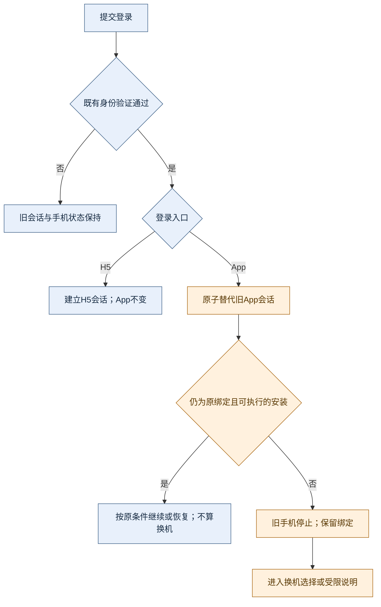
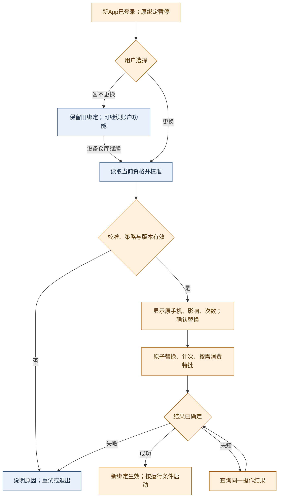
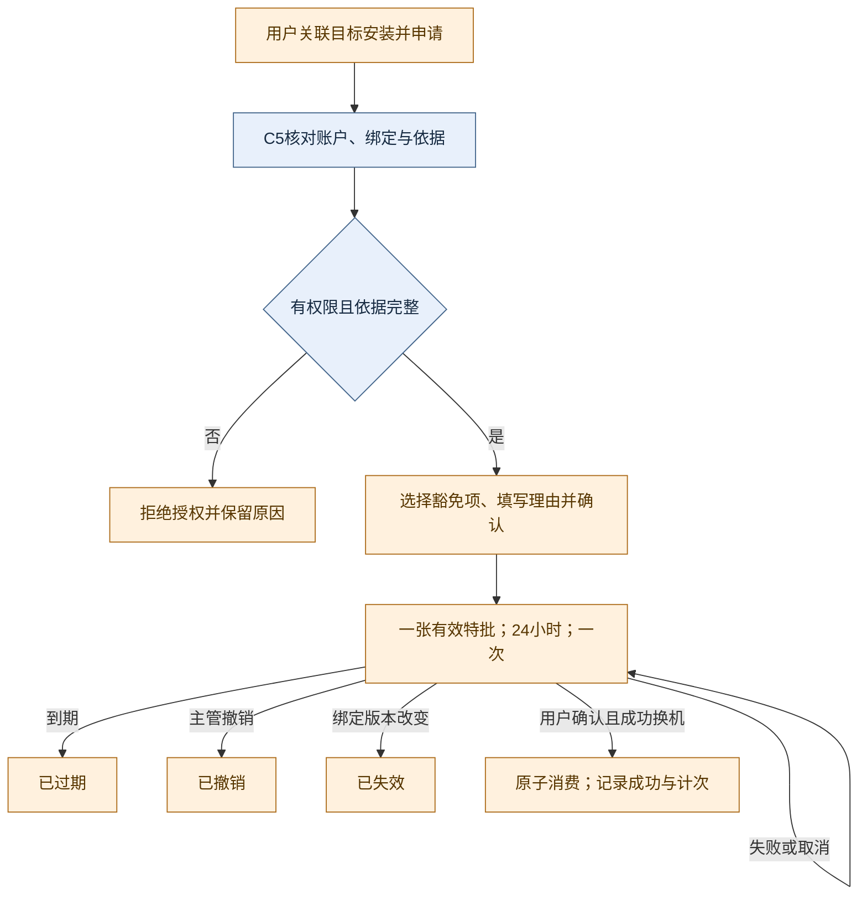

# App 单点登录、手机换绑与一次性特批 PRD 确认稿

> 状态：待产品确认，尚未实施。适用正式 App、H5、运营后台及服务端。本文补齐功能契约和交互说明，不改变现有安装身份、硬件校准、账号风控及收益结算规则；新增规则仅在确认并完成相应发布后生效。

## 1. 范围与统一口径

### 1.1 已确定的产品规则

| 对象 | 规则 |
|---|---|
| App 登录 | 一个账号在 App 组中只有一个有效业务会话；新 App 显式登录成功后替代旧 App 会话 |
| H5 登录 | 普通 H5 登录不踢 App、不停止 App 手机任务；App 登录也不踢 H5；H5 保留现有多会话规则 |
| 手机绑定 | 一个账号最多绑定并激活一台手机。登录接管、激活绑定、任务运行是不同状态 |
| 新安装登录 | 登录接管成功即停止原手机任务；无论用户稍后拒绝换机、校准失败或换机受限，旧绑定保留为暂停，新安装不获得手机执行权 |
| 同绑定恢复 | 原绑定安装重新登录不算换机、不重置绑定时间，沿用现有同绑定恢复；只解除换机导致的暂停，保留运营、风控、离线和运行条件限制 |
| 默认限制 | 滚动 30×24 小时内最多成功换机 2 次；首次绑定及每次成功更换后至少间隔 24 小时才可再次普通换机；后台可配置 |
| 特批 | 保留一次性特批，24 小时内允许目标安装完成 1 次成功换机；按所选范围豁免次数和/或间隔，成功仍记入真实历史及滚动次数 |
| 既有风控 | 沿用当前校准、安装标识匹配及账号风险检查；不新增强制验证码、设备证书、硬件证明或额外安全资格有效期 |
| 其他资产 | 登录接管与换手机只影响手机执行；不停止已购非手机设备，不重置试用、新人奖励、资产、既有账单或已确认收益 |

“H5 不踢 App”仅适用于普通登录、浏览、刷新和退出当前 H5 会话。用户主动执行全端退出、密码找回、安全重置，以及后台封禁或全端撤销，仍按原安全规则影响相应会话；本规格不削弱这些动作。

App 组包括使用该账户认证体系的现有原生 App 入口；Android、iOS及已有原生白 App 不得各占一个单点名额。手机执行能力仍以现行支持的 Android 原生能力为准，不因能登录就获得手机执行资格。H5不能校准、激活、更换手机或提交手机运行数据；它只读账号手机状态及换机记录。

### 1.2 文档归属与实现基线

- 本确认稿是本轮跨端规则、字段语义、接口增量及边界验收的共同契约。前端主 PRD §4.7.7、§6.11、§12.2描述用户行为；后台 V2 [E6]持有全局策略，V1 [C5b]持有账户查询和特批；K1/K4只消费风险事实，不维护第二套次数配置。
- 前端 PRD：[工作区版](../NexGrid_产品功能架构设计文档_v3.7.md)、[正式 App 随仓版](../../nexion-frontend-uniapp/PRD/NexGrid_产品功能架构设计文档_v3.7.md)。后台：[V1](../NexGrid_运营控制后台PRD_v1.md)、[V2](../NexGrid_运营控制后台PRD_v2.md)。引用以章节名称和功能标识共同定位。
- 现状核对基线：App `90d5935d`、后台 `551a37e`、服务端 `fe9457ef`；现有换机入口为 `/pages/onboarding/connect`、设备仓库 `/pages/me/devices`、后台 `/devices/compute-config` 与 `/users/security`。现有服务端已支持手机绑定与间隔，但不等同于已经实现本规格的 App 单点、滚动次数和特批。
- 本次先交付 PRD、状态流程和点击矩阵供确认，不修改产品代码、不宣称发布。界面视觉及可点击原型不属于本次文字确认稿；实现前应按确认后的关键流补充原型并验收。

## 2. App 单点与 H5 会话隔离

#### [FEAT-SESSION01] App 会话接管

**① 用户故事**

- 作为 App 用户，我想在另一部手机登录时明确结束旧 App 会话，以便只有当前 App 能操作账户和申请手机运行。
- 作为同时使用网页版的用户，我希望 H5 浏览与 App 登录互不打断，以便查看账户时手机任务继续正常运行。

**② 验收（GWT）与异常路径**

- 阳光路径：Given A App 有效且手机运行，When B 的全部既有身份验证通过并提交新 App 登录，Then 服务端原子建立 B 为唯一 App 会话、撤销 A 的访问及续期能力、停止旧手机未完成任务；H5会话不变，绑定仍为 A，B进入绑定决策。
- 同绑定路径：Given 当前仍绑定 A 的同一安装，When A 显式重新认证，Then旧 App 会话被新会话替代，但不因此强制取消该手机在途任务、不计换机、不更新绑定时间；新会话依据现有绑定与新运行状态继续或恢复任务，不能解除其他暂停。
- 异常1（登录失败）：Given 密码、验证码、账号状态或既有风险校验未通过，When 登录结束，Then不接管、不停止旧手机、不修改绑定；沿用原错误及重试规则。
- 异常2（接管提交失败）：Given 身份验证通过但会话撤销、旧手机停止或新会话提交失败，When事务未提交，Then整笔接管不生效，不形成两条有效 App 会话；确定失败允许重试，结果未知先恢复原登录尝试结果，不自动制造第二次接管。
- 异常3（换机资格不足）：Given B 已接管，但禁换、冷却、次数不足、校准不支持或条款待确认，When资格检查返回，Then B仍可使用允许的账户功能，旧手机保持停止；绑定不改，不因换机资格不足撤销已成功的登录。
- 异常4（并发与迟到）：Given B、C先后或并发登录，When账号锁内形成最终接管顺序，Then最后成功提交者持有唯一 App 会话；旧登录回执、刷新、退出或手机核验不得撤销、复活或覆盖较新会话。
- 异常5（旧版本客户端）：Given无法可靠区分 App/H5 的旧会话或客户端缺少必要上下文，When访问需要分组鉴权的能力，Then要求重新认证/升级以明确归组，不把未知来源默认为可绕过单点的 H5；不得因此把正常 H5 登录改成全端踢出。
- 跨端路径：Given A App运行，When任意 H5成功登录、刷新或退出当前会话，Then A会话、绑定、手机任务保持不变；Given已有H5会话，When B App接管，Then H5也保持有效。

**③ 数据字典 + 生成规则**

以下新增字段为目标契约，不表示现有响应已具备。服务端权威，client仅 UI cache。

| 字段 | 类型 | 必填/默认 | 生成规则与约束 |
|---|---|---|---|
| `sessionGroup` | `APP / H5` | 有效会话必填 | 由认证入口及签发上下文固定；刷新时不得换组，手机接口不得接受 H5 组执行请求 |
| `installationId` | string | App必填；H5可空 | 复用现有安装 `deviceId`；不是物理硬件真实性证明，不新建第二种设备身份 |
| `appSessionVersion` | integer | App必填 | 服务端账号维度单调更新，只有一次新登录成功提交才推进；续期保持逻辑会话归属 |
| `sessionChainId` | string | 必填 | 复用现有服务端会话链；撤销覆盖其访问和刷新后继，不能仅清客户端缓存 |
| `loginAttemptId` | string | App新登录必填 | 绑定同一身份验证尝试的稳定标识；重复请求只能恢复原结果，不能重新抢占；标识本身不授予登录或令牌读取权 |
| `sessionEndedReason` | enum | 可空 | 区分当前退出、另一 App 接管、安全撤销；前端映射为用户可读文字，不显示枚举 |

现有 `/auth/users/login`、`/auth/users/login/otp/verify`、`/auth/users/login/2fa` 及实际启用的 OAuth 登录完成路径统一使用这一接管合同；注册仍只创建新账号的一次初始会话。`/auth/users/refresh`不执行接管，`/auth/users/logout`只撤销当前会话链，保留既有显式全端退出入口。App新登录携带既有安装身份和稳定尝试标识，成功响应返回会话分组及版本。恢复已经被 C 替代的 B 登录结果时，不再发放有效 B 会话，只告知需主动重新登录。

`POST /api/onboarding/phone-installation/login`保留现有路径，变为当前 App 会话的幂等绑定核验与同绑定恢复入口。它必须校验最新 App 会话，不承担新登录之后才执行的补救停机，也不得让旧会话或 H5重新取得手机执行权。条款确认仍是手机启动条件，不能延迟新 App 接管时对旧端的停止。

**④ 状态机 + 禁止动作**

禁止动作：旧会话静默自动登录抢回；把刷新/前后台切换/冷启动恢复视为新登录；仅凭客户端“已退出”认定权限撤销；H5改请求字段获得手机执行权；同一过期登录请求覆盖较新会话；App接管停止非手机资产。服务端立即拒绝失效权限；离线旧端的画面在联网或下次请求后更新，不承诺离线画面同步刷新。

**⑤ 交互原型说明（4态）**

- 默认态：App登录页说明“在此登录后，其他 App 登录将退出”；H5登录页不出现将停止 App 的提示。
- 空状态：无已绑定手机时进入现有首次激活引导，不出现替换提示或扣次数提示。
- 加载态：既有登录表单保留输入，提交期间禁重复操作；核验绑定显示信息骨架，不展示未知设备名或虚假额度。
- 报错/极限态：确定登录失败保留重试；结果未知提供“确认登录结果”；被接管页显示“账号已在另一台设备的 App 登录”与“重新登录”。只有服务端确认旧手机已停止时才提示停止结果。

**⑥ 点击流矩阵**

| 触发元素 | 目标 | 反馈与出口 |
|---|---|---|
| App“登录” | 现有认证链 | 既有验证通过后接管；失败留在登录页；成功进入原路由或换机决策 |
| “确认登录结果” | 原登录尝试恢复 | 确定已接管才进入；若已被另一 App 替代，显示重新登录 |
| 被接管页“重新登录” | `/pages/login/login` | 用户主动开始新验证，不自动提交缓存凭证 |
| H5“登录/退出当前账号” | 现有H5链 | 只影响本H5会话，不写手机运行状态 |

**⑦ 跨文档一致性**

对齐前端 §4.7.7、§6.11、§12.2及后台 [C5b]。普通登录隔离与安全全端撤销必须同时成立；角色权限、验证码、条款、密码找回沿用各自原合同。本节只定义会话接管，不持有换机次数或后台参数写权。

## 3. 手机换绑、计次与恢复

#### [FEAT-PHONE01] 显式换机与设备仓库恢复

**① 用户故事**

- 作为在新手机登录的用户，我想选择是否替换原绑定，并看到次数和间隔限制，以便理解何时能够继续手机任务。
- 作为暂不换机的用户，我想稍后从设备仓库继续，以便不必重新走登录流程。

**② 验收（GWT）与异常路径**

- 阳光路径：Given B已成为当前App、绑定为A、策略允许且额度充足，When B校准后明确确认替换，Then原子将绑定从A换到B、复用原手机激活槽位、记录一次成功事件；只有满足条款、运行状态和既有风险条件后才能开始B手机任务。
- 拒绝路径：Given A已被B接管并暂停，When B选择暂不更换/返回/关闭，Then保留A绑定和暂停状态，B不能运行，不计次数；设备仓库可继续。A主动重新登录仍属原绑定恢复，0次。
- 异常1（冷却/超限/禁换）：Given任一规则不满足，When预检或最终提交，Then返回明确阻断原因与可确定的最早时间；不改绑定、不扣次数；返回首页、查看仓库或联系客服均可用。
- 异常2（校准失败/版本变化）：Given硬件未支持、校准规则更新或绑定/策略版本已变，When提交，Then不替换；解释需要重新校准或刷新确认，不自动使用新条件继续提交。
- 异常3（响应丢失）：Given替换命令结果未知，When重试或重开页面，Then按原幂等键/操作号先查原结果；已成功只恢复回执，失败可重新确认，处理中继续查询；不得显示猜测成功或重复计数。
- 异常4（并发）：Given B确认期间C接管或另一操作修改绑定，When B提交，Then旧会话或旧绑定版本被拒绝；成功的绑定写、次数事件、特批消费和任务停止必须同成同败。
- 异常5（重装/硬件变化）：Given相同手机重装丢失安装身份，或同安装的既有非空硬件标识发生变化，When申请激活，Then沿现有换机判据判断；不能凭相同机型、IP或账号验证码把它认作不扣次数的同绑定恢复。
- 异常6（读取失败/历史不足）：Given策略或计数不可用，When打开或提交，Then额度显示“暂无法确认”而非0或不限；禁止普通换机，保留原绑定恢复和账户功能，并提供重试/客服出口，按§4处理有证据的核实或特批。
- 协助申请路径：Given当前App已登录且有原绑定，When在受限页或仓库确认“申请换机协助”，Then服务端生成账号、当前安装及绑定版本固定的申请快照；成功显示申请号并可关联既有客服会话，不改绑定、不计次。重复提交同一有效申请只返回原记录；创建失败保留理由供重试；客服关联失败明确显示未送达，可复制申请号重试，不假称已获特批。
- 协助返回路径：Given申请已关联客服，When用户返回仓库刷新资格，Then显示待处理、已授权或已到期/失效；授权后仍需校准并显式确认换机。申请到期须重新确认提交，绑定版本变化须刷新新上下文，不能自动延长申请或授权。

**③ 数据字典 + 生成规则**

换机判据沿现行服务端：已有绑定且安装身份改变，或同安装但既有非空硬件标识改变，才是替换。首次绑定不算替换；旧硬件标识为空时同安装补齐不计；仅校准规则变化、同绑定校准和恢复不计。不得用绑定版本递增次数代替真实换机次数。

| 对象/字段 | 类型 | 必填/默认 | 权威与约束 |
|---|---|---|---|
| `binding.installationId / userDeviceId` | string / integer | 有绑定时必填 | 复用现有安装与用户设备关系；无绑定明确为null，不用空对象代替 |
| `binding.bindingVersion` | integer | 有绑定时必填 | 映射既有绑定行version；同绑定保存也可能递增，不能把它当换机计数器 |
| `binding.changedAt` | epoch毫秒 | 有绑定时必填 | 首次绑定及实际替换成功提交时写入；同绑定登录、校准、暂缓不重置 |
| `replacementWindowDays / maxReplacementsInWindow` | integer | 30 / 2 | E6服务端有效配置，精确定义见§4；用户界面显示实际值 |
| `usedCount / remainingCount` | integer或null | 核实后必填 | 成功事件滚动聚合；剩余=max(0,上限-已用)，特批造成超额也不得负数；未知为null |
| `historyComplete / historyCompleteFrom` | boolean / epoch或null | 必填/可空 | 服务端确认可追溯窗口；不是用户清缓存产生的标记 |
| `canReplace / blockedReasons` | boolean / enum[] | 必填 | 综合App会话、能力、绑定、策略、风控、校准和特批；前端不能只按剩余次数放行 |
| `nextAllowedAt` | epoch毫秒或null | 必填 | 综合间隔与次数计算的最早普通换机时间；禁换、封禁等无确定时刻返回null |
| `policyVersion / serverNow` | integer / epoch毫秒 | 必填 | 固定预检与最终确认依据；客户端时间只用于显示倒计时 |
| `ReplacementEvent` | object | 成功替换必有 | 服务端唯一事件号、账号、旧/新绑定、成功时刻、操作号、策略版本、特批号；只追加、不删除或改成首次绑定 |
| `operationId / idempotencyKey` | string | 写操作必填 | 操作号服务端生成，格式沿平台；幂等键复用现有激活命令生成方式，账号/目标/请求内容固定，直到结果确定不更换 |

换机协助申请为特批的目标来源，沿既有客服与核实机制处理，不构成新的风控校验。字段合同如下：

| 申请字段 | 类型/生成 | 约束 |
|---|---|---|
| `requestId / requestNo` | 服务端唯一ID / 用户可读申请号 | 账号内可查询，不作为访问凭证；C5按该记录选择目标，禁止人工输入安装标识 |
| `accountId / targetInstallationId / bindingVersion` | 当前会话账号 / 当前App安装 / 服务端当前绑定版本 | 提交携`expectedBindingVersion`并复验，不能为别的账号或任意安装造申请；H5不能创建 |
| `reason / supportRef` | 用户原因 / 既有客服会话或工单引用，可空 | 原因8–200字；创建时可尚无客服引用，授权前必须关联已核实记录；关联失败可重试或复制申请号处理 |
| `createdAt / expiresAt` | 服务端时间 / 创建后24小时 | 仅约束待处理申请能否用于新签发；已签发特批按自身有效期计算，不因原申请待处理期限到达而提前失效 |
| `status / grantId` | `PENDING / GRANTED / CLOSED / EXPIRED / STALE`，可空特批ID | 待处理才可签发；签发后关联唯一特批并显示其当前状态；未签发申请的绑定版本变化为失效，过期不可首次签发 |

同账号、同目标安装、同绑定版本的未到期待处理申请重复创建时返回原记录，不重置时间；已有有效特批则返回其来源申请与授权状态。终态申请不能恢复为待处理，每个申请至多签发一张特批。旧特批撤销/到期/消费或申请过期后，需要新申请和新确认才能再次签发；关闭页面不等于撤回。具有C5特批处置权限的主管拒绝申请时记录原因并置为`CLOSED`，用户可查看说明，修改原因后主动重新申请。申请创建与客服关联是两个结果，界面必须分别如实反馈。

滚动统计在服务端时刻 `t` 取 `(t - W×24小时, t]` 内全部成功替换事件，首次绑定不入计数。普通新换机提交前须满足 `usedCount < N` 及 `t >= changedAt + interval`；事件恰好到窗口左边界即移出，间隔恰好达到即允许。A→B→A两次成功记2；特批成功同样计入。仅靠最早一笔过期不足以计算超额后的恢复时间，须等足够事件移出后再与间隔取较晚时刻。

建议接口增量（明确为待实现合同，未列为已上线接口）：

| 接口 | 变化与关键输入 | 结果与权限 |
|---|---|---|
| `GET /api/onboarding/phone-installation/replacement-eligibility`（新增） | App可带当前 `installationId`；H5仅查账户概览 | 当前绑定、策略、次数、原因、可换时间和有效特批；H5的`canReplace=false`，不获得运行授权 |
| `POST /api/onboarding/calibrate/activate`（已有扩展） | 保留校准`expectedRevision`与幂等键，新增`expectedBindingVersion / expectedPolicyVersion / exceptionGrantId?`，替换须明确确认；首次绑定的预期版本为null，表示预期仍无绑定 | 校验当前App会话并原子保存；并发首绑只能一次成功，不以首绑名义覆盖已存在绑定；同绑定恢复不误扣；旧客户端缺替换确认不得绕过，可继续登录浏览并提示更新 |
| `GET /api/onboarding/phone-installation/replacement-operations/{operationId}`（新增） | 仅当前账号读取本人的操作 | 返回处理中、成功、确定失败及原回执；不执行新换机，不暴露其他账号记录 |
| `POST /api/onboarding/phone-installation/replacement-requests`（新增） | 当前App会话、当前安装、`expectedBindingVersion / reason`及Idempotency-Key | 返回申请快照及可读号；服务端复验归属，账号由会话取得；不代为签发特批 |
| `GET /api/onboarding/phone-installation/replacement-requests/current`（新增） | 当前账号；App按当前安装读，H5只读账户状态 | 返回当前申请、关联客服结果及特批当前状态；无记录明确为空，失败不伪装为空；不返回凭证或完整硬件标识 |
| `GET /api/onboarding/calibrate/binding-status`（已有） | 保留既有兼容语义 | 只读是否已有绑定，不能替代完整资格预检 |

结果未知但尚未取得操作号时，用同一账号、原幂等键查询或重放原激活命令恢复原回执，不生成新键。回执恢复先辨认已成功操作，再检查是否需要执行；已经成功者即使特批后来到期或绑定再变化，仍返回原成功事实及当前绑定，不能再次执行。H5可读结果但不能重放激活命令。

**④ 状态机 + 禁止动作**

禁止：点击“完成校准”隐含替换；拒绝后自动解绑；仓库旧手机按钮绕过当前安装校验；因换机恢复新人奖励或试用；H5触发激活；新会话未提交就停止旧手机；换机失败自动恢复已被撤销的旧会话。旧安装迟到心跳、领取和结算均校验当前权限与任务状态；已完成并确认的历史收益保留，服务端停止时未完成手机任务终止且不补发该次奖励；并发停止与完成由同一权威任务结果裁定，不重复结算。

**⑤ 交互原型说明（4态）**

- 默认态：新安装登录展示当前绑定手机、原手机已暂停、实际剩余次数和影响。校准前“校准并更换/暂不更换”；校准成功后“确认更换并激活/暂不更换”。原设备名不可得时显示“原绑定手机”，不造型号。
- 空状态：没有绑定时使用首次激活引导，不扣次数；有绑定但没有换机记录时明确“暂无更换记录”，仅在历史完整时显示已用0次。
- 加载态：资格/校准/提交各自标明正在处理；读取时保留骨架，提交时冻结当前确认内容和重复按钮。提交结果未知提供查询，不能让“取消”被误解成回滚已送出的操作。
- 报错/极限态：冷却显示具体可换时间与用户时区；超限说明滚动周期；禁换、校准不支持、历史待核实给不同原因和下一步；多条阻断同时显示，未知时不显示0次。未确定请求结果时可离开，仓库保留待确认状态并可继续查询。原绑定仍为A时，暂停/拒绝/受限页提示“可在原绑定手机重新登录，满足运行条件后恢复”；已经成功替换后明确“换回旧手机仍需按换机规则办理”，不能暗示返回首页就恢复原机。申请读取失败保留重试；无申请显示申请入口，提交中禁重复，成功可查看申请号与客服关联结果。

推荐确认文案：“当前账号已绑定「{原手机}」。因已在当前 App 登录，原手机任务已暂停。确认更换后，当前手机将成为唯一绑定手机，原手机将不能运行手机任务。最近{实际窗口}天已更换{已用}次，本次完成后剩余{预计剩余}次。”使用特批时改为“本次使用一次性特批，更换成功后该特批失效”，不显示负剩余次数。无权或不可用动作禁用并给原因；页面不显示内部字段、枚举或错误码。

**⑥ 点击流矩阵**

| 触发元素 | 目标 | 反馈与出口 |
|---|---|---|
| 登录后“校准并更换” | `/pages/onboarding/connect?mode=recalibrate` | `mode=login`仅承担登录后的状态核验；主动换机进入重新校准，未通过保留原因与退出 |
| 校准后“确认更换并激活” | 当前页激活命令 | 重新校验版本/额度，确定成功后刷新仓库 |
| “暂不更换”/返回/关闭 | 原返回页或首页 | 不修改绑定、不计次；原手机保持暂停 |
| 仓库“更换为当前手机” | 同一校准与确认流程 | 每次重新读资格；不存在不受限制的快捷激活 |
| “确认更换结果”/刷新 | 原操作结果 | 成功显示原回执和最新绑定；失败解除忙碌态 |
| “申请换机协助” | 原因表单与当前绑定/当前手机确认 | 自动关联当前安装；提交成功显示申请号，不等于已授权；取消不创建，失败保留输入 |
| 申请成功页“联系客服”/“复制申请号” | 现有客服入口，携账号关联的申请引用；失败可复制申请号重试 | 不携凭证或完整硬件数据；明确客服关联是否成功；返回后重新读资格，不自动消费特批 |
| “刷新资格”/“查看协助进度” | 当前申请、特批与资格查询 | 待处理显示等待和返回；已授权仍需校准确认；到期/失效可主动重新申请，不能自动续期 |
| H5“在 App 中处理” | 已有打开App/下载入口 | 只读保留当前页面；不自动踢App或发换机命令 |

**⑦ 跨文档一致性**

前端§6.11与设备仓库、§12.2绑定/任务状态共享同一服务端事实；次数配置只读后台[E6]，特批只读[C5b]。已购设备容量上限沿既有配置；替换复用原手机所占槽位，不临时多占一槽。无原手机激活槽可复用时仍执行现有容量与试用预留规则，不写死槽位数量。

## 4. 后台策略与一次性特批

#### [FEAT-OPS01] 换机参数、账户记录及特批处置

**① 用户故事**

- 作为设备策略运营人员，我想配置换机窗口、次数与间隔，以便按既有风控体系管理异常频繁更换。
- 作为具有授权的安全主管，我想核验用户申请并授予有明确目标和期限的一次特批，以便处理丢机、损坏等无法普通换机的情况且保留审计。

**② 验收（GWT）与异常路径**

- 阳光路径：Given运营有E6写权限，When提交合法整组参数并填写理由确认，Then新策略版本原子发布，之后新命令按它校验；现有绑定、任务及历史不被追溯撤销。
- 特批路径：Given账户目标安装和绑定版本已确认且有授权角色，When主管选择豁免项、填写核实依据和理由后确认，Then产生一张24小时/1次特批；用户回到App仍须校准及确认，后台不代用户绑定手机。
- 异常1（参数非法/版本冲突）：Given次数/窗口非法、间隔时间无法安全计算或旧编辑版本已变化，When确认，Then整组不生效、旧策略保留，定位字段错误或要求刷新对比；不自动改值或静默覆盖。
- 异常2（无权/缺依据）：Given无授权、理由不足或没有关联核实记录，When提交特批，Then不生成授权；只读人员可以查看原因及已有申请，不能借直接调用绕过。
- 异常3（部分豁免）：Given特批只豁免次数但仍处冷却，When用户确认，Then继续拒绝且不消费；只豁免间隔时同理。全局禁换、封禁、风险暂停、校准失败和无当前App会话均不可豁免。
- 异常4（并发/到期/撤销）：Given消费与撤销、两次消费或到期并发，When服务端锁内裁定，Then最多一次成功；首次成功提交时必须尚有效，失败不消费但不能延长期限；成功后的回执重放保持成功事实。
- 异常5（上下文改变）：Given特批生效后绑定版本变化、目标安装改变或更换账户，When使用，Then拒绝并提示重新申请；同绑定保存导致版本变化也不能绕过检查。
- 异常6（历史待核实）：Given旧版本历史不足，When查询额度，Then不显示0次、不抹掉历史；C5提供缺失范围和核实入口。具备次数豁免的已核实一次性特批可应急完成目标换机，但保留历史不完整标识，成功事件正常计入；不转换成永久放行。
- 异常7（签发回执丢失且已到期）：Given特批已签发但客户端未收到结果，When超过24小时幂等缓存后重放原签发请求，Then恢复原特批及已到期状态，不能新发或续期；再次授权必须新申请、新核实确认。
- 异常8（后台命令结果未知）：Given策略发布/授权/撤销响应丢失，When按原操作号或原命令类型及幂等键查询，Then只返回该操作的处理中、成功或确定失败；成功回执与当前配置/特批状态分开，不把别人的后续变更当原命令结果，不自动再写一次。

**③ 数据字典 + 参数及生成规则**

E6唯一参数源，前缀`E.compute.phoneBinding.`。新窗口/次数范围是本确认稿的拟定输入约束；间隔保留既有取值域及0语义。

| 参数 | 默认/现有值处理 | 范围 | 生效方式 |
|---|---|---|---|
| `allowReplacement`（已有） | 保留当前有效值；新环境沿既有off默认 | on/off | 关闭只阻止替换，不阻止首次绑定和同绑定恢复；特批不绕过 |
| `minReplacementIntervalDays`（已有） | 新配置默认1天=24小时；已有显式值不静默覆盖 | 0..9007199254740991整数；0不限间隔 | 发布前需验证毫秒换算与未来时刻可表示，不溢出；拒绝无效发布，不把账号变成永久报错 |
| `replacementWindowDays`（新增） | 30 | 1..365整数 | 以新版本窗口重新聚合已有成功事实，不清历史 |
| `maxReplacementsInWindow`（新增） | 2 | 1..100整数 | 与窗口一起校验；0不承担“无限”或“禁止”含义，禁止换机应使用现有开关 |

已有间隔并非1天的环境，发布前在E6展示差异，由运营按本确认值明确发布；不在数据库迁移中静默覆盖。新增字段必须随服务端策略版本齐备后启用；缺失/无效时换机资格不可用，不以0/无限作为降级。改窗口/次数不取消已激活手机；只影响后续更换。打开确认页后政策变动，客户端必须刷新并再次确认，不自动套用新政策提交。

| 特批/记录字段 | 类型/默认 | 规则 |
|---|---|---|
| `grantId / accountId` | 服务端唯一标识 /账号ID | 归属固定，不能跨账号；id格式沿平台，不由浏览器伪造 |
| `requestId / bindingVersion / targetInstallationId` | string / integer / string | 引用§3服务端申请快照并核对当前绑定版本；目标从申请取得，不能任意改写或发通用白名单；一个申请至多签发一张特批 |
| `waiveCount / waiveInterval` | boolean，默认false | 至少选一个；次数豁免可覆盖待核实计数，但不清除其未知标识；不得包含其他硬阻断 |
| `issuedAt / expiresAt / remainingUses` | 服务端时间 / issuedAt+24小时 /1 | `now < expiresAt`才能首次消费；有效期和一次次数固定，不开放无限期授权 |
| `status` | `ACTIVE / CONSUMED / REVOKED / EXPIRED / STALE` | 服务端派生/写入；绑定版本变化为STALE，终态不能恢复成ACTIVE |
| `reason / evidenceRef / operatorId` | string | 理由8–200字，关联已核实工单或安全申请记录、操作者和权限；不得记录密码、验证码或令牌 |
| `consumedOperationId / consumedAt` | string /时间，可空 | 只在真实成功替换事务中填；失败/取消不消费，成功重放不再消费 |

每账号最多1张有效特批。已有有效特批时，新增默认拒绝并展示现有记录；确需更换目标或豁免范围，先明确撤销旧特批，再重新确认生成新特批，不静默叠加或覆盖。历史审计不修改。计数未知且使用次数豁免时，确认预览明确说明该风险，用户剩余额度仍显示未知；若绑定变更时刻也不可核实，必须另有间隔豁免，不能从未知时刻推导冷却已过。

接口合同：

| 接口 | 合同 |
|---|---|
| `GET /api/admin/devices/compute-config`（已有扩展） | 返回完整手机策略及策略版本；沿用E6配置读取权限 |
| `PATCH /api/admin/devices/compute-config/params`（已有扩展） | body保留`values / reason / operator`，新增`expectedPolicyVersion`；`values`携四项完整手机策略，操作者真值取服务端认证上下文。原子发布参数组；既有单字段路径新增同名预期版本，并与其余当前值组成完整策略校验；复用权限、幂等、A2审计 |
| `GET /api/admin/users/profiles/{userId}/phone-binding`（新增） | C5返回当前绑定、运行暂停原因、App/H5会话概览、普通资格、待确认操作和有效特批；不泄露原始凭证 |
| `GET /api/admin/users/profiles/{userId}/phone-replacements`（新增） | 成功历史、失败申请、特批及审计关联分页查询；失败申请与成功计次明确分列 |
| `GET /api/admin/users/profiles/{userId}/phone-replacement-requests`（新增） | C5按账户分页查询§3申请快照与当前状态，按现有账户查看权限及数据范围裁剪；以服务端申请选择目标，不人工输入安装标识 |
| `POST /api/admin/users/profiles/{userId}/phone-replacement-requests/{requestId}/close`（新增） | 对已核实但不予授予的待处理申请记录拒绝理由并关闭，沿C5特批处置权限、确认与审计；不关闭已经签发的授权，后者须走撤销 |
| `POST /api/admin/users/profiles/{userId}/phone-replacement-grants`（新增） | body含`requestId / expectedBindingVersion / waiveCount / waiveInterval / reason / evidenceRef`；目标从申请取，使用Idempotency-Key；不修改绑定本身 |
| `POST /api/admin/users/profiles/{userId}/phone-replacement-grants/{grantId}/revoke`（新增） | 明确撤销确认与理由；已消费时显示已消费而非假称撤销成功，重复撤销幂等 |
| `GET /api/admin/phone-replacement-operations/{operationId}`（新增） | 查询原策略发布、申请处置、特批签发或撤销结果；不得执行新命令；仅允许当前仍有相应E6/C5权限且在数据范围内的原操作者或有同等处置权限的主管查询 |
| `GET /api/admin/phone-replacement-operations/by-idempotency-key?commandType=...&idempotencyKey=...`（新增） | 尚未收到操作号时按原命令类型和原幂等键定位，权限同上；键不是认证凭证，不把未找到当确定失败重发 |

后台命令回执统一含`operationId / commandType / status(PENDING|SUCCEEDED|FAILED) / submittedAt / completedAt / originalResult / currentResource / auditRef`；`commandType`区分策略发布、申请关闭、特批签发和撤销。原结果冻结提交时的策略版本/申请号/特批号，当前资源另列最新状态；处理中没有完成时刻，确定失败含用户可读原因。查不到返回“结果暂无法确认”与继续查询/核实出口，不假定失败；客户端保留原键和请求快照直到确定结果。查询不回传原始凭证或无权查看的账户信息。

新增冲突合同使用响应`conflictType`区分`POLICY_VERSION_CHANGED`（策略版本变更）、`BINDING_VERSION_CHANGED`（绑定变更）、`REQUEST_UNAVAILABLE`（申请已过期/失效/关闭或已签发）、`GRANT_STATE_CHANGED`（授权状态变化）、`ACTIVE_GRANT_EXISTS`（已有有效授权）、`IDEMPOTENCY_MISMATCH`（同键异输入）；非法参数使用`INVALID_POLICY`并带`fieldErrors`，无当前权限使用`PERMISSION_DENIED`。均返回可读原因和允许的刷新/取消/重新申请动作，不自动重试写入；内部类型不直接展示给用户。成功命令的回执恢复先于当前对象状态校验，不能把后来的版本变化误报为原命令失败。

新增授权动作权限拟为`user_c5_phone_replacement_exception_grant`、`user_c5_phone_replacement_exception_revoke`，仅具有相应权限的现安全主管（风控lead）/超管可执行；申请关闭使用前者。普通客服只查已有授权范围内的账户数据及关联工单。E6沿用其现有写权限，不因能改参数自动获得C5特批权限。全部高敏写操作使用24小时幂等缓存、确认+理由和A2不可变审计，并持久保存原命令与原资源的关联；缓存到期不代表原命令可再次执行。原签发请求无论特批已消费、撤销、失效或过期，都只恢复原特批及当前状态；重新授予须新申请、新操作和新确认。若无法安全恢复原命令，只能提示核实，不得自动产生新授权或再次发布旧策略。

事件遵循A4现有命名/身份规则，本轮拟新增以下唯一事件表；后台各模块引用本表，不另取别名。

| 事件 | 触发及主要属性 |
|---|---|
| `account.app_session_replaced` | App接管成功，账号、原/新会话版本、安装、操作及提交时刻，不含token |
| `phone.replacement_succeeded` / `phone.replacement_rejected` | 实际替换成功/确定拒绝，账号、操作、绑定、策略、特批和原因；只有成功事件进入次数 |
| `phone.replacement_request_created` / `admin.phone_replacement_request_closed` | 协助申请建立/主管拒绝关闭，申请、账号、目标、版本及理由；不计次数 |
| `admin.phone_replacement_policy_updated` | E6发布成功，旧/新策略版本、参数差异、操作者与理由 |
| `admin.phone_replacement_grant_issued` / `admin.phone_replacement_grant_revoked` / `admin.phone_replacement_grant_consumed` | 特批签发/撤销/真实成功换机消费，申请号、特批号、关联操作、权限依据及前后状态 |
| `admin.phone_replacement_grant_expired` / `admin.phone_replacement_grant_stale` | 未消费特批首次到期/绑定版本变化失效，特批号、原/新状态与有效失效时刻；到期可在读取时物化，但不得依赖后台扫描延迟仍可消费 |
| `admin.phone_replacement_grant_rejected` | 签发、撤销或使用特批被确定拒绝，申请/特批/操作（已有时）、动作类型及原因；请求重放不重复登记，不伪造成功 |

替换成功唯一事件关联操作号，供计数、C5和K1/K4共同消费，不因重复投递重复计数；审计与事实写入失败则对应高敏命令不宣告成功。特批生命周期终态事件按特批号与终态唯一去重，重复读取到期状态不反复发事件；拒绝事件不是成功换机事实。

**④ 状态机 + 禁止动作**

禁止后台直接替用户激活、清零历史、无限白名单、失败提前消费、到期后首次执行、修改已消费目标、把同账号验证码当作同物理手机证明。E6、C5与K1/K4不得保存相互矛盾的次数真源。

**⑤ 交互原型说明（4态）**

- 默认态：E6显示实际开关、间隔、窗口、上限及生效版本；C5同页显示登录会话分组、绑定状态、次数与历史、明确的阻断原因和当前特批。
- 空状态：无绑定显示“尚未绑定手机”；无成功更换显示“暂无更换记录”；无特批显示“暂无有效特批”，不把读取失败当空列表。
- 加载态：详情和分页各自保留骨架；提交禁重复；发布/授权结果未知保留操作查询，不能仅以Toast认定完成。
- 报错/极限态：数字使用步进器和范围校验；豁免项使用勾选，原因单独文本框，依据用记录选择器；禁单框多值输入。权限不足给说明，历史未知显示待核实，特批失效显示原因和重新申请出口；失败保留用户输入，成功回读实际新版本或授权。

**⑥ 点击流矩阵**

| 控件 | 目标 | 反馈与取消 |
|---|---|---|
| E6“调整换机规则” | 当前页业务编辑弹窗 | 展示修改前后及影响；取消不写；确认复验版本与理由 |
| E6“刷新配置” | 当前有效策略 | 失败保留上次数据并标过期，禁止以过期值放行新提交 |
| C5“查看换机记录” | 当前账户分页记录 | 筛选成功/失败/特批；可返回账户安全概览 |
| C5“核实申请” | 选择账户的服务端申请及既有关联工单/安全记录 | 无申请先引导用户从目标App发起；无核实记录先关联；不以自由输入的设备名生成目标安装 |
| C5“不予授予” | 待处理申请的原因确认 | 留存原因并关闭申请；取消不改，已有授权需另走撤销，不通过关闭申请伪装撤销 |
| C5“授予一次特批” | 本次目标与豁免项确认弹窗 | 24小时/一次、权限与影响明示；确认回读授权，取消不创建 |
| C5“撤销特批” | 当前未消费特批确认弹窗 | 显示目标、状态与理由；并发已消费时刷新真实结果 |
| C5“刷新/确认操作结果” | 当前策略、绑定或原操作回执 | 不重置计数、不自动重复发放 |

**⑦ 跨文档一致性**

后台V2[E6]拥有参数，V1[C5b]拥有特批，A2拥有审计合同，A4拥有事件规范，K1/K4只读消费。E3有价设备置换、E5资产管理不承载手机身份换绑；既有App/H5全端安全动作保持原归属。

## 5. 边界场景验收矩阵

以下每条均以“Given前置、When动作、Then结果”验收；行号不是接口编号。默认普通策略为30天2次、间隔24小时，除非明确另设。

| ID | Given / When | Then必须成立 |
|---|---|---|
| S01 | A App运行，B App认证成功 | 仅B App有效；A手机停止、绑定仍A；H5不变 |
| S02 | A App运行，同手机浏览器或另一手机H5登录 | A App及任务均不变，H5不得换机或运行手机任务 |
| S03 | H5已登录，B App接管A | H5保持有效，只有App组发生接管 |
| S04 | 两个H5浏览器登录或同浏览器多标签刷新 | 沿现有H5多会话；不增加换机记录、不影响App |
| S05 | 同一App安装显式重新认证 | 替换旧App会话；同绑定任务不因认证本身被取消；计数/绑定时间不变 |
| S06 | App刷新、冷启动恢复、网络重连 | 只恢复当前有效会话；失效会话不可静默抢回 |
| S07 | B登录失败、验证未完成或取消 | A会话和任务不变，次数不变 |
| S08 | B接管后仍待条款确认或校准 | A已停止；B不能运行手机任务，但已成功登录不回滚 |
| S09 | B拒绝替换，稍后仓库再次申请 | 拒绝0次；仓库重新核验资格，只有最终成功才计1次 |
| S10 | A→B登录拒绝→A主动登录 | 原绑定A恢复，0次，不重置changedAt，其他暂停继续 |
| S11 | A→B成功替换→A再次成功替换 | 共2次，回旧机仍须策略许可，不恢复历史已取消任务 |
| S12 | B拒绝后C登录 | C为唯一App；绑定仍A、暂停；0次 |
| S13 | 换机开关关闭 | 新App登录可以成功并停止旧手机；首次绑定/同绑定恢复仍按既有规则；普通换机及特批均不可绕过禁换 |
| S14 | 首次绑定成功后不足24小时 | 首次不计次，但普通更换受间隔限制；同绑定恢复不受限 |
| S15 | 到达间隔边界或成功事件恰满30天 | 服务端精确时刻决定是否可换，客户端改时间无效 |
| S16 | 特批使窗口内成功数超过2 | 剩余显示0，计算足够事件移出后的最早普通可换时间；不只取最早一笔 |
| S17 | 同一操作双击、两个请求重放 | 同结果、同事件、同消费；最多计一次 |
| S18 | B提交期间C已接管或绑定版本改变 | 拒绝旧B提交；回读最新事实，不覆盖新会话/绑定 |
| S19 | 替换提交成功但响应丢失，随后特批到期 | 原操作回查仍显示成功，不再次消费或把成功改失败 |
| S20 | 替换提交失败后特批到期 | 失败不消费，但不能再凭过期授权首次执行 |
| S21 | 只有次数豁免而冷却未满；或反之 | 未豁免规则仍阻断；特批不消费 |
| S22 | 特批目标不符、版本改变、已撤销或已消费 | 新执行拒绝；已成功原回执仍可查询；重新申请不抹历史 |
| S23 | 两次消费或消费与撤销并发 | 只有一个权威终态；后台显示真实结果，不双成功 |
| S24 | 当前已有有效特批，再授另一张 | 阻止直接创建；明确撤销旧授权后才能另授，不能叠加 |
| S25 | 同安装硬件标识改变或清数据重装 | 沿现有替换判据，不能凭同型号/IP免计；同安装旧空硬件标识补齐不计 |
| S26 | 策略或历史读取失败 | 不能假设0次或不限；普通换机暂停，账号功能/原绑定恢复可用 |
| S27 | 修改窗口/上限/间隔时用户正看确认页 | 新命令按新版本预检并重新确认；不追溯撤销已绑定设备 |
| S28 | 旧App离线、旧心跳或任务结果迟到 | 旧权限无效；以停止/完成的权威提交顺序裁定，不补算和不重复结算 |
| S29 | 原手机有运营/风控暂停，用户回原机登录 | 仅解除换机暂停，不解除其他暂停，不凭特批绕过 |
| S30 | 账户有已购设备、试用及已到账收益 | 手机换绑不改变其他资产和既有收益，不重发试用/新人礼 |
| S31 | 原手机占满最后一个激活槽 | 成功替换复用该槽；无可复用槽时执行原容量/预留规则 |
| S32 | H5触发全端退出、找回密码或后台封禁 | 按原安全动作撤销相应App/H5；普通H5登录豁免不适用于这些明确安全动作 |
| S33 | 旧UNKNOWN来源会话、刷新伪造组别 | 不成为免单点/免手机权限校验通道；按迁移映射或重新认证确定组别 |
| S34 | 不支持手机执行的原生App登录 | 仍占唯一App会话，旧手机停止；新端只能使用其支持功能，不能误提示可以激活 |
| S35 | App切换到另一个账号、旧响应迟到 | 不串绑定/次数/特批；旧响应不改变当前账号；显式换账号退出原当前会话并停止其手机执行 |
| S36 | 特批申请后用户放弃、关闭页面或校准失败 | 不消费、不延长；App显示仍有资格或已过期，后台不得代用户激活 |
| S37 | App重复申请协助、客服关联失败或H5尝试申请 | 有效同目标同版本申请返回原记录不续期；关联失败可复制申请号重试；H5只读，申请不改绑定、不计次 |
| S38 | 签发成功回执丢失，24小时后用原请求重试 | 返回原特批及已过期状态，不创建或续期；新授权必须新申请及明确确认 |
| S39 | 发布/签发/撤销结果未知，后续配置或特批又变化 | 原命令回执与当前状态分开；按原操作/键只读恢复，不把后续状态当原命令结果，不自动再写 |
| S40 | 用户受限或拒绝后选择返回，原绑定未变/已实际更换 | 页面分别指引原绑定手机主动登录恢复，或说明回旧机仍算再次更换；不暗示返回首页自动恢复 |
| S41 | 无绑定时多个激活请求并发，或旧首绑请求迟到 | 账号内只建立一个初始绑定；其余返回冲突/原回执，不能以首绑名义覆盖已有绑定或绕过次数 |

## 6. 存量迁移与确认边界

1. 新字段、会话分组及计数事件必须先具备服务端权威读写能力，再开放客户端新交互；不能先发界面、后补次数校验。规则在本次产品确认及后续实现验收后生效。
2. 现有会话按可证实的认证来源归组；无法可靠归组的旧记录在下一次使用时要求重新认证，不作为永久豁免。迁移App组有多会话时保留最近一次明确登录成功的App会话，按服务端唯一顺序处理；当前绑定安装不匹配则暂停手机，H5已知会话不参与竞争。
3. 历史换机按既有可核验审计事实去重导入；当前`changedAt`不能推导过去30天所有更换次数。无完整历史时标记未知并记录可靠采集起点；只有证据补齐或整个统计窗口进入可靠覆盖区间后，才恢复完整计数。特批可在核实用户诉求后按次数豁免救济，但不伪造0次、不删除未知标识。
4. 默认30/2/1天是本轮确认值；既有开关和显式间隔保留并在发布时展示差异，由有权运营明确发布。策略修改不触发强制下线或停止已运行手机。
5. 本确认稿不包含生产实现、全量构建、真机及真实后台联调结果。后续实施验收必须覆盖§5矩阵、App/H5界面与服务端拒绝路径，并验证刷新后状态、并发事务及审计结果。
