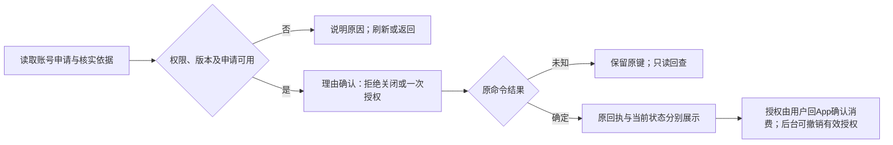

# SPEC-06：后台 E6 换机策略与 C5 一次性特批

> 类型：实施交接规格；本轮不实现业务。产品规则已于 2026-10-19 确认，状态以任务 `HANDOFF.md` 为准，输入快照中的“待确认/拟定”不再构成产品待决项；接口、权限及测试尚待实施。

## 目标、依赖与基线

- 目标：在既有 E6、C5 入口完成可配置换机规则、账户事实查询、申请拒绝关闭、一次性授权及撤销；运营可解释限制并恢复未知操作结果，不代用户激活手机。
- 依赖：[SPEC-03](SPEC-03-backend-operations.md) 服务端管理接口、权限、版本/幂等/审计合同验收通过后进入本步；可与 SPEC-04 App/H5 前端并行，两步写入仓不重叠；最终仍须跨端集成。
- 共同契约：[FEAT-SESSION01](../inputs/PRD/specs/FEAT-SESSION01-app-single-login-phone-replacement.md) §3–§5；后台输入：[V1 C5b](../inputs/PRD/NexGrid_运营控制后台PRD_v1.md)、[V2 E6](../inputs/PRD/NexGrid_运营控制后台PRD_v2.md)。DTO、事件及权限语义只引用共同契约，不另建口径。
- 实施仓：`D:/WORKS/PLAN/nexion-frontend-pc`。回源 HEAD `551a37e1603bd1cccb6d6e1627aaf01e2e661673`，已读取 `CLAUDE.md`、`package.json`；该仓规则中的旧原型名称/旧路径不是另开工作线依据。
- 已 fetch 的 `origin/test` 为 `f30e08e976885b76d677e0acf69b4fba261880e1`，仅新增 M3 品牌文案及 `tests/system-brand-display.test.mjs`；实施前固定实际基线，禁止为此覆盖远端改动。现存 `.claude/settings.json` 删除为他人改动，不纳入本步。
- 现状：`e6PhoneBindingKey` / `parseE6PhoneBinding` 仅含开关与间隔，E6 经 A2 高敏命令；C5 已有安全概览和会话撤销，未有本次申请/特批/操作回查。既有客户端/代理路径存在不表示新增合同已支持。

## 写入范围与接口交接

以下均为 PC 仓内路径；候选表示实施时核实后采用，不宣称文件已存在。限定本功能，不重构无关 E/C 域。

| 范围 | 真实入口或候选产物 | 本步责任 |
|---|---|---|
| E6 | `app/components/domain-views/e-tabs/e6-compute-config.tsx`、`app/components/domain-views/e-view.tsx`、`app/components/domain-views/e-tabs/types.ts` | 四参草稿、版本确认、A2 命令上下文及发布恢复 |
| E6 合同 | `lib/admin/e6-client.ts`、`lib/admin/e456-overview-contract.ts`、`lib/admin/high-ops-registry.ts` | 完整 DTO 校验、稳定原键、预期版本透传；覆盖单参兼容与批量/A2 通道 |
| C5 | `app/components/domain-views/c-tabs/c5-security.tsx`、`lib/admin/user360-client.ts` | 账号选择、App/H5 摘要、绑定/暂停/次数/申请/特批和历史分页 |
| 新合同隔离 | 候选 `lib/admin/phone-replacement-client.ts`、`app/components/domain-views/c-tabs/phone-replacement-panel.tsx` | 仅在拆分有必要时新增；解析、冲突映射、目标隔离和回查 |
| 代理与权限 | `app/api/admin/devices/[...path]/route.ts`、`app/api/admin/users/[...path]/route.ts`；候选 `app/api/admin/phone-replacement-operations/[...path]/route.ts` | 明确方法/路径白名单、认证与幂等透传；查询权限由后端复验，不放宽代理 |
| 共用状态/错误 | `lib/admin/pending-mutation-store.ts`、`lib/admin/error-messages.ts` | 仅必要适配；不得改变其他动作的稳定键和安全错误边界 |
| 验证及文档 | 下文定向测试；`docs/OPS-ACTIONS-MATRIX.md`、`docs/cgm/CGM-C.md`、`docs/cgm/CGM-E.md`、正式 PRD 目标章 | 动作/字段映射、真实覆盖证据；不新增菜单、第二套配置或全局新开关 |

正式 PRD 目标为 PC 仓现存完整文件 `docs/PRD/Nexion_运营控制后台PRD_v1.md` 的 C5/C5b 和 `docs/PRD/Nexion_运营控制后台PRD_v2.md` 的 E6；输入快照名为 `NexGrid_*`。本次远端回写按用户授权适用这些实际目标，不套用旧 `admin-ops` 指针规则。按章节及相关引用 merge，逐项处理基线差异，禁止整文件覆盖或顺手品牌改名。

#### [FEAT-OPS06] E6/C5 可操作交付

**① 用户故事与归属**

作为设备策略运营者，我想在 E6 一次确认四项换机规则，以便规则一致生效且不改写历史。作为有特批处置权的安全主管，我想核实目标 App 提交的申请后关闭、授权或撤销，以便处理一次例外并保留追溯。

E6 独占全局参数；C5 只读引用策略并处置账号申请；A2 持不可变审计、A4 持事件命名。K1/K4 只消费事实，E3 商品置换、E5 资产运维及 H5 手机奖励退役保持原归属。

**② 验收（GWT）与异常路径**

验收 ID 在本步唯一；S 编号精确引用共同契约 §5。测试必须断言实际读回及禁止发生的写入，不能仅检查按钮或源码字符串。

| ID / 边界 | Given → When → Then |
|---|---|
| A06-01 / S13、S27 | 有权且读齐策略 → 确认发布四参 → 同一新版本原子生效；关闭不阻断首绑/同绑定恢复，旧确认页须刷新再确认，不踢既有绑定 |
| A06-02 / S15、S27 | 字段越界、非整数、时刻溢出或编辑版本过期 → 发布 → 整组拒绝，字段/版本原因可读，旧策略保留；无权不能借混合参数或兼容单参旁路 |
| A06-03 / S01–S06、S14–S16、S26、S29–S32 | 选中账号 → 查询及分页 → 分开展示 App/H5、绑定/暂停、成功计次/失败记录、全部阻断原因；未知不当0，特批超额剩余不负数，不以登录/版本增量计次 |
| A06-04 / S24、S36、S37 | 有已核实有效申请且无有效授权 → 选择豁免项确认 → 一张24小时/一次授权，目标取申请、后台不绑机；重复申请不续期，已有授权不覆盖 |
| A06-05 / S37、S39 | 待处理申请 → 有权主管填写理由拒绝关闭，或与签发并发 → 至多一个转换成功；已签发不能关闭代替撤销，未知结果只查原命令，用户可读拒绝原因 |
| A06-06 / S20–S24、S36 | 有效特批 → 撤销、到期、绑定变化或用户消费 → 显示唯一真实终态；失败/放弃不消费，已消费不能假报撤销成功；再次授权需新申请、新确认 |
| A06-07 / S13、S21、S26、S29 | 部分豁免或历史不完整 → 预览/执行 → 仅豁免勾选项；未知次数须次数豁免，未知绑定时间另须间隔豁免；硬阻断不豁免且未知标记保留 |
| A06-08 / S17、S19、S22、S38、S39 | 发布/关闭/授权/撤销回执丢失 → 刷新/重进并查原操作或原键 → 原回执与当前状态分列；超过24小时仍恢复原事实，不重发、不续期、不消费第二次；查不到不当失败 |
| A06-09 / S18、S22、S35、S39 | 切账号、权限撤销、数据范围收窄或旧响应迟到 → 继续查询/提交 → 不串账号、不覆盖新目标；原操作者无当前权限也不能查原结果；键/操作号不授予访问权 |
| A06-10 / S27、S30、S32、S39 | 当前配置/授权已被后续操作改变 → 查询旧成功命令/回滚配置 → 保留成功历史，当前状态另列；回滚是基于当前版本的新发布，不删除审计，不影响其他资产或全端安全动作 |

异常1（读失败）：配置、历史或申请加载失败时不展示为“无记录/零次”；保留明确失败与重试，不用旧快照放行写入。异常2（写失败/结果未知）：确定失败保留输入并显示可读原因；未知锁定原请求快照与键，只查询原结果，取消页面不表示撤销命令。异常3（权限改变）：隐藏敏感旧数据并给返回出口，后端拒绝当前无权查询/写入，不能因曾经操作过而例外。

**③ 数据字典、参数与接口合同**

服务端权威，client 仅 UI cache。E6 唯一前缀 `E.compute.phoneBinding.`，只新增已确认的窗口与次数两项，连同既有两项组成四参：

| 字段 | 默认及范围 | 必须保留的语义 |
|---|---|---|
| `allowReplacement` | 保留现值，新环境 off；on/off | 关闭只禁替换；特批不能绕过 |
| `minReplacementIntervalDays` | 新配置1；0..9007199254740991整数且时间计算可表示 | 0仅不限制间隔；现存显式值不静默覆盖，差异须运营确认发布 |
| `replacementWindowDays` | 30；1..365整数 | 滚动连续天数，不按自然月；调整不清历史 |
| `maxReplacementsInWindow` | 2；1..100整数 | 0不代表无限/禁换；只统计真实成功，特批成功也计入 |

策略 DTO 必含完整四参、`policyVersion`；写带 `expectedPolicyVersion`。绑定版本、计数/历史完整性、申请/授权字段、分页及事件使用共同契约 §3–§4 和 SPEC-03 的已验收响应。`usedCount/remainingCount=null` 是未知；不得降级为空对象或零。ID由服务端生成，目标来自当前账号的服务端申请，不能手输安装标识。

| 方法/路径（共同契约 §4） | 消费责任 |
|---|---|
| `GET /api/admin/devices/compute-config`；`PATCH .../compute-config/params` 及兼容 `.../params/{paramKey}` | 完整读取；保留 `values/reason/operator` 合同并带预期版本；实际操作者取认证上下文；A2执行重新判权和版本 |
| `GET /api/admin/users/profiles/{userId}/phone-binding`、`.../phone-replacements`、`.../phone-replacement-requests` | 同账号绑定、分组、次数/历史、申请分页及授权事实；服务端裁剪数据范围 |
| `POST .../phone-replacement-requests/{requestId}/close` | 待处理申请理由关闭；不得关闭已签发申请代替撤销 |
| `POST .../phone-replacement-grants`；`POST .../phone-replacement-grants/{grantId}/revoke` | 授权携 `requestId/expectedBindingVersion/waiveCount/waiveInterval/reason/evidenceRef`；撤销按 SPEC-03 合同带上下文与理由 |
| `GET /api/admin/phone-replacement-operations/{operationId}`；`.../by-idempotency-key?commandType=...&idempotencyKey=...` | 只读恢复，响应含原状态/原结果、当前资源与审计引用；当前权限与数据范围每次复验 |

不得把路径缩写当真实 URL；以共同契约完整路径实现。写命令统一确认、8–200字理由、稳定 `Idempotency-Key`、24小时缓存及持久操作关联；缓存到期不重新执行。错误映射覆盖共同契约全部 `conflictType`、`INVALID_POLICY/fieldErrors`、`PERMISSION_DENIED`，运营界面不暴露枚举/错误码。

**④ 状态机、权限与禁止动作**

申请：`PENDING → GRANTED / CLOSED / EXPIRED / STALE`，仅待处理可首次签发/关闭；每申请至多一张特批。申请创建后24小时只限制首次签发。特批：`ACTIVE → CONSUMED / REVOKED / EXPIRED / STALE`；签发后独立24小时，剩余1次，原申请到期不截短它；仅有效且未消费可撤销，终态不可复活。

| 动作 | 权限/角色与复验 |
|---|---|
| E6读/发布 | 读取沿现有E6权限；参数变更按 `device_e6_write`、开关变更按现有开关治理，复用 A2 执行边界。当前 `canToggleE6` 包含 write/flag_toggle/有提案权growth，只是展示/提案能力，不等于执行授权；SPEC-03明确的服务端权限矩阵为准 |
| C5读取/历史/申请 | 沿现有 `user_c5_read` 与账号数据范围；普通客服只读其授权内容和关联工单 |
| C5签发/关闭 | 待实施登记 `user_c5_phone_replacement_exception_grant`，仅现安全主管（风控lead）/超管；确认、理由和已核实证据；关闭不等于撤销 |
| C5撤销 | 待实施登记 `user_c5_phone_replacement_exception_revoke`，同一角色限制；当前账号、绑定版本及授权状态复验 |
| 原操作查询 | 当前仍有相应E6/C5权限且在数据范围内的原操作者，或有同等处置权限主管；权限撤销后原操作者也不得读取 |

禁止后台代激活、清次数、永久白名单、人工拼设备目标、修改终态或自动续期；不新增 OTP/硬件证明/额外资格有效期。每账号最多一张有效特批；硬阻断、特批豁免范围与消费原子性仍由服务端裁定，前端不可推断放行。

**⑤ 交互原型说明（4态）**

- 默认态：E6完整策略及版本、前后预览；C5按所选账号显示会话分组、绑定/暂停、资格、成功/失败/申请/特批记录和核实入口，原操作结果与当前状态分开。
- 空状态：分别显示未选账号、尚未绑定、暂无换机记录、暂无有效申请/特批，并给选择账号或引导用户在目标App申请的下一步。
- 加载态：当前区块骨架、分页独立加载，未读齐上下文禁止提交且说明原因；结果未知保留查询入口，提交防双击。
- 报错/极限态：可读字段错误/权限不足/历史待核实/到期失效/版本冲突；保留输入、刷新/重试查询、取消/返回。数值用独立步进器，豁免用勾选，申请和证据用记录选择器，理由独立文本框，禁止单框多值和工程术语。

**⑥ 点击流与动作矩阵**

| 控件/动作 | 响应与结果确认 | 失败与出口 |
|---|---|---|
| E6调整四参/发布 | 草稿→前后预览、理由及影响确认→原命令回执和有效版本回读；不得把A2提案成功显示为策略已生效 | 非法/冲突留草稿；刷新后重新确认，取消不写 |
| E6刷新/发布记录 | 最新快照或A2版本详情；回滚以当前版本另行确认新发布 | 回读失败标待核实；可返回 |
| C5选账号/查看记录 | 清旧账号上下文，加载绑定/资格/申请/分页；迟到响应不串目标 | 无权清敏感旧数据；空/失败分别处理，可返回概览 |
| C5核实申请 | 选择本账号有效服务端申请与已核实工单/安全记录 | 无申请引导目标App发起；证据缺失禁签发并说明 |
| C5不予授予 | 仅待处理；理由确认→关闭回执及申请回读 | 并发签发显示真实状态；取消不关闭，未知查原命令 |
| C5授予一次特批 | 目标摘要、版本、独立到期时刻、勾选豁免项、证据、理由、影响确认；回读后指引用户回App | 至少选一项；已有授权先明确撤销，未知不再次签发 |
| C5撤销特批 | 有效授权摘要/理由确认→原回执+当前授权 | 已消费/失效显示真实原因；取消不写，未知查原命令 |
| 两页确认操作结果 | 原操作号或原类型+键只读回查，分别显示原结果/当前状态 | 查不到继续核实，不换键、不重发；可离页后恢复 |

**⑦ 跨文档一致性、审计与交付**

引用共同契约唯一事件表：E6策略发布、申请关闭、特批签发/撤销/消费/到期/失效/拒绝，关联A2/A4；记录操作者及权限、账号/申请/授权/版本、前后值、目标摘要、豁免项、证据、理由、原键/操作号和结果，不落令牌、密码、验证码。读取/失败/首次绑定不伪造成功换机事件。

## 测试与实景完成门

现有命令在 PC 仓执行；本轮文档交接未运行产品测试。先按[SPEC-00](SPEC-00-baseline-contract.md)显式设置`NEXION_APP_ROOT / NEXION_BACKEND_ROOT / NEXION_PRD_ROOT`，读回解析路径及对应Git基线，防止自动候选误选旧原型或缺仓。先定向，最终执行完整机器门；旧测试通过仅证明其覆盖项。最终检查FAIL、NOT-RUN、SKIP、SCOPED-SKIP、innerSkipped均为0、无DEGRADED，不能把退出0、acknowledged skip或单独record pass当完整通过。

| 入口（已存在） | 用途与缺口 |
|---|---|
| `node --experimental-strip-types --test tests/e6-phone-binding-contract.test.mjs tests/c5-security-closure-contract.test.mjs tests/c5-session-time.test.mjs` | 既有两参解析、C5安全行为/时间回归；必须扩充本次版本、四参、申请/授权与恢复断言 |
| `node tests/e6-phone-binding-ui.mjs` | 真实组件+隔离HTTP存储夹具；明确不是生产A2/数据库验收，不能证明新服务端闭环 |
| `npm run verify:auth`、`npm run test:rbac-platform` | 权限来源及契约回归；补新增处置权限和权限撤销后的读取/写入 |
| `npx tsc --noEmit`、`npm run verify` | 完整机器门，不能用 static/scoped 或 SKIP 代替全量通过 |
| `npm run dev`、`npm run test:e2e` | 现有 Next :3002 与 Playwright入口；`ADMIN_BASE_URL`、`NEXION_BACKEND_URL`、真实测试身份由隔离环境注入，禁止认证旁路 |

需补定向测试入口（候选，当前不存在）：`tests/phone-replacement-admin-contract.test.mjs`、`tests/e2e/phone-replacement-admin-live.spec.ts`；实施后登记具体运行命令和A06/S映射，不能交付仅写了文件名的测试门。覆盖四参/A2上下文、代理白名单、申请与特批独立期限、关闭与签发竞争、撤销与消费竞争、同键异输入、24小时后恢复、未知不重发、权限/账号切换和迟到响应。旧 `scripts/admin-c-domain-security-proof.mjs` 使用localStorage演示态，不能作为真后端证据；历史E6日期化脚本也不能直接复用旧fixture或build证据。

真后端实景门：SPEC-03已验收服务+隔离数据+真实有权/只读/撤权/范围外身份，浏览器按A06逐条操作两页；发布/关闭/授权/撤销后通过API和刷新读回数据库事实、A2/A4与版本。再由当前App成功消费，C5刷新验证只消费/计次一次；保留未豁免、禁换、到期、并发、响应丢失及原结果恢复负例。截图/trace、网络断言和服务端回执绑定同一前后端快照；console错误为0，环境缺失记未验证。

每完成一页派独立agent按初次运营者视角检查：下一步/禁用原因/四态/重试/取消返回/业务文案/结构化控件/目标清晰。只报P0/P1/P2，主线回源复验P0/P1；再做权限与恢复镜头审查及跨端集成，不能以组件夹具或子步绿灯替代。关键流可点原型沿共同稿约定在实施前补齐并验收，本次不伪称已提供。

## 失败恢复与交接产物

- 接口或权限不齐：停在失败关闭的只读态，记录缺失DTO/端点与SPEC-03责任项，不临时mock成功或借旧全权限绕过。未知命令保留原键/快照/操作号；重新进入先查原结果，不自动重写。
- 发布回滚：基于当前版本和完整四参重新确认发布；特批纠正先明确撤销有效旧授权，再由新申请新确认签发；保留历史与原命令关联。旧回执不能用于覆盖当前状态。
- 恢复记录：固定PC/服务端SHA、原步骤、测试身份权限与数据范围、未结操作、环境地址、证据路径；不保存秘密。失败证据保留，禁止重置记录制造全绿。
- 交接必须含：实际改动路径/commit、SPEC-03接口映射、A06→S→测试/实景证据、独立审查及主线裁定、PRD章节merge diff、残留限制、测试资源清理/保留理由。完成前按done-review六维与六问区分文档交付和业务验收。
